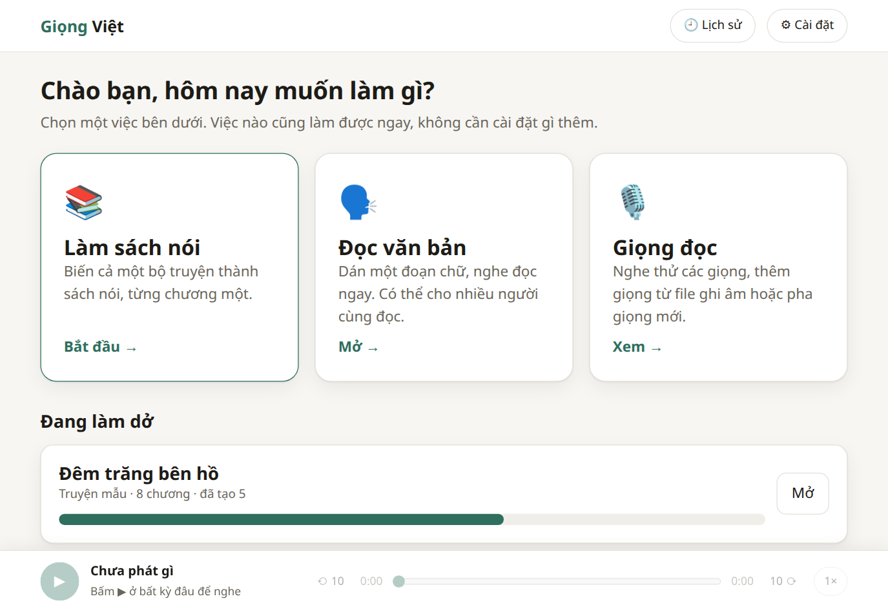
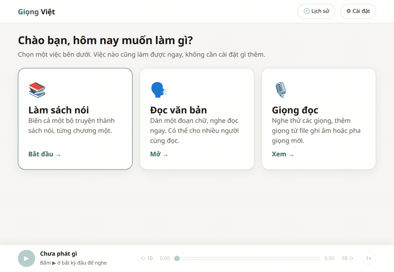
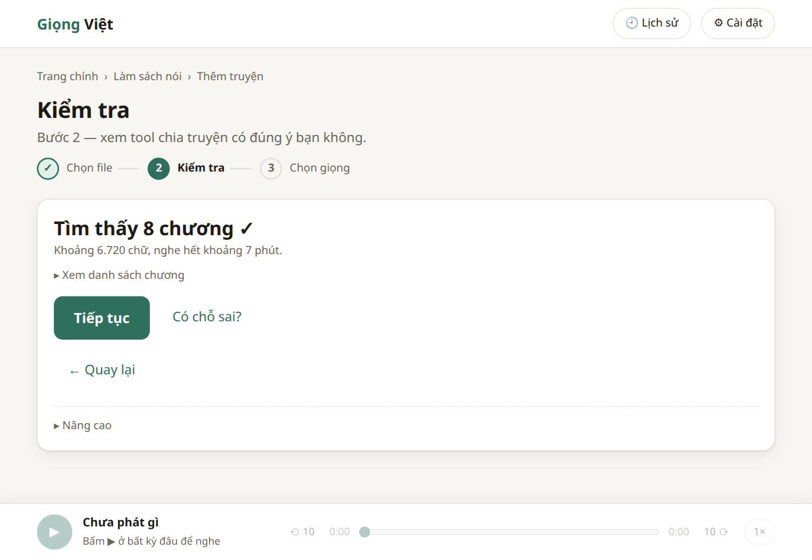
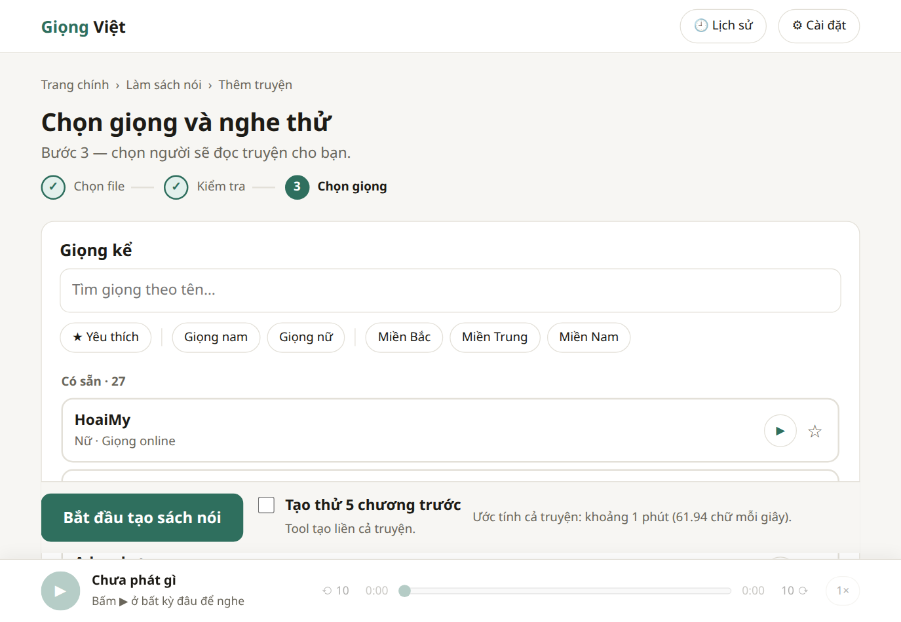
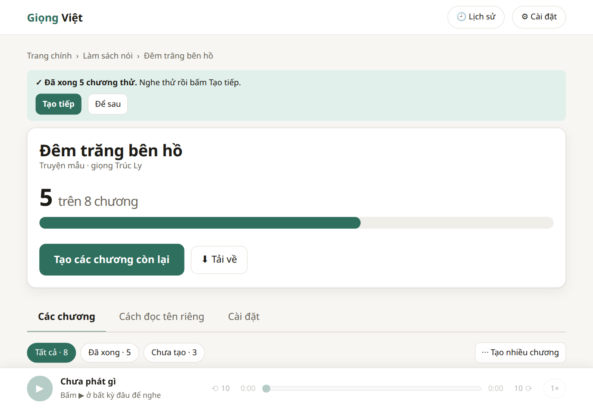
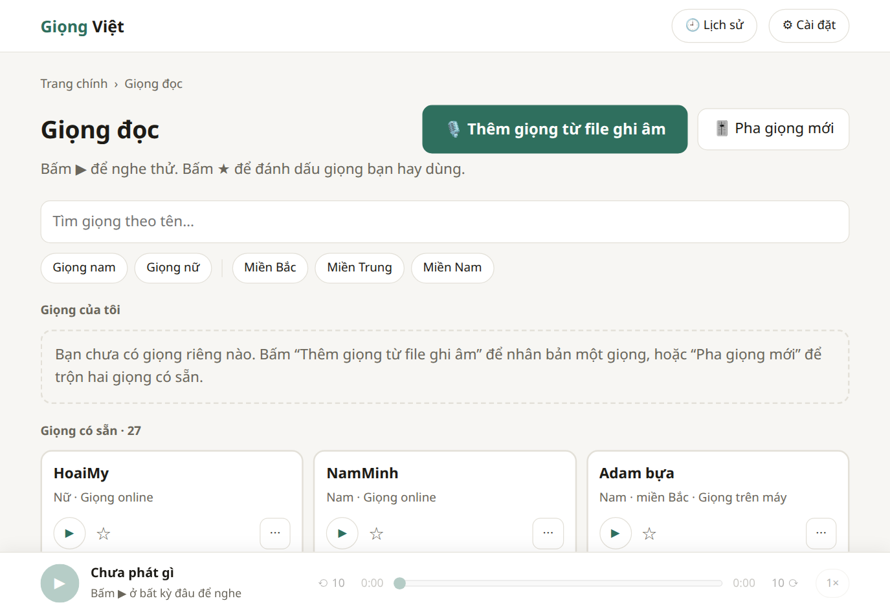

# Giọng Việt — Text to Speech

Web tool chuyển văn bản thành giọng nói tiếng Việt: đọc văn bản, thư viện giọng (nhân bản, yêu thích),
trộn hai giọng thành giọng mới, và hội thoại nhiều người. Chạy trên máy bạn, giao diện web thuần (HTML + CSS + ES module, không cần build).

## Bắt đầu nhanh (5 bước)

Cài một lần theo mục "Cài đặt" bên dưới, rồi:

1. **Mở tool.** Chạy `python server.py` rồi mở http://localhost:8000 (hoặc cài app cửa sổ riêng, mục "App cửa sổ riêng", rồi chạy `giong-viet`). Màn chính có ba thẻ lớn: Làm sách nói, Đọc văn bản, Giọng đọc.

   

2. **Đọc thử một đoạn.** Bấm "Đọc văn bản", dán hoặc gõ vài câu, bấm **Đọc** (hoặc Ctrl + Enter). Nghe ngay ở thanh phát dưới cùng; muốn giữ thì bấm "Tải về". Lần đầu dùng "Giọng trên máy" có thể mất vài phút để tải thêm.

   

3. **Thêm truyện.** Bấm "Làm sách nói" → "Thêm truyện", kéo thả các file (`.txt`, `.epub`, `.html`) vào, bấm Tiếp tục. Tool chia chương và nói rõ chỗ đáng ngờ (thiếu chương, chữ bị che, chương quá ngắn). Đúng ý thì bấm "Đúng rồi, tiếp tục"; chưa đúng thì bấm "Có chỗ sai" để sửa.

   

4. **Tạo thử 5 chương.** Ở bước chọn giọng: chọn giọng, bấm ▶ nghe thử 1 phút đầu chương 1, tick "Tạo thử 5 chương trước", bấm **Bắt đầu tạo sách nói**. Tool tạo 5 chương rồi **dừng**; nghe thử, ưng thì bấm "Tạo tiếp" cho cả truyện (có thể đóng trình duyệt, tool vẫn chạy nền).

   

5. **Tải về.** Ở trang truyện bấm "⬇ Tải về": chọn "Từng chương (MP3)" (file zip) hoặc "Một file nghe trên điện thoại" (.m4b có mục lục).

   

## Giao diện

Không có bước build: HTML + CSS + ES module thuần. Thiết kế nằm ở `docs/ux/` (kiểm kê, sơ đồ điều hướng, bản mẫu `prototype.html`). **Giao diện cũ có ở git tag `ux-3`** (`git checkout ux-3`); từ bản này không còn được phục vụ.

- `static/index.html` + `static/css/{tokens,base,components}.css` + `static/js/` (`app.js`, `router.js`, `player.js`, `errors.js`, `voicepicker.js`, `shortcuts.js`, `views/`…). Màu và cỡ chữ chỉ nằm trong `tokens.css` (sáng / tối theo hệ thống; tương phản chữ đạt WCAG AA, có test).
- Các màn: Màn chính `#/` · Làm sách nói `#/sach`, `#/sach/them`, `#/sach/<id>/kiem-tra`, `#/sach/<id>/giong`, `#/sach/<id>` · Đọc văn bản `#/doc` (gồm "Nhiều người đọc") · Giọng đọc `#/giong`, Pha giọng `#/giong/pha` · Lịch sử và Cài đặt chung (hộp thoại ở thanh trên cùng).
- Chữ trên giao diện là lời thường; thuật ngữ kỹ thuật chỉ nằm trong khối "Nâng cao" (đóng sẵn). Lỗi hiện kèm cách khắc phục, chi tiết gốc ở "Xem chi tiết".
- **Phím tắt:** Ctrl + Enter đọc · Space phát/dừng thanh phát (khi không gõ chữ) · Esc đóng hộp thoại/menu/Lịch sử · `?` mở bảng phím tắt.
- **Làm sách nói:** "Tạo thử 5 chương trước" dừng sau 5 chương rồi hiện banner "Tạo tiếp". Trạng thái nằm ở server: `book.json` có `trial: {limit, done_at}` (ghi khi gọi `POST /api/books/{id}/queue/run` với `{"limit":5,"trial":true}`; `done_at` ghi khi đủ N chương xong; `GET /api/queue?book=` trả `trial`; `PATCH /api/books/{id}` với `{"dismiss_trial":true}` = "Để sau"; chạy tiếp cả truyện thì `trial` bị xoá). Mở truyện ở máy khác vẫn thấy banner. Danh sách chương chia trang 50 dòng (truyện 1.500 chương: mở trang ~0,2 giây).
- **Giọng đọc:** lưới thẻ chia nhóm Yêu thích / Giọng của tôi / Giọng có sẵn; thẻ có ▶, ★, menu ⋯ (Dùng để đọc, Đổi tên, Xoá). "Thêm giọng từ file ghi âm" là hộp thoại 2 bước (chọn file hoặc ghi âm bằng micro → đặt tên + xác nhận quyền dùng giọng; `recorder.js`). "Pha giọng mới": chọn 2 giọng bằng thẻ, kéo thanh, thả tay là tự nghe thử, "Lưu giọng này".
- **Cài đặt chung:** giọng mặc định, giữ máy không ngủ khi đang tạo, báo khi xong (lưu ở server: `notify` trong `data/settings.json`, qua `PUT /api/settings {"notify": false}`; tắt thì cả `notify-send` của server lẫn thông báo của trình duyệt đều im). Khối "Nâng cao" chỉ hiển thị (đặt bằng biến môi trường): chế độ chạy giọng trên máy, độ chính xác, kích thước đoạn, dung lượng bộ nhớ tạm.
- **Dữ liệu ở trình duyệt (`localStorage`):** các khoá còn dùng, đều có tiền tố `gv:` — `engine`, `voice:<loại giọng>`, `voice-last`, `speed`, `playRate`, `mix:auto`. Lúc khởi động giao diện xoá các khoá không còn dùng (`gv:trial5:*`, `engine` / `voice:*` không tiền tố của giao diện cũ).
- API thêm cho giao diện: `GET/PUT /api/settings` (`{default_voice:{engine,voice}|null, notify:bool}`; PUT chỉ đổi trường nào được gửi; lưu ở `data/settings.json`, module `settings.py`; chưa chọn thì dùng giọng ⭐ đầu tiên của giọng trên máy), `GET /api/settings/info` (chỉ đọc: chế độ chạy, độ chính xác, cỡ đoạn, dung lượng bộ nhớ tạm), `GET /api/overview` (chỉ đọc: trạng thái hàng đợi + danh sách truyện + truyện đang tạo, để vẽ thanh trên cùng và màn chính bằng một request).



## Tính năng theo engine

| | **Nhanh** (edge-tts) | **Chất lượng cao** (VieNeu-TTS) |
|---|---|---|
| Chạy ở đâu | Server Microsoft, cần internet | Trên máy bạn (CPU, ONNX), offline |
| Giọng | Hoài My, Nam Minh + giọng đa ngôn ngữ | 25 giọng dựng sẵn (nam/nữ, Bắc/Trung/Nam) |
| Tốc độ 1x / 2x / 3x | Có | Có |
| Cao độ | Có | Không |
| Nhân bản giọng (audio mẫu 3–10 giây) | Không | Có |
| Trộn hai giọng | Không | Có |
| Thẻ cảm xúc `[cười]` `[thở dài]` `[hắng giọng]` | Không (thẻ bị bỏ khi tạo audio) | Có (mode `v3turbo`, mặc định) |
| Chuẩn hoá văn bản (số, ngày, đơn vị…) | Microsoft tự làm | Có (sea-g2p + `text_normalize.py`) |
| Thư viện giọng, hội thoại, lịch sử | Có | Có |
| Đầu ra | MP3 | WAV 48 kHz |

Hội thoại ghép được giọng của cả hai engine; đầu ra luôn là WAV 48 kHz mono (thêm MP3 nếu có `ffmpeg`).

## Cài đặt

Đã chạy thử với Python 3.14 trên Linux. Cần Python 3.10 trở lên; nên dùng venv (xem "Lỗi thường gặp" nếu `pip` báo `externally-managed-environment`).

```bash
cd tts-tool
python3 -m venv .venv
source .venv/bin/activate          # Windows: .venv\Scripts\activate
python -m pip install -r requirements.txt
```

Chỉ cần edge-tts: xoá dòng `vieneu` trong `requirements.txt` trước khi cài; nút "Chất lượng cao" sẽ hiện "chưa cài".
`ffmpeg` là tuỳ chọn: có thì hội thoại xuất thêm MP3 và đọc được thêm định dạng audio mẫu (webm/m4a).

## Chạy

```bash
python server.py        # mở http://localhost:8000
```

Lần đầu dùng VieNeu, model (~1 GB) được tải từ Hugging Face một lần. Muốn có cửa sổ riêng thay vì trình duyệt: mục "App cửa sổ riêng" bên dưới.

## App cửa sổ riêng (`giong-viet`)

Cùng giao diện web, nhưng chạy trong cửa sổ riêng (pywebview + WebKitGTK), không cần mở trình duyệt. Backend `server.py` và giao diện web giữ nguyên; `python server.py` + trình duyệt vẫn chạy được (dùng khi chạy từ xa).

**Phụ thuộc Python:** `requirements.txt` cho server (đủ để chạy `python server.py`); `requirements-app.txt` (`pywebview>=6.2,<7`) là phần **thêm** cho app cửa sổ, cài sau `requirements.txt`. Công cụ dev (ruff) ở `requirements-dev.txt`, cấu hình `ruff.toml`.

**Cài gói hệ thống** (một lần; pip không cài được PyGObject trong `.venv` vì thiếu bản dev của girepository, nên dùng bản của hệ thống, `app_gtk.py` tự tìm):

| Hệ | Lệnh |
|---|---|
| Ubuntu / Debian *(đã thử trên Ubuntu 26.04)* | `sudo apt install python3-gi gir1.2-gtk-3.0 gir1.2-webkit2-4.1 gstreamer1.0-plugins-good libnotify-bin` |
| Fedora *(chưa thử, theo tên gói)* | `sudo dnf install python3-gobject gtk3 webkit2gtk4.1 gstreamer1-plugins-good libnotify` |
| Arch *(chưa thử, theo tên gói)* | `sudo pacman -S python-gobject gtk3 webkit2gtk-4.1 gst-plugins-good libnotify` |

Tuỳ chọn: khay hệ thống cần thêm `gir1.2-ayatanaappindicator3-0.1` (Fedora `libayatana-appindicator-gtk3`, Arch `libayatana-appindicator`) và, trên GNOME, tiện ích AppIndicator (Ubuntu bật sẵn). `gstreamer1.0-plugins-good` cho WAV / FLAC / MP3 trong trình phát. Rồi:

```bash
.venv/bin/python -m pip install -r requirements-app.txt   # pywebview
scripts/install_desktop.sh        # lệnh ~/.local/bin/giong-viet + mục menu + biểu tượng, không cần root
giong-viet                        # hoặc tìm "Giọng Việt" trong menu ứng dụng; chuột phải vào biểu tượng có "Đọc văn bản / Làm sách nói / Giọng đọc"
scripts/uninstall_desktop.sh      # gỡ (thêm --purge để xoá luôn cỡ / vị trí cửa sổ, nhật ký, localStorage của app; data/ không bị đụng)
```

Không cài thì chạy thẳng: `.venv/bin/python app.py [/doc | /sach/them | /giong] [--debug] [--no-tray]`. Đối số `/doc`… mở thẳng tới màn đó (nếu app đang chạy thì đưa nó tới màn đó).

**Hành vi:**
- Khởi động: server (uvicorn) chạy ở luồng nền, cổng trống chỉ nghe `127.0.0.1` (chọn ngẫu nhiên lần đầu rồi nhớ lại để `localStorage` còn giữa các lần mở; cổng bị chiếm thì chọn cổng khác). Cửa sổ hiện ngay với màn chờ "Đang khởi động…" (đo 0,3–0,4 giây từ lúc chạy), nạp giao diện khi `/api/engines` trả 200 (đo 0,6–0,7 giây khi vừa chạy gần đây; lần đầu sau khi bật máy chưa đo, sẽ lâu hơn vì phải nạp thư viện từ đĩa).
- Một bản duy nhất cho mỗi thư mục `data/` (khoá `flock` + socket unix trong `$XDG_RUNTIME_DIR`): mở lần 2 thì đưa cửa sổ đang có lên trước (và tới màn bạn chỉ định) rồi thoát, không có server thứ hai.
- Nhớ cỡ cửa sổ, phóng to, mức chữ (Ctrl + = / − / 0) trong `~/.config/giong-viet/window.json`; vị trí chỉ nhớ được trên X11 (Wayland không cho ứng dụng đặt / đọc vị trí cửa sổ; muốn nhớ vị trí: chạy với `GDK_BACKEND=x11`). Nhật ký: `~/.local/state/giong-viet/app.log`.
- **Đóng cửa sổ khi đang tạo sách nói:** hỏi "Đang tạo “Truyện X”, chương 12/171" với **Chạy nền tiếp** / **Tạm dừng và thoát** / Ở lại. Chạy nền: cửa sổ ẩn, server giữ sống, biểu tượng khay hiện trạng thái và có Mở / Tạm dừng (Tiếp tục) / Thoát; máy không có khay thì thu nhỏ cửa sổ xuống thanh tác vụ. Tạm dừng và thoát: tạm dừng hàng đợi (lần mở sau vẫn đang tạm dừng, chờ bạn bấm Tiếp tục), dừng ở ranh giới đoạn, nhả `systemd-inhibit`. Không có việc gì đang chạy thì đóng cửa sổ là thoát luôn. SIGINT / SIGTERM cũng thoát sạch (hàng đợi giữ nguyên, lần sau tự chạy tiếp).
- **Tải về** (`<a download>`): trong app thay bằng hộp thoại "Lưu thành…" gốc (qua `js_api`; nhớ thư mục lần trước), file từ server được chép thẳng, kết quả đọc trong trình duyệt (blob) được đẩy qua `PUT /_app/save/<mã>`. Trình duyệt thường vẫn dùng `<a download>`. Phát hiện môi trường bằng `window.pywebview` (`static/js/appenv.js`).
- **Kéo thả file:** WebKitGTK không đưa `File` vào trang khi kéo từ ngoài vào, nên app giữ đường dẫn file vừa thả và trang lấy lại qua `GET /_app/drop/<mã>` (một lần, chỉ đúng các file bạn vừa thả; `static/js/dropfiles.js`). Thả trượt ra ngoài vùng thả không làm cửa sổ chuyển sang file đó.
- **Micro:** app tự cho phép micro (chỉ âm thanh) cho trang của chính nó; ghi âm chọn rõ định dạng webm/opus (mặc định của WebKitGTK là mp4/AAC, máy thiếu bộ mã hoá sẽ thu ra file rỗng). Cửa sổ nào không có micro / `MediaRecorder` thì nút "Ghi âm" ẩn đi, chỉ còn "Chọn file ghi âm".
- **Thông báo:** webview không có Notification API nên app dùng `notify-send` của server (cùng công tắc "Báo cho tôi khi tạo xong" trong Cài đặt chung).
- **Bo góc cửa sổ:** GTK3 chỉ bo góc phần decoration (thanh tiêu đề + khung), nội dung WebKit là hình chữ nhật vẽ đè lên nên 2 góc dưới vuông. Cách chạy được (thử theo thứ tự): *A. chỉ CSS GTK* (decoration bo cả 4 góc) **không đủ**, GTK không cắt nội dung con theo góc tròn, đo ra góc dưới vẫn đặc; *B. cửa sổ trong suốt* **chạy được**: `app_gtk.install_corners` đặt nền cửa sổ GTK, ScrolledWindow và WebKitWebView trong suốt rồi trang tự cắt góc dưới bằng `clip-path` (`static/css/app-window.css`, class `app-window` trên `<html>` do app thêm; trình duyệt thường không bị ảnh hưởng). Bán kính lấy từ CSS của GTK theme (Yaru: 15 px; không đọc được thì 15, hoặc ép bằng `GV_CORNER_RADIUS`). Phóng to / toàn màn hình / ghép nửa màn hình (bắt `window-state-event`) thì thêm class `app-square` để không bo. Màn chờ nhúng cùng file CSS. Trong app `<body>` là chỗ cuộn (cần để `clip-path` cắt đúng đáy cửa sổ). Hạn chế đã biết: WebKit vẽ đè lên cả hình chữ nhật của nó nên ở 2 góc dưới (~15 px) không có bóng đổ và viền 1px của GTK, chỗ đó chỉ thấy nền sau lưng cửa sổ. `GV_DEBUG_CORNERS=1` vẽ viền đỏ quanh vùng bo (một vòng của GTK, một vòng trong trang) để chụp màn hình kiểm tra trên máy thật.
- **Phím:** Ctrl + Enter đọc, Space phát / dừng, F5 hoặc Ctrl + R tải lại, Ctrl + = / − / 0 phóng to / thu nhỏ / về mặc định (thêm Ctrl + cuộn chuột), `?` bảng phím tắt. Chuột phải: ô nhập và chữ đang chọn có Cắt / Chép / Dán; chỗ khác không có menu; không có Inspect trừ khi `GV_DEBUG=1` (hoặc `--debug`).
- Kiểm tra: `.venv/bin/python app.py --selftest` (cửa sổ ẩn, dữ liệu và cấu hình tạm) — in PASS / FAIL, không để tiến trình nào sót lại; `scripts/smoke_test.sh` gọi nó (SKIP nếu không có màn hình hay thiếu GTK).

**Vì sao GTK mà không phải Qt** (đo trên Ubuntu 26.04, Python 3.14.4, WebKitGTK 2.52.6 so với PyQt6 6.12 / QtWebEngine 6.14; chạy trong Xvfb nên RAM là khi vẽ bằng phần mềm; mỗi ô là một lần đo, `scripts/webview_probe.py`):

| | **GTK** (WebKitGTK, đã chọn) | Qt (QtWebEngine) |
|---|---|---|
| Cài trong `.venv` Python 3.14 | `pip install pywebview` được (venv 40 MB), nhưng cần gói hệ thống (bảng trên); PyGObject không build được bằng pip | chỉ pip (`pywebview PyQt6 PyQt6-WebEngine`, 13 giây), venv **580 MB**, tự mang theo Chromium riêng |
| Phát WAV / FLAC / MP3 | cả ba chạy (cần `gstreamer1.0-plugins-good`) | cả ba chạy, nhưng `play()` không do người dùng bấm bị chặn trừ khi thêm cờ `--autoplay-policy=no-user-gesture-required` |
| `getUserMedia` | mặc định **bị từ chối** (pywebview/GTK không trả lời permission-request) → app cho phép; `MediaRecorder` mặc định thu **0 byte** (mp4/AAC), chọn webm/opus thì 27 KB / 1,1 giây | chạy sẵn, webm/opus 17 KB / 1,1 giây |
| Kéo thả file vào cửa sổ | sự kiện `drop` tới nhưng `dataTransfer.files` **rỗng** → app có cầu nối (đã thử thả 3 file vào bước chọn file) | `File` có sẵn, đọc đủ 1000 / 1000 byte |
| RAM khi rảnh, trang thật của tool (chỉ phần cửa sổ, server ở tiến trình khác) | **170 MB** (python 72 + WebKitWebProcess 84 + NetworkProcess 15) | **462 MB** (python 312 + 4 tiến trình QtWebEngine 150) |

GTK nhẹ hơn 2,7 lần RAM và 540 MB ổ đĩa, dùng WebKit của hệ thống (được bản phân phối vá lỗi). Đổi lại: phải cài gói hệ thống và có ba chỗ vá (micro, định dạng ghi âm, cầu nối kéo thả; đều nằm trong `app_gtk.py` / `recorder.js` / `dropfiles.js` và có kiểm tra). Qt là phương án dự phòng nếu bản phân phối nào đó không có WebKitGTK 4.1; chưa có mã cho nó trong app này.

**RAM của app đo được** (cả cây tiến trình, PSS): rảnh ở màn chính **250 MB** (python + server 139, WebKit 84 + 19, bộ nạp ảnh SVG 8); riêng `python server.py` rảnh là 67 MB. Đang tạo sách nói với VieNeu đã nạp: **1,37 GB** (tiến trình python 1,24 GB gồm model, WebKit 124 MB).

## Biến môi trường

| Biến | Mặc định | Ý nghĩa |
|---|---|---|
| `PORT` | `8000` | Cổng chạy |
| `TTS_DATA_DIR` | `./data` | Nơi lưu thư viện giọng, lịch sử, dự án, cache |
| `TTS_MAX_CHARS` | `20000` | Độ dài tối đa của văn bản / kịch bản |
| `TTS_CACHE_MB` | `1024` | Giới hạn `data/cache/`; vượt thì xoá dòng ít dùng nhất (khi khởi động và sau mỗi hội thoại). Dòng của job đang sống không bị xoá; nếu chỉ riêng chúng đã vượt giới hạn thì server log cảnh báo |
| `VIENEU_MODE` | `v3turbo` | `v3nano` cho máy yếu (nhanh hơn, chất lượng thấp hơn, không có thẻ cảm xúc) |
| `VIENEU_PRECISION` | tự chọn | `fp32` hoặc `int8`. Không đặt thì tự chọn: `int8` nếu `/proc/cpuinfo` có `avx_vnni` hoặc `avx512_vnni`, không thì `fp32` (int8 không có VNNI sẽ méo tiếng). Đang dùng precision nào hiện ở header UI ("VieNeu · int8") và trong `GET /api/engines` (`precision`). Nằm trong khoá cache (`v3turbo-int8`), nên audio fp32 và int8 không dùng chung cache; đổi precision làm chương sách nói đã tạo thành "lỗi thời". Giọng nhân bản và giọng trộn (`emb.<mode>.npz`) **không** phụ thuộc precision, không cần tạo lại khi đổi (xem `scripts/bench_vieneu.py`) |
| `BOOK_SEGMENT_CHARS` | `800` | Kích thước đoạn của hàng đợi sách nói (đơn vị lưu, tạm dừng, tiếp tục). Nhỏ hơn thì tạm dừng nhanh hơn nhưng nhiều mối nối hơn |

## Dữ liệu trong `data/`

`voices/<id>/` (giọng nhân bản và giọng trộn), `favorites.json`, `history/` (50 bản gần nhất), `projects/`, `cache/`, `lexicon.json` (từ điển toàn cục), `books/<id>/` (`book.json`, `source/`, `chapters/`, `audio/<nnnn>.flac`, `export/`), `queue.json` (hàng đợi bền), `settings.json` (giọng mặc định), `bench.json` (số đo của `scripts/bench_vieneu.py`).
File cấu hình sửa được, nằm trong repo: `config/name_stopwords.txt` (từ dừng của gợi ý tên riêng), `config/speech_verbs.txt` (động từ nói nhận ra phần dẫn viết hoa sau gạch thoại).
Thư mục này không nằm trong git. Không chạy hai server cùng lúc trên một `data/` (khoá ghi chỉ có trong một tiến trình).

## Sự đồng ý của chủ giọng khi nhân bản

Thêm giọng vào thư viện bắt buộc tick xác nhận bạn là chủ giọng nói hoặc đã được người đó đồng ý
(API: `consent=true`). Chỉ giọng có xác nhận này mới trộn được; giọng trộn từ giọng trộn được kiểm tra theo chuỗi giọng nguồn.
Đừng nhân bản giọng người khác khi chưa được phép.

## API

Mọi lỗi trả `{"error": "..."}` kèm mã HTTP tương ứng.

| | |
|---|---|
| `GET /api/overview` | Chỉ đọc, gộp cho màn chính: `queue` (trạng thái hàng đợi), `books` (kèm `done`, `queued`, `running`), `current` (truyện đang tạo + `estimate_seconds`, hoặc `null`) |
| `GET /api/engines` | Engine, trạng thái và `capabilities` (`clone`, `pitch`, `emotion_tags`, `mix`, `normalize`) |
| `GET /api/voices[?engine=]`, `GET /api/voices/{engine}` | Giọng (preset + thư viện) kèm `source` (`preset`/`clone`/`mix`), `favorite`, `usable` |
| `POST /api/tts` | `text`, `engine`, `voice`, `speed` (−50…200 %), `pitch`, `normalize`, `ref_audio`, `save_as` + `consent` |
| `GET/POST /api/library`, `PATCH/DELETE /api/library/{id}`, `GET /api/library/{id}/preview` | Thư viện giọng; giọng `lib:<id>` dùng được ở trường `voice` |
| `POST /api/favorites` | `engine`, `voice`, `favorite` |
| `POST /api/mix`, `POST /api/mix/save` | `voice_a`, `voice_b`, `slider` 0…1 (1 = giọng A), `text`; lưu thêm `name`, `tags`, `gender`, `region`, `description` |
| `POST /api/dialogue/parse`, `POST /api/dialogue` | Kịch bản `[Tên]: lời`; tạo job (`script`, `cast`, `speed`, `gap_ms`, `paragraph_gap_ms`, `normalize`) |
| `GET /api/dialogue/{job}`, `…/audio[?fmt=mp3]`, `…/line/{i}/audio`, `POST …/line/{i}` | Tiến độ (polling), audio tổng, audio từng dòng, sinh lại một dòng (`{"seed": n}` tuỳ chọn) |
| `GET/POST /api/projects`, `GET/DELETE /api/projects/{id}` | Dự án hội thoại |
| `GET /api/history[?kind=tts\|dialogue]`, `GET …/{id}/audio`, `DELETE /api/history[/{id}]` | Lịch sử |

Ví dụ:

```bash
curl -X POST http://localhost:8000/api/tts \
  -F text="Xin chào" -F engine=edge -F voice=vi-VN-HoaiMyNeural -F speed=0 -o out.mp3
```

Header `X-TTS-Warning` (nếu có) chỉ chứa được latin-1 nên giá trị được mã hoá phần trăm UTF-8; client phải `decodeURIComponent` / `urllib.parse.unquote` để đọc.
Khi edge-tts từ chối tổ hợp tốc độ + cao độ, server đọc lại không có cao độ và gửi cảnh báo qua header này.

## Trộn giọng

Tab **Tạo giọng mới** trộn hai giọng (preset hoặc thư viện) bằng speaker embedding 192 chiều của VieNeu:
`emb = slerp(â, b̂, α) · (α·|a| + (1−α)·|b|)` (nội suy hướng bằng slerp, nội suy độ dài tuyến tính).
`codes` lấy theo giọng có trọng số lớn hơn; hoà thì lấy giọng có norm lớn hơn. Thanh trượt 0…1 được đổi sang `α` bằng bảng đo
`SLIDER_KNOTS` / `ALPHA_KNOTS` trong `engines/vieneu.py`; `meta.json` lưu cả `slider` lẫn `alpha`.

Giới hạn: chỉ VieNeu hỗ trợ trộn giọng. Giọng trộn lưu embedding theo `VIENEU_MODE` lúc tạo (không có `ref.wav`);
đổi mode thì giọng đó vẫn hiện nhưng bị làm mờ ("tạo ở mode x", `usable:false`). Bản đồ slider→α đo trên 2 cặp giọng nên
từng cặp có thể lệch khoảng ±0.2 so với tuyến tính lý tưởng. Thí nghiệm gốc: `scripts/mix_experiment.py` → `out/mix/`.

## Dàn giọng nhân vật (giọng lời thoại theo vai)

Thẻ **Dàn giọng** trong trang truyện: mỗi nhân vật hay mỗi loại người (nam chính, nam thanh niên, nam trung niên, lão ông, thiếu nữ, nữ trung niên, lão bà…) một giọng; lời dẫn truyện vẫn do giọng kể của truyện đọc. "Dùng mẫu 7 vai" điền sẵn 7 vai với từ khoá thường gặp và mỗi vai một giọng trên máy đúng giới tính; bạn thêm tên nhân vật vào từng vai, nghe thử rồi lưu. "Kiểm tra trên 5 chương đầu" cho biết mỗi vai có bao nhiêu câu thoại, kèm ví dụ và phần dẫn đã dùng để đoán, và những câu chưa nhận ra vai.

- **Cách đoán người nói** (`cast.py`, thuần quy tắc, chạy offline): với mỗi câu thoại, xét phần dẫn kề nó trong cùng dòng, mỗi bên chỉ một câu của phần dẫn (bên trước: sau dấu kết câu cuối; bên sau: tới dấu kết câu đầu). Cả hai bên đều khớp thì lấy bên trước nếu nó kết thúc bằng `:` hoặc `,`, ngược lại lấy bên sau. Một phần dẫn khớp nhiều vai: tên nhân vật thắng từ khoá, cụm dài thắng cụm ngắn. Từ điển phát âm áp dụng trước (viết tên theo đúng chữ sau khi thay).
- **Câu không nhận ra vai** (dòng thoại không có phần dẫn như `– Ra ngoài trấn.`) dùng giọng lời thoại chung của truyện nếu bật, không thì giọng kể. Tool **không** nhớ người nói giữa các dòng (đoán sai khi hai người đối đáp luân phiên còn tệ hơn đọc bằng giọng chung).
- **Vai có nhiều giọng** (tối đa 4, ví dụ thiếu nữ hai giọng): mỗi *tên nhân vật* cố định một giọng, xoay vòng theo thứ tự tên trong danh sách; khớp bằng từ khoá thì dùng giọng đầu. Muốn các cô gái khác nhau nghe khác nhau thì liệt kê tên từng người.
- Đổi vai, tên, từ khoá hay giọng của vai → chương đã tạo thành "cần tạo lại" (chữ ký chứa cả dàn giọng). Giọng của vai, giọng lời thoại chung và giọng kể độc lập nhau.
- **API** (thêm, không đổi API cũ): `PATCH /api/books/{id}` nhận `cast: {enabled, roles: [{id?, name, voices: [{engine, voice}] (1–4), names: [], keywords: []}]}` (tối đa 20 vai; 400 nếu sai cấu trúc, 404 nếu giọng thư viện không còn); `POST /api/books/{id}/cast/preview` body `{cast?, chapters?}` (không gửi `cast` = bản đã lưu, `chapters` mặc định 5 chương đầu, tối đa 30) → `{chapters, roles: [{id, name, lines, samples: [{chapter, text, tag}]}], unmatched, dialogue_lines}`; không tạo audio.
- **Chưa có** (phase sau): nhãn độ tuổi cho giọng có sẵn để gợi ý lão ông / lão bà / giọng trẻ; hiện giọng có sẵn chỉ có giới tính, vùng miền, phong cách, nên giọng già thật sự bạn tạo từ file ghi âm hoặc pha giọng (màn Giọng đọc) rồi gán cho vai.

## Hội thoại

```
[Lan]: Chào anh, hôm nay anh khoẻ không?
[Minh]: Anh khoẻ, cảm ơn em [cười].

[Lan]: Vậy thì tốt quá.
```

- Chỉ nhận `[Tên]: lời` (tên so khớp sau strip + chuẩn hoá Unicode NFC, phân biệt hoa thường). Dòng không có thẻ thuộc người nói trước; dòng trống nghỉ dài hơn (`paragraph_gap_ms`).
- Thẻ cảm xúc được chuyển cho engine hỗ trợ; engine không hỗ trợ (edge) thì thẻ bị bỏ, UI hiện ⚠ ở dòng đó.
- **Thẻ nghỉ có độ dài** `[nghỉ 0.5s]`, `[nghỉ 2s]`, `[nghỉ 1,5s]` (0.1–5 giây, dùng được với mọi engine, trong tab Đọc và trong từng dòng hội thoại): server tách văn bản tại thẻ, sinh từng đoạn bằng engine đang chọn, rồi chèn đúng khoảng lặng và ghép bằng cùng pipeline của hội thoại (decode, resample 48 kHz, cắt lặng, chuẩn hoá âm lượng, cache từng đoạn). Văn bản có thẻ nghỉ trả WAV 48 kHz (kèm MP3 trong lịch sử nếu có `ffmpeg`), kể cả với edge; văn bản không có thẻ nghỉ giữ đường cũ. Thẻ ngoài 0.1–5 giây bị từ chối (400).
- Thanh nút trên ô văn bản/kịch bản: "Nghỉ…" (nhập số giây rồi chèn thẻ nghỉ), "Ngắt nhẹ" (chèn `, `, gần như không thêm khoảng lặng) và "Xuống đoạn" (tab Đọc: xuống dòng, VieNeu tách thành đoạn mới nên nghỉ ≥ 0,7 s; tab Hội thoại: dòng trống, nghỉ `paragraph_gap_ms`).
- Mỗi dòng được cắt lặng hai đầu và chuẩn hoá về cùng mức âm lượng (RMS 0.12, đỉnh ≤ 0.95); MP3 của edge được decode và resample lên 48 kHz.
- Dòng VieNeu chạy tuần tự, dòng edge chạy song song tối đa 4 (edge-tts lỗi "No audio received" được thử lại).
- Cache từng dòng trong `data/cache/<hash>.wav`; khoá gồm engine, giọng, lời, tốc độ, mode, và (giọng mix) variant + alpha. Sửa một dòng thì chỉ dòng đó được sinh lại.
- Sinh lại một dòng bỏ qua cache và tạo take mới (VieNeu tái lập được bằng `seed`); take mới thay take cũ trong cache.
- Giới hạn: 300 dòng và `TTS_MAX_CHARS` ký tự mỗi kịch bản. Job nằm trong bộ nhớ và bị dọn sau 1 giờ.

## Chuẩn hoá văn bản

VieNeu (sea-g2p) đã tự đọc đúng ngày giờ, %, số thập phân, tiền VNĐ/€, đơn vị (km, kg, MB, °C…), số điện thoại, viết tắt (TP.HCM, UBND, v.v.).
`text_normalize.py` chỉ bù các trường hợp sea-g2p đọc sai (tìm bằng `scripts/normalize_probe.py`): `50k` → "năm mươi nghìn",
`1.5 triệu` → "một phẩy năm triệu", `TP. Hồ Chí Minh` (dư dấu chấm), `km²`/`m³` → "mét vuông"/"mét khối", `$100`/`100$`/`USD` → "đô la".
Bật/tắt bằng ô "Chuẩn hoá văn bản" (mặc định bật; chỉ áp dụng cho VieNeu).

## Sách nói (nhập, tách chương, làm sạch, từ điển, giọng lời thoại)

Tab **Sách nói** nhập truyện dài, tách chương, làm sạch văn bản. Mỗi truyện nằm trong `data/books/<id>/` (`book.json`, `source/` giữ file gốc, `chapters/<nnnn>.txt` + `.json`). Sau khi tách chương: nghe thử (▶, "Đọc thử 1 phút"), tạo audio hàng loạt bằng hàng đợi nền và xuất MP3 / m4b (xem "Tạo audio hàng loạt" bên dưới).

- **Nhập HTML** (`html_import.py`; chỉ file có sẵn trên máy, không tải từ URL): `.html` / `.htm` (nhiều file cùng lúc) hoặc một `.zip` chứa các file html (bỏ file khác, thư mục ẩn, `__MACOSX`). Nhiều file hoặc có html thì tự vào chế độ "mỗi file một chương".
  - **Tiêu đề** lấy từ `<title>`: bỏ tên trang, bỏ "Chương N:" bị lặp, phần IN HOA thành chữ thường. **Thứ tự** theo số chương trong tiêu đề, không có thì theo số cuối trong tên file (1, 2, 10 — không theo bảng chữ cái). Báo chương **trùng số** và **thiếu** (có 1, 2, 4 → "Thiếu chương: 3"), cũng báo file không thấy khung chương hoặc quá ngắn.
  - **Nội dung** lấy từ khung chương (mặc định `#chapter-c`; chỉnh được trong phần "Tách chương": `#id`, `.class`, `tag` hoặc `tag#id.class`) **đến hết trang**, vì HTML lỗi có thể đẩy đoạn văn ra ngoài khung. Bỏ script, style, khối quảng cáo. Không thấy khung thì lấy cả `<body>` và cảnh báo.
  - **Ba quy tắc làm sạch mới** (bật/tắt riêng, có số dòng + nút "Xem"): *Khôi phục từ bị che (\*)* theo `data/masked_words.json` (khởi tạo từ `scripts/masked_words.txt`; màn xem trước liệt kê từ còn bị che chưa có trong từ điển, nhập "từ đúng là…" rồi Lưu để thêm và áp dụng lại ngay; từ đúng phải khớp từ bị che: cùng số chữ, chữ không bị che giống nhau); *Ghép số bị tách* (`2. 513` → `2.513`); *Bỏ dòng trống thừa* (mỗi dòng là một đoạn văn). Dòng ngăn cảnh (`====`, `--- oOo ---`…) dùng quy tắc `[nghỉ Ns]` có sẵn; ngăn cảnh ở đầu / cuối chương bị bỏ.
  - **Lỗi chính tả của người dịch không được tự sửa**: thêm vào Từ điển phát âm của truyện.
  - `scripts/clean_html.py` vẫn chạy độc lập (`python scripts/clean_html.py chuong*.html -o truyen.txt`), dùng chung code với `html_import.py`. Fixture thử: `tests/fixtures/chapter_sample.html` ↔ `scripts/vi-du-chuong-1.txt`.
- **Nhập:** `.txt` (tự dò UTF-8 / UTF-16 / GB18030 / Windows-1258) và `.epub` (đọc bằng thư viện chuẩn `zipfile` + `xml.etree`, không thêm phụ thuộc). Nhiều file `.txt` thì mỗi file một chương, sắp theo số trong tên.
- **Tách chương:** regex mặc định nhận `Chương 12`, `Chương 12:`, `Chương XII`, `第12章`, `Quyển 2 Chương 5` (sửa được). Có màn hình xem trước (số chương, tiêu đề, số ký tự); gộp với chương sau hoặc tách tại dòng chứa một đoạn văn bản. Chỉ khi bấm "Xác nhận" mới ghi `chapters/`.
- **Làm sạch** (bật/tắt từng quy tắc, lưu theo truyện): bỏ ký tự điều khiển, chuẩn hoá ngoặc kép và dấu ba chấm, bỏ dòng URL, dòng "nguồn:" / "truyện được dịch bởi", dòng trùng, gộp dòng bị ngắt giữa câu; dòng chỉ gồm dấu ngăn cảnh (`***`, `* * *`, `---`, `~~~`, `ooo`, `♦`…) thành `[nghỉ 1.5s]` (chỉnh số giây trong cài đặt). Thêm được quy tắc tuỳ chỉnh regex → thay thế.
- **Tiêu đề chương** được đọc ở đầu mỗi chương (tắt được trong cài đặt truyện).
- **Tác động từng quy tắc:** màn xem trước hiện số dòng bị ảnh hưởng của mỗi quy tắc; nút "Xem" liệt kê tối đa 50 dòng (bị xoá: nội dung gốc + chương; bị gộp: 2 dòng trước và 1 dòng sau). "Giữ dòng này" thêm `{rule, line}` vào `exceptions` của truyện, quy tắc đó không áp dụng cho dòng ấy nữa (xem trước tính lại ngay, lưu khi bấm "Xác nhận" hoặc "Lưu cài đặt"). Ngoại lệ khớp theo nội dung dòng (đã `strip`), không theo vị trí.
- **Từ điển phát âm** (`lexicon.py`; toàn cục `data/lexicon.json` + riêng từng truyện, truyện ưu tiên): mỗi mục `{match, replace, pause_before, pause_after, whole_word, case_sensitive}`. "Đọc thành" thay chữ; "nghỉ trước/sau" chèn `[nghỉ Ns]` quanh cụm. Áp dụng một lượt, TRƯỚC chuẩn hoá. Gạch nối (`Đấu-Khí`) không có tác dụng với VieNeu (sea-g2p đổi gạch nối thành khoảng trắng, audio giống hệt); xem `scripts/lexicon_probe.py`.
- **Gợi ý tên riêng:** cụm viết hoa 2–4 tiếng KHÔNG đứng đầu câu (sau `. ! ? : …`, dấu ngoặc kép, gạch thoại, đầu dòng), lặp ≥ N lần. Từ dừng (Anh, Hắn, Nhưng…) nằm trong `config/name_stopwords.txt`, sửa được, không cần khởi động lại. Có câu ví dụ, "Nghe thử" và "Thêm vào từ điển". Tiếng đơn (vd. `Viêm`) chỉ được gợi ý nếu là thành phần của một cụm đã gợi ý (`Tiêu Viêm`) và đứng riêng, không ở đầu câu, ≥ 5 lần; hiện thụt vào dưới cụm cha.
- **Giọng thứ hai cho lời thoại** (`narrate.py`, tuỳ chọn trong cài đặt truyện): nhận (a) đoạn trong ngoặc kép `“…”` / `"…"` và (b) dòng bắt đầu bằng gạch thoại `–`, `—` hoặc `- `. Với (b), phần dẫn (`– Đi đâu? – hắn hỏi.`) về giọng kể; phần dẫn được nhận ra nhờ chữ thường sau gạch, hoặc nếu viết hoa thì phải ngắn (≤ 60 ký tự) và có một động từ nói trong 4 tiếng đầu (`config/speech_verbs.txt`: hỏi, nói, đáp, quát, cười, thì thầm…), nên `– Đi đâu? – Hắn hỏi.` tách đúng nhưng `– Em yêu anh. – Anh cười với em.` bị coi là phần dẫn (có động từ "cười") dù là câu thoại. Ngoặc kép bao một thuật ngữ ngắn không dấu câu (`"Đấu Khí"`) vẫn do giọng kể đọc.
- **Đọc thử 1 phút:** nút ở mỗi chương (đầu chương hoặc giữa chương), ~900 ký tự, dùng giọng + từ điển + giọng lời thoại hiện tại. Chạy qua hàng đợi với ưu tiên cao nhất (chen vào giữa hai mảnh của chương đang tạo), có thanh tiến độ. ▶ (~300 ký tự) vẫn chạy ngay.

### Tạo audio hàng loạt (hàng đợi nền)

Nút **Chạy tất cả**, **Chạy thử 5 chương đầu**, **Chạy khoảng** và **Tạo**/**Tạo lại** từng chương xếp chương vào hàng đợi (`data/queue.json`). Một worker nền chạy lần lượt từng chương:

- **Đơn vị:** chương → đoạn ≤ `BOOK_SEGMENT_CHARS` (800 ký tự) → mảnh ≤ 256 ký tự mỗi lần gọi model (VieNeu tự chia chunk ở 256). Đoạn chỉ cắt ở ranh giới đoạn văn (xuống dòng); một đoạn văn dài hơn giới hạn mới bị cắt, ở ranh giới câu.
- **Khoảng nghỉ:** giữa hai đoạn văn `paragraph_pause_s` (mặc định 0,6 giây) và sau tiêu đề chương `title_pause_s` (1,2 giây), chỉnh trong cài đặt truyện (0 = không nghỉ). Áp dụng cả ở mối nối giữa hai đoạn cắt, không áp dụng giữa hai mảnh của một đoạn văn dài bị cắt. Dòng dấu ngăn cảnh (`[nghỉ 1.5s]`) thay khoảng nghỉ đoạn văn chứ không cộng thêm. `scripts/measure_pauses.py` đo khoảng lặng thật ở từng chỗ. Mỗi đoạn dựng xong được ghi ngay vào `audio/<nnnn>.parts/`; chương xong thì ghép thành `audio/<nnnn>.flac` (lossless 48 kHz mono, nguồn cho MP3/m4b) và xoá `.parts`. Đổi giọng / tốc độ / từ điển / chuẩn hoá / đọc tiêu đề / các mức nghỉ / precision thì đoạn cũ không còn khớp (hash) và chương đã xong bị đánh dấu "cài đặt đã đổi, nên tạo lại".
- **Bền:** tắt server hoặc server chết (kể cả `kill -9`), khởi động lại sẽ tự chạy tiếp; chỉ đoạn đang chạy dở được dựng lại. **Tạm dừng** và **Huỷ** chỉ có hiệu lực ở ranh giới đoạn (đoạn đang chạy được dựng xong, không cắt giữa chừng). Ctrl+C chờ nốt mảnh đang chạy (vài giây) rồi dừng sạch.
- **Ưu tiên:** "Đọc thử" > request tương tác (▶, tab Đọc…) > chương trong hàng đợi. Khoá model dùng chung: việc tương tác chờ tối đa một mảnh (~10 giây), không phải chờ cả đoạn. Mở / nghe / xem một chương đang chờ thì chương đó lên đầu hàng.
- **Ước tính:** "Ước tính: X giờ cho N chương còn lại" dùng tốc độ đo thực tế của các đoạn vừa chạy; chưa có thì dùng số đo của `scripts/bench_vieneu.py` (precision đang dùng); chưa có cả hai thì báo chưa đo.
- **Chống ngủ máy (Linux):** khi worker đang chạy, giữ `systemd-inhibit --what=sleep:idle` bằng một tiến trình con tự thoát khi server chết. Không có `systemd-inhibit` thì bỏ qua (ghi log). Có ô tick để tắt.
- **Thông báo khi xong:** Notification API của trình duyệt (xin quyền khi bấm Chạy; tab phải còn mở) và `notify-send` của server nếu máy có (bật / tắt chung bằng `settings.notify`; tạo thử N chương xong thì nội dung nhắc "Nghe thử rồi bấm Tạo tiếp").
- **3 chương lỗi liên tiếp** thì hàng đợi tự tạm dừng (kèm thông báo) để không chạy hết cả truyện trong lỗi.
- **Dung lượng:** mỗi truyện hiện dung lượng đã dùng (danh sách và bảng chương: audio gốc, file xuất, nguồn + văn bản). FLAC gốc khoảng 33 KB/giây audio (~120 MB/giờ). Nút **Xoá nguồn FLAC của chương đã xuất** (có xác nhận) xoá FLAC của các chương đã xuất MP3 hoặc m4b ít nhất một lần; chương chuyển sang "đã xuất": không nghe lại / xuất lại được cho tới khi **Tạo lại**. File zip / m4b đã xuất không bị xoá.
- **Xuất:** MP3 từng chương (mono 64 / 80 / 96 kbps, ID3: tên chương, số thứ tự, album, tác giả) đóng zip, hoặc một file `.m4b` (AAC 64 kbps) có đánh dấu chương. Chỉ xuất chương đã xong. File nằm trong `data/books/<id>/export/`.
- API: `GET /api/queue[?book=]`, `POST /api/books/{id}/queue/run` (`chapters`, `limit`, `regenerate`, `stale_only`), `POST /api/books/{id}/queue/focus`, `POST /api/queue/{pause,resume,cancel,settings}`, `POST /api/books/{id}/chapters/{n}/trial` + `GET /api/trials/{id}[/audio]`, `GET …/chapters/{n}/audio.mp3`, `POST /api/books/{id}/export` + `GET /api/exports/{id}` + `GET /api/books/{id}/export/{file}`, `GET /api/books/{id}/disk`, `POST /api/books/{id}/audio/purge-exported`.
- API: `GET/POST /api/books`, `POST /api/books/import`, `GET/PATCH/DELETE /api/books/{id}`, `POST …/preview`, `POST …/chapters` (xác nhận), `GET …/chapters[/{n}[/sample?use_lexicon=]]`, `POST …/speak`, `POST …/lexicon/apply`, `GET …/suggest`, `GET/PUT /api/lexicon`. `preview`/`chapters` nhận thêm `exceptions`; `PATCH` nhận `exceptions`, `lexicon`, `dialogue_voice`.

## Kiểm tra nhanh

```bash
scripts/smoke_test.sh            # khởi động server với data tạm, chạy các luồng chính, in PASS/FAIL, tự dọn
SKIP_EDGE=1 scripts/smoke_test.sh   # bỏ các bước cần mạng
```
`scripts/smoke_ui.py` (do `smoke_test.sh` gọi; cần Chrome/Chromium, không có thì bỏ qua) mở giao diện trong Chrome headless: mọi route ở 390 / 768 / 1280 px không lỗi JS, không tràn ngang, nút biểu tượng có nhãn, không có từ kỹ thuật ngoài "Nâng cao", luồng bước 3 → tạo thử 5 chương. `app.py --selftest` (cùng được gọi) kiểm app cửa sổ riêng: server, giao diện dựng xong trong WebKitGTK, mở lần 2, tải về, kéo thả, micro, hộp hỏi khi đóng lúc đang tạo, thoát sạch không sót tiến trình. Test JS thuần chạy bằng `node tests/js/*.test.mjs`. `scripts/smoke_books.py` (do `smoke_test.sh` gọi) kiểm riêng phần sách nói; `scripts/smoke_queue.py` (cũng do `smoke_test.sh` gọi, `SKIP_QUEUE=1` để bỏ, ~3 phút) tự chạy server riêng để `kill -9` / SIGINT giữa chừng, khởi động lại và xuất MP3 + m4b. `scripts/bench_vieneu.py` đo tốc độ fp32 và int8. `scripts/measure_pauses.py` đo khoảng lặng xuống đoạn / sau tiêu đề trong audio chương thật (chạy VieNeu ~45 giây; cũng nằm trong bước hàng đợi của `smoke_test.sh`). `scripts/perf_books.py` đo hiệu năng với truyện giả 20 MB / 1.500 chương.

## Thêm engine mới

Tạo `engines/<ten>.py` chứa lớp kế thừa `engines.base.Engine`, rồi thêm một dòng `"engines.<ten>:<Lop>"` vào `PLUGINS` trong `engines/registry.py`.
Engine chưa cài vẫn hiện trên UI với nhãn "chưa cài"; plugin lỗi khi import bị bỏ qua.

## Lỗi thường gặp

- **`pip install` báo `externally-managed-environment`** (Debian/Ubuntu, Python do hệ điều hành quản lý): dùng venv như ở mục Cài đặt
  (`python3 -m venv .venv && source .venv/bin/activate`), đừng dùng `--break-system-packages`. Thiếu module venv: `sudo apt install python3-venv`.
- **VieNeu báo `External data path escapes model directory`:** cache Hugging Face lưu file model bằng symlink mà onnxruntime từ chối.
  Server tự thay symlink bằng bản sao thật rồi nạp lại (tốn thêm khoảng 1 GB ổ đĩa).
- **edge-tts báo `No audio was received`:** dịch vụ Microsoft thỉnh thoảng từ chối một câu hoặc một tổ hợp tham số rồi lại nhận ở lần sau.
  Server tự thử lại tối đa 2 lần; tổ hợp tốc độ + cao độ bị từ chối thì đọc lại không cao độ. Vẫn lỗi: kiểm tra mạng hoặc thử câu ngắn hơn.
- **Giọng trộn bị mờ "tạo ở mode …":** đặt lại `VIENEU_MODE` như lúc tạo giọng đó.

## Giấy phép

- **VieNeu-TTS:** Apache 2.0.
- **edge-tts** (thư viện LGPLv3) gọi API đọc văn bản của Microsoft Edge, là **API không chính thức**: có thể ngừng hoạt động hoặc đổi điều khoản bất cứ lúc nào; dùng cho mục đích cá nhân, không nên phụ thuộc vào nó cho sản phẩm thương mại.
