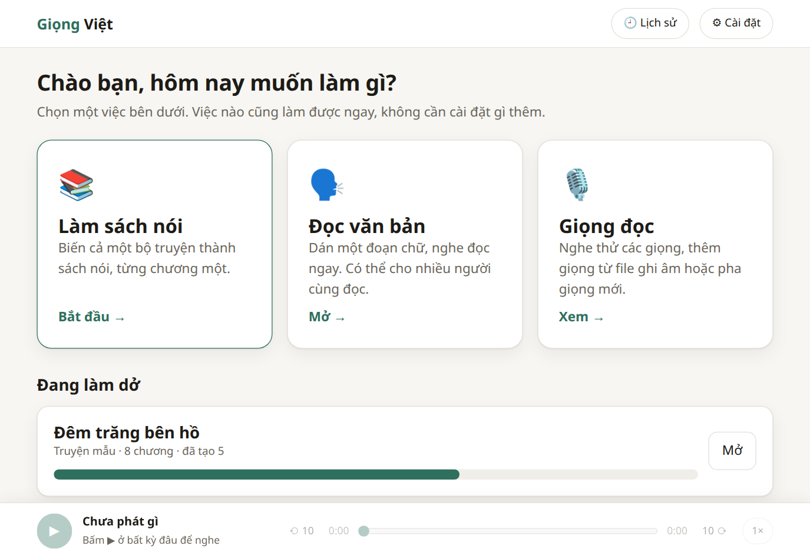
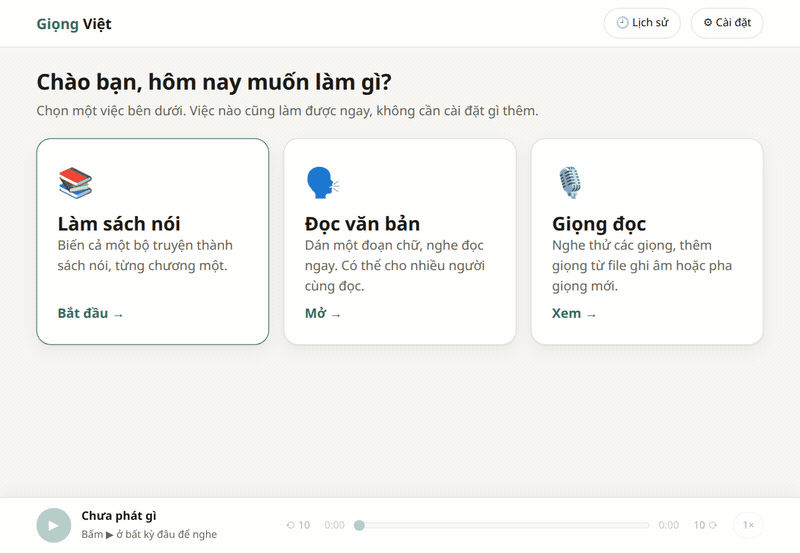
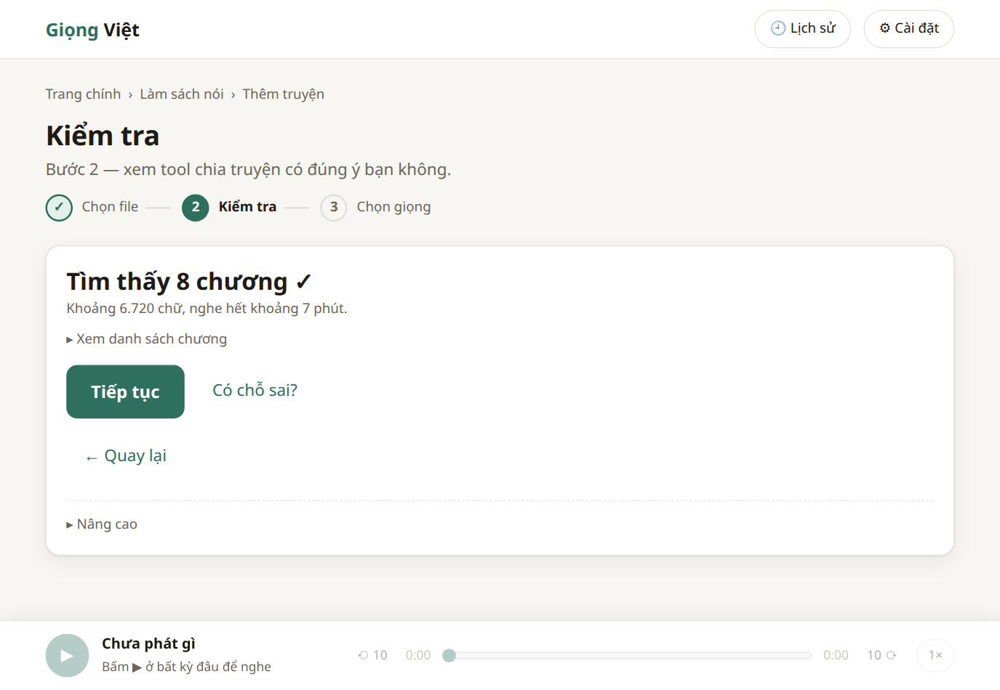
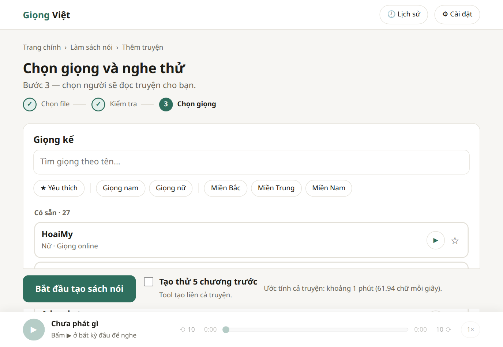
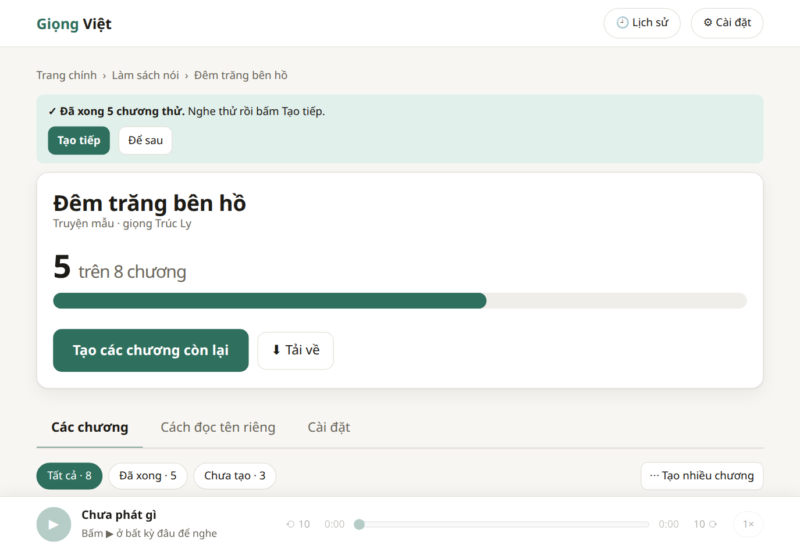
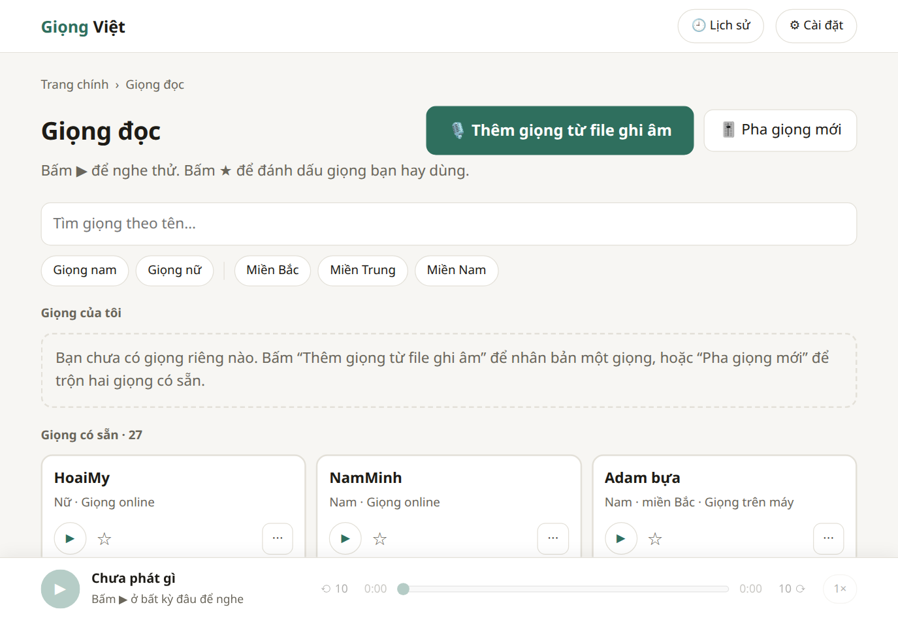

This file is a merged representation of the entire codebase, combined into a single document by Repomix.

# File Summary

## Purpose
This file contains a packed representation of the entire repository's contents.
It is designed to be easily consumable by AI systems for analysis, code review,
or other automated processes.

## File Format
The content is organized as follows:
1. This summary section
2. Repository information
3. Directory structure
4. Repository files (if enabled)
5. Multiple file entries, each consisting of:
  a. A header with the file path (## File: path/to/file)
  b. The full contents of the file in a code block

## Usage Guidelines
- This file should be treated as read-only. Any changes should be made to the
  original repository files, not this packed version.
- When processing this file, use the file path to distinguish
  between different files in the repository.
- Be aware that this file may contain sensitive information. Handle it with
  the same level of security as you would the original repository.

## Notes
- Some files may have been excluded based on .gitignore rules and Repomix's configuration
- Binary files are not included in this packed representation. Please refer to the Repository Structure section for a complete list of file paths, including binary files
- Files matching patterns in .gitignore are excluded
- Files matching default ignore patterns are excluded
- Files are sorted by Git change count (files with more changes are at the bottom)

# Directory Structure
```
config/
  name_stopwords.txt
  speech_verbs.txt
desktop/
  giong-viet.svg
docs/
  img/
    buoc-2-kiem-tra.png
    buoc-3-chon-giong.png
    doc-mot-doan.gif
    doc-van-ban.png
    giong-doc.png
    man-chinh.png
    sach-noi.png
    tai-ve-xong.png
    tai-ve.png
    trang-truyen.png
  ux/
    inventory.md
    navigation.md
    prototype.html
engines/
  __init__.py
  base.py
  edge.py
  registry.py
  vieneu.py
scripts/
  bench_vieneu.py
  clean_html.py
  install_desktop.sh
  lexicon_probe.py
  masked_words.txt
  measure_pauses.py
  mix_experiment.py
  normalize_probe.py
  perf_books.py
  smoke_books.py
  smoke_queue.py
  smoke_test.sh
  smoke_ui.py
  uninstall_desktop.sh
  vi-du-chuong-1.txt
  webview_dnd_source.py
  webview_probe.py
static/
  css/
    app-window.css
    base.css
    components.css
    tokens.css
  js/
    views/
      book-cast.js
      book-names.js
      book-settings.js
      book.js
      books.js
      home.js
      mix.js
      read.js
      voice-add.js
      voices.js
      wizard.js
    api.js
    app.js
    appclose.js
    appenv.js
    bookapi.js
    defaults.js
    dom.js
    dropfiles.js
    errors.js
    history.js
    lexicon-editor.js
    menu.js
    overview.js
    pager.js
    player.js
    recorder.js
    router.js
    settings.js
    shortcuts.js
    store.js
    tagpicker.js
    titlepattern.js
    ui.js
    voicepicker.js
  index.html
tests/
  fixtures/
    chapter_sample.html
  js/
    contrast.test.mjs
    errors.test.mjs
    links.test.mjs
    print_patterns.mjs
    recorder.test.mjs
    storage.test.mjs
    titlepattern.test.mjs
.gitignore
app_gtk.py
app.py
bookq.py
books.py
cast.py
dialogue.py
exporter.py
history.py
html_import.py
lexicon.py
library.py
narrate.py
PROMPTS-UX.md
PROMPTS.md
README.md
requirements-app.txt
requirements-dev.txt
requirements.txt
ruff.toml
server.py
settings.py
sfx.py
text_normalize.py
voice_age.py
```

# Files

## File: static/js/tagpicker.js
````javascript
// Bảng chọn thẻ kiểu ElevenLabs: cảm xúc, chỗ nghỉ, hiệu ứng âm thanh (có sẵn + của bạn).
// tagPicker({ textarea, emotionTags: () => ["[cười]"], multi: () => bool }) → Node (nút "[ ] Chèn thẻ" + bảng nổi)
import { h } from "./dom.js";
import { api, getJSON, sendForm } from "./api.js";
import { modal, confirmBox, toast, showError } from "./ui.js";
import { play } from "./player.js";

let catalogP = null;   // tải lười một lần khi mở bảng lần đầu; thêm / xoá âm thì tải lại
const loadCatalog = () => (catalogP ||= getJSON("/api/sfx").catch((e) => { catalogP = null; throw e; }));

/** Bỏ dấu, đ → d, chữ thường: "Tiếng sấm" khớp "tieng sam". */
const fold = (s) => s.normalize("NFD").replace(/\p{M}/gu, "").replace(/đ/g, "d").replace(/Đ/g, "D").toLowerCase();

const PAUSES = [
  { label: "Ngắt nhẹ", insert: ", ", desc: "Dấu phẩy: ngắt hơi rất ngắn", raw: true },
  { label: "[nghỉ 0.5s]", insert: "[nghỉ 0.5s]", desc: "Im lặng nửa giây" },
  { label: "[nghỉ 1s]", insert: "[nghỉ 1s]", desc: "Im lặng một giây" },
  { label: "[nghỉ 2s]", insert: "[nghỉ 2s]", desc: "Im lặng hai giây" },
];

/** Chèn vào vị trí con trỏ (thay vùng đang chọn). Thẻ dính vào chữ thì tự thêm khoảng trắng. */
function insertAt(ta, text, raw) {
  const { selectionStart: a, selectionEnd: b, value } = ta;
  let t = text;
  if (!raw) {
    if (a > 0 && !/\s/.test(value[a - 1])) t = " " + t;
    if (b < value.length && !/[\s.,!?;:…]/.test(value[b])) t += " ";
  }
  ta.setRangeText(t, a, b, "end");
  ta.focus();
  ta.dispatchEvent(new Event("input", { bubbles: true }));
}

function addDialog(onAdded) {
  const name = h("input", { type: "text", maxLength: 30, placeholder: "Ví dụ: tiếng còi xe", "aria-label": "Tên thẻ" });
  const file = h("input", { type: "file", accept: "audio/*", "aria-label": "File âm thanh" });
  const err = h("div", { class: "notice err", hidden: true, role: "alert" });
  const add = h("button", { type: "button", class: "btn primary" }, "Thêm");
  const m = modal([
    h("h3", {}, "Thêm âm của bạn"),
    h("p", { class: "muted" }, "Chọn một file âm thanh ngắn (tối đa 15 giây, dài hơn sẽ bị cắt). Gõ tên thẻ để dùng, ví dụ [tiếng còi xe]."),
    h("label", { class: "field" }, "Tên thẻ", name),
    h("label", { class: "field", style: "margin-top:12px" }, "File âm thanh", file),
    err,
    h("div", { class: "row end", style: "margin-top:18px" }, h("button", { type: "button", class: "btn", onclick: () => m.close() }, "Huỷ"), add),
  ]);
  add.onclick = async () => {
    err.hidden = true;
    if (!name.value.trim()) { err.textContent = "Hãy gõ tên thẻ."; err.hidden = false; name.focus(); return; }
    if (!file.files[0]) { err.textContent = "Hãy chọn một file âm thanh."; err.hidden = false; return; }
    add.disabled = true; add.textContent = "Đang thêm…";
    try {
      const made = await (await sendForm("/api/sfx", { name: name.value.trim(), file: file.files[0] })).json();
      catalogP = null;
      m.close();
      toast(`Đã thêm ${made.label}. Gõ thẻ này vào văn bản để chèn tiếng đó.`);
      onAdded(made);
    } catch (e) {
      err.textContent = e.message; err.hidden = false; add.disabled = false; add.textContent = "Thêm";
    }
  };
  name.addEventListener("keydown", (e) => { if (e.key === "Enter") add.click(); });
}

export function tagPicker({ textarea, emotionTags, multi }) {
  let open = false, items = [], info = null, cat = null, loadErr = false;
  const search = h("input", { type: "search", placeholder: "Tìm thẻ: mưa, rain, gõ cửa…", "aria-label": "Tìm thẻ" });
  const list = h("div", { class: "tp-list" });
  const bar = h("div", { class: "tp-bar", "aria-live": "polite" });
  const pop = h("div", { class: "tp-pop hidden", role: "dialog", "aria-label": "Chèn thẻ" }, search, list, bar);
  const btn = h("button", { type: "button", class: "btn small", "aria-haspopup": "dialog", "aria-expanded": "false", onclick: () => (open ? close() : show()) }, "[ ] Chèn thẻ");
  const root = h("span", { class: "tp" }, btn, pop);

  const navEls = () => [...list.querySelectorAll(".tp-chip")];

  function close(toButton = true) {
    if (!open) return;
    open = false; pop.classList.add("hidden"); btn.setAttribute("aria-expanded", "false");
    if (toButton) btn.focus();
  }

  async function show() {
    open = true; pop.classList.remove("hidden"); btn.setAttribute("aria-expanded", "true");
    search.value = ""; paint(); place(); search.focus();
    if (!cat) {
      try { cat = await loadCatalog(); loadErr = false; } catch { loadErr = true; }
      paint(); place();
    }
  }

  /** Không đủ chỗ phía dưới (chừa chỗ cho thanh phát) thì mở lên trên, giống menu.js. Gọi sau mỗi lần vẽ lại. */
  function place() {
    pop.classList.remove("up");
    const r = pop.getBoundingClientRect();
    if (r.bottom > window.innerHeight - 96 && btn.getBoundingClientRect().top - r.height - 6 > 0) pop.classList.add("up");
  }

  const sections = () => {
    const q = fold(search.value.trim());
    const hit = (it) => !q || [it.label, it.desc, ...(it.aliases || [])].some((s) => fold(s).includes(q));
    const emo = emotionTags().map((t) => ({ label: t, insert: t, desc: "Cảm xúc của giọng đọc" }));
    const sfx = (src) => (cat || []).filter((c) => c.source === src).map((c) => ({ label: c.label, insert: c.label, desc: c.description, aliases: c.aliases, sfx: c }));
    const para = [...PAUSES, { label: "Xuống đoạn", insert: multi() ? "\n\n" : "\n", desc: "Xuống dòng để nghỉ lâu hơn", raw: true }];
    return [
      { title: "Cảm xúc", items: emo.filter(hit), empty: q ? "" : "Giọng đang chọn không có thẻ cảm xúc. Giọng chạy trên máy (VieNeu) có [cười], [thở dài], [hắng giọng]." },
      { title: "Chỗ nghỉ", items: para.filter(hit) },
      { title: "Hiệu ứng âm thanh", items: sfx("builtin").filter(hit), empty: !cat && !loadErr ? "Đang tải…" : loadErr ? "Không tải được danh sách hiệu ứng. Đóng bảng rồi mở lại." : "" },
      { title: "Âm của bạn", items: sfx("user").filter(hit), addChip: true },
    ];
  };

  function showInfo(it) {
    info = it;
    bar.replaceChildren(h("span", { class: "tp-info" }, h("b", {}, it.label), " — ", it.desc),
      it.sfx && h("button", { type: "button", class: "btn small", onclick: () => play({ src: `/api/sfx/${encodeURIComponent(it.sfx.id)}/audio`, title: it.label, sub: "Nghe thử hiệu ứng" }) }, "▶ Nghe thử"),
      it.sfx?.source === "user" && h("button", { type: "button", class: "btn small danger", onclick: () => remove(it.sfx) }, "Xoá"));
  }

  async function remove(s) {
    if (!(await confirmBox({ title: `Xoá ${s.label}?`, body: "Các văn bản đang dùng thẻ này sẽ đọc thẻ như chữ thường. Truyện đã tạo audio xong thì không đổi.", ok: "Xoá", cancel: "Để lại", danger: true }))) return;
    try {
      await api(`/api/sfx/${encodeURIComponent(s.id)}`, { method: "DELETE" });
      catalogP = null; cat = await loadCatalog(); info = null; paint(); toast(`Đã xoá ${s.label}.`);
    } catch (e) { showError(e); }
  }

  function paint() {
    items = [];
    list.replaceChildren(...sections().flatMap((s) => {
      if (!s.items.length && !s.empty && !s.addChip) return [];
      items.push(...s.items);
      return [h("div", { class: "tp-group" }, h("div", { class: "tp-title" }, s.title),
        h("div", { class: "tp-chips" },
          ...s.items.map((it) => h("button", { type: "button", class: "tp-chip", title: it.desc, onmouseenter: () => showInfo(it), onfocus: () => showInfo(it), onclick: () => { close(false); insertAt(textarea, it.insert, it.raw); } }, it.label)),
          s.addChip && h("button", { type: "button", class: "tp-chip add", onclick: () => addDialog(() => { loadCatalog().then((c) => { cat = c; paint(); }); }) }, "＋ Thêm từ file")),
        !s.items.length && s.empty ? h("div", { class: "muted tp-empty" }, s.empty) : null)];
    }));
    if (!list.firstChild) list.append(h("div", { class: "muted tp-empty" }, "Không có thẻ nào khớp. Thử từ khác, ví dụ “mưa” hoặc “rain”."));
    if (!info) bar.replaceChildren(h("span", { class: "muted" }, "Rê chuột hoặc chọn một thẻ để xem mô tả."));
  }

  search.addEventListener("input", paint);
  search.addEventListener("keydown", (e) => {
    if (e.key === "Enter") { e.preventDefault(); if (items[0]) { close(false); insertAt(textarea, items[0].insert, items[0].raw); } }
    else if (e.key === "ArrowDown") { e.preventDefault(); navEls()[0]?.focus(); }
  });
  list.addEventListener("keydown", (e) => {
    const els = navEls(), i = els.indexOf(document.activeElement);
    if (i < 0) return;
    if (e.key === "ArrowRight" || e.key === "ArrowDown") { e.preventDefault(); els[Math.min(i + 1, els.length - 1)].focus(); }
    else if (e.key === "ArrowLeft" || e.key === "ArrowUp") { e.preventDefault(); if (i === 0) search.focus(); else els[i - 1].focus(); }
  });
  pop.addEventListener("keydown", (e) => { if (e.key === "Escape") { e.stopPropagation(); close(); } });
  const outside = (e) => {
    if (!root.isConnected) return document.removeEventListener("click", outside);   // màn đã vẽ lại: gỡ bộ nghe cũ
    if (open && !root.contains(e.target) && !e.target.closest(".modal")) close(false);
  };
  document.addEventListener("click", outside);
  return root;
}
````

## File: sfx.py
````python
"""Thư viện hiệu ứng âm thanh cho thẻ kiểu [tiếng mưa] (chưa nối vào pipeline, xem dialogue / narrate).

Model của ta (edge, VieNeu) không tự tạo được tiếng mưa, tiếng gõ cửa… nên thẻ hiệu ứng chạy bằng cách ghép file âm thanh.

data/sfx/builtin/<id>-v<VERSION>.wav   âm có sẵn, tự sinh bằng numpy/scipy một lần (đổi công thức thì tăng VERSION)
data/sfx/user/<id>.wav                 âm người dùng thêm (id = u-<slug>-<6 hex>, xoá rồi thêm lại không dính cache cũ)
data/sfx/user.json                     danh sách âm người dùng

Mọi âm được chuẩn hoá: mono float32 48 kHz, cắt lặng hai đầu, ≤ 15 giây, RMS phần có tiếng ≈ 0.08 (nhỏ hơn giọng đọc),
peak ≤ 0.9, fade vào 4 ms / ra 30 ms. `audio(id)` trả âm đã chuẩn hoá kèm 0.1 giây lặng hai đầu.
"""

from __future__ import annotations

import functools
import json
import re
import secrets
import threading
import time
import unicodedata
import zlib
from collections.abc import Callable, Iterable
from datetime import UTC, datetime
from pathlib import Path

import numpy as np
import soundfile as sf
import soxr
from scipy import signal

import library

SR = 48000  # = dialogue.SR (không import để khỏi vòng: dialogue sẽ gọi sfx)
VERSION = 1
MAX_SECONDS = 15.0
TARGET_RMS = 0.08
PEAK = 0.9
EDGE_PAD_S = 0.1
NAME_MAX = 30

ROOT = library.DATA / "sfx"
BUILTIN_DIR = ROOT / "builtin"
USER_DIR = ROOT / "user"
USER_JSON = ROOT / "user.json"

_USER_ID = re.compile(r"u-[a-z0-9-]+")
_lock = threading.RLock()


class SfxError(ValueError):
    """Lỗi do người dùng (tên trùng, file hỏng…): thông báo dùng được nguyên văn."""


class SfxNotFound(LookupError):
    pass


# ───────────────────────── tổng hợp ─────────────────────────


def _t(d: float) -> np.ndarray:
    return np.arange(int(d * SR), dtype=np.float64) / SR


def _noise(rng: np.random.Generator, d: float) -> np.ndarray:
    return rng.standard_normal(int(d * SR))


def _filt(x: np.ndarray, kind: str, cut: float | tuple[float, float], order: int = 4) -> np.ndarray:
    return signal.sosfilt(signal.butter(order, cut, btype=kind, fs=SR, output="sos"), x)


def _put(buf: np.ndarray, sig: np.ndarray, at: float, amp: float = 1.0) -> None:
    i = int(at * SR)
    if i >= len(buf):
        return
    sig = sig[: len(buf) - i]
    buf[i : i + len(sig)] += amp * sig


def _decay(d: float, tau: float, attack: float = 0.0015) -> np.ndarray:
    t = _t(d)
    return np.exp(-t / tau) * np.minimum(1.0, t / attack) if attack else np.exp(-t / tau)


def _partials(freqs, amps, taus, d: float, attack: float = 0.001) -> np.ndarray:
    t = _t(d)
    out = np.zeros_like(t)
    for f, a, tau in zip(freqs, amps, taus, strict=True):
        out += a * np.sin(2 * np.pi * f * t) * np.exp(-t / tau)
    return out * np.minimum(1.0, t / attack)


def _smooth(rng: np.random.Generator, d: float, hz: float) -> np.ndarray:
    """Đường 0..1 đổi chậm (cho gió, mưa to nhỏ)."""
    m = _filt(_noise(rng, d), "low", hz, 2)
    return 0.5 + 0.5 * m / (np.abs(m).max() + 1e-9)


def _fades(x: np.ndarray, fin: float, fout: float) -> np.ndarray:
    x = x.copy()
    a, b = min(int(fin * SR), len(x) // 2), min(int(fout * SR), len(x) // 2)
    if a:
        x[:a] *= np.linspace(0, 1, a)
    if b:
        x[-b:] *= np.linspace(1, 0, b)
    return x


def _thump(f_hi: float, f_lo: float, tau: float, d: float) -> np.ndarray:
    t = _t(d)
    f = f_lo + (f_hi - f_lo) * np.exp(-t / 0.04)
    return np.sin(2 * np.pi * np.cumsum(f) / SR) * np.exp(-t / tau)


def _mua(rng: np.random.Generator) -> np.ndarray:
    d = 4.5
    bed = _filt(_noise(rng, d), "band", (800, 7000)) * (0.8 + 0.2 * _smooth(rng, d, 3))
    imp = np.zeros(int(d * SR))
    idx = rng.integers(0, len(imp), int(d * 90))
    imp[idx] = rng.uniform(0.3, 1.0, len(idx))
    drops = _filt(_filt(imp, "high", 1500), "low", 12000)
    drops = np.clip(
        drops / (drops.std() + 1e-9), -3, 3
    )  # xung đơn lẻ mà cao thì peak chặn mất RMS cả tiếng mưa
    return _fades(bed / bed.std() + 0.7 * drops, 0.3, 0.6)


def _sam(rng: np.random.Generator) -> np.ndarray:
    d = 4.8
    t = _t(d)
    rumble = _filt(np.cumsum(_noise(rng, d)), "band", (25, 220), 2)
    env = np.zeros_like(t)
    for at, a, tau in ((0.12, 1.0, 0.6), (0.9, 0.7, 0.5), (1.7, 0.5, 0.5), (2.6, 0.3, 0.7)):
        dt = np.maximum(t - at, 0)
        env += a * (1 - np.exp(-dt / 0.05)) * np.exp(-dt / tau) * (t >= at)
    crack = np.zeros_like(t)
    c = _filt(_noise(rng, 0.5), "band", (300, 3000)) * _decay(0.5, 0.12)
    _put(crack, c, 0.1)
    return crack / np.abs(crack).max() * 0.6 + rumble / np.abs(rumble).max() * env * 1.6


def _gio(rng: np.random.Generator) -> np.ndarray:
    d = 5.0
    body = _filt(_noise(rng, d), "band", (150, 1500)) * (0.35 + 0.65 * _smooth(rng, d, 0.4))
    whistle = _filt(_noise(rng, d), "band", (900, 2400)) * _smooth(rng, d, 0.7) ** 2
    return _fades(body / body.std() + 0.3 * whistle / whistle.std(), 0.8, 0.8)


def _tim_dap(rng: np.random.Generator) -> np.ndarray:
    buf = np.zeros(int(3.0 * SR))
    for k in range(3):
        at = 0.05 + 0.85 * k
        _put(buf, _thump(95, 52, 0.07, 0.3), at)
        _put(buf, _thump(80, 45, 0.06, 0.3), at + 0.22, 0.7)
    return _filt(buf, "low", 220, 2)


def _go_cua(rng: np.random.Generator) -> np.ndarray:
    buf = np.zeros(int(1.5 * SR))
    for at, a in ((0.0, 1.0), (0.42, 0.85), (0.84, 0.95)):
        knock = _partials((180, 410, 760), (1, 0.5, 0.3), (0.05, 0.035, 0.02), 0.25)
        knock += 0.5 * _filt(_noise(rng, 0.25), "band", (300, 2000)) * _decay(0.25, 0.012)
        _put(buf, knock, at, a)
    return buf


def _chuong(rng: np.random.Generator) -> np.ndarray:
    f0 = 520
    sig = _partials(
        [f0 * r for r in (0.5, 1, 1.19, 1.5, 2.0, 2.76, 4.07)] + [f0 + 1.7],
        (0.6, 1, 0.5, 0.4, 0.6, 0.3, 0.15, 0.6),
        (3.0, 2.5, 1.8, 1.5, 1.0, 0.6, 0.3, 2.2),
        4.0,
    )
    return sig + 0.3 * _filt(_noise(rng, 4.0), "high", 2500) * _decay(4.0, 0.004)


def _chieng(rng: np.random.Generator) -> np.ndarray:
    d = 5.0
    f0 = 110
    freqs = [f0 * r for r in (1, 1.47, 2.03, 2.51, 3.12, 4.3)] + [f0 + 2.0, f0 * 2.03 + 3.0]
    sig = _partials(
        freqs,
        (1, 0.7, 0.6, 0.4, 0.3, 0.2, 0.8, 0.4),
        (2.5, 2, 1.5, 1.2, 0.9, 0.6, 2.4, 1.4),
        d,
        0.04,
    )
    return sig + 0.4 * _filt(_noise(rng, d), "low", 1500) * _decay(d, 0.1, 0.02)


def _dien_thoai(rng: np.random.Generator) -> np.ndarray:
    d = 3.0
    t = _t(0.4)
    tone = np.sin(2 * np.pi * 440 * t) + np.sin(2 * np.pi * 480 * t)
    ring = (
        tone
        * (0.5 + 0.5 * np.sign(np.sin(2 * np.pi * 20 * t)))
        * np.minimum(1, np.minimum(t, 0.4 - t) / 0.01)
    )
    buf = np.zeros(int(d * SR))
    for at in (0.0, 0.6, 2.0, 2.6):
        _put(buf, ring, at)
    return _filt(buf, "low", 3000, 2)


def _trong_don(rng: np.random.Generator) -> np.ndarray:
    buf = np.zeros(int(3.4 * SR))
    at, gap = 0.0, 0.16
    while at < 2.0:
        a = 0.3 + 0.7 * at / 2.0
        hit = _filt(_noise(rng, 0.12), "band", (200, 3000)) * _decay(0.12, 0.015)
        hit += 0.8 * np.sin(2 * np.pi * 150 * _t(0.12)) * _decay(0.12, 0.03)
        _put(buf, hit, at, a * rng.uniform(0.85, 1.0))
        at += gap
        gap = max(0.04, gap * 0.9)
    _put(buf, _thump(110, 70, 0.25, 0.8), 2.1, 1.2)
    _put(buf, _filt(_noise(rng, 1.2), "high", 4000) * _decay(1.2, 0.45), 2.1, 0.7)
    return buf


def _ban_phim(rng: np.random.Generator) -> np.ndarray:
    buf = np.zeros(int(2.6 * SR))
    at = 0.05
    for k in range(16):
        click = _filt(_noise(rng, 0.05), "band", (1500, 6000)) * _decay(0.05, 0.006)
        click += 0.6 * np.sin(2 * np.pi * rng.uniform(1500, 2200) * _t(0.05)) * _decay(0.05, 0.004)
        _put(buf, click, at, rng.uniform(0.6, 1.0) * (1.3 if k == 15 else 1.0))
        at += rng.uniform(0.07, 0.2)
    return buf


def _vo_tay(rng: np.random.Generator) -> np.ndarray:
    d = 4.0
    t = _t(d)
    lam = np.clip(t / 0.4, 0, 1) * np.clip((d - 0.3 - t) / 1.6, 0, 1)
    lam *= 0.8 + 0.2 * _smooth(rng, d, 4)
    out = np.zeros(len(t))
    for _ in range(4):
        imp = np.zeros(len(t))
        hit = rng.random(len(t)) < lam * 90 / SR
        imp[hit] = rng.uniform(0.3, 1.0, hit.sum())
        kernel = _filt(_noise(rng, 0.04), "band", (800, 5000)) * _decay(0.04, 0.012)
        out += signal.fftconvolve(imp, kernel)[: len(t)]
    return out / (out.std() + 1e-9) + 0.35 * _filt(_noise(rng, d), "band", (600, 4000)) * lam


def _buoc_chan(rng: np.random.Generator) -> np.ndarray:
    buf = np.zeros(int(2.6 * SR))
    for k in range(4):
        at = 0.1 + 0.55 * k
        step = _filt(_noise(rng, 0.2), "low", 700) * _decay(0.2, 0.04)
        step += 0.9 * np.sin(2 * np.pi * (80 + 8 * (k % 2)) * _t(0.2)) * _decay(0.2, 0.06)
        _put(
            buf,
            _filt(_noise(rng, 0.1), "band", (1500, 4000)) * _decay(0.1, 0.04, 0.03),
            at - 0.04,
            0.2,
        )
        _put(buf, step, at, 0.9 + 0.1 * (k % 2))
    return buf


def _kiem(rng: np.random.Generator) -> np.ndarray:
    buf = np.zeros(int(2.2 * SR))
    scrape = _filt(_noise(rng, 0.14), "band", (3000, 9000)) * np.linspace(0.1, 1, int(0.14 * SR))
    _put(buf, scrape, 0.0, 0.5)
    ring = _partials(
        (2300, 3410, 4780, 6120, 7440, 1100),
        (1, 0.8, 0.6, 0.4, 0.3, 0.7),
        (0.9, 0.7, 0.5, 0.35, 0.25, 0.6),
        2.0,
    )
    ring += 0.8 * _filt(_noise(rng, 2.0), "high", 2000) * _decay(2.0, 0.03)
    _put(buf, ring, 0.12)
    return buf


def _no_may(rng: np.random.Generator) -> np.ndarray:
    d = 4.0
    buf = np.zeros(int(d * SR))
    t = _t(1.1)
    gate = 0.5 + 0.5 * np.sign(np.sin(2 * np.pi * 11 * t))
    crank = signal.sawtooth(2 * np.pi * 55 * t) * gate * (0.5 + 0.5 * np.sin(2 * np.pi * 3 * t))
    _put(buf, _filt(crank, "low", 600, 2), 0.0, 0.8)
    _put(buf, _filt(_noise(rng, 0.4), "low", 400) * _decay(0.4, 0.1), 1.1, 1.5)
    n = int(2.9 * SR)
    t2 = np.arange(n) / SR
    f = 28 + 14 * np.exp(-t2 / 0.35) + 0.8 * _filt(_noise(rng, 2.9), "low", 6, 2) * 6
    phase = 2 * np.pi * np.cumsum(f) / SR
    eng = sum(np.sin(k * phase + k) / k for k in range(1, 13))
    eng = _filt(eng, "low", 900, 2) + 0.2 * _filt(_noise(rng, 2.9), "low", 400)
    _put(buf, _fades(eng, 0.05, 0.3) * np.minimum(1, 0.4 + t2 / 0.5), 1.15, 0.9)
    return buf


# id → (hàm sinh, thẻ, mô tả, bí danh tiếng Anh của ElevenLabs)
_SPECS: dict[str, tuple[Callable[[np.random.Generator], np.ndarray], str, str, tuple[str, ...]]] = {
    "mua": (_mua, "tiếng mưa", "Mưa rơi đều", ("rain falling", "rain")),
    "sam": (_sam, "tiếng sấm", "Sấm rền", ("thunder",)),
    "gio": (_gio, "tiếng gió", "Gió thổi", ("wind",)),
    "tim-dap": (_tim_dap, "tim đập", "Tim đập thình thịch", ("heartbeat",)),
    "go-cua": (_go_cua, "gõ cửa", "Cốc cốc cốc", ("knocking on door",)),
    "chuong": (_chuong, "chuông ngân", "Một tiếng chuông", ("bell ringing",)),
    "chieng": (_chieng, "tiếng chiêng", "Chiêng / cồng", ("gong",)),
    "dien-thoai": (_dien_thoai, "điện thoại reo", "Hai hồi chuông", ("phone ringing",)),
    "trong-don": (_trong_don, "trống dồn", "Trống dồn rồi chũm chọe", ("drum roll",)),
    "ban-phim": (_ban_phim, "gõ phím", "Gõ bàn phím", ("keyboard typing",)),
    "vo-tay": (_vo_tay, "vỗ tay", "Tràng vỗ tay", ("applause",)),
    "buoc-chan": (_buoc_chan, "bước chân", "Bốn bước chân", ("footsteps",)),
    "kiem": (_kiem, "tiếng kiếm", "Kiếm chạm nhau: keng", ("sword clash",)),
    "no-may": (_no_may, "nổ máy", "Đề máy rồi nổ máy", ("engine starting",)),
}
BUILTIN_IDS = tuple(_SPECS)


# ───────────────────────── chuẩn hoá ─────────────────────────


def conform(wav: np.ndarray, sr: int) -> np.ndarray:
    """Âm bất kỳ → mono float32 48 kHz, cắt lặng, ≤ 15 giây, RMS ≈ 0.08, peak ≤ 0.9, có fade. Raise SfxError nếu im lặng."""
    import librosa

    x = np.nan_to_num(np.asarray(wav, dtype=np.float32))
    if sr != SR:
        x = soxr.resample(x, sr, SR)
    if len(x) == 0 or float(np.abs(x).max()) < 1e-4:
        raise SfxError("File này im lặng hoặc quá ngắn. Hãy chọn file có tiếng.")
    x, _ = librosa.effects.trim(x, top_db=45)
    if len(x) > MAX_SECONDS * SR:
        x = _fades(x[: int(MAX_SECONDS * SR)], 0, 0.2)
    frames = librosa.feature.rms(y=x, frame_length=2048, hop_length=512)[0]
    on = frames > frames.max() * 0.1  # chỉ tính phần có tiếng, khỏi bị đoạn lặng kéo RMS xuống
    rms = float(np.sqrt(np.mean(frames[on] ** 2)))
    x = x * (TARGET_RMS / max(rms, 1e-6))
    peak = float(np.abs(x).max())
    if peak > PEAK:
        x = x * (PEAK / peak)
    return _fades(x, 0.004, 0.03).astype(np.float32)


def _write_wav(path: Path, x: np.ndarray) -> None:
    path.parent.mkdir(parents=True, exist_ok=True)
    tmp = path.with_name(path.name + ".tmp")
    sf.write(tmp, x, SR, format="WAV", subtype="PCM_16")
    tmp.replace(path)


def generate(sfx_id: str) -> np.ndarray:
    """Sinh một âm có sẵn (đã chuẩn hoá). Seed cố định theo id nên lần nào cũng giống nhau."""
    fn = _SPECS[sfx_id][0]
    return conform(fn(np.random.default_rng(zlib.crc32(sfx_id.encode()))), SR)


def _builtin_path(sfx_id: str) -> Path:
    path = BUILTIN_DIR / f"{sfx_id}-v{VERSION}.wav"
    with _lock:
        if not path.is_file():
            _write_wav(path, generate(sfx_id))
            for old in BUILTIN_DIR.glob(f"{sfx_id}-v*.wav"):
                if old != path:
                    old.unlink(missing_ok=True)
    return path


# ───────────────────────── âm của người dùng ─────────────────────────


def _norm(s: str) -> str:
    """Dạng so khớp thẻ: NFC, khoảng trắng co giãn, không phân biệt hoa thường."""
    return re.sub(r"\s+", " ", unicodedata.normalize("NFC", s)).strip().casefold()


def _read_user() -> list[dict]:
    try:
        return json.loads(USER_JSON.read_text(encoding="utf-8"))
    except FileNotFoundError, ValueError:
        return []


def _write_user(items: list[dict]) -> None:
    library._write_json(USER_JSON, items)


def _names() -> dict[str, str]:
    """thẻ (đã chuẩn hoá) → id, gồm tên chính và bí danh."""
    out: dict[str, str] = {}
    for sid, (_, tag, _, aliases) in _SPECS.items():
        for n in (tag, *aliases):
            out[_norm(n)] = sid
    for u in _read_user():
        out[_norm(u["name"])] = u["id"]
    return out


def _check_name(name: str, reserved: Iterable[str]) -> str:
    name = re.sub(r"\s+", " ", unicodedata.normalize("NFC", name)).strip()
    if not 1 <= len(name) <= NAME_MAX:
        raise SfxError(f"Tên thẻ phải từ 1 đến {NAME_MAX} ký tự.")
    if re.search(r"[\[\]:\x00-\x1f]", name):
        raise SfxError(
            "Tên thẻ không được có dấu [ ] hoặc dấu hai chấm. Chỉ cần viết chữ, ví dụ: tiếng còi."
        )
    if _norm(name).startswith("nghỉ"):
        raise SfxError(
            "Tên thẻ không được bắt đầu bằng “nghỉ” vì trùng thẻ nghỉ. Hãy đặt tên khác."
        )
    key = _norm(name)
    if key in _names() or key in {_norm(r.strip("[] ")) for r in reserved}:
        raise SfxError(f"Đã có thẻ [{name}]. Hãy đặt tên khác.")
    return name


def add(name: str, data: bytes, reserved: Iterable[str] = ()) -> dict:
    """Thêm âm của người dùng. `reserved`: các thẻ không được trùng (thẻ cảm xúc của mọi engine)."""
    with _lock:
        name = _check_name(name, reserved)
        try:
            wav, sr = library.decode_audio(data)
        except library.LibraryError as ex:
            raise SfxError(str(ex)) from ex
        x = conform(wav, sr)
        sid = f"u-{library.slugify(name)[:20].strip('-') or 'am'}-{secrets.token_hex(3)}"
        _write_wav(USER_DIR / f"{sid}.wav", x)
        entry = {
            "id": sid,
            "name": name,
            "seconds": round(len(x) / SR, 2),
            "created_at": datetime.now(UTC).isoformat(timespec="seconds"),
        }
        _write_user([*_read_user(), entry])
        _invalidate()
        return _public(entry)


def delete(sfx_id: str) -> None:
    with _lock:
        items = _read_user()
        if not any(u["id"] == sfx_id for u in items):
            raise SfxNotFound("Không tìm thấy âm này (âm có sẵn thì không xoá được).")
        _write_user([u for u in items if u["id"] != sfx_id])
        (USER_DIR / f"{sfx_id}.wav").unlink(missing_ok=True)
        _invalidate()


# ───────────────────────── tra cứu ─────────────────────────


def _public(u: dict) -> dict:
    return {
        "id": u["id"], "tag": u["name"], "label": f"[{u['name']}]", "description": "Âm bạn thêm",
        "aliases": [], "source": "user", "seconds": u.get("seconds"),
    }  # fmt: skip


def catalog() -> list[dict]:
    """Âm có sẵn rồi âm của người dùng. `tag` là tên không ngoặc, `label` là thẻ viết đầy đủ."""
    out = []
    for sid, (_, tag, desc, aliases) in _SPECS.items():
        info = sf.info(_builtin_path(sid))
        out.append({
            "id": sid, "tag": tag, "label": f"[{tag}]", "description": desc, "aliases": list(aliases),
            "source": "builtin", "seconds": round(info.duration, 2),
        })  # fmt: skip
    return out + [_public(u) for u in _read_user()]


_rx: re.Pattern | None = None


def _invalidate() -> None:
    global _rx
    _rx = None


def _regex() -> re.Pattern:
    global _rx
    if _rx is None:
        with _lock:
            names = sorted(_names(), key=len, reverse=True)  # thẻ dài khớp trước
            body = "|".join(re.escape(n).replace(r"\ ", r"\s+") for n in names)
            _rx = re.compile(rf"\[\s*(?:{body})\s*\]", re.IGNORECASE)
    return _rx


def _lookup(tag_text: str) -> str | None:
    return _names().get(_norm(tag_text.strip("[] \t\n")))


def find(tag: str) -> str | None:
    """'[Tiếng  sấm]' hoặc 'rain' → id, không thấy thì None."""
    return _lookup(tag)


def has_sfx(text: str) -> bool:
    if "[" not in text:
        return False
    return bool(_regex().search(unicodedata.normalize("NFC", text)))


def split(text: str) -> list[tuple[str, str]]:
    """[("text", ...), ("sfx", id), ...]. Thẻ lạ (vd [witch voice]) vẫn là chữ. Không có thẻ hiệu ứng thì giữ nguyên `text`."""
    if "[" not in text:
        return [("text", text)] if text else []
    norm = unicodedata.normalize("NFC", text)
    rx = _regex()
    if not rx.search(norm):
        return [("text", text)]
    out: list[tuple[str, str]] = []
    pos = 0
    for m in rx.finditer(norm):
        if m.start() > pos:
            out.append(("text", norm[pos : m.start()]))
        out.append(("sfx", _lookup(m.group(0)) or ""))
        pos = m.end()
    if pos < len(norm):
        out.append(("text", norm[pos:]))
    return out


def path_of(sfx_id: str) -> Path:
    """Đường dẫn file wav của một âm (id lạ → SfxNotFound; chặn path traversal)."""
    if sfx_id in _SPECS:
        return _builtin_path(sfx_id)
    if _USER_ID.fullmatch(sfx_id):
        p = USER_DIR / f"{sfx_id}.wav"
        if p.is_file():
            return p
    raise SfxNotFound("Không tìm thấy âm này.")


def key(sfx_id: str) -> str:
    """Phần khoá cache: đổi công thức (VERSION) hay thay âm thì khoá đổi."""
    path_of(sfx_id)
    return f"{sfx_id}-v{VERSION}" if sfx_id in _SPECS else sfx_id


@functools.lru_cache(maxsize=32)
def _load(sfx_id: str) -> np.ndarray:
    x, _ = sf.read(path_of(sfx_id), dtype="float32")
    pad = np.zeros(int(EDGE_PAD_S * SR), dtype=np.float32)
    out = np.concatenate([pad, x, pad])
    out.flags.writeable = False
    return out


def audio(sfx_id: str) -> np.ndarray:
    """Âm đã chuẩn hoá kèm 0.1 giây lặng hai đầu (chỉ đọc, không sửa tại chỗ)."""
    return _load(sfx_id)


def _selftest() -> None:  # python sfx.py: sinh đủ âm, in thời gian
    t0 = time.perf_counter()
    for sid in BUILTIN_IDS:
        t = time.perf_counter()
        x = generate(sid)
        assert np.isfinite(x).all() and 0.5 < len(x) / SR <= MAX_SECONDS, sid
        print(
            f"{sid:12s} {len(x) / SR:5.2f}s peak={np.abs(x).max():.2f} sinh {time.perf_counter() - t:.2f}s"
        )
    print(f"tổng {time.perf_counter() - t0:.1f}s")


if __name__ == "__main__":
    _selftest()
````

## File: config/name_stopwords.txt
````
# Từ viết hoa KHÔNG phải tên riêng: bị bỏ khỏi gợi ý tên riêng của từ điển (lexicon.suggest_terms).
# Mỗi dòng một từ, không phân biệt hoa thường; "#" bắt đầu chú thích. Sửa file là có hiệu lực ở lần quét sau, không cần khởi động lại.
# Từ dừng nằm ở đầu hoặc cuối cụm viết hoa thì bị cắt bỏ ("Anh Tiêu Viêm" → "Tiêu Viêm"); cụm chỉ còn dưới 2 tiếng thì bị loại.

# đại từ, xưng hô
anh
chị
em
ông
bà
cô
chú
bác
cậu
mợ
dì
thím
thầy
con
cháu
hắn
nàng
y
gã
ả
nó
họ
ta
tôi
ngươi
mình
ngài
bọn
chúng
các
những
mọi
mỗi
cả
# liên từ, trạng từ hay đứng đầu câu
nhưng
thế
vậy
và
rồi
nếu
khi
lúc
sau
trước
hôm
đó
đây
này
kia
cái
một
hai
ba
còn
bởi
vì
do
tuy
dù
mặc
thôi
thì
là
mà
cũng
chỉ
đã
sẽ
đang
vẫn
lại
ngay
đều
không
có
được
bị
để
với
cho
của
trong
ngoài
trên
dưới
tại
từ
đến
hay
hoặc
nên
# thán từ, lời đáp
à
ừ
ồ
ôi
ơ
ê
vâng
dạ
phải
đúng
xin
cảm
chào
# từ chỉ chương / mục
chương
quyển
tập
hồi
phần
mục
````

## File: config/speech_verbs.txt
````
# Động từ nói/phát âm dùng để nhận ra PHẦN DẪN viết hoa sau gạch thoại:
#   – Đi đâu? – Hắn hỏi.     →  "Hắn hỏi." là phần dẫn (giọng kể), không phải một câu thoại mới.
# Quy tắc (narrate.py): đoạn sau gạch thứ 2 trở đi, viết hoa, dài ≤ 60 ký tự và có một động từ dưới đây trong 4 tiếng đầu.
# Mỗi dòng một động từ hoặc cụm từ (không phân biệt hoa thường); "#" là chú thích. Sửa file là có hiệu lực ngay, không cần khởi động lại.
hỏi
nói
đáp
quát
cười
gắt
thì thầm
lẩm bẩm
hét
kêu
bảo
thốt
trả lời
gọi
la
reo
rên
thở dài
mắng
nạt
cằn nhằn
càu nhàu
lầm bầm
nhắc
tiếp lời
lên tiếng
cất tiếng
gằn giọng
hừ
rống
gào
thét
xen vào
chen vào
đáp lời
phản đối
giải thích
khẽ gọi
````

## File: desktop/giong-viet.svg
````xml
<svg xmlns="http://www.w3.org/2000/svg" viewBox="0 0 256 256" width="256" height="256">
  <title>Giọng Việt</title>
  <defs>
    <linearGradient id="bg" x1="0" y1="0" x2="0" y2="1">
      <stop offset="0" stop-color="#3a8a74"/>
      <stop offset="1" stop-color="#245a4c"/>
    </linearGradient>
  </defs>
  <rect x="8" y="8" width="240" height="240" rx="56" fill="url(#bg)"/>
  <!-- năm vạch sóng âm: giọng nói -->
  <g stroke-linecap="round" stroke-width="22">
    <line x1="64"  y1="108" x2="64"  y2="148" stroke="#ffffff" stroke-opacity=".85"/>
    <line x1="96"  y1="84"  x2="96"  y2="172" stroke="#ffffff"/>
    <line x1="128" y1="56"  x2="128" y2="200" stroke="#f0c14b"/>
    <line x1="160" y1="84"  x2="160" y2="172" stroke="#ffffff"/>
    <line x1="192" y1="108" x2="192" y2="148" stroke="#ffffff" stroke-opacity=".85"/>
  </g>
</svg>
````

## File: docs/ux/inventory.md
````markdown
# Kiểm kê giao diện hiện tại (`static/index.html`, 1.898 dòng, 1 file)

Phân loại: **[chính]** dùng thường xuyên · **[phụ]** thỉnh thoảng · **[nâng cao]** hiếm khi dùng hoặc kỹ thuật.
Cột "Vấn đề" ghi lý do người không rành kỹ thuật bị vướng (dùng để quyết định đặt lại chỗ ở UX-1).

Hiện có **5 tab ngang hàng**, 4 hộp thoại (Nhập truyện, Xem chương, Thêm/Sửa giọng, Lưu giọng pha) và khoảng **150 điều khiển**.
Tab "Sách nói" một mình có 9 thẻ xếp dọc (Cài đặt, Từ điển, Gợi ý tên, Làm sạch, Tách chương, Danh sách chương…) và ~70 điều khiển.

---

## Thanh trên cùng

| Thứ | Loại | Vấn đề |
|---|---|---|
| Tên "Giọng Việt" + dòng phụ | [phụ] | — |
| Nhãn "VieNeu · int8" (độ chính xác model) | [nâng cao] | Thuật ngữ kỹ thuật, nằm ở chỗ ai cũng thấy |
| 5 tab: Đọc văn bản · Thư viện giọng · Tạo giọng mới · Hội thoại · Sách nói | [chính] | Ngang hàng nhau dù việc chính chỉ có 2 (đọc nhanh, làm sách nói); "Tạo giọng mới" thực chất là pha giọng, "Hội thoại" thực chất là đọc nhiều người |
| (không có) chỉ báo việc đang chạy nền | — | Làm sách nói chạy hàng giờ mà rời tab Sách nói là không biết nó có đang chạy không |
| (không có) trình phát chung | — | Mỗi tab có `<audio>` riêng; nghe chương xong chuyển tab là mất |

## Tab 1 — Đọc văn bản

| Thứ | Loại | Vấn đề |
|---|---|---|
| Ô nhập văn bản + bộ đếm ký tự | [chính] | — |
| Gợi ý "Ctrl + Enter để đọc" | [phụ] | — |
| Hàng nút chèn: thẻ cảm xúc (`[cười]`, `[thở dài]`…), "Ngắt nhẹ", "Xuống đoạn", "Nghỉ… (giây)" | [phụ] | Hàng nút dài, tên thẻ trong ngoặc vuông khó hiểu; chỉ hiện với giọng hỗ trợ |
| **Engine** (2 nút: Nhanh / Chất lượng cao) | [chính] | Từ "Engine"; mô tả "edge-tts · cần mạng" |
| Giọng đọc (danh sách thả, có ♥ 🎙️ 🎚️) + gợi ý "Lần đầu sẽ tải model…" | [chính] | Danh sách thả dài, không nghe thử được tại chỗ |
| Tốc độ 1x / 2x / 3x | [chính] | — |
| Cao độ (−50…50 Hz) | [nâng cao] | Chỉ có với giọng online |
| Chuẩn hoá văn bản (số, ngày, đơn vị…) | [nâng cao] | Mặc định bật, ít khi cần tắt |
| Nhân bản giọng từ file mẫu 3–8 giây (kéo thả) + chú thích | [phụ] | Trùng chức năng với "Thêm giọng" ở thư viện, giải thích khó |
| Nút "Đọc văn bản" + dòng báo lỗi | [chính] | Lỗi hiện nguyên văn kỹ thuật |
| Trình phát kết quả (trong lịch sử) | [chính] | — |
| **Lịch sử** (50 bản): kiểu (đọc / hội thoại), giờ, tên giọng (kèm "đã xoá"), văn bản, trình phát, Tải WAV/MP3, "Dùng lại", "Xoá", "Xoá tất cả" | [phụ] | Dài, nằm dưới ô nhập; chung với tab Hội thoại bằng 2 danh sách riêng |

## Tab 2 — Thư viện giọng

| Thứ | Loại | Vấn đề |
|---|---|---|
| Ô tìm (tên, thẻ, mô tả) | [chính] | — |
| Lọc giới tính / vùng miền / "Tất cả · Yêu thích · Giọng của tôi · Giọng dựng sẵn" | [phụ] | 4 ô lọc cùng lúc, nhiều hơn cần thiết |
| Nút "+ Thêm giọng" | [chính] | Mở hộp thoại 9 trường |
| Thẻ giọng: tên, ♥ yêu thích, giới tính · vùng · engine, thẻ, mô tả, nhãn "Trộn" / ⚠ không dùng được | [chính] | Hiện tên engine |
| Nút trên thẻ: ▶ Nghe thử · "Dùng giọng này" · ✎ Sửa · 🗑 Xoá | [chính]/[phụ] | "Dùng giọng này" chuyển tab, người dùng mất ngữ cảnh |
| **Hộp thoại Thêm/Sửa giọng**: tên, Engine, file mẫu (kéo thả), ● Ghi âm, thông tin thời lượng, giới tính, vùng miền, thẻ, mô tả, tick đồng ý chủ giọng | [phụ] | Engine; "giới tính/vùng/thẻ/mô tả" bắt buộc phải nhìn dù không cần |

## Tab 3 — Tạo giọng mới (pha giọng)

| Thứ | Loại | Vấn đề |
|---|---|---|
| Giọng A / Giọng B: ô tìm + danh sách thả + ▶ | [chính] | — |
| Thanh trượt pha (nhãn 2 đầu = tên 2 giọng) + dòng phần trăm | [chính] | Từ "thanh trượt" trong tick bên dưới |
| Câu thử | [phụ] | — |
| "Nghe thử" + tick "Tự nghe thử khi thả thanh trượt" | [chính] | — |
| "Lưu vào thư viện" → hộp thoại tên, giới tính, vùng, thẻ, mô tả | [chính] | — |
| Trình phát kết quả | [chính] | — |

## Tab 4 — Hội thoại

| Thứ | Loại | Vấn đề |
|---|---|---|
| Ô kịch bản `[Tên]: lời` + đếm dòng + chú thích "Dòng trống = nghỉ dài hơn" | [chính] | Người không biết cú pháp `[Tên]:` |
| Hàng nút chèn (thẻ cảm xúc, Ngắt nhẹ, Xuống đoạn, Nghỉ…) | [phụ] | Như tab Đọc |
| Cảnh báo "giọng X không hỗ trợ thẻ…" / lỗi cú pháp | [phụ] | Câu chữ kỹ thuật |
| **Diễn viên**: mỗi tên một danh sách chọn giọng (tự gợi ý) | [chính] | — |
| Tốc độ 1x/2x/3x | [chính] | Lặp lại tab Đọc |
| Nghỉ giữa dòng (ms) / Nghỉ giữa đoạn (ms) | [nâng cao] | Đơn vị mili-giây |
| Chuẩn hoá văn bản (chỉ giọng VieNeu) | [nâng cao] | Tên engine |
| "Tạo audio" + thanh tiến độ "n/N dòng" | [chính] | — |
| Kết quả: trình phát, Tải WAV / MP3 | [chính] | — |
| Danh sách dòng: số, người nói, ✓ / "✓ cache" / ⚠, ▶ nghe dòng, 🔄 sinh lại dòng | [phụ] | "cache" |
| **Dự án**: danh sách thả, Mở, Xoá, tên, "Lưu dự án" | [phụ] | — |
| Lịch sử hội thoại + "Xoá tất cả" | [phụ] | Danh sách thứ hai ngoài Lịch sử của tab Đọc |

## Tab 5 — Sách nói

### 5a. Danh sách truyện

| Thứ | Loại |
|---|---|
| Thẻ truyện: tên, tác giả, "N chương · N ký tự · đã dùng X MB", nhãn "Nháp", Mở, 🗑 | [chính] |
| "+ Nhập truyện" | [chính] |

### 5b. Hộp thoại Nhập truyện

| Thứ | Loại | Vấn đề |
|---|---|---|
| Chọn file (.txt .epub .html .htm .zip, nhiều file) | [chính] | Nhãn dài 3 dòng, không kéo thả |
| "Tự dò encoding UTF-8 / UTF-16…" | [nâng cao] | Thuật ngữ; người dùng không cần biết |
| Tên truyện, Tác giả | [chính]/[phụ] | — |

### 5c. Trang truyện (9 thẻ dọc, theo thứ tự hiện tại)

| # | Thẻ / điều khiển | Loại | Vấn đề |
|---|---|---|---|
| 1 | **Cài đặt**: tên, tác giả, giọng kể, tốc độ | [chính]/[phụ] | — |
| | Chuẩn hoá văn bản (chỉ giọng VieNeu) | [nâng cao] | — |
| | Đọc tiêu đề chương ở đầu mỗi chương | [phụ] | — |
| | Nghỉ giữa các đoạn văn (giây), Nghỉ sau tiêu đề (giây) + chú thích "lỗi thời" | [nâng cao] | "lỗi thời" |
| | Lời thoại đọc bằng giọng thứ hai + chọn giọng | [phụ] | — |
| | Lưu cài đặt | [chính] | Phải nhớ bấm lưu |
| 2 | **Từ điển phát âm**: của truyện / toàn cục; mỗi mục: cụm, đọc thành, nghỉ trước, nghỉ sau, nguyên từ, hoa/thường, ✕ | [phụ] | Nhiều cột; "toàn cục" |
| | + Thêm mục (×2), Lưu từ điển | [phụ] | — |
| 3 | **Gợi ý tên riêng**: ngưỡng "xuất hiện tối thiểu N lần", Quét truyện; mỗi gợi ý: số lần, chương, câu ví dụ, ▶ Nghe thử, + Thêm vào từ điển (tiếng đơn thụt dưới cụm cha) | [phụ] | Tách rời khỏi từ điển cùng nghĩa |
| 4 | **Làm sạch văn bản**: 11 quy tắc bật/tắt (ký tự điều khiển, ngoặc kép, ba chấm, dòng URL, dòng nguồn, ngăn cảnh, dòng trùng, gộp dòng ngắt, khôi phục từ bị che, ghép số, bỏ dòng trống) | [nâng cao] | 11 công tắc thuật ngữ, phần lớn nên tự bật |
| | Khoảng nghỉ ở dấu ngăn cảnh (giây) | [nâng cao] | — |
| | Quy tắc tuỳ chỉnh (regex → thay thế), thêm/xoá | [nâng cao] | regex |
| | Ngoại lệ đã giữ (✕ bỏ) | [nâng cao] | — |
| 5 | **Tách chương**: cách tách (regex / mỗi file một chương), khung chương HTML (selector), regex tiêu đề + "Mặc định" | [nâng cao] | regex, selector; **không giải thích tách chương để làm gì** |
| | "Xem trước chương", "Bỏ gộp/tách thủ công" | [chính] | Nằm sau 4 thẻ khác |
| | Kết quả xem trước: thống kê, cảnh báo (thiếu/trùng chương…), từ bị che chưa biết (ô "từ đúng là…" + Lưu), ghi chú lỗi chính tả | [chính] | — |
| | Mỗi quy tắc: số dòng bị ảnh hưởng + "Xem" (50 dòng; "Giữ dòng này") | [nâng cao] | — |
| | Mỗi chương: tên, số ký tự, thời gian ước tính, đoạn đầu, "Gộp với chương sau", "Tách…" | [phụ] | — |
| | "Xác nhận tách chương" | [chính] | Nằm sau cuối thẻ thứ 5 |
| 6 | **Danh sách chương** (chỉ hiện sau khi xác nhận): tiêu đề "Danh sách chương (N)" | [chính] | Phải cuộn qua 5 thẻ mới tới |
| | Tóm tắt "Hàng đợi: đang chạy · x/N chương xong · Ước tính…", thanh tiến độ, dòng "Đang tạo chương n — đoạn a/b", ghi chú (tạm dừng vì lỗi) | [chính] | "Hàng đợi", "đoạn" |
| | **Chạy tất cả**, Chạy thử 5 chương đầu, Chạy khoảng (từ…đến…) | [chính]/[phụ] | 3 nút gần nhau, không rõ nên bấm nút nào |
| | Tạo lại chương lỗi thời | [phụ] | "lỗi thời" |
| | Tạm dừng / Tiếp tục, Huỷ hàng đợi | [chính] | — |
| | Giữ máy không ngủ khi đang tạo (+ trạng thái) | [phụ] | — |
| | Đọc thử: thanh tiến độ + chữ | [chính] | — |
| | Xuất: chọn MP3 64/80/96 kbps, Xuất MP3 (zip), Xuất .m4b, danh sách file đã xuất | [chính] | kbps, m4b |
| | Dung lượng đã dùng + "Xoá nguồn FLAC của chương đã xuất" | [phụ] | FLAC |
| | Mỗi chương: tên, ký tự, thời gian, trạng thái (chưa tạo / đang chờ / đang tạo đoạn a/b / đã xong / đã xuất / lỗi / lỗi thời), nút ▶ (300 ký tự), Đọc thử 1 phút, …giữa chương, Nghe, Tạo, Tạo lại, Xem | [chính] | 5–6 nút mỗi dòng chương |

## Hộp thoại phụ

| Thứ | Loại |
|---|---|
| Xem chương (văn bản đã dọn) | [phụ] |
| Lưu giọng pha (tên, giới tính, vùng, thẻ, mô tả) | [chính] |
| Xác nhận bằng `confirm()` của trình duyệt (xoá, tạo lại, huỷ, xoá FLAC) | [phụ] — giao diện hệ thống, không đồng bộ phong cách |

## Hành vi ngầm (không có nút)

| Hành vi | Loại |
|---|---|
| Nhớ engine / giọng đã chọn (`localStorage`) | [chính] |
| Thông báo trình duyệt khi tạo xong (xin quyền khi bấm Chạy) | [phụ] |
| Tự cuộn tab đang chọn vào giữa trên điện thoại | [phụ] |
| Báo lỗi: văn bản lỗi gốc từ server (vd. "502 No audio was received", "Hãy tách chương trước.") hiện trong dòng đỏ | [chính] — cần viết lại bằng lời thường |

## Thuật ngữ đang hiện trên giao diện chính và cách đổi

| Hiện nay | Đổi thành |
|---|---|
| Engine / edge-tts / VieNeu | Giọng online (nhanh, cần mạng) / Giọng trên máy (tự nhiên hơn) |
| Tách chương / Regex tiêu đề / Khung chương HTML (selector) | Chia chương / "Mẫu tiêu đề chương" (chỉ ví dụ) / ẩn trong Nâng cao |
| Làm sạch văn bản + 11 quy tắc | Dọn văn bản (vài lựa chọn bằng lời thường, phần còn lại tự bật) |
| Từ điển phát âm / Gợi ý tên riêng | Cách đọc tên riêng |
| Trộn giọng / Tạo giọng mới | Pha giọng |
| Hàng đợi / Huỷ hàng đợi | Đang tạo / Dừng việc đang tạo |
| Lỗi thời | Cần tạo lại (bạn đã đổi cài đặt) |
| cache, "✓ cache" | (bỏ) / "có sẵn" |
| kbps, m4b, FLAC, zip | "Tải từng chương (MP3)", "Tải một file có mục lục", "Giải phóng chỗ trống" |
| "VieNeu · int8" | chuyển vào Cài đặt chung → Nâng cao |

## Số liệu tóm tắt

| | [chính] | [phụ] | [nâng cao] |
|---|---|---|---|
| Đọc văn bản | 6 | 5 | 3 |
| Thư viện giọng | 5 | 4 | 1 |
| Pha giọng | 5 | 1 | 0 |
| Hội thoại | 6 | 5 | 3 |
| Sách nói | ~14 | ~14 | ~25 |

**Nhận xét:** tính năng "nâng cao" tập trung ở Sách nói, nhưng chính ở đó chúng nằm cùng cấp với việc chính (cuộn qua Làm sạch, Tách chương mới thấy nút Tạo). Việc chính của một lượt làm sách nói chỉ có 4 bước: chọn file → kiểm tra số chương → chọn giọng → bấm tạo; phần còn lại là sửa khi có chỗ sai.
````

## File: docs/ux/prototype.html
````html
<!doctype html>
<html lang="vi">
<head>
<meta charset="utf-8" />
<meta name="viewport" content="width=device-width, initial-scale=1" />
<title>Giọng Việt — bản mẫu giao diện (UX-0)</title>
<style>
/* ───── design tokens: đổi bộ màu / cỡ chữ chỉ cần sửa khối này (UX-1 sẽ tách thành static/css/tokens.css) ───── */
:root {
  --bg: #f7f6f3; --surface: #ffffff; --surface-2: #f0eee9; --line: #e3e0d8;
  --text: #1d1b16; --muted: #6a665b;
  --accent: #2f6f5e; --accent-strong: #245a4c; --accent-soft: #e2f0ec; --on-accent: #ffffff;
  --ok: #2f7d4f; --warn: #a86a00; --warn-soft: #fff3d9; --err: #b3372f; --err-soft: #fde8e6;
  --radius: 16px; --radius-sm: 10px;
  --fs: 18px; --fs-sm: 15px; --fs-lg: 22px; --fs-xl: 30px;
  --gap: 20px; --topbar-h: 64px; --player-h: 76px;
  --shadow: 0 1px 2px rgba(0,0,0,.05), 0 8px 24px rgba(0,0,0,.06);
}
@media (prefers-color-scheme: dark) {
  :root {
    --bg: #14161a; --surface: #1d2025; --surface-2: #272b32; --line: #333842;
    --text: #eceae4; --muted: #a29e92;
    --accent: #58b79f; --accent-strong: #75cbb5; --accent-soft: #1f3a33; --on-accent: #0e1a16;
    --ok: #6cc58d; --warn: #e0b04d; --warn-soft: #3a2f14; --err: #ee7b73; --err-soft: #3b1f1d;
    --shadow: 0 1px 2px rgba(0,0,0,.4), 0 8px 24px rgba(0,0,0,.35);
  }
}
* { box-sizing: border-box; }
html { scroll-behavior: smooth; }
body { margin: 0; background: var(--bg); color: var(--text); font: var(--fs)/1.55 system-ui, -apple-system, "Segoe UI", Roboto, sans-serif;
  padding-bottom: calc(var(--player-h) + 24px); }
button, input, select, textarea { font: inherit; color: inherit; }
h1, h2, h3 { margin: 0; line-height: 1.25; }
h2 { font-size: var(--fs-xl); letter-spacing: -.01em; }
h3 { font-size: var(--fs-lg); }
p { margin: 0 0 12px; }
a { color: var(--accent); }
.muted { color: var(--muted); font-size: var(--fs-sm); }
.hidden { display: none !important; }

/* thanh trên cùng */
.topbar { position: sticky; top: 0; z-index: 20; background: var(--surface); border-bottom: 1px solid var(--line); }
.topbar-in { max-width: 1040px; margin: 0 auto; padding: 0 20px; min-height: var(--topbar-h); display: flex; align-items: center; gap: 14px; flex-wrap: wrap; }
.logo { font-weight: 700; font-size: 20px; cursor: pointer; background: none; border: 0; padding: 0; color: var(--text); }
.logo b { color: var(--accent); }
.spacer { flex: 1; }
.running { display: flex; align-items: center; gap: 10px; background: var(--accent-soft); color: var(--text); border: 0; border-radius: 999px;
  padding: 8px 16px; font-size: var(--fs-sm); cursor: pointer; max-width: 100%; text-align: left; }
.running .dot { width: 10px; height: 10px; border-radius: 50%; background: var(--accent); animation: pulse 1.4s infinite; flex: none; }
@keyframes pulse { 50% { opacity: .3; } }
.iconbtn { background: none; border: 1px solid var(--line); border-radius: 999px; padding: 8px 16px; font-size: var(--fs-sm); cursor: pointer; color: var(--text); }
.iconbtn:hover { background: var(--surface-2); }

.page { max-width: 1040px; margin: 0 auto; padding: 28px 20px 40px; }
.crumb { display: flex; align-items: center; gap: 8px; flex-wrap: wrap; color: var(--muted); font-size: var(--fs-sm); margin-bottom: 14px; }
.crumb a { color: var(--muted); text-decoration: none; cursor: pointer; }
.crumb a:hover { color: var(--accent); text-decoration: underline; }
.pagehead { margin-bottom: 8px; }
.lead { color: var(--muted); margin: 6px 0 24px; }

/* nút */
.btn { border: 1px solid var(--line); background: var(--surface); border-radius: 12px; padding: 11px 18px; cursor: pointer; font-weight: 500; }
.btn:hover { background: var(--surface-2); }
.btn.primary { background: var(--accent); border-color: var(--accent); color: var(--on-accent); font-weight: 600; padding: 14px 26px; font-size: 19px; }
.btn.primary:hover { background: var(--accent-strong); }
.btn.small { padding: 7px 12px; font-size: var(--fs-sm); border-radius: 10px; }
.btn.ghost { border-color: transparent; background: none; color: var(--accent); }
.btn.danger { color: var(--err); }
.btn:disabled { opacity: .5; cursor: not-allowed; }
.play { width: 40px; height: 40px; border-radius: 50%; border: 1px solid var(--line); background: var(--surface); cursor: pointer; flex: none; display: inline-grid; place-items: center; font-size: 14px; color: var(--accent); }
.play:hover { background: var(--accent-soft); }
.row { display: flex; gap: 12px; align-items: center; flex-wrap: wrap; }
.row.end { justify-content: flex-end; }
.stack > * + * { margin-top: var(--gap); }
.card { background: var(--surface); border: 1px solid var(--line); border-radius: var(--radius); padding: 22px; box-shadow: var(--shadow); }
.card.flat { box-shadow: none; }
label.field { display: block; font-weight: 600; margin: 0 0 6px; }
input[type=text], input[type=search], input[type=number], select, textarea {
  width: 100%; border: 1px solid var(--line); background: var(--surface); border-radius: 12px; padding: 12px 14px; }
textarea { resize: vertical; line-height: 1.6; }
input:focus-visible, select:focus-visible, textarea:focus-visible, button:focus-visible { outline: 3px solid var(--accent-soft); outline-offset: 1px; border-color: var(--accent); }
.hint { color: var(--muted); font-size: var(--fs-sm); margin-top: 6px; }
.chips { display: flex; gap: 8px; flex-wrap: wrap; }
.chip { border: 1px solid var(--line); background: var(--surface); border-radius: 999px; padding: 6px 14px; cursor: pointer; font-size: var(--fs-sm); }
.chip.on { background: var(--accent); border-color: var(--accent); color: var(--on-accent); }
.seg { display: inline-flex; border: 1px solid var(--line); border-radius: 12px; overflow: hidden; }
.seg button { border: 0; background: var(--surface); padding: 10px 18px; cursor: pointer; border-right: 1px solid var(--line); }
.seg button:last-child { border-right: 0; }
.seg button.on { background: var(--accent); color: var(--on-accent); font-weight: 600; }
.switch { display: inline-flex; align-items: center; gap: 12px; cursor: pointer; font-weight: 500; user-select: none; }
.switch input { appearance: none; width: 48px; height: 28px; border-radius: 999px; background: var(--line); position: relative; cursor: pointer; transition: .2s; flex: none; margin: 0; }
.switch input::after { content: ""; position: absolute; top: 3px; left: 3px; width: 22px; height: 22px; border-radius: 50%; background: #fff; transition: .2s; }
.switch input:checked { background: var(--accent); }
.switch input:checked::after { left: 23px; }
.check { display: flex; gap: 10px; align-items: flex-start; cursor: pointer; }
.check input { width: 20px; height: 20px; margin-top: 3px; accent-color: var(--accent); flex: none; }
details.adv { border-top: 1px dashed var(--line); margin-top: 22px; padding-top: 14px; }
details.adv > summary { cursor: pointer; color: var(--muted); font-size: var(--fs-sm); list-style: none; }
details.adv > summary::before { content: "▸ "; }
details.adv[open] > summary::before { content: "▾ "; }
details.adv > .adv-body { margin-top: 14px; }
.notice { border-radius: var(--radius-sm); padding: 12px 16px; margin: 10px 0; font-size: var(--fs-sm); }
.notice.warn { background: var(--warn-soft); }
.notice.err { background: var(--err-soft); }
.notice.ok { background: var(--accent-soft); }
.notice summary { cursor: pointer; margin-top: 6px; color: var(--muted); }
.bar { height: 14px; background: var(--surface-2); border-radius: 999px; overflow: hidden; }
.bar > i { display: block; height: 100%; background: var(--accent); border-radius: 999px; transition: width .4s; }
.bar.big { height: 22px; }

/* màn chính */
.bigcards { display: grid; grid-template-columns: repeat(3, 1fr); gap: var(--gap); }
.bigcard { text-align: left; background: var(--surface); border: 1px solid var(--line); border-radius: 20px; padding: 28px; cursor: pointer; box-shadow: var(--shadow);
  display: flex; flex-direction: column; gap: 10px; min-height: 220px; transition: .15s; }
.bigcard:hover { transform: translateY(-2px); border-color: var(--accent); }
.bigcard .emoji { font-size: 40px; }
.bigcard h3 { font-size: 26px; }
.bigcard p { color: var(--muted); margin: 0; }
.bigcard .go { margin-top: auto; color: var(--accent); font-weight: 600; }
.bigcard.main { border-color: var(--accent); }

/* thẻ truyện */
.booklist { display: grid; gap: var(--gap); }
.book { display: grid; grid-template-columns: 1fr auto; gap: 14px; align-items: center; cursor: pointer; }
.book:hover { border-color: var(--accent); }
.book h3 { font-size: 22px; }
.tag { display: inline-block; font-size: 13px; padding: 2px 10px; border-radius: 999px; background: var(--surface-2); color: var(--muted); margin-left: 8px; vertical-align: middle; }
.tag.run { background: var(--accent-soft); color: var(--accent-strong); }
.tag.ok { background: var(--accent-soft); color: var(--ok); }

/* trình hướng dẫn */
.steps { display: flex; gap: 8px; margin: 6px 0 26px; flex-wrap: wrap; }
.step { display: flex; align-items: center; gap: 10px; color: var(--muted); font-size: var(--fs-sm); }
.step .n { width: 30px; height: 30px; border-radius: 50%; border: 2px solid var(--line); display: grid; place-items: center; font-weight: 700; flex: none; }
.step.on { color: var(--text); font-weight: 600; }
.step.on .n { background: var(--accent); border-color: var(--accent); color: var(--on-accent); }
.step.done .n { background: var(--accent-soft); border-color: var(--accent); color: var(--accent); }
.step + .step::before { content: ""; width: 28px; height: 2px; background: var(--line); margin-right: 2px; }
.drop { border: 2px dashed var(--line); border-radius: 20px; padding: 52px 20px; text-align: center; cursor: pointer; background: var(--surface); }
.drop:hover, .drop.over { border-color: var(--accent); background: var(--accent-soft); }
.drop .big { font-size: 22px; font-weight: 600; margin-bottom: 6px; }
.filechip { display: flex; align-items: center; gap: 12px; border: 1px solid var(--line); border-radius: 12px; padding: 10px 14px; background: var(--surface); }
.chlist { border: 1px solid var(--line); border-radius: 14px; overflow: hidden; background: var(--surface); }
.chrow { display: flex; align-items: center; gap: 12px; padding: 12px 16px; border-top: 1px solid var(--line); }
.chrow:first-child { border-top: 0; }
.chrow .name { flex: 1; min-width: 0; }
.chrow .name b { font-weight: 600; }
.chrow .sub { color: var(--muted); font-size: var(--fs-sm); }
.chrow.skip { color: var(--muted); justify-content: center; background: var(--surface-2); font-size: var(--fs-sm); }
.fixpanel { border: 2px solid var(--accent-soft); border-radius: 16px; padding: 20px; margin-top: 18px; background: var(--surface); }
.fixpanel h3 { font-size: 20px; margin-bottom: 6px; }
.fixpanel section + section { margin-top: 22px; padding-top: 18px; border-top: 1px solid var(--line); }
.sample { font-family: ui-monospace, monospace; font-size: 15px; border: 1px solid var(--line); border-radius: 10px; padding: 8px 12px; background: var(--surface-2); cursor: pointer; display: block; width: 100%; text-align: left; margin-top: 6px; }
.sample.on { border-color: var(--accent); background: var(--accent-soft); }
.vgrid { display: grid; grid-template-columns: repeat(auto-fill, minmax(230px, 1fr)); gap: 14px; }
.voice { border: 2px solid var(--line); border-radius: 16px; padding: 16px; background: var(--surface); display: flex; flex-direction: column; gap: 8px; cursor: pointer; text-align: left; }
.voice.sel { border-color: var(--accent); background: var(--accent-soft); }
.voice .top { display: flex; align-items: center; gap: 10px; }
.voice .top b { flex: 1; font-size: 19px; }
.voice .meta { color: var(--muted); font-size: var(--fs-sm); }
.voice .acts { display: flex; gap: 8px; align-items: center; margin-top: 4px; flex-wrap: wrap; }
.fav { background: none; border: 0; font-size: 22px; cursor: pointer; color: var(--muted); padding: 0 4px; }
.fav.on { color: #d9534f; }
.stickyfoot { position: sticky; bottom: calc(var(--player-h) + 8px); background: var(--bg); padding: 14px 0; margin-top: 18px; display: flex; gap: 14px; align-items: center; flex-wrap: wrap; border-top: 1px solid var(--line); z-index: 5; }

/* trang truyện */
.dash { display: grid; gap: var(--gap); }
.dash .big { font-size: 44px; font-weight: 700; letter-spacing: -.02em; line-height: 1.1; }
.tabs { display: flex; gap: 4px; border-bottom: 2px solid var(--line); margin: 28px 0 18px; overflow-x: auto; }
.tabs button { background: none; border: 0; padding: 12px 20px; font-weight: 500; cursor: pointer; color: var(--muted); border-bottom: 3px solid transparent; margin-bottom: -2px; white-space: nowrap; }
.tabs button.on { color: var(--text); border-bottom-color: var(--accent); font-weight: 600; }
.menu { position: relative; display: inline-block; }
.menu > .pop { position: absolute; right: 0; top: calc(100% + 6px); background: var(--surface); border: 1px solid var(--line); border-radius: 14px; box-shadow: var(--shadow); min-width: 280px; z-index: 30; padding: 6px; }
.menu > .pop button { display: block; width: 100%; text-align: left; background: none; border: 0; padding: 12px 14px; border-radius: 10px; cursor: pointer; }
.menu > .pop button:hover { background: var(--surface-2); }
.menu > .pop small { display: block; color: var(--muted); font-size: 14px; }
.kv { display: grid; grid-template-columns: 1fr; gap: 14px; }
.two { display: grid; grid-template-columns: 1fr 1fr; gap: 16px; }
.nameline { display: grid; grid-template-columns: 1fr auto 1fr auto; gap: 10px; align-items: center; margin-bottom: 10px; }

/* đọc văn bản */
.reader { display: grid; gap: var(--gap); }
.reader textarea { min-height: 220px; font-size: 19px; }
.castrow { display: grid; grid-template-columns: 140px 1fr auto; gap: 10px; align-items: center; padding: 10px 0; border-top: 1px solid var(--line); }
.castrow:first-child { border-top: 0; }
.dline { display: grid; grid-template-columns: auto 1fr auto; gap: 12px; padding: 10px 0; border-top: 1px solid var(--line); align-items: center; }
.audiocard { display: flex; gap: 14px; align-items: center; flex-wrap: wrap; }

/* lịch sử + hộp thoại */
.drawer { position: fixed; top: 0; right: 0; bottom: 0; width: min(460px, 100%); background: var(--surface); border-left: 1px solid var(--line); z-index: 40; box-shadow: var(--shadow);
  display: flex; flex-direction: column; transform: translateX(105%); transition: .25s; }
.drawer.open { transform: none; }
.drawer header { padding: 18px 20px; border-bottom: 1px solid var(--line); display: flex; align-items: center; gap: 10px; }
.drawer .body { overflow: auto; padding: 8px 20px 90px; flex: 1; }
.hitem { padding: 14px 0; border-top: 1px solid var(--line); }
.hitem:first-child { border-top: 0; }
.hitem .txt { margin: 4px 0 10px; display: -webkit-box; -webkit-line-clamp: 2; -webkit-box-orient: vertical; overflow: hidden; }
.scrim { position: fixed; inset: 0; background: rgba(0,0,0,.35); z-index: 35; }
.modal { position: fixed; z-index: 50; left: 50%; top: 50%; transform: translate(-50%, -50%); width: min(560px, calc(100% - 24px)); max-height: calc(100% - 24px); overflow: auto;
  background: var(--surface); border-radius: 20px; padding: 26px; box-shadow: var(--shadow); border: 1px solid var(--line); }
.modal h3 { margin-bottom: 16px; }

/* trình phát dính đáy */
.player { position: fixed; left: 0; right: 0; bottom: 0; z-index: 25; background: var(--surface); border-top: 1px solid var(--line); box-shadow: 0 -4px 20px rgba(0,0,0,.06); }
.player-in { max-width: 1040px; margin: 0 auto; padding: 10px 20px; min-height: var(--player-h); display: flex; align-items: center; gap: 14px; }
.player .title { min-width: 0; flex: 0 1 260px; }
.player .title b { display: block; white-space: nowrap; overflow: hidden; text-overflow: ellipsis; font-size: 16px; }
.player .title span { color: var(--muted); font-size: 14px; }
.player .seek { flex: 1; display: flex; align-items: center; gap: 10px; min-width: 0; }
.player input[type=range] { flex: 1; accent-color: var(--accent); min-width: 60px; }
.player .time { font-variant-numeric: tabular-nums; color: var(--muted); font-size: 14px; white-space: nowrap; }
.player .pbtn { width: 48px; height: 48px; border-radius: 50%; border: 0; background: var(--accent); color: var(--on-accent); cursor: pointer; font-size: 18px; flex: none; }
.player .skip { background: none; border: 0; cursor: pointer; font-size: 14px; color: var(--text); padding: 6px; }
.player .spd { border: 1px solid var(--line); background: var(--surface); border-radius: 999px; padding: 6px 12px; cursor: pointer; font-size: 14px; }
.player.idle .seek, .player.idle .skip, .player.idle .spd, .player.idle .pbtn { opacity: .35; pointer-events: none; }

/* bảng điều khiển bản mẫu */
.demo { position: fixed; right: 12px; bottom: calc(var(--player-h) + 12px); z-index: 60; background: #222; color: #fff; border-radius: 14px; padding: 10px 12px; font-size: 13px; max-width: 270px; opacity: .92; }
.demo summary { cursor: pointer; list-style: none; }
.demo button { background: #444; color: #fff; border: 0; border-radius: 8px; padding: 6px 10px; margin: 6px 6px 0 0; cursor: pointer; font-size: 13px; }
.toast { position: fixed; left: 50%; transform: translateX(-50%); bottom: calc(var(--player-h) + 20px); z-index: 70; background: var(--surface); border: 1px solid var(--line); border-left: 6px solid var(--err);
  border-radius: 14px; padding: 16px 20px; box-shadow: var(--shadow); width: min(560px, calc(100% - 24px)); }

/* chỉ dùng khi chụp ảnh toàn trang */
body.shot .topbar, body.shot .player, body.shot .demo, body.shot .stickyfoot { position: static; }
body.shot { padding-bottom: 0; }

@media (max-width: 760px) {
  :root { --fs: 17px; --fs-xl: 26px; }
  .bigcards { grid-template-columns: 1fr; }
  .bigcard { min-height: 0; padding: 22px; flex-direction: row; align-items: center; gap: 16px; }
  .bigcard .go { display: none; }
  .bigcard .emoji { font-size: 34px; }
  .bigcard h3 { font-size: 22px; }
  .two, .nameline { grid-template-columns: 1fr; }
  .castrow { grid-template-columns: 1fr auto; } .castrow b { grid-column: 1 / -1; }
  .chrow { flex-wrap: wrap; } .chrow .name { flex-basis: 100%; }
  .dline { grid-template-columns: auto 1fr; } .dline > span.row { grid-column: 1 / -1; }
  .book { grid-template-columns: 1fr; }
  .player-in { flex-wrap: wrap; gap: 6px 10px; padding: 8px 14px; }
  .player .title { flex-basis: calc(100% - 70px); }
  .player .seek { order: 5; flex-basis: 100%; }
  :root { --player-h: 112px; }
  .dash .big { font-size: 34px; }
  .page { padding: 20px 14px 30px; }
  .topbar-in { padding: 8px 14px; gap: 8px; }
  .running { order: 9; flex-basis: 100%; }
  .demo { bottom: calc(var(--player-h) + 8px); max-width: 200px; }
  .stickyfoot .btn.primary { width: 100%; }
}
</style>
</head>
<body>

<div class="topbar"><div class="topbar-in">
  <button class="logo" data-go="/"><b>Giọng</b> Việt</button>
  <button class="running hidden" id="running" data-go="/sach/truyen/la-phi"><span class="dot"></span><span id="runningText"></span></button>
  <span class="spacer"></span>
  <button class="iconbtn" data-act="openHistory">🕘 Lịch sử</button>
  <button class="iconbtn" data-act="openSettings">⚙ Cài đặt</button>
</div></div>

<main class="page" id="view"></main>

<div class="player idle" id="player"><div class="player-in">
  <button class="pbtn" id="pPlay" aria-label="Phát / tạm dừng">▶</button>
  <div class="title"><b id="pTitle">Chưa phát gì</b><span id="pSub">Bấm ▶ ở bất kỳ đâu để nghe</span></div>
  <button class="skip" id="pBack" aria-label="Lùi 10 giây">⟲ 10</button>
  <div class="seek"><span class="time" id="pCur">0:00</span><input type="range" id="pSeek" min="0" max="100" value="0" aria-label="Tua" /><span class="time" id="pDur">0:00</span></div>
  <button class="skip" id="pFwd" aria-label="Tới 10 giây">10 ⟳</button>
  <button class="spd" id="pSpeed" aria-label="Tốc độ phát">1×</button>
</div></div>

<div class="drawer" id="drawer" aria-hidden="true"></div>
<div class="scrim hidden" id="scrim"></div>
<div id="modalHost"></div>
<div id="toastHost"></div>

<details class="demo"><summary>🛠 Bản mẫu: bấm để thử tình huống</summary>
  <button data-act="demoError">Giả lập lỗi</button>
  <button data-act="demoRunning">Bật/tắt “đang tạo”</button>
  <button data-act="demoStale">Giả lập đổi cài đặt</button>
  <div style="margin-top:8px;opacity:.7">Chỉ là bản mẫu: dữ liệu giả, không có âm thanh thật.</div>
</details>

<script>
"use strict";
/* ───────────── dữ liệu giả ───────────── */
const VOICES = [
  { id: "hd", name: "Hải Đăng", gender: "Nam", region: "Bắc", kind: "máy", note: "Trầm ấm, hợp kể truyện", fav: true, mine: false },
  { id: "tl", name: "Trúc Ly", gender: "Nữ", region: "Nam", kind: "máy", note: "Nhẹ nhàng, rõ chữ", fav: true, mine: false },
  { id: "ad", name: "Adam", gender: "Nam", region: "Nam", kind: "máy", note: "Vui, hợp truyện hài", fav: false, mine: false },
  { id: "hm", name: "Hoài My", gender: "Nữ", region: "Bắc", kind: "online", note: "Nhanh, cần có mạng", fav: false, mine: false },
  { id: "nm", name: "Nam Minh", gender: "Nam", region: "Bắc", kind: "online", note: "Nhanh, cần có mạng", fav: false, mine: false },
  { id: "me", name: "Giọng của mẹ", gender: "Nữ", region: "Trung", kind: "máy", note: "Tôi ghi âm ngày 12/10", fav: true, mine: true },
  { id: "mx", name: "Hải Đăng × Trúc Ly", gender: "Nam", region: "", kind: "máy", note: "Pha: 60% Hải Đăng, 40% Trúc Ly", fav: false, mine: true, mix: true },
];
const kindLabel = (k) => k === "online" ? "Giọng online" : "Giọng trên máy";
const BOOKS = {
  "la-phi": { id: "la-phi", title: "Cảnh Sát Hình Sự La Phi", author: "Lôi Mễ", chapters: 171, done: 12, running: true, hours: 9.2, voice: "hd" },
  "dau-pha": { id: "dau-pha", title: "Đấu Phá Thương Khung", author: "Thiên Tàm Thổ Đậu", chapters: 24, done: 24, running: false, hours: 0, voice: "tl" },
};
const state = {
  running: true, paused: false, stale: false,
  wiz: { step: 1, file: false, title: "Cảnh Sát Hình Sự La Phi", checked: false, fix: false, voice: "hd", dlg: false, trial5: true, trialDone: false, sample: 0, tpl: 0 },
  read: { multi: false, mode: "máy", speed: 1, voice: "hd", done: false },
  lib: { q: "", f: "all" }, bookTab: "chuong", chFilter: "all", histOpen: false,
};
const esc = (s) => String(s).replace(/[&<>"]/g, (c) => ({ "&": "&amp;", "<": "&lt;", ">": "&gt;", '"': "&quot;" }[c]));
const $ = (s, r = document) => r.querySelector(s);
const voiceName = (id) => (VOICES.find((v) => v.id === id) || {}).name || "";

/* ───────────── trình phát giả ───────────── */
const P = { on: false, t: 0, dur: 60, speed: 1, timer: null };
const fmt = (s) => `${Math.floor(s / 60)}:${String(Math.floor(s % 60)).padStart(2, "0")}`;
function playerShow() {
  $("#player").classList.remove("idle");
  $("#pPlay").textContent = P.on ? "❚❚" : "▶";
  $("#pCur").textContent = fmt(P.t); $("#pDur").textContent = fmt(P.dur);
  $("#pSeek").max = P.dur; $("#pSeek").value = P.t; $("#pSpeed").textContent = P.speed + "×";
}
function play(title, sub, dur = 60) {
  P.on = true; P.t = 0; P.dur = dur; $("#pTitle").textContent = title; $("#pSub").textContent = sub; playerShow();
  clearInterval(P.timer);
  P.timer = setInterval(() => { if (!P.on) return; P.t = Math.min(P.dur, P.t + 0.25 * P.speed); if (P.t >= P.dur) P.on = false; playerShow(); }, 250);
}
$("#pPlay").onclick = () => { P.on = !P.on; if (P.on && P.t >= P.dur) P.t = 0; playerShow(); };
$("#pBack").onclick = () => { P.t = Math.max(0, P.t - 10); playerShow(); };
$("#pFwd").onclick = () => { P.t = Math.min(P.dur, P.t + 10); playerShow(); };
$("#pSeek").oninput = (e) => { P.t = +e.target.value; playerShow(); };
$("#pSpeed").onclick = () => { const o = [1, 1.25, 1.5, 2]; P.speed = o[(o.indexOf(P.speed) + 1) % o.length]; playerShow(); };

/* ───────────── điều hướng ───────────── */
const route = () => location.hash.replace(/^#/, "") || "/";
const go = (p) => { location.hash = p; };
window.addEventListener("hashchange", render);

function runningBar() {
  const b = BOOKS["la-phi"], el = $("#running");
  el.classList.toggle("hidden", !state.running);
  if (state.running) {
    const left = state.paused ? "đang tạm dừng" : `còn ~${Math.floor(b.hours)} giờ ${Math.round((b.hours % 1) * 60)} phút`;
    $("#runningText").textContent = `Đang tạo: ${b.title}, chương ${b.done}/${b.chapters}, ${left}`;
  }
}

function render() {
  const r = route(); runningBar();
  const v = $("#view");
  let html;
  if (r === "/") html = home();
  else if (r === "/sach") html = bookList();
  else if (r.startsWith("/sach/them")) html = wizard();
  else if (r.startsWith("/sach/truyen/")) html = dashboard(BOOKS[r.split("/")[3]] || BOOKS["la-phi"]);
  else if (r === "/doc") html = reader();
  else if (r === "/giong") html = voices();
  else html = home();
  v.innerHTML = html;
  if (render.last !== r) window.scrollTo(0, 0); // chỉ cuộn lên đầu khi đổi trang, không khi cập nhật tại chỗ
  render.last = r;
}

/* ───────────── màn chính ───────────── */
function home() {
  return `
  <div class="pagehead"><h2>Chào bạn, hôm nay muốn làm gì?</h2></div>
  <p class="lead">Chọn một việc bên dưới. Việc nào cũng làm được ngay, không cần cài đặt gì thêm.</p>
  <div class="bigcards">
    <button class="bigcard main" data-go="/sach"><span class="emoji">📚</span><div><h3>Làm sách nói</h3><p>Biến cả một bộ truyện thành sách nói, từng chương một.</p></div><span class="go">Bắt đầu →</span></button>
    <button class="bigcard" data-go="/doc"><span class="emoji">🗣️</span><div><h3>Đọc văn bản</h3><p>Dán một đoạn chữ, nghe đọc ngay. Có thể cho nhiều người cùng đọc.</p></div><span class="go">Mở →</span></button>
    <button class="bigcard" data-go="/giong"><span class="emoji">🎙️</span><div><h3>Giọng của tôi</h3><p>Nghe thử các giọng, thêm giọng từ file ghi âm hoặc pha giọng mới.</p></div><span class="go">Xem →</span></button>
  </div>
  <h3 style="margin:36px 0 14px">Đang làm dở</h3>
  <div class="booklist">${bookCard(BOOKS["la-phi"])}</div>`;
}

/* ───────────── làm sách nói: danh sách ───────────── */
function bookCard(b) {
  const pct = Math.round((b.done / b.chapters) * 100);
  const status = b.running ? `<span class="tag run">${state.paused ? "Đang tạm dừng" : "Đang tạo"}</span>` : b.done === b.chapters ? `<span class="tag ok">Đã xong</span>` : "";
  return `<div class="card book" data-go="/sach/truyen/${b.id}">
    <div><h3>${esc(b.title)} ${status}</h3>
      <div class="muted">${esc(b.author)} · ${b.chapters} chương · đã tạo ${b.done}</div>
      <div class="bar" style="margin-top:12px"><i style="width:${pct}%"></i></div></div>
    <button class="btn">Mở</button></div>`;
}
function bookList() {
  return `
  <div class="crumb"><a data-go="/">Trang chính</a> › <span>Làm sách nói</span></div>
  <div class="row" style="justify-content:space-between;margin-bottom:8px"><h2>Sách nói của bạn</h2>
    <button class="btn primary" data-act="newBook">＋ Thêm truyện</button></div>
  <p class="lead">Thêm file truyện, chọn giọng, rồi để máy tạo từng chương.</p>
  <div class="booklist">${bookCard(BOOKS["la-phi"])}${bookCard(BOOKS["dau-pha"])}</div>`;
}

/* ───────────── trình hướng dẫn thêm truyện ───────────── */
function stepper(n) {
  const names = ["Chọn file", "Kiểm tra", "Chọn giọng và nghe thử"];
  return `<div class="steps">${names.map((t, i) => `<div class="step ${i + 1 === n ? "on" : i + 1 < n ? "done" : ""}"><span class="n">${i + 1 < n ? "✓" : i + 1}</span>${t}</div>`).join("")}</div>`;
}
function wizard() {
  const w = state.wiz;
  const crumb = `<div class="crumb"><a data-go="/">Trang chính</a> › <a data-go="/sach">Làm sách nói</a> › <span>Thêm truyện</span></div>`;
  if (w.step === 1) return crumb + `<h2>Thêm truyện</h2>` + `<p class="lead" style="margin-bottom:12px">Bước 1 — chọn file truyện của bạn.</p>` + stepper(1) + `
    <div class="drop" data-act="pickFile"><div class="big">Kéo file vào đây, hoặc bấm để chọn</div>
      <div class="muted">Nhận file .txt, .epub, .html hoặc một file .zip chứa nhiều file</div></div>
    <p class="hint" style="margin-top:14px">💡 Tool sẽ tự chia truyện thành từng chương để bạn nghe và tạo từng phần.</p>
    ${w.file ? `<div class="stack" style="margin-top:18px">
      <div class="filechip"><span>🗂️</span><div style="flex:1"><b>la-phi-chuong-1-171.zip</b><div class="muted">171 file chương · 38 MB</div></div><button class="btn small" data-act="clearFile">Bỏ</button></div>
      <div><label class="field" for="wTitle">Tên truyện</label><input type="text" id="wTitle" value="${esc(w.title)}" /><div class="hint">Tool đã đọc tên này từ file. Bạn có thể sửa.</div></div>
      <div class="row end"><button class="btn primary" data-act="wizNext">Tiếp tục →</button></div></div>` : ""}`;
  if (w.step === 2) return crumb + `<h2>Kiểm tra</h2><p class="lead" style="margin-bottom:12px">Bước 2 — xem tool chia truyện có đúng ý bạn không.</p>` + stepper(2) + `
    <div class="card"><h3 style="font-size:26px">Tìm thấy 171 chương</h3>
      <p class="muted">Tổng cộng khoảng 640.000 chữ, nghe hết khoảng 41 giờ.</p>
      <div class="chlist">
        ${[["1", "Bức tranh tức giận (1)"], ["2", "Bức tranh tức giận (2)"], ["3", "Người lạ trong đêm"]].map(([n, t]) => `<div class="chrow"><div class="name"><b>Chương ${n}</b> · ${t}<div class="sub">${n === "3" ? "2.940" : "3.200"} chữ</div></div><button class="play" data-play="Chương ${n}: ${t}|Xem trước|40" aria-label="Nghe thử">▶</button></div>`).join("")}
        <div class="chrow skip">… 166 chương nữa · <a data-act="showAll" style="cursor:pointer;margin-left:4px">Xem tất cả</a></div>
        <div class="chrow"><div class="name"><b>Chương 171</b> · Kết thúc<div class="sub">4.012 chữ</div></div></div>
      </div>
      <div class="notice warn">⚠ <b>Thiếu chương 3 và 57.</b> Trong các file bạn chọn không có hai chương này. Bạn có thể thêm file rồi kiểm tra lại, hoặc bỏ qua.</div>
      <div class="notice warn">⚠ <b>Chương 88 rất ngắn</b> (120 chữ). Có thể đó là trang quảng cáo.</div>
      <div class="notice warn">⚠ <b>2 từ bị che bằng dấu sao</b> mà tool chưa biết: <b>zz*zz</b>, <b>q*t</b>.
        <div class="row" style="margin-top:8px"><input type="text" placeholder="Từ đúng là…" style="max-width:200px" /><button class="btn small" data-act="toast" data-msg="Đã lưu. Tool sẽ nhớ từ này cho các truyện sau.">Lưu</button></div></div>
      <p class="muted" style="margin-top:14px">Không có lỗi nào nghiêm trọng. Nếu các chương và tiêu đề ở trên trông đúng, bạn có thể đi tiếp.</p>
      <div class="row" style="margin-top:6px"><button class="btn primary" data-act="wizNext">Đúng rồi, tiếp tục</button><button class="btn" data-act="toggleFix">Có chỗ sai</button></div>
      ${w.fix ? fixPanel() : ""}
    </div>
    <div class="row" style="margin-top:16px"><button class="btn ghost" data-act="wizBack">← Quay lại</button></div>`;
  return crumb + `<h2>Chọn giọng và nghe thử</h2><p class="lead" style="margin-bottom:12px">Bước 3 — chọn người sẽ đọc truyện cho bạn.</p>` + stepper(3) + `
    <div class="vgrid">${VOICES.filter((v) => !v.mix).map((v) => `
      <div class="voice ${w.voice === v.id ? "sel" : ""}" data-act="pickVoice" data-id="${v.id}">
        <div class="top"><b>${esc(v.name)}</b><button class="play" data-play="${esc(v.name)}|Nghe thử giọng|8" aria-label="Nghe thử">▶</button></div>
        <div class="meta">${v.gender} · ${kindLabel(v.kind)}</div><div class="meta">${esc(v.note)}</div>
        ${w.voice === v.id ? `<div style="color:var(--accent);font-weight:600">✓ Đang chọn</div>` : ""}</div>`).join("")}</div>
    <div class="card flat" style="margin-top:22px"><h3 style="font-size:20px;margin-bottom:6px">Nghe thử 1 phút đầu chương 1</h3>
      <p class="muted">Nghe trước xem giọng này đọc truyện của bạn có ưng không. Chưa tạo gì cả.</p>
      <button class="btn" data-act="trial">▶ Nghe thử bằng giọng ${esc(voiceName(w.voice))}</button>
      ${w.sample ? `<div class="bar" style="margin-top:12px"><i style="width:${w.sample}%"></i></div><div class="hint">${w.sample < 100 ? "Đang chuẩn bị bản nghe thử… khoảng 30 giây" : "Xong! Bạn đang nghe ở thanh phát bên dưới."}</div>` : ""}</div>
    <div class="card flat" style="margin-top:16px"><label class="switch"><input type="checkbox" data-act="toggleDlg" ${w.dlg ? "checked" : ""} /> Lời thoại đọc bằng giọng khác</label>
      <p class="hint">Lời nhân vật (trong dấu ngoặc kép hoặc sau gạch đầu dòng) sẽ do một người khác đọc, phần dẫn vẫn do người kể đọc.</p>
      ${w.dlg ? `<select style="max-width:300px">${VOICES.filter((v) => !v.mix).map((v) => `<option ${v.id === "tl" ? "selected" : ""}>${esc(v.name)} — ${kindLabel(v.kind)}</option>`).join("")}</select>` : ""}</div>
    <div class="stickyfoot"><button class="btn primary" data-act="startBook">Bắt đầu tạo sách nói</button>
      <label class="check"><input type="checkbox" data-act="toggleTrial5" ${w.trial5 ? "checked" : ""} /><span><b>Tạo thử 5 chương trước</b> (nên chọn)<br><span class="muted">Truyện có hơn 20 chương nên bạn nghe thử trước, ưng rồi mới tạo tiếp.</span></span></label></div>
    <details class="adv"><summary>Nâng cao</summary><div class="adv-body two">
      <div><label class="field">Tốc độ đọc</label><select><option>Bình thường</option><option>Nhanh hơn (2×)</option><option>Rất nhanh (3×)</option></select></div>
      <div><label class="field">Nghỉ giữa các đoạn văn</label><select><option>0,6 giây</option><option>0,3 giây</option><option>1 giây</option></select></div>
      <label class="check"><input type="checkbox" checked /><span>Đọc tên chương ở đầu mỗi chương</span></label>
      <label class="check"><input type="checkbox" checked /><span>Giữ máy không đi ngủ khi đang tạo</span></label></div></details>
    <div class="row" style="margin-top:16px"><button class="btn ghost" data-act="wizBack">← Quay lại</button></div>`;
}
function fixPanel() {
  const w = state.wiz;
  return `<div class="fixpanel"><h3>Chỗ nào chưa đúng? Chọn cách sửa</h3><p class="muted">Bạn chỉ cần sửa phần nào thấy sai.</p>
    <section><b>Tool chia chương chưa đúng chỗ</b><p class="muted" style="margin:4px 0 8px">Bấm vào dòng nào giống một tiêu đề chương, tool sẽ tìm các dòng giống vậy.</p>
      ${["Chương 5: Gặp gỡ", "CHƯƠNG 5 — GẶP GỠ", "Hồi 5. Gặp gỡ", "5. Gặp gỡ"].map((s, i) => `<button class="sample ${w.tpl === i ? "on" : ""}" data-act="pickTpl" data-i="${i}">${s}</button>`).join("")}
      <div class="hint">Với mẫu đang chọn tool tìm thấy <b>${[171, 171, 0, 12][w.tpl]} chương</b>.</div></section>
    <section><b>Gộp hoặc tách chương</b><p class="muted" style="margin:4px 0 8px">Ví dụ chương 88 quá ngắn nên gộp vào chương 89.</p>
      <div class="chlist"><div class="chrow"><div class="name"><b>Chương 88</b> <span class="sub">120 chữ</span></div><button class="btn small" data-act="toast" data-msg="Đã gộp chương 88 vào chương 89.">Gộp với chương sau</button><button class="btn small" data-act="toast" data-msg="Chọn đoạn văn muốn tách ở đây (bản thật).">Tách…</button></div></div></section>
    <section><b>Dọn văn bản</b><p class="muted" style="margin:4px 0 8px">Tool tự dọn những thứ sau. Bỏ chọn nếu bạn không muốn.</p>
      <div class="stack" style="--gap:10px">${[["Bỏ dòng có đường link và tên trang web", "2 dòng"], ["Khôi phục chữ bị che bằng dấu sao (vd. h*m m**n)", "7 chỗ"], ["Ghép số bị tách (2. 513 thành 2.513)", "3 chỗ"], ["Bỏ dòng trống thừa", "23 dòng"], ["Chuẩn hoá dấu ngoặc kép và dấu ba chấm", "21 dòng"]].map(([t, n]) => `<label class="check"><input type="checkbox" checked /><span>${t} <span class="muted">· ảnh hưởng ${n}</span> <a data-act="toast" data-msg="Hiện danh sách các dòng bị ảnh hưởng, mỗi dòng có nút “Giữ nguyên dòng này” (bản thật)." style="cursor:pointer;font-size:14px">xem</a></span></label>`).join("")}</div></section>
    <details class="adv"><summary>Nâng cao</summary><div class="adv-body"><label class="field">Mẫu tiêu đề chương (regex)</label><input type="text" value="^\\s*(?:Chương|Hồi)\\s+\\d+" /><label class="field" style="margin-top:12px">Khung chương trong trang web (selector)</label><input type="text" value="#chapter-c" /><div class="hint">Chỉ cần khi file là trang web đã lưu và tool không tìm thấy nội dung.</div></div></details></div>`;
}

/* ───────────── trang truyện (bảng điều khiển) ───────────── */
function dashboard(b) {
  const isRun = b.id === "la-phi";
  const pct = Math.round((b.done / b.chapters) * 100);
  const head = `<div class="crumb"><a data-go="/">Trang chính</a> › <a data-go="/sach">Làm sách nói</a> › <span>${esc(b.title)}</span></div>`;
  const staleBanner = state.stale && isRun ? `<div class="notice warn" style="margin:0">⚠ <b>Cần tạo lại 12 chương</b> — bạn đã đổi cài đặt (đổi giọng kể) nên các chương đã tạo chưa theo cài đặt mới. <button class="btn small" data-act="toast" data-msg="Đã xếp 12 chương vào hàng tạo lại.">Tạo lại các chương này</button></div>` : "";
  const top = `<div class="card dash">
    <div><h2>${esc(b.title)}</h2><div class="muted">${esc(b.author)} · giọng ${esc(voiceName(b.voice))}</div></div>
    ${isRun ? `<div><div class="big">${b.done} <span style="font-size:24px;color:var(--muted);font-weight:500">trên ${b.chapters} chương</span></div>
        <div class="bar big" style="margin:14px 0 8px"><i style="width:${pct}%"></i></div>
        <div class="muted">${state.paused ? "Đang tạm dừng. Bấm “Tiếp tục” để tạo tiếp." : `Còn khoảng <b>${Math.floor(b.hours)} giờ ${Math.round((b.hours % 1) * 60)} phút</b>. Bạn có thể để máy chạy qua đêm, tool sẽ báo khi xong.`}</div></div>
      <div class="row"><button class="btn primary" data-act="togglePause">${state.paused ? "▶ Tiếp tục" : "❚❚ Tạm dừng"}</button>
        ${dlMenu()}<button class="btn danger" data-act="toast" data-msg="Đã dừng việc đang tạo. Các phần đã tạo vẫn được giữ.">Dừng hẳn</button></div>`
      : `<div><div class="big">Đã xong ${b.chapters} chương 🎉</div><div class="muted">Bạn có thể nghe lại từng chương hoặc tải về.</div></div>
      <div class="row">${dlMenu(true)}<button class="btn" data-act="toast" data-msg="Mở từng chương để chỉnh (bản thật).">Chỉnh sửa</button></div>`}
  </div>`;
  const tabs = `<div class="tabs" role="tablist">${[["chuong", "Các chương"], ["ten", "Cách đọc tên riêng"], ["caidat", "Cài đặt"]].map(([k, t]) => `<button class="${state.bookTab === k ? "on" : ""}" data-act="bookTab" data-k="${k}">${t}</button>`).join("")}</div>`;
  return head + `<div class="stack">${staleBanner}${top}</div>` + tabs + (state.bookTab === "chuong" ? chapTab(isRun) : state.bookTab === "ten" ? namesTab() : settingsTab());
}
function dlMenu(primary) {
  return `<span class="menu"><button class="btn ${primary ? "primary" : ""}" data-act="menu" data-m="dl">⬇ Tải về ▾</button>
    <div class="pop hidden" id="m-dl"><button data-act="toast" data-msg="Đang gói các chương thành file zip…"><b>Từng chương (MP3)</b><small>Một file zip, mỗi chương một file</small></button>
      <button data-act="toast" data-msg="Đang ghép thành một file có mục lục…"><b>Một file có mục lục</b><small>Nghe liền mạch, bấm nhảy tới chương bất kỳ (.m4b)</small></button>
      <button data-act="toast" data-msg="Chọn khoảng chương cần tải (bản thật)."><b>Chỉ một số chương…</b><small>Ví dụ chương 1 đến 20</small></button></div></span>`;
}
function chapTab(isRun) {
  const f = state.chFilter, total = isRun ? 171 : 24;
  const rows = [];
  const mk = (n, st) => ({ n, st });
  for (let n = 1; n <= 8; n++) rows.push(mk(n, n <= 6 ? "done" : n === 7 ? "stale" : "done"));
  if (isRun) { rows.push(mk(12, "run")); rows.push(mk(13, "wait")); rows.push(mk(14, "wait")); }
  const titles = ["Bức tranh tức giận (1)", "Bức tranh tức giận (2)", "Người lạ trong đêm", "Vụ án ở khu nhà cũ", "Dấu vết trên tuyết", "Chiếc điện thoại", "Cuộc gặp lúc nửa đêm", "Bóng người trong sương", "", "", "", "Lời khai đầu tiên", "Hiện trường thứ hai", "Người chứng kiến"];
  const stLabel = { done: "Đã xong", stale: "Cần tạo lại (bạn đã đổi cài đặt)", run: "Đang tạo… 60%", wait: "Đang chờ" };
  const shown = rows.filter((r) => f === "all" || (f === "done" && r.st === "done") || (f === "wait" && (r.st === "wait" || r.st === "run")) || (f === "stale" && r.st === "stale"));
  return `<div class="chips" style="margin-bottom:14px">${[["all", "Tất cả"], ["done", "Đã xong"], ["wait", "Đang chờ"], ["stale", "Cần tạo lại"]].map(([k, t]) => `<button class="chip ${f === k ? "on" : ""}" data-act="chFilter" data-k="${k}">${t}</button>`).join("")}</div>
    <div class="chlist">${shown.map((r) => `<div class="chrow"><div class="name"><b>Chương ${r.n}</b> · ${esc(titles[r.n - 1] || "…")}<div class="sub" style="${r.st === "stale" ? "color:var(--warn)" : ""}">${stLabel[r.st]}</div></div>
      ${r.st === "done" || r.st === "stale" ? `<button class="play" data-play="Chương ${r.n}: ${esc(titles[r.n - 1])}|${esc(BOOKS["la-phi"].title)}|180" aria-label="Nghe">▶</button><span class="menu"><button class="btn small" data-act="menu" data-m="c${r.n}">⋯</button>
        <div class="pop hidden" id="m-c${r.n}"><button data-act="toast" data-msg="Đã xếp chương ${r.n} vào hàng tạo lại.">Tạo lại chương này</button><button data-act="toast" data-msg="Hiện văn bản chương đã dọn sạch (bản thật).">Xem chữ của chương</button><button data-act="toast" data-msg="Đang tải chương ${r.n}…">Tải chương này (MP3)</button></div></span>` : r.st === "run" ? `<div style="width:120px"><div class="bar"><i style="width:60%"></i></div></div>` : `<button class="btn small" data-act="toast" data-msg="Chương ${r.n} sẽ được tạo trước.">Tạo trước</button>`}</div>`).join("")}
      <div class="chrow skip">… còn ${total - shown.length} chương nữa</div></div>
    <p class="hint">Mỗi chương có nút ▶ để nghe đoạn đầu ngay trong lúc đang tạo các chương khác.</p>`;
}
function namesTab() {
  return `<div class="card flat"><h3 style="font-size:20px">Cách đọc tên riêng</h3><p class="muted">Nếu tool đọc sai một tên (ví dụ “Tiêu Viêm”), thêm vào đây để tool đọc đúng ở mọi chương. Sau khi sửa, các chương đã tạo sẽ được đánh dấu “cần tạo lại”.</p>
    <div class="chlist">${[["Tiêu Viêm", "đọc là", "Tiêu Diễm"], ["Đấu Khí", "dừng một nhịp trước khi đọc", ""], ["Vân Lam Tông", "đọc bình thường, dừng một nhịp sau", ""]].map(([a, b, c]) => `<div class="chrow"><div class="name"><b>${a}</b> <span class="muted">— ${b} ${c ? `“${c}”` : ""}</span></div><button class="play" data-play="${a}|Nghe thử cách đọc|4" aria-label="Nghe">▶</button><button class="btn small" data-act="toast" data-msg="Mở ô sửa cách đọc (bản thật).">Sửa</button></div>`).join("")}</div>
    <div class="row" style="margin-top:12px"><button class="btn" data-act="toast" data-msg="Mở ô thêm một tên (bản thật).">＋ Thêm tên</button></div></div>
    <div class="card flat" style="margin-top:16px"><h3 style="font-size:20px">Tìm tên riêng trong truyện</h3><p class="muted">Tool tìm các tên xuất hiện nhiều lần để bạn nghe thử và thêm nhanh.</p>
      <button class="btn primary" data-act="scan">Tìm tên riêng</button>
      <div id="scanOut" class="chlist hidden" style="margin-top:14px">${[["Tiêu Viêm", 412, ""], ["Viêm", 120, "child"], ["Vân Lam Tông", 188, ""], ["Dược Lão", 96, ""]].map(([a, n, c]) => `<div class="chrow" ${c ? 'style="margin-left:26px;background:var(--surface-2)"' : ""}><div class="name"><b>${a}</b> <span class="muted">· ${n} lần${c ? " · một phần của “Tiêu Viêm”" : ""}</span><div class="sub">“Hắn nhìn ${a} rồi cười.”</div></div><button class="play" data-play="${a}|Nghe thử câu ví dụ|4" aria-label="Nghe">▶</button><button class="btn small" data-act="toast" data-msg="Đã thêm “${a}” vào cách đọc tên riêng.">＋ Thêm</button></div>`).join("")}</div></div>`;
}
function settingsTab() {
  return `<div class="card flat stack"><div class="two"><div><label class="field">Tên truyện</label><input type="text" value="Cảnh Sát Hình Sự La Phi" /></div><div><label class="field">Tác giả</label><input type="text" value="Lôi Mễ" /></div></div>
    <div><label class="field">Giọng kể</label><select><option>Hải Đăng — Giọng trên máy</option><option>Trúc Ly — Giọng trên máy</option><option>Hoài My — Giọng online</option></select></div>
    <label class="switch"><input type="checkbox" /> Lời thoại đọc bằng giọng khác</label>
    <label class="check"><input type="checkbox" checked /><span>Đọc tên chương ở đầu mỗi chương</span></label>
    <div class="row"><button class="btn primary" data-act="toast" data-msg="Đã lưu. 12 chương cần tạo lại để theo cài đặt mới." data-stale="1">Lưu cài đặt</button></div>
    <details class="adv"><summary>Nâng cao</summary><div class="adv-body stack">
      <div class="two"><div><label class="field">Nghỉ giữa các đoạn văn (giây)</label><input type="number" value="0.6" step="0.1" /></div><div><label class="field">Nghỉ sau tên chương (giây)</label><input type="number" value="1.2" step="0.1" /></div></div>
      <div><b>Chia chương lại / Dọn văn bản</b><p class="muted">Mở lại trình kiểm tra như lúc thêm truyện. Việc này sẽ làm các chương đã tạo phải tạo lại.</p><button class="btn" data-act="toast" data-msg="Mở lại bước Kiểm tra (bản thật).">Mở trình kiểm tra</button></div>
      <div><b>Dung lượng đang dùng: 3,2 GB</b><p class="muted">Có thể giải phóng 2,1 GB từ các chương đã tải về (vẫn giữ file MP3 đã tải).</p><button class="btn" data-act="confirmFree">Giải phóng chỗ trống</button></div>
      <div><b>Quy tắc dọn riêng</b><p class="muted">Dành cho người rành: thay một mẫu chữ bằng chữ khác (regex).</p><button class="btn" data-act="toast" data-msg="Mở bảng quy tắc riêng (bản thật).">Quản lý quy tắc riêng</button></div>
      <div><b>Cách đọc tên riêng dùng chung cho mọi truyện</b><button class="btn" data-act="toast" data-msg="Mở bảng tên dùng chung (bản thật).">Mở</button></div>
    </div></details></div>`;
}

/* ───────────── đọc văn bản ───────────── */
function reader() {
  const r = state.read;
  const script = `[Lan]: Chào anh, hôm nay anh khoẻ không?\n[Minh]: Anh khoẻ, cảm ơn em.\n\n[Lan]: Vậy thì tốt quá, mình đi dạo nhé.`;
  const single = `Xin chào! Đây là công cụ chuyển văn bản thành giọng nói tiếng Việt.`;
  return `<div class="crumb"><a data-go="/">Trang chính</a> › <span>Đọc văn bản</span></div>
  <div class="row" style="justify-content:space-between"><h2>Đọc văn bản</h2><label class="switch"><input type="checkbox" data-act="toggleMulti" ${r.multi ? "checked" : ""} /> Nhiều người đọc</label></div>
  <p class="lead">${r.multi ? "Viết lời của từng người theo dạng [Tên]: lời nói. Rồi chọn giọng cho mỗi người." : "Dán hoặc gõ văn bản vào ô bên dưới, rồi bấm Đọc."}</p>
  <div class="reader">
    <div><textarea id="rText" spellcheck="false" aria-label="${r.multi ? "Kịch bản" : "Văn bản cần đọc"}">${r.multi ? script : single}</textarea>
      <div class="row" style="margin-top:8px;justify-content:space-between"><span class="muted">${r.multi ? "Mỗi người một dòng. Dòng trống để nghỉ lâu hơn." : "Gõ Ctrl + Enter để đọc nhanh."}</span>
        <details class="adv" style="border:0;margin:0;padding:0"><summary>Thêm cảm xúc, chỗ nghỉ</summary><div class="adv-body chips"><button class="chip">Nghỉ 1 giây</button><button class="chip">Xuống đoạn</button><button class="chip">[cười]</button><button class="chip">[thở dài]</button></div></details></div></div>
    ${r.multi ? `<div class="card flat"><h3 style="font-size:20px;margin-bottom:6px">Ai đọc giọng nào?</h3>
        ${["Lan", "Minh"].map((n, i) => `<div class="castrow"><b>${n}</b><select>${VOICES.filter((v) => !v.mix).map((v) => `<option ${(i ? "nm" : "tl") === v.id ? "selected" : ""}>${esc(v.name)} — ${kindLabel(v.kind)}</option>`).join("")}</select><button class="play" data-play="${n}|Nghe thử giọng|5" aria-label="Nghe thử">▶</button></div>`).join("")}
        <div class="hint">Tool tự tìm các tên trong kịch bản. Gõ thêm một [Tên] mới thì sẽ có thêm một dòng ở đây.</div></div>`
      : `<div class="card flat"><div class="two"><div><label class="field">Giọng đọc</label><div class="seg" style="margin-bottom:10px">${["máy", "online"].map((k) => `<button class="${r.mode === k ? "on" : ""}" data-act="readMode" data-k="${k}">${kindLabel(k)}</button>`).join("")}</div>
          <div class="row" style="flex-wrap:nowrap"><select style="flex:1">${VOICES.filter((v) => v.kind === r.mode && !v.mix).map((v) => `<option>${(v.fav ? "♥ " : "") + esc(v.name)}</option>`).join("")}</select><button class="play" data-play="Nghe thử giọng|Giọng đã chọn|5" aria-label="Nghe thử">▶</button></div>
          <div class="hint">${r.mode === "online" ? "Đọc nhanh nhưng cần có mạng." : "Tự nhiên hơn. Lần đầu dùng có thể phải chờ tải thêm vài phút."}</div></div>
        <div><label class="field">Đọc nhanh hay chậm?</label><div class="seg">${[["Chậm", 0.8], ["Vừa", 1], ["Nhanh", 1.3]].map(([t, v]) => `<button class="${r.speed === v ? "on" : ""}" data-act="readSpeed" data-v="${v}">${t}</button>`).join("")}</div></div></div></div>`}
    <div class="row"><button class="btn primary" data-act="readGo">${r.multi ? "Tạo audio" : "Đọc"}</button></div>
    ${r.done ? readResult(r.multi) : ""}
    <details class="adv"><summary>Nâng cao</summary><div class="adv-body stack">
      ${r.multi ? `<div class="two"><div><label class="field">Nghỉ giữa các câu thoại (mili-giây)</label><input type="number" value="350" /></div><div><label class="field">Nghỉ giữa các đoạn (mili-giây)</label><input type="number" value="800" /></div></div>
        <div class="row"><select style="max-width:260px"><option>— Dự án đã lưu —</option><option>Kịch bản chương 3</option></select><button class="btn small" data-act="toast" data-msg="Đã mở dự án.">Mở</button><button class="btn small" data-act="toast" data-msg="Đã lưu dự án.">Lưu thành dự án</button></div>`
      : `<div><label class="field">Cao độ giọng online</label><input type="range" min="-50" max="50" value="0" style="width:100%;accent-color:var(--accent)" /></div>
        <div><label class="field">Dùng giọng từ file ghi âm (chỉ lần này)</label><input type="file" accept="audio/*" /><div class="hint">Nếu muốn dùng lại về sau, hãy thêm vào “Giọng của tôi”.</div></div>`}
      <label class="check"><input type="checkbox" checked /><span>Tự đọc số, ngày tháng, đơn vị cho đúng (chuẩn hoá văn bản)</span></label>
    </div></details>
  </div>`;
}
function readResult(multi) {
  return `<div class="card"><div class="audiocard"><button class="play" data-play="${multi ? "Hội thoại Lan – Minh" : "Xin chào! Đây là công cụ…"}|Vừa tạo xong|${multi ? 24 : 8}" aria-label="Nghe">▶</button><div style="flex:1"><b>Đã đọc xong</b><div class="muted">${multi ? "3 dòng · 24 giây" : "8 giây"}</div></div><button class="btn small" data-act="toast" data-msg="Đang tải file MP3…">Tải về (MP3)</button></div>
    ${multi ? `<div style="margin-top:12px">${[["Lan", "Chào anh, hôm nay anh khoẻ không?"], ["Minh", "Anh khoẻ, cảm ơn em."], ["Lan", "Vậy thì tốt quá, mình đi dạo nhé."]].map(([w, t], i) => `<div class="dline"><b>${w}</b><span>${t}</span><span class="row" style="flex-wrap:nowrap"><button class="play" data-play="${w}: ${esc(t)}|Dòng ${i + 1}|4" aria-label="Nghe dòng này">▶</button><button class="btn small" data-act="toast" data-msg="Đã đọc lại dòng ${i + 1} với một cách đọc khác.">Đọc lại dòng này</button></span></div>`).join("")}</div>` : ""}</div>`;
}

/* ───────────── giọng của tôi ───────────── */
function voices() {
  const { q, f } = state.lib;
  const list = VOICES.filter((v) => (!q || (v.name + v.note).toLowerCase().includes(q.toLowerCase())) &&
    (f === "all" || (f === "fav" && v.fav) || (f === "mine" && v.mine) || (f === "nam" && v.gender === "Nam") || (f === "nu" && v.gender === "Nữ")));
  return `<div class="crumb"><a data-go="/">Trang chính</a> › <span>Giọng của tôi</span></div>
  <div class="row" style="justify-content:space-between"><h2>Giọng của tôi</h2><div class="row"><button class="btn primary" data-act="addVoice">🎙️ Thêm giọng từ file ghi âm</button><button class="btn" data-act="mixVoice">🎚️ Pha giọng mới</button></div></div>
  <p class="lead">Bấm ▶ để nghe thử. Bấm ♥ để đánh dấu giọng bạn hay dùng.</p>
  <div class="row" style="margin-bottom:16px"><input type="search" id="vq" placeholder="Tìm giọng theo tên…" value="${esc(q)}" style="max-width:320px" />
    <div class="chips">${[["all", "Tất cả"], ["fav", "Yêu thích"], ["mine", "Của tôi"], ["nam", "Nam"], ["nu", "Nữ"]].map(([k, t]) => `<button class="chip ${f === k ? "on" : ""}" data-act="libFilter" data-k="${k}">${t}</button>`).join("")}</div></div>
  <div class="vgrid">${list.map((v) => `<div class="voice">
    <div class="top"><b>${v.mix ? "🎚️ " : v.mine ? "🎙️ " : ""}${esc(v.name)}</b><button class="fav ${v.fav ? "on" : ""}" data-act="fav" data-id="${v.id}" aria-label="Yêu thích">${v.fav ? "♥" : "♡"}</button></div>
    <div class="meta">${[v.gender, v.region && "giọng " + v.region, kindLabel(v.kind)].filter(Boolean).join(" · ")}</div><div class="meta">${esc(v.note)}</div>
    <div class="acts"><button class="play" data-play="${esc(v.name)}|Nghe thử giọng|8" aria-label="Nghe thử">▶</button><button class="btn small" data-act="useVoice" data-id="${v.id}">Dùng để đọc</button>
      ${v.mine ? `<span class="menu"><button class="btn small" data-act="menu" data-m="v${v.id}">⋯</button><div class="pop hidden" id="m-v${v.id}"><button data-act="addVoice">Sửa tên, ghi chú</button><button class="danger" data-act="toast" data-msg="Đã xoá giọng. Các sách nói đã tạo vẫn giữ nguyên.">Xoá giọng này</button></div></span>` : ""}</div></div>`).join("") || `<p class="muted">Không có giọng nào khớp.</p>`}</div>`;
}

/* ───────────── hộp thoại, ngăn kéo, thông báo ───────────── */
function modal(html) { $("#modalHost").innerHTML = `<div class="scrim" data-act="closeModal"></div><div class="modal" role="dialog" aria-modal="true">${html}</div>`; }
function closeModal() { $("#modalHost").innerHTML = ""; }
function toast(msg, err) {
  $("#toastHost").innerHTML = `<div class="toast" ${err ? "" : 'style="border-left-color:var(--accent)"'} role="status">${msg}</div>`;
  clearTimeout(toast.t); toast.t = setTimeout(() => { $("#toastHost").innerHTML = ""; }, err ? 12000 : 3500);
}
function openHistory(on = true) {
  const d = $("#drawer"); d.classList.toggle("open", on); $("#scrim").classList.toggle("hidden", !on); d.setAttribute("aria-hidden", String(!on));
  if (!on) return;
  d.innerHTML = `<header><h3 style="flex:1">Lịch sử</h3><button class="btn small" data-act="toast" data-msg="Đã xoá lịch sử.">Xoá tất cả</button><button class="btn small" data-act="closeHistory">Đóng</button></header>
  <div class="body"><p class="muted">Những lần đọc gần đây (giữ 50 bản mới nhất).</p>${[["Hôm nay 14:32", "Giọng trên máy · Hải Đăng", "Xin chào! Đây là công cụ chuyển văn bản thành giọng nói tiếng Việt."], ["Hôm nay 10:05", "Nhiều người · Lan, Minh", "[Lan]: Chào anh, hôm nay anh khoẻ không?"], ["Hôm qua 21:18", "Giọng online · Hoài My", "Tin nhanh: hôm nay trời nắng đẹp, nhiệt độ từ 22 đến 31 độ."]].map(([t, v, x]) => `<div class="hitem"><div class="muted">${t} · ${v}</div><div class="txt">${x}</div><div class="row"><button class="play" data-play="${esc(x.slice(0, 30))}…|${v}|14" aria-label="Nghe">▶</button><button class="btn small" data-go="/doc" data-act="closeHistory">Dùng lại</button><button class="btn small" data-act="toast" data-msg="Đang tải…">Tải về</button><button class="btn small danger" data-act="toast" data-msg="Đã xoá.">Xoá</button></div></div>`).join("")}</div>`;
}
function settingsModal() {
  modal(`<h3>Cài đặt chung</h3><div class="stack" style="--gap:16px">
    <label class="switch"><input type="checkbox" checked /> Giữ máy không đi ngủ khi đang tạo sách nói</label>
    <label class="switch"><input type="checkbox" checked /> Báo cho tôi khi tạo xong (hiện thông báo trên màn hình)</label>
    <div><label class="field">Giọng trên máy ưu tiên</label><select><option>Tự chọn cho hợp với máy (nên dùng)</option><option>Nhanh hơn, hơi kém tự nhiên</option><option>Tự nhiên nhất, chậm hơn</option></select><div class="hint">Máy của bạn có hỗ trợ chạy nhanh, tool đã tự bật.</div></div>
    <details class="adv" style="margin:0"><summary>Nâng cao</summary><div class="adv-body stack"><div class="muted">Đang dùng: VieNeu · int8 (precision tự chọn). Bộ nhớ đệm (cache): 412 MB / 1024 MB. Thư mục dữ liệu: data/</div><button class="btn small" data-act="toast" data-msg="Đã dọn bộ nhớ đệm.">Dọn bộ nhớ đệm</button></div></details>
    <div class="row end"><button class="btn primary" data-act="closeModal">Xong</button></div></div>`);
}
function addVoiceModal() {
  modal(`<h3>Thêm giọng từ file ghi âm</h3><div class="stack" style="--gap:14px"><div><label class="field">Tên giọng</label><input type="text" placeholder="Ví dụ: Giọng của mẹ" /></div>
    <div class="drop" style="padding:28px" data-act="toast" data-msg="Đã chọn file ghi âm (bản mẫu).">Kéo file ghi âm vào đây, hoặc bấm để chọn<div class="muted">Nên là giọng rõ, ít tiếng ồn, dài 3–10 giây</div></div>
    <div class="row"><button class="btn" data-act="toast" data-msg="Đang ghi âm… (bản thật sẽ xin quyền dùng micro)">● Ghi âm ngay</button></div>
    <label class="check"><input type="checkbox" /><span>Tôi là chủ giọng nói này hoặc đã được người đó đồng ý</span></label>
    <details class="adv" style="margin:0"><summary>Thêm thông tin (không bắt buộc)</summary><div class="adv-body two"><div><label class="field">Nam hay nữ</label><select><option>Không rõ</option><option>Nam</option><option>Nữ</option></select></div><div><label class="field">Giọng vùng nào</label><select><option>Không rõ</option><option>Bắc</option><option>Trung</option><option>Nam</option></select></div></div></details>
    <div class="row end"><button class="btn" data-act="closeModal">Huỷ</button><button class="btn primary" data-act="toast" data-msg="Đã thêm giọng vào “Giọng của tôi”." data-close="1">Lưu giọng</button></div></div>`);
}
function mixModal() {
  modal(`<h3>Pha giọng mới</h3><p class="muted">Chọn hai giọng rồi kéo thanh để pha. Càng gần giọng nào thì càng giống giọng đó.</p><div class="stack" style="--gap:14px">
    <div class="two"><div><label class="field">Giọng thứ nhất</label><select>${VOICES.filter((v) => !v.mix).map((v) => `<option ${v.id === "hd" ? "selected" : ""}>${esc(v.name)}</option>`).join("")}</select></div><div><label class="field">Giọng thứ hai</label><select>${VOICES.filter((v) => !v.mix).map((v) => `<option ${v.id === "tl" ? "selected" : ""}>${esc(v.name)}</option>`).join("")}</select></div></div>
    <div><div class="row" style="justify-content:space-between"><span>Giống Hải Đăng</span><span>Giống Trúc Ly</span></div><input type="range" min="0" max="100" value="60" id="mixR" style="width:100%;accent-color:var(--accent)" /><div class="muted" style="text-align:center" id="mixP">60% Hải Đăng · 40% Trúc Ly</div></div>
    <div class="row"><button class="btn" data-play="Giọng pha|Nghe thử|6">▶ Nghe thử</button><label class="check"><input type="checkbox" checked /><span>Tự nghe thử khi tôi thả thanh kéo</span></label></div>
    <div><label class="field">Đặt tên cho giọng này</label><input type="text" value="Hải Đăng × Trúc Ly" /></div>
    <div class="row end"><button class="btn" data-act="closeModal">Huỷ</button><button class="btn primary" data-act="toast" data-msg="Đã lưu giọng pha vào “Giọng của tôi”." data-close="1">Lưu giọng</button></div></div>`);
  const r = $("#mixR"); r.oninput = () => { $("#mixP").textContent = `${r.value}% Hải Đăng · ${100 - r.value}% Trúc Ly`; };
}
function errorToast() {
  toast(`<b>Giọng online đang bận, đã thử lại 3 lần.</b><div>Thử lại sau ít phút, hoặc chọn <a data-go="/doc" style="cursor:pointer">giọng trên máy</a> (không cần mạng).</div>
    <div class="row" style="margin-top:10px"><button class="btn small" data-act="toast" data-msg="Đang thử lại…">Thử lại</button></div>
    <details class="notice" style="padding:0;margin:8px 0 0"><summary>Xem chi tiết</summary><code style="font-size:13px;word-break:break-all">edge-tts: 502 No audio was received (3 lần thử)</code></details>`, true);
}

/* ───────────── sự kiện chung ───────────── */
document.addEventListener("click", (e) => {
  const playBtn = e.target.closest("[data-play]");
  if (playBtn) { e.stopPropagation(); const [t, s, d] = playBtn.dataset.play.split("|"); play(t, s, +d || 30); return; }
  if (!e.target.closest(".menu")) document.querySelectorAll(".menu .pop").forEach((p) => p.classList.add("hidden"));
  const el = e.target.closest("[data-act],[data-go]");
  if (!el) return;
  const a = el.dataset.act, w = state.wiz;
  if (el.dataset.go && !(a && el.tagName === "INPUT")) { if (a === "closeHistory") openHistory(false); go(el.dataset.go); if (!a) return; }
  switch (a) {
    case "openHistory": openHistory(true); break;
    case "closeHistory": openHistory(false); break;
    case "openSettings": settingsModal(); break;
    case "closeModal": closeModal(); break;
    case "newBook": Object.assign(state.wiz, { step: 1, file: false, checked: false, fix: false, sample: 0 }); go("/sach/them"); break;
    case "pickFile": w.file = true; render(); break;
    case "clearFile": w.file = false; render(); break;
    case "wizNext": w.title = $("#wTitle")?.value || w.title; w.step = Math.min(3, w.step + 1); render(); break;
    case "wizBack": w.step = Math.max(1, w.step - 1); render(); break;
    case "toggleFix": w.fix = !w.fix; render(); break;
    case "pickTpl": w.tpl = +el.dataset.i; render(); break;
    case "showAll": toast("Hiện đủ 171 chương, mỗi chương có tên và số chữ (bản thật)."); break;
    case "pickVoice": if (!e.target.closest(".play")) { w.voice = el.dataset.id; render(); } break;
    case "toggleDlg": w.dlg = el.checked; render(); break;
    case "toggleTrial5": w.trial5 = el.checked; break;
    case "trial": w.sample = 5; render(); { const t = setInterval(() => { w.sample = Math.min(100, w.sample + 15); if (route().includes("them")) render(); if (w.sample >= 100) { clearInterval(t); play(`Chương 1 (nghe thử) — ${voiceName(w.voice)}`, "Nghe thử 1 phút", 60); } }, 500); } break;
    case "startBook": state.running = true; state.paused = false; go("/sach/truyen/la-phi"); toast(w.trial5 ? "Bắt đầu tạo 5 chương đầu. Nghe thử xong bạn có thể tạo tiếp." : "Bắt đầu tạo sách nói. Bạn có thể tắt trang này, tool vẫn chạy."); break;
    case "togglePause": state.paused = !state.paused; render(); break;
    case "bookTab": state.bookTab = el.dataset.k; render(); break;
    case "chFilter": state.chFilter = el.dataset.k; render(); break;
    case "menu": { const m = $("#m-" + el.dataset.m); const open = m.classList.contains("hidden"); document.querySelectorAll(".menu .pop").forEach((p) => p.classList.add("hidden")); m.classList.toggle("hidden", !open); e.stopPropagation(); break; }
    case "scan": $("#scanOut").classList.remove("hidden"); break;
    case "confirmFree": modal(`<h3>Giải phóng 2,1 GB?</h3><p>Tool sẽ xoá bản gốc của các chương đã tải về. File MP3 bạn đã tải không bị ảnh hưởng.</p><p class="muted">Sau đó muốn chỉnh sửa chương nào, bạn cần tạo lại chương đó.</p><div class="row end"><button class="btn" data-act="closeModal">Để lại</button><button class="btn primary" data-act="toast" data-msg="Đã giải phóng 2,1 GB." data-close="1">Giải phóng</button></div>`); break;
    case "toggleMulti": state.read.multi = el.checked; state.read.done = false; render(); break;
    case "readMode": state.read.mode = el.dataset.k; render(); break;
    case "readSpeed": state.read.speed = +el.dataset.v; render(); break;
    case "readGo": state.read.done = true; render(); play(state.read.multi ? "Hội thoại Lan – Minh" : "Xin chào! Đây là công cụ…", "Vừa tạo xong", state.read.multi ? 24 : 8); break;
    case "libFilter": state.lib.f = el.dataset.k; render(); break;
    case "fav": { const v = VOICES.find((x) => x.id === el.dataset.id); v.fav = !v.fav; render(); break; }
    case "useVoice": state.read.voice = el.dataset.id; state.read.mode = VOICES.find((x) => x.id === el.dataset.id).kind; go("/doc"); toast(`Đã chọn giọng ${voiceName(el.dataset.id)} để đọc.`); break;
    case "addVoice": addVoiceModal(); break;
    case "mixVoice": mixModal(); break;
    case "toast": toast(el.dataset.msg || "Xong."); if (el.dataset.close) closeModal(); if (el.dataset.stale) { state.stale = true; } break;
    case "demoError": errorToast(); break;
    case "demoRunning": state.running = !state.running; render(); break;
    case "demoStale": state.stale = !state.stale; go("/sach/truyen/la-phi"); state.bookTab = "chuong"; render(); break;
  }
});
$("#scrim").onclick = () => openHistory(false);
document.addEventListener("input", (e) => { if (e.target.id === "vq") { state.lib.q = e.target.value; const pos = e.target.selectionStart; render(); const i = $("#vq"); i.focus(); i.setSelectionRange(pos, pos); } });
document.addEventListener("keydown", (e) => { if (e.key === "Escape") { closeModal(); openHistory(false); } });
render();
</script>
</body>
</html>
````

## File: engines/__init__.py
````python

````

## File: engines/edge.py
````python
from __future__ import annotations

import io

from .base import Engine

# Dùng khi không lấy được danh sách giọng từ Microsoft (ví dụ mất mạng).
FALLBACK = [
    {"id": "vi-VN-HoaiMyNeural", "name": "HoaiMy", "label": "Hoài My (nữ, Việt)", "gender": "nữ", "region": "", "lang": "vi-VN"},
    {"id": "vi-VN-NamMinhNeural", "name": "NamMinh", "label": "Nam Minh (nam, Việt)", "gender": "nam", "region": "", "lang": "vi-VN"},
    {"id": "en-US-AvaMultilingualNeural", "name": "AvaMultilingual", "label": "Ava (nữ, Anh, đa ngôn ngữ)", "gender": "nữ", "region": "", "lang": "en-US"},
    {"id": "en-US-AndrewMultilingualNeural", "name": "AndrewMultilingual", "label": "Andrew (nam, Anh, đa ngôn ngữ)", "gender": "nam", "region": "", "lang": "en-US"},
]
PITCH_DROPPED = "Đã bỏ cao độ do edge-tts không hỗ trợ tổ hợp này"


class EdgeEngine(Engine):
    id = "edge"
    label = "Nhanh"
    description = "edge-tts · cần mạng"
    name = "edge-tts"
    install_hint = "pip install edge-tts"
    error_status = 502

    def __init__(self) -> None:
        self._voices: list[dict] | None = None

    @staticmethod
    def installed() -> bool:
        try:
            import edge_tts  # noqa: F401
            return True
        except ImportError:
            return False

    def capabilities(self) -> dict:
        # normalize=False: Microsoft tự chuẩn hoá số/ngày/đơn vị phía server.
        return {"clone": False, "pitch": True, "emotion_tags": [], "mix": False, "normalize": False}

    async def voices(self) -> list[dict]:
        if self._voices is not None:
            return self._voices
        try:
            import edge_tts

            voices = []
            for v in await edge_tts.list_voices():
                loc = v.get("Locale", "")
                name = v["ShortName"]
                # Giữ giọng tiếng Việt + giọng đa ngôn ngữ (đọc được cả tiếng Việt)
                if loc.startswith("vi-") or "Multilingual" in name:
                    gender = "nữ" if v.get("Gender") == "Female" else "nam"
                    short = name.split("-")[-1].replace("Neural", "")
                    lang = "Việt" if loc.startswith("vi-") else loc
                    # region là phương ngữ (bac/trung/nam); edge không cho biết nên để trống.
                    voices.append({"id": name, "name": short, "label": f"{short} ({gender}, {lang})",
                                   "gender": gender, "region": "", "lang": loc})
            voices.sort(key=lambda x: (not x["id"].startswith("vi-"), x["label"]))
            self._voices = voices or FALLBACK
        except Exception:
            return FALLBACK  # không cache, để lần sau thử lại
        return self._voices

    async def _stream(self, text: str, voice: str, speed: int, pitch: int) -> bytes:
        import edge_tts

        comm = edge_tts.Communicate(text, voice, rate=f"{speed:+d}%", pitch=f"{pitch:+d}Hz")
        buf = io.BytesIO()
        async for chunk in comm.stream():
            if chunk["type"] == "audio":
                buf.write(chunk["data"])
        if buf.tell() == 0:
            raise edge_tts.exceptions.NoAudioReceived("edge-tts không trả về audio (kiểm tra kết nối mạng).")
        return buf.getvalue()

    async def synthesize(self, text: str, voice: str, speed: int, **opts) -> tuple[bytes, str]:
        import edge_tts

        pitch = opts.get("pitch", 0)
        voice = voice or DEFAULT_VOICE
        try:
            return await self._stream(text, voice, speed, pitch), "audio/mpeg"
        except edge_tts.exceptions.NoAudioReceived:
            if pitch == 0:
                raise
        # Microsoft từ chối một số tổ hợp speed + pitch (vd +100% & +5Hz): thử lại không cao độ.
        opts.get("warnings", []).append(PITCH_DROPPED)
        return await self._stream(text, voice, speed, 0), "audio/mpeg"
````

## File: engines/registry.py
````python
"""Danh sách engine. Thêm engine mới = thêm 1 dòng "module:Class" vào PLUGINS."""
from __future__ import annotations

import importlib
import logging

from .base import Engine

PLUGINS = [
    "engines.edge:EdgeEngine",
    "engines.vieneu:VieNeuEngine",
]

ENGINES: dict[str, Engine] = {}
for _spec in PLUGINS:
    _mod, _cls = _spec.split(":")
    try:
        _e = getattr(importlib.import_module(_mod), _cls)()
        ENGINES[_e.id] = _e
    except Exception:  # plugin hỏng không được làm sập server
        logging.exception("Bỏ qua engine %s", _spec)
````

## File: scripts/clean_html.py
````python
#!/usr/bin/env python3
"""
Làm sạch file HTML chương truyện (đã lưu từ trình duyệt) thành văn bản .txt cho tab Sách nói.

Dùng:
    python clean_html.py chuong1.html chuong2.html ... -o truyen.txt
    python clean_html.py thu_muc_html/ -o truyen.txt

Xử lý:
  - Lấy nội dung từ khung chương (#chapter-c) đến hết trang, kể cả phần bị đẩy ra ngoài
    khung do HTML lỗi; bỏ script, style, khối quảng cáo (id/class chứa "ads").
  - <br>, <p> thành xuống dòng; xuống dòng trong mã nguồn HTML thành dấu cách.
  - Tiêu đề lấy từ <title>: bỏ tên trang, bỏ "Chương N:" bị lặp, chữ IN HOA thành chữ thường.
  - Khôi phục từ bị che bằng dấu * (h*m m**n → ham muốn) theo từ điển masked_words.txt.
  - Ghép số bị tách: "2. 513" → "2.513".
  - Dòng ngăn cảnh (=====, oOo, ***, ---) → "***" (tool đổi thành [nghỉ 1.5s]).
  - Gộp file theo số chương, xuất 1 file .txt có tiêu đề "Chương N: ..." để tool tự tách.
Chỉ dùng thư viện chuẩn của Python.
"""

from __future__ import annotations

import argparse
import sys
from pathlib import Path

HERE = Path(__file__).parent
sys.path.insert(0, str(HERE.parent))  # chạy độc lập: logic nằm trong html_import.py (cùng module dùng cho tab Sách nói)

from html_import import (  # noqa: E402
    build_unmask_patterns,
    chapter_number,
    clean_body,
    clean_title,
    extract,
    load_masked_words,
)


# ─────────────────────────────────── main ────────────────────────────────────

def main() -> int:
    ap = argparse.ArgumentParser(description="Làm sạch HTML chương truyện thành .txt")
    ap.add_argument("inputs", nargs="+", help="file .html/.htm hoặc thư mục")
    ap.add_argument("-o", "--output", default="truyen.txt")
    ap.add_argument("--masked", default=str(HERE / "masked_words.txt"),
                    help="từ điển khôi phục từ bị che dấu *")
    args = ap.parse_args()

    files: list[Path] = []
    for item in args.inputs:
        p = Path(item)
        files += sorted(p.glob("*.htm*")) if p.is_dir() else [p]
    if not files:
        print("Không tìm thấy file HTML nào.", file=sys.stderr)
        return 1

    patterns = build_unmask_patterns(load_masked_words(Path(args.masked)))
    chapters, warnings = [], []
    for i, f in enumerate(files):
        raw = f.read_bytes().decode("utf-8", errors="replace")
        title_raw, body_raw, _ = extract(raw)
        title = clean_title(title_raw) or f.stem
        body, leftover = clean_body(body_raw, patterns)
        if len(body) < 200:
            warnings.append(f"{f.name}: nội dung rất ngắn ({len(body)} ký tự), kiểm tra lại")
        if leftover:
            warnings.append(f"{title}: còn từ bị che chưa khôi phục: {', '.join(leftover)}")
        no = chapter_number(title, f.name)
        chapters.append((float(no) if no is not None else 1e9 + i, title, body))

    chapters.sort(key=lambda c: c[0])
    seen, dupes = set(), []
    for no, title, _ in chapters:
        if no < 1e9 and no in seen:
            dupes.append(title)
        seen.add(no)
    if dupes:
        warnings.append("Trùng số chương: " + ", ".join(dupes))

    out = "\n\n\n".join(f"{t}\n\n{b}" for _, t, b in chapters) + "\n"
    Path(args.output).write_text(out, encoding="utf-8")

    print(f"✔ {len(chapters)} chương → {args.output} ({len(out):,} ký tự)")
    for w in warnings:
        print("⚠", w)
    return 0


if __name__ == "__main__":
    sys.exit(main())
````

## File: scripts/install_desktop.sh
````bash
#!/usr/bin/env bash
# Cài "Giọng Việt" vào máy cho người dùng hiện tại (không cần root):
#   ~/.local/bin/giong-viet                                 lệnh chạy app (trỏ vào .venv của thư mục này)
#   ~/.local/share/applications/giong-viet.desktop          mục trong menu ứng dụng
#   ~/.local/share/icons/hicolor/scalable/apps/giong-viet.svg   biểu tượng
# Gỡ: scripts/uninstall_desktop.sh. Chạy lại để cập nhật (ví dụ sau khi chuyển thư mục tool).
set -euo pipefail

REPO="$(cd "$(dirname "${BASH_SOURCE[0]}")/.." && pwd)"
PY="$REPO/.venv/bin/python"
BIN_DIR="${HOME}/.local/bin"
DATA_HOME="${XDG_DATA_HOME:-$HOME/.local/share}"
APPS_DIR="$DATA_HOME/applications"
ICON_DIR="$DATA_HOME/icons/hicolor/scalable/apps"

die() { echo "Lỗi: $*" >&2; exit 1; }

[ -x "$PY" ] || die "chưa có $PY. Tạo trước: cd '$REPO' && python3 -m venv .venv && .venv/bin/python -m pip install -r requirements.txt"

if ! "$PY" -c "import webview" 2>/dev/null; then
  echo "• Cài pywebview vào .venv (pip, không cần root)…"
  "$PY" -m pip install -q -r "$REPO/requirements-app.txt"
fi

# GTK / WebKitGTK là gói của hệ thống (pip không cài được PyGObject): app_gtk.py báo cách cài nếu thiếu
if ! out="$(cd "$REPO" && "$PY" -c "import app_gtk" 2>&1)"; then
  echo "$out" | sed -n '/^Thiếu thư viện/,$p' >&2
  die "thiếu gói hệ thống cho cửa sổ app (xem lệnh ở trên), rồi chạy lại script này."
fi

mkdir -p "$BIN_DIR" "$APPS_DIR" "$ICON_DIR"

cat > "$BIN_DIR/giong-viet" <<LAUNCHER
#!/bin/sh
# Giọng Việt — tạo bởi scripts/install_desktop.sh (gỡ: scripts/uninstall_desktop.sh)
exec "$PY" "$REPO/app.py" "\$@"
LAUNCHER
chmod +x "$BIN_DIR/giong-viet"

cp "$REPO/desktop/giong-viet.svg" "$ICON_DIR/giong-viet.svg"

cat > "$APPS_DIR/giong-viet.desktop" <<DESKTOP
[Desktop Entry]
Type=Application
Version=1.0
Name=Giọng Việt
GenericName=Chuyển văn bản thành giọng nói
Comment=Đọc văn bản và làm sách nói bằng giọng tiếng Việt, chạy ngay trên máy bạn
Exec=$BIN_DIR/giong-viet
Icon=giong-viet
Terminal=false
Categories=AudioVideo;Audio;
Keywords=giọng nói;tiếng Việt;sách nói;đọc;tts;audiobook;
StartupNotify=true
StartupWMClass=giong-viet
Actions=read;books;voices;

[Desktop Action read]
Name=Đọc văn bản
Exec=$BIN_DIR/giong-viet /doc

[Desktop Action books]
Name=Làm sách nói
Exec=$BIN_DIR/giong-viet /sach

[Desktop Action voices]
Name=Giọng đọc
Exec=$BIN_DIR/giong-viet /giong
DESKTOP

command -v desktop-file-validate >/dev/null && desktop-file-validate "$APPS_DIR/giong-viet.desktop"
command -v update-desktop-database >/dev/null && update-desktop-database "$APPS_DIR" 2>/dev/null || true
command -v gtk-update-icon-cache >/dev/null && gtk-update-icon-cache -q -f -t "$DATA_HOME/icons/hicolor" 2>/dev/null || true

echo "Đã cài:"
echo "  $BIN_DIR/giong-viet"
echo "  $APPS_DIR/giong-viet.desktop"
echo "  $ICON_DIR/giong-viet.svg"
case ":$PATH:" in *":$BIN_DIR:"*) ;; *) echo "Lưu ý: $BIN_DIR chưa nằm trong PATH nên gõ 'giong-viet' ở terminal chưa chạy được (mở từ menu ứng dụng thì vẫn được).";; esac
echo "Mở: tìm \"Giọng Việt\" trong menu ứng dụng, hoặc gõ: giong-viet"
````

## File: scripts/masked_words.txt
````
# Từ thường bị trang truyện che bằng dấu * (ví dụ "h*m m**n").
# Mỗi dòng một từ hoặc cụm từ, viết đúng chính tả có dấu. Cụm dài được ưu tiên khớp trước.
# Thêm dòng mới khi script báo "còn từ bị che chưa khôi phục".
ham muốn
kích thích
dục vọng
khiêu dâm
tình dục
làm tình
khỏa thân
khoả thân
lõa thể
quan hệ
cởi truồng
gợi cảm
động dục
dâm đãng
dâm dục
hiếp dâm
cưỡng hiếp
mại dâm
thân thể
ngực
mông
liếm
hôn
rên rỉ
thở dốc
nóng bỏng
khoái cảm
cao trào
giết người
ma túy
ma tuý
thuốc phiện
tự sát
đâm
chết tiệt
khốn kiếp
mẹ kiếp
````

## File: scripts/mix_experiment.py
````python
"""Thử trộn giọng VieNeu (Phase 3a-bis): nội suy speaker_emb của hai giọng preset.

  A) emb = alpha*emb_a + (1-alpha)*emb_b          , codes của giọng trọng số lớn hơn
  B) cùng emb như A                                , use_ref_codes=False (chỉ dựa vào embedding)
  C) slerp trên hướng + nội suy norm               , codes như A
       u   = slerp(â, b̂, alpha)     (â = emb_a/|emb_a|)
       emb = u * (alpha*|emb_a| + (1-alpha)*|emb_b|)

alpha=1 là giọng A thuần, alpha=0 là giọng B thuần. Hoà ở alpha=0.5 (biến thể A, C):
codes lấy của giọng có norm embedding lớn hơn.

Mỗi điểm chạy nhiều seed. Số đo chính: "A − B" = cos(emb_sinh_ra, emb_a) − cos(emb_sinh_ra, emb_b),
trong đó emb_sinh_ra là encode_reference của chính audio vừa sinh.

Chạy: .venv/bin/python scripts/mix_experiment.py [--pair "Adam bựa,Trúc Ly"] [--seeds 3]
Kết quả: out/mix/<cặp>/<biến thể>_<alpha>_s<seed>.wav, out/mix/index.html, out/mix/metrics.json
"""

from __future__ import annotations

import argparse
import html
import json
import random
import shutil
import sys
from pathlib import Path

import numpy as np
import soundfile as sf

ROOT = Path(__file__).resolve().parent.parent
sys.path.insert(0, str(ROOT))

from engines.registry import ENGINES  # noqa: E402
from engines.vieneu import codes_owner, make_embedding  # noqa: E402

TEXT = "Xin chào, hôm nay trời đẹp quá, mình đi dạo nhé."
ALPHAS = [0.0, 0.25, 0.4, 0.5, 0.6, 0.75, 1.0]
VARIANTS = ("A", "B", "C")
VERIFY_S = [0.2, 0.4, 0.6, 0.8]  # điểm slider dùng để kiểm chứng hàm ánh xạ bằng audio thật
OUT = ROOT / "out" / "mix"


def seed_all(s: int) -> None:
    random.seed(s)
    np.random.seed(s)  # vieneu lấy mẫu bằng np.random toàn cục


def pick_pairs(tts) -> list[tuple[str, str, str]]:
    """(nhãn, A, B): khác giới cùng miền Bắc; cùng giới (nữ) khác miền Bắc/Trung."""
    from engines.vieneu import _voice_entry

    voices = [_voice_entry(vid, label, tts._preset_voices[vid]) for label, vid in tts.list_preset_voices()]
    first = lambda g, r: next(v["id"] for v in voices if v["gender"] == g and v["region"] == r)  # noqa: E731
    return [
        ("khac-gioi_nam-nu", first("nam", "bac"), first("nữ", "bac")),
        ("cung-gioi_nu_bac-trung", first("nữ", "bac"), first("nữ", "trung")),
    ]


def cos(a: np.ndarray, b: np.ndarray) -> float:
    a, b = a.reshape(-1), b.reshape(-1)
    return float(a @ b / (np.linalg.norm(a) * np.linalg.norm(b)))


def audio_stats(wav: np.ndarray, sr: int) -> dict:
    return {
        "seconds": round(len(wav) / sr, 2),
        "peak": round(float(np.abs(wav).max()), 3) if wav.size else 0.0,
        "clip_frac": round(float((np.abs(wav) >= 0.999).mean()), 5) if wav.size else 0.0,
        "finite": bool(np.isfinite(wav).all()),
    }


def monotone(y: np.ndarray) -> np.ndarray:
    return np.maximum.accumulate(y)


def normalized_curve(means: list[float]) -> np.ndarray:
    """Đường cong "A − B" đã co về 0..1 theo hai đầu mút, ép tăng đơn điệu (để nghịch đảo được)."""
    y = np.asarray(means, dtype=float)
    y = (y - y[0]) / (y[-1] - y[0])
    return monotone(y)


def inverse_map(curve: np.ndarray, s: np.ndarray) -> np.ndarray:
    """alpha cần dùng để "A − B" chuẩn hoá đạt giá trị s. np.interp cần x tăng ngặt → dùng khử trùng lặp nhỏ."""
    x = curve + np.arange(len(curve)) * 1e-9
    return np.interp(s, x, ALPHAS)


def main() -> None:
    ap = argparse.ArgumentParser()
    ap.add_argument("--pair", action="append", help='"A,B" (tên giọng preset); lặp lại được, mặc định tự chọn 2 cặp')
    ap.add_argument("--seeds", type=int, default=3)
    args = ap.parse_args()
    seeds = list(range(args.seeds))

    engine = ENGINES["vieneu"]
    tts = engine._get()
    sr = tts.sample_rate
    pairs = ([(f"{i + 1}_{a}-{b}".replace(" ", "_"), a, b) for i, (a, b) in enumerate(p.split(",") for p in args.pair)]
             if args.pair else pick_pairs(tts))
    presets = tts._preset_voices
    shutil.rmtree(OUT, ignore_errors=True)

    def infer(emb, codes, use_codes, seed):
        seed_all(seed)
        wav = tts.infer(TEXT, voice={"speaker_emb": emb, "codes": codes}, use_ref_codes=use_codes)
        return np.asarray(wav, dtype=np.float32)

    def measure(d: Path, name: str, emb, codes, use_codes, seed, ea, eb) -> dict:
        rec: dict = {"file": name}
        try:
            wav = infer(emb, codes, use_codes, seed)
            sf.write(d / name, wav, sr)
            rec.update(audio_stats(wav, sr))
            g, _ = tts.encode_reference(d / name, denoise=False)
            rec["cos_a"], rec["cos_b"] = cos(g, ea), cos(g, eb)
            rec["a_minus_b"] = rec["cos_a"] - rec["cos_b"]
        except Exception as e:  # ghi lại thay vì dừng cả thí nghiệm
            rec["error"] = f"{type(e).__name__}: {e}"
        return rec

    metrics: dict = {"text": TEXT, "alphas": ALPHAS, "seeds": seeds, "variants": VARIANTS, "pairs": {}}
    for label, a, b in pairs:
        pa, pb = presets[a], presets[b]
        ea, eb = pa["speaker_emb"].astype(np.float32), pb["speaker_emb"].astype(np.float32)
        na, nb = float(np.linalg.norm(ea)), float(np.linalg.norm(eb))
        d = OUT / label
        d.mkdir(parents=True, exist_ok=True)
        pm: dict = {"a": a, "b": b, "cos_ab": round(cos(ea, eb), 4), "norm_a": round(na, 4), "norm_b": round(nb, 4),
                    "angle_deg": round(float(np.degrees(np.arccos(cos(ea, eb)))), 1), "cells": {}}
        for tag, p in (("goc-A", pa), ("goc-B", pb)):
            sf.write(d / f"{tag}.wav", infer(p["speaker_emb"], p["codes"], True, 0), sr)
        for variant in VARIANTS:
            for alpha in ALPHAS:
                emb = make_embedding(variant, ea, eb, alpha)
                owner = codes_owner(alpha, na, nb)
                codes = (pa if owner == "a" else pb)["codes"]
                runs = [measure(d, f"{variant}_{alpha}_s{s}.wav", emb, codes, variant != "B", s, ea, eb) for s in seeds]
                ok = [r for r in runs if "error" not in r]
                vals = [r["a_minus_b"] for r in ok]
                cell = {
                    "mixed_norm": round(float(np.linalg.norm(emb)), 3),
                    "codes_from": None if variant == "B" else (a if owner == "a" else b),
                    "mean": float(np.mean(vals)) if vals else None,
                    "std": float(np.std(vals)) if vals else None,
                    "cos_a": float(np.mean([r["cos_a"] for r in ok])) if ok else None,
                    "cos_b": float(np.mean([r["cos_b"] for r in ok])) if ok else None,
                    "per_seed": [round(v, 4) for v in vals],
                    "errors": [r["error"] for r in runs if "error" in r],
                    "bad_audio": [r["file"] for r in ok if not r["finite"] or r["clip_frac"] >= 0.001],
                    "seconds": [min(r["seconds"] for r in ok), max(r["seconds"] for r in ok)] if ok else None,
                    "file0": f"{variant}_{alpha}_s{seeds[0]}.wav",
                }
                pm["cells"][f"{variant}_{alpha}"] = cell
                print(f"{label:24s} {variant} a={alpha:<4} " + (f"A-B = {cell['mean']:+.3f} ± {cell['std']:.3f}"
                      if vals else cell["errors"][:1]))
        metrics["pairs"][label] = pm

    # ── hàm ánh xạ slider → alpha ──
    def curve(pm, v):
        return [pm["cells"][f"{v}_{al}"]["mean"] for al in ALPHAS]

    mapping: dict = {}
    for v in VARIANTS:
        curves = {l: normalized_curve(curve(pm, v)) for l, pm in metrics["pairs"].items()}
        shared = np.mean(list(curves.values()), axis=0)
        grid = np.linspace(0, 1, 11)
        amap = inverse_map(shared, grid)
        resid = {l: float(np.max(np.abs(np.interp(amap, ALPHAS, c) - grid))) for l, c in curves.items()}
        raw_dev = {l: float(np.max(np.abs(c - np.array(ALPHAS)))) for l, c in curves.items()}
        mapping[v] = {
            "normalized_curve_shared": [round(float(x), 3) for x in shared],
            "slider_to_alpha": {f"{s:.1f}": round(float(al), 3) for s, al in zip(grid, amap)},
            "max_nonlinearity_without_map": {l: round(x, 3) for l, x in raw_dev.items()},
            "max_nonlinearity_with_map": {l: round(x, 3) for l, x in resid.items()},
            "monotonic_raw": {l: bool(np.all(np.diff([pm["cells"][f"{v}_{al}"]["mean"] for al in ALPHAS]) > 0))
                              for l, pm in metrics["pairs"].items()},
            "mean_std": round(float(np.mean([c["std"] for pm in metrics["pairs"].values() for k, c in pm["cells"].items()
                                              if k.startswith(v + "_") and c["std"] is not None])), 4),
        }
    best = min(VARIANTS, key=lambda v: np.mean(list(mapping[v]["max_nonlinearity_without_map"].values())))
    metrics["mapping"], metrics["best_by_linearity"] = mapping, best

    # ── kiểm chứng bằng audio thật: slider s → alpha(s) → A−B chuẩn hoá có ≈ s không? ──
    amap_best = [mapping[best]["slider_to_alpha"][f"{s:.1f}"] for s in np.linspace(0, 1, 11)]
    metrics["verify"] = {"variant": best, "points": {}}
    for label, a, b in pairs:
        pa, pb = presets[a], presets[b]
        ea, eb = pa["speaker_emb"].astype(np.float32), pb["speaker_emb"].astype(np.float32)
        na, nb = float(np.linalg.norm(ea)), float(np.linalg.norm(eb))
        lo = metrics["pairs"][label]["cells"][f"{best}_0.0"]["mean"]
        hi = metrics["pairs"][label]["cells"][f"{best}_1.0"]["mean"]
        d = OUT / label
        out = {}
        for s in VERIFY_S:
            alpha = float(np.interp(s, np.linspace(0, 1, 11), amap_best))
            emb = make_embedding(best, ea, eb, alpha)
            owner = codes_owner(alpha, na, nb)
            runs = [measure(d, f"verify_{best}_s{s}_seed{sd}.wav", emb, (pa if owner == "a" else pb)["codes"],
                            best != "B", sd, ea, eb) for sd in seeds]
            vals = [(r["a_minus_b"] - lo) / (hi - lo) for r in runs if "error" not in r]
            out[f"{s}"] = {"alpha": round(alpha, 3), "achieved_mean": round(float(np.mean(vals)), 3),
                           "achieved_std": round(float(np.std(vals)), 3)}
            print(f"verify {label:24s} s={s} alpha={alpha:.3f} → {np.mean(vals):.3f} ± {np.std(vals):.3f}")
        metrics["verify"]["points"][label] = out

    (OUT / "metrics.json").write_text(json.dumps(metrics, ensure_ascii=False, indent=2), encoding="utf-8")
    write_index(metrics)
    print(f"\nTốt nhất theo độ tuyến tính: {best}\nXong → {OUT / 'index.html'}")


def write_index(m: dict) -> None:
    rows = [f"<h1>Thử trộn giọng VieNeu (3a-bis)</h1><p>Câu: <b>{html.escape(m['text'])}</b></p>",
            "<p>Hàng = alpha (1 là A thuần, 0 là B thuần). Mỗi ô phát seed 0; số dưới ô là "
            "<b>A − B</b> trung bình ± độ lệch chuẩn trên "
            f"{len(m['seeds'])} seed (âm = giống B, dương = giống A). "
            "A: nội suy tuyến tính + codes; B: nội suy tuyến tính, không codes; "
            "C: slerp hướng + nội suy norm + codes. Hoà ở 0.5: codes của giọng có norm lớn hơn.</p>"]
    for label, p in m["pairs"].items():
        rows.append(f"<h2>{html.escape(label)}: A = {html.escape(p['a'])}, B = {html.escape(p['b'])} "
                    f"<small>(góc giữa 2 emb gốc {p['angle_deg']}°, norm {p['norm_a']} / {p['norm_b']})</small></h2>")
        rows.append(f"<p>Giọng gốc: A <audio controls src='{label}/goc-A.wav'></audio> "
                    f"B <audio controls src='{label}/goc-B.wav'></audio></p>")
        rows.append("<table><tr><th>alpha</th>" + "".join(f"<th>biến thể {v}</th>" for v in m["variants"]) + "</tr>")
        for alpha in m["alphas"]:
            cells = []
            for v in m["variants"]:
                c = p["cells"][f"{v}_{alpha}"]
                if c["mean"] is None:
                    cells.append(f"<td>{html.escape(str(c['errors'][:1]))}</td>")
                    continue
                flag = " <b style='color:#c00'>méo?</b>" if c["bad_audio"] else ""
                cells.append(f"<td><audio controls src='{label}/{c['file0']}'></audio><br>"
                             f"<small>A−B {c['mean']:+.2f} ± {c['std']:.2f} · norm {c['mixed_norm']}{flag}</small></td>")
            rows.append(f"<tr><th>{alpha}</th>{''.join(cells)}</tr>")
        rows.append("</table>")
    (OUT / "index.html").write_text(
        "<!doctype html><meta charset=utf-8><title>Trộn giọng VieNeu</title>"
        "<style>body{font:14px system-ui;margin:24px}table{border-collapse:collapse}td,th{border:1px solid #ccc;padding:6px;vertical-align:top}"
        "audio{width:210px}small{color:#555}</style>" + "".join(rows), encoding="utf-8")


if __name__ == "__main__":
    main()
````

## File: scripts/normalize_probe.py
````python
"""Xem VieNeu (sea-g2p) tự chuẩn hoá được những gì, để chỉ viết quy tắc cho phần còn thiếu.

Chạy: .venv/bin/python scripts/normalize_probe.py
Mỗi câu mẫu đi qua đúng đường chuẩn hoá mà VieNeu dùng khi đọc
(vieneu_utils.phonemize_text.normalize_to_chunks_v3_with_gaps) và in ra văn bản sau chuẩn hoá.
Dùng với `--rules` để chạy thêm text_normalize.py trước rồi so sánh.
"""

from __future__ import annotations

import sys
from pathlib import Path

ROOT = Path(__file__).resolve().parent.parent
sys.path.insert(0, str(ROOT))

SAMPLES = [
    # ngày giờ
    "Hôm nay là 12/3/2025.", "Họp lúc 10h30 sáng mai.", "Từ 8:00 đến 17:30 hằng ngày.", "Sinh ngày 05-11-1990.",
    "Năm 2024 là năm nhuận.", "Tháng 3/2025 có nhiều mưa.",
    # số, tiền, phần trăm, đơn vị
    "Tỷ lệ đạt 25% so với năm trước.", "Quãng đường dài 3,5 km.", "Giá là 1.000.000đ một tháng.",
    "Anh ấy nặng 72 kg và cao 1m75.", "Nhiệt độ 35°C ngoài trời.", "Tốc độ 120 km/h trên cao tốc.",
    "Máy tính có 16GB RAM.", "Dung lượng 512 MB còn trống.", "Số điện thoại 0912 345 678.", "Giá 100$ một chiếc.",
    "Chương 3 có 15 mục.", "Điểm trung bình là 8,75.",
    # viết tắt
    "Ông ấy sống ở TP.HCM.", "Rau, thịt, cá, v.v.", "Họp tại UBND tỉnh.", "Dịch COVID-19 bùng phát.",
    "Công ty TNHH Thiên Long.", "Ông Nguyễn Văn A là GS.TS.", "Xem thêm tại www.example.com.",
    # ca khó hơn: khoảng, phân số, ký hiệu, tiền viết tắt, đơn vị lạ
    "Có từ 10-15 người tham dự.", "Tăng 10-15% mỗi năm.", "Diện tích 50m2 và 2km².", "Giá chỉ 50k một cốc.",
    "Lương 15tr một tháng.", "Cần 1/2 cốc đường.", "Ngày 30/4 và 2/9 là ngày lễ.", "Thứ 2 đến thứ 6.",
    "Mạng 4G và 5G đã phủ sóng.", "Giá 1.5 triệu đồng.", "Số 1.234,56 là số thực.", "Họp lúc 9 giờ 15 phút.",
    "Phòng 301 tầng 3 toà A1.", "Nhiệt độ từ -5 đến 10 độ C.", "Anh ấy là CEO của công ty ABC.",
    "GDP tăng 6,5% trong quý 1/2025.", "Mua 2 tặng 1, giảm giá 30%!", "Đường Nguyễn Huệ, Q.1, TP. Hồ Chí Minh.",
    "Ngày 1/1/2025 - 31/12/2025.", "Phiên bản v2.0.1 vừa ra mắt.", "Gọi 113 hoặc 114 khi khẩn cấp.",
    "Chuyển 100 USD sang VND.", "Giá $100 một chiếc.", "Giá 50€ một vé.", "Vay 2,5 tỷ VNĐ.", "Đạt 3 x 4 bằng 12.",
    "Nhóm A & B cùng tham gia.", "Theo dõi #hashtag mới.", "Gọi +84 912 345 678.", "Hạng 1/3 toàn quốc.",
    "Cân nặng 2,5kg và 500g.", "Đường dài 100m, rộng 5 m.", "Giá 2.500.000 VND.",
    "Liên hệ qua email abc@gmail.com nhé.", "Tổng cộng 5 người (xem hình 2).", "Trụ sở ở Q.1, P.Bến Nghé.",
    "NASA phóng tên lửa ra vũ trụ.", "Học AI và IT ở trường ĐH Bách Khoa.",
]


def main() -> None:
    from vieneu_utils.phonemize_text import normalize_to_chunks_v3_with_gaps

    use_rules = "--rules" in sys.argv
    if use_rules:
        import text_normalize
    for s in SAMPLES:
        src = text_normalize.normalize(s) if use_rules else s
        chunks, _ = normalize_to_chunks_v3_with_gaps(src)
        print(f"{s}\n   → {' | '.join(chunks)}\n")


if __name__ == "__main__":
    main()
````

## File: scripts/uninstall_desktop.sh
````bash
#!/usr/bin/env bash
# Gỡ những gì scripts/install_desktop.sh đã cài. Không đụng tới thư mục tool và thư mục dữ liệu data/ (truyện, giọng, lịch sử).
#   --purge   xoá luôn trạng thái của app: cỡ / vị trí cửa sổ (~/.config/giong-viet), nhật ký (~/.local/state/giong-viet),
#             bộ nhớ riêng của cửa sổ app gồm localStorage (~/.local/share/giong-viet)
set -euo pipefail

DATA_HOME="${XDG_DATA_HOME:-$HOME/.local/share}"
files=("$HOME/.local/bin/giong-viet" "$DATA_HOME/applications/giong-viet.desktop" "$DATA_HOME/icons/hicolor/scalable/apps/giong-viet.svg")
for f in "${files[@]}"; do
  if [ -e "$f" ]; then rm -f "$f" && echo "Đã xoá $f"; else echo "Không có $f (bỏ qua)"; fi
done
command -v update-desktop-database >/dev/null && update-desktop-database "$DATA_HOME/applications" 2>/dev/null || true
command -v gtk-update-icon-cache >/dev/null && gtk-update-icon-cache -q -f -t "$DATA_HOME/icons/hicolor" 2>/dev/null || true

if [ "${1:-}" = "--purge" ]; then
  for d in "${XDG_CONFIG_HOME:-$HOME/.config}/giong-viet" "${XDG_STATE_HOME:-$HOME/.local/state}/giong-viet" "$DATA_HOME/giong-viet"; do
    if [ -d "$d" ]; then rm -rf "$d" && echo "Đã xoá $d"; fi
  done
fi
echo "Xong. Dữ liệu của bạn (data/) vẫn còn nguyên."
````

## File: static/css/base.css
````css
/* Nền: đặt lại, chữ, bố cục trang, thanh trên cùng, trình phát. Chỉ dùng biến trong tokens.css. */
* { box-sizing: border-box; }
html { scroll-behavior: smooth; }
body { margin: 0; background: var(--bg); color: var(--text); font: var(--fs)/1.55 system-ui, -apple-system, "Segoe UI", Roboto, sans-serif;
  padding-bottom: calc(var(--player-h) + 24px); }
button, input, select, textarea { font: inherit; color: inherit; }
h1, h2, h3 { margin: 0; line-height: 1.25; }
h2 { font-size: var(--fs-xl); letter-spacing: -.01em; }
h3 { font-size: var(--fs-lg); }
p { margin: 0 0 12px; }
a { color: var(--accent); }
.muted { color: var(--muted); font-size: var(--fs-sm); }
.hidden { display: none !important; }

/* thanh trên cùng */
.topbar { position: sticky; top: 0; z-index: 20; background: var(--surface); border-bottom: 1px solid var(--line); }
.topbar-in { max-width: 1040px; margin: 0 auto; padding: 0 20px; min-height: var(--topbar-h); display: flex; align-items: center; gap: 14px; flex-wrap: wrap; }
.logo { font-weight: 700; font-size: 20px; cursor: pointer; background: none; border: 0; padding: 0; color: var(--text); }
.logo b { color: var(--accent); }
.spacer { flex: 1; }
.running { display: flex; align-items: center; gap: 10px; background: var(--accent-soft); color: var(--text); border: 0; border-radius: 999px;
  padding: 8px 16px; font-size: var(--fs-sm); cursor: pointer; max-width: 100%; text-align: left; }
.running .dot { width: 10px; height: 10px; border-radius: 50%; background: var(--accent); animation: pulse 1.4s infinite; flex: none; }
@keyframes pulse { 50% { opacity: .3; } }
.iconbtn { background: none; border: 1px solid var(--line); border-radius: 999px; padding: 8px 16px; font-size: var(--fs-sm); cursor: pointer; color: var(--text); }
.iconbtn:hover { background: var(--surface-2); }

.page { max-width: 1040px; margin: 0 auto; padding: 28px 20px 40px; }
.crumb { display: flex; align-items: center; gap: 8px; flex-wrap: wrap; color: var(--muted); font-size: var(--fs-sm); margin-bottom: 14px; }
.crumb a { color: var(--muted); text-decoration: none; cursor: pointer; }
.crumb a:hover { color: var(--accent); text-decoration: underline; }
.pagehead { margin-bottom: 8px; }
.lead { color: var(--muted); margin: 6px 0 24px; }
````

## File: static/js/views/book-names.js
````javascript
// Thẻ "Cách đọc tên riêng": danh sách tên đã chỉnh + gợi ý tên tìm thấy trong truyện (nghe thử, "Đọc sai? Sửa").
import { h } from "../dom.js";
import { getJSON, sendJSON } from "../api.js";
import { showError, toast, modal } from "../ui.js";
import { play } from "../player.js";
import { editEntry, emptyEntry, describe } from "../lexicon-editor.js";
import { patchBook } from "../bookapi.js";

const fmtN = (n) => Number(n).toLocaleString("vi-VN");

export function mountNamesTab(root, { id, book, onChanged }) {
  let alive = true, list = (book.lexicon || []).map((e) => ({ ...e })), sugg = null;
  const box = h("div", {}), sugBox = h("div", {});
  root.append(box, sugBox);

  async function save(next, okText) {
    try {
      const saved = await patchBook(id, { lexicon: next });
      list = saved.lexicon; book.lexicon = list; paint(); paintSug();
      toast(okText || "Đã lưu. Các chương đã tạo sẽ được đánh dấu “cần tạo lại”.");
      onChanged && onChanged();
      return true;
    } catch (e) { showError(e); return false; }
  }

  async function editAt(i, preset) {
    const base = i == null ? (preset || emptyEntry()) : list[i];
    const r = await editEntry(base, { title: i == null ? "Thêm cách đọc một tên" : "Cách đọc tên này", canDelete: i != null });
    if (!r) return false;
    const next = [...list];
    if (r._delete) next.splice(i, 1);
    else { const { _delete, ...e } = r; if (i == null) next.push(e); else next[i] = e; }
    return save(next);
  }

  function paint() {
    box.replaceChildren(h("div", { class: "card flat" }, h("h3", { style: "font-size:20px" }, "Cách đọc tên riêng"),
      h("p", { class: "muted" }, "Nếu tool đọc sai một tên (ví dụ “Tiêu Viêm”), thêm vào đây để tool đọc đúng ở mọi chương. Sau khi sửa, các chương đã tạo cần tạo lại."),
      list.length ? h("div", { class: "chlist" }, ...list.map((e, i) => h("div", { class: "chrow" },
        h("div", { class: "name" }, h("b", {}, e.match), h("div", { class: "sub" }, describe(e))),
        h("button", { class: "btn small", onclick: () => editAt(i) }, "Đọc sai? Sửa")))) : h("p", { class: "muted" }, "Chưa có tên nào. Bấm “Tìm tên riêng trong truyện” bên dưới để tool gợi ý."),
      h("div", { class: "row", style: "margin-top:12px" }, h("button", { class: "btn", onclick: () => editAt(null) }, "＋ Thêm tên"))));
  }

  const minCount = { v: 3 };
  async function scan(btn) {
    btn.disabled = true; btn.textContent = "Đang tìm…";
    try { sugg = (await getJSON(`/api/books/${encodeURIComponent(id)}/suggest?min_count=${minCount.v}`)).terms; paintSug(); }
    catch (e) { showError(e); }
    btn.disabled = false; btn.textContent = "Tìm tên riêng";
  }

  async function hear(t, btn) {
    btn.disabled = true;
    try {
      const res = await fetch(`/api/books/${encodeURIComponent(id)}/speak`, { method: "POST", headers: { "Content-Type": "application/json" }, body: JSON.stringify({ text: t.example }) });
      if (!res.ok) throw new Error((await res.json()).error || res.statusText);
      play({ src: URL.createObjectURL(await res.blob()), title: t.phrase, sub: "Nghe thử câu ví dụ" });
    } catch (e) { showError(e); }
    btn.disabled = false;
  }

  function paintSug() {
    const scanBtn = h("button", { class: "btn primary", onclick: (e) => scan(e.target) }, "Tìm tên riêng");
    sugBox.replaceChildren(h("div", { class: "card flat", style: "margin-top:16px" }, h("h3", { style: "font-size:20px" }, "Tìm tên riêng trong truyện"),
      h("p", { class: "muted" }, "Tool tìm các tên xuất hiện nhiều lần để bạn nghe thử và sửa nhanh những tên bị đọc sai."), scanBtn,
      h("details", { class: "adv" }, h("summary", {}, "Nâng cao"), h("div", { class: "adv-body" }, h("label", { class: "field" }, "Chỉ gợi ý tên xuất hiện từ … lần"),
        h("input", { type: "number", min: 1, max: 100, value: minCount.v, style: "max-width:100px", oninput: (e) => { minCount.v = Math.max(1, +e.target.value || 3); } }))),
      sugg ? (sugg.length ? h("div", { class: "chlist", style: "margin-top:14px" }, ...sugg.map((t) => h("div", { class: "chrow" + (t.parent ? " child" : "") },
        h("div", { class: "name" }, h("b", {}, t.phrase), h("span", { class: "muted" }, ` · ${fmtN(t.count)} lần${t.parent ? ` · một phần của “${t.parent}”` : ""}`), h("div", { class: "sub" }, `“${t.example}”`)),
        h("button", { class: "play", "aria-label": "Nghe thử " + t.phrase, onclick: (e) => hear(t, e.currentTarget) }, "▶"),
        h("button", { class: "btn small", onclick: async () => { const ok = await editAt(null, { ...emptyEntry(t.phrase), pause_before: 0.2, case_sensitive: true }); if (ok) { sugg = sugg.filter((x) => x !== t); paintSug(); } } }, "Đọc sai? Sửa"))))
        : h("p", { class: "muted", style: "margin-top:12px" }, "Không có tên nào lặp lại đủ nhiều. Thử giảm số lần trong Nâng cao.")) : null));
  }
  paint(); paintSug();
  return () => { alive = false; };
}
````

## File: static/js/views/home.js
````javascript
// Màn chính: 3 thẻ lớn + truyện đang làm dở.
import { h } from "../dom.js";
import { go } from "../router.js";
import { overview } from "../overview.js";
import { bookCard } from "./books.js";

export function mountHome(root) {
  const bigcard = (cls, emoji, title, text, to, cta) => h("button", { class: "bigcard " + cls, onclick: () => go(to) },
    h("span", { class: "emoji", "aria-hidden": "true" }, emoji), h("div", {}, h("h3", {}, title), h("p", {}, text)), h("span", { class: "go" }, cta));
  const dolist = h("div", {});
  root.append(
    h("div", { class: "pagehead" }, h("h2", {}, "Chào bạn, hôm nay muốn làm gì?")),
    h("p", { class: "lead" }, "Chọn một việc bên dưới. Việc nào cũng làm được ngay, không cần cài đặt gì thêm."),
    h("div", { class: "bigcards" },
      bigcard("main", "📚", "Làm sách nói", "Biến cả một bộ truyện thành sách nói, từng chương một.", "/sach", "Bắt đầu →"),
      bigcard("", "🗣️", "Đọc văn bản", "Dán một đoạn chữ, nghe đọc ngay. Có thể cho nhiều người cùng đọc.", "/doc", "Mở →"),
      bigcard("", "🎙️", "Giọng đọc", "Nghe thử các giọng, thêm giọng từ file ghi âm hoặc pha giọng mới.", "/giong", "Xem →")),
    dolist);
  const paint = () => {
    const books = ((overview.data && overview.data.books) || []).filter((b) => b.status === "ready" && b.done < b.chapters);
    dolist.replaceChildren(...(books.length ? [h("h3", { style: "margin:36px 0 14px" }, "Đang làm dở"), h("div", { class: "booklist" }, ...books.map(bookCard))] : []));
  };
  paint();
  document.addEventListener("gv:overview", paint);
  return () => document.removeEventListener("gv:overview", paint);
}
````

## File: static/js/api.js
````javascript
// Gọi API của tool. Mọi lỗi thành ApiError; errors.js đổi sang lời thường.
export class ApiError extends Error {
  constructor(status, message) { super(message); this.status = status; }
}

export async function api(url, opts) {
  let res;
  try { res = await fetch(url, opts); }
  catch (e) { throw new ApiError(0, String(e && e.message || e)); }
  if (!res.ok) {
    let msg = res.statusText;
    try { msg = (await res.json()).error || msg; } catch { /* không phải JSON */ }
    throw new ApiError(res.status, msg);
  }
  return res;
}

export const getJSON = async (url) => (await api(url)).json();
export const sendJSON = async (url, body, method = "POST") =>
  (await api(url, { method, headers: { "Content-Type": "application/json" }, body: JSON.stringify(body ?? {}) })).json();
export const sendForm = async (url, fields, method = "POST") => {
  const fd = new FormData();
  for (const [k, v] of Object.entries(fields)) if (v != null) fd.append(k, v);
  return api(url, { method, body: fd });
};
````

## File: static/js/appclose.js
````javascript
// Đóng cửa sổ app khi đang tạo sách nói: app.py chặn việc đóng rồi gọi window.gvAppClose() (chỉ có trong app cửa sổ riêng).
import { h } from "./dom.js";
import { getJSON } from "./api.js";
import { modal, showError } from "./ui.js";
import { appApi, inApp } from "./appenv.js";

export function installAppClose() {
  if (!inApp()) return;
  window.gvAppClose = async () => {
    const api = await appApi();
    if (!api) return;
    let cur = null, info = {};
    try { cur = (await getJSON("/api/overview")).current; info = await api.info(); } catch { /* không có thông tin: vẫn hỏi, câu chữ chung chung */ }
    const where = cur ? `Đang tạo “${cur.title}”, ${cur.chapter ? `chương ${cur.chapter}/${cur.chapters}` : `${cur.done}/${cur.chapters} chương`}.` : "Đang tạo sách nói.";
    const choose = async (choice) => { m.close(); try { await api.close_choice(choice); } catch (e) { showError(e); } };
    const m = modal([
      h("h3", {}, "Đang tạo sách nói"),
      h("p", {}, where),
      h("p", { class: "muted" }, info.tray
        ? "“Chạy nền tiếp” đóng cửa sổ nhưng tool vẫn tạo; bấm biểu tượng ở khay hệ thống để mở lại hoặc thoát."
        : "“Chạy nền tiếp” thu nhỏ cửa sổ xuống thanh tác vụ và tool vẫn tạo."),
      h("div", { class: "row end", style: "margin-top:18px" },
        h("button", { type: "button", class: "btn ghost", onclick: () => m.close() }, "Ở lại"),
        h("button", { type: "button", class: "btn", id: "closeQuit", onclick: () => choose("quit") }, "Tạm dừng và thoát"),
        h("button", { type: "button", class: "btn primary", id: "closeBg", onclick: () => choose("background") }, "Chạy nền tiếp")),
    ]);
    document.getElementById("closeBg").focus();
  };
}
````

## File: static/js/appenv.js
````javascript
// Môi trường "app cửa sổ riêng" (pywebview, xem app.py). Trong trình duyệt thường mọi thứ ở đây là no-op.
// Cách phát hiện: pywebview luôn tạo window.pywebview; các hàm Python (js_api) chỉ có sau sự kiện "pywebviewready".

export const inApp = () => !!window.pywebview;

let apiP = null;
/** js_api của app.py ({ info, save_dialog, save_url, dropped_files, … }) hoặc null nếu không ở trong app. */
export function appApi() {
  if (!inApp()) return Promise.resolve(null);
  return (apiP ||= new Promise((resolve) => {
    const ok = () => (window.pywebview.api && window.pywebview.api.info ? resolve(window.pywebview.api) : false);
    if (!ok()) { window.addEventListener("pywebviewready", ok, { once: true }); setTimeout(() => resolve(window.pywebview.api || null), 5000); }
  }));
}

/** Nút "Tải về" dùng chung. Trong app: hộp thoại "Lưu thành…" gốc; ngoài app: <a download> như thường.
 *  src: đường dẫn trên server ("/api/…"), URL blob:, hoặc Blob. Trả true nếu đã lưu (trong app) / đã bấm tải (trình duyệt). */
export async function saveAs(src, name, { onStart, onDone } = {}) {
  const api = await appApi();
  if (!api) {
    const a = document.createElement("a");
    a.download = name; a.href = typeof src === "string" ? src : URL.createObjectURL(src);
    document.body.append(a); a.click(); a.remove();
    return true;
  }
  if (typeof src === "string" && src.startsWith(location.origin + "/")) src = src.slice(location.origin.length);   // URL tuyệt đối cùng nơi → đường dẫn
  const t = await api.save_dialog(name);
  if (!t || !t.ok) return false;              // bấm Huỷ
  onStart && onStart(t);
  let r;
  if (typeof src === "string" && !src.startsWith("blob:")) r = await api.save_url(t.token, src);
  else {                                      // dữ liệu nằm trong trình duyệt (blob): đẩy nguyên khối sang Python qua route riêng của app
    const blob = typeof src === "string" ? await (await fetch(src)).blob() : src;
    const res = await fetch("/_app/save/" + t.token, { method: "PUT", body: blob });
    r = res.ok ? await res.json() : { ok: false, error: "Không ghi được file." };
  }
  if (!r || !r.ok) throw new Error((r && r.error) || "Không lưu được file.");
  onDone && onDone({ ...t, ...r });
  return true;
}

/** Gắn vào mọi liên kết tải: trong app thì chặn <a download> mặc định rồi lưu qua hộp thoại gốc. Gọi một lần ở app.js. */
export function interceptDownloads(onSaved, onError) {
  if (!inApp()) return;
  document.addEventListener("click", (e) => {
    const a = e.target.closest && e.target.closest("a[download]");
    if (!a || e.defaultPrevented) return;
    e.preventDefault();
    saveAs(a.getAttribute("href"), a.getAttribute("download") || "tai-ve", { onDone: onSaved }).catch(onError);
  }, true);
}

/** Micro dùng được trong trình duyệt/backend này? (Không → ẩn nút Ghi âm, chỉ còn chọn file.) */
export const canRecord = () => !!(navigator.mediaDevices && navigator.mediaDevices.getUserMedia && window.MediaRecorder);
````

## File: static/js/dropfiles.js
````javascript
// Lấy danh sách File từ sự kiện thả. Trình duyệt thường (và Chromium) đưa File sẵn trong dataTransfer.files; riêng WebKitGTK
// (backend của app cửa sổ riêng) không đưa File khi kéo từ ngoài vào, nên app.py giữ đường dẫn file vừa thả và phát lại qua
// js_api dropped_files() → mỗi file có một URL dùng một lần (/_app/drop/<mã>) để đọc bằng fetch.
import { appApi, inApp } from "./appenv.js";

export async function filesFromDrop(e) {
  if (e.dataTransfer && e.dataTransfer.files && e.dataTransfer.files.length) return [...e.dataTransfer.files];
  if (!inApp() || ![...((e.dataTransfer && e.dataTransfer.types) || [])].includes("text/uri-list")) return [];   // kéo chữ / ảnh trong trang: không phải file
  const api = await appApi();
  if (!api) return [];
  const list = await api.dropped_files();
  const out = [];
  for (const d of list) {
    const blob = await (await fetch(d.url)).blob();
    out.push(new File([blob], d.name, { type: d.type || blob.type, lastModified: d.mtime ? d.mtime * 1000 : Date.now() }));
  }
  return out;
}

/** Chặn trình duyệt tự mở file khi thả trượt ra ngoài vùng thả (mặc định nó rời khỏi trang sang file đó). */
export function guardStrayDrops() {
  for (const ev of ["dragover", "drop"]) window.addEventListener(ev, (e) => { if (e.dataTransfer && [...(e.dataTransfer.types || [])].some((t) => t === "Files" || t === "text/uri-list")) e.preventDefault(); });
}
````

## File: static/js/errors.js
````javascript
// Đổi lỗi kỹ thuật thành lời thường, kèm cách khắc phục. Chi tiết gốc để trong "Xem chi tiết".
// Hàm thuần (không đụng DOM) để thử bằng node: tests/js/errors.test.mjs.

/** @returns {{title: string, tip: string, detail: string}} */
export function explain(err) {
  const status = err && typeof err.status === "number" ? err.status : -1;
  const msg = String((err && err.message) || err || "");
  const out = (title, tip = "", detail = msg) => ({ title, tip, detail });

  if (status === 0 || /Failed to fetch|NetworkError|Load failed/i.test(msg)) {
    return out("Không kết nối được với tool.", "Kiểm tra tool còn đang chạy không, rồi tải lại trang.");
  }
  if (/No audio was received|edge-tts lỗi|Không nạp được edge|Cannot connect to host|timed? ?out/i.test(msg)) {
    return out("Giọng online đang bận, đã thử lại 3 lần.", "Thử lại sau ít phút, hoặc chọn một giọng trên máy (không cần mạng).");
  }
  if (/Chưa cài/i.test(msg)) {
    return out("Giọng này chưa được cài trên máy.", "Chọn giọng khác, hoặc mở Cài đặt → Nâng cao để xem cách cài.");
  }
  if (/VieNeu.*lỗi|Không nạp được VieNeu/i.test(msg)) {
    return out("Giọng trên máy gặp trục trặc.", "Thử lại. Nếu vẫn lỗi, tắt tool rồi mở lại, hoặc tạm dùng giọng online.");
  }
  if (/lỗi thời|cần tạo lại/i.test(msg)) return out(msg, "");
  if (status === 413) return out("File quá lớn.", "Chọn file nhỏ hơn hoặc chia thành nhiều file.");
  if (status === 404) return out("Không tìm thấy mục này.", "Có thể nó đã bị xoá. Tải lại trang để cập nhật.");
  if (status === 409) return out(msg || "Việc này đang bận.", "Đợi việc đang chạy xong rồi thử lại.", "");
  if (status === 422) return out("Dữ liệu chưa hợp lệ.", "Kiểm tra lại các ô vừa nhập.");
  if (status >= 500 || status === -1) return out("Tool gặp lỗi bất ngờ.", "Thử lại sau ít phút. Nếu lặp lại, tắt tool rồi mở lại.");
  // 400…: server đã viết sẵn câu tiếng Việt dễ hiểu ("Hãy nhập văn bản.", "Thẻ nghỉ phải từ 0.1 đến 5 giây…")
  return out(msg || "Có lỗi xảy ra.", "", "");
}
````

## File: static/js/history.js
````javascript
// Ngăn kéo "Lịch sử": mọi bản đã đọc (đọc một người và nhiều người), nghe lại, tải về, dùng lại, xoá.
import { h, $, fmtDate } from "./dom.js";
import { api, getJSON } from "./api.js";
import { play } from "./player.js";
import { showError, toast, confirmBox } from "./ui.js";
import { engines, voices } from "./store.js";
import { pending, go } from "./router.js";

const drawer = () => $("#drawer");

export function closeHistory() {
  drawer().classList.remove("open"); drawer().setAttribute("aria-hidden", "true"); $("#scrim").classList.add("hidden");
}

export async function openHistory() {
  drawer().classList.add("open"); drawer().setAttribute("aria-hidden", "false"); $("#scrim").classList.remove("hidden");
  drawer().replaceChildren(h("header", {}, h("h3", {}, "Lịch sử")), h("div", { class: "body" }, h("p", { class: "muted" }, "Đang tải…")));
  await paint();
}

async function paint() {
  let items, eng, vs;
  try { [items, eng, vs] = await Promise.all([getJSON("/api/history"), engines(), voices().catch(() => [])]); }
  catch (e) { showError(e); return; }
  const title = (m) => {
    if (m.kind === "dialogue") return `Nhiều người đọc · ${m.lines} dòng · ${m.seconds} giây`;
    const v = vs.find((x) => x.engine === m.engine && x.id === m.voice);
    const who = m.cloned_ref ? "giọng ghi âm" : (m.voice_label || (v && (v.name || v.label)) || m.voice || "giọng mặc định") + (m.voice_deleted ? " (đã xoá)" : "");
    return `${eng[m.engine]?.local ? "Giọng trên máy" : "Giọng online"} · ${who}`;
  };
  const row = (m) => {
    const url = `/api/history/${m.id}/audio`;
    const links = [[m.ext, url]];
    if (m.has_mp3 && m.ext !== "mp3") links.push(["mp3", url + "?fmt=mp3"]);
    return h("div", { class: "hitem" },
      h("div", { class: "muted" }, `${fmtDate(m.created_at)} · ${title(m)}`),
      h("div", { class: "txt" }, m.kind === "dialogue" ? m.script : m.text),
      h("div", { class: "row" },
        h("button", { class: "play", "aria-label": "Nghe lại", onclick: () => play({ src: url, title: (m.kind === "dialogue" ? m.script : m.text).slice(0, 60), sub: title(m) }) }, "▶"),
        h("button", { class: "btn small", onclick: () => { pending.reuse = m; closeHistory(); go("/doc"); } }, "Dùng lại"),
        ...links.map(([ext, href]) => h("a", { class: "btn small", href, download: `giong-noi.${ext}` }, "Tải " + ext.toUpperCase())),
        h("button", { class: "btn small danger", onclick: async () => {
          try { await api("/api/history/" + m.id, { method: "DELETE" }); paint(); } catch (e) { showError(e); } } }, "Xoá")));
  };
  drawer().replaceChildren(
    h("header", {}, h("h3", { style: "flex:1" }, "Lịch sử"),
      h("button", { class: "btn small danger", disabled: !items.length, onclick: async () => {
        if (!(await confirmBox({ title: "Xoá toàn bộ lịch sử?", body: "Các bản đã đọc sẽ bị xoá và không khôi phục được. Sách nói không bị ảnh hưởng.", ok: "Xoá tất cả", danger: true }))) return;
        try { await api("/api/history", { method: "DELETE" }); toast("Đã xoá lịch sử."); paint(); } catch (e) { showError(e); } } }, "Xoá tất cả"),
      h("button", { class: "btn small", onclick: closeHistory }, "Đóng")),
    h("div", { class: "body" }, h("p", { class: "muted" }, "Những lần đọc gần đây (giữ 50 bản mới nhất)."),
      ...(items.length ? items.map(row) : [h("p", { class: "muted" }, "Chưa có bản nào. Đọc thử một đoạn văn để bắt đầu.")])));
}
````

## File: static/js/lexicon-editor.js
````javascript
// Sửa cách đọc tên riêng: mỗi mục = cụm chữ + "đọc thành…" + dừng trước / sau (giây).
import { h } from "./dom.js";
import { modal, showError, switchEl } from "./ui.js";

export const emptyEntry = (match = "") => ({ match, replace: "", pause_before: 0, pause_after: 0, whole_word: true, case_sensitive: false });

export function describe(e) {
  const parts = [];
  if (e.replace) parts.push(`đọc là “${e.replace}”`);
  if (e.pause_before) parts.push(`dừng ${e.pause_before} giây trước`);
  if (e.pause_after) parts.push(`dừng ${e.pause_after} giây sau`);
  return parts.join(" · ") || "đọc bình thường";
}

/** Hộp "Đọc sai? Sửa" cho một mục → Promise<entry|null>. */
export function editEntry(entry, { title = "Cách đọc tên này", canDelete = false } = {}) {
  return new Promise((resolve) => {
    const e = { ...entry };
    let settled = false;
    const done = (v) => { if (!settled) { settled = true; resolve(v); } m.close(); };
    const num = (key) => h("input", { type: "number", min: 0, max: 5, step: 0.1, value: e[key], style: "max-width:120px", oninput: (ev) => { e[key] = Math.round((+ev.target.value || 0) * 10) / 10; } });
    const name = h("input", { type: "text", value: e.match, placeholder: "Ví dụ: Tiêu Viêm", oninput: (ev) => { e.match = ev.target.value; } });
    const rep = h("input", { type: "text", value: e.replace, placeholder: "Để trống nếu giữ nguyên chữ", oninput: (ev) => { e.replace = ev.target.value; } });
    const m = modal([
      h("h3", {}, title),
      h("div", { class: "stack", style: "--gap:14px" },
        h("div", {}, h("label", { class: "field" }, "Tên hoặc cụm chữ trong truyện"), name),
        h("div", {}, h("label", { class: "field" }, "Đọc thành…"), rep, h("div", { class: "hint" }, "Gõ cách đọc đúng, ví dụ “Tiêu Diễm”. Để trống nếu chữ đã đúng mà chỉ cần ngắt nghỉ.")),
        h("div", { class: "two" },
          h("div", {}, h("label", { class: "field" }, "Dừng trước (giây)"), num("pause_before")),
          h("div", {}, h("label", { class: "field" }, "Dừng sau (giây)"), num("pause_after"))),
        h("div", { class: "hint", style: "margin-top:-6px" }, "Tên Hán Việt hay bị đọc liền nhau; dừng khoảng 0,2 giây thường nghe tự nhiên hơn."),
        h("details", { class: "adv", style: "margin:0" }, h("summary", {}, "Nâng cao"), h("div", { class: "adv-body stack", style: "--gap:10px" },
          switchEl("Chỉ khớp cả từ (không khớp một phần của từ khác)", e.whole_word, (on) => { e.whole_word = on; }),
          switchEl("Phân biệt chữ hoa và chữ thường", e.case_sensitive, (on) => { e.case_sensitive = on; }))),
        h("div", { class: "row end" },
          canDelete && h("button", { class: "btn danger", style: "margin-right:auto", onclick: () => done({ ...e, _delete: true }) }, "Xoá mục này"),
          h("button", { class: "btn", onclick: () => done(null) }, "Huỷ"),
          h("button", { class: "btn primary", onclick: () => {
            if (!e.match.trim()) return name.focus();
            if (!e.replace.trim() && !e.pause_before && !e.pause_after) return showError(new Error("Hãy điền “đọc thành…” hoặc chọn khoảng dừng."));
            done(e);
          } }, "Lưu"))),
    ], { onclose: () => { if (!settled) { settled = true; resolve(null); } } });
  });
}
````

## File: static/js/pager.js
````javascript
// Phân trang cho danh sách dài (truyện hàng nghìn chương): chỉ vẽ một trang mỗi lần.
import { h } from "./dom.js";

export const PAGE_SIZE = 50;

/** Pager({ total, page, size, onPage }) → Node. page bắt đầu từ 0. Ẩn khi chỉ có một trang. */
export function Pager({ total, page, size = PAGE_SIZE, onPage }) {
  const pages = Math.max(1, Math.ceil(total / size));
  if (pages <= 1) return h("span", {});
  const jump = h("input", { type: "number", min: 1, max: pages, value: page + 1, "aria-label": "Số trang", style: "width:80px",
    onkeydown: (e) => { if (e.key === "Enter") onPage(Math.min(pages, Math.max(1, +jump.value || 1)) - 1); } });
  const b = (label, to, aria, disabled) => h("button", { type: "button", class: "btn small", "aria-label": aria, disabled, onclick: () => onPage(to) }, label);
  return h("div", { class: "pager row" },
    b("«", 0, "Trang đầu", page === 0), b("‹", page - 1, "Trang trước", page === 0),
    h("span", { class: "muted" }, "Trang ", jump, ` / ${pages}`),
    b("›", page + 1, "Trang sau", page >= pages - 1), b("»", pages - 1, "Trang cuối", page >= pages - 1));
}
````

## File: static/js/titlepattern.js
````javascript
// Từ MỘT dòng tiêu đề chương mẫu suy ra mẫu tìm tiêu đề (regex) cho server. Hàm thuần, thử bằng node: tests/js/titlepattern.test.mjs.
// Người dùng chỉ cần dán "Chương 5: Gặp gỡ"; ô regex chỉ hiện trong Nâng cao.

const esc = (s) => s.replace(/[.*+?^${}()|[\]\\\/-]/g, "\\$&");
const CJK_NUM = "零〇一二三四五六七八九十百千万两兩";
const UNITS = "章回节節话話集卷";

/** @returns {string|null} regex (server so khớp từ đầu dòng, không phân biệt hoa thường) hoặc null nếu dòng trống */
export function inferTitlePattern(line) {
  const s = String(line || "").replace(/^\s+|\s+$/g, "");
  if (!s) return null;
  const token = (t) => (/^\d+$/.test(t) ? "\\d+" : esc(t));
  const words = (t) => t.trim().split(/\s+/).filter(Boolean).map(token).join("\\s+");
  // Từ khoá chương + số ("Chương 5", "Hồi 12", "Chapter 3", "第5章"): lấy lần xuất hiện CUỐI ("Quyển 2 Chương 5" → số của Chương)
  const kw = [...s.matchAll(/(chương|chuong|hồi|hoi|chapter|chap|phần|phan|tập|tap|quyển|quyen|第)\s*(\d+|[零〇一二三四五六七八九十百千万两兩]+|[IVXLCDM]{1,7}(?![\p{L}\d]))/giu)].pop();
  let idx, len, kind;
  if (kw) { len = kw[2].length; idx = kw.index + kw[0].length - len; kind = /^\d/.test(kw[2]) ? "d" : /^[IVXLCDM]+$/i.test(kw[2]) ? "r" : "c"; }
  else {
    const m = new RegExp(`(\\d+)|([${CJK_NUM}]+)(?=[${UNITS}\\s:：.])|(?<![\\p{L}\\d])([IVXLCDM]{1,7})(?![\\p{L}\\d])`, "u").exec(s);
    if (!m) return `^\\s*${words(s)}\\s*$`;        // tiêu đề không có số ("Mở đầu"): khớp nguyên dòng
    idx = m.index; len = m[0].length; kind = m[1] ? "d" : m[2] ? "c" : "r";
  }
  const prefix = s.slice(0, idx), after = s.slice(idx + len);
  const cls = kind === "d" ? "\\d+" : kind === "c" ? `[${CJK_NUM}\\d]+` : "[IVXLCDM]+";
  const unit = after && UNITS.includes(after[0]) ? after[0] : "";
  const head = prefix.trim() ? words(prefix) + (/[\s\p{L}]$/u.test(prefix) ? "\\s*" : "") : "";
  return `^\\s*${head}${cls}${unit}(?!\\d)`;
}
````

## File: tests/fixtures/chapter_sample.html
````html
<head>
    <title>Cảnh Sát Hình Sự La Phi - Chương 1: Chương 1: BỨC TRANH TỨC GIẬN (1) | TruyenFull.vn</title>
</head>

<body>
    <div id="ads-head"></div>
    <script>(function () { var evs = ['scroll', 'pointerdown', 'keydown', 'touchstart', 'mousemove'], done = false; function load() { if (done) return; done = true; evs.forEach(function (e) { window.removeEventListener(e, load, true); }); var s = document.createElement('script'); s.src = 'https://challenges.cloudflare.com/turnstile/v0/api.js'; s.async = true; document.head.appendChild(s); } evs.forEach(function (e) { window.addEventListener(e, load, { capture: true, passive: true }); }); })();</script>
    <div id="wrap">
                    <div id="chapter-c" class="chapter-c" itemprop="articleBody">
                        <div id="ads-chapter-top"></div>
                        <p><br></p>
                        <p>Mở Đầu<br>Ông từng cho rằng tất cả đều đã đi qua.<br>
                        <div id="ads-adsVtri0" style="margin-bottom: 10px; margin-top: 10px"></div>Đúng vậy, ít nhất từ
                        bên ngoài nhìn vào, ông đã sống ở một thế giới khác rất nhiều năm. Hỉ nộ ái ố, buồn vui hợp tan
                        của người phàm trần đều không có quan hệ gì với ông nữa rồi.<br>Mà ngay cả thù hận đã từng như
                        ngọn lửa lớn bùng cháy, giống như ma quỷ cắn nuốt thù hận của mình, cũng theo bức tranh bị phủ
                        bụi kia cuốn đi.<br>
                                
                                </div>
                            </div>
                        </div>Hồi ức của ông cũng giống như phủ đầy bụi, ông gần như đã không còn nhớ rõ bộ dạng và tâm
                        tình của mình lần đầu tiên đến nơi này vào hai mươi năm trước như thế nào.<br>Ông cho là hồi ức
                        kia sẽ không bao giờ bị chạm đến nữa, nhưng ông đã sai lầm rồi.<br><br>Khoảnh khắc khi bức tranh
                        kia được mở ra, lửa giận lại bắt đầu cháy rừng rực thêm một lần nữa, ở trước mặt nó, ngoại trừ
                        run rẩy, mày còn có thể làm
                        gì?<br>============================================================================<br>Cuối
                        tháng 11 năm 1993, vùng núi Nam Minh ngoại ô thành phố Long Châu.<br>Ngày sắp xế chiều, bầu trời
                        u ám, gió Phương Bắc tổi “vù vù”, một hồi nhanh rồi lại một hồi.<br>La Phi đứng ở sau cửa sổ
                        ngắm nhìn dãy núi trùng điệp bên ngoài phòng, trong lòng nghĩ ngợi: Xem ra trận tuyết rơi đầu
                        tiên của năm năm đã đến gần.<br>Tuyết rơi sớm một chút cũng tốt. Từ ý nào đó mà nói, khi bão
                        tuyết che khắp núi, một năm làm việc ở đây cũng có thể chấm dứt rồi. Trong lòng La Phi mơ hồ có
                        loại cảm giác thoải mái và được giải thoát.<br>Nhưng mà loại cảm giác này anh không hề biểu hiện
                        ra trên mặt. Thật ra thì lúc La Phi đang suy nghĩ về chuyện gì đó, người khác rất khó dựa vào
                        nét mặt của anh mà đo lường được ý nghĩ trong nội tâm anh. Trời sanh da mặt anh có chút lỏng
                        lẻo, cảnh này khiến người đứng ngoài nhìn anh luôn là rũ khóe mắt xuống, mặt mày ủ dột. Cho dù
                        anh vô cùng vui vẻ, nụ cười thể hiện trên gương mặt kia cũng chỉ là hai khóe môi cong lên như
                        mặt trăng khuyết. Không biết những người biết La Phi có vì thế mà cảm thấy anh lạnh lùng, khó có
                        thể đến gần, mà trên thực tế, La Phi là một người đàn ông điển hình thuộc chòm sao Bò Cạp (Thần
                        Nông) trong nóng ngoài lạnh. Khi cùng người khác tới lui thì thông thường sẽ xuất hiện tình
                        huống như vầy: Có lẽ đối phương vẫn cố sức suy nghĩ thái độ của La Phi còn La Phi đã sớm đem đối
                        phương làm thành bạn thật sự của mình. Dĩ nhiên, đầu tiên là người này đã được La Phi công nhận
                        về nhân phẩm.<br>La Phi nhìn người vô cùng chính xác, có lẽ điều này liên quan đến chòm sao của
                        anh. Trên sách nói, người thuộc chòm sao Bò Cạp là người suy nghĩ thấu đáo, có sở trường về nhìn
                        người và phân biệt đồ vật, suy luận phân tích tốt. Những lời này dùng trên người La Phi cực kỳ
                        thích hợp, anh có một loại h*m m**n và năng lực tự tìm ra lời giải đáp. Từ “tại sao” là từ ngữ
                        xuất hiện trong đầu anh nhiều nhất, cuối cùng anh lại tìm kiếm đáp án những vấn đề đó. Những vấn
                        đề này nếu người khác nhìn vào có lẽ là không đáng kể, có lẽ là không cách nào giải thích, nhưng
                        La Phi lại tìm tòi không biết mệt. Có lẽ ở dưới rất nhiều tình huống, anh cũng không phải đang
                        theo đuổi kết quả một vấn đề, mà là đang hưởng thụ quá trình tìm tòi vấn đề đó.<br>Từ nhỏ đến
                        lớn, La Phi vẫn ước mơ có thể trở thành một cảnh sát, giống như Sherlock Holmes trong tiểu
                        thuyết, điều tra và phá các vụ án ly kỳ quái dị. Cuộc sống như thế hẳn là sẽ bao trùm trong đặc
                        sắc và k*ch th*ch! Anh vẫn luôn nỗ lực vì cái ước mơ này. Vào mùa Hạ mười năm trước, kết thúc kỳ
                        thi tốt nghiệp Trung học, rốt cuộc anh cũng tiến vào học viện sĩ quan cảnh sát.<br>Sau khi tốt
                        nghiệp trường cảnh sát, La Phi có thành tích đặc biệt nổi trội bị phân công thẳng đến làm việc ở
                        đồn công an núi Nam Minh thành phố Long Châu, rất nhanh lập tức bởi vì hoàn thành công tác một
                        cách xuất sắc được đề bạt làm phó sở trưởng, hai năm sau, đề bạt làm sở trưởng. La Phi quản lý
                        ba mươi cây số xung quanh vùng núi, cái diện tích này là lớn nhất trong mười bảy đồn công an ở
                        thành phố này, nhưng anh cũng không thích phần công việc này.<br>Khu vực rộng lớn trực thuộc
                        quản lý của La Phi, có 528 ngôi nhà và 4 ngôi chùa, tổng số người thường trú ở chung là 2. 513 tên. Hơn
                        hai năm qua, hàng xóm tranh cãi và mất trộm là những vụ án được báo về đồn nhiều nhất. Có lúc La
                        Phi đi đường núi rất xa, có khả năng là bởi vì cậu hai nhà họ Trương uống rượu đánh cậu nhà họ
                        Lý, hoặc là nhà họ Vương bị người ta ăn cắp trái cây trong vườn.<br>Hai mùa Xuân – Thu, công
                        việc của La Phi ở đồn có vẻ hơi ý nghĩa một chút. Mặc dù núi Nam Minh chưa khai phá, nhưng ở
                        những mùa thích hợp, cảnh đẹp trên núi vẫn hấp dẫn không ít du khách. Nhiều người, tự nhiên công
                        việc cũng nhiều hơn. Phòng cháy, bảo vệ, phòng trộm cắp đều là trách nhiệm của đồn công
                        an.<br>Không chút nghi ngờ nào, công việc như vậy khiến La Phi cảm thấy chán nản. Anh tình
                        nguyện làm một trinh sát viên nhỏ trong một đội cảnh sát hình sự nào đó, mỗi ngày bận rộn bôn ba
                        bên ngoài, thẩm vấn, điều tra, tiếp xúc đủ loại người và công việc màu sắc khác nhau, quan sát
                        bọn họ, phân tích bọn họ, tìm kiếm chân tướng bị những thứ kia che giấu. Đây mới là khát vọng
                        lúc ban sơ và cuộc sống mà anh theo đuổi.<br>Hai năm trước, La Phi lập tức viết báo cáo xin với
                        cấp trên, yêu cầu điều anh về làm việc cho cục cảnh sát hành sự thành phố. Rốt cuộc cách đây
                        không lâu yêu cầu của anh đã có kết quả, trong tổ chức đã ra quyết định, chờ đến sau khi anh
                        hoàn thành công việc năm nay, sẽ sắp xếp điều động công việc.<br>Cho nên, hiện tại La Phi vô
                        cùng mong ngóng tuyết mau rơi. Anh đứng yên sau cửa sổ rất lâu, chăm chú nhìn bầu trời âm u, vậy
                        mà sắc trời càng ngày càng mờ, nhưng bông tuyết thủy chung vẫn không bay.<br>“Sở trưởng La,
                        không về nhà sao? Một mình đứng sững sờ ở đây làm gì?” Một giọng nói truyền từ cửa phòng làm
                        việc đến, ngay sau đó có một tiếng vang nhỏ, người nói chuyện đưa tay bật đèn huỳnh quang trong
                        phòng, ánh đèn lập tức tô đậm không khí buổi đêm.<br>Giọng nói của người nói chuyện với La Phi
                        không thể quen thuộc hơn được. Anh quay đầu lại, xuất hiện trước mắt anh quả nhiên là khuôn mặt
                        tươi cười của Chu Bình.<br><br>La Phi mở cửa sổ, đi tới bên cạnh bàn làm việc, ngồi xuống, thuận
                        tiện giải thích một câu: “Tối nay tôi trực.”<br>Chu Bình tùy tiện đi tới ngồi xuống đối diện với
                        La Phi: “Tối nay em cũng không về nhà.”<br>“Tại sao?”<br>“Xem bóng đá thôi! Mười một giờ rưỡi có
                        trực tiếp Champions League, Barcelona đấu với Milan”<br>--- ------oOo---- -----<br><br></p><br>

                    </div

                </div>
            </div>
        </div>
    </div </body>

    </html>
````

## File: tests/js/contrast.test.mjs
````javascript
// Tương phản chữ đạt WCAG AA (≥ 4,5:1 chữ thường) cho các cặp màu chữ / nền thật sự dùng, ở cả bộ sáng và tối.
import { readFileSync } from "node:fs";
import assert from "node:assert/strict";

const css = readFileSync(new URL("../../static/css/tokens.css", import.meta.url), "utf8");
const [rootBlock, darkBlock] = [css.match(/:root\s*\{([^}]*)\}/)[1], css.match(/prefers-color-scheme: dark\)\s*\{\s*:root\s*\{([^}]*)\}/)[1]];
const vars = (b) => Object.fromEntries([...b.matchAll(/--([\w-]+):\s*(#[0-9a-fA-F]{6})/g)].map((m) => [m[1], m[2]]));
const lum = (hex) => { const c = [1, 3, 5].map((i) => parseInt(hex.slice(i, i + 2), 16) / 255).map((v) => (v <= 0.03928 ? v / 12.92 : ((v + 0.055) / 1.055) ** 2.4)); return 0.2126 * c[0] + 0.7152 * c[1] + 0.0722 * c[2]; };
const ratio = (a, b) => { const [x, y] = [lum(a), lum(b)].sort((p, q) => q - p); return (x + 0.05) / (y + 0.05); };

// [chữ, nền]: những cặp có thật trong giao diện
const PAIRS = [["text", "bg"], ["text", "surface"], ["text", "surface-2"], ["muted", "bg"], ["muted", "surface"], ["muted", "surface-2"],
  ["accent", "surface"], ["accent", "bg"], ["accent-strong", "surface"], ["on-accent", "accent"], ["on-accent", "accent-strong"], ["text", "accent-soft"], ["accent", "accent-soft"],
  ["err", "surface"], ["text", "err-soft"], ["err", "err-soft"], ["text", "warn-soft"], ["warn", "surface"], ["ok", "surface"]];
const light = vars(rootBlock), dark = { ...light, ...vars(darkBlock) };
const bad = [];
for (const [name, v] of [["sáng", light], ["tối", dark]]) for (const [fg, bg] of PAIRS) {
  const r = ratio(v[fg], v[bg]);
  if (r < 4.5) bad.push(`${name}: ${fg} ${v[fg]} trên ${bg} ${v[bg]} = ${r.toFixed(2)}:1`);
}
assert.deepEqual(bad, [], "cặp màu chưa đạt AA:\n" + bad.join("\n"));
console.log(`ok: ${PAIRS.length * 2} cặp màu đạt ≥ 4,5:1 (sáng + tối)`);
````

## File: tests/js/errors.test.mjs
````javascript
// Thử errors.js (đổi lỗi kỹ thuật → lời thường). Chạy: node tests/js/errors.test.mjs
import assert from "node:assert/strict";
import { explain } from "../../static/js/errors.js";

const BANNED = /\b(engine|precision|int8|fp32|alpha|slider|cache|regex|selector|seed|RTF|embedding|mode|job|queue)\b/i;
const cases = [
  [{ status: 500, message: "edge-tts lỗi: 502 No audio was received" }, /Giọng online đang bận/, /No audio was received/],
  [{ status: 502, message: "No audio was received. Please verify that your parameters are correct." }, /Giọng online đang bận/, /No audio/],
  [{ status: 0, message: "TypeError: Failed to fetch" }, /Không kết nối được/, /Failed to fetch/],
  [{ status: 400, message: "Chưa cài VieNeu-TTS. Chạy: pip install vieneu" }, /chưa được cài/, /pip install/],
  [{ status: 500, message: "VieNeu-TTS lỗi: CUDA out of memory" }, /Giọng trên máy gặp trục trặc/, /CUDA/],
  [{ status: 404, message: "Không tìm thấy giọng trong thư viện." }, /Không tìm thấy/, /Không tìm thấy giọng/],
  [{ status: 413, message: "x" }, /File quá lớn/, "x"],
  [{ status: 422, message: "Dữ liệu gửi lên không hợp lệ." }, /chưa hợp lệ/, /không hợp lệ/],
  [{ status: 503, message: "Traceback…" }, /bất ngờ/, /Traceback/],
];
for (const [err, title, detail] of cases) {
  const e = explain(err);
  assert.match(e.title, title, JSON.stringify(err));
  assert.ok(e.tip.length > 10, "phải có cách khắc phục: " + e.title);
  assert.match(e.detail, detail instanceof RegExp ? detail : new RegExp(detail));
  assert.ok(!BANNED.test(e.title + " " + e.tip), "từ kỹ thuật lọt vào câu hiển thị: " + e.title + " " + e.tip);
}
// Lỗi 400 server đã viết bằng tiếng Việt thì giữ nguyên, không có chi tiết thừa
const plain = explain({ status: 400, message: "Hãy nhập văn bản." });
assert.equal(plain.title, "Hãy nhập văn bản.");
assert.equal(plain.detail, "");
assert.equal(explain(new Error("boom")).title, "Tool gặp lỗi bất ngờ.");   // lỗi không có status
console.log("errors.test.mjs: ok");
````

## File: tests/js/links.test.mjs
````javascript
// Quét mã giao diện mới: mọi đích go("/…") / href="#/…" phải khớp một route đã đăng ký trong app.js,
// và không nơi nào được trỏ tới giao diện cũ (/legacy). Chạy: node tests/js/links.test.mjs
import { readFileSync, readdirSync } from "node:fs";
import assert from "node:assert/strict";

const root = new URL("../../static/", import.meta.url);
const files = ["index.html", ...readdirSync(new URL("js/", root)).filter((f) => f.endsWith(".js")).map((f) => "js/" + f),
  ...readdirSync(new URL("js/views/", root)).map((f) => "js/views/" + f)];
const src = Object.fromEntries(files.map((f) => [f, readFileSync(new URL(f, root), "utf8")]));

const routes = [...src["js/app.js"].matchAll(/route\("([^"]+)"/g)].map((m) => m[1]);
assert.ok(routes.length >= 9, routes);
const rx = routes.map((r) => new RegExp("^" + r.replace(/:[a-z]+/g, "[^/]+") + "$"));
const known = (p) => rx.some((r) => r.test(p));

let n = 0;
for (const [f, text] of Object.entries(src)) {
  assert.ok(!/legacy/i.test(text), `${f} còn nhắc tới giao diện cũ (legacy)`);
  for (const m of text.matchAll(/(?:go\(|href: |href=)[`"'](#?\/[^"'`]*)[`"']/g)) {
    const p = m[1].replace(/^#/, "").replace(/\$\{[^}]*\}/g, "x").replace(/(.)\/$/, "$1");
    if (p.startsWith("/api/") || p.startsWith("/css/") || p.startsWith("/js/")) continue;
    assert.ok(known(p), `${f}: đích "${m[1]}" không khớp route nào (${routes.join(", ")})`);
    n++;
  }
}
assert.ok(n >= 15, "quét được quá ít liên kết: " + n);
console.log(`ok: ${n} liên kết/điều hướng đều khớp ${routes.length} route, không có liên kết tới /legacy`);
````

## File: tests/js/print_patterns.mjs
````javascript
// In ra JSON {dòng mẫu: mẫu suy ra} để smoke test Python kiểm tra mẫu đó với server thật. Chạy: node tests/js/print_patterns.mjs
import { inferTitlePattern } from "../../static/js/titlepattern.js";
const ex = ["Chương 5: Gặp gỡ", "Hồi 5. Gặp gỡ", "Chapter 5", "第5章 开始", "5. Cuối cùng", "Mở đầu"];
console.log(JSON.stringify(Object.fromEntries(ex.map((e) => [e, inferTitlePattern(e)]))));
````

## File: tests/js/recorder.test.mjs
````javascript
// Ngưỡng thời lượng mẫu giọng: dưới 3 giây hoặc trên 30 giây thì không cho tiếp; 10–30 giây chỉ cảnh báo.
import { judgeDuration } from "../../static/js/recorder.js";
import assert from "node:assert/strict";

const lvl = (d) => judgeDuration(d).level;
assert.equal(lvl(2.9), "bad");
assert.equal(lvl(3), "ok");
assert.equal(lvl(10), "ok");
assert.equal(lvl(10.1), "warn");
assert.equal(lvl(30), "warn");
assert.equal(lvl(30.1), "bad");
assert.equal(lvl(null), "unknown");     // trình duyệt không giải mã được: để server quyết định
assert.match(judgeDuration(1.5).text, /1,5 giây/);
console.log("ok: judgeDuration");
````

## File: tests/js/titlepattern.test.mjs
````javascript
// Thử titlepattern.js: một dòng tiêu đề mẫu → mẫu tìm tiêu đề. Chạy: node tests/js/titlepattern.test.mjs
import assert from "node:assert/strict";
import { inferTitlePattern } from "../../static/js/titlepattern.js";

const text = [
  "Chương 1: Mở đầu", "Những dòng văn thường, không phải tiêu đề.", "Chương 2", "Chuong 3 - Gặp gỡ",
  "Hồi 4. Biến cố", "CHƯƠNG 5 — TRỞ VỀ", "Chapter 6", "第7章 开始", "Quyển 2 Chương 8: Lửa", "9. Cuối cùng", "Chương XII", "Mở đầu",
  "Chương trình truyền hình hôm nay rất hay và dài hơn một dòng thường gặp.", "Chương 100 năm sau, anh vẫn nhớ.",
];
const heads = (pat) => text.filter((l) => new RegExp(pat, "i").test(l));

const cases = [
  ["Chương 5: Gặp gỡ", ["Chương 1: Mở đầu", "Chương 2", "CHƯƠNG 5 — TRỞ VỀ", "Chương 100 năm sau, anh vẫn nhớ."]],   // không phân biệt hoa thường; "Chuong" không dấu là chữ khác
  ["chuong 3 - Gặp gỡ", ["Chuong 3 - Gặp gỡ"]],
  ["Hồi 4. Biến cố", ["Hồi 4. Biến cố"]],
  ["CHƯƠNG 5 — TRỞ VỀ", ["Chương 1: Mở đầu", "Chương 2", "CHƯƠNG 5 — TRỞ VỀ", "Chương 100 năm sau, anh vẫn nhớ."]],
  ["Chapter 6", ["Chapter 6"]],
  ["第7章 开始", ["第7章 开始"]],
  ["Quyển 2 Chương 8: Lửa", ["Quyển 2 Chương 8: Lửa"]],          // lấy số của "Chương", số của "Quyển" thành \d+ nên khớp mọi quyển
  ["9. Cuối cùng", ["9. Cuối cùng"]],
  ["Chương XII", ["Chương XII"]],
  ["Mở đầu", ["Mở đầu"]],
];
for (const [example, want] of cases) {
  const pat = inferTitlePattern(example);
  assert.ok(pat, example);
  new RegExp(pat, "i");                                           // phải biên dịch được
  assert.deepEqual(heads(pat), want, `${example} → ${pat}`);
  assert.ok(new RegExp(pat, "i").test(example), "phải khớp chính dòng mẫu: " + example);
}
assert.equal(inferTitlePattern("   "), null);
assert.equal(inferTitlePattern(null), null);
assert.ok(!heads(inferTitlePattern("Chương 5: Gặp gỡ")).includes("Chương trình truyền hình hôm nay rất hay và dài hơn một dòng thường gặp."));
console.log("titlepattern.test.mjs: ok");
````

## File: .gitignore
````
.venv/
__pycache__/
data/
out/
````

## File: html_import.py
````python
"""Nhập chương truyện từ file HTML đã lưu từ trình duyệt (Phase "nhập HTML").

Chỉ thư viện chuẩn, không đụng tới đĩa / mạng: books.py gọi các hàm ở đây khi nhập và khi áp quy tắc làm sạch;
scripts/clean_html.py (công cụ dòng lệnh độc lập) cũng import lại từ đây.

  extract(html, selector)   → (tiêu đề thô, văn bản, tìm thấy khung?)  lấy từ khung chương ĐẾN HẾT TRANG
  clean_title(raw)          → "Chương N: Tiêu đề" (bỏ tên trang / "Chương N:" lặp, IN HOA → chữ thường)
  chapter_number(title, filename)
  unmask / join_split_numbers / find_masked  → ba quy tắc làm sạch dùng chung với books.py
"""

from __future__ import annotations

import re
import unicodedata
from functools import lru_cache
from html.parser import HTMLParser
from pathlib import Path

DEFAULT_SELECTOR = "#chapter-c"
SKIP_TAGS = {"script", "style", "noscript", "iframe", "svg", "button", "form"}
VOID_TAGS = {"br", "hr", "img", "input", "meta", "link", "source", "wbr"}
BREAK_TAGS = {"p", "div", "h1", "h2", "h3", "h4", "li", "blockquote"}
_SELECTOR = re.compile(r"^([a-zA-Z][\w-]*)?(?:#([\w-]+))?((?:\.[\w-]+)*)$")


# ─────────────────────────── trích văn bản từ HTML ───────────────────────────

def parse_selector(selector: str) -> tuple[str, str, tuple[str, ...]]:
    """Selector đơn giản: "#id", ".class", "tag", "tag#id.class1.class2". Raise ValueError nếu không hiểu."""
    m = _SELECTOR.match(selector.strip())
    if not selector.strip() or not m or not any(m.groups()):
        raise ValueError(f"Selector '{selector}' không hợp lệ (chỉ nhận dạng #id, .class, tag hoặc tag#id.class).")
    return (m.group(1) or "").lower(), m.group(2) or "", tuple(c for c in m.group(3).split(".") if c)


class ChapterExtractor(HTMLParser):
    """Lấy văn bản từ thẻ khớp `selector` ĐẾN HẾT TRANG (không tắt khi gặp thẻ đóng của khung): HTML lỗi có thể đẩy nội dung ra
    ngoài khung. Bỏ script / style / khối quảng cáo. Nhớ nội dung <title>."""

    def __init__(self, selector: str = DEFAULT_SELECTOR):
        super().__init__(convert_charrefs=True)
        self.sel_tag, self.sel_id, self.sel_classes = parse_selector(selector)
        self.capturing = False
        self.skip_depth = 0           # đang ở trong script/style/quảng cáo
        self.skip_stack: list[str] = []
        self.parts: list[str] = []
        self.title = ""
        self._in_title = False

    def _is_start(self, tag: str, a: dict) -> bool:
        if self.sel_tag and tag != self.sel_tag:
            return False
        if self.sel_id and a.get("id") != self.sel_id:
            return False
        classes = (a.get("class") or "").split()
        return all(c in classes for c in self.sel_classes)

    @staticmethod
    def _is_ad(attrs: dict) -> bool:
        blob = f"{attrs.get('id', '')} {attrs.get('class', '')}".lower()
        return bool(re.search(r"\bads?\b|ads[-_]|[-_]ads|advert|banner|quang-?cao", blob))

    def handle_starttag(self, tag, attrs):
        a = dict(attrs)
        if tag == "title":
            self._in_title = True
        if not self.capturing and self._is_start(tag, a):
            self.capturing = True
            return
        if tag in VOID_TAGS:
            if tag == "br" and self.capturing and not self.skip_depth:
                self.parts.append("\n")
            return
        if self.skip_depth or tag in SKIP_TAGS or self._is_ad(a):
            self.skip_depth += 1
            self.skip_stack.append(tag)
            return
        if self.capturing and tag in BREAK_TAGS:
            self.parts.append("\n")

    def handle_endtag(self, tag):
        if tag == "title":
            self._in_title = False
        if self.skip_depth:
            # đóng đúng thẻ đã mở trong vùng bỏ qua (HTML lỗi: bỏ qua thẻ đóng lạc)
            if tag in self.skip_stack:
                while self.skip_stack:
                    t = self.skip_stack.pop()
                    self.skip_depth -= 1
                    if t == tag:
                        break
            return
        if self.capturing and tag in BREAK_TAGS:
            self.parts.append("\n")

    def handle_startendtag(self, tag, attrs):
        if tag == "br" and self.capturing and not self.skip_depth:
            self.parts.append("\n")

    def handle_data(self, data):
        if self._in_title:
            self.title += data
            return
        if self.capturing and not self.skip_depth:
            # xuống dòng trong mã nguồn chỉ là định dạng → dấu cách
            self.parts.append(re.sub(r"\s+", " ", data))


def extract(html: str, selector: str = DEFAULT_SELECTOR) -> tuple[str, str, bool]:
    """(tiêu đề thô, văn bản, tìm thấy khung?). Không thấy khung thì lấy cả <body> (found=False)."""
    p = ChapterExtractor(selector)
    p.feed(html)
    p.close()
    found = p.capturing
    if not found:
        p = ChapterExtractor(selector)
        p.capturing = True
        p.feed(html)
        p.close()
    return p.title.strip(), "".join(p.parts), found


# ───────────────────────────── tiêu đề, số chương ─────────────────────────────

def clean_title(raw: str) -> str:
    t = re.split(r"\s+[|–-]\s+(?:Truyen|truyện|TruyenFull)", raw, flags=re.I)[0]
    t = re.sub(r"^.*?(?=Chương\s+\d)", "", t)                  # bỏ tên truyện phía trước
    t = re.sub(r"^(Chương\s+\d+)\s*:\s*\1\s*:\s*", r"\1: ", t, flags=re.I)  # "Chương 1: Chương 1:"
    head, _, rest = t.partition(":")
    if rest and rest.strip().upper() == rest.strip():         # phần sau dấu : viết IN HOA
        rest = " " + rest.strip().lower().capitalize()
    t = (head + (":" + rest if rest else "")).strip()
    return re.sub(r"\s+", " ", t)


def chapter_number(title: str, filename: str = "") -> int | None:
    """Số chương: trong tiêu đề ("Chương N"), không có thì số cuối cùng trong tên file (1, 2, 10 — không theo bảng chữ cái)."""
    m = re.search(r"Chương\s+(\d+)", title, re.I)
    if m:
        return int(m.group(1))
    nums = re.findall(r"\d+", Path(filename).stem)
    return int(nums[-1]) if nums else None


# ───────────────────────── từ bị che, số bị tách ─────────────────────────

def load_masked_words(path: Path) -> list[str]:
    """Đọc file .txt (mỗi dòng một từ, '#' là chú thích): cụm dài khớp trước."""
    if not path.exists():
        return []
    words = []
    for line in path.read_text(encoding="utf-8").splitlines():
        line = line.strip()
        if line and not line.startswith("#"):
            words.append(unicodedata.normalize("NFC", line))
    return sorted(set(words), key=len, reverse=True)


@lru_cache(maxsize=8)
def _patterns(words: tuple[str, ...]):
    pats = []
    for w in sorted(set(words), key=len, reverse=True):
        # mỗi ký tự chữ có thể bị thay bằng "*"; phải có ít nhất một "*"
        body = "".join(f"(?:{re.escape(c)}|\\*)" if c.isalpha() else re.escape(c) for c in w)
        pats.append((re.compile(rf"(?<![\w*])(?=[\w ]*\*)(?i:{body})(?![\w*])"), w))
    return pats


def build_unmask_patterns(words) -> list:
    return _patterns(tuple(words))


def keep_case(src: str, word: str) -> str:
    return word[0].upper() + word[1:] if src[:1].isupper() else word


def unmask(text: str, patterns) -> str:
    if "*" not in text:
        return text
    for pat, word in patterns:
        # dòng chỉ toàn dấu * (ngăn cảnh "***") khớp với mọi từ: phải còn ít nhất một chữ thật mới khôi phục
        text = pat.sub(lambda m: keep_case(m.group(0), word) if re.search(r"\w", m.group(0)) else m.group(0), text)
    return text


_MASKED_TOKEN = re.compile(r"[\w*]*\*[\w*]*")


def find_masked(text: str) -> list[str]:
    """Từ còn dấu * kẹp giữa chữ (chưa khôi phục được): "h*m", "th*ch"…; bỏ dòng dấu * thuần (ngăn cảnh)."""
    return [t for t in _MASKED_TOKEN.findall(text) if re.search(r"\w", t.replace("_", ""))]


def masked_matches(masked: str, correct: str) -> bool:
    """Từ bị che `masked` ("m**n") có đúng là `correct` ("muốn") bị che bớt chữ không?"""
    if "*" not in masked or "*" in correct or not correct.strip():
        return False
    body = "".join(f"(?:{re.escape(c)}|\\*)" if c.isalpha() else re.escape(c) for c in unicodedata.normalize("NFC", correct.strip()))
    return re.fullmatch(f"(?i:{body})", unicodedata.normalize("NFC", masked.strip())) is not None


_THOUSANDS = [(re.compile(r"(\d)\.\s+(\d{3})(?!\d)"), r"\1.\2"), (re.compile(r"(\d),\s+(\d{3})(?!\d)"), r"\1,\2")]


def join_split_numbers(text: str) -> str:
    """"2. 513" → "2.513", "2, 513" → "2,513" (trang truyện tách số ở dấu phân cách hàng nghìn)."""
    for rx, rep in _THOUSANDS:
        text = rx.sub(rep, text)
    return text


# ───────────────────── làm sạch trọn gói (cho scripts/clean_html.py) ─────────────────────

SEPARATOR_RE = re.compile(r"^[\s=\-–—_~*•♦◆oO0.·]{3,}$")


def clean_body(text: str, patterns) -> tuple[str, list[str]]:
    """Văn bản trích từ HTML → văn bản sạch (mỗi dòng một đoạn văn, ngăn cảnh = "***") và danh sách từ còn bị che.
    Dùng cho scripts/clean_html.py; tab Sách nói áp từng bước qua các quy tắc làm sạch của books.py."""
    text = unicodedata.normalize("NFC", text).replace("\xa0", " ")
    text = join_split_numbers(unmask(text, patterns))
    out: list[str] = []
    for line in text.split("\n"):
        line = re.sub(r"[ \t]+", " ", line).strip()
        if SEPARATOR_RE.match(line):
            line = "***"
        if not line or (line == "***" and (not out or out[-1] == "***")):
            continue
        out.append(line)
    while out and out[-1] == "***":
        out.pop()
    return "\n".join(out), sorted(set(find_masked("\n".join(out))))
````

## File: PROMPTS-UX.md
````markdown
# Prompt bundle: làm lại UX/UI "Giọng Việt"

Dán **từng phase** cho agent. Mỗi phase kết thúc bằng **STOP & REPORT**.
Đặt file này ở gốc repo để agent tự đọc.

---

## PROMPT UX-0: Bối cảnh, quy tắc, kiểm kê và bản mẫu (dán đầu tiên)

```
Mục tiêu: làm lại giao diện "Giọng Việt" cho dễ dùng, thân thiện với người không biết kỹ thuật.
Người dùng chính: một người làm audio cho truyện (sách nói) và thỉnh thoảng đọc nhanh một đoạn văn.
Vấn đề hiện tại (phản hồi của người dùng): "tool quá khó dùng".
Cụ thể: quá nhiều tab ngang hàng, nhiều thuật ngữ kỹ thuật, cài đặt lộ hết ra, làm sách nói phải
đi qua nhiều bước rời rạc, và không hiểu tách chương để làm gì.

QUY TẮC CHUNG (mọi phase UX):
1. CHỈ làm lại giao diện. KHÔNG đổi API backend. Nếu thật sự cần một endpoint mới cho UI
   (ví dụ gộp dữ liệu), đề xuất trong report, chờ duyệt.
2. smoke_test.sh phải PASS sau mỗi phase.
3. Không build step, không framework. Được phép tách frontend thành nhiều file tĩnh:
   static/index.html + static/css/*.css + static/js/*.js (ES modules gốc của trình duyệt).
4. Ngôn ngữ trên UI: tiếng Việt đời thường. Cấm các từ sau trên giao diện chính (chỉ được
   xuất hiện trong mục "Nâng cao"): engine, precision, int8, fp32, alpha, slider, cache,
   regex, selector, seed, RTF, embedding, mode, job, queue.
   Bảng đổi tên gợi ý:
     edge-tts → "Giọng online (nhanh, cần mạng)"
     VieNeu   → "Giọng trên máy (tự nhiên hơn)"
     tách chương → "Chia chương"
     làm sạch → "Dọn văn bản"
     từ điển phát âm → "Cách đọc tên riêng"
     trộn giọng → "Pha giọng"
     hàng đợi → "Đang tạo"
     lỗi thời → "Cần tạo lại (bạn đã đổi cài đặt)"
5. Ẩn dần: mặc định chỉ hiện thứ người dùng cần cho 80% trường hợp. Mọi tuỳ chọn kỹ thuật dồn
   vào khối "Nâng cao" đóng sẵn. Không xoá tính năng nào.
6. Mỗi màn hình phải trả lời được 3 câu: tôi đang ở đâu, việc chính ở đây là gì (1 nút chính
   nổi bật duy nhất), bước tiếp theo là gì.
7. Báo lỗi bằng lời thường, kèm cách khắc phục. Ví dụ: không hiện "502 No audio was received"
   mà hiện "Giọng online đang bận, đã thử lại 3 lần. Thử lại sau ít phút hoặc chọn giọng
   trên máy." (Chi tiết kỹ thuật để trong "Xem chi tiết".)
8. Màu sắc và kích thước dùng CSS custom properties (design tokens) trong một file
   static/css/tokens.css, để sau này thay bộ màu dễ dàng. Có sáng/tối theo hệ thống.
9. Cuối mỗi phase, chụp screenshot ở 1280px và 390px gửi kèm report (out/ux/<phase>/).

PHASE UX-0: kiểm kê + kiến trúc thông tin + bản mẫu tĩnh. CHƯA sửa UI thật.
1. Kiểm kê: liệt kê mọi màn hình, nút, tuỳ chọn hiện có trong static/index.html. Phân loại
   từng thứ: [chính] dùng thường xuyên, [phụ] thỉnh thoảng, [nâng cao] hiếm khi dùng hoặc
   kỹ thuật. Ghi vào out/ux/inventory.md.
2. Kiến trúc thông tin đề xuất (có thể điều chỉnh nếu có lý do):
   - Màn hình chính có 3 thẻ lớn: "Đọc văn bản", "Làm sách nói", "Giọng của tôi".
   - "Đọc văn bản" gồm cả hội thoại: có công tắc "Nhiều người đọc". Bật lên thì ô văn bản
     thành ô kịch bản [Tên]: lời, kèm bảng chọn giọng cho từng người.
   - "Làm sách nói" = danh sách truyện + nút "Thêm truyện". Thêm truyện là trình hướng dẫn
     3 bước:
       Bước 1 "Chọn file": kéo thả .txt/.epub/.html/.zip. Giải thích một câu:
         "Tool sẽ tự chia truyện thành từng chương để bạn nghe và tạo từng phần."
       Bước 2 "Kiểm tra": "Tìm thấy N chương" + danh sách rút gọn + cảnh báo bằng lời thường
         (thiếu chương, chương quá dài/ngắn, từ bị che chưa khôi phục). Hai nút
         [Đúng rồi, tiếp tục] và [Có chỗ sai]. [Có chỗ sai] mở các công cụ sửa (mẫu tiêu đề
         chương bằng ví dụ, gộp/tách, dọn văn bản).
       Bước 3 "Chọn giọng và nghe thử": chọn giọng bằng thẻ có nút ▶, nghe thử 1 phút đầu
         chương 1, rồi nút chính [Bắt đầu tạo sách nói]. Có lựa chọn "Tạo thử 5 chương trước"
         (đề xuất mặc định cho truyện > 20 chương).
     Sau khi tạo: trang truyện dạng "bảng điều khiển": tiến độ lớn, thời gian còn lại, nút
     Tạm dừng/Tiếp tục, danh sách chương có ▶, nút "Tải về" (MP3 hoặc 1 file có mục lục),
     tab phụ "Cách đọc tên riêng" và "Cài đặt".
   - "Giọng của tôi" = thư viện (thẻ giọng, yêu thích, lọc) + 2 nút: "Thêm giọng từ file
     ghi âm" và "Pha giọng mới".
   - Thanh trên cùng luôn có: logo/tên, chỉ báo "Đang tạo: Truyện X, chương 12/171, còn
     ~9 giờ" (bấm vào để tới trang truyện), nút Lịch sử, nút Cài đặt chung.
   - Trình phát nhỏ dính ở đáy màn hình, phát mọi thứ (nghe thử, lịch sử, chương), có
     tua và tốc độ phát.
3. Bản mẫu tĩnh: out/ux/prototype.html. Một file, dữ liệu giả, bấm qua được toàn bộ luồng:
   màn chính → làm sách nói (3 bước) → trang truyện → đọc văn bản (bật/tắt nhiều người
   đọc) → giọng của tôi. Không gọi API. Phong cách tối giản, chữ lớn dễ đọc, khoảng trắng
   rộng, 1 màu nhấn.
4. Report gồm:
   - inventory.md;
   - sơ đồ điều hướng (text);
   - bảng "chỗ cũ → chỗ mới" cho từng tính năng, để chứng minh không mất tính năng nào;
   - danh sách điểm chưa chắc cần người dùng quyết định;
   - screenshot các màn của prototype.
STOP & REPORT. Người dùng sẽ bấm thử prototype và góp ý trước khi làm UX-1.
```

---

## PHASE UX-1: Nền móng

```
PHASE UX-1: nền móng frontend, chưa đổi giao diện người dùng thấy.
1. Tách static/index.html thành:
   - css/tokens.css, css/base.css, css/components.css
   - js/api.js (mọi fetch, xử lý lỗi thành thông báo lời thường theo quy tắc 7)
   - js/state.js, js/router.js (điều hướng bằng hash: #/, #/doc, #/sach-noi, #/sach-noi/<id>,
     #/giong; nút Back của trình duyệt hoạt động)
   - js/components/*.js
2. Component dùng chung (mỗi cái một file):
   - VoicePicker (thẻ giọng, ▶, yêu thích, tìm, lọc nam/nữ/vùng, nhóm "Giọng online" và
     "Giọng trên máy", giọng không dùng được thì mờ kèm lý do);
   - MiniPlayer;
   - Toast (thông báo);
   - Dialog;
   - ProgressBar;
   - EmptyState (minh hoạ đơn giản + 1 câu + 1 nút);
   - Advanced (khối "Nâng cao" đóng sẵn, nhớ trạng thái);
   - EmotionBar (dùng lại logic cũ).
3. Giao diện cũ vẫn chạy y như trước, nhưng đã dùng các module mới bên dưới.
4. smoke_test.sh PASS. Report liệt kê file mới và dòng code giảm/tăng.
STOP & REPORT.
```

---

## PHASE UX-2: Màn hình chính, Đọc văn bản, thanh trên, trình phát

```
PHASE UX-2: theo prototype đã duyệt ở UX-0 (và góp ý của người dùng), làm:
- Màn hình chính 3 thẻ. Lần đầu mở có 1 dòng chào ngắn + gợi ý "Bắt đầu bằng đọc thử một
  đoạn văn" (bấm tắt vĩnh viễn được).
- Đọc văn bản:
  * ô văn bản lớn; VoicePicker gọn (giọng đang chọn + nút "Đổi giọng" mở picker đầy đủ);
  * tốc độ dạng 3 nút "Chậm / Bình thường / Nhanh", tinh chỉnh trong Nâng cao;
  * nút chính "Đọc";
  * công tắc "Nhiều người đọc";
  * Nâng cao: cao độ, chuẩn hoá văn bản, nhân bản trực tiếp từ file mẫu, khoảng nghỉ hội thoại.
- Thanh trên + chỉ báo "Đang tạo" (polling nhẹ mỗi 5s, chỉ khi có việc đang chạy).
- MiniPlayer cho mọi audio. Bỏ các thẻ <audio> rải rác.
- Lịch sử: ngăn kéo trượt từ cạnh phải, mở bằng nút trên thanh trên.
Report kèm screenshot 1280/390 và một video GIF ngắn luồng "đọc một đoạn" (Chromium headless).
STOP & REPORT.
```

---

## PHASE UX-3: Làm sách nói (trình hướng dẫn + trang truyện)

```
PHASE UX-3: Làm sách nói theo prototype.
- Trình hướng dẫn 3 bước như UX-0. Mỗi bước có thanh bước (1 Chọn file · 2 Kiểm tra ·
  3 Chọn giọng). Quay lại bước trước không mất dữ liệu.
- [Có chỗ sai] mở công cụ sửa bằng lời thường:
  * "Tiêu đề chương trong truyện viết thế nào?" (dán 1 dòng ví dụ → tool tự suy ra mẫu;
    ô mẫu dạng regex chỉ ở trong Nâng cao);
  * gộp/tách bằng nút trên từng chương;
  * Dọn văn bản: danh sách quy tắc bằng lời thường, mỗi quy tắc có "Xem những dòng bị đổi".
- Cảnh báo ở bước 2 kèm hành động: "Còn 3 từ bị che chưa đoán được" → [Điền ngay].
- Trang truyện (bảng điều khiển):
  * khối tiến độ lớn (vòng hoặc thanh), "còn khoảng X giờ", nút Tạm dừng/Tiếp tục;
  * danh sách chương (lọc: tất cả / đã xong / đang chờ / cần tạo lại);
  * nút "Tải về" mở dialog chọn "Từng chương (MP3)" hoặc "Một file nghe trên điện thoại
    (có mục lục)";
  * tab "Cách đọc tên riêng": danh sách gợi ý dạng thẻ, ▶ nghe thử, nút "Đọc sai? Sửa"
    mở ô "đọc thành…" + "ngắt nghỉ trước/sau";
  * tab "Cài đặt": giọng, tốc độ, nghỉ giữa đoạn/sau tiêu đề; Nâng cao cho phần còn lại.
  * khi đổi cài đặt làm chương cần tạo lại: banner "12 chương cần tạo lại vì bạn đã đổi
    giọng" + [Tạo lại].
- Dung lượng: hiện trong Cài đặt của truyện bằng lời thường ("Truyện này đang chiếm 4,2 GB")
  + nút dọn.
Report kèm screenshot + GIF luồng "thêm truyện từ 3 file html → tạo thử 5 chương".
STOP & REPORT.
```

---

## PHASE UX-4: Giọng của tôi

```
PHASE UX-4: Giọng của tôi.
- Lưới thẻ giọng (dùng lại VoicePicker ở chế độ quản lý), nhóm: Yêu thích / Giọng của tôi
  (clone, pha) / Giọng có sẵn.
- "Thêm giọng từ file ghi âm": dialog 2 bước (chọn file hoặc ghi âm → đặt tên + xác nhận
  quyền sử dụng giọng). Hiện hướng dẫn ngắn: "3–10 giây, một người nói, không nhạc nền".
- "Pha giọng mới": chọn 2 giọng bằng thẻ, thanh kéo hai đầu ghi tên giọng, tự nghe thử khi
  thả tay, nút "Lưu giọng này".
- Thẻ giọng: ▶, ★, menu ⋯ (Đổi tên, Dùng để đọc, Xoá).
Report kèm screenshot.
STOP & REPORT.
```

---

## PHASE UX-5: Hoàn thiện

```
PHASE UX-5: hoàn thiện.
1. Rà toàn bộ chữ trên UI theo quy tắc 4. Liệt kê các chữ đã đổi trong report.
2. Trạng thái rỗng cho mọi danh sách (chưa có truyện, chưa có giọng, lịch sử trống).
3. Trạng thái đang tải dạng skeleton thay cho chữ "Đang tải…".
4. Bàn phím:
   - Ctrl+Enter: đọc;
   - Space: phát/dừng mini player khi không gõ chữ;
   - Esc: đóng dialog;
   - "?": mở bảng phím tắt.
5. Truy cập:
   - focus nhìn thấy được;
   - mọi nút icon có aria-label;
   - tương phản chữ đạt WCAG AA;
   - không chỉ dùng màu để báo trạng thái.
6. Responsive 390/768/1280 không tràn ngang.
7. Trang "Cài đặt chung": giọng mặc định, chạy chống ngủ máy, thông báo khi xong. Nâng cao:
   chế độ chạy, kích thước đoạn, dung lượng cache.
8. smoke_test.sh PASS. Thêm vào smoke test một bước headless:
   - mở từng route;
   - không có lỗi JS;
   - không có chữ nào trong danh sách cấm (quy tắc 4) xuất hiện ngoài khối Nâng cao.
STOP & REPORT (báo cáo cuối).
```
````

## File: PROMPTS.md
````markdown
# Prompt bundle: bảng chọn thẻ kiểu ElevenLabs + hiệu ứng âm thanh

Dán **từng phase** cho coding agent theo thứ tự. Mỗi phase kết thúc bằng **STOP & REPORT**:
agent dừng lại, bạn đọc báo cáo rồi mới dán phase tiếp theo.

> **Đường tắt:** nếu đã có file `0001-feat-tag-picker-like-ElevenLabs-sound-effect-tags.patch`, chạy
> `git am <file>` rồi chỉ dán PROMPT 0 + PHASE T-4 (rà soát và kiểm thử trên máy thật).

---

## PROMPT 0: Bối cảnh (dán đầu tiên, kèm Phase T-1)

```
Bạn đang làm việc trên repo "tts-tool" (Giọng Việt). Đây là tool text-to-speech tiếng Việt:
- server.py: FastAPI. Engine nằm trong engines/ (edge.py: online, MP3; vieneu.py: offline,
  ONNX/CPU, WAV). Thêm engine mới: một file + một dòng trong registry.py.
- dialogue.py: pipeline chung "cắt văn bản theo thẻ → đọc từng đoạn → ghép". make_plan() trả
  [("text", ...), ("pause", giây)], render_plan() ghép audio 48 kHz mono, plan_key() làm khoá cache.
- text_normalize.py: PAUSE_RE, has_pause(), split_pauses() cho thẻ [nghỉ Ns].
- narrate.py: sách nói. units() đổi văn bản thành các Unit "text" / "silence";
  render_unit() dựng từng Unit. bookq.py gọi hai hàm này.
- static/: HTML + CSS + ES module thuần, không có build. Màu chỉ lấy từ css/tokens.css.
  Helper: dom.js (h), api.js (getJSON, sendForm, api), ui.js (modal, toast, confirmBox,
  showError), player.js (play). Màn "Đọc văn bản" là static/js/views/read.js.
- Chạy: `.venv/bin/python server.py`, mở http://localhost:8000. Python 3.14, luôn dùng
  `.venv/bin/python -m pip`.

Mục tiêu: chèn thẻ giống ElevenLabs v3. Model của ta (edge, VieNeu) KHÔNG tự tạo được tiếng
mưa, tiếng gõ cửa… nên thẻ hiệu ứng âm thanh phải chạy bằng cách ghép file âm thanh vào đúng
chỗ, đi qua đúng pipeline đang dùng cho thẻ [nghỉ Ns].

Quy tắc chung (áp dụng cho MỌI phase):
1. Đọc code hiện có trước khi sửa: dialogue.make_plan / render_plan / plan_key,
   narrate.units / render_unit, text_normalize.split_pauses, server.py đoạn `pausey`.
   Không đoán chữ ký hàm.
2. Không phá hành vi hiện có: thẻ [nghỉ Ns], thẻ cảm xúc [cười] [thở dài] [hắng giọng],
   cache dòng hội thoại, cache sách nói. Văn bản không có thẻ mới phải cho ra đúng khoá cache cũ.
3. Không thêm dependency mới. numpy, scipy (đi kèm librosa), soundfile, soxr đã có.
4. Chữ trên giao diện là tiếng Việt, lời thường. Lỗi phải nói cách khắc phục.
5. Kiểm tra bằng curl và bằng script Python có engine giả (không cần mạng, không cần VieNeu)
   trước khi báo cáo.
6. Chạy `ruff check` cho các file đã sửa. Không thêm lỗi mới so với trước.
7. Kết thúc phase: DỪNG lại và báo cáo theo mẫu:
   - Đã làm gì (danh sách file thay đổi)
   - Cách test, kèm lệnh và kết quả thực tế
   - Những gì CHƯA chắc chắn hoặc phải giả định
   - Đề xuất điều chỉnh cho phase sau (nếu có)
   Không tự động làm sang phase tiếp theo.
```

---

## PHASE T-1: Thư viện hiệu ứng âm thanh (sfx.py)

```
PHASE T-1: tạo module sfx.py, chưa nối vào pipeline.

1. Âm có sẵn: sinh bằng numpy/scipy, KHÔNG tải file từ mạng. Sinh một lần, cache ở
   data/sfx/builtin/<id>-v<VERSION>.wav. Hằng VERSION: đổi công thức thì tăng để bỏ cache cũ.
   Seed cố định theo id, để lần nào sinh ra cũng giống nhau.
   Danh sách (id, thẻ, mô tả, bí danh tiếng Anh của ElevenLabs):
   - mua        [tiếng mưa]      Mưa rơi đều            rain falling, rain
   - sam        [tiếng sấm]      Sấm rền                thunder
   - gio        [tiếng gió]      Gió thổi               wind
   - tim-dap    [tim đập]        Tim đập thình thịch    heartbeat
   - go-cua     [gõ cửa]         Cốc cốc cốc            knocking on door
   - chuong     [chuông ngân]    Một tiếng chuông       bell ringing
   - chieng     [tiếng chiêng]   Chiêng / cồng          gong
   - dien-thoai [điện thoại reo] Hai hồi chuông         phone ringing
   - trong-don  [trống dồn]      Trống dồn rồi chũm chọe drum roll
   - ban-phim   [gõ phím]        Gõ bàn phím            keyboard typing
   - vo-tay     [vỗ tay]         Tràng vỗ tay           applause
   - buoc-chan  [bước chân]      Bốn bước chân          footsteps
   - kiem       [tiếng kiếm]     Kiếm chạm nhau: keng   sword clash
   - no-may     [nổ máy]         Đề máy rồi nổ máy      engine starting
   Mỗi âm dài 1–5 giây. Gợi ý cách tổng hợp: noise qua bộ lọc (mưa, gió, vỗ tay), cộng các
   partial sin tắt dần (chuông, chiêng, kiếm), xung lặp lại (gõ cửa, tim, bước chân, trống).
2. Chuẩn hoá mọi âm (có sẵn và của người dùng): mono float32 48 kHz, cắt lặng hai đầu
   (librosa.effects.trim top_db≈45), tối đa 15 giây (cắt có fade), RMS phần có tiếng ≈ 0.08
   (nhỏ hơn giọng đọc, dialogue.TARGET_RMS = 0.12), peak ≤ 0.9, fade in 4 ms, fade out 30 ms.
3. Âm của người dùng: add(name, bytes, reserved) và delete(id).
   - Lưu ở data/sfx/user/<id>.wav, danh sách ở data/sfx/user.json (ghi qua file .tmp rồi
     replace, có threading.Lock).
   - id = "u-<slug>-<6 hex ngẫu nhiên>", để xoá rồi thêm lại cùng tên không dính cache cũ.
   - Kiểm tra tên: 1–30 ký tự; không có [ ] : hay xuống dòng; không bắt đầu bằng "nghỉ";
     không trùng thẻ hoặc bí danh đã có, kể cả thẻ cảm xúc của mọi engine (truyền qua reserved).
   - Giải mã bằng library.decode_audio (có fallback ffmpeg).
4. Tra cứu:
   - catalog() → [{id, tag, label, description, aliases, source: "builtin"|"user", seconds?}]
   - split(text) → [("text", ...), ("sfx", id), ...]
   - has_sfx(text), find(tag), path_of(id), key(id) (phần khoá cache), audio(id)
     (đã kèm 0.1 s lặng hai đầu).
   - So khớp thẻ: không phân biệt hoa thường, khoảng trắng trong thẻ co giãn,
     NFC unicode, thẻ dài khớp trước.
   - Regex dựng từ catalog và cache lại; dựng lại sau mỗi lần add/delete.
   - path_of chỉ nhận id có sẵn hoặc khớp ^u-[a-z0-9-]+$ (chặn path traversal).

Test: script sinh đủ 14 âm (không NaN, độ dài hợp lý, in thời gian sinh); kiểm tra
split("Trời tối. [Tiếng  sấm] Hắn [rain falling][nghỉ 1s] đi [witch voice]") tách đúng, và
[witch voice] vẫn là chữ. Báo cáo kèm ảnh spectrogram 14 âm nếu có matplotlib.
STOP & REPORT.
```

---

## PHASE T-2: Nối vào pipeline và API

```
PHASE T-2: thẻ hiệu ứng chạy được ở Đọc văn bản, Nhiều người đọc và Làm sách nói.

1. text_normalize:
   - has_pause() trả True khi có thẻ nghỉ HOẶC thẻ hiệu ứng (để server.py đi đường `pausey`).
   - split_pauses() tách tiếp từng đoạn chữ bằng sfx.split → có thêm phần tử ("sfx", id).
   - Import sfx bên trong hàm để tránh import vòng.
2. dialogue:
   - make_plan giữ nguyên phần tử "sfx".
   - plan_key mã hoá "sfx" thành "[sfx <sfx.key(id)>]".
   - render_plan chèn sfx.audio(id) (chạy qua anyio.to_thread).
   - Phần trừ SEGMENT_PAD_S của thẻ nghỉ chỉ tính đoạn "text" kề bên, giữ nguyên.
3. narrate:
   - units() sinh Unit("sfx", text=id).
   - render_unit() dựng sfx.audio.
   - Kiểm tra bookq.py không có chỗ nào giả định Unit chỉ là "text" hoặc "silence".
4. server.py:
   - GET    /api/sfx               → sfx.catalog()
   - GET    /api/sfx/{id}/audio    → FileResponse wav (404 khi không có)
   - POST   /api/sfx  (form: name, file) → 400 kèm lời dễ hiểu khi tên trùng hoặc file hỏng.
     reserved = mọi emotion_tags của các engine. Dùng read_upload sẵn có.
   - DELETE /api/sfx/{id}
5. Thẻ engine không hiểu (vd [witch voice]) vẫn đi đường cũ. Không âm thầm xoá.

Test bằng engine giả (class có id, local, name, capabilities(), cache_tag(),
synthesize() trả wav sin 0.5 s):
- dialogue.render_text với "Trời tối sầm. [tiếng sấm] Có tiếng [knocking on door] ngoài cửa."
- narrate.units / narrate.render với "[rain falling]"
- dialogue.parse_script có thẻ hiệu ứng
- curl đủ 4 endpoint, gồm cả: tên trùng [tiếng mưa], tên trùng [cười], id có "../"
- Văn bản KHÔNG có thẻ mới: plan_key và line_key giống hệt trước khi sửa (so bằng git stash).
STOP & REPORT.
```

---

## PHASE T-3: Bảng chọn thẻ (giao diện)

```
PHASE T-3: thay khối "Thêm cảm xúc, chỗ nghỉ" trong read.js bằng bảng chọn thẻ kiểu ElevenLabs.

1. Module mới static/js/tagpicker.js, export tagPicker({ textarea, emotionTags, multi }) → Node.
2. Nút "[ ] Chèn thẻ" đặt ngay dưới ô văn bản, cạnh bộ đếm ký tự. Bấm thì mở bảng nổi
   (role="dialog", aria-expanded trên nút). Nếu không đủ chỗ phía dưới (chừa thanh phát)
   thì mở lên trên, giống menu.js.
3. Trong bảng nổi:
   - Ô tìm, tự focus khi mở. Tìm không cần dấu: bỏ dấu cả hai phía, đ→d. Khớp cả thẻ, mô tả
     và bí danh tiếng Anh.
   - Danh sách cuộn (max-height ~300px), chia nhóm:
     * Cảm xúc: emotionTags() của giọng đang chọn (ở chế độ Nhiều người đọc thì gộp các
       engine). Nhóm rỗng thì ghi: Giọng đang chọn không có thẻ cảm xúc…
     * Chỗ nghỉ: Ngắt nhẹ, [nghỉ 0.5s], [nghỉ 1s], [nghỉ 2s], Xuống đoạn.
     * Hiệu ứng âm thanh: các âm có sẵn.
     * Âm của bạn: âm người dùng thêm, và chip viền đứt "＋ Thêm từ file".
   - Chip hiện thẻ có ngoặc vuông, bo góc nhỏ (6px), không phải dạng viên thuốc.
   - Thanh dưới cùng: rê chuột hoặc focus vào thẻ thì hiện "[thẻ] — mô tả". Thẻ hiệu ứng có
     thêm "▶ Nghe thử" (player.play với /api/sfx/<id>/audio); âm của bạn có thêm "Xoá"
     (confirmBox).
4. Chèn: vào vị trí con trỏ, thay vùng đang chọn. Tự thêm khoảng trắng nếu thẻ dính vào chữ.
   Bắn sự kiện "input". Đóng bảng, trả focus về ô văn bản.
5. Bàn phím:
   - Enter trong ô tìm: chèn thẻ đầu tiên.
   - ↓ từ ô tìm vào chip; mũi tên đi giữa các chip; ↑ ở chip đầu thì về ô tìm.
   - Esc: đóng bảng, trả focus về nút; stopPropagation để không đụng phím tắt toàn cục.
   - Bấm ra ngoài thì đóng (trừ khi bấm trong .modal).
6. "＋ Thêm từ file": modal gồm tên thẻ (maxLength 30), file (accept audio/*),
   nút Huỷ / Thêm.
   - Lỗi từ server hiện ngay trong modal.
   - Thành công: tải lại catalog, toast "Đã thêm [tên]…".
7. Catalog tải lười một lần khi mở bảng lần đầu, cache trong module.
8. CSS thêm vào cuối components.css, chỉ dùng biến trong tokens.css.
   Phải đẹp ở cả chế độ sáng và tối.

Report kèm screenshot (sáng + tối):
- bảng đang mở
- tìm "rain" ra [tiếng mưa]
- modal thêm âm
- văn bản sau khi chèn
Kiểm tra không có lỗi JS trong console.
STOP & REPORT.
```

---

## PHASE T-4: Rà soát và kiểm thử trên máy thật

```
PHASE T-4: rà soát và chạy thật với edge-tts và VieNeu.

1. Đọc văn bản:
   "Đêm khuya, trời tối sầm. [tiếng sấm] Có tiếng [gõ cửa] ngoài hiên. [nghỉ 1s] Hắn đứng dậy."
   Làm với cả "Nhanh" (edge) và "Chất lượng cao" (VieNeu). Nghe xem hiệu ứng có đúng chỗ
   không, có nhỏ hơn giọng đọc không, có bị dính vào chữ không. Đo bằng scripts/measure_pauses.py
   nếu dùng được.
2. Nhiều người đọc: một dòng chỉ có "[vỗ tay]" và một dòng chữ có thẻ hiệu ứng ở giữa.
   Tạo lại một dòng, kiểm tra cache.
3. Làm sách nói: tạo thử 1 chương có dòng "[tiếng chiêng]" đứng riêng.
   Kiểm tra cache đoạn (bookq.py: khoá cấu hình). Nếu xoá rồi thêm lại âm của bạn cùng tên
   mà chương cũ vẫn dùng âm cũ, đề xuất cách sửa (đưa sfx.key vào khoá) nhưng CHƯA làm.
4. Thêm vào smoke test (scripts/smoke_test.sh hoặc file smoke riêng): sinh đủ âm có sẵn,
   gọi 4 endpoint /api/sfx, render_text với engine giả.
5. README: thêm đoạn "Thẻ và hiệu ứng âm thanh" (cách dùng, danh sách âm, API, nơi lưu dữ
   liệu).
6. Liệt kê âm có sẵn nào nghe kém nhất kèm đề xuất cách tổng hợp lại (tăng VERSION).
STOP & REPORT (báo cáo cuối).
```
````

## File: requirements-dev.txt
````
# Công cụ dev (không cần để chạy tool). Cài: .venv/bin/python -m pip install -r requirements-dev.txt
ruff==0.17.4
````

## File: requirements.txt
````
fastapi>=0.110
uvicorn>=0.29
python-multipart>=0.0.9
edge-tts>=7.0
# Xử lý audio dùng chung (thư viện giọng, hội thoại)
numpy
soundfile
librosa
soxr
# Engine offline chất lượng cao (tuỳ chọn — bỏ dòng dưới nếu chỉ cần edge-tts)
vieneu>=3.8
````

## File: voice_age.py
````python
"""Nhãn độ tuổi của giọng: "tre" | "trung_nien" | "gia" | "" (chưa rõ).

- Giọng thư viện (ghi âm, pha): lưu ở meta.json của giọng (library.py, trường `age`), người dùng chọn khi thêm / đổi tên.
- Giọng có sẵn (preset): tool chỉ GỢI Ý theo phong cách (`suggest`), người dùng chỉnh được; lựa chọn lưu ở data/voice_ages.json
  (khoá "<engine>:<id>"). Gợi ý chỉ dựa vào chữ mô tả của giọng, KHÔNG phải nghe giọng: lão ông / lão bà phải do người dùng gắn
  hoặc tạo từ file ghi âm / pha giọng.
"""

from __future__ import annotations

import json
import threading

import library

AGES = ("", "tre", "trung_nien", "gia")
LABELS = {"tre": "trẻ", "trung_nien": "trung niên", "gia": "già"}
PATH = library.DATA / "voice_ages.json"
_lock = threading.Lock()


class AgeError(ValueError):
    pass


def check(age: str) -> str:
    if age not in AGES:
        raise AgeError("Độ tuổi phải là 'tre', 'trung_nien', 'gia' hoặc để trống.")
    return age


def group_of(years: int) -> str:
    """Số tuổi → nhóm: trẻ < 25, trung niên 25–55, già > 55."""
    return "tre" if years < 25 else "trung_nien" if years <= 55 else "gia"


def suggest(voice: dict) -> str:
    """Gợi ý theo phong cách trong mô tả / thẻ của giọng có sẵn: "tự nhiên" → trẻ; "kể chuyện" / "đọc truyện" / "tin tức" → trung niên."""
    text = " ".join(
        [str(voice.get("description") or ""), *map(str, voice.get("tags") or [])]
    ).lower()
    if any(k in text for k in ("kể chuyện", "đọc truyện", "tin tức")):
        return "trung_nien"
    if "tự nhiên" in text:
        return "tre"
    return ""


def load() -> dict[str, str]:
    try:
        raw = json.loads(PATH.read_text(encoding="utf-8"))
    except OSError, ValueError:
        return {}
    return {k: v for k, v in raw.items() if isinstance(k, str) and v in AGES and v}


def set_preset(engine: str, voice: str, age: str) -> None:
    check(age)
    with _lock:
        cur = load()
        if age:
            cur[f"{engine}:{voice}"] = age
        else:
            cur.pop(f"{engine}:{voice}", None)
        PATH.parent.mkdir(parents=True, exist_ok=True)
        library._write_json(PATH, cur)


def annotate_preset(engine: str, voice: dict, saved: dict[str, str]) -> dict:
    """Thêm `age` và `age_source` ("user" | "suggested" | "") cho giọng có sẵn."""
    k = f"{engine}:{voice['id']}"
    if k in saved:
        return {**voice, "age": saved[k], "age_source": "user"}
    s = suggest(voice)
    return {**voice, "age": s, "age_source": "suggested" if s else ""}
````

## File: docs/ux/navigation.md
````markdown
# UX-0 — Kiến trúc thông tin

## 1. Sơ đồ điều hướng

```
Thanh trên cùng (luôn hiện)
├─ "Giọng Việt" (logo)            → Màn chính
├─ [● Đang tạo: Truyện X, chương 12/171, còn ~9 giờ]   (chỉ hiện khi đang tạo; bấm → Trang truyện)
├─ 🕘 Lịch sử                     → ngăn kéo bên phải (không rời trang)
└─ ⚙ Cài đặt                      → hộp thoại "Cài đặt chung" (+ khối Nâng cao)

Trình phát dính đáy (luôn hiện; phát mọi thứ: nghe thử, lịch sử, chương, giọng)

Màn chính  (/)
├─ 📚 Làm sách nói   (thẻ nhấn mạnh)  → /sach
├─ 🗣️ Đọc văn bản                     → /doc
├─ 🎙️ Giọng của tôi                   → /giong
└─ "Đang làm dở": truyện đang tạo (bấm → trang truyện)

/sach  Sách nói của bạn
├─ [＋ Thêm truyện]  → /sach/them  (trình hướng dẫn)
│     Bước 1 Chọn file → Bước 2 Kiểm tra → Bước 3 Chọn giọng và nghe thử → [Bắt đầu tạo sách nói] → trang truyện
│        Bước 2: [Đúng rồi, tiếp tục] / [Có chỗ sai] → mở 3 công cụ sửa:
│            • Chia chương chưa đúng chỗ (chọn mẫu bằng ví dụ)   • Gộp / tách chương   • Dọn văn bản
│            • (Nâng cao) mẫu tiêu đề dạng mã, khung chương HTML
└─ thẻ truyện → /sach/truyen/<id>

/sach/truyen/<id>  Trang truyện = bảng điều khiển
├─ Đầu trang: tiến độ lớn · thời gian còn lại · [Tạm dừng/Tiếp tục] · [Tải về ▾] · [Dừng hẳn]
│            (+ banner vàng "Cần tạo lại N chương" khi đã đổi cài đặt)
├─ Thẻ phụ "Các chương": lọc (Tất cả / Đã xong / Đang chờ / Cần tạo lại), mỗi chương ▶ + ⋯ (Tạo lại, Xem chữ, Tải chương)
├─ Thẻ phụ "Cách đọc tên riêng": danh sách tên + "Tìm tên riêng trong truyện" (nghe thử, thêm nhanh)
└─ Thẻ phụ "Cài đặt": tên, tác giả, giọng kể, giọng cho lời thoại, đọc tên chương
      └─ Nâng cao: khoảng nghỉ, mở lại trình kiểm tra (chia chương / dọn văn bản), dung lượng + giải phóng chỗ,
                   quy tắc dọn riêng, cách đọc tên riêng dùng chung

/doc  Đọc văn bản
├─ Công tắc "Nhiều người đọc": tắt = ô văn bản + giọng + tốc độ; bật = ô kịch bản [Tên]: lời + bảng "Ai đọc giọng nào?"
├─ [Đọc] / [Tạo audio] → kết quả (▶, Tải về, từng dòng ▶ + Đọc lại dòng này)
└─ Nâng cao: cao độ, giọng từ file ghi âm tạm, chuẩn hoá, nghỉ (ms), dự án (mở/lưu)

/giong  Giọng của tôi
├─ [🎙️ Thêm giọng từ file ghi âm]  → hộp thoại (kéo file / ghi âm / đồng ý chủ giọng; giới tính-vùng trong "Thêm thông tin")
├─ [🎚️ Pha giọng mới]             → trang /giong/pha (2 thẻ giọng + thanh pha + tự nghe khi thả tay + [Lưu giọng này]; làm trang chứ không phải hộp thoại vì cần chọn giọng bằng hộp thoại con)
└─ lọc (tìm, Tất cả / Yêu thích / Của tôi / Nam / Nữ) + thẻ giọng: ▶ · ♥ · [Dùng để đọc] · ⋯ (Sửa, Xoá)
```

Quy tắc điều hướng: tối đa **2 cấp** (Màn chính → một mục → trang con); luôn có dấu vết "Trang chính › … ›"; nút Quay lại luôn ở cùng chỗ; việc nền không bao giờ bị che khi đổi trang (chỉ báo trên cùng + trình phát đáy).

## 2. Mỗi màn hình trả lời 3 câu

| Màn | Tôi đang ở đâu | Việc chính (1 nút nổi) | Bước tiếp theo |
|---|---|---|---|
| Màn chính | "Chào bạn, hôm nay muốn làm gì?" | thẻ **Làm sách nói** (viền nhấn) | bấm một thẻ |
| Sách nói của bạn | breadcrumb | **＋ Thêm truyện** | mở một truyện |
| Bước 1 | "Bước 1 — chọn file" + thanh bước | **Tiếp tục →** (hiện sau khi có file) | Bước 2 |
| Bước 2 | "Tìm thấy 171 chương" | **Đúng rồi, tiếp tục** | Bước 3 (hoặc "Có chỗ sai" → sửa → quay lại nút chính) |
| Bước 3 | "Chọn giọng và nghe thử" | **Bắt đầu tạo sách nói** (dính đáy) | trang truyện |
| Trang truyện (đang tạo) | tên truyện + tiến độ lớn | **Tạm dừng** | nghe chương đã xong / Tải về |
| Trang truyện (xong) | "Đã xong N chương" | **Tải về** | — |
| Đọc văn bản | "Đọc văn bản" | **Đọc** / **Tạo audio** | nghe, tải về |
| Giọng của tôi | "Giọng của tôi" | **Thêm giọng từ file ghi âm** | ▶ nghe, "Dùng để đọc" |

## 3. Bảng "chỗ cũ → chỗ mới" (không mất tính năng nào)

### Đọc văn bản (tab cũ 1)

| Tính năng cũ | Chỗ mới | Ghi chú |
|---|---|---|
| Ô văn bản + đếm ký tự | `/doc` ô chính | Bộ đếm giữ ở dòng chú thích |
| Ctrl+Enter để đọc | `/doc` dòng chú thích | giữ |
| Thẻ cảm xúc, Ngắt nhẹ, Xuống đoạn, Nghỉ… | `/doc` "Thêm cảm xúc, chỗ nghỉ" (gấp lại) | chỉ hiện thẻ giọng hỗ trợ (như cũ) |
| Engine (Nhanh / Chất lượng cao) | Nút đôi "Giọng online / Giọng trên máy" | |
| Giọng đọc (danh sách) | Danh sách giọng + ▶ nghe thử tại chỗ | thêm nghe thử |
| Gợi ý "tải model lần đầu" | Dòng gợi ý dưới danh sách giọng | |
| Tốc độ 1x/2x/3x | Chậm / Vừa / Nhanh (ánh xạ 0.8×–1.3× → API giữ `speed` %) | cần xác nhận mức (xem mục 4) |
| Cao độ | `/doc` → Nâng cao | |
| Chuẩn hoá văn bản | `/doc` → Nâng cao "Tự đọc số, ngày tháng…" | |
| Nhân bản giọng từ file mẫu (tạm) | `/doc` → Nâng cao "Dùng giọng từ file ghi âm (chỉ lần này)" | lưu lâu dài → Giọng của tôi |
| Nút "Đọc văn bản" + lỗi | nút **Đọc** + lỗi lời thường (toast, "Xem chi tiết") | |
| Lịch sử (phát, Tải WAV/MP3, Dùng lại, Xoá, Xoá tất cả) | Ngăn kéo 🕘 Lịch sử (gộp cả hội thoại) | một danh sách thay vì hai |

### Hội thoại (tab cũ 4) → "Nhiều người đọc"

| Tính năng cũ | Chỗ mới |
|---|---|
| Ô kịch bản `[Tên]: lời` | `/doc` khi bật "Nhiều người đọc" |
| Diễn viên (chọn giọng từng tên) | "Ai đọc giọng nào?" (▶ nghe thử mỗi người) |
| Tốc độ | dùng chung điều khiển tốc độ của `/doc` |
| Nghỉ giữa dòng / giữa đoạn (ms) | `/doc` → Nâng cao |
| Chuẩn hoá | `/doc` → Nâng cao |
| Tạo audio + tiến độ + kết quả (Tải WAV/MP3) | nút **Tạo audio** + kết quả |
| ▶ nghe dòng, 🔄 sinh lại dòng | ▶ + "Đọc lại dòng này" |
| Dự án (lưu / mở / xoá) | `/doc` → Nâng cao "Dự án" |
| Lịch sử hội thoại | Ngăn kéo Lịch sử (chung) |
| Cảnh báo giọng không hỗ trợ thẻ cảm xúc | dòng cảnh báo vàng dưới ô kịch bản |

### Thư viện giọng (tab cũ 2) + Tạo giọng mới (tab cũ 3) → "Giọng của tôi"

| Tính năng cũ | Chỗ mới |
|---|---|
| Tìm, lọc giới tính / vùng / phạm vi | Ô tìm + chip: Tất cả / Yêu thích / Của tôi / Nam / Nữ (vùng miền: chip thứ hai "Giọng Bắc/Trung/Nam" ở UX-1) |
| Thẻ giọng (♥, ▶, thẻ, mô tả, cảnh báo không dùng được) | giữ, rút gọn dòng thông tin |
| "Dùng giọng này" | "Dùng để đọc" (chuyển sang `/doc` kèm giọng đã chọn) |
| ✎ Sửa, 🗑 Xoá | menu ⋯ trên giọng của tôi |
| + Thêm giọng (file / kéo thả / ghi âm / đồng ý chủ giọng / giới tính / vùng / thẻ / mô tả) | Nút "Thêm giọng từ file ghi âm" → hộp thoại 3 trường chính; giới tính, vùng, thẻ, mô tả trong "Thêm thông tin" |
| Chọn Engine khi thêm giọng | tự chọn theo giọng trên máy (chỉ giọng trên máy hỗ trợ nhân bản); hiện trong "Thêm thông tin" nếu sau này có nhiều hơn một |
| Pha giọng: A, B, tìm, ▶, thanh pha, câu thử, tự nghe, Lưu | Nút "Pha giọng mới" → trang `/giong/pha` (2 thẻ giọng, mỗi thẻ "Đổi giọng" mở bộ chọn, thanh "Giống A … Giống B", nghe thử, tự nghe khi thả, đặt tên) |
| Lưu giọng pha: tên, giới tính, vùng, thẻ, mô tả | ô tên + "Thêm thông tin" |

### Sách nói (tab cũ 5)

| Tính năng cũ | Chỗ mới |
|---|---|
| Danh sách truyện, Mở, 🗑 xoá, nhãn Nháp, dung lượng | `/sach` thẻ truyện (tiến độ + trạng thái); xoá trong Cài đặt truyện → Nâng cao |
| Nhập truyện (file, tên, tác giả, tự dò encoding) | Trình hướng dẫn bước 1 (kéo thả; tên truyện; tác giả trong trang Cài đặt); encoding tự động, không hiện |
| Cài đặt: tên, tác giả, giọng kể, tốc độ | Trang truyện → thẻ "Cài đặt" + bước 3 |
| Đọc tiêu đề chương | Bước 3 "Nâng cao" + Cài đặt truyện |
| Nghỉ giữa đoạn / sau tiêu đề | Cài đặt truyện → Nâng cao (hiện trong bước 3 "Nâng cao" dạng chọn sẵn) |
| Lời thoại giọng thứ hai | Công tắc "Lời thoại đọc bằng giọng khác" ở bước 3 và Cài đặt |
| Chuẩn hoá văn bản | Cài đặt truyện → Nâng cao |
| Từ điển phát âm (của truyện) | Thẻ phụ "Cách đọc tên riêng" |
| Từ điển toàn cục | Cài đặt truyện → Nâng cao "Cách đọc tên riêng dùng chung" |
| Gợi ý tên riêng (ngưỡng, quét, ▶, thêm, thụt dòng) | "Tìm tên riêng trong truyện" (ngưỡng ẩn thành mặc định 3 lần; chỉnh trong Nâng cao) |
| Làm sạch: 11 quy tắc, số dòng, "Xem", "Giữ dòng này", ngoại lệ | Bước 2 → Có chỗ sai → "Dọn văn bản" (5 lựa chọn bằng lời thường; số chỗ + "xem"); quy tắc còn lại tự bật, mở trong Nâng cao |
| Khoảng nghỉ ngăn cảnh | Dọn văn bản → Nâng cao |
| Quy tắc tuỳ chỉnh (regex) | Cài đặt truyện → Nâng cao "Quy tắc dọn riêng" |
| Tách chương: cách tách, regex, selector, "Mặc định" | Bước 2 → "Chia chương chưa đúng chỗ" (chọn bằng ví dụ); regex/selector trong Nâng cao |
| Xem trước chương, thống kê, cảnh báo thiếu/trùng, từ bị che + "từ đúng là…" | **Bước 2 "Kiểm tra"** (tự chạy khi vào bước, không phải bấm nút) |
| Gộp với chương sau, Tách…, Bỏ gộp/tách thủ công | Bước 2 → "Gộp hoặc tách chương" |
| Xác nhận tách chương | nút **Đúng rồi, tiếp tục** |
| Danh sách chương + trạng thái | Trang truyện → "Các chương" |
| Tóm tắt hàng đợi, thanh tiến độ, "Đang tạo chương n đoạn a/b", ghi chú tạm dừng | Đầu trang truyện (số lớn + thanh + thời gian còn lại) và chỉ báo trên cùng |
| Chạy tất cả / Chạy thử 5 chương đầu | Bước 3: nút **Bắt đầu tạo sách nói** + ô "Tạo thử 5 chương trước"; trang truyện: "Tạo trước" từng chương, tiếp tục sau khi nghe thử |
| Chạy khoảng (từ…đến…) | Tải về → "Chỉ một số chương…" (cho xuất) và "Tạo trước" từng chương (cho tạo); khoảng tạo hàng loạt: menu ⋯ ở đầu danh sách chương (UX-1) |
| Tạo lại chương lỗi thời | Banner "Cần tạo lại N chương" + nút "Tạo lại các chương này" |
| Tạm dừng / Tiếp tục | Nút lớn đầu trang truyện |
| Huỷ hàng đợi | "Dừng hẳn" (có xác nhận) |
| Giữ máy không ngủ | Cài đặt chung (công tắc) |
| Đọc thử 1 phút (đầu / giữa chương) + thanh tiến độ | Bước 3 "Nghe thử 1 phút đầu chương 1"; từng chương: ▶ ở trang truyện (đầu chương); "giữa chương" thành menu ⋯ → "Nghe thử đoạn giữa" (UX-1) |
| ▶ nghe 300 ký tự đầu chương | ▶ mỗi chương (trình phát đáy) |
| Nghe (bản đã tạo) | ▶ chương đã xong |
| Tạo / Tạo lại từng chương | "Tạo trước" / menu ⋯ → "Tạo lại chương này" |
| Xem (văn bản chương đã dọn) | menu ⋯ → "Xem chữ của chương" |
| Xuất MP3 (zip) 64/80/96, Xuất .m4b, danh sách file đã xuất | Nút **Tải về ▾** (Từng chương MP3 / Một file có mục lục / Chỉ một số chương); chất lượng MP3 và file đã xuất trong Cài đặt truyện → Nâng cao |
| Dung lượng + Xoá nguồn FLAC | Cài đặt truyện → Nâng cao "Dung lượng" + "Giải phóng chỗ trống" (có xác nhận) |
| Xem chương (hộp thoại) | menu ⋯ |
| Thông báo trình duyệt khi xong | Cài đặt chung (công tắc), xin quyền khi bấm tạo |

### Chung

| Tính năng cũ | Chỗ mới |
|---|---|
| Nhãn "VieNeu · int8" | Cài đặt chung → Nâng cao |
| Chọn mức "chính xác" (biến môi trường) | Cài đặt chung: "Giọng trên máy ưu tiên: Tự chọn / Nhanh hơn / Tự nhiên nhất" (ánh xạ lên biến hiện có, UX-1 chỉ đọc trạng thái) |
| Nhớ engine/giọng đã chọn | giữ (`localStorage`) |
| `confirm()` của trình duyệt | hộp xác nhận cùng phong cách, câu chữ nói rõ hậu quả |
| (mới) Chỉ báo việc đang tạo trên mọi trang | thanh trên cùng |
| (mới) Trình phát chung, tua, tốc độ phát | đáy màn hình |

## 4. Điểm chưa chắc, cần bạn quyết định

1. **"Làm sách nói" có là thẻ chính?** Tôi đặt viền nhấn vì đó là việc chính của bạn; "Đọc văn bản" là việc phụ. Nếu hay đọc nhanh hơn thì đổi thứ tự thẻ.
2. **Tốc độ đọc:** 3 mức Chậm / Vừa / Nhanh. API hiện nhận phần trăm (0, 100, 200 ứng với 1×, 2×, 3×). Tôi muốn ánh xạ Chậm = −20%, Vừa = 0, Nhanh = +30%. Mức này có đủ không, hay bạn cần chọn chính xác?
3. **Trình hướng dẫn thêm truyện bắt buộc đi hết 3 bước?** Bước 2 có thể bỏ qua nếu tool thấy mọi thứ ổn (không cảnh báo). Mặc định đề xuất: **luôn hiện** bước 2 vì đây chính là chỗ giải thích "chia chương để làm gì".
4. **Gộp "tạo thử 5 chương" vào bước 3 mặc định bật cho truyện > 20 chương**: đồng ý? Sau 5 chương, tool dừng và hỏi "Ưng chưa? Tạo tiếp phần còn lại" hay tự chạy tiếp?
5. **Giọng online và giọng trên máy trong cùng một danh sách** (nhãn bên cạnh) hay luôn tách hai nhóm như bản mẫu ở trang đọc? Bản mẫu: tách bằng 2 nút ở trang Đọc, nhưng hiện chung ở Giọng của tôi và bước 3.
6. **Chọn giọng cho nhân vật phụ (nhiều người đọc):** bản mẫu cho chọn thủ công từng tên. Có muốn thêm "Tự chọn giọng khác nhau cho mỗi người" không?
7. **Giữ lại "đọc thử giữa chương"?** Nó giúp nghe đoạn thoại/tên riêng, nhưng thêm một nút. Đề xuất đưa vào menu ⋯ của chương.
8. **Chạy khoảng chương (từ…đến…) để tạo:** bản mẫu chưa có chỗ nổi bật (chỉ "Tạo trước" từng chương). Nếu bạn hay tạo theo khoảng, đề xuất menu ⋯ ở đầu danh sách chương.
9. **Một Lịch sử chung** cho đọc văn bản và hội thoại (thay hai danh sách): chấp nhận được không? Lịch sử không chứa sách nói (sách nói có trang riêng).
10. **Vùng miền, thẻ, mô tả của giọng:** bản mẫu bỏ các ô này khỏi luồng chính (chỉ trong "Thêm thông tin"). Bạn có dùng lọc vùng miền không?
11. **Tên "Giọng của tôi"** gồm cả giọng dựng sẵn của tool (Hải Đăng…). Có thấy lạ không? Phương án khác: "Các giọng".
12. **Thuật ngữ còn lại ở Cài đặt chung → Nâng cao** (VieNeu, int8, cache…) được phép theo quy tắc; xác nhận chỉ để trong đó.
13. **Backend:** UX-0 không cần endpoint mới. Cho UX-1 tôi **đề xuất** (chờ duyệt): một `GET /api/overview` gộp trạng thái hàng đợi + danh sách truyện + giọng để vẽ màn chính bằng 1 request (hiện cần 3–4 request; không bắt buộc).
14. **Mọi nút "xoá/tạo lại/giải phóng"** dùng hộp xác nhận nói rõ hậu quả. Có muốn thêm hoàn tác (vài giây) thay xác nhận cho xoá giọng/lịch sử không? (cần thêm API khôi phục, nên chưa đề xuất).

## 5. Cách làm ở UX-1 (đề xuất, chưa làm)

- Tách `static/index.html` + `static/css/{tokens,base,components}.css` + `static/js/*.js` (ES modules: `api.js`, `router.js`, `player.js`, `views/{home,books,wizard,book,read,voices}.js`, `errors.js`).
- `tokens.css` là nguồn duy nhất của màu, cỡ chữ, khoảng cách (đã có khối tokens trong prototype, sáng/tối theo hệ thống).
- `errors.js` ánh xạ lỗi từ API sang lời thường + "Xem chi tiết".
- Giữ nguyên mọi endpoint; `smoke_test.sh` thêm 1 bước tải `/`, `/css/tokens.css`, `/js/app.js` và kiểm chuỗi cấm ngoài "Nâng cao" bằng trình duyệt headless.
````

## File: engines/base.py
````python
from __future__ import annotations

import contextvars
import threading
from abc import ABC, abstractmethod
from pathlib import Path

# Việc nền (hàng đợi sách nói) đặt cờ này trong task của nó; anyio.to_thread chép contextvars sang thread chạy model.
BACKGROUND: contextvars.ContextVar[bool] = contextvars.ContextVar("tts_background", default=False)


class PriorityLock:
    """Khoá chạy model: request tương tác (mặc định) luôn được nhận khoá trước việc nền khi cả hai đang chờ.
    Việc đang giữ khoá không bị ngắt: tương tác chờ tối đa một mảnh nền (≤ ~500 ký tự) rồi vào trước."""

    def __init__(self) -> None:
        self._cond = threading.Condition()
        self._held = False
        self._waiting_fg = 0

    def acquire(self) -> None:
        background = BACKGROUND.get()
        with self._cond:
            if not background:
                self._waiting_fg += 1
            try:
                while self._held or (background and self._waiting_fg):
                    self._cond.wait()
            finally:
                if not background:
                    self._waiting_fg -= 1
            self._held = True

    def release(self) -> None:
        with self._cond:
            self._held = False
            self._cond.notify_all()

    def __enter__(self) -> None:
        self.acquire()

    def __exit__(self, *exc) -> None:
        self.release()


class Engine(ABC):
    """Một engine TTS. Thêm engine mới: tạo file trong engines/ và thêm 1 dòng vào registry.py."""

    id: str
    label: str            # tên ngắn hiện trên UI, ví dụ "Nhanh"
    description: str      # dòng phụ dưới tên, ví dụ "edge-tts · cần mạng"
    name: str             # tên hiển thị trong thông báo lỗi
    install_hint: str = ""  # lệnh cài khi installed() == False
    error_status: int = 500  # mã HTTP khi synthesize/voices lỗi
    local: bool = False      # chạy nặng trên máy người dùng (UI nhắc văn bản dài sẽ lâu)

    @staticmethod
    @abstractmethod
    def installed() -> bool: ...

    @property
    def loaded(self) -> bool:
        """Model đã nạp vào RAM chưa (engine nhẹ luôn True)."""
        return True

    @abstractmethod
    def capabilities(self) -> dict:
        """{"clone": bool, "pitch": bool, "emotion_tags": list[str], "mix": bool,
        "normalize": bool (engine cần chuẩn hoá văn bản phía ta; engine tự chuẩn hoá thì False)}"""

    @abstractmethod
    async def voices(self) -> list[dict]:
        """[{id, label, gender?, region?, tags?, description?, source?}]
        gender: "nam"|"nữ"; region: "bac"|"trung"|"nam"; source: "preset" (mặc định) | "clone"."""

    @abstractmethod
    async def synthesize(self, text: str, voice: str, speed: int, **opts) -> tuple[bytes, str]:
        """Trả (bytes âm thanh, mime). speed: % (0 = 1x). `voice` dạng "lib:<id>" là giọng trong
        thư viện (engine có clone phải dùng library.ref_path(id)). opts tuỳ engine
        (pitch, ref_audio, warnings: list[str] để engine thêm cảnh báo, …);
        engine bỏ qua opts nó không hỗ trợ."""

    def prepare_reference(self, wav_path: Path) -> None:
        """Làm sạch file mẫu của giọng thư viện tại chỗ (đồng bộ, chạy trong thread).
        Mặc định không làm gì; engine có clone ghi đè nếu hỗ trợ denoise/encode trước."""

    def slider_to_alpha(self, slider: float) -> float:
        """Đổi vị trí thanh trượt UI (0..1, 1 = giọng A thuần) thành hệ số trộn thật. Mặc định giữ nguyên."""
        return slider

    async def mix(self, voice_a: str, voice_b: str, alpha: float, variant: str = "C") -> dict:
        """Chỉ khi capabilities()["mix"]. Trả dict mô tả giọng trộn (alpha=1 là A thuần):
        {speaker_emb, codes, codes_from (id giọng cho codes hoặc None), variant, alpha, mode, cache_name}.
        Dict này đưa thẳng vào synthesize(..., voice_data=dict); server lưu speaker_emb/codes vào
        <cache_name> trong thư mục giọng thư viện. Raise ValueError nếu không tìm thấy giọng."""
        raise NotImplementedError

    def unusable_reason(self, meta: dict) -> str | None:
        """Lý do một giọng thư viện của engine này hiện không dùng được (vd. "tạo ở mode x"), hoặc None."""
        return None

    def precision(self) -> str | None:
        """Độ chính xác số học model đang dùng (vd. "int8"), hoặc None nếu engine không có khái niệm này. Hiện ở header UI."""
        return None

    def cache_tag(self) -> str:
        """Chuỗi cấu hình ảnh hưởng tới âm thanh (vd. mode của model); nằm trong khoá cache từng dòng hội thoại."""
        return ""
````

## File: engines/vieneu.py
````python
from __future__ import annotations

import io
import logging
import os
import threading
from pathlib import Path

import numpy as np

import anyio

import library

from .base import Engine, PriorityLock

log = logging.getLogger(__name__)

# Thẻ cảm xúc thật của checkpoint v3 Turbo, lấy từ _EMOTION_TAG_TO_K trong
# vieneu_utils/phonemize_text.py (ngoài ra còn bản tiếng Anh: [chuckle] [sigh] [clear throat]).
EMOTION_TAGS = ["[cười]", "[thở dài]", "[hắng giọng]"]

_GENDER = {"male": "nam", "female": "nữ"}
_REGION = {"Bắc": "bac", "Trung": "trung", "Nam": "nam"}
_STYLE = {"tu_nhien": "tự nhiên", "doc_truyen": "đọc truyện", "tin_tuc": "tin tức"}

# ── Trộn giọng (Phase 3a/3b; thí nghiệm ở scripts/mix_experiment.py, số đo ở out/mix/metrics.json) ──
VARIANTS = ("A", "B", "C")
# Thanh trượt UI (1 = giọng A thuần) → alpha thật. Bảng = mapping.C.slider_to_alpha của lần chạy 3a-bis;
# thanh trượt tuyến tính vì "A − B" đo được gần như tuyến tính theo slider sau phép ánh xạ này.
SLIDER_KNOTS = [0.0, 0.1, 0.2, 0.3, 0.4, 0.5, 0.6, 0.7, 0.8, 0.9, 1.0]
ALPHA_KNOTS = [0.0, 0.232, 0.384, 0.433, 0.47, 0.511, 0.57, 0.632, 0.698, 0.794, 1.0]


def slider_to_alpha(slider: float) -> float:
    return float(np.interp(slider, SLIDER_KNOTS, ALPHA_KNOTS))


def slerp_mix(ea: np.ndarray, eb: np.ndarray, alpha: float) -> np.ndarray:
    """Biến thể C: slerp trên hướng, nội suy tuyến tính norm. alpha=1 → ea."""
    na, nb = np.linalg.norm(ea), np.linalg.norm(eb)
    ua, ub = ea / na, eb / nb
    omega = float(np.arccos(np.clip(ua @ ub, -1.0, 1.0)))
    if omega < 1e-6:
        u = ua
    else:
        u = (np.sin((1 - alpha) * omega) * ub + np.sin(alpha * omega) * ua) / np.sin(omega)
    return (u * (alpha * na + (1 - alpha) * nb)).astype(np.float32)


def make_embedding(variant: str, ea: np.ndarray, eb: np.ndarray, alpha: float) -> np.ndarray:
    """A và B: nội suy tuyến tính; C: slerp + nội suy norm."""
    if variant == "C":
        return slerp_mix(ea, eb, alpha)
    return (alpha * ea + (1 - alpha) * eb).astype(np.float32)


def codes_owner(alpha: float, na: float, nb: float) -> str:
    """'a' hoặc 'b': giọng có trọng số lớn hơn cho codes; hoà (alpha=0.5) → giọng có norm embedding lớn hơn."""
    if alpha != 0.5:
        return "a" if alpha > 0.5 else "b"
    return "a" if na >= nb else "b"


def check_emotion_tags() -> list[str]:
    """So danh sách ghi cứng với _EMOTION_TAG_TO_K của vieneu; trả về các điểm lệch (rỗng = khớp).
    Thư viện đổi tên biến private này thì bỏ qua (không có gì để so)."""
    try:
        from vieneu_utils.phonemize_text import _EMOTION_TAG_TO_K as real
    except ImportError:
        return []
    problems = [f"{t} không còn trong vieneu" for t in EMOTION_TAGS if t[1:-1] not in real]
    # Mỗi cảm xúc k phải có đúng một thẻ tiếng Việt ghi cứng.
    covered = {real[t[1:-1]] for t in EMOTION_TAGS if t[1:-1] in real}
    problems += [f"vieneu có thêm cảm xúc #{k} chưa có thẻ" for k in sorted(set(real.values()) - covered)]
    return problems


def has_vnni() -> bool:
    """CPU có tập lệnh VNNI (avx_vnni hoặc avx512_vnni)? int8 chỉ nhanh và không méo tiếng khi có."""
    try:
        flags = Path("/proc/cpuinfo").read_text().split("flags", 1)[1].split("\n", 1)[0].split()
    except (OSError, IndexError):
        return False
    return "avx_vnni" in flags or "avx512_vnni" in flags


def default_precision() -> str:
    """Tự chọn: int8 nếu CPU có VNNI, không thì fp32. VIENEU_PRECISION (fp32 | int8) ghi đè."""
    env = os.getenv("VIENEU_PRECISION", "").strip().lower()
    if env in ("fp32", "int8"):
        return env
    if env:
        log.warning("VIENEU_PRECISION=%r không hợp lệ (chỉ fp32 hoặc int8): tự chọn theo CPU.", env)
    return "int8" if has_vnni() else "fp32"


def _materialize_hf_symlinks() -> None:
    """onnxruntime từ chối file .data trỏ qua symlink ra ngoài thư mục model (cache HF
    dùng symlink snapshots → blobs). Thay symlink bằng bản sao thật."""
    import shutil

    from huggingface_hub.constants import HF_HUB_CACHE

    for repo in Path(HF_HUB_CACHE).glob("models--*"):
        for link in (repo / "snapshots").rglob("*"):
            if link.is_symlink():
                real = link.resolve()
                link.unlink()
                shutil.copyfile(real, link)


def _voice_entry(vid: str, label: str, preset: dict) -> dict:
    """Metadata có cấu trúc lấy từ _preset_voices của vieneu; nhãn "Nam · Bắc · …" chỉ là fallback."""
    desc = preset.get("description") or ""
    parts = [p.strip() for p in desc.split("·")]
    gender = _GENDER.get(preset.get("gender") or "") or {"Nam": "nam", "Nữ": "nữ"}.get(parts[0], "")
    region = _REGION.get(parts[1], "") if len(parts) > 1 else ""
    style = _STYLE.get(preset.get("style") or "") or (parts[2].removeprefix("Phong cách ") if len(parts) > 2 else "")
    # Giọng không có description và không phải "featured" là giọng do UI cũ lưu bằng add_voice(save=True).
    legacy = not desc and preset.get("featured") is None and bool(preset)
    return {
        "id": vid, "name": vid, "label": label, "gender": gender, "region": region,
        "tags": [style] if style else [], "description": desc,
        "source": "clone" if legacy else "preset",
    }


class VieNeuEngine(Engine):
    """Nạp model lười (lần gọi đầu mới tải), khoá để chỉ 1 request chạy model cùng lúc."""

    id = "vieneu"
    label = "Chất lượng cao"
    description = "VieNeu · offline"
    local = True
    name = "VieNeu-TTS"
    install_hint = "pip install vieneu"

    def __init__(self) -> None:
        self._tts = None
        self._load_lock = threading.Lock()
        self._run_lock = PriorityLock()  # tương tác vào trước việc nền (hàng đợi sách nói)
        self._lib_cache: dict[str, dict] = {}
        for p in check_emotion_tags():
            log.warning("Danh sách thẻ cảm xúc ghi cứng lệch với vieneu: %s", p)

    @staticmethod
    def installed() -> bool:
        try:
            import vieneu  # noqa: F401
            return True
        except ImportError:
            return False

    @property
    def loaded(self) -> bool:
        return self._tts is not None

    @property
    def _mode(self) -> str:
        return os.getenv("VIENEU_MODE", "v3turbo")

    def capabilities(self) -> dict:
        # Thẻ cảm xúc chỉ có ở mode mặc định v3turbo.
        return {"clone": True, "pitch": False,
                "emotion_tags": EMOTION_TAGS if self._mode == "v3turbo" else [], "mix": True, "normalize": True}

    def _get(self):
        if self._tts is None:
            with self._load_lock:
                if self._tts is None:
                    from vieneu import Vieneu

                    kwargs = {}
                    if self._mode == "v3turbo":  # precision chỉ có ở backend ONNX/CPU của v3turbo
                        kwargs["precision"] = default_precision()
                    if os.getenv("VIENEU_MODE"):  # ví dụ: v3nano
                        kwargs["mode"] = os.environ["VIENEU_MODE"]
                    try:
                        self._tts = Vieneu(**kwargs)
                    except Exception as e:
                        if "External data path" not in str(e):
                            raise
                        _materialize_hf_symlinks()
                        self._tts = Vieneu(**kwargs)
        return self._tts

    def _voices(self) -> list[dict]:
        tts = self._get()
        presets = getattr(tts, "_preset_voices", {})
        return [_voice_entry(vid, label, presets.get(vid) or {}) for label, vid in tts.list_preset_voices()]

    async def voices(self) -> list[dict]:
        # Lần đầu sẽ tải model (vài trăm MB) — có thể mất vài phút
        return await anyio.to_thread.run_sync(self._voices)

    # ── giọng trong thư viện ──
    # add_voice(save=True) của vieneu ghi đè file voices_v3_turbo.json nằm trong site-packages
    # (lẫn với giọng dựng sẵn, mất khi nâng cấp gói) nên không dùng. Ta encode ref.wav một lần,
    # cache speaker_emb + codes thành emb.<mode>.npz cạnh ref.wav rồi truyền cho infer(voice=dict).
    def _lib_voice(self, tts, voice_id: str) -> dict:
        meta = library.get(voice_id)
        if meta.get("source") == "mix":  # giọng trộn: chỉ có emb.<mode>.npz, không có ref.wav để encode lại
            cache = library.voice_dir(voice_id) / f"emb.{self._mode}.npz"
            if not cache.is_file():
                raise ValueError(f"Giọng trộn này tạo ở mode '{meta.get('mode')}', hiện đang chạy '{self._mode}'.")
            with np.load(cache) as z:
                return {"speaker_emb": z["speaker_emb"], "codes": z["codes"] if z["codes"].size else None}
        ref = library.ref_path(voice_id)
        if not ref.is_file():
            raise library.NotFound(voice_id)
        cache = ref.with_name(f"emb.{self._mode}.npz")
        stamp = ref.stat().st_mtime_ns
        hit = self._lib_cache.get(voice_id)
        if hit and hit["stamp"] == stamp:
            return hit["voice"]
        voice = None
        if cache.is_file() and cache.stat().st_mtime_ns >= stamp:
            with np.load(cache) as z:
                voice = {"speaker_emb": z["speaker_emb"], "codes": z["codes"] if z["codes"].size else None}
        if voice is None:
            emb, codes = tts.encode_reference(ref, denoise=False)  # ref.wav đã denoise lúc thêm
            voice = {"speaker_emb": np.asarray(emb, dtype=np.float32),
                     "codes": None if codes is None else np.asarray(codes, dtype=np.int64)}
            np.savez(cache, speaker_emb=voice["speaker_emb"],
                     codes=voice["codes"] if voice["codes"] is not None else np.zeros(0, dtype=np.int64))
        self._lib_cache[voice_id] = {"stamp": stamp, "voice": voice}
        return voice

    def prepare_reference(self, wav_path: Path) -> None:
        tts = self._get()
        with self._run_lock:
            try:
                tts.denoise(str(wav_path), out_path=str(wav_path))
            except RuntimeError as e:  # backend không có denoiser: giữ nguyên file đã cắt lặng
                log.warning("Bỏ qua denoise: %s", e)
            self._lib_voice(tts, wav_path.parent.name)  # encode sẵn để lần đọc đầu không phải chờ

    def slider_to_alpha(self, slider: float) -> float:
        return slider_to_alpha(slider)

    def unusable_reason(self, meta: dict) -> str | None:
        # Giọng mix lưu embedding theo mode lúc tạo; mode khác thì không dùng được.
        if meta.get("source") == "mix" and meta.get("mode") != self._mode:
            return f"tạo ở mode {meta.get('mode')}"
        return None

    def precision(self) -> str | None:
        return default_precision() if self._mode == "v3turbo" else None

    def cache_tag(self) -> str:
        # fp32 giữ tag cũ "v3turbo" để cache hiện có còn dùng được; int8 cho audio khác nên tag riêng.
        precision = self.precision()
        return self._mode if precision in (None, "fp32") else f"{self._mode}-{precision}"

    def _voice_data(self, tts, vid: str) -> dict:
        """Giọng preset hoặc lib: → {"speaker_emb", "codes"}."""
        try:
            if vid.startswith(library.LIB_PREFIX):
                return self._lib_voice(tts, vid[len(library.LIB_PREFIX):])
            p = tts.get_preset_voice(vid)
        except (library.NotFound, ValueError) as e:
            raise ValueError(f"Không tìm thấy giọng '{vid}'.") from e
        return {"speaker_emb": p["speaker_emb"], "codes": p.get("codes")}

    def _mix(self, voice_a: str, voice_b: str, alpha: float, variant: str) -> dict:
        if variant not in VARIANTS:
            raise ValueError(f"variant phải là một trong {VARIANTS}.")
        tts = self._get()
        with self._run_lock:  # encode giọng clone chưa có cache dùng model
            da, db = self._voice_data(tts, voice_a), self._voice_data(tts, voice_b)
        ea, eb = (np.asarray(d["speaker_emb"], dtype=np.float32) for d in (da, db))
        owner = codes_owner(alpha, float(np.linalg.norm(ea)), float(np.linalg.norm(eb)))
        codes = None if variant == "B" else (da if owner == "a" else db)["codes"]
        return {
            "speaker_emb": make_embedding(variant, ea, eb, alpha), "codes": codes,
            "codes_from": None if variant == "B" or codes is None else (voice_a if owner == "a" else voice_b),
            "variant": variant, "alpha": alpha, "mode": self._mode, "cache_name": f"emb.{self._mode}.npz",
        }

    async def mix(self, voice_a: str, voice_b: str, alpha: float, variant: str = "C") -> dict:
        return await anyio.to_thread.run_sync(self._mix, voice_a, voice_b, alpha, variant)

    def _synthesize(self, text: str, voice: str | None, speed: int, ref_audio: str | None,
                    voice_data: dict | None = None, seed: int | None = None) -> bytes:
        import soundfile as sf

        tts = self._get()
        with self._run_lock:
            if seed is not None:  # vieneu lấy mẫu bằng RNG toàn cục; khoá run_lock giữ cho seed không bị chen ngang
                import random

                random.seed(seed)
                np.random.seed(seed)
            if voice_data is None and not ref_audio and voice and voice.startswith(library.LIB_PREFIX):
                voice_data = self._lib_voice(tts, voice[len(library.LIB_PREFIX):])
            if ref_audio:
                audio = tts.infer(text, ref_audio=ref_audio, denoise=True)
            elif voice_data is not None:
                audio = tts.infer(text, voice=voice_data, use_ref_codes=voice_data.get("codes") is not None)
            else:
                audio = tts.infer(text, voice=voice or None)

        audio = np.asarray(audio, dtype=np.float32)
        if speed != 0 and audio.size:
            import librosa

            audio = librosa.effects.time_stretch(audio, rate=1 + speed / 100)

        buf = io.BytesIO()
        sf.write(buf, audio, tts.sample_rate, format="WAV")
        return buf.getvalue()

    async def synthesize(self, text: str, voice: str, speed: int, **opts) -> tuple[bytes, str]:
        data = await anyio.to_thread.run_sync(
            self._synthesize, text, voice, speed, opts.get("ref_audio"), opts.get("voice_data"), opts.get("seed"))
        return data, "audio/wav"
````

## File: scripts/bench_vieneu.py
````python
"""Đo tốc độ VieNeu trên máy này: fp32 so với int8, cùng 3 đoạn (~2.000 ký tự).

Mỗi precision chạy trong tiến trình riêng (VIENEU_PRECISION=...). Đo qua đúng đường của hàng đợi sách nói
(narrate.units → mảnh ≤ 500 ký tự → dialogue.synth_segment, bỏ qua cache). In: thời gian nạp model, RTF (giây chạy / giây audio),
ký tự/giây, và ước tính thời gian cho truyện hiện tại. Kèm kiểm tra encode_reference (speaker encoder + codec) có phụ thuộc
precision không: so sánh embedding và codes của cùng một file mẫu giữa các precision.

int8 chỉ đo nếu CPU có VNNI (avx512_vnni hoặc avx_vnni); không thì ghi "không hỗ trợ" (đặt --force-int8 để vẫn đo).
Kết quả lưu vào data/bench.json; tab Sách nói dùng số này để ước tính khi chưa có số đo thực tế từ hàng đợi.

Chạy: .venv/bin/python scripts/bench_vieneu.py [--book ID] [--precisions fp32,int8] [--no-save] [--force-int8]
"""

from __future__ import annotations

import argparse
import atexit
import json
import os
import subprocess
import shutil
import sys
import tempfile
import time
from pathlib import Path

ROOT = Path(__file__).resolve().parent.parent
sys.path.insert(0, str(ROOT))

VOICE = "Hải Đăng"
PASSAGES = [
    "Sáng sớm, sương còn đọng trên những mái nhà ngói đỏ của làng chài ven biển. Ông Tư đã ra bến từ lúc bốn giờ, lặng lẽ kiểm tra "
    "từng chiếc lưới, từng sợi dây neo. Gió đông thổi nhẹ, mang theo mùi muối mặn và tiếng sóng vỗ đều đặn vào bờ cát. Cậu con trai "
    "út chạy theo sau, vừa đi vừa dụi mắt. \"Ba ơi, hôm nay mình đi xa không?\" Ông Tư cười, không trả lời ngay. Ông nhìn về phía "
    "chân trời, nơi mặt trời vừa nhô lên đỏ rực như một quả cam chín, rồi mới khẽ nói rằng biển hôm nay hiền, đủ để đi đến tận "
    "bãi đá ngầm, nơi cá thu thường kéo về vào mùa này. Hai cha con xuống thuyền, đẩy mạnh một cái, chiếc ghe nhỏ trượt khỏi bờ cát "
    "và hòa vào làn nước xanh thẫm phía xa.",
    "Chuyến tàu từ Hà Nội vào Sài Gòn mất gần ba mươi tiếng, đi qua hơn bảy mươi ga lớn nhỏ. Lan ngồi cạnh cửa sổ, đầu tựa vào thành "
    "ghế, nhìn những cánh đồng lúa xanh lùi dần về phía sau. Trong túi xách của cô có một cuốn sổ cũ, vài tấm ảnh đã ngả màu và "
    "tám trăm nghìn đồng, tất cả những gì cô dành dụm được sau hai năm làm công nhân. Người đàn ông ngồi đối diện bắt chuyện, hỏi cô "
    "đi đâu, làm gì. Cô chỉ đáp ngắn gọn rằng mình đi tìm một người, và không biết người ấy còn nhớ đến mình hay không. Đến ga Vinh trời đổ mưa, những hạt nước lăn dài trên ô cửa kính, "
    "nhòe đi cả bóng dáng của thành phố đang trôi qua.",
    "Thiếu niên áo đen bước vào đại sảnh, ánh mắt lạnh lùng quét qua đám đông đang xì xào bàn tán. Không ai dám lên tiếng. Trên bục "
    "cao, vị trưởng lão râu tóc bạc phơ đặt chén trà xuống, chậm rãi nói rằng cuộc thi năm nay sẽ khác mọi năm, bởi phần thưởng "
    "là một viên đan dược quý hiếm mà cả tông môn đã cất giữ suốt ba trăm năm. Tiếng hít vào đồng loạt vang lên khắp sảnh. Thiếu niên "
    "vẫn đứng yên, tay siết chặt chuôi kiếm, trong lòng thầm nhủ rằng dù phải đánh đổi bất cứ thứ gì, hắn cũng nhất định phải có "
    "được viên đan dược ấy để cứu lấy mẹ mình. Tiếng chuông đồng ngân lên ba hồi dài, cuộc thi chính thức bắt đầu trong ánh mắt dõi theo của hàng nghìn người.",
]


from engines.vieneu import default_precision, has_vnni  # noqa: E402


def cpu_name() -> str:
    try:
        for line in Path("/proc/cpuinfo").read_text().splitlines():
            if line.startswith("model name"):
                return line.split(":", 1)[1].strip()
    except OSError:
        pass
    return "?"


def child(precision: str, ref: Path, emb_out: Path) -> None:
    import asyncio

    import numpy as np
    import soundfile as sf

    import dialogue
    import narrate
    from engines.registry import ENGINES

    engine = ENGINES["vieneu"]
    t0 = time.perf_counter()
    tts = engine._get()
    load_s = time.perf_counter() - t0

    async def render(text: str):
        us = narrate.units(text, (engine, VOICE), None, True)
        wavs = [await narrate.render_unit(u, 0, [], True) for u in us]
        return np.concatenate(wavs), len(us)

    async def run():
        await render("Xin chào các bạn.")  # khởi động: lần gọi đầu có chi phí khởi tạo session
        rows, first = [], None
        for text in PASSAGES:
            t = time.perf_counter()
            wav, pieces = await render(text)
            wall = time.perf_counter() - t
            first = wav if first is None else first
            rows.append({"chars": len(text), "pieces": pieces, "wall": wall, "audio": len(wav) / dialogue.SR})
        return rows, first

    rows, first = asyncio.run(run())
    if not ref.is_file():  # file mẫu chung cho các precision: lấy từ lần đọc đầu của tiến trình đầu tiên
        sf.write(str(ref), first, dialogue.SR)
    emb, codes = tts.encode_reference(ref, denoise=False)
    np.savez(emb_out, emb=np.asarray(emb, dtype=np.float32), codes=np.asarray(codes if codes is not None else [], dtype=np.int64))
    print("RESULT " + json.dumps({"precision": precision, "load_s": load_s, "rows": rows, "sample_rate": getattr(tts, "sample_rate", None),
                                  "backend": getattr(tts, "backend", None)}))


def book_estimate(book_id: str | None) -> tuple[str, int] | None:
    import books

    items = books.list_books()
    if not items:
        return None
    b = next((x for x in items if x["id"] == book_id), None) if book_id else max(items, key=lambda x: x.get("created_at", ""))
    if b is None:
        raise SystemExit(f"Không có truyện '{book_id}'.")
    chs = books.list_chapters(b["id"]) if b.get("status") == "ready" else []
    todo = [c for c in chs if c.get("status") != "done"]
    return b["title"], sum(c["chars"] for c in todo), len(todo), len(chs)


def fmt(sec: float) -> str:
    return f"{sec / 3600:.1f} giờ" if sec >= 3600 else f"{sec / 60:.0f} phút" if sec >= 90 else f"{sec:.0f} giây"


def main() -> None:
    ap = argparse.ArgumentParser()
    ap.add_argument("--child")
    ap.add_argument("--ref")
    ap.add_argument("--emb-out")
    ap.add_argument("--precisions", default="fp32,int8")
    ap.add_argument("--book")
    ap.add_argument("--no-save", action="store_true")
    ap.add_argument("--force-int8", action="store_true")
    a = ap.parse_args()
    if a.child:
        return child(a.child, Path(a.ref), Path(a.emb_out))

    import numpy as np

    tmp = Path(tempfile.mkdtemp(prefix="bench_vieneu_"))
    atexit.register(shutil.rmtree, tmp, ignore_errors=True)   # dọn thư mục tạm khi thoát (kể cả lỗi)
    ref = tmp / "ref.wav"
    total_chars = sum(len(p) for p in PASSAGES)
    print(f"CPU: {cpu_name()} ({os.cpu_count()} luồng) · VNNI: {'có' if has_vnni() else 'không'} → precision mặc định của server: "
          f"{default_precision()} · 3 đoạn, {total_chars} ký tự\n")
    results: dict[str, dict] = {}
    embs: dict[str, dict] = {}
    independent = None
    for p in [x.strip() for x in a.precisions.split(",") if x.strip()]:
        if p == "int8" and not has_vnni() and not a.force_int8:
            print(f"{p:5s} không hỗ trợ: CPU không có VNNI (int8 sẽ bị méo tiếng). Dùng --force-int8 để vẫn đo.")
            results[p] = {"supported": False}
            continue
        env = {**os.environ, "VIENEU_PRECISION": p, "TTS_DATA_DIR": str(tmp / f"data_{p}")}
        print(f"… đo {p} (nạp model + khởi động + 3 đoạn)", flush=True)
        r = subprocess.run([sys.executable, __file__, "--child", p, "--ref", str(ref), "--emb-out", str(tmp / f"emb_{p}.npz")],
                           env=env, capture_output=True, text=True)
        line = next((l for l in r.stdout.splitlines() if l.startswith("RESULT ")), None)
        if r.returncode or not line:
            print(f"{p:5s} LỖI: {(r.stderr or r.stdout)[-400:]}")
            results[p] = {"supported": True, "error": (r.stderr or r.stdout)[-400:]}
            continue
        d = json.loads(line[7:])
        wall, audio = sum(x["wall"] for x in d["rows"]), sum(x["audio"] for x in d["rows"])
        results[p] = {"supported": True, "chars_per_sec": round(total_chars / wall, 2), "rtf": round(wall / audio, 3), "load_s": round(d["load_s"], 1),
                      "wall_s": round(wall, 1), "audio_s": round(audio, 1), "sample_rate": d["sample_rate"], "backend": d["backend"],
                      "cpu": cpu_name(), "measured_at": time.strftime("%Y-%m-%d %H:%M:%S")}
        with np.load(tmp / f"emb_{p}.npz") as z:
            embs[p] = {"emb": z["emb"], "codes": z["codes"]}

    print(f"\n{'precision':10s} {'nạp (s)':>8s} {'chạy (s)':>9s} {'audio (s)':>10s} {'RTF':>6s} {'ký tự/s':>8s}")
    for p, r in results.items():
        if "chars_per_sec" in r:
            print(f"{p:10s} {r['load_s']:8.1f} {r['wall_s']:9.1f} {r['audio_s']:10.1f} {r['rtf']:6.2f} {r['chars_per_sec']:8.2f}")
    if "fp32" in results and "int8" in results and "chars_per_sec" in results["int8"] and "chars_per_sec" in results["fp32"]:
        print(f"\nint8 nhanh gấp {results['int8']['chars_per_sec'] / results['fp32']['chars_per_sec']:.2f}x so với fp32 "
              f"(audio dài {results['int8']['audio_s']:.1f}s vs {results['fp32']['audio_s']:.1f}s; chất lượng phải nghe bằng tai)")

    if len(embs) >= 2:
        (pa, ea), (pb, eb) = list(embs.items())[:2]
        same_emb = np.array_equal(ea["emb"], eb["emb"])
        same_codes = np.array_equal(ea["codes"], eb["codes"])
        print(f"\nencode_reference của cùng một file mẫu, {pa} vs {pb}: speaker_emb "
              f"{'GIỐNG HỆT' if same_emb else 'khác (max |Δ| = %.3g)' % float(np.abs(ea['emb'] - eb['emb']).max())}, "
              f"codes {'GIỐNG HỆT' if same_codes else 'khác'}")
        independent = bool(same_emb and same_codes)

    if independent is not None:
        print("→ giọng nhân bản và giọng trộn (emb.<mode>.npz) " + ("giữ nguyên khi đổi precision, không cần tạo lại." if independent
              else "PHỤ THUỘC precision: cần tạo lại khi đổi."))
    est = book_estimate(a.book)
    if est and len(est) == 4:
        title, chars, todo, n = est
        print(f"\nTruyện '{title}': {todo}/{n} chương chưa xong, {chars:,} ký tự".replace(",", "."))
        for p, r in results.items():
            if "chars_per_sec" in r:
                print(f"  ước tính với {p}: {fmt(chars / r['chars_per_sec'])}")

    if not a.no_save:
        import library

        path = library.DATA / "bench.json"
        old = json.loads(path.read_text()) if path.is_file() else {}
        old.setdefault("vieneu", {}).update({p: r for p, r in results.items() if isinstance(r, dict) and "chars_per_sec" in r})
        path.parent.mkdir(parents=True, exist_ok=True)
        path.write_text(json.dumps(old, ensure_ascii=False, indent=2), encoding="utf-8")
        print(f"\n→ đã lưu {path}")


if __name__ == "__main__":
    main()
````

## File: scripts/lexicon_probe.py
````python
"""So sánh các cách giúp VieNeu ngắt nhịp quanh tên Hán Việt (Phase 6b).

Biến thể cho câu "Hắn nhìn Tiêu Viêm rồi cười." (và một câu có tên 4 tiếng):
  plain      : viết nguyên
  hyphen     : Tiêu-Viêm
  joined     : TiêuViêm
  comma      : "Hắn nhìn, Tiêu Viêm, rồi cười."
  pause_before / pause_after / pause_both : chèn [nghỉ 0.2s] (pipeline thẻ nghỉ của dự án)

Số đo (trung bình trên 3 seed): phoneme có đổi không; audio có giống từng byte với plain không (cùng seed);
tổng thời lượng; tổng và dài nhất của các khoảng lặng ≥ 80 ms nằm giữa câu; tỉ lệ f0 cuối đoạn trước chỗ ngắt
(so với f0 trung vị; < 1 là đang xuống giọng, tức nghe như hết câu).
Chạy: .venv/bin/python scripts/lexicon_probe.py   → in bảng + ghi out/lexicon_probe.json
Không có tai người ở đây: bảng chỉ cho biết cái gì đo được, quyết định nghe vẫn là của bạn.
"""

from __future__ import annotations

import asyncio
import atexit
import json
import os
import shutil
import sys
import tempfile
from pathlib import Path

import numpy as np

if "TTS_DATA_DIR" not in os.environ:
    os.environ["TTS_DATA_DIR"] = tempfile.mkdtemp(prefix="lexicon_probe_")
    atexit.register(shutil.rmtree, os.environ["TTS_DATA_DIR"], ignore_errors=True)   # dọn khi thoát
ROOT = Path(__file__).resolve().parent.parent
sys.path.insert(0, str(ROOT))

import dialogue  # noqa: E402
from engines.registry import ENGINES  # noqa: E402

VOICE = "Hải Đăng"
SEEDS = [0, 1, 2]
SR = dialogue.SR
SENTENCES = {
    "2 tiếng": ("Hắn nhìn {N} rồi cười.", "Tiêu Viêm"),
    "4 tiếng": ("Hắn đọc quyển {N} rất say mê.", "Đấu Phá Thương Khung"),
}


def variants(tpl: str, name: str) -> dict[str, str]:
    hy, jn = name.replace(" ", "-"), name.replace(" ", "")
    return {
        "plain": tpl.format(N=name),
        "hyphen": tpl.format(N=hy),
        "joined": tpl.format(N=jn),
        "comma": tpl.replace("{N}", name).replace(" " + name, ", " + name).replace(name + " ", name + ", "),
        "pause_before": tpl.format(N=f"[nghỉ 0.2s] {name}"),
        "pause_after": tpl.format(N=f"{name} [nghỉ 0.2s]"),
        "pause_both": tpl.format(N=f"[nghỉ 0.2s] {name} [nghỉ 0.2s]"),
    }


def silences(w: np.ndarray, min_s: float = 0.08, edge: float = 0.1, db: float = -40.0) -> list[tuple[float, float]]:
    win = int(0.01 * SR)
    n = len(w) // win
    quiet = np.abs(w[: n * win]).reshape(n, win).mean(1) < 10 ** (db / 20)
    out, start = [], None
    for i, q in enumerate(list(quiet) + [False]):
        if q and start is None:
            start = i
        elif not q and start is not None:
            s, e = start * 0.01, i * 0.01
            if e - s >= min_s and s > edge and e < n * 0.01 - edge:
                out.append((round(s, 2), round(e - s, 2)))
            start = None
    return out


def f0_end_ratio(w: np.ndarray, cut_s: float) -> float | None:
    """f0 trung vị của 250 ms cuối đoạn trước chỗ ngắt (cut_s) / f0 trung vị cả đoạn đó."""
    import librosa

    seg = w[: int(cut_s * SR)]
    if len(seg) < SR * 0.6:
        return None
    f0 = librosa.yin(seg, fmin=70, fmax=400, sr=SR, frame_length=4096, hop_length=480)
    rms = librosa.feature.rms(y=seg, frame_length=4096, hop_length=480)[0][: len(f0)]
    ok = rms > 0.3 * np.median(rms)
    t = np.arange(len(f0)) * 0.01
    tail = ok & (t > cut_s - 0.25) & (t < cut_s - 0.03)
    if tail.sum() < 5 or ok.sum() < 20:
        return None
    return float(np.median(f0[tail]) / np.median(f0[ok]))


async def render(engine, text: str, seed: int) -> np.ndarray:
    plan = dialogue.make_plan(engine, text, True)
    return await dialogue.render_plan(engine, VOICE, plan, 0, seed=seed, force=True)


async def main() -> None:
    engine = ENGINES["vieneu"]
    result: dict = {}
    for label, (tpl, name) in SENTENCES.items():
        rows = {}
        ref = {}
        for vname, text in variants(tpl, name).items():
            ph = dialogue.make_plan(engine, text, True)
            durs, sil_tot, sil_max, ratios, same = [], [], [], [], []
            for seed in SEEDS:
                w = await render(engine, text, seed)
                if vname == "plain":
                    ref[seed] = w
                durs.append(len(w) / SR)
                sl = silences(w)
                sil_tot.append(sum(l for _, l in sl))
                sil_max.append(max((l for _, l in sl), default=0.0))
                same.append(bool(len(w) == len(ref[seed]) and np.array_equal(w, ref[seed])))
                if sl:  # chỗ ngắt dài nhất (chỉ có nghĩa với biến thể có dấu phẩy / thẻ nghỉ)
                    s, l = max(sl, key=lambda x: x[1])
                    r = f0_end_ratio(w, s)
                    if r:
                        ratios.append(r)
            rows[vname] = {"text": text, "plan": [p[0] if p[0] == "pause" else "text" for p in ph], "dur": round(float(np.mean(durs)), 2),
                           "silence_sum": round(float(np.mean(sil_tot)), 2), "silence_max": round(float(np.mean(sil_max)), 2),
                           "f0_end_ratio": round(float(np.mean(ratios)), 3) if ratios else None, "identical_to_plain": all(same)}
        result[label] = rows
        print(f"\n== {label}: {tpl.format(N=name)}")
        print(f"{'biến thể':14s} {'dài(s)':>7s} {'Σ lặng':>7s} {'lặng max':>9s} {'f0 cuối/trung vị':>17s}  giống plain từng byte?")
        for v, r in rows.items():
            print(f"{v:14s} {r['dur']:7.2f} {r['silence_sum']:7.2f} {r['silence_max']:9.2f} {str(r['f0_end_ratio']):>17s}  {r['identical_to_plain']}")
    out = ROOT / "out" / "lexicon_probe.json"
    out.parent.mkdir(exist_ok=True)
    out.write_text(json.dumps(result, ensure_ascii=False, indent=2), encoding="utf-8")
    print(f"\n→ {out}")


asyncio.run(main())
````

## File: scripts/measure_pauses.py
````python
"""Đo khoảng lặng ở chỗ xuống đoạn văn / sau tiêu đề trong audio chương do hàng đợi sách nói dựng (VieNeu, chạy thật).

Dựng một chương thử (đoạn nhỏ để có mối nối giữa các đoạn cắt, cả ở ranh giới đoạn văn lẫn một đoạn văn dài bị cắt ở ranh giới
câu) bằng đúng đường của worker (bookq), rồi đo mọi khoảng lặng ≥ 0,35 s giữa chương và so với mức nghỉ cấu hình:
  - sau tiêu đề: title_pause_s (1,2 s)
  - giữa hai đoạn văn: paragraph_pause_s (0,6 s), kể cả mối nối giữa hai đoạn cắt
  - dấu ngăn cảnh [nghỉ 1,5s]: 1,5 s (thay, không cộng với nghỉ đoạn văn)
  - giữa hai mảnh của một đoạn văn dài bị cắt: KHÔNG có khoảng nghỉ đoạn văn
Hai biến thể: một giọng, và hai giọng (lời thoại bằng giọng thứ hai) để kiểm tra chỗ đổi giọng trùng chỗ xuống đoạn.

Chạy: .venv/bin/python scripts/measure_pauses.py [--tol 0.1]   (thoát mã 1 nếu có chỗ lệch quá dung sai)
"""

from __future__ import annotations

import argparse
import asyncio
import atexit
import os
import shutil
import sys
import tempfile
from pathlib import Path

os.environ["TTS_DATA_DIR"] = tempfile.mkdtemp(prefix="measure_pauses_")
atexit.register(shutil.rmtree, os.environ["TTS_DATA_DIR"], ignore_errors=True)   # dọn khi thoát
os.environ.setdefault("BOOK_SEGMENT_CHARS", "220")
sys.path.insert(0, str(Path(__file__).resolve().parent.parent))

import numpy as np  # noqa: E402
import soundfile as sf  # noqa: E402

import bookq  # noqa: E402
import books  # noqa: E402
import dialogue  # noqa: E402
import narrate  # noqa: E402
from engines.registry import ENGINES  # noqa: E402

# Một câu dài nhiều vế ngăn bằng dấu phẩy (không có dấu chấm giữa chừng): bị cắt ở ranh giới vế khi vượt giới hạn đoạn, mà không
# sinh khoảng lặng "hết câu" của model (khoảng lặng ≥ 0,35 s đo được ở đây chỉ có thể là chỗ xuống đoạn văn).
LONG = ("Gió thổi qua những mái nhà ngói đỏ, mang theo mùi khói bếp từ những gian bếp nhỏ, cùng tiếng gà gáy vọng lại từ xa, "
        "tiếng chó sủa lẫn trong sương sớm, tiếng trẻ con í ới gọi nhau ngoài ngõ, và cả tiếng mái chèo khua nhẹ ngoài bến.")
PLAIN = f"""Chương 1: Thử nghỉ đoạn
Buổi sáng ở làng chài yên ắng, chỉ có tiếng sóng vỗ đều đặn vào bờ cát.
Ông Tư kiểm tra từng chiếc lưới, từng sợi dây neo trước khi ra khơi.
{LONG}
Cậu con trai út chạy theo sau, vừa đi vừa dụi mắt ngái ngủ.
***
Chiều xuống, cả hai cha con trở về với khoang thuyền đầy cá bạc.
Bà Tư đã đứng chờ sẵn ở đầu bến, tay cầm chiếc nón lá cũ.
Mâm cơm tối được dọn ra ngay trước hiên nhà, thơm mùi cá kho riềng.
Cả nhà quây quần bên nhau, nghe ông kể chuyện biển cả những ngày giông bão.
Đêm đó, trăng lên rất sáng, soi rõ từng con sóng bạc đầu ngoài khơi xa."""
DIALOGUE = """Chương 1: Thử nghỉ đoạn
Buổi sáng ở làng chài yên ắng, chỉ có tiếng sóng vỗ đều đặn vào bờ cát.
– Hôm nay mình đi xa không ba? – Cậu bé hỏi.
Ông Tư cười, nhìn về phía chân trời nơi mặt trời vừa nhô lên đỏ rực như quả cam.
"Biển hôm nay hiền, đi được tới bãi đá ngầm." Ông nói khẽ.
***
Chiều xuống, cả hai cha con trở về với khoang thuyền đầy cá bạc.
– Ba giỏi quá! – Cậu bé reo lên.
Bà Tư mỉm cười, đặt mâm cơm xuống giữa hiên nhà.
"Ăn đi con, cá còn nóng đấy." Bà nói.
Ông Tư gật đầu, rót cho mình một chén rượu nhỏ.
– Năm nay biển chiều lòng người lắm. – Ông nói.
Cậu bé ngồi nghe, mắt sáng lên như hai vì sao."""


def quiet_span(w: np.ndarray, center: int, db: float = -40.0) -> float:
    """Độ dài (giây) của khoảng lặng liên tục (cửa sổ 10 ms dưới -40 dB) chứa mẫu `center`."""
    win = int(0.01 * dialogue.SR)
    thr = 10 ** (db / 20)
    quiet = lambda i: i >= 0 and i * win < len(w) and np.abs(w[i * win:(i + 1) * win]).mean() < thr  # noqa: E731
    c = center // win
    if not quiet(c):
        return 0.0
    lo = hi = c
    while quiet(lo - 1):
        lo -= 1
    while quiet(hi + 1):
        hi += 1
    return (hi - lo + 1) * 0.01


async def run_variant(name: str, text: str, dialogue_voice: bool, tol: float) -> bool:
    engine = ENGINES["vieneu"]
    narr, dlg = (engine, "Hải Đăng"), ((engine, "Trúc Ly") if dialogue_voice else None)
    book = books.import_files([("t.txt", text.encode())], f"Đo nghỉ {name}", "", {"engine": "vieneu", "voice": "Hải Đăng"})
    bid = book["id"]
    settings = books.overrides(books.get(bid), {})
    books.confirm(bid, books.build(books.load_docs(bid), settings), settings)
    bookq.Q.start(lambda b: (narr, dlg))
    bookq.Q.enqueue(bid, [1])  # dựng bằng đúng worker: lấp cache từng mảnh + ra FLAC của chương
    while bookq.Q.status()["state"] != "idle":
        await asyncio.sleep(0.5)
    await bookq.Q.stop()
    b = books.get(bid)
    meta, body = books.chapter_text(bid, 1)
    assert meta["status"] == "done", meta
    paras = books.paragraphs(b, meta, body)
    segs = narrate.split_segments(paras, books.SEGMENT_CHARS)

    # dựng lại từ cache theo từng mảnh để biết vị trí mẫu của mọi chỗ nghỉ / mối nối (cùng cách ghép với worker)
    parts, pause_at, cont_joins, pos = [], [], [], 0
    for k in range(len(segs)):
        us = narrate.units(narrate.segment_text(segs, k), narr, dlg, b["normalize"], b.get("lexicon"), [])
        for i, u in enumerate(us):
            a = await narrate.render_unit(u, b["speed"])
            if u.pause:
                pause_at.append((pos + len(a) // 2, "mối nối đoạn cắt" if i == len(us) - 1 else "trong đoạn cắt"))
            parts.append(a)
            pos += len(a)
        if k + 1 < len(segs) and segs[k + 1].cont:
            cont_joins.append(pos)
    wav = np.concatenate(parts)
    flac, sr = sf.read(str(books.chapter_audio(bid, 1)), dtype="float32")
    assert abs(len(flac) - len(wav)) < 0.01 * sr, (len(flac) / sr, len(wav) / sr)  # cùng audio với file worker đã ghi

    expected = [g for _, g in (p for p in paras[:-1])]
    ok = len(pause_at) == len(expected)
    print(f"\n== {name}: {len(segs)} đoạn cắt (cont: {[int(s.cont) for s in segs]}), {len(expected)} chỗ xuống đoạn / tiêu đề, audio {len(wav) / sr:.1f}s")
    print(f"{'#':>2s} {'loại':18s} {'mong đợi':>9s} {'đo được':>8s} {'lệch':>7s}  kết quả")
    for i, (c, label) in enumerate(pause_at):
        want = expected[i] if i < len(expected) else float("nan")
        label = "tiêu đề" if i == 0 and b.get("read_title", True) else label
        got = quiet_span(wav, c)
        good = abs(got - want) <= tol
        ok &= bool(good)
        print(f"{i + 1:2d} {label:18s} {want:9.2f} {got:8.2f} {got - want:+7.2f}  {'OK' if good else 'LỆCH'}")
    for c in cont_joins:  # giữa hai mảnh của một đoạn văn dài: không được có khoảng nghỉ đoạn văn
        got = quiet_span(wav, c)
        good = got < 0.4
        ok &= good
        print(f"   {'nối trong đoạn văn':18s} {'<0.40':>9s} {got:8.2f} {'':7s}  {'OK' if good else 'LỆCH'}")
    return ok


async def main(tol: float) -> int:
    ok = await run_variant("một giọng", PLAIN, False, tol)
    ok &= await run_variant("hai giọng", DIALOGUE, True, tol)
    print("\nTất cả trong dung sai ±%.2fs." % tol if ok else "\nCÓ CHỖ LỆCH quá dung sai.")
    return 0 if ok else 1


if __name__ == "__main__":
    ap = argparse.ArgumentParser()
    ap.add_argument("--tol", type=float, default=0.1)
    sys.exit(asyncio.run(main(ap.parse_args().tol)))
````

## File: scripts/perf_books.py
````python
"""Đo hiệu năng nhập / xem trước / xác nhận với truyện giả ~20 MB, ~1.500 chương.

Chạy: .venv/bin/python scripts/perf_books.py [--mb 20] [--chapters 1500]
Truyện giả có đủ thứ mà bộ làm sạch phải xử lý: dòng URL, dòng "nguồn:", dấu ngăn cảnh, dòng bị ngắt giữa câu,
ngoặc kép cong, dấu ba chấm, và dòng quảng cáo lặp ở mọi chương.
"""

from __future__ import annotations

import argparse
import atexit
import os
import random
import shutil
import sys
import tempfile
import time
from pathlib import Path

if "TTS_DATA_DIR" not in os.environ:
    os.environ["TTS_DATA_DIR"] = tempfile.mkdtemp(prefix="perf_books_")
    atexit.register(shutil.rmtree, os.environ["TTS_DATA_DIR"], ignore_errors=True)   # dọn khi thoát
sys.path.insert(0, str(Path(__file__).resolve().parent.parent))

import books  # noqa: E402

WORDS = ("hắn đứng lặng người nhìn về phía xa trong lòng dâng lên một cảm giác khó tả Tiêu Viêm cười nhạt đấu khí cuồn cuộn "
         "thiếu niên áo đen bước vào đại sảnh ánh mắt sắc lạnh nói rằng ngươi không thể nào thắng được ta").split()


def make_story(mb: float, chapters: int) -> bytes:
    rnd = random.Random(1)
    per = int(mb * 1024 * 1024 / chapters)
    out = ["Tên truyện: Đấu Phá Giả", "Nguồn: truyenfull.vn", ""]
    for n in range(1, chapters + 1):
        out.append(f"Chương {n}: Tiêu đề số {n}")
        size = 0
        while size < per:
            r = rnd.random()
            if r < 0.01:
                line = "Đọc truyện tại https://truyenfull.vn/dau-pha"
            elif r < 0.02:
                line = "***"
            elif r < 0.05:
                line = "Quảng cáo lặp lại ở mọi trang của web truyện này nhé các bạn."
            else:
                words = [rnd.choice(WORDS) for _ in range(rnd.randint(12, 30))]
                words[0] = words[0].capitalize()
                line = " ".join(words) + rnd.choice([".", "...", "!", "?", ".”", ","])
                if rnd.random() < 0.1:
                    line = "“" + line
                if line.endswith(","):  # dòng bị ngắt giữa câu: dòng sau bắt đầu bằng chữ thường
                    out.append(line)
                    size += len(line.encode()) + 1
                    line = " ".join(rnd.choice(WORDS) for _ in range(8)) + "."
            out.append(line)
            size += len(line.encode()) + 1
        out.append("")
    return "\n".join(out).encode("utf-8")


def timed(label: str, fn):
    t = time.perf_counter()
    r = fn()
    print(f"{label:48s} {time.perf_counter() - t:7.2f} s")
    return r


def main() -> None:
    ap = argparse.ArgumentParser()
    ap.add_argument("--mb", type=float, default=20)
    ap.add_argument("--chapters", type=int, default=1500)
    a = ap.parse_args()
    data = timed(f"tạo file giả {a.mb:g} MB / {a.chapters} chương", lambda: make_story(a.mb, a.chapters))
    print(f"  kích thước thật: {len(data) / 2**20:.1f} MB")
    book = timed("nhập (ghi source + dò encoding + gợi ý chế độ)", lambda: books.import_files([("story.txt", data)], "Perf", "", {}))
    bid = book["id"]
    docs = timed("  đọc + giải mã nguồn (load_docs)", lambda: books.load_docs(bid))
    settings = books.overrides(books.get(bid), {})
    built = timed("XEM TRƯỚC: tách chương + làm sạch (build)", lambda: books.build(docs, settings))
    summ = timed("  tóm tắt danh sách chương (summarize)", lambda: books.summarize(built))
    print(f"  {len(summ)} chương, stats={built['stats']}")
    docs = books.load_docs(bid)
    timed("XEM TRƯỚC toàn bộ (load_docs + build + summarize)", lambda: books.summarize(books.build(docs, settings)))
    timed("XÁC NHẬN (build + ghi chapters/)", lambda: books.confirm(bid, books.build(books.load_docs(bid), settings), settings))
    ch = timed("đọc một chương", lambda: books.chapter_text(bid, 700))
    print(f"  chương 700: {len(ch[1])} ký tự")


if __name__ == "__main__":
    main()
````

## File: scripts/vi-du-chuong-1.txt
````
Chương 1: Bức tranh tức giận (1)

Mở Đầu
Ông từng cho rằng tất cả đều đã đi qua.
Đúng vậy, ít nhất từ bên ngoài nhìn vào, ông đã sống ở một thế giới khác rất nhiều năm. Hỉ nộ ái ố, buồn vui hợp tan của người phàm trần đều không có quan hệ gì với ông nữa rồi.
Mà ngay cả thù hận đã từng như ngọn lửa lớn bùng cháy, giống như ma quỷ cắn nuốt thù hận của mình, cũng theo bức tranh bị phủ bụi kia cuốn đi.
Hồi ức của ông cũng giống như phủ đầy bụi, ông gần như đã không còn nhớ rõ bộ dạng và tâm tình của mình lần đầu tiên đến nơi này vào hai mươi năm trước như thế nào.
Ông cho là hồi ức kia sẽ không bao giờ bị chạm đến nữa, nhưng ông đã sai lầm rồi.
Khoảnh khắc khi bức tranh kia được mở ra, lửa giận lại bắt đầu cháy rừng rực thêm một lần nữa, ở trước mặt nó, ngoại trừ run rẩy, mày còn có thể làm gì?
***
Cuối tháng 11 năm 1993, vùng núi Nam Minh ngoại ô thành phố Long Châu.
Ngày sắp xế chiều, bầu trời u ám, gió Phương Bắc tổi “vù vù”, một hồi nhanh rồi lại một hồi.
La Phi đứng ở sau cửa sổ ngắm nhìn dãy núi trùng điệp bên ngoài phòng, trong lòng nghĩ ngợi: Xem ra trận tuyết rơi đầu tiên của năm năm đã đến gần.
Tuyết rơi sớm một chút cũng tốt. Từ ý nào đó mà nói, khi bão tuyết che khắp núi, một năm làm việc ở đây cũng có thể chấm dứt rồi. Trong lòng La Phi mơ hồ có loại cảm giác thoải mái và được giải thoát.
Nhưng mà loại cảm giác này anh không hề biểu hiện ra trên mặt. Thật ra thì lúc La Phi đang suy nghĩ về chuyện gì đó, người khác rất khó dựa vào nét mặt của anh mà đo lường được ý nghĩ trong nội tâm anh. Trời sanh da mặt anh có chút lỏng lẻo, cảnh này khiến người đứng ngoài nhìn anh luôn là rũ khóe mắt xuống, mặt mày ủ dột. Cho dù anh vô cùng vui vẻ, nụ cười thể hiện trên gương mặt kia cũng chỉ là hai khóe môi cong lên như mặt trăng khuyết. Không biết những người biết La Phi có vì thế mà cảm thấy anh lạnh lùng, khó có thể đến gần, mà trên thực tế, La Phi là một người đàn ông điển hình thuộc chòm sao Bò Cạp (Thần Nông) trong nóng ngoài lạnh. Khi cùng người khác tới lui thì thông thường sẽ xuất hiện tình huống như vầy: Có lẽ đối phương vẫn cố sức suy nghĩ thái độ của La Phi còn La Phi đã sớm đem đối phương làm thành bạn thật sự của mình. Dĩ nhiên, đầu tiên là người này đã được La Phi công nhận về nhân phẩm.
La Phi nhìn người vô cùng chính xác, có lẽ điều này liên quan đến chòm sao của anh. Trên sách nói, người thuộc chòm sao Bò Cạp là người suy nghĩ thấu đáo, có sở trường về nhìn người và phân biệt đồ vật, suy luận phân tích tốt. Những lời này dùng trên người La Phi cực kỳ thích hợp, anh có một loại ham muốn và năng lực tự tìm ra lời giải đáp. Từ “tại sao” là từ ngữ xuất hiện trong đầu anh nhiều nhất, cuối cùng anh lại tìm kiếm đáp án những vấn đề đó. Những vấn đề này nếu người khác nhìn vào có lẽ là không đáng kể, có lẽ là không cách nào giải thích, nhưng La Phi lại tìm tòi không biết mệt. Có lẽ ở dưới rất nhiều tình huống, anh cũng không phải đang theo đuổi kết quả một vấn đề, mà là đang hưởng thụ quá trình tìm tòi vấn đề đó.
Từ nhỏ đến lớn, La Phi vẫn ước mơ có thể trở thành một cảnh sát, giống như Sherlock Holmes trong tiểu thuyết, điều tra và phá các vụ án ly kỳ quái dị. Cuộc sống như thế hẳn là sẽ bao trùm trong đặc sắc và kích thích! Anh vẫn luôn nỗ lực vì cái ước mơ này. Vào mùa Hạ mười năm trước, kết thúc kỳ thi tốt nghiệp Trung học, rốt cuộc anh cũng tiến vào học viện sĩ quan cảnh sát.
Sau khi tốt nghiệp trường cảnh sát, La Phi có thành tích đặc biệt nổi trội bị phân công thẳng đến làm việc ở đồn công an núi Nam Minh thành phố Long Châu, rất nhanh lập tức bởi vì hoàn thành công tác một cách xuất sắc được đề bạt làm phó sở trưởng, hai năm sau, đề bạt làm sở trưởng. La Phi quản lý ba mươi cây số xung quanh vùng núi, cái diện tích này là lớn nhất trong mười bảy đồn công an ở thành phố này, nhưng anh cũng không thích phần công việc này.
Khu vực rộng lớn trực thuộc quản lý của La Phi, có 528 ngôi nhà và 4 ngôi chùa, tổng số người thường trú ở chung là 2.513 tên. Hơn hai năm qua, hàng xóm tranh cãi và mất trộm là những vụ án được báo về đồn nhiều nhất. Có lúc La Phi đi đường núi rất xa, có khả năng là bởi vì cậu hai nhà họ Trương uống rượu đánh cậu nhà họ Lý, hoặc là nhà họ Vương bị người ta ăn cắp trái cây trong vườn.
Hai mùa Xuân – Thu, công việc của La Phi ở đồn có vẻ hơi ý nghĩa một chút. Mặc dù núi Nam Minh chưa khai phá, nhưng ở những mùa thích hợp, cảnh đẹp trên núi vẫn hấp dẫn không ít du khách. Nhiều người, tự nhiên công việc cũng nhiều hơn. Phòng cháy, bảo vệ, phòng trộm cắp đều là trách nhiệm của đồn công an.
Không chút nghi ngờ nào, công việc như vậy khiến La Phi cảm thấy chán nản. Anh tình nguyện làm một trinh sát viên nhỏ trong một đội cảnh sát hình sự nào đó, mỗi ngày bận rộn bôn ba bên ngoài, thẩm vấn, điều tra, tiếp xúc đủ loại người và công việc màu sắc khác nhau, quan sát bọn họ, phân tích bọn họ, tìm kiếm chân tướng bị những thứ kia che giấu. Đây mới là khát vọng lúc ban sơ và cuộc sống mà anh theo đuổi.
Hai năm trước, La Phi lập tức viết báo cáo xin với cấp trên, yêu cầu điều anh về làm việc cho cục cảnh sát hành sự thành phố. Rốt cuộc cách đây không lâu yêu cầu của anh đã có kết quả, trong tổ chức đã ra quyết định, chờ đến sau khi anh hoàn thành công việc năm nay, sẽ sắp xếp điều động công việc.
Cho nên, hiện tại La Phi vô cùng mong ngóng tuyết mau rơi. Anh đứng yên sau cửa sổ rất lâu, chăm chú nhìn bầu trời âm u, vậy mà sắc trời càng ngày càng mờ, nhưng bông tuyết thủy chung vẫn không bay.
“Sở trưởng La, không về nhà sao? Một mình đứng sững sờ ở đây làm gì?” Một giọng nói truyền từ cửa phòng làm việc đến, ngay sau đó có một tiếng vang nhỏ, người nói chuyện đưa tay bật đèn huỳnh quang trong phòng, ánh đèn lập tức tô đậm không khí buổi đêm.
Giọng nói của người nói chuyện với La Phi không thể quen thuộc hơn được. Anh quay đầu lại, xuất hiện trước mắt anh quả nhiên là khuôn mặt tươi cười của Chu Bình.
La Phi mở cửa sổ, đi tới bên cạnh bàn làm việc, ngồi xuống, thuận tiện giải thích một câu: “Tối nay tôi trực.”
Chu Bình tùy tiện đi tới ngồi xuống đối diện với La Phi: “Tối nay em cũng không về nhà.”
“Tại sao?”
“Xem bóng đá thôi! Mười một giờ rưỡi có trực tiếp Champions League, Barcelona đấu với Milan”
````

## File: scripts/webview_dnd_source.py
````python
"""Cửa sổ GTK đóng vai "file manager" cho scripts/webview_probe.py: bấm giữ rồi kéo ra ngoài sẽ mang theo một file (text/uri-list).
Nhận một hay nhiều đường dẫn file. Chạy bằng /usr/bin/python3 (cần python3-gi). In "ready" khi cửa sổ đã hiện ở (50,30) cỡ 120×60."""

import sys
from pathlib import Path

import gi

gi.require_version("Gtk", "3.0")
gi.require_version("Gdk", "3.0")
from gi.repository import Gdk, Gtk  # noqa: E402

paths = [Path(a).resolve() for a in sys.argv[1:]]
win = Gtk.Window(title="file manager giả")
win.set_default_size(120, 60)
win.move(50, 30)
box = Gtk.EventBox()
box.add(Gtk.Label(label=", ".join(p.name for p in paths)))
win.add(box)
box.drag_source_set(
    Gdk.ModifierType.BUTTON1_MASK, [Gtk.TargetEntry.new("text/uri-list", 0, 0)], Gdk.DragAction.COPY
)
box.connect(
    "drag-data-get", lambda w, ctx, data, info, t: data.set_uris([p.as_uri() for p in paths])
)
box.connect("drag-begin", lambda *a: print("drag-begin", file=sys.stderr, flush=True))
box.connect("drag-end", lambda *a: print("drag-end", file=sys.stderr, flush=True))
win.connect("destroy", Gtk.main_quit)
win.show_all()
from gi.repository import GLib  # noqa: E402

GLib.timeout_add(600, lambda: (print("ready", flush=True), False)[1])
Gtk.main()
````

## File: scripts/webview_probe.py
````python
"""Đo nhanh một backend của pywebview (gtk | qt) để chọn cái dùng cho app "Giọng Việt".
Mở một cửa sổ thật (nên chạy trong Xvfb: `xvfb-run -a -s "-screen 0 1280x800x24" <python> scripts/webview_probe.py --backend gtk`)
và đo:
  - phát WAV / FLAC / MP3 (canPlayType + play() thật, tắt tiếng, currentTime phải chạy),
  - getUserMedia (micro) + MediaRecorder,
  - kéo thả file từ ngoài vào cửa sổ (một cửa sổ GTK riêng đóng vai file manager, chuột giả bằng XTest),
  - localStorage còn sau khi mở lại (cùng cổng),
  - RAM (PSS, KB) của cả cây tiến trình webview khi rảnh. Có --url để nạp trang thật của tool đang chạy ở tiến trình khác.
In một dòng JSON. Cần: pywebview, python-xlib, pillow; kéo thả cần python3-gi hệ thống (/usr/bin/python3) làm "file manager".
Cách dựng hai venv để so sánh (đã dùng cho bảng trong README):
  GTK: python3 -m venv /tmp/vg && /tmp/vg/bin/pip install pywebview python-xlib pillow \
       && ln -s /usr/lib/python3/dist-packages/gi /tmp/vg/lib/python3.14/site-packages/gi
  Qt : python3 -m venv /tmp/vq && /tmp/vq/bin/pip install pywebview PyQt6 PyQt6-WebEngine qtpy python-xlib pillow
Chạy trong Xvfb nhớ bỏ WAYLAND_DISPLAY (GDK_BACKEND=x11 cho nguồn kéo thả) và với Qt thêm
QTWEBENGINE_CHROMIUM_FLAGS=--autoplay-policy=no-user-gesture-required (không có cờ này play() không do người dùng bấm bị chặn).
Đây là công cụ dùng một lần để so sánh backend, không phải một phần của app.
"""

from __future__ import annotations

import argparse
import http.server
import json
import os
import subprocess
import tempfile
import threading
import time
import uuid
from pathlib import Path

ap = argparse.ArgumentParser()
ap.add_argument("--backend", choices=["gtk", "qt"], required=True)
ap.add_argument("--url", help="nạp trang này (vd. tool thật) thay cho trang thử cho phần đo RAM")
ap.add_argument("--idle", type=float, default=8, help="giây chờ trước khi đo RAM")
ap.add_argument("--screenshot", help="chụp màn hình Xvfb ra file này")
ap.add_argument("--no-dnd", action="store_true")
ap.add_argument(
    "--no-mic-patch",
    action="store_true",
    help="GTK: không tự cho phép micro (để thấy mặc định bị từ chối)",
)
args = ap.parse_args()

PROBE_ID = uuid.uuid4().hex
os.environ["GV_PROBE_ID"] = PROBE_ID
if args.backend == "gtk":
    os.environ.setdefault("GDK_BACKEND", "x11")
else:
    os.environ.setdefault("QT_QPA_PLATFORM", "xcb")

import webview  # noqa: E402

WORK = Path(tempfile.mkdtemp(prefix="webview_probe_"))
REPORT: dict = {"backend": args.backend}
GOT = {
    "page": threading.Event(),
    "drop": threading.Event(),
    "dragenter": threading.Event(),
    "dropEvent": threading.Event(),
}


def make_assets() -> None:
    for ext, codec in (("wav", "pcm_s16le"), ("flac", "flac"), ("mp3", "libmp3lame")):
        subprocess.run(
            [
                "ffmpeg",
                "-v",
                "error",
                "-y",
                "-f",
                "lavfi",
                "-i",
                "sine=frequency=440:duration=2",
                "-ar",
                "48000",
                "-ac",
                "1",
                "-c:a",
                codec,
                str(WORK / f"t.{ext}"),
            ],
            check=True,
        )
    (WORK / "drop-me.txt").write_text("xin chào " * 100, encoding="utf-8")


PAGE = """<!doctype html><meta charset=utf-8><title>probe</title>
<body style="font:16px sans-serif"><div id=zone style="position:fixed;left:300px;top:200px;width:500px;height:300px;border:3px dashed #07a;padding:10px">Thả file vào đây</div><pre id=out></pre>
<script>
const R = { ua: navigator.userAgent, pywebview: !!window.pywebview };
const sleep = (ms) => new Promise((r) => setTimeout(r, ms));
const post = (o) => fetch('/report', { method: 'POST', body: JSON.stringify(o) });
const z = document.getElementById('zone');
for (const ev of ['dragenter', 'dragover']) z.addEventListener(ev, (e) => { e.preventDefault(); if (ev === 'dragenter') post({ dragenter: [...e.dataTransfer.types] }); });
z.addEventListener('drop', async (e) => {
  e.preventDefault();
  post({ dropEvent: { types: [...e.dataTransfer.types], nfiles: e.dataTransfer.files.length, items: e.dataTransfer.items ? e.dataTransfer.items.length : -1, uri: e.dataTransfer.getData('text/uri-list'), text: e.dataTransfer.getData('text/plain').slice(0, 120) } });
  const fs = [...e.dataTransfer.files];
  const info = [];
  for (const f of fs) { let n = -1; try { n = (await f.arrayBuffer()).byteLength; } catch (er) { n = 'ERR ' + er; } info.push({ name: f.name, size: f.size, read: n, path: f.pywebviewFullPath || null }); }
  post({ drop: { files: info, types: [...e.dataTransfer.types] } });
});
(async () => {
  for (let i = 0; i < 100 && !window.__go; i++) await sleep(100);
  R.canPlay = {}; R.play = {};
  for (const [ext, mime] of [['wav', 'audio/wav'], ['flac', 'audio/flac'], ['mp3', 'audio/mpeg']]) {
    const a = new Audio('/t.' + ext); R.canPlay[ext] = a.canPlayType(mime) || 'no';
    a.muted = true;
    try { await a.play(); await sleep(900); R.play[ext] = { ok: a.currentTime > 0.3, t: +a.currentTime.toFixed(2), dur: +(a.duration || 0).toFixed(2) }; a.pause(); }
    catch (e) { R.play[ext] = { ok: false, err: e.name + ': ' + e.message }; }
  }
  R.mediaRecorder = typeof MediaRecorder;
  if (typeof MediaRecorder !== 'undefined') R.recTypes = ['audio/webm', 'audio/ogg', 'audio/mp4', 'audio/wav'].filter((t) => MediaRecorder.isTypeSupported(t));
  R.mediaDevices = !!(navigator.mediaDevices && navigator.mediaDevices.getUserMedia);
  try {
    const s = await navigator.mediaDevices.getUserMedia({ audio: true });
    R.gum = { ok: true, tracks: s.getAudioTracks().length, label: s.getAudioTracks()[0] && s.getAudioTracks()[0].label };
    if (typeof MediaRecorder !== 'undefined') {
      R.gum.rec = {};
      for (const mt of ['', 'audio/webm', 'audio/webm;codecs=opus', 'audio/ogg', 'audio/mp4']) {
        if (mt && !MediaRecorder.isTypeSupported(mt)) { R.gum.rec[mt || 'default'] = 'unsupported'; continue; }
        try {
          const rec = mt ? new MediaRecorder(s, { mimeType: mt }) : new MediaRecorder(s), chunks = [];
          rec.ondataavailable = (e) => chunks.push(e.data);
          const done = new Promise((r) => (rec.onstop = r));
          rec.start(250); await sleep(1100); rec.stop(); await done;
          const blob = new Blob(chunks, { type: rec.mimeType });
          let dec = null;
          if (blob.size) { try { const c = new AudioContext(); const b = await c.decodeAudioData(await blob.arrayBuffer()); dec = +b.duration.toFixed(2); c.close(); } catch (e) { dec = 'decode ERR ' + e.name; } }
          R.gum.rec[mt || 'default'] = { bytes: blob.size, mime: rec.mimeType, decodedSeconds: dec };
        } catch (e) { R.gum.rec[mt || 'default'] = 'ERR ' + e.name + ': ' + e.message; }
      }
    }
    try {   // thu PCM trực tiếp bằng WebAudio (không qua MediaRecorder)
      const c = new AudioContext(); const src = c.createMediaStreamSource(s); const proc = c.createScriptProcessor(4096, 1, 1);
      let n = 0; proc.onaudioprocess = (e) => { n += e.inputBuffer.length; };
      src.connect(proc); proc.connect(c.destination); await sleep(1100);
      R.gum.pcm = { samples: n, rate: c.sampleRate, seconds: +(n / c.sampleRate).toFixed(2) }; proc.disconnect(); src.disconnect(); c.close();
    } catch (e) { R.gum.pcm = 'ERR ' + e.name + ': ' + e.message; }
    s.getTracks().forEach((t) => t.stop());
  } catch (e) { R.gum = { ok: false, err: e.name + ': ' + e.message }; }
  R.notification = typeof Notification === 'undefined' ? 'none' : Notification.permission;
  try { const prev = localStorage.getItem('probe'); R.localStorageBefore = prev; localStorage.setItem('probe', String(Date.now())); } catch (e) { R.localStorageBefore = 'ERR ' + e.name; }
  post({ page: R });
})();
</script>"""


class H(http.server.SimpleHTTPRequestHandler):
    def __init__(self, *a, **k):
        super().__init__(*a, directory=str(WORK), **k)

    def log_message(self, *a):
        pass

    def do_GET(self):
        if self.path in ("/", "/probe.html"):
            body = PAGE.encode()
            self.send_response(200)
            self.send_header("Content-Type", "text/html; charset=utf-8")
            self.send_header("Content-Length", str(len(body)))
            self.end_headers()
            self.wfile.write(body)
        else:
            super().do_GET()

    def do_POST(self):
        d = json.loads(self.rfile.read(int(self.headers.get("Content-Length", 0))) or b"{}")
        for k, v in d.items():
            REPORT[k] = v
            GOT[k].set()
        self.send_response(204)
        self.end_headers()


def descendants(root: int) -> set[int]:
    kids: dict[int, list[int]] = {}
    for p in Path("/proc").iterdir():
        if p.name.isdigit():
            try:
                ppid = int((p / "stat").read_text().rsplit(")", 1)[1].split()[1])
            except OSError, ValueError, IndexError:
                continue
            kids.setdefault(ppid, []).append(int(p.name))
    out, todo = {root}, [root]
    while todo:
        for c in kids.get(todo.pop(), []):
            if c not in out:
                out.add(c)
                todo.append(c)
    return out


def tree_pss() -> dict:
    """PSS (KB) của cả cây tiến trình của probe (python + các tiến trình WebKit* / QtWebEngine* sinh ra)."""
    out, total = {}, 0
    me = os.getpid()
    pids = descendants(me)
    for p in Path("/proc").iterdir():
        if not p.name.isdigit():
            continue
        try:
            pid = int(p.name)
            if pid not in pids:
                if PROBE_ID.encode() not in (p / "environ").read_bytes():
                    continue
            name = (p / "comm").read_text().strip()
            pss = sum(
                int(line.split()[1])
                for line in (p / "smaps_rollup").read_text().splitlines()
                if line.startswith("Pss:")
            )
        except OSError, ValueError:
            continue
        out[f"{name}:{p.name}" + ("*" if pid == me else "")] = pss
        total += pss
    return {"total_kb": total, "procs": out}


def do_drag(win):
    """File manager giả (GTK, python3 hệ thống) bắt đầu kéo một file; chuột giả bằng XTest thả vào vùng #zone của trang."""
    from Xlib import X, display
    from Xlib.ext import xtest

    src = subprocess.Popen(
        [
            "/usr/bin/python3",
            str(Path(__file__).with_name("webview_dnd_source.py")),
            str(WORK / "drop-me.txt"),
        ],
        stdout=subprocess.PIPE,
        text=True,
    )
    assert src.stdout.readline().strip() == "ready"
    d = display.Display()
    move = lambda x, y: (xtest.fake_input(d, X.MotionNotify, x=x, y=y), d.sync())  # noqa: E731
    time.sleep(0.5)
    move(110, 60)
    time.sleep(0.2)
    xtest.fake_input(d, X.ButtonPress, 1)
    d.sync()
    time.sleep(0.2)
    tx, ty = (
        300 + 250 + (win.x or 0),
        200 + 150 + (win.y or 0),
    )  # tâm #zone (cửa sổ không có WM nên không viền)
    sx, sy = 110, 60
    for i in range(1, 41):
        move(int(sx + (tx - sx) * i / 40), int(sy + (ty - sy) * i / 40))
        time.sleep(0.03)
    time.sleep(0.4)
    if args.screenshot:
        from PIL import ImageGrab

        ImageGrab.grab(xdisplay=os.environ["DISPLAY"]).save(
            args.screenshot.replace(".png", "-drag.png")
        )
    xtest.fake_input(d, X.ButtonRelease, 1)
    d.sync()
    return src


def allow_mic_gtk(win) -> None:
    """pywebview/GTK không trả lời permission-request nên WebKitGTK từ chối micro: tự cho phép (chỉ trang 127.0.0.1 của tool)."""
    import gi

    gi.require_version("WebKit2", "4.1")
    from gi.repository import WebKit2
    from webview.platforms.gtk import BrowserView

    def on_perm(_wv, req):
        if isinstance(req, WebKit2.UserMediaPermissionRequest):
            req.allow()
            return True
        return False

    BrowserView.instances[win.uid].webview.connect("permission-request", on_perm)


def runner(win) -> None:
    try:
        win.events.loaded.wait(20)
        if args.backend == "gtk" and not args.no_mic_patch:
            allow_mic_gtk(win)
        win.evaluate_js("window.__go = true")
        REPORT["page_loaded"] = GOT["page"].wait(40)
        if args.url:
            win.load_url(args.url)
            time.sleep(args.idle)
        else:
            time.sleep(args.idle)
        if args.screenshot:
            from PIL import ImageGrab

            ImageGrab.grab(xdisplay=os.environ["DISPLAY"]).save(args.screenshot)
        REPORT["win"] = [win.x, win.y, win.width, win.height]
        REPORT["ram"] = tree_pss()
        if not args.no_dnd and not args.url:
            src = do_drag(win)  # nguồn kéo phải còn sống cho tới khi trang nhận xong
            REPORT["drop_received"] = GOT["dropEvent"].wait(8)
            GOT["drop"].wait(3)
            src.terminate()
    except Exception as ex:  # noqa: BLE001
        REPORT["probe_error"] = f"{type(ex).__name__}: {ex}"
    finally:
        win.destroy()


def main() -> None:
    make_assets()
    srv = http.server.ThreadingHTTPServer(("127.0.0.1", 0), H)
    threading.Thread(target=srv.serve_forever, daemon=True).start()
    url = f"http://127.0.0.1:{srv.server_address[1]}/probe.html"
    win = webview.create_window("probe", url, width=1000, height=700, x=250, y=40)
    t0 = time.time()
    store = str(WORK / "profile")
    webview.start(runner, win, gui=args.backend, private_mode=False, storage_path=store)
    REPORT["seconds"] = round(time.time() - t0, 1)
    print(json.dumps(REPORT, ensure_ascii=False))
    srv.shutdown()


try:
    main()
finally:
    import shutil

    shutil.rmtree(WORK, ignore_errors=True)
````

## File: static/css/app-window.css
````css
/* Chỉ dùng trong app cửa sổ riêng (app.py thêm class "app-window" lên <html>; trình duyệt thường không có class này nên không đổi gì).
   GTK3 chỉ bo góc phần decoration, nội dung WebKit vẽ hình chữ nhật đè lên nên trang tự cắt 2 góc dưới (cắt cả phần fixed như
   thanh phát). Vùng bị cắt trong suốt vì app_gtk.py đặt nền WebKitWebView + cửa sổ GTK trong suốt.
   --app-radius do app.py đặt = bán kính góc decoration của GTK theme đang dùng. Cửa sổ phóng to / ghép nửa màn hình / toàn màn hình
   thì app.py thêm class "app-square" để không bo. Mỗi giá trị cố ý nằm ở một chỗ này: màn chờ của app.py nhúng nguyên file. */
/* html = đúng khung nhìn (cao 100%, không cuộn) và body là chỗ cuộn: clip-path cắt theo hộp của phần tử gốc, nếu để trang cuộn kiểu
   thường thì hộp đó cao bằng cả tài liệu (ngắn hơn hoặc dài hơn cửa sổ) nên góc dưới không nằm đúng đáy cửa sổ. */
html.app-window {
  height: 100%;
  overflow: hidden;
  clip-path: inset(0 round 0 0 var(--app-radius, 15px) var(--app-radius, 15px));
}
/* Chừa chỗ cho trình phát bằng đệm của .page chứ không phải của body: WebKit trừ padding của phần tử cuộn khỏi vùng "sticky",
   để ở body thì .stickyfoot (bước 3) dừng cao hơn đáy 100 px. */
html.app-window body {
  padding-bottom: 0;
}
html.app-window .page {
  padding-bottom: calc(var(--player-h) + 64px);
}
html.app-window body {
  height: 100%;
  overflow-x: hidden;
  overflow-y: auto;
  scroll-behavior: smooth;
}
html.app-window.app-square {
  clip-path: none;
}
/* GV_DEBUG_CORNERS=1: viền đỏ đúng theo vùng bo (cùng viền đỏ ở decoration của GTK) để chụp màn hình kiểm tra */
html.app-window.app-debug::after {
  content: "";
  position: fixed;
  inset: 0;
  z-index: 2147483647;
  pointer-events: none;
  box-sizing: border-box;
  border: 3px solid #f00;
  border-radius: 0 0 var(--app-radius, 15px) var(--app-radius, 15px);
}
html.app-window.app-square.app-debug::after {
  border-radius: 0;
}
````

## File: static/js/views/book-cast.js
````javascript
// Thẻ "Dàn giọng": mỗi nhân vật / loại nhân vật một giọng. Tool đoán ai đang nói qua phần dẫn ("Trần Bình An nói:", "– lão giả hỏi.").
import { h } from "../dom.js";
import { sendJSON } from "../api.js";
import { showError, toast, modal, switchEl, skeleton, confirmBox } from "../ui.js";
import { engines, voices } from "../store.js";
import { VoicePicker, keyOf, displayName, metaLine, previewVoice, AGE } from "../voicepicker.js";
import { go, pending } from "../router.js";
import { patchBook } from "../bookapi.js";

const MAX_ROLES = 20, MAX_VOICES = 4;

/** Mẫu 8 vai thường gặp trong truyện phân vai: lời dẫn do giọng kể của truyện đọc, nên không có vai "dẫn truyện" ở đây. */
export const TEMPLATE = [
  { name: "Nam chính", gender: "nam", age: "tre", slot: "", names: [], keywords: [] },
  { name: "Nam thanh niên", gender: "nam", age: "tre", slot: "nam_tre", names: [], keywords: ["thanh niên", "chàng trai", "thiếu niên", "công tử"] },
  { name: "Nam trung niên", gender: "nam", age: "trung_nien", slot: "nam_trung_nien", names: [], keywords: ["trung niên", "đại thúc", "người đàn ông"] },
  { name: "Lão ông", gender: "nam", age: "gia", slot: "nam_gia", names: [], keywords: ["lão giả", "lão nhân", "ông lão", "ông cụ", "lão gia", "tiền bối"] },
  { name: "Thiếu nữ", gender: "nữ", age: "tre", slot: "nu_tre", names: [], keywords: ["thiếu nữ", "cô gái", "cô nương", "tiểu thư"], two: true },
  { name: "Nữ trung niên", gender: "nữ", age: "trung_nien", slot: "nu_trung_nien", names: [], keywords: ["phu nhân", "thiếu phụ", "bà chủ", "người đàn bà"] },
  { name: "Lão bà", gender: "nữ", age: "gia", slot: "nu_gia", names: [], keywords: ["lão bà", "bà lão", "bà cụ", "lão thái"] },
];

/** id tạm cho vai chưa lưu (server giữ nguyên nếu hợp lệ: chữ thường + số, tối đa 12 ký tự). */
const newId = (roles) => { let id; do { id = "r" + Math.random().toString(36).slice(2, 8); } while (roles.some((r) => r.id === id)); return id; };
const slotOf = (c) => `${c.gender === "nam" ? "nam" : "nu"}_${c.group}`;
const csv = (t) => t.split(/[,\n;]/).map((x) => x.trim()).filter(Boolean);
const keyOfSpec = (v) => `${v.engine}|${v.voice}`;

export function mountCastTab(root, { id, book, onChanged }) {
  let alive = true, E = {}, V = [];
  const cur = book.cast || { enabled: false, roles: [] };
  const S = { enabled: !!cur.enabled, roles: (cur.roles || []).map((r) => ({ ...r, voices: r.voices.map((v) => ({ ...v })), names: [...r.names], keywords: [...r.keywords] })), characters: (cur.characters || []).map((c) => ({ ...c })), paste: "", pasteErrors: [], preview: null, busy: false, dirty: false };
  const area = h("div", {}, skeleton(3));
  root.append(area);
  Promise.all([engines(), voices()]).then(([e, v]) => { if (alive) { E = e; V = v; draw(); } }).catch(showError);
  const voiceOf = (spec) => V.find((v) => keyOf(v) === keyOfSpec(spec));
  const touch = () => { S.dirty = true; S.preview = null; };

  function pickVoice(role, slot) {
    const m = modal([h("h3", {}, "Chọn giọng"), VoicePicker({ voices: V, engines: E, value: role.voices[slot] ? keyOfSpec(role.voices[slot]) : "", only: (x) => x.usable !== false,
      onPick: (x) => { role.voices[slot] = { engine: x.engine, voice: x.id }; touch(); m.close(); draw(); } }),
      h("div", { class: "row end", style: "margin-top:14px" }, h("button", { class: "btn", onclick: () => m.close() }, "Đóng"))], { wide: true });
  }

  function addRole() {
    if (S.roles.length >= MAX_ROLES) return toast(`Tối đa ${MAX_ROLES} vai.`);
    const used = new Set(S.roles.flatMap((r) => r.voices.map(keyOfSpec)));
    const v = V.find((x) => x.usable !== false && !used.has(keyOf(x))) || V[0];
    S.roles.push({ id: newId(S.roles), name: "", voices: [{ engine: v.engine, voice: v.id }], names: [], keywords: [] });
    touch(); draw();
  }

  // ───── nhân vật: "Tên - giới tính - tuổi" ─────
  const roleName = (id) => (S.roles.find((r) => r.id === id) || {}).name;
  const autoRole = (c) => S.roles.find((r) => r.slot && r.slot === slotOf(c));
  async function addPasted() {
    if (!S.paste.trim()) return;
    try {
      const r = await sendJSON("/api/cast/parse-characters", { text: S.paste });
      for (const c of r.characters) { const k = S.characters.findIndex((x) => x.name.toLowerCase() === c.name.toLowerCase()); if (k >= 0) S.characters[k] = { ...c, role: S.characters[k].role }; else S.characters.push(c); }
      S.pasteErrors = r.errors;
      S.paste = r.errors.map((e) => e.text).join("\n");   // chỉ giữ lại các dòng lỗi để sửa
      if (r.characters.length) touch();
      draw();
      if (r.characters.length) toast(`Đã thêm ${r.characters.length} nhân vật.` + (r.errors.length ? ` ${r.errors.length} dòng lỗi còn ở ô bên trên, hãy sửa rồi bấm thêm lại.` : ""));
    } catch (e) { showError(e); }
  }
  async function editCharacter(c, field, value) {
    const next = { ...c, [field]: value };
    try {
      const r = await sendJSON("/api/cast/parse-characters", { text: `${next.name} - ${next.gender} - ${next.age ?? AGE[next.group]}` });
      if (r.errors.length) { toast(r.errors[0].error, { kind: "error" }); return draw(); }
      Object.assign(c, { name: r.characters[0].name, gender: r.characters[0].gender, age: r.characters[0].age, group: r.characters[0].group });
      touch(); draw();
    } catch (e) { showError(e); draw(); }
  }

  /** Mẫu: gán mỗi vai một giọng trên máy khác nhau, đúng giới tính (giọng chưa có nhãn tuổi nên lão ông / lão bà chỉ là giọng thường, bạn tự đổi). */
  function useTemplate() {
    const narr = `${book.voice.engine}|${book.voice.voice}`, taken = new Set([narr]);
    const pool = (g) => V.filter((x) => x.usable !== false && x.gender === g && x.source !== "mix" && (!x.lang || x.lang.startsWith("vi")) && E[x.engine] && E[x.engine].local);
    // đúng giới tính và đúng tuổi trước; chưa có giọng đúng tuổi thì lấy giọng đúng giới tính (thẻ sẽ nhắc giọng chưa đúng tuổi)
    const pick = (g, age) => { const all = pool(g), ok = all.filter((x) => x.age === age), v = ok.find((x) => !taken.has(keyOf(x))) || ok[0] || all.find((x) => !taken.has(keyOf(x))) || all[0] || V.find((x) => x.usable !== false); if (v) taken.add(keyOf(v)); return v; };
    S.roles = [];
    for (const t of TEMPLATE) {
      const vs = [pick(t.gender, t.age), ...(t.two ? [pick(t.gender, t.age)] : [])].filter(Boolean);
      S.roles.push({ id: newId(S.roles), name: t.name, slot: t.slot, voices: vs.map((v) => ({ engine: v.engine, voice: v.id })), names: [...t.names], keywords: [...t.keywords] });
    }
    S.characters.forEach((c) => { c.role = ""; });   // vai cũ bị thay nên lựa chọn tay cũ không còn nghĩa
    S.enabled = true; touch(); draw();
    toast("Đã điền mẫu 7 vai. Hãy thêm tên nhân vật vào từng vai, nghe thử giọng rồi bấm “Lưu dàn giọng”.");
  }

  const spec = () => ({ enabled: S.enabled, roles: S.roles.map((r) => ({ id: r.id, name: r.name, slot: r.slot || "", voices: r.voices, names: r.names, keywords: r.keywords })),
    characters: S.characters.map((c) => ({ name: c.name, gender: c.gender, age: c.age, group: c.group, role: c.role || "" })) });

  async function save() {
    S.busy = true; draw();
    try {
      const saved = await patchBook(id, { cast: spec() });
      book.cast = saved.cast; S.roles = saved.cast.roles.map((r) => ({ ...r })); S.characters = saved.cast.characters.map((c) => ({ ...c })); S.dirty = false;
      toast("Đã lưu dàn giọng. Chương nào bị ảnh hưởng sẽ hiện “cần tạo lại”.");
      onChanged && onChanged();
    } catch (e) { showError(e); }
    S.busy = false; if (alive) draw();
  }

  async function check() {
    S.busy = true; draw();
    try { S.preview = await sendJSON(`/api/books/${encodeURIComponent(id)}/cast/preview`, { cast: spec() }); }
    catch (e) { showError(e); }
    S.busy = false; if (alive) draw();
  }

  const need = (r) => (r.slot ? r.slot.replace(/^(nam|nu)_/, "") : "");
  function roleCard(r, i) {
    const voiceRow = (spec, k) => { const v = voiceOf(spec); return h("div", { class: "vcurrent" },
      h("div", { class: "vinfo" }, h("b", {}, v ? displayName(v) : "(giọng không còn dùng được)"), v && h("div", { class: "muted" }, metaLine(v, E)),
        v && need(r) && v.age !== need(r) && h("div", { class: "muted" }, `⚠ Vai này cần giọng ${AGE[need(r)]}, giọng này ${v.age ? "đang nhãn " + AGE[v.age] : "chưa có nhãn tuổi"}.`)),
      v && h("button", { type: "button", class: "play", "aria-label": "Nghe thử " + displayName(v), onclick: () => previewVoice(v) }, "▶"),
      h("button", { type: "button", class: "btn small", onclick: () => pickVoice(r, k) }, "Đổi giọng"),
      r.voices.length > 1 && h("button", { type: "button", class: "btn small danger", "aria-label": "Bỏ giọng này", onclick: () => { r.voices.splice(k, 1); touch(); draw(); } }, "Bỏ")); };
    return h("div", { class: "card flat castrole" },
      h("div", { class: "row", style: "justify-content:space-between" },
        h("input", { type: "text", value: r.name, maxlength: 60, placeholder: "Tên vai, ví dụ: Lão ông", "aria-label": "Tên vai", style: "font-weight:600;max-width:320px", oninput: (e) => { r.name = e.target.value; touch(); } }),
        h("button", { type: "button", class: "btn small danger", onclick: () => { S.roles.splice(i, 1); touch(); draw(); } }, "Xoá vai")),
      h("div", { class: "stack", style: "--gap:10px;margin-top:12px" },
        h("div", {}, h("label", { class: "field" }, r.voices.length > 1 ? "Giọng (mỗi tên nhân vật cố định một giọng, xoay vòng)" : "Giọng"), ...r.voices.map(voiceRow),
          r.voices.length < MAX_VOICES && h("button", { type: "button", class: "btn small ghost", onclick: () => { const v = V.find((x) => x.usable !== false); r.voices.push({ engine: v.engine, voice: v.id }); touch(); pickVoice(r, r.voices.length - 1); } }, "＋ Thêm giọng")),
        h("div", { class: "two" },
          h("div", {}, h("label", { class: "field" }, "Tên nhân vật"), h("input", { type: "text", value: r.names.join(", "), placeholder: "Trần Bình An, Ninh Diêu", oninput: (e) => { r.names = csv(e.target.value); touch(); } }),
            h("div", { class: "hint" }, "Cách nhau bằng dấu phẩy. Viết đúng như trong truyện.")),
          h("div", {}, h("label", { class: "field" }, "Từ khoá chỉ loại người"), h("input", { type: "text", value: r.keywords.join(", "), placeholder: "lão giả, ông cụ", oninput: (e) => { r.keywords = csv(e.target.value); touch(); } }),
            h("div", { class: "hint" }, "Dùng khi phần dẫn không nêu tên: “– lão giả hỏi.”")))));
  }

  /** Nhóm tuổi có nhân vật mà chưa có giọng nào mang nhãn tuổi đó → nhắc tạo giọng (ghi âm / pha giọng). */
  function missingVoices() {
    const have = new Set(V.filter((x) => x.usable !== false && x.age).map((x) => x.age));
    const groups = ["gia", "trung_nien", "tre"].filter((g) => S.characters.some((c) => c.group === g) && !have.has(g));
    return groups.map((g) => h("div", { class: "notice warn" }, h("b", {}, `Chưa có giọng ${AGE[g]}. `), "Tạo từ file ghi âm hoặc Pha giọng, nhớ chọn độ tuổi khi lưu. Giọng có sẵn nào nghe hợp thì bạn cũng có thể gắn nhãn ở màn Giọng đọc (menu ⋯ → Đổi độ tuổi).",
      h("div", { class: "row", style: "margin-top:8px" },
        h("button", { type: "button", class: "btn small", onclick: () => { pending.voiceAction = "add"; go("/giong"); } }, "Thêm giọng từ file ghi âm"),
        h("button", { type: "button", class: "btn small", onclick: () => go("/giong/pha") }, "Pha giọng mới"))));
  }

  function charactersCard() {
    const row = (c) => {
      const auto = autoRole(c);
      return h("div", { class: "charrow" },
        h("input", { type: "text", value: c.name, maxlength: 60, "aria-label": "Tên nhân vật", onchange: (e) => editCharacter(c, "name", e.target.value) }),
        h("select", { "aria-label": "Giới tính", onchange: (e) => editCharacter(c, "gender", e.target.value) }, ...[["nam", "Nam"], ["nữ", "Nữ"]].map(([k, t]) => h("option", { value: k, selected: c.gender === k }, t))),
        h("input", { type: "text", value: c.age ?? AGE[c.group], size: 8, "aria-label": "Tuổi", title: `Nhóm: ${AGE[c.group]}`, onchange: (e) => editCharacter(c, "age", /^\d+$/.test(e.target.value.trim()) ? +e.target.value.trim() : e.target.value.trim()) }),
        h("select", { "aria-label": "Vai của " + c.name, onchange: (e) => { c.role = e.target.value; touch(); draw(); } },
          h("option", { value: "", selected: !c.role }, auto ? `Tự động: ${auto.name}` : `Tự động: chưa có vai ${AGE[c.group]} ${c.gender === "nam" ? "nam" : "nữ"}`),
          ...S.roles.map((r) => h("option", { value: r.id, selected: c.role === r.id }, r.name || "(chưa đặt tên)"))),
        h("button", { type: "button", class: "btn small danger", "aria-label": "Bỏ " + c.name, onclick: () => { S.characters.splice(S.characters.indexOf(c), 1); touch(); draw(); } }, "Bỏ"));
    };
    return h("div", { class: "card flat", style: "margin-top:16px" }, h("h3", { style: "font-size:20px;margin-bottom:6px" }, "Nhân vật"),
      h("p", { class: "muted" }, "Mỗi nhân vật một dòng: Tên - giới tính - tuổi. Tuổi là số hoặc trẻ / trung niên / già. Tool xếp theo tuổi: dưới 25 là trẻ, từ 25 đến 55 là trung niên, trên 55 là già, rồi tự đưa vào vai tương ứng. Bạn vẫn đổi vai bằng tay được."),
      h("textarea", { rows: 5, id: "castPaste", placeholder: "Trần Bình An - nam - 16\nLão Lưu - nam - già\nNinh Diêu - nữ - 15", "aria-label": "Danh sách nhân vật, mỗi dòng một người", oninput: (e) => { S.paste = e.target.value; } }, S.paste),
      S.pasteErrors.length ? h("div", { class: "notice err" }, ...S.pasteErrors.map((e) => h("div", {}, h("b", {}, `Dòng ${e.line}: `), e.error, h("div", { class: "muted ellip" }, e.text)))) : null,
      h("div", { class: "row", style: "margin-top:10px" }, h("button", { type: "button", class: "btn", id: "castAddChars", onclick: addPasted }, "Thêm nhân vật")),
      S.characters.length ? h("div", { class: "stack", style: "margin-top:14px;--gap:8px" }, h("div", { class: "charrow charhead muted" }, h("span", {}, "Tên"), h("span", {}, "Giới tính"), h("span", {}, "Tuổi"), h("span", {}, "Vai"), h("span", {})), ...S.characters.map(row)) : null,
      ...missingVoices());
  }

  function previewBox() {
    const p = S.preview;
    if (!p) return null;
    const row = (name, e, warn) => h("div", { class: "castprev" },
      h("div", { class: "row", style: "justify-content:space-between" }, h("b", {}, name), h("span", { class: warn ? "tag" : "muted" }, `${e.lines} câu`)),
      ...e.samples.map((s) => h("div", { class: "muted ellip", title: `${s.text}  —  ${s.tag}` }, `Chương ${s.chapter}: “${s.text}”`, s.tag ? ` ← ${s.tag}` : "")));
    return h("div", { class: "card flat", style: "margin-top:16px" }, h("h3", { style: "font-size:20px;margin-bottom:6px" }, `Kết quả trên ${p.chapters.length} chương đầu`),
      p.dialogue_lines ? h("p", { class: "muted" }, `Có ${p.dialogue_lines} câu thoại. ${p.unmatched.lines} câu chưa nhận ra vai sẽ do giọng lời thoại chung (hoặc giọng kể) đọc.`) : h("p", { class: "muted" }, "Không thấy câu thoại nào trong các chương này."),
      ...p.roles.map((r) => row(r.name || "(chưa đặt tên)", r)), p.unmatched.lines ? row(p.unmatched.name, p.unmatched, true) : null,
      p.unmatched.lines ? h("div", { class: "hint" }, "Muốn nhận ra thêm: thêm tên nhân vật hoặc từ khoá có trong phần dẫn (“… nói”, “… hỏi”) vào đúng vai.") : null);
  }

  function draw() {
    if (!V.length) return;
    area.replaceChildren(
      h("div", { class: "card flat" }, h("h3", { style: "font-size:20px;margin-bottom:6px" }, "Dàn giọng nhân vật"),
        h("p", { class: "muted" }, "Mỗi nhân vật hay mỗi loại người một giọng riêng. Tool đoán ai đang nói qua phần dẫn như “Trần Bình An nói:” hoặc “– lão giả hỏi.”. Lời dẫn truyện do giọng kể của truyện đọc. Câu thoại không đoán được vai do giọng lời thoại chung đọc (đặt ở thẻ Cài đặt), nếu không bật thì do giọng kể đọc."),
        switchEl("Đọc lời thoại theo từng vai", S.enabled, (on) => { S.enabled = on; touch(); draw(); }),
        h("div", { class: "row", style: "margin-top:12px" },
          h("button", { type: "button", class: "btn", onclick: async () => { if (!S.roles.length || (await confirmBox({ title: "Thay bằng mẫu 7 vai?", body: "Các vai bạn đã tạo sẽ bị thay (chỉ khi bạn bấm Lưu mới ghi đè).", ok: "Thay bằng mẫu", cancel: "Giữ lại" }))) useTemplate(); } }, "Dùng mẫu 7 vai"),
          h("button", { type: "button", class: "btn", onclick: addRole }, "＋ Thêm vai"))),
      charactersCard(),
      S.roles.length ? h("div", { class: "stack", style: "margin-top:16px" }, ...S.roles.map(roleCard)) : h("div", { class: "empty", style: "margin-top:16px" }, h("p", { class: "muted" }, "Chưa có vai nào. Bấm “Dùng mẫu 7 vai” hoặc “＋ Thêm vai”.")),
      previewBox(),
      h("div", { class: "stickyfoot" },
        h("button", { type: "button", class: "btn primary", id: "castSave", disabled: S.busy || !S.dirty, onclick: save }, S.busy ? "Đang xử lý…" : "Lưu dàn giọng"),
        h("button", { type: "button", class: "btn", id: "castCheck", disabled: S.busy || !S.roles.length, onclick: check }, "Kiểm tra trên 5 chương đầu"),
        S.dirty && h("span", { class: "muted" }, "Chưa lưu thay đổi.")));
  }
  return () => { alive = false; };
}
````

## File: static/js/views/book-settings.js
````javascript
// Thẻ "Cài đặt" của truyện: tên, giọng, tốc độ, nghỉ, dung lượng. Phần kỹ thuật nằm trong "Nâng cao".
import { h } from "../dom.js";
import { api, getJSON, sendJSON } from "../api.js";
import { go } from "../router.js";
import { showError, toast, confirmBox, modal, switchEl } from "../ui.js";
import { engines, voices } from "../store.js";
import { VoicePicker, keyOf, displayName, metaLine, previewVoice } from "../voicepicker.js";
import { patchBook, deleteBook } from "../bookapi.js";
import { editEntry, emptyEntry, describe } from "../lexicon-editor.js";
import { sizeText } from "../dom.js";

const SPEEDS = [["Chậm", -15], ["Vừa", 0], ["Nhanh", 20]];
const speedLabel = (p) => (SPEEDS.find(([, v]) => v === p) || [])[0];

export function mountSettingsTab(root, { id, book, q, onChanged }) {
  let alive = true, E = {}, V = [];
  const st = { title: book.title, author: book.author || "", voice: `${book.voice.engine}|${book.voice.voice}`, speed: book.speed || 0, custom: speedLabel(book.speed || 0) ? "" : String(book.speed),
    dlg: !!(book.dialogue_voice && book.dialogue_voice.enabled), dlgVoice: book.dialogue_voice ? `${book.dialogue_voice.engine}|${book.dialogue_voice.voice}` : "",
    readTitle: book.read_title !== false, pp: book.paragraph_pause_s ?? 0.6, tp: book.title_pause_s ?? 1.2, norm: book.normalize !== false };
  const area = h("div", {}), diskBox = h("div", {});
  root.append(area);
  Promise.all([engines(), voices()]).then(([e, v]) => { if (alive) { E = e; V = v; draw(); } }).catch((e) => showError(e));
  const voiceOf = (k) => V.find((v) => keyOf(v) === k);

  function pick(key) {
    const m = modal([h("h3", {}, "Chọn giọng"), VoicePicker({ voices: V, engines: E, value: st[key], only: (x) => x.usable !== false, onPick: (x) => { st[key] = keyOf(x); m.close(); draw(); } }),
      h("div", { class: "row end", style: "margin-top:14px" }, h("button", { class: "btn", onclick: () => m.close() }, "Đóng"))], { wide: true });
  }
  const voiceRow = (key, label) => { const v = voiceOf(st[key]); return h("div", {}, h("label", { class: "field" }, label),
    h("div", { class: "vcurrent" }, h("div", { class: "vinfo" }, h("b", {}, v ? displayName(v) : "(giọng không còn dùng được)"), v && h("div", { class: "muted" }, metaLine(v, E))),
      v && h("button", { class: "play", "aria-label": "Nghe thử " + displayName(v), onclick: () => previewVoice(v) }, "▶"), h("button", { class: "btn small", onclick: () => pick(key) }, "Đổi giọng"))); };

  async function save() {
    const v = voiceOf(st.voice);
    if (!v) return showError(new Error("Hãy chọn một giọng còn dùng được."));
    const d = voiceOf(st.dlgVoice) || v;
    const speed = st.custom !== "" && !Number.isNaN(+st.custom) ? Math.round(+st.custom) : st.speed;
    try {
      await patchBook(id, { title: st.title, author: st.author, voice: { engine: v.engine, voice: v.id }, speed, read_title: st.readTitle, normalize: st.norm,
        paragraph_pause_s: +st.pp, title_pause_s: +st.tp, dialogue_voice: { enabled: st.dlg, engine: d.engine, voice: d.id } });
      toast("Đã lưu cài đặt. Chương nào bị ảnh hưởng sẽ hiện “cần tạo lại”.");
      onChanged();
    } catch (e) { showError(e); }
  }

  async function paintDisk() {
    try {
      const d = await getJSON(`/api/books/${encodeURIComponent(id)}/disk`), pg = q.purgeable || { chapters: 0, bytes: 0 };
      diskBox.replaceChildren(h("div", { class: "card flat", style: "margin-top:16px" }, h("h3", { style: "font-size:20px" }, "Dung lượng"),
        h("p", {}, "Truyện này đang chiếm ", h("b", {}, sizeText(d.total)), " trên máy.", h("span", { class: "muted" }, ` Bản gốc của các chương đã tạo: ${sizeText(d.audio)}; file đã chuẩn bị để tải: ${sizeText(d.export)}.`)),
        h("button", { class: "btn", disabled: !pg.chapters, onclick: purge }, pg.chapters ? `Dọn bản gốc các chương đã tải về (giải phóng ${sizeText(pg.bytes)})` : "Dọn bản gốc các chương đã tải về"),
        h("div", { class: "hint" }, pg.chapters ? "Chương nào đã tải về mới được dọn. File đã tải không bị xoá; muốn nghe hoặc sửa lại chương đó thì tạo lại." : "Chưa chương nào được tải về nên chưa có gì để dọn.")));
    } catch { /* bỏ qua */ }
  }
  async function purge() {
    const pg = q.purgeable;
    if (!(await confirmBox({ title: `Giải phóng ${sizeText(pg.bytes)}?`, body: `Tool xoá bản gốc của ${pg.chapters} chương đã tải về. File MP3 / m4b bạn đã tải không bị ảnh hưởng. Muốn nghe lại hoặc sửa các chương đó, bạn cần tạo lại chương.`, ok: "Giải phóng", danger: true }))) return;
    try { const r = await sendJSON(`/api/books/${encodeURIComponent(id)}/audio/purge-exported`, {}); toast(`Đã giải phóng ${sizeText(r.freed)}.`); onChanged(); paintDisk(); } catch (e) { showError(e); }
  }

  function draw() {
    area.replaceChildren(h("div", { class: "card flat stack" },
      h("div", { class: "two" }, h("div", {}, h("label", { class: "field" }, "Tên truyện"), h("input", { type: "text", value: st.title, maxLength: 200, oninput: (e) => { st.title = e.target.value; } })),
        h("div", {}, h("label", { class: "field" }, "Tác giả"), h("input", { type: "text", value: st.author, maxLength: 200, oninput: (e) => { st.author = e.target.value; } }))),
      voiceRow("voice", "Giọng kể"),
      h("div", {}, h("label", { class: "field" }, "Đọc nhanh hay chậm?"), h("div", { class: "seg", role: "group", "aria-label": "Tốc độ đọc" }, ...SPEEDS.map(([t, p]) =>
        h("button", { type: "button", class: st.custom === "" && st.speed === p ? "on" : "", onclick: () => { st.speed = p; st.custom = ""; draw(); } }, t)))),
      switchEl("Lời thoại đọc bằng giọng khác", st.dlg, (on) => { st.dlg = on; if (on && !st.dlgVoice) st.dlgVoice = st.voice; draw(); }),
      st.dlg ? voiceRow("dlgVoice", "Giọng đọc lời thoại") : null,
      switchEl("Đọc tên chương ở đầu mỗi chương", st.readTitle, (on) => { st.readTitle = on; }),
      h("div", { class: "two" }, h("div", {}, h("label", { class: "field" }, "Nghỉ giữa các đoạn văn (giây)"), h("input", { type: "number", min: 0, max: 3, step: 0.1, value: st.pp, oninput: (e) => { st.pp = e.target.value; } })),
        h("div", {}, h("label", { class: "field" }, "Nghỉ sau tên chương (giây)"), h("input", { type: "number", min: 0, max: 5, step: 0.1, value: st.tp, oninput: (e) => { st.tp = e.target.value; } }))),
      h("div", { class: "row" }, h("button", { class: "btn primary", onclick: save }, "Lưu cài đặt"), h("span", { class: "muted" }, "Đổi giọng, tốc độ hay chỗ nghỉ thì các chương đã tạo cần tạo lại.")),
      h("details", { class: "adv" }, h("summary", {}, "Nâng cao"), h("div", { class: "adv-body stack" },
        h("div", {}, h("label", { class: "field" }, "Tốc độ tinh chỉnh (%)"), h("input", { type: "number", min: -50, max: 200, step: 5, value: st.custom, placeholder: "Để trống để dùng Chậm / Vừa / Nhanh", style: "max-width:260px", oninput: (e) => { st.custom = e.target.value; } })),
        switchEl("Tự đọc số, ngày tháng, đơn vị cho đúng (chuẩn hoá văn bản)", st.norm, (on) => { st.norm = on; }),
        h("div", {}, h("b", {}, "Cách đọc tên riêng dùng chung cho mọi truyện"), h("div", {}, h("button", { class: "btn small", style: "margin-top:6px", onclick: globalLexicon }, "Mở danh sách chung"))),
        h("div", {}, h("b", {}, "Chia chương lại hoặc dọn văn bản"), h("p", { class: "muted", style: "margin:4px 0 8px" }, "Mở lại bước Kiểm tra. Khi xác nhận, các chương đã tạo sẽ bị xoá và phải tạo lại."),
          h("button", { class: "btn small", onclick: async () => {
            if (!(await confirmBox({ title: "Chia chương lại?", body: "Bạn có thể xem và chỉnh trước. Chỉ khi bấm tiếp tục ở bước Kiểm tra thì các chương đã tạo mới bị xoá.", ok: "Mở bước Kiểm tra", cancel: "Thôi" }))) return;
            go(`/sach/${id}/kiem-tra`); } }, "Mở bước Kiểm tra")),
        h("div", {}, h("b", {}, "Xoá truyện này"), h("p", { class: "muted", style: "margin:4px 0 8px" }, "Xoá cả file gốc, các chương và audio đã tạo. Không khôi phục được."),
          h("button", { class: "btn small danger", onclick: async () => {
            if (!(await confirmBox({ title: `Xoá truyện “${book.title}”?`, body: "Toàn bộ chương và audio đã tạo của truyện này sẽ bị xoá khỏi máy và không khôi phục được.", ok: "Xoá truyện", danger: true }))) return;
            try { await deleteBook(id); toast("Đã xoá truyện."); go("/sach"); } catch (e) { showError(e); } } }, "Xoá truyện"))))),
      diskBox);
    paintDisk();
  }

  async function globalLexicon() {
    let list;
    try { list = await getJSON("/api/lexicon"); } catch (e) { return showError(e); }
    const box = h("div", {});
    const put = async (next) => { try { list = await sendJSON("/api/lexicon", next, "PUT"); paint(); toast("Đã lưu cách đọc dùng chung."); onChanged(); } catch (e) { showError(e); } };
    const edit = async (i) => {
      const r = await editEntry(i == null ? emptyEntry() : list[i], { title: i == null ? "Thêm tên dùng chung" : "Cách đọc tên này", canDelete: i != null });
      if (!r) return; const next = [...list];
      if (r._delete) next.splice(i, 1); else { const { _delete, ...e } = r; if (i == null) next.push(e); else next[i] = e; }
      put(next);
    };
    const paint = () => box.replaceChildren(list.length ? h("div", { class: "chlist" }, ...list.map((e, i) => h("div", { class: "chrow" }, h("div", { class: "name" }, h("b", {}, e.match), h("div", { class: "sub" }, describe(e))),
      h("button", { class: "btn small", onclick: () => edit(i) }, "Sửa")))) : h("p", { class: "muted" }, "Chưa có tên nào dùng chung."));
    paint();
    const m = modal([h("h3", {}, "Cách đọc tên riêng dùng chung"), h("p", { class: "muted" }, "Áp dụng cho mọi truyện. Tên đã có ở từng truyện riêng thì dùng cách đọc của truyện đó."), box,
      h("div", { class: "row", style: "margin-top:12px" }, h("button", { class: "btn", onclick: () => edit(null) }, "＋ Thêm tên"), h("button", { class: "btn primary", style: "margin-left:auto", onclick: () => m.close() }, "Xong"))], { wide: true });
  }
  return () => { alive = false; };
}
````

## File: static/js/views/books.js
````javascript
// Làm sách nói: danh sách truyện. Bấm vào truyện → trang truyện; truyện chưa chia chương → tiếp tục bước Kiểm tra.
import { h } from "../dom.js";
import { go } from "../router.js";
import { overview } from "../overview.js";

export const bookPath = (b) => (b.status === "ready" ? `/sach/${encodeURIComponent(b.id)}` : `/sach/${encodeURIComponent(b.id)}/kiem-tra`);

export function bookCard(b) {
  const pct = b.chapters ? Math.round((b.done / b.chapters) * 100) : 0;
  const tag = b.running ? h("span", { class: "tag run" }, "Đang tạo")
    : b.status !== "ready" ? h("span", { class: "tag" }, "Chưa xong bước chuẩn bị")
    : b.done === b.chapters && b.chapters ? h("span", { class: "tag ok" }, "✓ Đã xong") : null;
  const open = () => go(bookPath(b));
  return h("div", { class: "card book", role: "link", tabindex: 0, "aria-label": b.title, onclick: open, onkeydown: (e) => { if (e.key === "Enter") open(); } },
    h("div", {}, h("h3", {}, b.title, " ", tag),
      h("div", { class: "muted" }, [b.author, b.status === "ready" ? `${b.chapters} chương · đã tạo ${b.done}` : "bấm để tiếp tục chia chương"].filter(Boolean).join(" · ")),
      b.status === "ready" && h("div", { class: "bar", role: "progressbar", "aria-valuenow": pct, "aria-valuemin": 0, "aria-valuemax": 100, "aria-label": "Đã tạo " + pct + "%", style: "margin-top:12px" }, h("i", { style: `width:${pct}%` }))),
    h("span", { class: "btn", "aria-hidden": "true" }, b.status === "ready" ? "Mở" : "Tiếp tục"));
}

export function mountBooks(root) {
  const list = h("div", { class: "booklist" });
  root.append(
    h("div", { class: "crumb" }, h("a", { href: "#/" }, "Trang chính"), " › ", h("span", {}, "Làm sách nói")),
    h("div", { class: "row", style: "justify-content:space-between;margin-bottom:8px" }, h("h2", {}, "Sách nói của bạn"),
      h("button", { class: "btn primary", onclick: () => go("/sach/them") }, "＋ Thêm truyện")),
    h("p", { class: "lead" }, "Thêm file truyện, chọn giọng, rồi để máy tạo từng chương."), list);
  const paint = () => {
    const books = (overview.data && overview.data.books) || [];
    list.replaceChildren(...(books.length ? books.map(bookCard)
      : [h("div", { class: "empty" }, h("div", { class: "emoji", "aria-hidden": "true" }, "📚"), h("p", {}, overview.data ? "Chưa có truyện nào." : "Đang tải…"),
        overview.data && h("button", { class: "btn primary", onclick: () => go("/sach/them") }, "Thêm truyện đầu tiên"))]));
  };
  paint();
  document.addEventListener("gv:overview", paint);
  return () => document.removeEventListener("gv:overview", paint);
}
````

## File: static/js/defaults.js
````javascript
// Cài đặt chung (data/settings.json qua /api/settings) và cách chọn giọng mặc định.
import { getJSON, sendJSON } from "./api.js";
import { keyOf } from "./voicepicker.js";

let cache = null;
export const getSettings = async (force = false) => (cache = !force && cache ? cache : await getJSON("/api/settings"));
export async function saveDefaultVoice(v) {
  cache = await sendJSON("/api/settings", { default_voice: v ? { engine: v.engine, voice: v.id } : null }, "PUT");
  return cache;
}

export async function saveNotify(on) {
  cache = await sendJSON("/api/settings", { notify: !!on }, "PUT");
  return cache;
}

const usable = (v) => v.usable !== false && (!v.lang || v.lang.startsWith("vi"));

/** Giọng mặc định: người dùng đã chọn (nếu còn dùng được) → giọng có sẵn đánh dấu ★ đầu tiên của "Giọng trên máy"
 *  → giọng trên máy đầu tiên → giọng đầu danh sách. */
export function effectiveDefault(voices, engines, settings) {
  const ok = voices.filter(usable);
  const chosen = settings && settings.default_voice;
  const mine = chosen && ok.find((v) => v.engine === chosen.engine && v.id === chosen.voice);
  if (mine) return { voice: mine, source: "chosen" };
  const local = ok.filter((v) => engines[v.engine] && engines[v.engine].local);
  const star = local.find((v) => v.source === "preset" && v.favorite);
  if (star) return { voice: star, source: "star" };
  const first = local[0] || ok[0] || null;
  return { voice: first, source: "first" };
}

export { keyOf };
````

## File: static/js/menu.js
````javascript
// Menu ⋯ nhỏ: menuButton("⋯", [{ label, hint, onclick, danger }]) → Node
import { h } from "./dom.js";

let openPop = null;
document.addEventListener("click", (e) => { if (openPop && !openPop.parentElement.contains(e.target)) { openPop.classList.add("hidden"); openPop = null; } });
document.addEventListener("keydown", (e) => { if (e.key === "Escape" && openPop) { openPop.classList.add("hidden"); openPop = null; } });

export function menuButton(label, items, { aria = "Thêm lựa chọn", cls = "btn small" } = {}) {
  const pop = h("div", { class: "pop hidden", role: "menu" }, ...items.filter(Boolean).map((it) =>
    h("button", { type: "button", role: "menuitem", class: it.danger ? "danger" : "", onclick: () => { pop.classList.add("hidden"); openPop = null; it.onclick(); } },
      it.label, it.hint && h("small", {}, it.hint))));
  const btn = h("button", { type: "button", class: cls, "aria-label": aria, "aria-haspopup": "menu", onclick: () => {
    const wasHidden = pop.classList.contains("hidden");
    if (openPop) openPop.classList.add("hidden");
    pop.classList.toggle("hidden", !wasHidden);
    pop.classList.remove("up");
    if (wasHidden) {   // không đủ chỗ phía dưới (chừa chỗ cho thanh phát) thì mở lên trên
      const r = pop.getBoundingClientRect(), room = window.innerHeight - 96;
      if (r.bottom > room && btn.getBoundingClientRect().top - r.height - 6 > 0) pop.classList.add("up");
    }
    openPop = wasHidden ? pop : null;
  } }, label);
  return h("span", { class: "menu" }, btn, pop);
}
````

## File: static/js/player.js
````javascript
// Trình phát dính đáy màn hình: phát mọi thứ (nghe thử, lịch sử, kết quả), có tua và tốc độ phát.
import { $, fmtTime } from "./dom.js";
import { prefs } from "./store.js";
import { showError } from "./ui.js";

const audio = new Audio();
audio.preload = "auto";
const SPEEDS = [1, 1.25, 1.5, 2];
let rate = prefs.get("playRate", 1);
let seeking = false;

function paint() {
  const bar = $("#player");
  bar.classList.remove("idle");
  $("#pPlay").textContent = audio.paused ? "▶" : "❚❚";
  $("#pPlay").setAttribute("aria-label", audio.paused ? "Phát" : "Tạm dừng");
  const dur = isFinite(audio.duration) ? audio.duration : 0;
  $("#pDur").textContent = fmtTime(dur);
  if (!seeking) { $("#pCur").textContent = fmtTime(audio.currentTime); $("#pSeek").max = dur || 1; $("#pSeek").value = audio.currentTime; }
  $("#pSpeed").textContent = rate + "×";
}

/** Phát một nguồn âm thanh. src: URL (kể cả blob:). */
export async function play({ src, title, sub = "" }) {
  $("#pTitle").textContent = title;
  $("#pSub").textContent = sub;
  audio.src = src;
  audio.playbackRate = rate;
  try { await audio.play(); } catch (e) { if (e.name !== "AbortError") showError(e); }
  paint();
}

export function stop() { audio.pause(); }
/** Phát / tạm dừng bằng phím Space (không làm gì nếu chưa có gì để phát). */
export function toggle() { if (audio.src) audio.paused ? audio.play() : audio.pause(); }
export const isPlaying = () => !audio.paused;

export function initPlayer() {
  audio.addEventListener("timeupdate", paint);
  audio.addEventListener("loadedmetadata", paint);
  audio.addEventListener("play", paint);
  audio.addEventListener("pause", paint);
  audio.addEventListener("ended", paint);
  audio.addEventListener("error", () => { if (audio.src) showError(new Error("Không phát được âm thanh này.")); });
  $("#pPlay").onclick = () => { if (!audio.src) return; audio.paused ? audio.play() : audio.pause(); };
  $("#pBack").onclick = () => { audio.currentTime = Math.max(0, audio.currentTime - 10); };
  $("#pFwd").onclick = () => { audio.currentTime = Math.min(audio.duration || 0, audio.currentTime + 10); };
  $("#pSeek").addEventListener("input", (e) => { seeking = true; $("#pCur").textContent = fmtTime(+e.target.value); });
  $("#pSeek").addEventListener("change", (e) => { audio.currentTime = +e.target.value; seeking = false; });
  $("#pSpeed").onclick = () => {
    rate = SPEEDS[(SPEEDS.indexOf(rate) + 1) % SPEEDS.length];
    audio.playbackRate = rate; prefs.set("playRate", rate); paint();
  };
  $("#pSpeed").textContent = rate + "×";
}
````

## File: static/js/recorder.js
````javascript
// Ghi âm bằng micro và xem thời lượng file mẫu. Ghi âm được giải mã ngay trong trình duyệt rồi gửi dạng WAV
// để tool không phụ thuộc codec của từng trình duyệt.
export const SAMPLE_MIN = 3, SAMPLE_MAX = 30, SAMPLE_GOOD = 10;

/** Thời lượng (giây) của file âm thanh; null nếu trình duyệt không giải mã được (để tool kiểm tra khi lưu). */
export async function audioDuration(file) {
  try {
    const ctx = new AudioContext();
    const buf = await ctx.decodeAudioData(await file.arrayBuffer());
    ctx.close();
    return buf.duration;
  } catch { return null; }
}

/** Đánh giá thời lượng mẫu → { level: "ok" | "warn" | "bad" | "unknown", text } bằng lời thường. */
export function judgeDuration(d) {
  if (d === null) return { level: "unknown", text: "Không xem được thời lượng. Tool sẽ kiểm tra khi bạn lưu." };
  const s = d.toFixed(1).replace(".", ",");
  if (d < SAMPLE_MIN) return { level: "bad", text: `Mẫu quá ngắn (${s} giây). Cần từ ${SAMPLE_MIN} đến ${SAMPLE_MAX} giây.` };
  if (d > SAMPLE_MAX) return { level: "bad", text: `Mẫu quá dài (${s} giây). Cần từ ${SAMPLE_MIN} đến ${SAMPLE_MAX} giây.` };
  if (d > SAMPLE_GOOD) return { level: "warn", text: `Mẫu dài ${s} giây. Dùng được, nhưng 3–10 giây thường cho giọng giống hơn.` };
  return { level: "ok", text: `Mẫu dài ${s} giây. Tốt.` };
}

export function encodeWav(buf) {
  const n = buf.length, ch = buf.numberOfChannels, pcm = new Int16Array(n);
  const data = Array.from({ length: ch }, (_, c) => buf.getChannelData(c));
  for (let i = 0; i < n; i++) {
    let s = 0;
    for (let c = 0; c < ch; c++) s += data[c][i];
    pcm[i] = Math.max(-1, Math.min(1, s / ch)) * 0x7fff;
  }
  const dv = new DataView(new ArrayBuffer(44 + n * 2));
  const str = (o, t) => [...t].forEach((c, i) => dv.setUint8(o + i, c.charCodeAt(0)));
  str(0, "RIFF"); dv.setUint32(4, 36 + n * 2, true); str(8, "WAVEfmt ");
  dv.setUint32(16, 16, true); dv.setUint16(20, 1, true); dv.setUint16(22, 1, true);
  dv.setUint32(24, buf.sampleRate, true); dv.setUint32(28, buf.sampleRate * 2, true);
  dv.setUint16(32, 2, true); dv.setUint16(34, 16, true); str(36, "data"); dv.setUint32(40, n * 2, true);
  new Int16Array(dv.buffer, 44).set(pcm);
  return new File([dv.buffer], "ghi-am.wav", { type: "audio/wav" });
}

async function recordedToFile(blob) {
  try {
    const ctx = new AudioContext();
    const buf = await ctx.decodeAudioData(await blob.arrayBuffer());
    ctx.close();
    return encodeWav(buf);
  } catch { return new File([blob], "ghi-am." + (blob.type.includes("ogg") ? "ogg" : "webm"), { type: blob.type }); }
}

export const MIC_DENIED = "Không dùng được micro. Hãy cho phép trang này dùng micro (bấm biểu tượng ổ khoá cạnh địa chỉ), hoặc chọn file ghi âm có sẵn.";

/**
 * Bắt đầu ghi âm. onTick(giây) mỗi 250 ms; tự dừng ở SAMPLE_MAX giây.
 * Trả { stop(), done: Promise<File|null> }. Ném Error(MIC_DENIED) nếu không mở được micro.
 */
export async function recordMic(onTick = () => {}) {
  if (!navigator.mediaDevices || !window.MediaRecorder) throw new Error(MIC_DENIED);
  let stream;
  try { stream = await navigator.mediaDevices.getUserMedia({ audio: true }); } catch { throw new Error(MIC_DENIED); }
  // Chọn định dạng rõ ràng: WebKitGTK mặc định chọn mp4/AAC mà máy thường thiếu bộ mã hoá nên thu ra file rỗng.
  const mime = ["audio/webm;codecs=opus", "audio/webm", "audio/ogg;codecs=opus"].find((t) => MediaRecorder.isTypeSupported(t));
  const rec = mime ? new MediaRecorder(stream, { mimeType: mime }) : new MediaRecorder(stream), chunks = [], t0 = Date.now();
  rec.ondataavailable = (e) => chunks.push(e.data);
  const tick = setInterval(() => { const s = (Date.now() - t0) / 1000; onTick(s); if (s >= SAMPLE_MAX) rec.stop(); }, 250);
  const done = new Promise((resolve) => {
    rec.onstop = async () => {
      clearInterval(tick);
      stream.getTracks().forEach((t) => t.stop());
      resolve(chunks.some((c) => c.size) ? await recordedToFile(new Blob(chunks, { type: rec.mimeType })) : null);
    };
  });
  rec.start();
  return { stop: () => { if (rec.state !== "inactive") rec.stop(); }, done };
}
````

## File: static/js/shortcuts.js
````javascript
// Phím tắt toàn trang: Ctrl+Enter đọc, Space phát/dừng, ? mở bảng phím tắt. Esc đóng hộp thoại do ui.js / menu.js / app.js lo.
import { h, $ } from "./dom.js";
import { modal } from "./ui.js";
import { toggle } from "./player.js";
import { appApi, inApp } from "./appenv.js";

export const SHORTCUTS = [
  ["Ctrl + Enter", "Đọc văn bản đang gõ (ở trang Đọc văn bản)"],
  ["Space", "Phát hoặc dừng âm thanh ở thanh phát (khi bạn không đang gõ chữ)"],
  ["Esc", "Đóng hộp thoại, menu hoặc ngăn Lịch sử"],
  ["?", "Mở bảng phím tắt này"],
];

/** Đang gõ chữ hoặc đang đứng trên một điều khiển tự dùng phím Space / Enter? */
export function typing(el) {
  if (!el) return false;
  return el.isContentEditable || /^(INPUT|TEXTAREA|SELECT|BUTTON|A|SUMMARY)$/.test(el.tagName) || el.getAttribute?.("role") === "radio";
}

const APP_SHORTCUTS = [
  ["F5 hoặc Ctrl + R", "Tải lại trang"],
  ["Ctrl + = / Ctrl + −", "Phóng to / thu nhỏ chữ"],
  ["Ctrl + 0", "Về cỡ chữ ban đầu"],
];

export function showShortcuts() {
  const m = modal([h("h3", {}, "Phím tắt"),
    h("dl", { class: "kv" }, ...[...SHORTCUTS, ...(inApp() ? APP_SHORTCUTS : [])].flatMap(([k, d]) => [h("dt", {}, h("kbd", {}, k)), h("dd", {}, d)])),
    h("div", { class: "row end", style: "margin-top:16px" }, h("button", { class: "btn primary", onclick: () => m.close() }, "Xong"))]);
}

/** Trong cửa sổ app không có thanh địa chỉ nên phải tự làm các phím của trình duyệt: tải lại, phóng to / thu nhỏ. */
function initAppKeys() {
  const zoom = async (how) => { const api = await appApi(); if (api) api.zoom(how); };
  document.addEventListener("keydown", (e) => {
    const ctrl = e.ctrlKey || e.metaKey;
    if (e.key === "F5" || (ctrl && e.key.toLowerCase() === "r")) { e.preventDefault(); location.reload(); }
    else if (ctrl && (e.key === "=" || e.key === "+")) { e.preventDefault(); zoom("in"); }
    else if (ctrl && (e.key === "-" || e.key === "_")) { e.preventDefault(); zoom("out"); }
    else if (ctrl && e.key === "0") { e.preventDefault(); zoom("reset"); }
  });
  document.addEventListener("wheel", (e) => { if (e.ctrlKey) { e.preventDefault(); zoom(e.deltaY < 0 ? "in" : "out"); } }, { passive: false });
}

export function initShortcuts() {
  if (inApp()) initAppKeys();
  document.addEventListener("keydown", (e) => {
    if (e.defaultPrevented) return;
    if (e.key === "Enter" && (e.ctrlKey || e.metaKey) && location.hash.startsWith("#/doc")) {
      const b = $("#goBtn"); if (b && !b.disabled) { e.preventDefault(); b.click(); }
    } else if (e.key === " " && !e.ctrlKey && !e.metaKey && !e.altKey && !typing(e.target) && !$("#modalHost .modal")) {
      e.preventDefault(); toggle();
    } else if (e.key === "?" && !typing(e.target) && !$("#modalHost .modal")) {
      e.preventDefault(); showShortcuts();
    }
  });
}
````

## File: tests/js/storage.test.mjs
````javascript
// Dọn localStorage: xoá khoá cũ (gv:trial5:*, khoá của giao diện cũ), giữ mọi khoá còn dùng.
import assert from "node:assert/strict";
globalThis.localStorage = {};   // store.js chỉ chạm tới localStorage khi gọi hàm; staleKeys là hàm thuần
const { staleKeys, KEPT_KEYS } = await import("../../static/js/store.js");
const keep = [...KEPT_KEYS.map((k) => "gv:" + k), "gv:voice:vieneu", "gv:voice:edge", "other-app"];
const drop = ["gv:trial5:truyen-a", "gv:trial5:b", "engine", "voice:vieneu", "gv:khong-biet", "gv:notify"];
assert.deepEqual(staleKeys([...keep, ...drop]).sort(), drop.sort());
console.log("ok: staleKeys");
````

## File: cast.py
````python
"""Dàn giọng nhân vật: gán từng câu thoại cho một vai theo tên nhân vật / từ khoá trong phần dẫn.

Mỗi truyện có `book["cast"] = {"enabled": bool, "roles": [Vai]}`, Vai = {"id", "name", "voices": [{"engine","voice"}],
"names": [tên nhân vật], "keywords": [từ khoá chỉ loại người: "lão giả", "thiếu nữ"…]}.

Cách gán (narrate.split_line đã tách sẵn từng dòng thành đoạn kể "narr" / thoại "dlg"): với mỗi câu thoại, xét phần dẫn kề nó
trong cùng dòng, mỗi bên chỉ lấy MỘT câu của phần dẫn (bên trước: sau dấu kết câu cuối cùng; bên sau: tới dấu kết câu đầu tiên):
  – dẫn đứng trước ("Trần Bình An nói: “…”") hoặc đứng sau ("– Đi đâu? – lão giả hỏi.");
  – nếu cả hai bên đều khớp thì lấy bên trước khi nó kết thúc bằng ":" hoặc ",", ngược lại lấy bên sau;
  – cùng một phần dẫn khớp nhiều vai: tên nhân vật thắng từ khoá, cụm dài thắng cụm ngắn, trùng thì vai đứng trước thắng.
Không nhận ra vai thì câu thoại thuộc "thoại chung" (giọng lời thoại của truyện, hoặc giọng kể nếu không bật).
Vai có nhiều giọng: mỗi TÊN nhân vật cố định một giọng, xoay vòng theo thứ tự tên trong danh sách; khớp bằng từ khoá thì dùng giọng đầu.
Không nhớ người nói giữa các dòng: dòng thoại không có phần dẫn nhận ra được sẽ về thoại chung.
"""

from __future__ import annotations

import re
from dataclasses import dataclass, field
from typing import Any

import voice_age

MAX_ROLES = 20
MAX_VOICES = 4
MAX_WORDS = 60  # số tên / từ khoá mỗi vai
MAX_WORD_LEN = 60
TAIL_CHARS = 80  # phần dẫn quá dài thì chỉ xét phần sát câu thoại
_END = re.compile(r"[.!?…]")
KIND_DEFAULT = (
    "dlg"  # kind của đoạn thoại không có vai; thoại có vai: "dlg:<role_id>:<chỉ số giọng>"
)


MAX_CHARACTERS = 200
SLOTS = (
    "nam_tre",
    "nam_trung_nien",
    "nam_gia",
    "nu_tre",
    "nu_trung_nien",
    "nu_gia",
)  # (giới tính, nhóm tuổi) → vai của mẫu 7 vai
GENDER_WORDS = {"nam": "nam", "nữ": "nữ", "nu": "nữ"}
AGE_WORDS = {
    "trẻ": "tre",
    "tre": "tre",
    "trung niên": "trung_nien",
    "trung nien": "trung_nien",
    "trung_nien": "trung_nien",
    "già": "gia",
    "gia": "gia",
}
_SEP = re.compile(r"\s+[-–—]\s+")


class CastError(ValueError):
    pass


def slot_of(gender: str, group: str) -> str:
    return f"{'nam' if gender == 'nam' else 'nu'}_{group}"


def _parse_age(raw: str) -> tuple[int | None, str] | None:
    """ "16" → (16, "tre"); "già" → (None, "gia"); không hiểu → None."""
    t = " ".join(raw.lower().split())
    if t.isdigit() and 0 <= int(t) <= 120:
        return int(t), voice_age.group_of(int(t))
    g = AGE_WORDS.get(t)
    return (None, g) if g else None


def parse_characters(text: str) -> tuple[list[dict], list[dict]]:
    """Mỗi dòng "Tên - giới tính - tuổi" (tuổi là số hoặc trẻ / trung niên / già) → (nhân vật hợp lệ, lỗi theo dòng).
    Thiếu giới tính hoặc tuổi là lỗi của dòng đó, không đoán. Dòng trống bị bỏ qua; số dòng đếm từ 1."""
    chars: list[dict] = []
    errors: list[dict] = []
    seen: set[str] = set()
    for n, raw in enumerate(text.splitlines(), 1):
        line = raw.strip().strip("[]").strip()
        if not line:
            continue
        parts = [p.strip() for p in _SEP.split(line)]

        def err(msg: str, n: int = n, raw: str = raw) -> None:
            errors.append({"line": n, "text": raw.strip(), "error": msg})

        if len(parts) < 2:
            err("Dòng cần có dạng: Tên - giới tính - tuổi. Ví dụ: Trần Bình An - nam - 16")
            continue
        if len(parts) == 2:
            if parts[1].lower() in GENDER_WORDS:
                err("Thiếu tuổi (số, hoặc trẻ / trung niên / già).")
            elif _parse_age(parts[1]):
                err("Thiếu giới tính (viết nam hoặc nữ).")
            else:
                err("Dòng cần có dạng: Tên - giới tính - tuổi. Ví dụ: Trần Bình An - nam - 16")
            continue
        name, g_raw, a_raw = " ".join(" - ".join(parts[:-2]).split()), parts[-2], parts[-1]
        gender = GENDER_WORDS.get(g_raw.lower())
        age = _parse_age(a_raw)
        if not name:
            err("Thiếu tên nhân vật.")
        elif len(name) > MAX_WORD_LEN:
            err(f"Tên quá dài (tối đa {MAX_WORD_LEN} ký tự).")
        elif gender is None:
            err(f"Giới tính “{g_raw}” không hợp lệ (viết nam hoặc nữ).")
        elif age is None:
            err(f"Tuổi “{a_raw}” không hợp lệ (số từ 0 đến 120, hoặc trẻ / trung niên / già).")
        elif name.lower() in seen:
            err(f"“{name}” đã được khai ở dòng trên.")
        else:
            seen.add(name.lower())
            chars.append(
                {"name": name, "gender": gender, "age": age[0], "group": age[1], "role": ""}
            )
    if len(chars) > MAX_CHARACTERS:
        raise CastError(f"Tối đa {MAX_CHARACTERS} nhân vật.")
    return chars, errors


def _validate_characters(raw: Any, role_ids: set[str]) -> list[dict]:
    if raw is None:
        return []
    if not isinstance(raw, list) or len(raw) > MAX_CHARACTERS:
        raise CastError(f"Danh sách nhân vật không hợp lệ (tối đa {MAX_CHARACTERS}).")
    out: list[dict] = []
    seen: set[str] = set()
    for c in raw:
        if not isinstance(c, dict):
            raise CastError("Nhân vật không hợp lệ.")
        name = " ".join(str(c.get("name", "")).split())
        if not name or len(name) > MAX_WORD_LEN:
            raise CastError("Tên nhân vật phải từ 1 đến 60 ký tự.")
        if name.lower() in seen:
            raise CastError(f"Nhân vật “{name}” bị khai hai lần.")
        seen.add(name.lower())
        gender = GENDER_WORDS.get(str(c.get("gender", "")).lower())
        if gender is None:
            raise CastError(f"Nhân vật “{name}” thiếu giới tính (nam hoặc nữ).")
        age = c.get("age")
        if isinstance(age, int) and not isinstance(age, bool) and 0 <= age <= 120:
            group = voice_age.group_of(age)
        elif age in (None, "") and c.get("group") in ("tre", "trung_nien", "gia"):
            age, group = None, c["group"]
        else:
            raise CastError(
                f"Nhân vật “{name}” thiếu tuổi hợp lệ (số từ 0 đến 120, hoặc trẻ / trung niên / già)."
            )
        role = str(c.get("role") or "")
        if role and role not in role_ids:
            raise CastError(f"Nhân vật “{name}” được xếp vào một vai không còn tồn tại.")
        out.append({"name": name, "gender": gender, "age": age, "group": group, "role": role})
    return out


def effective_roles(spec: dict) -> tuple[list[dict], list[dict]]:
    """Gộp nhân vật vào vai: (danh sách vai với `names` đã thêm tên nhân vật, nhân vật chưa có vai nào).
    Nhân vật đi vào vai người dùng chọn tay (`role`), không có thì vai có `slot` = (giới tính, nhóm tuổi) của nó."""
    roles = [{**r, "names": list(r.get("names") or [])} for r in spec.get("roles") or []]
    by_id = {r["id"]: r for r in roles}
    by_slot: dict[str, dict] = {}
    for r in roles:
        if r.get("slot"):
            by_slot.setdefault(r["slot"], r)
    lost: list[dict] = []
    for c in spec.get("characters") or []:
        target = by_id.get(c.get("role") or "") or by_slot.get(slot_of(c["gender"], c["group"]))
        if target is None:
            lost.append(c)
        elif c["name"].lower() not in (x.lower() for x in target["names"]):
            target["names"].append(c["name"])
    return roles, lost


def _words(raw: Any, what: str, role: str) -> list[str]:
    if raw is None:
        return []
    if not isinstance(raw, list):
        raise CastError(f"{what} của vai “{role}” phải là một danh sách.")
    out: list[str] = []
    for w in raw:
        w = " ".join(str(w).split())
        if not w:
            continue
        if len(w) > MAX_WORD_LEN:
            raise CastError(f"“{w[:20]}…” quá dài (tối đa {MAX_WORD_LEN} ký tự).")
        if w.lower() not in (x.lower() for x in out):
            out.append(w)
    if len(out) > MAX_WORDS:
        raise CastError(f"Vai “{role}” có quá nhiều {what.lower()} (tối đa {MAX_WORDS}).")
    return out


def _slot(r: dict, name: str) -> str:
    slot = str(r.get("slot") or "")
    if slot and slot not in SLOTS:
        raise CastError(f"Vai “{name}” có nhóm không hợp lệ.")
    return slot


def validate(spec: Any) -> dict:
    """Chuẩn hoá + kiểm tra cấu trúc (chưa kiểm giọng có tồn tại: server làm). Raise CastError."""
    if not isinstance(spec, dict):
        raise CastError("Dàn giọng không hợp lệ.")
    roles_in = spec.get("roles") or []
    if not isinstance(roles_in, list):
        raise CastError("Danh sách vai không hợp lệ.")
    if len(roles_in) > MAX_ROLES:
        raise CastError(f"Tối đa {MAX_ROLES} vai.")
    roles: list[dict] = []
    used: set[str] = set()
    for i, r in enumerate(roles_in, 1):
        if not isinstance(r, dict):
            raise CastError("Vai không hợp lệ.")
        name = " ".join(str(r.get("name", "")).split())
        if not name:
            raise CastError(f"Vai số {i} chưa có tên.")
        if len(name) > MAX_WORD_LEN:
            raise CastError(f"Tên vai “{name[:20]}…” quá dài.")
        rid = str(r.get("id") or "")
        if not re.fullmatch(r"[a-z0-9]{1,12}", rid) or rid in used:
            rid = next(f"v{k}" for k in range(1, 1000) if f"v{k}" not in used)
        used.add(rid)
        voices = r.get("voices") or []
        if not isinstance(voices, list) or not 1 <= len(voices) <= MAX_VOICES:
            raise CastError(f"Vai “{name}” cần từ 1 đến {MAX_VOICES} giọng.")
        vs = []
        for v in voices:
            if (
                not isinstance(v, dict)
                or not str(v.get("engine", ""))
                or not str(v.get("voice", ""))
            ):
                raise CastError(f"Giọng của vai “{name}” không hợp lệ.")
            vs.append({"engine": str(v["engine"]), "voice": str(v["voice"])})
        roles.append(
            {
                "id": rid,
                "name": name,
                "voices": vs,
                "slot": _slot(r, name),
                "names": _words(r.get("names"), "Tên nhân vật", name),
                "keywords": _words(r.get("keywords"), "Từ khoá", name),
            }
        )
    return {
        "enabled": bool(spec.get("enabled")),
        "roles": roles,
        "characters": _validate_characters(spec.get("characters"), used),
    }


@dataclass(frozen=True)
class _Pat:
    role: str
    is_name: bool
    idx: int  # vị trí của tên trong danh sách tên của vai (chọn giọng); 0 với từ khoá
    length: int
    rx: re.Pattern[str]


def _compile(word: str) -> re.Pattern[str]:
    body = r"\s+".join(re.escape(p) for p in word.split())
    return re.compile(rf"(?<!\w){body}(?!\w)", re.IGNORECASE)


def compile_roles(roles: list[dict]) -> list[_Pat]:
    pats: list[_Pat] = []
    for r in roles:
        for i, w in enumerate(r.get("names") or []):
            pats.append(_Pat(r["id"], True, i, len(w), _compile(w)))
        for w in r.get("keywords") or []:
            pats.append(_Pat(r["id"], False, 0, len(w), _compile(w)))
    return pats


def _best(text: str, pats: list[_Pat]) -> tuple[str, int] | None:
    """(role id, chỉ số tên) của mẫu tốt nhất khớp trong text, hoặc None."""
    best: tuple[tuple[int, int], _Pat] | None = None
    for p in pats:
        if p.rx.search(text):
            key = (1 if p.is_name else 0, p.length)
            if best is None or key > best[0]:
                best = (key, p)
    return (best[1].role, best[1].idx) if best else None


def _before(text: str) -> str:
    t = text.rstrip()
    m = list(_END.finditer(t))
    return (t[m[-1].end() :] if m else t)[-TAIL_CHARS:]


def _after(text: str) -> str:
    t = text.lstrip()
    m = _END.search(t)
    return t[: m.start()][:TAIL_CHARS] if m else t[:TAIL_CHARS]


def tag_line(
    segs: list[tuple[str, str]], pats: list[_Pat], roles_voices: dict[str, int]
) -> list[tuple[str, str]]:
    """Đổi kind "dlg" thành "dlg:<vai>:<giọng>" cho các câu thoại nhận ra được vai. roles_voices: id vai → số giọng."""
    out = list(segs)
    for i, (kind, _text) in enumerate(segs):
        if kind != "dlg":
            continue
        pre = segs[i - 1][1] if i > 0 and segs[i - 1][0] == "narr" else ""
        post = segs[i + 1][1] if i + 1 < len(segs) and segs[i + 1][0] == "narr" else ""
        mb, ma = (
            _best(_before(pre), pats) if pre else None,
            _best(_after(post), pats) if post else None,
        )
        if mb and ma:
            hit = mb if pre.rstrip().endswith((":", ",")) else ma
        else:
            hit = mb or ma
        if hit:
            rid, idx = hit
            n = max(1, roles_voices.get(rid, 1))
            out[i] = (f"{KIND_DEFAULT}:{rid}:{idx % n}", segs[i][1])
    return out


def role_of(kind: str) -> str | None:
    return kind.split(":")[1] if kind.startswith(KIND_DEFAULT + ":") else None


@dataclass
class Cast:
    """Dàn giọng đã giải quyết giọng thật, dùng khi dựng audio. `default` = (engine, voice) của thoại chung (None → giọng kể)."""

    roles: list[dict]
    voices: dict[str, list[tuple]]
    default: tuple | None = None
    _pats: list[_Pat] = field(default_factory=list, repr=False)

    def __post_init__(self) -> None:
        self._pats = compile_roles(self.roles)

    def tag(self, lines: list[list[tuple[str, str]]]) -> list[list[tuple[str, str]]]:
        counts = {rid: len(v) for rid, v in self.voices.items()}
        return [tag_line(segs, self._pats, counts) for segs in lines]

    def voice_for(self, kind: str, narr: tuple) -> tuple:
        if kind == "narr":
            return narr
        rid = role_of(kind)
        if rid is None or rid not in self.voices:
            return self.default or narr
        return self.voices[rid][int(kind.rsplit(":", 1)[1]) % len(self.voices[rid])]


def analyze(
    lines: list[list[tuple[str, str]]], roles: list[dict]
) -> list[tuple[str | None, str, str]]:
    """Dùng cho xem thử: mỗi câu thoại → (id vai hoặc None, câu thoại, phần dẫn kề nó)."""
    pats = compile_roles(roles)
    counts = {r["id"]: max(1, len(r.get("voices") or [1])) for r in roles}
    out: list[tuple[str | None, str, str]] = []
    for segs in lines:
        tagged = tag_line(segs, pats, counts)
        for i, (kind, text) in enumerate(tagged):
            if not kind.startswith(KIND_DEFAULT):
                continue
            ctx = " … ".join(
                t.strip() for j, (k, t) in enumerate(segs) if abs(j - i) == 1 and k == "narr"
            )
            out.append((role_of(kind), text, ctx))
    return out
````

## File: exporter.py
````python
"""Xuất sách nói: MP3 từng chương (ffmpeg, mono 64–96 kbps, ID3), zip các MP3, và .m4b một file có chương.

Nguồn là audio/<nnnn>.flac do hàng đợi dựng (lossless) nên MP3/AAC chỉ nén một lần. Chỉ xuất chương đã "done".
Việc xuất chạy nền (asyncio + thread), có tiến độ để UI hỏi theo kiểu polling.
"""

from __future__ import annotations

import asyncio
import re
import shutil
import subprocess
import tempfile
import time
import uuid
import zipfile
from dataclasses import dataclass, field
from pathlib import Path

import anyio
import soundfile as sf

import books

KBPS = (64, 80, 96)
M4B_KBPS = 64
JOB_TTL = 3600


class ExportError(ValueError):
    pass


def export_dir(book_id: str) -> Path:
    return books._dir(book_id) / "export"


def safe_name(text: str, fallback: str = "sach") -> str:
    text = re.sub(r'[\\/:*?"<>|\x00-\x1f]', " ", text).strip(" .")
    return re.sub(r"\s+", " ", text)[:80] or fallback


def _ffmpeg() -> str:
    exe = shutil.which("ffmpeg")
    if not exe:
        raise ExportError("Máy chưa cài ffmpeg (sudo apt install ffmpeg).")
    return exe


def _done_chapters(book_id: str, ns: list[int] | None) -> list[dict]:
    chs = [c for c in books.list_chapters(book_id) if c.get("status") == "done" and books.chapter_audio(book_id, c["n"]).is_file()]
    if ns is not None:
        want = set(ns)
        chs = [c for c in chs if c["n"] in want]
    if not chs:
        raise ExportError("Chưa có chương nào đã dựng xong để xuất.")
    return chs


def chapter_mp3(book: dict, meta: dict, kbps: int, total: int) -> Path:
    """MP3 của một chương (cache trong export/mp3/, dựng lại khi FLAC mới hơn)."""
    if kbps not in KBPS:
        raise ExportError(f"kbps phải là một trong {KBPS}.")
    src = books.chapter_audio(book["id"], meta["n"])
    out = export_dir(book["id"]) / "mp3" / f"{meta['n']:04d}_{kbps}.mp3"
    if out.is_file() and out.stat().st_mtime >= src.stat().st_mtime:
        return out
    out.parent.mkdir(parents=True, exist_ok=True)
    tmp = out.with_suffix(".tmp.mp3")
    title = f"{meta['n']}. {meta['title']}" if meta.get("title") else f"Chương {meta['n']}"
    cmd = [_ffmpeg(), "-v", "error", "-y", "-i", str(src), "-vn", "-ac", "1", "-codec:a", "libmp3lame", "-b:a", f"{kbps}k",
           "-id3v2_version", "3", "-metadata", f"title={title}", "-metadata", f"track={meta['n']}/{total}",
           "-metadata", f"album={book['title']}", "-metadata", f"artist={book.get('author') or ''}", "-metadata", "genre=Audiobook", str(tmp)]
    r = subprocess.run(cmd, capture_output=True)
    if r.returncode != 0:
        tmp.unlink(missing_ok=True)
        raise ExportError(f"ffmpeg lỗi ở chương {meta['n']}: {r.stderr.decode(errors='replace')[-300:]}")
    tmp.replace(out)
    return out


@dataclass
class ExportJob:
    id: str
    book: str
    kind: str                 # mp3zip | m4b
    status: str = "running"   # running | done | error
    done: int = 0
    total: int = 0
    chapters: int = 0
    file: str = ""
    size: int = 0
    error: str = ""
    created: float = field(default_factory=time.time)


JOBS: dict[str, ExportJob] = {}


def _purge() -> None:
    now = time.time()
    for jid, j in list(JOBS.items()):
        if j.status != "running" and now - j.created > JOB_TTL:
            del JOBS[jid]


def _build_zip(book: dict, chs: list[dict], kbps: int, job: ExportJob) -> Path:
    out = export_dir(book["id"]) / f"{safe_name(book['title'])} (mp3 {kbps}k).zip"
    out.parent.mkdir(parents=True, exist_ok=True)
    tmp = out.with_name(out.name + ".tmp")
    total = len(books.list_chapters(book["id"]))
    with zipfile.ZipFile(tmp, "w", zipfile.ZIP_STORED) as z:  # MP3 đã nén, không nén thêm
        for c in chs:
            mp3 = chapter_mp3(book, c, kbps, total)
            z.write(mp3, f"{c['n']:04d} - {safe_name(c.get('title') or 'Chương ' + str(c['n']))}.mp3")
            job.done += 1
    tmp.replace(out)
    return out


def _build_m4b(book: dict, chs: list[dict], job: ExportJob) -> Path:
    out = export_dir(book["id"]) / f"{safe_name(book['title'])}.m4b"
    out.parent.mkdir(parents=True, exist_ok=True)
    tmp = out.with_name(out.name + ".tmp.m4b")
    with tempfile.TemporaryDirectory() as td:
        listing, meta = [], [";FFMETADATA1", f"title={book['title']}", f"artist={book.get('author') or ''}", f"album={book['title']}", "genre=Audiobook"]
        pos = 0
        for c in chs:
            src = books.chapter_audio(book["id"], c["n"])
            dur_ms = round(sf.info(str(src)).duration * 1000)
            listing.append("file '" + str(src).replace("'", "'\\''") + "'")
            title = c.get("title") or f"Chương {c['n']}"
            meta += ["[CHAPTER]", "TIMEBASE=1/1000", f"START={pos}", f"END={pos + dur_ms}", f"title={c['n']}. {title}"]
            pos += dur_ms
        job.total = max(pos, 1)  # tiến độ tính theo mili-giây audio đã mã hoá
        (Path(td) / "list.txt").write_text("\n".join(listing) + "\n", encoding="utf-8")
        (Path(td) / "meta.txt").write_text("\n".join(meta) + "\n", encoding="utf-8")
        cmd = [_ffmpeg(), "-v", "error", "-y", "-nostats", "-progress", "pipe:1", "-f", "concat", "-safe", "0", "-i", str(Path(td) / "list.txt"),
               "-i", str(Path(td) / "meta.txt"), "-map", "0:a", "-map_metadata", "1", "-map_chapters", "1", "-c:a", "aac",
               "-b:a", f"{M4B_KBPS}k", "-ac", "1", "-movflags", "+faststart", "-f", "mp4", str(tmp)]
        p = subprocess.Popen(cmd, stdout=subprocess.PIPE, stderr=subprocess.PIPE, text=True)
        for line in p.stdout:
            if line.startswith("out_time_us="):
                try:
                    job.done = min(job.total, int(line.split("=")[1]) // 1000)
                except ValueError:
                    pass
        err = p.stderr.read()
        if p.wait() != 0:
            tmp.unlink(missing_ok=True)
            raise ExportError(f"ffmpeg lỗi khi tạo m4b: {err[-300:]}")
    tmp.replace(out)
    return out


def start(book: dict, kind: str, ns: list[int] | None = None, kbps: int = 64) -> ExportJob:
    if kind not in ("mp3zip", "m4b"):
        raise ExportError("kind phải là 'mp3zip' hoặc 'm4b'.")
    if kind == "mp3zip" and kbps not in KBPS:
        raise ExportError(f"kbps phải là một trong {KBPS}.")
    _ffmpeg()
    chs = _done_chapters(book["id"], ns)
    _purge()
    job = ExportJob(uuid.uuid4().hex[:12], book["id"], kind, total=len(chs), chapters=len(chs))

    async def run() -> None:
        try:
            build = (lambda: _build_zip(book, chs, kbps, job)) if kind == "mp3zip" else (lambda: _build_m4b(book, chs, job))
            path = await anyio.to_thread.run_sync(build)
            for c in chs:  # để nút "Xoá nguồn FLAC của chương đã xuất" biết chương nào đã có bản xuất
                books.update_chapter(book["id"], c["n"], exported=sorted(set(c.get("exported") or []) | {kind}))
            job.file, job.size, job.status = path.name, path.stat().st_size, "done"
        except Exception as ex:  # noqa: BLE001
            job.error, job.status = str(ex) or type(ex).__name__, "error"

    JOBS[job.id] = job
    asyncio.create_task(run())
    return job


def list_files(book_id: str) -> list[dict]:
    d = export_dir(book_id)
    if not d.is_dir():
        return []
    return [{"name": f.name, "size": f.stat().st_size, "modified": f.stat().st_mtime}
            for f in sorted(d.iterdir(), key=lambda p: -p.stat().st_mtime) if f.is_file() and f.suffix in (".zip", ".m4b") and ".tmp." not in f.name and not f.name.endswith(".tmp")]


def file_path(book_id: str, name: str) -> Path:
    p = export_dir(book_id) / name
    if "/" in name or "\\" in name or p.parent != export_dir(book_id) or not p.is_file():
        raise ExportError("Không có file này.")
    return p
````

## File: history.py
````python
"""Lịch sử các bản đã tạo (tab Đọc và Hội thoại): data/history/<id>.json + <id>.<ext>. Giữ MAX_ITEMS bản mới nhất."""

from __future__ import annotations

import json
import re
import secrets
import threading
import time
from datetime import datetime, timezone

import library

HISTORY = library.DATA / "history"
MAX_ITEMS = 50
_lock = threading.Lock()
_ID = re.compile(r"\d{16}-[0-9a-f]{4}")


def _meta_path(item_id: str):
    if not _ID.fullmatch(item_id):
        raise KeyError(item_id)
    return HISTORY / f"{item_id}.json"


def _audio_file(item_id: str, ext: str):
    return HISTORY / f"{item_id}.{ext}"


def save(kind: str, meta: dict, audio: bytes, ext: str, extra: dict[str, bytes] | None = None) -> str:
    """kind: "tts" | "dialogue". meta do nơi gọi quyết định (văn bản, giọng, cast, tốc độ…).
    extra: định dạng đi kèm {"mp3": bytes} lưu cạnh file chính."""
    with _lock:
        HISTORY.mkdir(parents=True, exist_ok=True)
        item_id = f"{time.time_ns() // 1000:016d}-{secrets.token_hex(2)}"  # micro giây: sắp theo id = sắp theo thời gian
        _audio_file(item_id, ext).write_bytes(audio)
        for e, data in (extra or {}).items():
            _audio_file(item_id, e).write_bytes(data)
        record = {**meta, "id": item_id, "kind": kind, "ext": ext, "bytes": len(audio),
                  "created_at": datetime.now(timezone.utc).isoformat(timespec="seconds")}
        library._write_json(_meta_path(item_id), record)
        for old in sorted(p.stem for p in HISTORY.glob("*.json"))[:-MAX_ITEMS]:
            _remove(old)
    return item_id


def replace_audio(item_id: str, audio: bytes, ext: str) -> None:
    """Cập nhật audio của một bản (hội thoại sau khi sinh lại một dòng)."""
    with _lock:
        meta = get(item_id)
        if meta["ext"] != ext:
            _audio_file(item_id, meta["ext"]).unlink(missing_ok=True)
        _audio_file(item_id, ext).write_bytes(audio)
        library._write_json(_meta_path(item_id), {**meta, "ext": ext, "bytes": len(audio)})


def get(item_id: str) -> dict:
    path = _meta_path(item_id)
    if not path.is_file():
        raise KeyError(item_id)
    return json.loads(path.read_text(encoding="utf-8"))


def list_items(kind: str | None = None) -> list[dict]:
    out = []
    for p in sorted(HISTORY.glob("*.json"), reverse=True) if HISTORY.is_dir() else []:
        try:
            m = json.loads(p.read_text(encoding="utf-8"))
        except (OSError, ValueError):
            continue
        if not kind or m.get("kind") == kind:
            out.append(m)
    return out


def audio_path(item_id: str, fmt: str | None = None):
    """Đường dẫn audio của bản; fmt chọn định dạng đi kèm (vd. "mp3"), mặc định định dạng chính."""
    ext = fmt or get(item_id)["ext"]
    path = _audio_file(item_id, ext)
    if not path.is_file():
        raise KeyError(item_id)
    return path, ext


def _remove(item_id: str) -> None:
    for e in ("wav", "mp3"):
        _audio_file(item_id, e).unlink(missing_ok=True)
    _meta_path(item_id).unlink(missing_ok=True)


def delete(item_id: str) -> None:
    with _lock:
        get(item_id)
        _remove(item_id)


def clear(kind: str | None = None) -> int:
    with _lock:
        ids = [m["id"] for m in list_items(kind)]
        for i in ids:
            _remove(i)
    return len(ids)
````

## File: lexicon.py
````python
"""Từ điển phát âm 2 cấp (toàn cục data/lexicon.json + theo từng truyện) và gợi ý tên riêng.

Mỗi mục: {match, replace, pause_before, pause_after, whole_word, case_sensitive}
  replace        "đọc thành": thay chữ (rỗng = giữ nguyên chữ gốc)
  pause_before/after  "tạm dừng quanh": chèn [nghỉ Ns] trước / sau cụm (0 = không chèn; 0.1–5 giây)
Áp dụng TRƯỚC bước chuẩn hoá văn bản (xem books.reading_text / narrate.render).

Một lượt duy nhất trên văn bản gốc (không áp dụng nối tiếp), nên kết quả của mục này không bị mục khác khớp lại.
Khi hai mục chồng nhau: cụm khớp dài hơn thắng; bằng nhau thì mục của truyện thắng mục toàn cục, rồi mục đứng trước.
Chuỗi gạch nối ("Đấu-Khí") KHÔNG giúp VieNeu: sea-g2p đổi gạch nối thành khoảng trắng nên audio giống hệt (xem
scripts/lexicon_probe.py), vì vậy từ điển dùng "đọc thành" và "tạm dừng quanh" thay vì gạch nối.
"""

from __future__ import annotations

import json
import re
import threading
import unicodedata
from dataclasses import dataclass
from pathlib import Path

import library

GLOBAL_PATH = library.DATA / "lexicon.json"
STOPWORDS_PATH = Path(__file__).resolve().parent / "config" / "name_stopwords.txt"
MAX_ENTRIES = 2000
MAX_MATCH_CHARS = 100
PAUSE_MIN, PAUSE_MAX = 0.1, 5.0
_lock = threading.Lock()


class LexiconError(ValueError):
    pass


def _pause(v, label: str) -> float:
    try:
        x = float(v or 0)
    except (TypeError, ValueError):
        raise LexiconError(f"{label} phải là số giây.")
    if x == 0:
        return 0.0
    if not PAUSE_MIN <= x <= PAUSE_MAX:
        raise LexiconError(f"{label} phải là 0 (không nghỉ) hoặc từ {PAUSE_MIN:g} đến {PAUSE_MAX:g} giây.")
    return round(x, 1)


def validate(entries) -> list[dict]:
    if not isinstance(entries, list):
        raise LexiconError("Từ điển phải là danh sách.")
    if len(entries) > MAX_ENTRIES:
        raise LexiconError(f"Tối đa {MAX_ENTRIES} mục.")
    out = []
    for e in entries:
        match = unicodedata.normalize("NFC", str(e.get("match", "")).strip())
        if not match or len(match) > MAX_MATCH_CHARS:
            raise LexiconError(f"Mục 'match' phải từ 1 đến {MAX_MATCH_CHARS} ký tự.")
        entry = {
            "match": match,
            "replace": unicodedata.normalize("NFC", str(e.get("replace", "")).strip())[:200],
            "pause_before": _pause(e.get("pause_before"), f"Nghỉ trước '{match}'"),
            "pause_after": _pause(e.get("pause_after"), f"Nghỉ sau '{match}'"),
            "whole_word": bool(e.get("whole_word", True)),
            "case_sensitive": bool(e.get("case_sensitive", False)),
        }
        if not (entry["replace"] or entry["pause_before"] or entry["pause_after"]):
            raise LexiconError(f"Mục '{match}' cần có \"đọc thành\" hoặc khoảng nghỉ trước/sau.")
        out.append(entry)
    return out


def load_global() -> list[dict]:
    try:
        return validate(json.loads(GLOBAL_PATH.read_text(encoding="utf-8")))
    except (OSError, ValueError):
        return []


def save_global(entries) -> list[dict]:
    clean = validate(entries)
    with _lock:
        GLOBAL_PATH.parent.mkdir(parents=True, exist_ok=True)
        library._write_json(GLOBAL_PATH, clean)
    return clean


def _compile(e: dict) -> re.Pattern:
    pat = re.escape(e["match"])
    if e["whole_word"]:
        pat = rf"(?<!\w){pat}(?!\w)"
    return re.compile(pat, 0 if e["case_sensitive"] else re.IGNORECASE)


def _pause_tag(sec: float) -> str:
    return f"[nghỉ {sec:g}s]"


def apply(text: str, book_entries: list[dict] | None = None, global_entries: list[dict] | None = None) -> str:
    """Áp dụng từ điển lên `text` (một lượt). book_entries được ưu tiên hơn global_entries khi khớp bằng nhau."""
    entries = [(0, i, e) for i, e in enumerate(book_entries or [])] + [(1, i, e) for i, e in enumerate(global_entries or [])]
    if not entries or not text:
        return text
    found: list[tuple[int, int, int, int, dict]] = []  # (start, -length, tier, idx, entry) + end
    spans = []
    for tier, idx, e in entries:
        for m in _compile(e).finditer(text):
            spans.append((m.start(), -(m.end() - m.start()), tier, idx, m.end(), e))
    spans.sort(key=lambda s: s[:4])
    out, pos = [], 0
    for start, _, _, _, end, e in spans:
        if start < pos:  # chồng lên cụm đã nhận
            continue
        out.append(text[pos:start])
        core = e["replace"] or text[start:end]
        if e["pause_before"]:
            out.append(_pause_tag(e["pause_before"]) + " ")
        out.append(core)
        if e["pause_after"]:
            out.append(" " + _pause_tag(e["pause_after"]))
        pos = end
    out.append(text[pos:])
    return "".join(out)


# ───────────────────────────── gợi ý tên riêng ─────────────────────────────

def load_stopwords() -> set[str]:
    """config/name_stopwords.txt: mỗi dòng một từ, '#' là chú thích; không phân biệt hoa thường. Sửa file là có hiệu lực ngay."""
    try:
        lines = STOPWORDS_PATH.read_text(encoding="utf-8").splitlines()
    except OSError:
        return set()
    return {unicodedata.normalize("NFC", l.split("#")[0].strip()).lower() for l in lines if l.split("#")[0].strip()}


_WORD = re.compile(r"[^\W\d_]+")
_SENT_END = ".!?…"
# Ký tự ngay trước từ đầu cụm cho biết từ đó đứng đầu câu / đầu lời thoại: . ! ? : … " “ « ‘ ' ( – — - 「 (hoặc đầu dòng)
_BOUNDARY = set(".!?:…\"“”«»‘’'(–—―-「」『』[")
MIN_PHRASE, MAX_PHRASE = 2, 4
SINGLE_MIN = 5   # tiếng đơn (vd. "Viêm") chỉ được gợi ý khi đứng riêng, không ở đầu câu, ≥ ngần này lần


def _is_cap(w: str) -> bool:
    return len(w) >= 2 and w[0].isupper() and w[1:].islower()


@dataclass
class Term:
    phrase: str
    count: int = 0
    chapter: int = 0
    example: str = ""
    parent: str = ""   # khác rỗng: gợi ý 1 tiếng, thành phần của cụm `parent`


def _sentence(line: str, start: int, end: int, limit: int = 220) -> str:
    a = max((line.rfind(c, 0, start) for c in _SENT_END), default=-1) + 1
    b = min((i for i in (line.find(c, end) for c in _SENT_END) if i >= 0), default=len(line) - 1) + 1
    s = line[a:b].strip().lstrip('"“”«»‘’\'–—-… ')  # bỏ dấu ngoặc / gạch thoại còn sót ở đầu câu
    if len(s) > limit:  # câu dài: cắt quanh cụm
        lo = max(0, start - a - limit // 2)
        s = ("…" if lo else "") + line[a + lo:a + lo + limit].strip() + "…"
    return s


def scan_line(line: str, stop: set[str]):
    """Sinh (phrase, start, end) cho các cụm viết hoa KHÔNG đứng đầu câu trong một dòng: 2–4 tiếng (gợi ý chính)
    và 1 tiếng đứng riêng (chỉ dùng làm gợi ý phụ khi là thành phần của một cụm chính)."""
    toks = [(m.group(), m.start(), m.end()) for m in _WORD.finditer(line)]
    i, n = 0, len(toks)
    while i < n:
        if not _is_cap(toks[i][0]):
            i += 1
            continue
        j = i
        while j + 1 < n and _is_cap(toks[j + 1][0]) and not line[toks[j][2]:toks[j + 1][1]].strip():
            j += 1
        run = toks[i:j + 1]
        before = line[:run[0][1]].rstrip()
        at_start = not before or before[-1] in _BOUNDARY
        # bỏ từ dừng (Anh, Hắn, Nhưng…) ở hai đầu; bỏ từ dừng đầu câu thì phần còn lại không còn đứng đầu câu
        while run and run[0][0].lower() in stop:
            run = run[1:]
            at_start = False
        while run and run[-1][0].lower() in stop:
            run = run[:-1]
        if run and not at_start and len(run) <= MAX_PHRASE:  # 1 tiếng cũng yield; suggest_terms tách theo khoảng trắng
            yield " ".join(t[0] for t in run), run[0][1], run[-1][2]
        i = j + 1


def suggest_terms(chapters, known: set[str] | None = None, min_count: int = 3, limit: int = 200,
                  stop: set[str] | None = None, single_min: int = SINGLE_MIN) -> list[Term]:
    """chapters: iterable (n, text). Trả các cụm viết hoa 2–4 tiếng lặp lại ≥ min_count lần, xếp theo tần suất giảm dần;
    ngay sau mỗi cụm là các tiếng đơn thành phần của nó (Term.parent = cụm cha) nếu tiếng đó đứng riêng, không ở đầu câu,
    ≥ single_min lần. `known`: các cụm đã có trong từ điển (không phân biệt hoa thường) bị bỏ."""
    stop = load_stopwords() if stop is None else stop
    skip = {k.lower() for k in (known or set())}
    terms: dict[str, Term] = {}
    for n, text in chapters:
        for line in text.split("\n"):
            if not line or line[0] == "[":  # dòng [nghỉ …]
                continue
            for phrase, a, b in scan_line(line, stop):
                t = terms.get(phrase)
                if t is None:
                    t = terms[phrase] = Term(phrase, 0, n, _sentence(line, a, b))
                t.count += 1
    ranked = [t for t in terms.values() if " " in t.phrase and t.count >= min_count and t.phrase.lower() not in skip]
    ranked.sort(key=lambda t: (-t.count, t.phrase))
    ranked = ranked[:limit]
    singles = {p: t for p, t in terms.items() if " " not in p and t.count >= single_min and p.lower() not in skip}
    children: dict[str, list[Term]] = {}
    used: set[str] = set()
    for parent in ranked:  # mỗi tiếng đơn chỉ nằm dưới một cụm cha (cụm xuất hiện nhiều hơn)
        for word in dict.fromkeys(parent.phrase.split()):
            if word in singles and word not in used:
                used.add(word)
                s = singles[word]
                children.setdefault(parent.phrase, []).append(Term(s.phrase, s.count, s.chapter, s.example, parent.phrase))
    out: list[Term] = []
    for parent in ranked:
        out.append(parent)
        out.extend(sorted(children.get(parent.phrase, []), key=lambda t: (-t.count, t.phrase)))
    return out
````

## File: requirements-app.txt
````
# Chỉ cần cho app cửa sổ riêng (giong-viet). Cần thêm gói hệ thống: xem README, mục "App cửa sổ riêng".
pywebview>=6.2,<7
````

## File: ruff.toml
````toml
target-version = "py314"
line-length = 100

[lint]
select = ["E", "F", "I", "B", "UP"]
ignore = [
  "E501",  # dòng dài: `ruff format` đã xuống dòng phần code; còn lại là chuỗi / chú thích tiếng Việt, cắt ra khó đọc hơn
  "B008",  # FastAPI dùng Form()/File() làm giá trị mặc định tham số: đúng theo thiết kế của FastAPI
]
````

## File: text_normalize.py
````python
"""Chuẩn hoá văn bản TRƯỚC khi đưa cho VieNeu — chỉ các trường hợp sea-g2p (bộ chuẩn hoá của VieNeu) xử lý chưa đúng.

sea-g2p đã tự đọc đúng: ngày/giờ (12/3/2025, 10h30), %, số thập phân và hàng nghìn, tiền (1.000.000đ, VND, €),
đơn vị (km, kg, MB, °C, m2), khoảng (10-15), số điện thoại, viết tắt (TP.HCM, UBND, TNHH, v.v., GS.TS), URL, email.
Phần còn thiếu do scripts/normalize_probe.py tìm ra nằm ở RULES bên dưới (mỗi quy tắc ghi rõ lý do).
Edge-tts không dùng module này: Microsoft tự chuẩn hoá phía server.
"""

from __future__ import annotations

import re

_NUM = r"\d+(?:[.,]\d+)*"


def _city(m: re.Match) -> str:
    # "TP. Hồ Chí Minh": sea-g2p đọc thành "thành phố." (dư dấu chấm). Chỉ đổi khi chữ sau viết hoa
    # để không đụng tới "TP.HCM" (đã đọc đúng) hay cuối câu.
    return "thành phố " + m.group(1) if m.group(1).isupper() else m.group(0)


RULES: list[tuple[re.Pattern, object]] = [
    # "50k" → "năm mươi ca" (sai); người Việt hiểu là nghìn.
    (re.compile(rf"(?<![\w.,])({_NUM})\s?[kK]\b(?!\w)"), r"\1 nghìn"),
    # "1.5 triệu" → "một chấm năm triệu" (sai); dấu chấm trước 1–2 chữ số rồi tới đơn vị lớn là dấu thập phân.
    (re.compile(r"(?<![\d.,])(\d{1,3})\.(\d{1,2})(?!\d)(?=\s*(?:triệu|tỷ|tỉ|nghìn|ngàn)\b)"), r"\1,\2"),
    (re.compile(r"\bTP\.\s+(\S)"), _city),
    # "km²" → "ki lô mét bình phương", "m³" → "mét lập phương" (sai, phải là "vuông"/"khối"); dạng "km2" đọc đúng.
    (re.compile(r"(?<![A-Za-z])(km|dm|cm|mm|m|ha)²"), r"\g<1>2"),
    (re.compile(r"(?<![A-Za-z])(km|dm|cm|mm|m)³"), r"\g<1>3"),
    # "$100", "100$", "USD" → sea-g2p đánh vần "u s d" (đọc theo kiểu tiếng Anh) thay vì "đô la".
    (re.compile(rf"\$\s*({_NUM})"), r"\1 đô la"),
    (re.compile(rf"({_NUM})\s*\$"), r"\1 đô la"),
    (re.compile(r"\bUSD\b"), "đô la Mỹ"),
]


def normalize(text: str) -> str:
    for pattern, repl in RULES:
        text = pattern.sub(repl, text)
    return text


# ── thẻ nghỉ có độ dài: [nghỉ 0.5s], [nghỉ 2s], [nghỉ 1,5s] (0.1–5 giây) ──
PAUSE_RE = re.compile(r"\[\s*nghỉ\s+(\d+(?:[.,]\d+)?)\s*s\s*\]", re.IGNORECASE)
PAUSE_MIN, PAUSE_MAX = 0.1, 5.0


def has_pause(text: str) -> bool:
    """Có thẻ nghỉ HOẶC thẻ hiệu ứng âm thanh: cả hai đi qua pipeline tách đoạn (dialogue.make_plan)."""
    import sfx  # trong hàm: sfx import library, tránh vòng

    return bool(PAUSE_RE.search(text)) or sfx.has_sfx(text)


def split_pauses(text: str) -> list[tuple[str, object]]:
    """Tách văn bản tại các thẻ nghỉ và thẻ hiệu ứng: [("text", "..."), ("pause", giây), ("sfx", id), ...].
    Raise ValueError nếu thẻ nghỉ ngoài 0.1–5 giây. Thẻ lạ (vd [witch voice]) vẫn là chữ."""
    import sfx

    out: list[tuple[str, object]] = []
    pos = 0
    for m in PAUSE_RE.finditer(text):
        sec = float(m.group(1).replace(",", "."))
        if not PAUSE_MIN <= sec <= PAUSE_MAX:
            raise ValueError(f"Thẻ nghỉ phải từ {PAUSE_MIN:g} đến {PAUSE_MAX:g} giây (gặp {m.group(0)}).")
        if m.start() > pos:
            out.extend(sfx.split(text[pos:m.start()]))
        out.append(("pause", sec))
        pos = m.end()
    if pos < len(text):
        out.extend(sfx.split(text[pos:]))
    return out
````

## File: static/css/tokens.css
````css
/* Design tokens: nguồn duy nhất của màu, cỡ chữ, khoảng cách. Đổi bộ màu chỉ cần sửa file này. Sáng / tối theo hệ thống. */
:root {
  --bg: #f7f6f3; --surface: #ffffff; --surface-2: #f0eee9; --line: #e3e0d8;
  --text: #1d1b16; --muted: #6a665b;
  --accent: #2f6f5e; --accent-strong: #245a4c; --accent-soft: #e2f0ec; --on-accent: #ffffff;
  --star: #c98a00; --ok: #2f7d4f; --warn: #9a6100; --warn-soft: #fff3d9; --err: #b3372f; --err-soft: #fde8e6;
  --radius: 16px; --radius-sm: 10px;
  --fs: 18px; --fs-sm: 15px; --fs-lg: 22px; --fs-xl: 30px;
  --gap: 20px; --topbar-h: 64px; --player-h: 76px;
  --shadow: 0 1px 2px rgba(0,0,0,.05), 0 8px 24px rgba(0,0,0,.06);
}
@media (prefers-color-scheme: dark) {
  :root {
    --bg: #14161a; --surface: #1d2025; --surface-2: #272b32; --line: #333842;
    --text: #eceae4; --muted: #a29e92;
    --accent: #58b79f; --accent-strong: #75cbb5; --accent-soft: #1f3a33; --on-accent: #0e1a16;
    --star: #f0c14b; --ok: #6cc58d; --warn: #e0b04d; --warn-soft: #3a2f14; --err: #ee7b73; --err-soft: #3b1f1d;
    --shadow: 0 1px 2px rgba(0,0,0,.4), 0 8px 24px rgba(0,0,0,.35);
  }
}
````

## File: static/js/views/mix.js
````javascript
// Pha giọng mới: chọn 2 giọng bằng thẻ, kéo thanh giữa hai giọng, thả tay là tự nghe thử, "Lưu giọng này".
import { h } from "../dom.js";
import { api } from "../api.js";
import { explain } from "../errors.js";
import { engines, voices, resetVoices, prefs } from "../store.js";
import { VoicePicker, keyOf, displayName, metaLine, previewVoice } from "../voicepicker.js";
import { skeleton, showError, toast, modal } from "../ui.js";
import { play } from "../player.js";
import { go } from "../router.js";
import { choiceSeg, GENDERS, REGIONS, AGES } from "./voice-add.js";

const SAMPLE = "Xin chào, đây là giọng đọc vừa được pha. Bạn nghe thử xem có hợp không nhé.";

export function mountMix(root) {
  let alive = true, eng = {}, E = null, V = [];
  const S = { a: null, b: null, pos: 50, text: SAMPLE, auto: prefs.get("mix:auto", true), busy: false, err: "", lastUrl: "" };
  let ctl = null, timer = null;
  const area = h("div", {}, skeleton(4));
  root.append(
    h("div", { class: "crumb" }, h("a", { href: "#/" }, "Trang chính"), " › ", h("a", { href: "#/giong" }, "Giọng đọc"), " › ", h("span", {}, "Pha giọng mới")),
    h("h2", {}, "Pha giọng mới"),
    h("p", { class: "lead" }, "Chọn hai giọng, rồi kéo thanh để quyết định giọng mới giống bên nào hơn. Thả tay ra là tool đọc thử ngay."), area);

  const pct = () => ({ a: 100 - S.pos, b: S.pos });
  const label = () => { const p = pct(); return `${p.a}% ${displayName(S.a)} · ${p.b}% ${displayName(S.b)}`; };

  function pickDialog(side) {
    const other = side === "a" ? "b" : "a";
    const m = modal([h("h3", {}, side === "a" ? "Chọn giọng thứ nhất" : "Chọn giọng thứ hai"),
      VoicePicker({ voices: V, engines: eng, value: keyOf(S[side]), only: (v) => v.engine === E.id && v.usable !== false,
        onPick: (v) => { if (keyOf(v) === keyOf(S[other])) S[other] = S[side]; S[side] = v; m.close(); draw(); schedule(); } }),
      h("div", { class: "row end", style: "margin-top:14px" }, h("button", { class: "btn", onclick: () => m.close() }, "Đóng"))], { wide: true });
  }

  const voiceCard = (side, title) => {
    const v = S[side];
    return h("div", { class: "card flat mixcard" }, h("div", { class: "hint", style: "margin:0 0 4px" }, title),
      h("b", { class: "ellip", style: "font-size:20px" }, displayName(v)), h("div", { class: "muted" }, metaLine(v, eng)),
      h("div", { class: "row", style: "margin-top:12px" },
        h("button", { type: "button", class: "play", "aria-label": "Nghe thử " + displayName(v), onclick: () => previewVoice(v) }, "▶"),
        h("button", { type: "button", class: "btn small", onclick: () => pickDialog(side) }, "Đổi giọng")));
  };

  function schedule() { clearTimeout(timer); if (S.auto) timer = setTimeout(preview, 600); }

  async function preview() {
    clearTimeout(timer);
    if (ctl) ctl.abort();
    const mine = (ctl = new AbortController());
    S.err = ""; S.busy = true; paintStatus();
    const fd = new FormData();
    fd.append("engine", E.id); fd.append("voice_a", S.a.id); fd.append("voice_b", S.b.id);
    fd.append("slider", String((100 - S.pos) / 100)); fd.append("text", S.text.trim() || SAMPLE);
    try {
      const blob = await (await api("/api/mix", { method: "POST", body: fd, signal: mine.signal })).blob();
      if (!alive || mine.signal.aborted) return;
      if (S.lastUrl) URL.revokeObjectURL(S.lastUrl);
      S.lastUrl = URL.createObjectURL(blob);
      S.busy = false; paintStatus();
      await play({ src: S.lastUrl, title: `Giọng pha: ${displayName(S.a)} × ${displayName(S.b)}`, sub: label() });
    } catch (e) {
      if (mine.signal.aborted || (e && e.name === "AbortError") || !alive) return;
      const x = explain(e); S.err = x.title + (x.tip ? " " + x.tip : ""); S.busy = false; paintStatus();
    }
  }

  const status = h("div", { class: "hint", role: "status", "aria-live": "polite" });
  function paintStatus() {
    status.className = "hint" + (S.err ? " err" : "");
    status.textContent = S.err || (S.busy ? "Đang pha giọng… lần đầu có thể mất vài giây." : "");
  }

  function saveDialog() {
    const same = (x, y) => (x && x === y ? x : "");
    const F = { name: `${displayName(S.a)} × ${displayName(S.b)}`.slice(0, 60), gender: same(S.a.gender, S.b.gender), region: same(S.a.region, S.b.region), age: "", tags: "", description: "", err: "", busy: false };
    const box = h("div", {});
    const m = modal(box);
    const drawSave = () => box.replaceChildren(
      h("h3", {}, "Lưu giọng này"), h("p", { class: "muted" }, label()),
      h("div", { class: "stack" },
        h("div", {}, h("label", { class: "field", for: "mxName" }, "Tên giọng mới"), h("input", { id: "mxName", type: "text", maxlength: 60, value: F.name, oninput: (e) => { F.name = e.target.value; } })),
        h("div", { class: "two" }, choiceSeg("Giọng nam hay nữ?", GENDERS, () => F.gender, (x) => { F.gender = x; }), choiceSeg("Giọng vùng nào?", REGIONS, () => F.region, (x) => { F.region = x; })),
        choiceSeg("Giọng nghe bao nhiêu tuổi?", AGES, () => F.age, (x) => { F.age = x; }),
        F.err && h("div", { class: "notice err", role: "alert" }, F.err)),
      h("div", { class: "row end", style: "margin-top:18px" },
        h("button", { type: "button", class: "btn", onclick: () => m.close() }, "Huỷ"),
        h("button", { type: "button", class: "btn primary", id: "mixSaveGo", disabled: F.busy, onclick: go_ }, F.busy ? "Đang lưu…" : "Lưu giọng này")));
    async function go_() {
      if (!F.name.trim()) { F.err = "Hãy đặt tên cho giọng."; return drawSave(); }
      F.busy = true; drawSave();
      const fd = new FormData();
      fd.append("engine", E.id); fd.append("voice_a", S.a.id); fd.append("voice_b", S.b.id); fd.append("slider", String((100 - S.pos) / 100));
      fd.append("name", F.name.trim()); fd.append("gender", F.gender); fd.append("region", F.region); fd.append("age", F.age); fd.append("tags", "pha");
      try {
        const meta = await (await api("/api/mix/save", { method: "POST", body: fd })).json();
        resetVoices(); m.close();
        toast(`Đã lưu giọng “${meta.name}”. Bạn tìm thấy nó trong nhóm Giọng của tôi.`);
        go("/giong");
      } catch (e) { const x = explain(e); F.err = x.title + (x.tip ? " " + x.tip : ""); F.busy = false; drawSave(); }
    }
    drawSave();
  }

  function draw() {
    const a = S.a, b = S.b;
    const range = h("input", { type: "range", id: "mixPos", min: 0, max: 100, step: 1, value: S.pos, "aria-label": `Pha giọng: kéo về ${displayName(a)} hoặc ${displayName(b)}`,
      oninput: (e) => { S.pos = +e.target.value; mixLbl.textContent = label(); }, onchange: () => schedule() });
    const mixLbl = h("div", { class: "mixlbl", id: "mixLbl" }, label());
    area.replaceChildren(
      h("div", { class: "two" }, voiceCard("a", "Giọng thứ nhất"), voiceCard("b", "Giọng thứ hai")),
      h("div", { class: "card flat", style: "margin-top:16px" },
        h("div", { class: "mixends" }, h("b", { class: "ellip" }, displayName(a)), h("b", { class: "ellip", style: "text-align:right" }, displayName(b))),
        range, mixLbl,
        h("div", { class: "row", style: "margin-top:12px" },
          h("button", { type: "button", class: "btn", id: "mixPreviewBtn", onclick: preview }, "▶ Nghe thử"), status)),
      h("div", { class: "row", style: "margin-top:18px" },
        h("button", { type: "button", class: "btn primary", id: "mixSave", onclick: saveDialog }, "Lưu giọng này"),
        h("a", { class: "btn ghost", href: "#/giong" }, "Thôi, quay lại")),
      h("details", { class: "adv" }, h("summary", {}, "Nâng cao"), h("div", { class: "adv-body stack", style: "--gap:10px" },
        h("div", {}, h("label", { class: "field", for: "mixText" }, "Câu đọc thử"), h("input", { id: "mixText", type: "text", value: S.text, oninput: (e) => { S.text = e.target.value; } })),
        h("label", { class: "check" }, h("input", { type: "checkbox", checked: S.auto, onchange: (e) => { S.auto = e.target.checked; prefs.set("mix:auto", S.auto); } }), h("span", {}, "Tự nghe thử khi thả tay khỏi thanh kéo")))));
    paintStatus();
  }

  (async () => {
    try {
      [eng, V] = await Promise.all([engines(), voices(true)]);
      if (!alive) return;
      const found = Object.entries(eng).find(([, e]) => e.available && e.capabilities && e.capabilities.mix);
      E = found && { ...found[1], id: found[0] };   // /api/engines là bảng theo id
      if (!E) { area.replaceChildren(h("div", { class: "notice err" }, "Máy này chưa có giọng nào cho phép pha giọng. Cần cài giọng trên máy (VieNeu) trước.")); return; }
      const pool = V.filter((v) => v.engine === E.id && v.usable !== false && (!v.lang || v.lang.startsWith("vi")));
      if (pool.length < 2) { area.replaceChildren(h("div", { class: "notice err" }, "Cần ít nhất hai giọng dùng được để pha.")); return; }
      V = pool;
      S.a = pool[0]; S.b = pool.find((v) => v.gender && v.gender !== pool[0].gender) || pool[1];
      draw();
    } catch (e) { area.replaceChildren(); showError(e); }
  })();
  return () => { alive = false; clearTimeout(timer); if (ctl) ctl.abort(); };
}
````

## File: static/js/views/read.js
````javascript
// Đọc văn bản: một người đọc, hoặc bật "Nhiều người đọc" để viết kịch bản [Tên]: lời.
import { h, debounce, sleep } from "../dom.js";
import { api, sendJSON, sendForm, getJSON } from "../api.js";
import { engines, voices, prefs } from "../store.js";
import { VoicePicker, keyOf, splitKey, kindLabel, displayName, metaLine, previewVoice } from "../voicepicker.js";
import { skeleton, modal, showError, toast, switchEl } from "../ui.js";
import { play } from "../player.js";
import { tagPicker } from "../tagpicker.js";
import { pending } from "../router.js";
import { getSettings, effectiveDefault } from "../defaults.js";

const SAMPLE_SCRIPT = "[Lan]: Chào anh, hôm nay anh khoẻ không?\n[Minh]: Anh khoẻ, cảm ơn em.\n\n[Lan]: Vậy thì tốt quá, mình đi dạo nhé.";
const SPEEDS = [["Chậm", -15], ["Vừa", 0], ["Nhanh", 20]];   // phần trăm gửi cho server (−50…200)
const HINT_F = ["chị", "bà", "cô", "mẹ", "dì", "lan", "hoa", "mai", "linh", "hương", "thảo", "ngọc", "trang", "thu", "nga", "my", "vy", "huệ", "cúc"];
const HINT_M = ["anh", "ông", "bác", "chú", "cậu", "thầy", "bố", "minh", "nam", "hùng", "dũng", "tuấn", "khoa", "long", "phong", "hải", "đức", "sơn"];
const nameGender = (n) => { const t = n.toLowerCase().split(/\s+/); return t.some((x) => HINT_F.includes(x)) ? "nữ" : t.some((x) => HINT_M.includes(x)) ? "nam" : ""; };

// Giữ trạng thái khi chuyển trang rồi quay lại (không mất chữ đã gõ)
const S = {
  multi: false, single: "", script: SAMPLE_SCRIPT, speed: prefs.get("speed", 0), custom: "", pitch: 0, norm: true,
  gap: 350, gapP: 800, cast: {}, speakers: [], lines: [], parseSeq: 0, result: null, job: null, ref: null,
};

export function mountRead(root) {
  let alive = true, E = {}, V = [], engineId = null, ST = null;
  const cleanup = () => { alive = false; };
  root.append(skeleton(4));
  Promise.all([engines(), voices(), getSettings(true)]).then(([e, v, st]) => {
    if (!alive) return;
    E = e; V = v; ST = st;
    const avail = Object.entries(E).filter(([, x]) => x.available).map(([id]) => id);
    if (!avail.length) { root.replaceChildren(h("p", { class: "notice err" }, "Chưa có giọng nào dùng được. Mở Cài đặt → Nâng cao để xem cách cài.")); return; }
    engineId = prefs.get("engine");
    if (!avail.includes(engineId)) { const d = effectiveDefault(V, E, ST).voice; engineId = d && avail.includes(d.engine) ? d.engine : avail.includes("vieneu") ? "vieneu" : avail[0]; }
    applyReuse();
    draw();
  }).catch((e) => { root.replaceChildren(); showError(e); });

  // ───── tiện ích ─────
  const eng = () => E[engineId];
  const usable = (v) => v.usable !== false;
  const voicesOf = (id) => V.filter((v) => v.engine === id && usable(v) && (!v.lang || v.lang.startsWith("vi")));
  function chosenVoice(id = engineId) {
    const list = voicesOf(id), saved = prefs.get("voice:" + id);
    const d = effectiveDefault(V, E, ST).voice;
    return list.find((v) => v.id === saved) || (d && d.engine === id && list.find((v) => v.id === d.id)) || list.find((v) => v.source === "preset" && v.favorite) || list[0] || null;
  }
  const speedPct = () => (S.custom !== "" && !Number.isNaN(+S.custom) ? Math.max(-50, Math.min(200, Math.round(+S.custom))) : S.speed);
  const tagsOf = () => [...new Set((S.multi ? Object.values(E).filter((x) => x.available) : [eng()]).flatMap((x) => (x.capabilities.emotion_tags || [])))];

  function applyReuse() {
    const m = pending.reuse; pending.reuse = null;
    if (!m) return;
    S.result = null; S.job = null;
    if (m.kind === "dialogue") {
      Object.assign(S, { multi: true, script: m.script, speed: m.speed, custom: "", gap: m.gap_ms, gapP: m.paragraph_gap_ms, norm: m.normalize !== false,
        cast: Object.fromEntries(Object.entries(m.cast).map(([n, c]) => [n, c.engine + "|" + c.voice])) });
    } else {
      Object.assign(S, { multi: false, single: m.text, speed: m.speed, custom: "", pitch: m.pitch || 0, norm: m.normalize !== false });
      if (E[m.engine]?.available) { engineId = m.engine; prefs.set("engine", m.engine); }
      if (m.voice) prefs.set("voice:" + m.engine, m.voice);
      if (m.cloned_ref) setTimeout(() => toast("Bản gốc dùng giọng từ file ghi âm. Hãy chọn lại file trong phần Nâng cao nếu muốn dùng nó."), 300);
    }
  }

  // ───── khung chung ─────
  let castBox, countEl, resultBox, goBtn;

  function draw() {
    if (!alive) return;
    const ta = h("textarea", { id: "rText", spellcheck: false, "aria-label": S.multi ? "Kịch bản" : "Văn bản cần đọc", rows: 9,
      placeholder: S.multi ? "[Tên]: lời nói…" : "Dán hoặc gõ văn bản cần đọc vào đây…" });
    ta.value = S.multi ? S.script : S.single;
    countEl = h("span", { class: "muted" });
    const updateCount = () => { countEl.textContent = S.multi ? `${S.lines.length} dòng · ${S.speakers.length} người` : `${ta.value.length.toLocaleString("vi-VN")} ký tự`; };
    ta.addEventListener("input", () => { if (S.multi) { S.script = ta.value; scheduleParse(); } else { S.single = ta.value; } updateCount(); });
    updateCount();
    castBox = h("div", {});
    resultBox = h("div", {});
    goBtn = h("button", { class: "btn primary", id: "goBtn", onclick: generate }, S.multi ? "Tạo audio" : "Đọc");

    root.replaceChildren(
      h("div", { class: "crumb" }, h("a", { href: "#/" }, "Trang chính"), " › ", h("span", {}, "Đọc văn bản")),
      h("div", { class: "row", style: "justify-content:space-between" }, h("h2", {}, "Đọc văn bản"),
        switchEl("Nhiều người đọc", S.multi, (on) => { S.multi = on; S.result = null; S.job = null; draw(); if (on) parseNow(); })),
      h("p", { class: "lead" }, S.multi ? "Viết lời của từng người theo dạng [Tên]: lời nói. Rồi chọn giọng cho mỗi người." : "Dán hoặc gõ văn bản vào ô bên dưới, rồi bấm Đọc."),
      h("div", { class: "reader" },
        h("div", {}, ta, h("div", { class: "row", style: "margin-top:8px;justify-content:space-between" },
          h("span", { class: "row", style: "gap:12px" }, tagPicker({ textarea: ta, emotionTags: tagsOf, multi: () => S.multi }), countEl),
          h("span", { class: "muted" }, S.multi ? "Mỗi người một dòng. Dòng trống để nghỉ lâu hơn." : "Gõ Ctrl + Enter để đọc nhanh."))),
        S.multi ? castCard() : voiceCard(),
        h("div", { class: "row" }, goBtn),
        resultBox,
        advanced()));
    if (S.multi) paintCast();
    paintResult();
  }

  // ───── một người đọc ─────
  function voiceCard() {
    const avail = Object.entries(E).filter(([, x]) => x.available);
    const v = chosenVoice();
    const seg = avail.length > 1 && h("div", { class: "seg", role: "group", "aria-label": "Loại giọng", style: "margin-bottom:12px" },
      ...avail.map(([id, x]) => h("button", { type: "button", class: id === engineId ? "on" : "", onclick: () => { engineId = id; prefs.set("engine", id); draw(); } }, kindLabel(x))));
    const hint = eng().local ? (eng().loaded === false ? "Tự nhiên hơn. Lần đầu dùng phải tải thêm, có thể mất vài phút." : "Tự nhiên hơn, chạy ngay trên máy bạn.") : "Đọc nhanh nhưng cần có mạng.";
    return h("div", { class: "card flat" }, h("div", { class: "two" },
      h("div", {}, h("label", { class: "field" }, "Giọng đọc"), seg,
        v ? h("div", { class: "vcurrent" }, h("div", { class: "vinfo" }, h("b", {}, displayName(v)), h("div", { class: "muted" }, metaLine(v, E))),
          h("button", { type: "button", class: "play", "aria-label": "Nghe thử giọng", onclick: () => previewVoice(v) }, "▶"),
          h("button", { type: "button", class: "btn small", onclick: () => changeVoice() }, "Đổi giọng"))
          : h("p", { class: "muted" }, "Chưa có giọng nào cho loại này."),
        h("div", { class: "hint" }, hint)),
      h("div", {}, h("label", { class: "field" }, "Đọc nhanh hay chậm?"), speedSeg(draw))));
  }

  function speedSeg(after) {
    return h("div", { class: "seg", role: "group", "aria-label": "Tốc độ đọc" }, ...SPEEDS.map(([t, p]) =>
      h("button", { type: "button", class: S.custom === "" && S.speed === p ? "on" : "", onclick: () => { S.speed = p; S.custom = ""; prefs.set("speed", p); after(); } }, t)));
  }

  function changeVoice() {
    const m = modal([h("h3", {}, "Chọn giọng đọc"), VoicePicker({ voices: V, engines: E, value: (() => { const c = chosenVoice(); return c ? keyOf(c) : ""; })(),
      only: (v) => v.engine === engineId && usable(v), onPick: (v) => { prefs.set("voice:" + engineId, v.id); m.close(); draw(); } }),
      h("div", { class: "row end", style: "margin-top:14px" }, h("button", { class: "btn", onclick: () => m.close() }, "Đóng"))], { wide: true });
  }

  async function generate() {
    if (S.multi) return generateMulti();
    const text = S.single.trim();
    if (!text) return toast("Hãy nhập văn bản cần đọc.", { kind: "error", ms: 4000 });
    const v = chosenVoice();
    const caps = eng().capabilities;
    goBtn.disabled = true; goBtn.textContent = "Đang đọc…";
    const t0 = performance.now();
    try {
      const res = await api("/api/tts", { method: "POST", body: formOf({ text, engine: engineId, voice: v ? v.id : "", speed: speedPct(), pitch: caps.pitch ? S.pitch : 0,
        normalize: caps.normalize ? S.norm : true, ref_audio: caps.clone ? S.ref : null }) });
      const blob = await res.blob();
      const warn = res.headers.get("X-TTS-Warning");
      const url = URL.createObjectURL(blob);
      S.result = { kind: "single", url, ext: blob.type.includes("mpeg") ? "mp3" : "wav", secs: ((performance.now() - t0) / 1000).toFixed(1), text, warn: warn && decodeURIComponent(warn),
        who: S.ref ? "giọng từ file ghi âm" : v ? displayName(v) : "giọng mặc định" };
      paintResult();
      play({ src: url, title: text.slice(0, 60), sub: S.result.who });
    } catch (e) { showError(e, { retry: generate }); }
    finally { goBtn.disabled = false; goBtn.textContent = "Đọc"; }
  }

  const formOf = (o) => { const fd = new FormData(); for (const [k, val] of Object.entries(o)) if (val != null && val !== "") fd.append(k, val); return fd; };

  // ───── nhiều người đọc ─────
  const parseNow = () => parse();
  const scheduleParse = debounce(() => parse(), 400);

  async function parse() {
    const seq = ++S.parseSeq;
    try {
      const d = await sendJSON("/api/dialogue/parse", { script: S.script });
      if (seq !== S.parseSeq || !alive) return;
      S.speakers = d.speakers; S.lines = d.lines; S.parseErr = "";
      suggestCast(d.speakers);
    } catch (e) { if (seq === S.parseSeq) { S.parseErr = e.message; S.speakers = []; S.lines = []; } }
    if (!alive) return;
    if (countEl) countEl.textContent = `${S.lines.length} dòng · ${S.speakers.length} người`;
    paintCast();
  }

  function suggestCast(names) {
    const valid = new Set(V.filter(usable).map(keyOf));
    for (const n of names) if (S.cast[n] && !valid.has(S.cast[n])) delete S.cast[n];
    const pool = V.filter((v) => usable(v) && (!v.lang || v.lang.startsWith("vi"))).sort((a, b) => !!E[b.engine]?.capabilities.clone - !!E[a.engine]?.capabilities.clone);
    const used = new Set(names.map((n) => S.cast[n]).filter(Boolean));
    let alt = 0;
    for (const n of names.filter((x) => !S.cast[x])) {
      const g = nameGender(n) || (++alt % 2 ? "nữ" : "nam");
      const free = pool.filter((v) => !used.has(keyOf(v)));
      const pick = free.find((v) => v.gender === g) || free[0] || pool.find((v) => v.gender === g) || pool[0];
      if (pick) { S.cast[n] = keyOf(pick); used.add(keyOf(pick)); }
    }
  }

  function castCard() {
    return h("div", { class: "card flat" }, h("h3", { style: "font-size:20px;margin-bottom:6px" }, "Ai đọc giọng nào?"), h("div", {}, castBox),
      h("div", { class: "hint" }, "Tool tự tìm các tên trong kịch bản. Gõ thêm một [Tên] mới thì sẽ có thêm một dòng ở đây."),
      h("div", { style: "margin-top:14px" }, h("label", { class: "field" }, "Đọc nhanh hay chậm?"), speedSeg(() => draw())));
  }

  function voiceOfKey(k) { const { engine, voice } = splitKey(k); return V.find((v) => v.engine === engine && v.id === voice); }

  function paintCast() {
    if (!castBox) return;
    if (S.parseErr) { castBox.replaceChildren(h("div", { class: "notice warn" }, S.parseErr)); return; }
    if (!S.speakers.length) { castBox.replaceChildren(h("div", { class: "muted" }, "Chưa có người nào. Viết [Tên]: lời nói ở ô phía trên.")); return; }
    const bad = S.lines.filter((l) => unsupported(l.speaker, l.text).length).map((l) => l.i + 1);
    castBox.replaceChildren(...[...S.speakers.map((n) => {
      const v = S.cast[n] && voiceOfKey(S.cast[n]);
      return h("div", { class: "castrow" }, h("b", {}, n),
        h("button", { type: "button", class: "btn pickbtn", onclick: () => pickFor(n) }, v ? `${displayName(v)} · ${kindLabel(E[v.engine])}` : "Chọn giọng…", " ▾"),
        h("button", { type: "button", class: "play", "aria-label": "Nghe thử giọng của " + n, disabled: !v, onclick: () => v && previewVoice(v) }, "▶"));
    }), bad.length ? h("div", { class: "notice warn" }, `Dòng ${bad.join(", ")} có cảm xúc trong ngoặc vuông mà giọng online không đọc được; phần đó sẽ bị bỏ qua.`) : null].filter(Boolean));
  }

  function pickFor(name) {
    const m = modal([h("h3", {}, `Giọng cho ${name}`), VoicePicker({ voices: V, engines: E, value: S.cast[name], only: usable,
      onPick: (v) => { S.cast[name] = keyOf(v); m.close(); paintCast(); } }),
      h("div", { class: "row end", style: "margin-top:14px" }, h("button", { class: "btn", onclick: () => m.close() }, "Đóng"))], { wide: true });
  }

  function unsupported(speaker, text) {
    const k = S.cast[speaker]; if (!k) return [];
    const own = new Set(E[splitKey(k).engine]?.capabilities.emotion_tags || []);
    const known = tagsOf();
    return (text.match(/\[[^\]]+\]/g) || []).filter((t) => known.includes(t) && !own.has(t));
  }

  async function generateMulti() {
    if (!S.speakers.length) return toast("Kịch bản chưa có dòng nào. Viết dạng [Tên]: lời nói.", { kind: "error", ms: 5000 });
    const missing = S.speakers.filter((n) => !S.cast[n]);
    if (missing.length) return toast("Chưa chọn giọng cho: " + missing.join(", "), { kind: "error", ms: 5000 });
    goBtn.disabled = true; goBtn.textContent = "Đang tạo…";
    try {
      const body = { script: S.script, cast: Object.fromEntries(S.speakers.map((n) => [n, splitKey(S.cast[n])])), speed: speedPct(), gap_ms: +S.gap, paragraph_gap_ms: +S.gapP, normalize: S.norm };
      S.job = (await sendJSON("/api/dialogue", body)).job_id; S.ver = Date.now();
      S.result = { kind: "multi" };
      await pollJob();
    } catch (e) { showError(e, { retry: generateMulti }); }
    finally { if (goBtn) { goBtn.disabled = false; goBtn.textContent = "Tạo audio"; } }
  }

  async function pollJob() {
    for (;;) {
      if (!alive) return;
      const info = await getJSON("/api/dialogue/" + S.job);
      S.result = { kind: "multi", info };
      paintResult();
      if (info.status !== "running") {
        if (info.status === "error") return showError(new Error(info.error || "Không tạo được audio."));
        if (info.audio.wav) play({ src: `/api/dialogue/${info.id}/audio?v=${S.ver}`, title: "Nhiều người đọc", sub: `${info.total} dòng` });
        return;
      }
      await sleep(500);
    }
  }

  // ───── kết quả ─────
  function paintResult() {
    if (!resultBox) return;
    const r = S.result;
    if (!r) return resultBox.replaceChildren();
    if (r.kind === "single") {
      resultBox.replaceChildren(h("div", { class: "card" }, h("div", { class: "audiocard" },
        h("button", { class: "play", "aria-label": "Nghe", onclick: () => play({ src: r.url, title: r.text.slice(0, 60), sub: r.who }) }, "▶"),
        h("div", { style: "flex:1" }, h("b", {}, "Đã đọc xong"), h("div", { class: "muted" }, `${r.who} · mất ${r.secs} giây`)),
        h("a", { class: "btn small", href: r.url, download: `giong-noi.${r.ext}` }, "Tải về (" + r.ext.toUpperCase() + ")")),
        r.warn && h("div", { class: "notice warn" }, r.warn)));
      return;
    }
    const info = r.info;
    if (!info) return resultBox.replaceChildren(h("div", { class: "card" }, h("p", { class: "muted" }, "Đang bắt đầu…")));
    const url = (p) => `/api/dialogue/${info.id}/${p}`;
    const busy = info.status === "running";
    const head = busy
      ? h("div", {}, h("div", { class: "bar" }, h("i", { style: `width:${Math.round((info.done / info.total) * 100)}%` })),
        h("div", { class: "muted", style: "margin-top:6px" }, `Đang tạo… ${info.done}/${info.total} dòng`))
      : h("div", { class: "audiocard" },
        h("button", { class: "play", "aria-label": "Nghe cả đoạn", onclick: () => play({ src: url("audio?v=" + S.ver), title: "Nhiều người đọc", sub: `${info.total} dòng` }) }, "▶"),
        h("div", { style: "flex:1" }, h("b", {}, "Đã tạo xong"), h("div", { class: "muted" }, `${info.total} dòng`)),
        h("a", { class: "btn small", href: url("audio?fmt=wav"), download: "hoi-thoai.wav" }, "Tải về (WAV)"),
        info.audio.mp3 && h("a", { class: "btn small", href: url("audio?fmt=mp3"), download: "hoi-thoai.mp3" }, "Tải về (MP3)"));
    const redo = async (l, ev) => {
      ev.target.disabled = true;
      try {
        await sendJSON(`/api/dialogue/${S.job}/line/${l.i}`, {});
        S.ver = Date.now();
        toast(`Đã đọc lại dòng ${l.i + 1} với cách đọc khác.`);
        await pollJob();
      } catch (e) { showError(e); }
    };
    const lineRow = (l) => h("div", { class: "dline" },
      h("b", {}, `${l.i + 1}. ${l.speaker}`),
      h("span", {}, l.text, l.error && h("small", { class: "muted" }, " — " + l.error)),
      h("span", { class: "row", style: "flex-wrap:nowrap" },
        h("button", { class: "play", "aria-label": "Nghe dòng " + (l.i + 1), disabled: l.status !== "done",
          onclick: () => play({ src: url(`line/${l.i}/audio?v=${S.ver}`), title: l.text.slice(0, 60), sub: l.speaker }) }, "▶"),
        h("button", { class: "btn small", disabled: busy, onclick: (ev) => redo(l, ev) }, "Đọc lại dòng này")));
    resultBox.replaceChildren(h("div", { class: "card" }, head, h("div", { style: "margin-top:10px" }, ...info.lines.map(lineRow))));
  }

  // ───── Nâng cao ─────
  function advanced() {
    const caps = eng().capabilities;
    const num = (label, key, attrs) => h("div", {}, h("label", { class: "field" }, label), h("input", { type: "number", value: S[key], ...attrs, oninput: (e) => { S[key] = e.target.value; } }));
    return h("details", { class: "adv" }, h("summary", {}, "Nâng cao"), h("div", { class: "adv-body stack" },
      h("div", {}, h("label", { class: "field" }, "Tốc độ tinh chỉnh (%)"),
        h("input", { type: "number", min: -50, max: 200, step: 5, placeholder: "Để trống để dùng Chậm / Vừa / Nhanh ở trên", value: S.custom, oninput: (e) => { S.custom = e.target.value; } }),
        h("div", { class: "hint" }, "−50 là chậm một nửa, 100 là nhanh gấp đôi. Điền số ở đây thì thay cho ba nút bên trên.")),
      S.multi ? h("div", { class: "two" }, num("Nghỉ giữa các câu thoại (mili-giây)", "gap", { min: 0, max: 5000 }), num("Nghỉ giữa các đoạn (mili-giây)", "gapP", { min: 0, max: 10000 })) : null,
      !S.multi && caps.pitch ? h("div", {}, h("label", { class: "field" }, "Cao độ giọng"), h("input", { type: "range", min: -50, max: 50, step: 5, value: S.pitch, style: "width:100%;accent-color:var(--accent)", oninput: (e) => { S.pitch = +e.target.value; } })) : null,
      !S.multi && caps.clone ? h("div", {}, h("label", { class: "field" }, "Dùng giọng từ file ghi âm (chỉ lần này)"),
        h("input", { type: "file", accept: "audio/*", onchange: (e) => { S.ref = e.target.files[0] || null; } }),
        h("div", { class: "hint" }, "File 3–8 giây, giọng rõ. Muốn dùng lại về sau, hãy thêm vào Giọng đọc.")) : null,
      switchEl("Tự đọc số, ngày tháng, đơn vị cho đúng (chuẩn hoá văn bản)", S.norm, (on) => { S.norm = on; }),
      S.multi ? projects() : null));
  }

  function projects() {
    const sel = h("select", { "aria-label": "Dự án đã lưu", style: "max-width:260px" }, h("option", { value: "" }, "— dự án đã lưu —"));
    const name = h("input", { type: "text", placeholder: "Tên dự án để lưu", style: "max-width:220px" });
    const load = async (selectId = "") => {
      try { const list = await getJSON("/api/projects"); sel.replaceChildren(h("option", { value: "" }, list.length ? "— chọn dự án —" : "— chưa có dự án —"), ...list.map((p) => h("option", { value: p.id }, p.name))); sel.value = selectId; }
      catch (e) { showError(e); }
    };
    load();
    return h("div", {}, h("label", { class: "field" }, "Dự án (lưu kịch bản và giọng để dùng lại)"), h("div", { class: "row" }, sel,
      h("button", { type: "button", class: "btn small", onclick: async () => {
        if (!sel.value) return toast("Hãy chọn một dự án.", { kind: "error", ms: 3000 });
        try { const p = await getJSON("/api/projects/" + sel.value);
          Object.assign(S, { script: p.script, speed: p.speed, custom: "", gap: p.gap_ms, gapP: p.paragraph_gap_ms, norm: p.normalize !== false,
            cast: Object.fromEntries(Object.entries(p.cast).map(([n, c]) => [n, c.engine + "|" + c.voice])) });
          draw(); parseNow(); toast(`Đã mở dự án “${p.name}”.`); } catch (e) { showError(e); } } }, "Mở"),
      h("button", { type: "button", class: "btn small danger", onclick: async () => {
        if (!sel.value) return; try { await api("/api/projects/" + sel.value, { method: "DELETE" }); await load(); toast("Đã xoá dự án."); } catch (e) { showError(e); } } }, "Xoá")),
      h("div", { class: "row", style: "margin-top:8px" }, name, h("button", { type: "button", class: "btn small", onclick: async () => {
        const nm = name.value.trim() || (sel.selectedOptions[0] && sel.value ? sel.selectedOptions[0].textContent : "");
        if (!nm) return toast("Hãy đặt tên cho dự án.", { kind: "error", ms: 3000 });
        try { const p = await sendJSON("/api/projects", { name: nm, script: S.script, cast: Object.fromEntries(S.speakers.filter((n) => S.cast[n]).map((n) => [n, splitKey(S.cast[n])])),
          speed: speedPct(), gap_ms: +S.gap, paragraph_gap_ms: +S.gapP, normalize: S.norm }); await load(p.id); toast(`Đã lưu dự án “${p.name}”.`); } catch (e) { showError(e); } } }, "Lưu thành dự án")));
  }

  return cleanup;
}
````

## File: static/js/views/voice-add.js
````javascript
// "Thêm giọng từ file ghi âm": hộp thoại 2 bước. Bước 1: chọn file hoặc ghi âm. Bước 2: đặt tên + xác nhận quyền dùng giọng.
import { h } from "../dom.js";
import { api } from "../api.js";
import { explain } from "../errors.js";
import { modal } from "../ui.js";
import { audioDuration, judgeDuration, recordMic } from "../recorder.js";
import { resetVoices } from "../store.js";
import { filesFromDrop } from "../dropfiles.js";
import { canRecord } from "../appenv.js";

const GENDERS = [["", "Không rõ"], ["nam", "Nam"], ["nữ", "Nữ"]];
const REGIONS = [["", "Không rõ"], ["bac", "Bắc"], ["trung", "Trung"], ["nam", "Nam"]];
const AGES = [["", "Không rõ"], ["tre", "Trẻ"], ["trung_nien", "Trung niên"], ["gia", "Già"]];

/** Nhóm nút chọn một trong vài giá trị (dùng cho giới tính, vùng miền). */
export function choiceSeg(label, options, get, set) {
  const box = h("div", { class: "seg", role: "group", "aria-label": label });
  const paint = () => box.replaceChildren(...options.map(([v, t]) => h("button", { type: "button", class: get() === v ? "on" : "", "aria-pressed": String(get() === v), onclick: () => { set(v); paint(); } }, t)));
  paint();
  return h("div", {}, h("label", { class: "field" }, label), box);
}
export { GENDERS, REGIONS, AGES };

export function openAddVoice({ engines, onSaved }) {
  const clonable = Object.entries(engines).map(([id, e]) => ({ ...e, id })).filter((e) => e.available && e.capabilities && e.capabilities.clone);   // /api/engines là bảng theo id
  const S = { file: null, url: "", info: null, name: "", gender: "", region: "", age: "", tags: "", description: "", consent: false, engine: clonable[0] && clonable[0].id, rec: null, recSec: 0, busy: false, err: "" };
  const box = h("div", {});
  const m = modal(box, { wide: true, onclose: () => { if (S.rec) S.rec.stop(); if (S.url) URL.revokeObjectURL(S.url); } });

  async function setSample(file) {
    if (S.url) URL.revokeObjectURL(S.url);
    S.file = file; S.url = URL.createObjectURL(file); S.info = null; S.err = "";
    draw();
    const d = await audioDuration(file);
    if (S.file !== file) return;
    S.info = judgeDuration(d);
    if (!S.name) S.name = file.name.replace(/\.[^.]+$/, "").replace(/^ghi-am$/, "").slice(0, 60);
    draw();
  }

  async function toggleRec() {
    if (S.rec) { S.rec.stop(); return; }
    S.err = "";
    try {
      const r = await recordMic((s) => { S.recSec = s; const el = box.querySelector("#recTime"); if (el) el.textContent = `Đang ghi… ${Math.floor(s)} giây`; });
      S.rec = r; draw();
      const f = await r.done;
      S.rec = null;
      if (f) await setSample(f); else { S.err = "Không thu được âm thanh. Kiểm tra micro rồi thử lại, hoặc chọn file ghi âm có sẵn."; draw(); }
    } catch (e) { S.rec = null; S.err = e.message; draw(); }
  }

  const header = (step) => [
    h("h3", {}, "Thêm giọng từ file ghi âm"),
    h("p", { class: "hint", style: "margin:0 0 14px" }, `Bước ${step} trên 2 — ${step === 1 ? "chọn file hoặc ghi âm" : "đặt tên và xác nhận"}`),
  ];

  function step1() {
    const input = h("input", { type: "file", accept: "audio/*", class: "sr", onchange: (e) => e.target.files[0] && setSample(e.target.files[0]) });
    const drop = h("label", { class: "drop small" + (S.file ? " has" : ""), tabindex: 0,
      ondragover: (e) => { e.preventDefault(); drop.classList.add("over"); }, ondragleave: () => drop.classList.remove("over"),
      ondrop: (e) => { e.preventDefault(); drop.classList.remove("over"); filesFromDrop(e).then(([f]) => f && setSample(f)); },
      onkeydown: (e) => { if (e.key === "Enter" || e.key === " ") { e.preventDefault(); input.click(); } } },
      input, h("div", { class: "big" }, S.file ? "🎙️ " + S.file.name : "Kéo file vào đây hoặc bấm để chọn"), h("div", { class: "muted" }, "File wav, mp3, m4a…"));
    const lvl = S.info && S.info.level;
    return [...header(1),
      h("div", { class: "notice" }, h("b", {}, "Mẫu tốt: "), "3–10 giây, một người nói, không nhạc nền, không tiếng ồn."),
      clonable.length ? null : h("div", { class: "notice err" }, "Máy này chưa có giọng nào cho phép tạo giọng từ ghi âm."),
      h("div", { class: "stack", style: "margin-top:14px" }, drop,
        canRecord()
          ? h("div", { class: "row" }, h("span", { class: "muted" }, "hoặc"),
            h("button", { type: "button", class: "btn" + (S.rec ? " danger" : ""), disabled: !clonable.length, onclick: toggleRec }, S.rec ? "■ Dừng ghi âm" : "● Ghi âm bằng micro"),
            h("span", { id: "recTime", class: "muted", "aria-live": "polite" }, S.rec ? "Đang ghi…" : ""))
          : h("div", { class: "row" }, h("button", { type: "button", class: "btn", disabled: !clonable.length, onclick: () => input.click() }, "Chọn file ghi âm"),
            h("span", { class: "muted" }, "Cửa sổ này chưa ghi âm trực tiếp được. Hãy ghi bằng ứng dụng khác rồi chọn file.")),
        S.err && h("div", { class: "notice err" }, S.err),
        S.file && h("div", { class: "card flat" }, h("div", { class: "row" }, h("b", {}, "Nghe lại mẫu"), h("button", { type: "button", class: "btn small ghost", onclick: () => { S.file = null; S.info = null; draw(); } }, "Chọn lại")),
          h("audio", { controls: true, src: S.url, style: "width:100%;margin-top:8px" }),
          h("div", { class: "notice " + (lvl === "bad" ? "err" : lvl === "warn" ? "warn" : lvl === "ok" ? "ok" : ""), style: "margin:10px 0 0" }, S.info ? S.info.text : "Đang xem thời lượng…")),
      ),
      h("div", { class: "row end", style: "margin-top:18px" },
        h("button", { type: "button", class: "btn", onclick: () => m.close() }, "Huỷ"),
        h("button", { type: "button", class: "btn primary", id: "addNext", disabled: !S.file || !S.info || S.info.level === "bad" || S.rec, onclick: () => { S.step = 2; draw(); } }, "Tiếp tục")),
    ];
  }

  async function save() {
    S.err = "";
    if (!S.name.trim()) { S.err = "Hãy đặt tên cho giọng."; return draw(); }
    if (!S.consent) { S.err = "Hãy tick xác nhận bạn là chủ giọng nói hoặc đã được người đó đồng ý."; return draw(); }
    S.busy = true; draw();
    const fd = new FormData();
    fd.append("name", S.name.trim()); fd.append("gender", S.gender); fd.append("region", S.region); fd.append("age", S.age);
    fd.append("tags", S.tags); fd.append("description", S.description.trim());
    fd.append("engine", S.engine); fd.append("consent", "true"); fd.append("ref_audio", S.file);
    try {
      const meta = await (await api("/api/library", { method: "POST", body: fd })).json();
      resetVoices();
      m.close();
      onSaved(meta);
    } catch (e) { const x = explain(e); S.err = x.title + (x.tip ? " " + x.tip : ""); S.busy = false; draw(); }
  }

  function step2() {
    return [...header(2),
      h("div", { class: "stack" },
        h("div", {}, h("label", { class: "field", for: "vName" }, "Tên giọng"),
          h("input", { id: "vName", type: "text", maxlength: 60, value: S.name, placeholder: "Ví dụ: Giọng của mẹ", oninput: (e) => { S.name = e.target.value; } })),
        h("div", { class: "two" }, choiceSeg("Giọng nam hay nữ?", GENDERS, () => S.gender, (v) => { S.gender = v; }), choiceSeg("Giọng vùng nào?", REGIONS, () => S.region, (v) => { S.region = v; })),
        choiceSeg("Giọng nghe bao nhiêu tuổi?", AGES, () => S.age, (v) => { S.age = v; }),
        h("label", { class: "check" }, h("input", { type: "checkbox", checked: S.consent, onchange: (e) => { S.consent = e.target.checked; if (S.consent && S.err.startsWith("Hãy tick")) { S.err = ""; box.querySelector("[role=alert]")?.remove(); } } }),
          h("span", {}, h("b", {}, "Tôi là chủ giọng nói này hoặc đã được người đó đồng ý."), h("br"), h("span", { class: "muted" }, "Đừng nhân bản giọng người khác khi chưa được phép."))),
        h("details", { class: "adv", style: "margin:0" }, h("summary", {}, "Nâng cao"), h("div", { class: "adv-body stack", style: "--gap:10px" },
          clonable.length > 1 && h("div", {}, h("label", { class: "field" }, "Loại giọng"),
            h("select", { onchange: (e) => { S.engine = e.target.value; } }, ...clonable.map((e) => h("option", { value: e.id, selected: e.id === S.engine }, e.name || e.label || e.id)))),
          h("div", {}, h("label", { class: "field" }, "Thẻ (cách nhau bằng dấu phẩy)"), h("input", { type: "text", value: S.tags, placeholder: "ví dụ: kể chuyện, ấm áp", oninput: (e) => { S.tags = e.target.value; } })),
          h("div", {}, h("label", { class: "field" }, "Ghi chú"), h("input", { type: "text", maxlength: 300, value: S.description, oninput: (e) => { S.description = e.target.value; } })))),
        S.err && h("div", { class: "notice err", role: "alert" }, S.err),
        S.busy && h("div", { class: "notice" }, "Đang xử lý mẫu giọng… lần đầu có thể mất vài phút vì tool phải tải model.")),
      h("div", { class: "row end", style: "margin-top:18px" },
        h("button", { type: "button", class: "btn", disabled: S.busy, onclick: () => { S.step = 1; S.err = ""; draw(); } }, "← Quay lại"),
        h("button", { type: "button", class: "btn primary", id: "addSave", disabled: S.busy, onclick: save }, S.busy ? "Đang lưu…" : "Lưu giọng này")),
    ];
  }

  function draw() {
    const focusId = document.activeElement && document.activeElement.id;
    box.replaceChildren(...(S.step === 2 ? step2() : step1()));
    if (focusId && focusId !== "recTime") { const el = box.querySelector("#" + focusId); if (el && !el.disabled) el.focus(); }
  }
  S.step = 1; draw();
}
````

## File: static/js/bookapi.js
````javascript
// Gọi API sách nói (giữ ở một chỗ để các màn dùng chung).
import { api, getJSON, sendJSON } from "./api.js";
import { sleep } from "./dom.js";

export const getBook = (id) => getJSON("/api/books/" + encodeURIComponent(id));
export const patchBook = (id, body) => sendJSON("/api/books/" + encodeURIComponent(id), body, "PATCH");
export const previewBook = (id, body) => sendJSON(`/api/books/${encodeURIComponent(id)}/preview`, body);
export const confirmBook = (id, body) => sendJSON(`/api/books/${encodeURIComponent(id)}/chapters`, body);
export const deleteBook = (id) => api("/api/books/" + encodeURIComponent(id), { method: "DELETE" });
export const queueOf = (id) => getJSON("/api/queue?book=" + encodeURIComponent(id));
export const runQueue = (id, body = {}) => sendJSON(`/api/books/${encodeURIComponent(id)}/queue/run`, body);
export const chaptersOf = (id) => getJSON(`/api/books/${encodeURIComponent(id)}/chapters`);

/** "Đọc thử": xếp vào hàng ưu tiên, chờ xong, trả URL âm thanh. onProgress(done, total, status). */
export async function trial(id, n, { chars = 900, offset = 0 } = {}, onProgress = () => {}, alive = () => true) {
  const t = await sendJSON(`/api/books/${encodeURIComponent(id)}/chapters/${n}/trial`, { chars, offset });
  for (;;) {
    const s = await getJSON(`/api/trials/${t.id}`);
    onProgress(s.done, s.total, s.status);
    if (s.status === "error") throw new Error(s.error || "Không tạo được bản nghe thử.");
    if (s.status === "done") return { url: `/api/trials/${t.id}/audio`, seconds: s.seconds };
    if (!alive()) throw new Error("đã huỷ");
    await sleep(600);
  }
}

/** "Tạo thử N chương": server tự dừng sau N chương và ghi book.trial = {limit, done_at}. */
export const startTrial = (id, limit = 5) => runQueue(id, { limit, trial: true });
/** "Để sau" trên banner tạo thử. */
export const dismissTrial = (id) => patchBook(id, { dismiss_trial: true });
````

## File: static/js/store.js
````javascript
// Ghi nhớ lựa chọn (localStorage) và bộ nhớ tạm danh sách giọng / engine.
import { getJSON } from "./api.js";

export const prefs = {
  get(key, fallback = null) { try { const v = localStorage.getItem("gv:" + key); return v == null ? fallback : JSON.parse(v); } catch { return fallback; } },
  set(key, value) { try { localStorage.setItem("gv:" + key, JSON.stringify(value)); } catch { /* bộ nhớ đầy / bị chặn */ } },
};

let enginesP = null, voicesP = null;
export const engines = (force = false) => (enginesP = !force && enginesP ? enginesP : getJSON("/api/engines"));
export const voices = (force = false) => (voicesP = !force && voicesP ? voicesP : getJSON("/api/voices"));
export const resetVoices = () => { voicesP = null; };

/** Các khoá localStorage giao diện còn dùng (đều có tiền tố "gv:"). "voice:" là tiền tố: một khoá cho mỗi loại giọng. */
export const KEPT_KEYS = ["engine", "voice-last", "speed", "playRate", "mix:auto"];
export const KEPT_PREFIXES = ["voice:"];

/** Khoá nào cần xoá: khoá "gv:" không còn dùng (vd. gv:trial5:*) và khoá của giao diện cũ ("engine", "voice:*" không có tiền tố). */
export function staleKeys(keys) {
  return keys.filter((k) => {
    if (!k.startsWith("gv:")) return k === "engine" || k.startsWith("voice:");
    const n = k.slice(3);
    return !(KEPT_KEYS.includes(n) || KEPT_PREFIXES.some((p) => n.startsWith(p)));
  });
}

export function cleanupStorage() {
  try { staleKeys(Object.keys(localStorage)).forEach((k) => localStorage.removeItem(k)); } catch { /* bị chặn */ }
}
````

## File: static/js/ui.js
````javascript
// Thành phần giao diện dùng chung: thông báo, hộp thoại, hộp xác nhận.
import { h, $ } from "./dom.js";
import { explain } from "./errors.js";

let toastTimer;
export function toast(content, { kind = "info", ms = kind === "error" ? 14000 : 3500 } = {}) {
  const host = $("#toastHost");
  host.replaceChildren(h("div", { class: "toast " + kind, role: kind === "error" ? "alert" : "status" }, content));
  clearTimeout(toastTimer);
  toastTimer = setTimeout(() => host.replaceChildren(), ms);
}

/** Báo lỗi bằng lời thường; lỗi gốc nằm trong "Xem chi tiết". */
export function showError(err, { retry } = {}) {
  const e = explain(err);
  toast([
    h("b", {}, e.title),
    e.tip && h("div", {}, e.tip),
    retry && h("div", { class: "row", style: "margin-top:10px" }, h("button", { class: "btn small", onclick: () => { $("#toastHost").replaceChildren(); retry(); } }, "Thử lại")),
    e.detail && h("details", { class: "notice" }, h("summary", {}, "Xem chi tiết"), h("code", {}, e.detail)),
  ], { kind: "error" });
  return e;
}

/** Báo đã lưu file (trong app cửa sổ riêng, sau hộp thoại "Lưu thành…"). info: { path, bytes }. */
export function savedToast(info) {
  toast([h("b", {}, "Đã lưu file. "), h("span", { style: "overflow-wrap:anywhere" }, info.path || "")]);
}

/** Hộp thoại. content: Node | Node[]. Trả { close, el }. Esc hoặc bấm nền để đóng. */
export function modal(content, { wide = false, onclose } = {}) {
  const host = $("#modalHost");
  const close = () => { host.replaceChildren(); document.removeEventListener("keydown", onKey); onclose && onclose(); };
  const onKey = (e) => { if (e.key === "Escape") close(); };
  const el = h("div", { class: "modal" + (wide ? " wide" : ""), role: "dialog", "aria-modal": "true" }, content);
  host.replaceChildren(h("div", { class: "scrim", onclick: close }), el);
  document.addEventListener("keydown", onKey);
  el.querySelector("input, textarea, select, button")?.focus?.();
  return { close, el };
}

/** Hộp xác nhận nói rõ hậu quả → Promise<boolean>. */
export function confirmBox({ title, body, ok = "Đồng ý", cancel = "Để lại", danger = false }) {
  return new Promise((resolve) => {
    let done = false;
    const finish = (v) => { if (!done) { done = true; resolve(v); } m.close(); };
    const m = modal([
      h("h3", {}, title), body && h("p", {}, body),
      h("div", { class: "row end", style: "margin-top:18px" },
        h("button", { class: "btn", onclick: () => finish(false) }, cancel),
        h("button", { class: "btn primary" + (danger ? " danger-fill" : ""), onclick: () => finish(true) }, ok)),
    ], { onclose: () => { if (!done) { done = true; resolve(false); } } });
  });
}

/** Khung xám nhấp nháy giữ chỗ lúc đang tải (thay cho chữ "Đang tải…"). rows: số dòng; cards: dựng thành thẻ. */
export function skeleton(rows = 3, { cards = false } = {}) {
  return h("div", { class: "skel" + (cards ? " cards" : ""), role: "status", "aria-busy": "true", "aria-label": "Đang tải" },
    ...Array.from({ length: rows }, (_, i) => h("div", { class: "skel-row", style: `width:${cards ? 100 : [92, 78, 85, 64][i % 4]}%` })));
}

/** Công tắc bật/tắt kiểu điện thoại. */
export function switchEl(label, checked, onchange) {
  const input = h("input", { type: "checkbox", checked: !!checked, onchange: () => onchange(input.checked) });
  return h("label", { class: "switch" }, input, label);
}
````

## File: app_gtk.py
````python
"""Phần riêng của backend GTK (WebKitGTK) cho app.py: tìm PyGObject của hệ thống, cho phép micro, nhận đường dẫn file kéo thả,
menu chuột phải, phóng to / thu nhỏ, đưa cửa sổ lên trước, biểu tượng khay (AppIndicator), tín hiệu SIGINT / SIGTERM.

Mọi lời gọi GTK phải chạy ở luồng giao diện: dùng on_main() / call_main() khi gọi từ luồng khác.
Vì sao GTK mà không phải Qt: xem mục "App cửa sổ riêng" trong README (đo thật: RAM, kéo thả, micro, cài đặt).
"""

from __future__ import annotations

import importlib
import os
import re
import signal
import subprocess
import sys
import threading
from collections.abc import Callable
from pathlib import Path
from typing import Any
from urllib.parse import unquote, urlparse

INSTALL_HINT = (
    "Thiếu thư viện giao diện GTK / WebKitGTK cho app cửa sổ riêng.\n"
    "  Ubuntu / Debian : sudo apt install python3-gi gir1.2-gtk-3.0 gir1.2-webkit2-4.1\n"
    "  Fedora          : sudo dnf install python3-gobject gtk3 webkit2gtk4.1\n"
    "  Arch            : sudo pacman -S python-gobject gtk3 webkit2gtk-4.1\n"
    "Muốn chạy bằng trình duyệt thay vì cửa sổ riêng: python server.py"
)


def ensure_gi() -> None:
    """PyGObject không cài được bằng pip trong .venv (cần bản dev của girepository) nên dùng bản của hệ thống: nếu .venv không
    có `gi`, thêm thư mục chứa nó ở CUỐI sys.path (gói của .venv luôn được ưu tiên). Chỉ dùng được khi cùng phiên bản Python."""
    try:
        import gi  # noqa: F401

        return
    except ImportError:
        pass
    v = f"{sys.version_info.major}.{sys.version_info.minor}"
    cands = [
        "/usr/lib/python3/dist-packages",
        f"/usr/lib/python{v}/site-packages",
        f"/usr/lib64/python{v}/site-packages",
        f"/usr/lib/python{v}/dist-packages",
    ]
    try:  # hỏi python hệ thống nó cài gi ở đâu (mọi bản phân phối)
        out = subprocess.run(
            [
                "/usr/bin/python3",
                "-c",
                "import gi,os;print(os.path.dirname(os.path.dirname(gi.__file__)))",
            ],
            capture_output=True,
            text=True,
            timeout=15,
        ).stdout.strip()
        if out:
            cands.append(out)
    except OSError, subprocess.SubprocessError:
        pass
    for d in dict.fromkeys(cands):
        if os.path.isdir(os.path.join(d, "gi")):
            sys.path.append(d)
            importlib.invalidate_caches()
            try:
                import gi  # noqa: F401

                return
            except ImportError:
                sys.path.remove(d)
                sys.modules.pop("gi", None)
    raise RuntimeError(INSTALL_HINT)


ensure_gi()
import gi  # noqa: E402

gi.require_version("Gtk", "3.0")
gi.require_version("Gdk", "3.0")
try:
    gi.require_version("WebKit2", "4.1")
except ValueError:
    gi.require_version("WebKit2", "4.0")
from gi.repository import Gdk, GdkPixbuf, Gio, GLib, Gtk, WebKit2  # noqa: E402

APPINDICATOR = None
for _ns in ("AyatanaAppIndicator3", "AppIndicator3"):
    try:
        gi.require_version(_ns, "0.1")
        APPINDICATOR = importlib.import_module("gi.repository." + _ns)
        break
    except ValueError, ImportError:
        continue


# ───────────── luồng giao diện ─────────────
def on_main(fn, *args) -> None:
    GLib.idle_add(lambda: (fn(*args), False)[1])


def call_main(fn: Callable[[], Any], timeout: float = 10) -> Any:
    """Chạy fn ở luồng giao diện và chờ kết quả (gọi từ luồng khác; ở chính luồng giao diện thì gọi thẳng, tránh tự chờ mình)."""
    if threading.current_thread() is threading.main_thread():
        return fn()
    done, box = threading.Event(), {}

    def run() -> bool:
        try:
            box["v"] = fn()
        except BaseException as ex:  # noqa: BLE001
            box["e"] = ex
        done.set()
        return False

    GLib.idle_add(run)
    if not done.wait(timeout):
        raise TimeoutError("luồng giao diện không trả lời")
    if "e" in box:
        raise box["e"]
    return box.get("v")


def set_app_identity(prgname: str, name: str) -> None:
    """Tên chương trình = app_id trên Wayland / WM_CLASS trên X11: khớp giao diện với giong-viet.desktop để có đúng biểu tượng."""
    GLib.set_prgname(prgname)
    GLib.set_application_name(name)
    Gdk.set_program_class(prgname)  # WM_CLASS của X11 = tên này, khớp StartupWMClass trong .desktop


def is_wayland() -> bool:
    d = Gdk.Display.get_default()
    return d is not None and "Wayland" in type(d).__name__


def downloads_dir() -> str:
    return GLib.get_user_special_dir(GLib.UserDirectory.DIRECTORY_DOWNLOAD) or str(Path.home())


def point_visible(x: int, y: int) -> bool:
    """Điểm (x, y) có nằm trong một màn hình đang cắm không? (tránh mở cửa sổ ra ngoài vùng nhìn thấy sau khi rút màn hình)."""
    d = Gdk.Display.get_default()
    if d is None:
        return True
    for i in range(d.get_n_monitors()):
        g = d.get_monitor(i).get_geometry()
        if g.x <= x < g.x + g.width and g.y <= y < g.y + g.height:
            return True
    return False


def svg_ok(path: str) -> bool:
    """GdkPixbuf đọc được SVG không (cần librsvg)? pywebview gọi set_icon_from_file không bắt lỗi nên phải thử trước."""
    try:
        GdkPixbuf.Pixbuf.new_from_file_at_size(path, 64, 64)
        return True
    except GLib.Error:
        return False


# ───────────── cửa sổ ─────────────
def view(win: Any) -> Any:
    from webview.platforms.gtk import BrowserView

    return BrowserView.instances[win.uid]


def wait_view(win: Any, timeout: float = 30) -> Any:
    import time

    t = time.time()
    while time.time() - t < timeout:
        try:
            bv = view(win)
            if (
                getattr(bv, "webview", None) is not None
            ):  # BrowserView vào danh sách sớm, webview được gán sau
                return bv
        except KeyError:
            pass
        time.sleep(0.05)
    raise TimeoutError("không tạo được cửa sổ")


_MENU_KEEP = {
    getattr(WebKit2.ContextMenuAction, n)
    for n in ("CUT", "COPY", "PASTE", "DELETE", "SELECT_ALL")
    if hasattr(WebKit2.ContextMenuAction, n)
}


def attach(win, *, debug: bool, on_uris) -> None:
    """Gắn các xử lý mà pywebview/GTK không tự làm:
    - micro: WebKitGTK từ chối getUserMedia nếu không ai trả lời permission-request → cho phép (chỉ âm thanh; trang duy nhất là
      127.0.0.1 của tool, liên kết ngoài pywebview đã mở bằng trình duyệt); mọi quyền khác từ chối;
    - kéo thả: WebKitGTK không đưa File vào DOM khi kéo từ ngoài vào, chỉ có URI → chuyển cho app.py;
    - menu chuột phải: chỉ còn Cắt / Chép / Dán khi bấm vào ô nhập hoặc chữ đang chọn, trừ khi debug thì giữ nguyên (có Inspect)."""
    bv = wait_view(win)
    wv = bv.webview

    def on_permission(_wv: Any, req: Any) -> bool:
        if isinstance(req, WebKit2.UserMediaPermissionRequest):
            if req.get_property("is-for-video-device"):
                req.deny()
            else:
                req.allow()
            return True
        req.deny()
        return True

    def on_context_menu(_wv: Any, menu: Any, _event: Any, hit: Any) -> bool:
        if debug:
            return False
        if not (hit.context_is_editable() or hit.context_is_selection()):
            return True
        for item in list(menu.get_items()):
            if not item.is_separator() and item.get_stock_action() not in _MENU_KEEP:
                menu.remove(item)
        return False

    def on_drag(_w: Any, _ctx: Any, _x: int, _y: int, data: Any, _info: int, _time: int) -> None:
        uris = data.get_uris() or [
            ln.strip()
            for ln in (data.get_text() or "").splitlines()
            if ln.strip().startswith("file://")
        ]
        if uris:
            on_uris(uris)

    def setup() -> None:
        wv.connect("permission-request", on_permission)
        wv.connect("context-menu", on_context_menu)
        wv.connect("drag-data-received", on_drag)
        if not debug:
            wv.get_settings().set_enable_developer_extras(False)

    call_main(setup)


# ───────────── bo góc cửa sổ ─────────────
_SQUARE_STATES = (
    Gdk.WindowState.MAXIMIZED
    | Gdk.WindowState.FULLSCREEN
    | Gdk.WindowState.TILED
    | Gdk.WindowState.TOP_TILED
    | Gdk.WindowState.RIGHT_TILED
    | Gdk.WindowState.BOTTOM_TILED
    | Gdk.WindowState.LEFT_TILED
)
_THEME_DIRS = ("~/.themes", "~/.local/share/themes", "/usr/share/themes")


def theme_radius(default: int = 15) -> int:
    """Bán kính góc `decoration` của GTK theme đang dùng. GTK3 không có API đọc border-radius, nên đọc thẳng CSS của theme
    (theme Yaru nén CSS trong gtk.gresource): lấy giá trị đầu của `decoration { border-radius: A B C D }` (= góc trên trái).
    Không đọc được thì dùng `default` = 15, số đo trên Yaru (CSS của theme ghi 15px; đo trên ảnh chụp góc trên trái cửa sổ ra 15–17)."""
    try:
        env = os.getenv("GV_CORNER_RADIUS")
        if env:
            return max(0, min(40, int(env)))
        name = Gtk.Settings.get_default().props.gtk_theme_name
        for d in _THEME_DIRS:
            f = Path(d).expanduser() / name / "gtk-3.0" / "gtk.css"
            if not f.is_file():
                continue
            text = f.read_text(encoding="utf-8", errors="replace")
            imp = re.match(r'\s*@import url\("resource://(/[^"]+)"\)', text)
            if imp and (f.parent / "gtk.gresource").is_file():
                res = Gio.Resource.load(str(f.parent / "gtk.gresource"))
                text = bytes(
                    res.lookup_data(imp.group(1), Gio.ResourceLookupFlags.NONE).get_data()
                ).decode()
            m = re.search(r"(?m)^decoration\s*\{[^}]*?border-radius:\s*([\d.]+)px", text)
            if m:
                return round(float(m.group(1)))
    except Exception:  # noqa: BLE001
        pass
    return default


def is_square(state: Any) -> bool:
    """Trạng thái cửa sổ không bo góc: phóng to, toàn màn hình, ghép nửa màn hình / ghép cạnh."""
    return bool(state & _SQUARE_STATES)


def corners_script(radius: int, square: bool, debug: bool) -> str:
    return (
        "(()=>{const r=document.documentElement;r.classList.add('app-window');"
        f"r.classList.toggle('app-square',{str(square).lower()});r.classList.toggle('app-debug',{str(debug).lower()});"
        f"r.style.setProperty('--app-radius','{radius}px');}})()"
    )


def install_corners(win: Any, *, debug: bool) -> None:
    """Bo 2 góc dưới cho khớp 2 góc trên (xem static/css/app-window.css). Phần GTK ở đây:
    - decoration bo cả 4 góc (bóng đổ và viền theo đúng hình), về 0 khi phóng to / ghép màn hình (GTK tự thêm class .maximized, .tiled…);
    - nền cửa sổ, ScrolledWindow và WebKitWebView trong suốt để vùng trang cắt đi lộ ra đúng hình bo;
    - mỗi lần trạng thái cửa sổ đổi: bật / tắt class app-square trên trang hiện tại và trên các trang nạp sau (UserScript)."""
    bv = wait_view(win)
    wv, w = bv.webview, win.native
    radius = theme_radius()

    def setup() -> None:
        w.get_style_context().add_class(
            "gv-main"
        )  # chỉ cửa sổ chính; hộp "Lưu thành…" (cửa sổ khác) giữ nguyên giao diện
        sq = ".maximized, .fullscreen, .tiled, .tiled-top, .tiled-right, .tiled-bottom, .tiled-left"
        css = (
            f"window.gv-main decoration {{ border-radius: {radius}px; }}\n"
            + ",".join(f"window.gv-main{c} decoration" for c in sq.replace(" ", "").split(","))
            + " { border-radius: 0; }\n"
            "window.gv-main, window.gv-main scrolledwindow, window.gv-main scrolledwindow * "
            "{ background-color: transparent; background-image: none; }\n"
        )
        if debug:
            css += "window.gv-main decoration { box-shadow: 0 0 0 2px #f00; }\n"
        p = Gtk.CssProvider()
        p.load_from_data(css.encode())
        Gtk.StyleContext.add_provider_for_screen(
            Gdk.Screen.get_default(), p, Gtk.STYLE_PROVIDER_PRIORITY_USER
        )
        wv.set_background_color(Gdk.RGBA(0, 0, 0, 0))

        def push(state: Any) -> None:
            script = corners_script(radius, is_square(state), debug)
            bv.manager.remove_all_scripts()
            bv.manager.add_script(
                WebKit2.UserScript.new(
                    script,
                    WebKit2.UserContentInjectedFrames.TOP_FRAME,
                    WebKit2.UserScriptInjectionTime.START,
                    None,
                    None,
                )
            )
            wv.run_javascript(script, None, None, None)

        w.connect("window-state-event", lambda _w, ev: push(ev.new_window_state))
        wv.connect(
            "load-changed",
            lambda _wv, ev: (
                ev == WebKit2.LoadEvent.COMMITTED
                and push(w.get_window().get_state() if w.get_window() else 0)
            ),
        )
        push(w.get_window().get_state() if w.get_window() else 0)

    call_main(setup)


def uris_to_paths(uris) -> list[Path]:
    out = []
    for u in uris:
        p = urlparse(u)
        if p.scheme == "file":
            out.append(Path(unquote(p.path)))
    return out


def set_zoom(win, z: float) -> None:
    on_main(lambda: view(win).webview.set_zoom_level(z))


def geometry(win) -> dict:
    def get() -> Any:
        w = win.native
        x, y = w.get_position()
        width, height = w.get_size()
        return {"x": x, "y": y, "width": width, "height": height, "maximized": w.is_maximized()}

    return call_main(get)


def is_shown(win) -> bool:
    """Cửa sổ đang hiện trên màn hình (không ẩn, không thu nhỏ)?"""

    def get() -> Any:
        w = win.native
        gw = w.get_window()
        return bool(
            w.get_visible() and gw is not None and not (gw.get_state() & Gdk.WindowState.ICONIFIED)
        )

    try:
        return call_main(get)
    except Exception:  # noqa: BLE001
        return False


def present(win, startup_id: str | None = None) -> None:
    def go() -> None:
        w = win.native
        if startup_id:
            try:
                w.set_startup_id(startup_id)
            except Exception:  # noqa: BLE001
                pass
        w.show()
        w.deiconify()
        w.present()

    on_main(go)


def handle_signals(callback) -> None:
    for s in (signal.SIGINT, signal.SIGTERM):
        GLib.unix_signal_add(
            GLib.PRIORITY_DEFAULT, s, lambda sig=s: (callback(signal.Signals(sig).name), True)[1]
        )


# ───────────── khay hệ thống ─────────────
def tray_available() -> bool:
    """Có AppIndicator và có chương trình hiển thị khay (StatusNotifierWatcher) trên D-Bus không?
    GNOME mặc định không có khay trừ khi bật tiện ích AppIndicator (Ubuntu bật sẵn)."""
    if APPINDICATOR is None:
        return False
    try:
        conn = Gio.bus_get_sync(Gio.BusType.SESSION, None)
        r = conn.call_sync(
            "org.freedesktop.DBus",
            "/org/freedesktop/DBus",
            "org.freedesktop.DBus",
            "NameHasOwner",
            GLib.Variant("(s)", ("org.kde.StatusNotifierWatcher",)),
            GLib.VariantType("(b)"),
            Gio.DBusCallFlags.NONE,
            2000,
            None,
        )
        return bool(r.unpack()[0])
    except GLib.Error:
        return False


class Tray:
    """Biểu tượng khay: [trạng thái] · Mở · Tạm dừng / Tiếp tục · Thoát. Gọi mọi hàm từ luồng bất kỳ."""

    def __init__(
        self,
        icon_dir: str,
        icon_name: str,
        on_open: Callable[[], Any],
        on_toggle: Callable[[], Any],
        on_quit: Callable[[], Any],
    ) -> None:
        self._cb = (on_open, on_toggle, on_quit)
        self._icon = (icon_dir, icon_name)
        self._ind = None
        self._items: dict = {}

    def _build(self) -> None:
        ind = APPINDICATOR.Indicator.new_with_path(
            "giong-viet",
            self._icon[1],
            APPINDICATOR.IndicatorCategory.APPLICATION_STATUS,
            self._icon[0],
        )
        ind.set_title("Giọng Việt")
        menu = Gtk.Menu()

        def item(label: str, cb: Callable[[], Any] | None = None, sensitive: bool = True) -> Any:
            it = Gtk.MenuItem(label=label)
            it.set_sensitive(sensitive)
            if cb:
                it.connect("activate", lambda _w: threading.Thread(target=cb, daemon=True).start())
            menu.append(it)
            return it

        self._items["status"] = item("Giọng Việt", sensitive=False)
        menu.append(Gtk.SeparatorMenuItem())
        self._items["open"] = item("Mở Giọng Việt", self._cb[0])
        self._items["toggle"] = item("Tạm dừng", self._cb[1], sensitive=False)
        menu.append(Gtk.SeparatorMenuItem())
        self._items["quit"] = item("Thoát", self._cb[2])
        menu.show_all()
        ind.set_menu(menu)
        ind.set_secondary_activate_target(self._items["open"])
        self._ind = ind

    def show(self) -> None:
        def go() -> None:
            if self._ind is None:
                self._build()
            self._ind.set_status(APPINDICATOR.IndicatorStatus.ACTIVE)

        on_main(go)

    def hide(self) -> None:
        on_main(lambda: self._ind and self._ind.set_status(APPINDICATOR.IndicatorStatus.PASSIVE))

    def update(self, status: str, toggle_label: str | None) -> None:
        def go() -> None:
            if self._ind is None:
                return
            self._items["status"].set_label(status)
            self._items["toggle"].set_sensitive(toggle_label is not None)
            if toggle_label:
                self._items["toggle"].set_label(toggle_label)

        on_main(go)
````

## File: app.py
````python
#!/usr/bin/env python3
"""Giọng Việt — app cửa sổ riêng (pywebview + WebKitGTK). Chạy: giong-viet  (hoặc: python app.py)

Cách chạy:
  - uvicorn chạy trong một luồng nền ở cổng trống chỉ nghe 127.0.0.1 (cổng chọn ngẫu nhiên lần đầu rồi nhớ để giữ localStorage);
  - cửa sổ mở ngay với màn chờ "Đang khởi động…", nạp giao diện khi /api/engines trả 200;
  - chỉ một bản cho mỗi thư mục dữ liệu: mở lần 2 đưa cửa sổ đang có lên trước rồi thoát;
  - nhớ kích thước / vị trí / phóng to-thu nhỏ cửa sổ (~/.config/giong-viet/window.json);
  - đóng cửa sổ khi đang tạo sách nói thì hỏi: chạy nền (khay hệ thống, hoặc thu nhỏ nếu không có khay) hoặc tạm dừng và thoát.
Vẫn chạy kiểu cũ được: python server.py rồi mở trình duyệt (dùng khi chạy từ xa).

  app.py --selftest   khởi động server + cửa sổ ẩn, kiểm tra các luồng chính, đóng sạch (dùng trong scripts/smoke_test.sh)
  GV_DEBUG=1          bật menu chuột phải đầy đủ (có Inspect) và mở bảng debug
  GV_DEBUG_CORNERS=1  viền đỏ quanh vùng bo góc cửa sổ (chụp màn hình kiểm tra trên máy thật)
  GV_CORNER_RADIUS=N  ép bán kính bo góc (px) thay vì đọc từ GTK theme
"""

from __future__ import annotations

import argparse
import fcntl
import hashlib
import json
import logging
import logging.handlers
import mimetypes
import os
import re
import secrets
import shutil
import socket
import sys
import tempfile
import threading
import time
import traceback
import urllib.error
import urllib.request
import uuid
from pathlib import Path
from typing import Any

from fastapi import (  # cấp module: FastAPI cần phân giải kiểu của tham số (file này có `from __future__ import annotations`)
    HTTPException,
    Request,
)
from fastapi.responses import FileResponse

ROOT = Path(__file__).resolve().parent
APP_NAME, APP_ID = "Giọng Việt", "giong-viet"
DEBUG = os.getenv("GV_DEBUG") == "1"
ICON_SVG = ROOT / "desktop" / "giong-viet.svg"
log = logging.getLogger("giong-viet")


def _xdg(env: str, default: str) -> Path:
    return Path(os.getenv(env) or Path.home() / default) / APP_ID


def paths() -> dict:
    """Thư mục của app (đọc env lúc gọi để --selftest chuyển hết sang thư mục tạm)."""
    runtime = Path(
        os.getenv("GV_RUNTIME_DIR")
        or os.getenv("XDG_RUNTIME_DIR")
        or f"/tmp/{APP_ID}-{os.getuid()}"
    )
    return {
        "config": _xdg("XDG_CONFIG_HOME", ".config"),
        "state": _xdg("XDG_STATE_HOME", ".local/state"),
        "share": _xdg("XDG_DATA_HOME", ".local/share"),
        "runtime": runtime,
    }


def data_dir() -> Path:
    return Path(os.getenv("TTS_DATA_DIR", ROOT / "data")).resolve()


def setup_logging(state_dir: Path) -> Path:
    state_dir.mkdir(parents=True, exist_ok=True)
    f = state_dir / "app.log"
    h = logging.handlers.RotatingFileHandler(f, maxBytes=512_000, backupCount=2, encoding="utf-8")
    h.setFormatter(logging.Formatter("%(asctime)s %(levelname)s %(name)s: %(message)s"))
    root = logging.getLogger()
    root.addHandler(h)
    root.setLevel(logging.INFO)
    if sys.stderr and sys.stderr.isatty():
        root.addHandler(logging.StreamHandler(sys.stderr))
    return f


# ───────────── một bản duy nhất ─────────────
class SingleInstance:
    """Khoá flock + socket unix cho mỗi thư mục dữ liệu (hai server trên một data/ không được hỗ trợ). Bản thứ hai gửi "raise"."""

    def __init__(self, runtime: Path, key: str) -> None:
        runtime.mkdir(parents=True, exist_ok=True)
        self.lock_path = runtime / f"{APP_ID}-{key}.lock"
        self.sock_path = runtime / f"{APP_ID}-{key}.sock"
        self._fd: int | None = None
        self._srv: socket.socket | None = None

    def acquire(self) -> bool:
        fd = os.open(self.lock_path, os.O_CREAT | os.O_RDWR, 0o600)
        try:
            fcntl.flock(fd, fcntl.LOCK_EX | fcntl.LOCK_NB)
        except OSError:
            os.close(fd)
            return False
        os.ftruncate(fd, 0)
        os.write(fd, str(os.getpid()).encode())
        self._fd = fd
        return True

    def ask_existing(self, token: str = "", route: str = "") -> bool:
        s = socket.socket(socket.AF_UNIX)
        s.settimeout(3)
        try:
            s.connect(str(self.sock_path))
            s.sendall(f"raise\t{token}\t{route}\n".encode())
            return s.recv(16).startswith(b"ok")
        except OSError:
            return False
        finally:
            s.close()

    def acquire_or_raise(self, token: str = "", route: str = "", timeout: float = 20) -> str:
        """ "owner": bản này là bản duy nhất · "raised": bản khác đang chạy và đã được nhắc đưa cửa sổ lên · "failed"."""
        end = time.time() + timeout
        while True:
            if self.acquire():
                return "owner"
            if self.ask_existing(token, route):
                return "raised"
            if time.time() > end:
                return "failed"
            time.sleep(
                0.2
            )  # bản kia đang khởi động (chưa mở socket) hoặc đang thoát (chưa nhả khoá)

    def serve(self, on_raise) -> None:
        self.sock_path.unlink(missing_ok=True)
        srv = socket.socket(socket.AF_UNIX)
        srv.bind(str(self.sock_path))
        os.chmod(self.sock_path, 0o600)
        srv.listen(4)
        self._srv = srv

        def loop() -> None:
            while True:
                try:
                    conn, _ = srv.accept()
                except OSError:
                    return
                try:
                    msg = conn.recv(1024).decode(errors="replace").rstrip("\n").split("\t")
                    if msg[0] == "raise":
                        try:
                            on_raise(*(msg[1:3] + ["", ""])[:2])
                        except Exception:  # noqa: BLE001
                            log.exception("không đưa được cửa sổ lên trước")
                        conn.sendall(b"ok\n")
                except OSError:
                    pass
                finally:
                    conn.close()

        threading.Thread(target=loop, name="single-instance", daemon=True).start()

    def close(self) -> None:
        if self._srv:
            self._srv.close()
            self._srv = None
        self.sock_path.unlink(missing_ok=True)
        if self._fd is not None:
            os.close(self._fd)
            self._fd = None


class Prefs:
    """Trạng thái cửa sổ: width, height, x, y, maximized, zoom, port, save_dir."""

    def __init__(self, path: Path) -> None:
        self.path = path
        try:
            self.d = json.loads(path.read_text(encoding="utf-8"))
        except OSError, ValueError:
            self.d = {}
        self._timer: threading.Timer | None = None
        self._lock = threading.Lock()

    def get(self, k: str, default: Any = None) -> Any:
        return self.d.get(k, default)

    def update(self, **kw) -> None:
        with self._lock:
            self.d.update({k: v for k, v in kw.items() if v is not None})

    def save(self) -> None:
        with self._lock:
            try:
                self.path.parent.mkdir(parents=True, exist_ok=True)
                tmp = self.path.with_suffix(".tmp")
                tmp.write_text(json.dumps(self.d, indent=1), encoding="utf-8")
                tmp.replace(self.path)
            except OSError:
                log.exception("không ghi được %s", self.path)

    def save_soon(self, delay: float = 1.0) -> None:
        if self._timer:
            self._timer.cancel()
        self._timer = threading.Timer(delay, self.save)
        self._timer.daemon = True
        self._timer.start()


# màn chờ không nạp /css của server nên nhúng nguyên file bo góc (một nguồn duy nhất cho cả giao diện thật lẫn màn chờ)
CORNER_CSS = (ROOT / "static" / "css" / "app-window.css").read_text(encoding="utf-8")


def splash(msg: str, sub: str = "", detail: str = "", spinning: bool = True) -> str:
    esc = lambda t: t.replace("&", "&amp;").replace("<", "&lt;")  # noqa: E731
    return f"""<!doctype html><html lang="vi" class="app-window"><meta charset="utf-8"><title>{APP_NAME}</title>
<style>
{CORNER_CSS}
:root{{--bg:#f7f6f3;--text:#1d1b16;--muted:#6a665b;--accent:#2f6f5e;--line:#e3e0d8}}
@media (prefers-color-scheme:dark){{:root{{--bg:#14161a;--text:#eceae4;--muted:#a29e92;--accent:#58b79f;--line:#333842}}}}
html,body{{height:100%;margin:0;background:var(--bg);color:var(--text);font:18px/1.5 system-ui,"Noto Sans",sans-serif}}
main{{min-height:100%;display:grid;place-content:center;justify-items:center;gap:14px;text-align:center;padding:24px;box-sizing:border-box}}
.logo{{font-size:34px;font-weight:700}} .logo b{{color:var(--accent)}}
.spin{{width:34px;height:34px;border:4px solid var(--line);border-top-color:var(--accent);border-radius:50%;animation:s 1s linear infinite}}
@keyframes s{{to{{transform:rotate(360deg)}}}}
p{{margin:0;color:var(--muted)}} .msg{{color:var(--text);font-weight:600}}
pre{{max-width:72ch;text-align:left;white-space:pre-wrap;color:var(--muted);font-size:13px;margin:0}}
@media (prefers-reduced-motion:reduce){{.spin{{animation:none}}}}
</style>
<main><div class="logo"><b>Giọng</b> Việt</div>{'<div class="spin" role="status" aria-label="Đang chờ"></div>' if spinning else ""}
<p class="msg">{esc(msg)}</p><p>{esc(sub)}</p>{f"<details><summary>Xem chi tiết</summary><pre>{esc(detail)}</pre></details>" if detail else ""}</main></html>"""


def norm_route(r: str) -> str:
    """Đường dẫn trong giao diện để mở thẳng tới (vd. /doc, /sach/them). Chỉ nhận ký tự an toàn."""
    r = (r or "").strip().lstrip("#")
    return r if re.fullmatch(r"/[A-Za-z0-9_\-./%]*", r) else ""


def http(url: str, method: str = "GET", timeout: float = 10) -> tuple[int, bytes]:
    req = urllib.request.Request(
        url,
        data=b"{}" if method == "POST" else None,
        method=method,
        headers={"Content-Type": "application/json"},
    )
    with urllib.request.urlopen(req, timeout=timeout) as r:
        return r.status, r.read()


ZOOMS = [0.5, 0.67, 0.8, 0.9, 1.0, 1.1, 1.25, 1.5, 1.75, 2.0, 2.5, 3.0]


class Api:
    """Hàm Python gọi từ JS qua window.pywebview.api (xem static/js/appenv.js). Mọi trạng thái để ở app._ vì pywebview lộ thuộc tính công khai."""

    def __init__(self, app: App) -> None:
        self._app = app

    def info(self) -> dict[str, Any]:
        a = self._app
        return {
            "app": True,
            "backend": "gtk",
            "debug": DEBUG,
            "tray": a.tray_ok,
            "port": a.port,
            "zoom": a.zoom,
        }

    def save_dialog(self, name: str) -> dict[str, Any]:
        """Hộp thoại "Lưu thành…" gốc. Trả {ok, token, path}; dữ liệu đưa sau qua save_url (từ server) hoặc PUT /_app/save/<token> (từ blob)."""
        import webview

        a = self._app
        name = re.sub(r'[\\/:*?"<>|\x00-\x1f]', "_", Path(str(name)).name)[:120] or "tai-ve"
        start = a.prefs.get("save_dir") or a.gtk.downloads_dir()
        res = a.window.create_file_dialog(
            webview.FileDialog.SAVE, directory=start, save_filename=name
        )
        if not res:
            return {"ok": False}
        path = Path(res if isinstance(res, str) else res[0])
        a.prefs.update(save_dir=str(path.parent))
        a.prefs.save_soon()
        tok = secrets.token_urlsafe(16)
        a.save_targets[tok] = path
        return {"ok": True, "token": tok, "path": str(path)}

    def save_url(self, token: str, url: str) -> dict[str, Any]:
        """Chép một đường dẫn trên server (/api/…) vào file đã chọn (không đọc cả file vào bộ nhớ trình duyệt)."""
        a = self._app
        dest = a.save_targets.pop(token, None)
        if dest is None:
            return {"ok": False, "error": "Phiên lưu đã hết hạn."}
        if not url.startswith("/") or url.startswith("//"):
            return {"ok": False, "error": "Đường dẫn không hợp lệ."}
        part = dest.with_name(dest.name + ".part")
        try:
            with (
                urllib.request.urlopen(f"http://127.0.0.1:{a.port}{url}", timeout=120) as r,
                part.open("wb") as f,
            ):
                shutil.copyfileobj(r, f, 1 << 20)
            part.replace(dest)
            return {"ok": True, "path": str(dest), "bytes": dest.stat().st_size}
        except urllib.error.HTTPError as ex:
            try:
                msg = json.loads(ex.read()).get("error")
            except ValueError, OSError:
                msg = None
            return {"ok": False, "error": msg or f"Server trả lỗi {ex.code}."}
        except OSError as ex:
            return {"ok": False, "error": f"Không ghi được file: {ex.strerror or ex}"}
        finally:
            part.unlink(missing_ok=True)

    def dropped_files(self) -> list[dict[str, Any]]:
        """File vừa được thả vào cửa sổ (WebKitGTK không đưa File cho trang). Mỗi file có URL dùng một lần để fetch."""
        a = self._app
        end = time.time() + 0.8
        while (
            not a.drops and time.time() < end
        ):  # DOM drop có thể tới trước tín hiệu kéo thả của GTK một chút
            time.sleep(0.03)
        with a.lock:
            paths, a.drops = a.drops, []
        out = []
        for p in paths:
            try:
                if not p.is_file():
                    continue
                st = p.stat()
            except OSError:
                continue
            tok = secrets.token_urlsafe(16)
            a.drop_files[tok] = p
            out.append(
                {
                    "name": p.name,
                    "url": f"/_app/drop/{tok}",
                    "size": st.st_size,
                    "mtime": int(st.st_mtime),
                    "type": mimetypes.guess_type(p.name)[0] or "",
                }
            )
        return out

    def zoom(self, how: str) -> float:
        a = self._app
        z = a.zoom
        if how == "in":
            z = next((s for s in ZOOMS if s > z + 1e-6), ZOOMS[-1])
        elif how == "out":
            z = next((s for s in reversed(ZOOMS) if s < z - 1e-6), ZOOMS[0])
        else:
            z = 1.0
        a.set_zoom(z)
        return z

    def close_choice(self, choice: str) -> bool:
        """Trả lời hộp hỏi khi đóng cửa sổ lúc đang tạo sách nói: "background" | "quit" | (khác = ở lại)."""
        a = self._app
        if choice == "background":
            a.go_background()
        elif choice == "quit":
            a.quit(pause=True)
        return True


class App:
    def __init__(self, args: argparse.Namespace) -> None:
        self.args = args
        self.selftest = args.selftest
        self.P = paths()
        self.prefs = Prefs(self.P["config"] / "window.json")
        self.lock = threading.Lock()
        self.window = None
        self.gtk = None
        self.port = 0
        self.sock: socket.socket | None = None
        self.uv = None
        self.server_thread: threading.Thread | None = None
        self.server_error = ""
        self.save_targets: dict[str, Path] = {}
        self.drop_files: dict[str, Path] = {}
        self.drops: list[Path] = []
        self.zoom = float(self.prefs.get("zoom", 1.0) or 1.0)
        self.tray = None
        self.tray_ok = False
        self.bg = False
        self.quitting = False
        self.raises = 0
        self.si: SingleInstance | None = None
        self.results: list[tuple[bool, str, str]] = []  # selftest
        self.selftest_force_close = False
        self.url_loaded = False
        self.t_start = time.time()
        self.pref_port_at_start = self.prefs.get("port")
        self.route = norm_route(getattr(args, "route", ""))
        self._geo_timer: threading.Timer | None = None

    # ───────────── server ─────────────
    def listen_socket(self) -> socket.socket:
        for port in [
            p for p in [self.prefs.get("port")] if isinstance(p, int) and 1024 <= p < 65536
        ] + [0]:
            s = socket.socket(socket.AF_INET, socket.SOCK_STREAM)
            s.setsockopt(socket.SOL_SOCKET, socket.SO_REUSEADDR, 1)
            try:
                s.bind(("127.0.0.1", port))  # chỉ loopback: không ai ngoài máy này vào được
            except OSError:
                s.close()
                continue
            return s
        raise OSError("không có cổng trống")

    def start_server(self) -> None:
        import uvicorn

        import server  # nặng (numpy, librosa, engines…): làm ở luồng nền để màn chờ hiện ngay

        self.add_routes(server.app)
        cfg = uvicorn.Config(
            server.app, log_level="warning", access_log=False, timeout_graceful_shutdown=15
        )
        self.uv = uvicorn.Server(cfg)

        def serve() -> None:
            try:
                self.uv.run(sockets=[self.sock])
            except BaseException:  # noqa: BLE001
                self.server_error = traceback.format_exc()
                log.error("server dừng: %s", self.server_error)

        self.server_thread = threading.Thread(target=serve, name="uvicorn", daemon=True)
        self.server_thread.start()

    def add_routes(self, fastapi_app) -> None:
        """Hai route chỉ có trong app cửa sổ riêng (không nằm trong server.py): nhận blob để lưu file, và phát lại file vừa kéo thả."""

        @fastapi_app.put("/_app/save/{token}")
        async def app_save(token: str, request: Request):
            dest = self.save_targets.pop(token, None)
            if dest is None:
                raise HTTPException(404, "Phiên lưu đã hết hạn.")
            part, n = dest.with_name(dest.name + ".part"), 0
            try:
                with part.open("wb") as f:
                    async for chunk in request.stream():
                        f.write(chunk)
                        n += len(chunk)
                part.replace(dest)
            except OSError as ex:
                part.unlink(missing_ok=True)
                raise HTTPException(500, f"Không ghi được file: {ex.strerror or ex}") from ex
            return {"ok": True, "path": str(dest), "bytes": n}

        @fastapi_app.get("/_app/drop/{token}")
        def app_drop(token: str) -> FileResponse:
            p = self.drop_files.pop(token, None)  # dùng một lần
            if p is None or not p.is_file():
                raise HTTPException(404, "File đã hết hạn.")
            return FileResponse(
                p, media_type=mimetypes.guess_type(p.name)[0] or "application/octet-stream"
            )

    def wait_ready(self, timeout: float = 240) -> None:
        url = f"http://127.0.0.1:{self.port}/api/engines"
        t = time.time()
        while time.time() - t < timeout:
            if self.server_thread is not None and not self.server_thread.is_alive():
                raise RuntimeError(self.server_error or "server đã dừng bất ngờ")
            try:
                if http(url, timeout=3)[0] == 200:
                    return
            except urllib.error.URLError, OSError, TimeoutError:
                pass
            time.sleep(0.25)
        raise TimeoutError("server không trả lời /api/engines")

    def stop_server(self, wait: float = 130) -> bool:
        """Tắt server như Ctrl+C: chờ nốt đoạn đang dựng, trả chương dở về hàng đợi, nhả systemd-inhibit. True nếu luồng đã dừng."""
        if self.uv is not None:
            self.uv.should_exit = True
        if self.server_thread is not None:
            self.server_thread.join(wait)
            return not self.server_thread.is_alive()
        return True

    def server_get(self, path: str) -> Any:
        return json.loads(http(f"http://127.0.0.1:{self.port}{path}")[1])

    def busy(self) -> bool:
        """Đang tạo sách nói? (hàng đợi đang chạy hoặc đang dừng ở ranh giới đoạn; tạm dừng hẳn thì không tính)."""
        try:
            bookq = sys.modules.get("bookq")
            return bool(bookq and bookq.Q.status()["state"] in ("running", "pausing"))
        except Exception:  # noqa: BLE001
            return False

    # ───────────── cửa sổ ─────────────
    def set_zoom(self, z: float) -> None:
        self.zoom = z
        self.gtk.set_zoom(self.window, z)
        self.prefs.update(zoom=z)
        self.prefs.save_soon()

    def save_geometry(self) -> None:
        try:
            g = self.gtk.geometry(self.window)
        except Exception:  # noqa: BLE001
            return
        upd = {"maximized": g["maximized"]}
        if not g["maximized"]:
            upd.update(width=g["width"], height=g["height"])
            if not self.gtk.is_wayland():  # Wayland không cho ứng dụng biết / đặt vị trí cửa sổ
                upd.update(x=g["x"], y=g["y"])
        self.prefs.update(**upd)
        self.prefs.save()

    def on_closing(self) -> bool:
        """Chạy ở luồng giao diện: trả False để chặn việc đóng."""
        if self.quitting or self.selftest_force_close:
            return True  # đang thoát chủ động
        if self.busy():
            threading.Thread(target=self.ask_close, daemon=True).start()
            return False
        self.save_geometry()
        return True

    def geo_changed(self, *_) -> None:
        """Kéo / đổi cỡ cửa sổ bắn rất nhiều sự kiện: chờ yên 2 giây rồi mới ghi."""
        if self._geo_timer:
            self._geo_timer.cancel()
        self._geo_timer = threading.Timer(2.0, self.save_geometry)
        self._geo_timer.daemon = True
        self._geo_timer.start()

    def ask_close(self) -> None:
        try:
            r = self.window.evaluate_js(
                "typeof window.gvAppClose === 'function' ? (window.gvAppClose(), 'ok') : 'none'"
            )
        except Exception:  # noqa: BLE001
            r = "none"
        if (
            r != "ok"
        ):  # trang chưa nạp xong / không hỏi được: an toàn nhất là không mất việc đang làm
            log.warning("không hỏi được người dùng khi đóng cửa sổ, chạy nền tiếp")
            self.go_background()

    def go_background(self) -> None:
        self.save_geometry()
        with self.lock:
            self.bg = True
        if self.tray_ok and self.ensure_tray():
            self.tray.show()
            threading.Thread(target=self.tray_poll, name="tray-poll", daemon=True).start()
            self.window.hide()
        else:
            self.window.minimize()

    def ensure_tray(self) -> bool:
        if self.tray is None:
            try:
                self.tray = self.gtk.Tray(
                    str(ICON_SVG.parent),
                    "giong-viet",
                    self.show_window,
                    self.toggle_pause,
                    lambda: self.quit(pause=self.busy()),
                )
            except Exception:  # noqa: BLE001
                log.exception("không tạo được biểu tượng khay")
                self.tray_ok = False
                return False
        return True

    def tray_poll(self) -> None:
        while self.bg and not self.quitting:
            try:
                cur = self.server_get("/api/overview").get("current")
                if cur:
                    n = (
                        f"chương {cur['chapter']}/{cur['chapters']}"
                        if cur.get("chapter")
                        else f"{cur['done']}/{cur['chapters']} chương"
                    )
                    self.tray.update(
                        f"{'Tạm dừng' if cur.get('paused') else 'Đang tạo'}: {cur['title']}, {n}",
                        "Tiếp tục" if cur.get("paused") else "Tạm dừng",
                    )
                else:
                    self.tray.update("Không có việc đang chạy", None)
            except Exception:  # noqa: BLE001
                pass
            time.sleep(3)

    def toggle_pause(self) -> None:
        try:
            paused = self.server_get("/api/queue")["paused"]
            http(
                f"http://127.0.0.1:{self.port}/api/queue/{'resume' if paused else 'pause'}", "POST"
            )
        except Exception:  # noqa: BLE001
            log.exception("không đổi được trạng thái tạm dừng")

    def show_window(self, token: str = "") -> None:
        with self.lock:
            self.bg = False
        if self.window is None:
            return
        if self.tray is not None:
            self.tray.hide()
        self.gtk.present(self.window, token or None)

    def on_raise(self, token: str = "", route: str = "") -> None:
        self.raises += 1
        self.show_window(token)
        if route and self.window is not None and self.url_loaded:
            self.window.evaluate_js(f"location.hash = {json.dumps('#' + route)}")

    def quit(self, pause: bool = False) -> None:
        with self.lock:
            if self.quitting:
                return
            self.quitting = True
        threading.Thread(target=self._quit, args=(pause,), name="quit", daemon=True).start()

    def _quit(self, pause: bool) -> None:
        log.info("thoát (pause=%s)", pause)
        try:
            self.save_geometry()
            if pause:
                try:
                    http(
                        f"http://127.0.0.1:{self.port}/api/queue/pause", "POST"
                    )  # trạng thái tạm dừng được lưu: lần mở sau không tự chạy tiếp
                except Exception:  # noqa: BLE001
                    log.exception("không tạm dừng được hàng đợi")
            if self.window is not None and self.gtk.is_shown(self.window):
                try:
                    self.window.load_html(
                        splash(
                            "Đang lưu việc đang làm dở…",
                            "Vài giây nữa là xong, bạn không cần làm gì.",
                        )
                    )
                except Exception:  # noqa: BLE001
                    pass
            if not self.stop_server():
                log.error("server chưa dừng sau khi chờ")
        finally:
            if self.tray is not None:
                self.tray.hide()
            if self.window is not None:
                self.window.destroy()

    # ───────────── chạy ─────────────
    def run(self) -> int:
        P = self.P
        self.log_file = setup_logging(P["state"])
        key = hashlib.sha1(str(data_dir()).encode()).hexdigest()[:10]
        self.si = SingleInstance(P["runtime"], key)
        mode = self.si.acquire_or_raise(
            os.getenv("XDG_ACTIVATION_TOKEN") or os.getenv("DESKTOP_STARTUP_ID") or "", self.route
        )
        if mode == "raised":
            print(f"{APP_NAME} đang chạy: đã đưa cửa sổ đang có lên trước.")
            return 0
        if mode == "failed":
            print(
                f"{APP_NAME} đang chạy nhưng không phản hồi. Đóng nó (hoặc kill) rồi thử lại.",
                file=sys.stderr,
            )
            return 1
        try:
            return self._run_owner()
        finally:
            self.si.close()

    def _run_owner(self) -> int:
        if not (os.getenv("DISPLAY") or os.getenv("WAYLAND_DISPLAY")):
            print(
                "Không có màn hình đồ hoạ (DISPLAY / WAYLAND_DISPLAY). Chạy từ xa thì dùng: python server.py",
                file=sys.stderr,
            )
            return 3 if self.selftest else 2
        try:
            import webview

            import app_gtk as gtk
        except (RuntimeError, ImportError) as ex:
            msg = (
                str(ex)
                if isinstance(ex, RuntimeError)
                else f"Thiếu pywebview ({ex}). Cài: python -m pip install -r requirements-app.txt"
            )
            print(msg, file=sys.stderr)
            log.error(msg)
            if shutil.which("notify-send"):
                os.system(
                    "notify-send -a 'Giọng Việt' 'Không mở được Giọng Việt' 'Thiếu thư viện giao diện, xem README (mục App cửa sổ riêng).'"
                )
            return 4
        self.gtk = gtk
        gtk.set_app_identity(APP_ID, APP_NAME)
        self.tray_ok = gtk.tray_available() and not self.args.no_tray and not self.selftest
        self.si.serve(self.on_raise)
        gtk.handle_signals(lambda sig: (log.info("nhận %s", sig), self.quit(pause=False)))

        self.sock = self.listen_socket()
        self.port = self.sock.getsockname()[1]
        self.prefs.update(port=self.port)

        w, h = int(self.prefs.get("width", 1100)), int(self.prefs.get("height", 780))
        x, y = self.prefs.get("x"), self.prefs.get("y")
        if not (isinstance(x, int) and isinstance(y, int) and gtk.point_visible(x + 40, y + 20)):
            x = y = None
        self.window = webview.create_window(
            APP_NAME,
            html=splash("Đang khởi động…", "Lần đầu có thể mất một lúc."),
            js_api=Api(self),
            width=w,
            height=h,
            x=x,
            y=y,
            min_size=(360, 480),
            hidden=self.selftest,
            maximized=bool(self.prefs.get("maximized")),
            text_select=True,
            background_color="#f7f6f3",
        )
        ev = self.window.events
        ev.closing += self.on_closing
        ev.resized += self.geo_changed
        ev.moved += self.geo_changed
        webview.settings["OPEN_DEVTOOLS_IN_DEBUG"] = DEBUG
        icon = str(ICON_SVG) if ICON_SVG.is_file() and gtk.svg_ok(str(ICON_SVG)) else None
        try:
            webview.start(
                self.boot,
                gui="gtk",
                debug=True,
                private_mode=False,
                storage_path=str(self.P["share"] / "webview"),
                icon=icon,
            )
        finally:
            self.cleanup()
        if self.selftest:
            return self.report_selftest()
        return 0

    def boot(self) -> None:
        """Luồng nền sau khi vòng lặp giao diện chạy: bật server, chờ sẵn sàng, rồi nạp giao diện (hoặc chạy selftest)."""
        t0 = time.time()
        try:
            if not DEBUG:
                logging.getLogger("pywebview").setLevel(logging.WARNING)
            self.gtk.attach(self.window, debug=DEBUG, on_uris=self.on_uris)
            self.gtk.install_corners(self.window, debug=os.getenv("GV_DEBUG_CORNERS") == "1")
            log.info("cửa sổ đã mở (màn chờ), %.1f giây từ lúc chạy", time.time() - self.t_start)
            self.start_server()
            self.wait_ready()
            log.info("server sẵn sàng sau %.1f giây, cổng %s", time.time() - t0, self.port)
            self.window.events.loaded += self.on_loaded
            self.window.load_url(
                f"http://127.0.0.1:{self.port}/" + (f"#{self.route}" if self.route else "")
            )
            self.url_loaded = True
            if self.selftest:
                self.run_selftest()
        except Exception:  # noqa: BLE001
            err = traceback.format_exc()
            log.error("không khởi động được: %s", err)
            try:
                self.window.load_html(
                    splash(
                        "Không khởi động được Giọng Việt.",
                        f"Nhật ký: {self.log_file}",
                        err,
                        spinning=False,
                    )
                )
            except Exception:  # noqa: BLE001
                pass
            if self.selftest:
                self.results.append((False, "khởi động", err.strip().splitlines()[-1]))
                self.finish_selftest()

    def on_loaded(self) -> None:
        if abs(self.zoom - 1.0) > 1e-6:
            self.gtk.set_zoom(self.window, self.zoom)

    def on_uris(self, uris) -> None:
        paths = self.gtk.uris_to_paths(uris)
        if paths:
            with self.lock:
                self.drops = paths

    def cleanup(self) -> None:
        """Sau khi cửa sổ đóng: tắt server (nếu chưa), nhả khoá. Gọi nhiều lần cũng được."""
        self.quitting = True
        self.prefs.save()
        if not self.stop_server():
            log.error("server không dừng được, ép thoát")
        if self.tray is not None:
            self.tray.hide()

    # ───────────── selftest ─────────────
    def check(self, name: str, fn) -> None:
        try:
            fn()
            self.results.append((True, name, ""))
        except Exception as ex:  # noqa: BLE001
            self.results.append((False, name, f"{type(ex).__name__}: {ex}"[:300]))

    def js(self, expr: str, timeout: float = 20) -> Any:
        return self.window.evaluate_js(expr)

    def run_selftest(self) -> None:
        import subprocess

        assert self.window.events.loaded.wait(30), "trang không nạp xong"
        base = f"http://127.0.0.1:{self.port}"

        def engines() -> None:
            s, b = http(base + "/api/engines")
            assert s == 200 and json.loads(b)

        def loopback_only() -> None:
            assert self.sock.getsockname()[0] == "127.0.0.1", self.sock.getsockname()

        def ui_mounted() -> None:
            t = time.time()
            while time.time() - t < 20:
                if self.js(
                    "document.querySelector('#view') && document.querySelector('#view').children.length"
                ):
                    return
                time.sleep(0.2)
            raise AssertionError("giao diện không dựng được (#view rỗng)")

        def in_webview() -> None:
            assert self.js("!!window.pywebview") is True
            t = time.time()
            while time.time() - t < 10 and not self.js(
                "!!(window.pywebview.api && window.pywebview.api.info)"
            ):
                time.sleep(0.2)
            self.js(
                "window.__info = null; window.pywebview.api.info().then(i => { window.__info = i; })"
            )
            t = time.time()
            while time.time() - t < 5 and not self.js("window.__info"):
                time.sleep(0.1)
            got = self.js("window.__info && window.__info.backend")
            assert got == "gtk", got

        def local_storage() -> None:
            self.js("localStorage.setItem('gv:selftest', '1')")
            assert self.js("localStorage.getItem('gv:selftest')") == "1"
            self.js("localStorage.removeItem('gv:selftest')")
            self.js(
                "localStorage.setItem('gv:voice-last', 'vong-1')"
            )  # vòng 2 của selftest kiểm giá trị này còn không (phải là khoá còn dùng, khoá lạ bị cleanupStorage xoá lúc khởi động)

        def persisted() -> None:
            assert self.pref_port_at_start and self.port == self.pref_port_at_start, (
                f"cổng đổi: {self.pref_port_at_start} → {self.port}"
            )
            got = self.js("localStorage.getItem('gv:voice-last')")
            ls = self.P["share"] / "webview" / "localstorage"
            files = {f.name: f.stat().st_size for f in ls.iterdir()} if ls.is_dir() else None
            assert got == "vong-1", (
                f"localStorage mất sau khi mở lại app: {got!r}; thư mục lưu: {files}"
            )

        def single_instance() -> None:
            env = dict(os.environ)
            before = self.raises
            r = subprocess.run(
                [sys.executable, str(ROOT / "app.py"), "/giong"],
                env=env,
                capture_output=True,
                text=True,
                timeout=60,
            )
            assert r.returncode == 0, (r.returncode, r.stderr[-200:])
            assert "đã đưa cửa sổ" in r.stdout, r.stdout
            assert self.raises == before + 1, "bản đang chạy không nhận được yêu cầu đưa cửa sổ lên"
            t = time.time()
            while (
                time.time() - t < 5 and self.js("location.hash") != "#/giong"
            ):  # đối số "/giong" của bản 2 đưa bản 1 tới màn đó
                time.sleep(0.2)
            assert self.js("location.hash") == "#/giong", self.js("location.hash")

        def save_via_server() -> None:
            d = Path(tempfile.mkdtemp(prefix="gv_save_"))
            try:
                out = d / "engines.json"
                tok = secrets.token_urlsafe(8)
                self.save_targets[tok] = out
                r = Api(self).save_url(tok, "/api/engines")
                assert r["ok"] and json.loads(out.read_text()), r
                assert Api(self).save_url(tok, "/api/engines")["ok"] is False  # mã chỉ dùng một lần
                tok = secrets.token_urlsafe(8)
                self.save_targets[tok] = out
                assert Api(self).save_url(tok, "//evil.example/x")["ok"] is False
            finally:
                shutil.rmtree(d, ignore_errors=True)

        def save_blob() -> None:
            d = Path(tempfile.mkdtemp(prefix="gv_save_"))
            try:
                out, tok, payload = d / "blob.bin", secrets.token_urlsafe(8), os.urandom(300_000)
                self.save_targets[tok] = out
                req = urllib.request.Request(f"{base}/_app/save/{tok}", data=payload, method="PUT")
                with urllib.request.urlopen(req, timeout=20) as r:
                    assert json.loads(r.read())["bytes"] == len(payload)
                assert out.read_bytes() == payload
            finally:
                shutil.rmtree(d, ignore_errors=True)

        def dropped() -> None:
            d = Path(tempfile.mkdtemp(prefix="gv_drop_"))
            try:
                f = d / "chuong 1.txt"
                f.write_text("xin chào", encoding="utf-8")
                self.on_uris([f.as_uri(), d.as_uri()])  # thư mục bị bỏ qua
                got = Api(self).dropped_files()
                assert [g["name"] for g in got] == ["chuong 1.txt"], got
                assert http(base + got[0]["url"])[1] == "xin chào".encode()
                assert Api(self).dropped_files() == []  # lấy xong thì hết
            finally:
                shutil.rmtree(d, ignore_errors=True)

        def microphone_allowed() -> None:
            # WebKitGTK từ chối getUserMedia nếu không ai cho phép: app phải cho phép. Máy không có micro → NotFoundError cũng là đạt.
            self.js(
                "window.__mic = null; navigator.mediaDevices.getUserMedia({audio: true}).then(s => { s.getTracks().forEach(t => t.stop()); window.__mic = 'ok'; }).catch(e => { window.__mic = e.name; })"
            )
            t = time.time()
            while time.time() - t < 20 and not self.js("window.__mic"):
                time.sleep(0.2)
            got = self.js("window.__mic")
            assert got in ("ok", "NotFoundError"), f"getUserMedia: {got}"
            self.mic_result = got

        def dialog_when_busy() -> None:
            # giả lập "đang tạo": app phải chặn việc đóng và hỏi trong trang; "Ở lại" thì không có gì xảy ra
            real = self.busy
            self.busy = lambda: True
            try:
                assert self.on_closing() is False
            finally:
                self.busy = real
            t = time.time()
            while time.time() - t < 10 and not self.js("!!document.querySelector('#closeBg')"):
                time.sleep(0.2)
            assert self.js(
                "!!document.querySelector('#closeBg') && !!document.querySelector('#closeQuit')"
            ), "hộp hỏi không hiện"
            assert self.js(
                "document.querySelector('.modal').innerText.includes('Chạy nền tiếp') || document.querySelector('.modal').innerText.includes('Đang tạo')"
            )
            self.js("document.querySelector('.modal .btn.ghost').click()")  # Ở lại
            assert not self.quitting

        def idle_close_allowed() -> None:
            assert self.on_closing() is True  # không có việc gì: cho đóng ngay

        def rounded_corners() -> None:
            g = self.gtk
            assert g.is_square(g.Gdk.WindowState.MAXIMIZED) and g.is_square(g.Gdk.WindowState.TILED)
            assert g.is_square(g.Gdk.WindowState.FULLSCREEN) and not g.is_square(
                g.Gdk.WindowState(0)
            )
            t = time.time()
            while time.time() - t < 10 and not self.js(
                "document.documentElement.classList.contains('app-window')"
            ):
                time.sleep(0.2)
            clip = "getComputedStyle(document.documentElement).clipPath"
            assert self.js("document.documentElement.classList.contains('app-window')"), (
                "trang không có class app-window"
            )
            assert "round" in str(self.js(clip)), self.js(
                clip
            )  # cửa sổ thường: góc dưới bị cắt tròn
            radius = self.js("document.documentElement.style.getPropertyValue('--app-radius')")
            assert radius == f"{g.theme_radius()}px", radius
            self.js(
                g.corners_script(g.theme_radius(), True, False)
            )  # phóng to / ghép màn hình: không bo
            assert self.js(clip) == "none", self.js(clip)
            self.js(g.corners_script(g.theme_radius(), False, False))
            assert "round" in str(self.js(clip))
            html = splash(
                "Đang khởi động…"
            )  # màn chờ cũng bo góc: cùng quy tắc, nhúng từ chung một file
            assert 'class="app-window"' in html and CORNER_CSS.strip() in html

        def zoom_keys() -> None:
            self.js(
                "window.__z = null; window.pywebview.api.zoom('in').then(z => { window.__z = z; })"
            )
            t = time.time()
            while time.time() - t < 5 and not self.js("window.__z"):
                time.sleep(0.1)
            assert abs(self.js("window.__z") - 1.1) < 1e-6
            self.js("window.pywebview.api.zoom('reset')")
            time.sleep(0.3)
            assert self.zoom == 1.0

        if (
            os.getenv("GV_SELFTEST_ROUND") == "2"
        ):  # mở lại app lần nữa với cùng thư mục: cổng và localStorage phải còn
            for name, fn in [
                ("app: mở lại app — server lên lại, /api/engines 200", engines),
                ("app: mở lại app — dùng lại đúng cổng cũ và localStorage còn nguyên", persisted),
            ]:
                self.check(name, fn)
            return self.finish_selftest()
        for name, fn in [
            ("app: server trả /api/engines 200 sau khi chờ sẵn sàng", engines),
            ("app: server chỉ nghe 127.0.0.1", loopback_only),
            ("app: giao diện dựng xong trong cửa sổ (#view có nội dung)", ui_mounted),
            ("app: window.pywebview + js_api (backend gtk) có trong trang", in_webview),
            ("app: localStorage dùng được (lưu bền ở thư mục riêng của app)", local_storage),
            (
                "app: mở lần 2 → bản đang chạy được nhắc đưa cửa sổ lên, bản 2 thoát mã 0, không có server thứ hai",
                single_instance,
            ),
            (
                "app: Tải về — save_url chép từ server, mã dùng một lần, từ chối đường dẫn ngoài",
                save_via_server,
            ),
            ("app: Tải về — PUT /_app/save/<mã> ghi nguyên khối blob 300 KB", save_blob),
            (
                "app: kéo thả — đường dẫn file được giữ, phát lại qua URL một lần, bỏ thư mục",
                dropped,
            ),
            ("app: micro — getUserMedia không bị chặn quyền trong cửa sổ app", microphone_allowed),
            ("app: phóng to / thu nhỏ qua js_api, về mặc định", zoom_keys),
            (
                "app: bo góc dưới — class + clip-path + bán kính theo theme, không bo khi phóng to / ghép màn hình, màn chờ có cùng CSS",
                rounded_corners,
            ),
            (
                "app: đang tạo mà đóng cửa sổ → chặn đóng + hộp hỏi “Chạy nền tiếp / Tạm dừng và thoát / Ở lại”",
                dialog_when_busy,
            ),
            ("app: không có việc gì thì đóng cửa sổ là thoát (không hỏi)", idle_close_allowed),
        ]:
            self.check(name, fn)
        self.finish_selftest()

    def finish_selftest(self) -> None:
        self.selftest_force_close = True
        self.quit(pause=False)

    def report_selftest(self) -> int:
        def server_stopped() -> None:
            assert self.server_thread is None or not self.server_thread.is_alive(), (
                "server còn chạy"
            )
            assert self.uv is not None and self.uv.should_exit

        self.check(
            "app: thoát chủ động — luồng server đã dừng (lifespan tắt hàng đợi)", server_stopped
        )
        ok = True
        for good, name, why in self.results:
            ok &= good
            print(
                ("PASS  " if good else "FAIL  ") + name + ("" if good else f" — {why}"), flush=True
            )
        return 0 if ok else 1


def marked_pids(mark: str) -> list[int]:
    """Tiến trình nào (còn sống) mang GV_SELFTEST_MARK=<mark> trong môi trường lúc khởi động: con cháu của lần selftest."""
    out = []
    for p in Path("/proc").iterdir():
        if p.name.isdigit() and int(p.name) != os.getpid():
            try:
                if f"GV_SELFTEST_MARK={mark}".encode() in (p / "environ").read_bytes().split(b"\0"):
                    out.append(int(p.name))
            except OSError:
                continue
    return out


def comm(pid: int) -> str:
    try:
        return Path(f"/proc/{pid}/comm").read_text().strip()
    except OSError:
        return "?"


def selftest_supervisor() -> int:
    """`app.py --selftest`: chạy phần kiểm tra thật trong một tiến trình con (có dữ liệu / cấu hình tạm, cửa sổ ẩn) rồi kiểm tra
    sau khi nó thoát: không còn tiến trình nào sót lại (WebKit* chỉ chết khi tiến trình giao diện thoát nên không kiểm trong chính nó)."""
    import subprocess

    if not (os.getenv("DISPLAY") or os.getenv("WAYLAND_DISPLAY")):
        print("SKIP  app --selftest: không có màn hình đồ hoạ (DISPLAY / WAYLAND_DISPLAY)")
        return 0
    mark, tmp = uuid.uuid4().hex, Path(tempfile.mkdtemp(prefix="gv_selftest_"))
    env = {
        **os.environ,
        "GV_SELFTEST_MARK": mark,
        "TTS_DATA_DIR": str(tmp / "data"),
        "GV_RUNTIME_DIR": str(tmp / "run"),
        "XDG_CONFIG_HOME": str(tmp / "config"),
        "XDG_STATE_HOME": str(tmp / "state"),
        "XDG_DATA_HOME": str(tmp / "share"),
    }
    try:
        rc = 0
        for rnd in (
            "1",
            "2",
        ):  # vòng 2 mở lại app với cùng thư mục tạm để kiểm cổng nhớ lại + localStorage còn
            try:
                rc |= subprocess.run(
                    [sys.executable, str(Path(__file__).resolve()), "--selftest"],
                    env={**env, "GV_SELFTEST_ROUND": rnd},
                    timeout=300,
                ).returncode
            except subprocess.TimeoutExpired:
                print(f"FAIL  app: selftest vòng {rnd} quá 300 giây (treo)")
                rc = 1
            if rc:
                break
        t = time.time()
        left = marked_pids(mark)
        while left and time.time() - t < 10:
            time.sleep(0.3)
            left = marked_pids(mark)
        if left:
            print(
                f"FAIL  app: sau khi thoát vẫn còn tiến trình sót lại — {[(p, comm(p)) for p in left]}"
            )
            for p in left:
                try:
                    os.kill(p, 9)
                except OSError:
                    pass
            rc = 1
        else:
            print("PASS  app: thoát sạch — không còn tiến trình nào sót lại (server, WebKit, …)")
        return rc
    finally:
        shutil.rmtree(tmp, ignore_errors=True)


def main(argv=None) -> int:
    ap = argparse.ArgumentParser(prog="giong-viet", description=__doc__.split("\n")[0])
    ap.add_argument(
        "route", nargs="?", default="", help="mở thẳng tới màn này, vd. /doc, /sach/them, /giong"
    )
    ap.add_argument(
        "--selftest", action="store_true", help="khởi động server + cửa sổ ẩn, kiểm tra, đóng sạch"
    )
    ap.add_argument(
        "--no-tray",
        action="store_true",
        help="không dùng khay hệ thống (chạy nền = thu nhỏ cửa sổ)",
    )
    ap.add_argument("--debug", action="store_true", help="như GV_DEBUG=1")
    args = ap.parse_args(argv)
    global DEBUG
    if args.debug:
        DEBUG = True
        os.environ["GV_DEBUG"] = "1"
    if args.selftest and not os.getenv("GV_SELFTEST_MARK"):
        return selftest_supervisor()
    return App(args).run()


if __name__ == "__main__":
    sys.exit(main())
````

## File: library.py
````python
"""Thư viện giọng: lưu giọng nhân bản/trộn trong data/voices/<id>/ và yêu thích của giọng preset.

data/voices/<id>/ref.wav      audio mẫu đã chuẩn hoá (mono, cắt lặng, peak-normalize)
data/voices/<id>/meta.json    metadata
data/voices/<id>/preview.<cache_tag>.*  câu đọc thử (sinh khi gọi /preview; đổi precision/mode thì tự sinh lại)
data/voices/<id>/emb.*.npz    cache embedding do engine tự ghi (nếu có)
data/favorites.json           ["engine:voice_id", …] cho giọng preset
"""

from __future__ import annotations

import io
import json
import os
import re
import shutil
import subprocess
import threading
import unicodedata
from datetime import datetime, timezone
from pathlib import Path

import numpy as np

DATA = Path(os.getenv("TTS_DATA_DIR", Path(__file__).parent / "data"))
VOICES = DATA / "voices"
FAVORITES = DATA / "favorites.json"

LIB_PREFIX = "lib:"
MIN_SECONDS, MAX_SECONDS = 3.0, 30.0
MAX_UPLOAD_BYTES = 30 * 1024 * 1024
GENDERS = ("", "nam", "nữ")
REGIONS = ("", "bac", "trung", "nam")
EDITABLE = ("name", "tags", "gender", "region", "description", "age")
AGES = ("", "tre", "trung_nien", "gia")

_lock = threading.Lock()


class LibraryError(ValueError):
    """Lỗi do dữ liệu người dùng gửi lên (server trả 400)."""


class NotFound(LookupError):
    pass


# ───────────────────────────── helpers ─────────────────────────────

def _write_json(path: Path, data) -> None:
    tmp = path.with_suffix(path.suffix + ".tmp")
    tmp.write_text(json.dumps(data, ensure_ascii=False, indent=2), encoding="utf-8")
    tmp.replace(path)


def slugify(name: str) -> str:
    s = unicodedata.normalize("NFKD", name.replace("đ", "d").replace("Đ", "D"))
    s = "".join(c for c in s if not unicodedata.combining(c))
    return re.sub(r"[^a-z0-9]+", "-", s.lower()).strip("-")[:40] or "giong"


def parse_tags(raw) -> list[str]:
    items = raw if isinstance(raw, list) else str(raw or "").split(",")
    out: list[str] = []
    for t in items:
        t = str(t).strip()
        if t and t.lower() not in (x.lower() for x in out):
            out.append(t[:30])
    return out[:10]


def _clean_fields(name=None, tags=None, gender=None, region=None, description=None, age=None) -> dict:
    """Chỉ giữ và kiểm tra các trường được truyền vào (None = không đổi)."""
    out: dict = {}
    if name is not None:
        name = name.strip()
        if not name or len(name) > 60:
            raise LibraryError("Tên giọng phải từ 1 đến 60 ký tự.")
        out["name"] = name
    if tags is not None:
        out["tags"] = parse_tags(tags)
    if gender is not None:
        if gender not in GENDERS:
            raise LibraryError("Giới tính phải là 'nam', 'nữ' hoặc để trống.")
        out["gender"] = gender
    if region is not None:
        if region not in REGIONS:
            raise LibraryError("Vùng miền phải là 'bac', 'trung', 'nam' hoặc để trống.")
        out["region"] = region
    if description is not None:
        out["description"] = description.strip()[:300]
    if age is not None:
        if age not in AGES:
            raise LibraryError("Độ tuổi phải là 'tre', 'trung_nien', 'gia' hoặc để trống.")
        out["age"] = age
    return out


# ───────────────────────────── audio ─────────────────────────────

def decode_audio(data: bytes) -> tuple[np.ndarray, int]:
    """bytes bất kỳ → (mono float32, sample rate). Thử soundfile trước, ffmpeg là fallback."""
    import soundfile as sf

    try:
        wav, sr = sf.read(io.BytesIO(data), dtype="float32", always_2d=True)
        return wav.mean(axis=1), sr
    except Exception:
        pass
    if shutil.which("ffmpeg"):
        proc = subprocess.run(
            ["ffmpeg", "-v", "error", "-i", "pipe:0", "-f", "wav", "-ac", "1", "pipe:1"],
            input=data, capture_output=True,
        )
        if proc.returncode == 0 and proc.stdout:
            wav, sr = sf.read(io.BytesIO(proc.stdout), dtype="float32", always_2d=True)
            return wav.mean(axis=1), sr
    raise LibraryError(
        "Không đọc được file audio. Hãy dùng wav/mp3/flac/ogg"
        + ("" if shutil.which("ffmpeg") else " (cài ffmpeg để đọc thêm webm/m4a)") + "."
    )


def normalize_reference(data: bytes) -> tuple[np.ndarray, int]:
    """Giải mã, kiểm tra độ dài, cắt lặng hai đầu, chuẩn hoá biên độ."""
    import librosa

    wav, sr = decode_audio(data)
    secs = len(wav) / sr
    if secs < MIN_SECONDS:
        raise LibraryError(f"Audio quá ngắn ({secs:.1f}s). Cần từ {MIN_SECONDS:.0f} đến {MAX_SECONDS:.0f} giây.")
    if secs > MAX_SECONDS:
        raise LibraryError(f"Audio quá dài ({secs:.1f}s). Cần từ {MIN_SECONDS:.0f} đến {MAX_SECONDS:.0f} giây.")
    wav, _ = librosa.effects.trim(wav, top_db=30)
    peak = float(np.abs(wav).max()) if wav.size else 0.0
    if peak < 1e-4:
        raise LibraryError("Audio gần như im lặng.")
    return (wav * (0.95 / peak)).astype(np.float32), sr


# ───────────────────────────── voices ─────────────────────────────

def _dir(voice_id: str) -> Path:
    if not re.fullmatch(r"[a-z0-9][a-z0-9-]*", voice_id):
        raise NotFound(voice_id)
    return VOICES / voice_id


def ref_path(voice_id: str) -> Path:
    """Đường dẫn ref.wav. Giọng source="mix" không có file này; chỉ đường dẫn được trả, không kiểm tra tồn tại."""
    return _dir(voice_id) / "ref.wav"


def voice_dir(voice_id: str) -> Path:
    return _dir(voice_id)


def get(voice_id: str) -> dict:
    meta = _dir(voice_id) / "meta.json"
    if not meta.is_file():
        raise NotFound(voice_id)
    return json.loads(meta.read_text(encoding="utf-8"))


def list_voices(engine: str | None = None, tag: str | None = None, gender: str | None = None) -> list[dict]:
    out = []
    for meta in sorted(VOICES.glob("*/meta.json")) if VOICES.is_dir() else []:
        try:
            v = json.loads(meta.read_text(encoding="utf-8"))
        except (OSError, ValueError):
            continue
        if engine and v.get("engine") != engine:
            continue
        if tag and tag.lower() not in (t.lower() for t in v.get("tags", [])):
            continue
        if gender and v.get("gender") != gender:
            continue
        out.append(v)
    out.sort(key=lambda v: v.get("created_at", ""), reverse=True)
    return out


def _make(engine: str, source: str, fields: dict, write, **extra) -> dict:
    """Cấp thư mục mới (slug từ tên), để `write(dir)` ghi dữ liệu, rồi ghi meta.json."""
    clean = _clean_fields(**{k: fields.get(k, "") for k in EDITABLE})
    if not clean.get("name"):
        raise LibraryError("Tên giọng phải từ 1 đến 60 ký tự.")
    with _lock:
        base = slugify(clean["name"])
        voice_id, n = base, 2
        while (VOICES / voice_id).exists():
            voice_id, n = f"{base}-{n}", n + 1
        d = VOICES / voice_id
        d.mkdir(parents=True)
        try:
            write(d)
            meta = {
                "id": voice_id, **clean, "engine": engine, "source": source, "consent": True, "favorite": False,
                "created_at": datetime.now(timezone.utc).isoformat(timespec="seconds"), **extra,
            }
            _write_json(d / "meta.json", meta)
        except BaseException:
            shutil.rmtree(d, ignore_errors=True)
            raise
    return meta


def create(*, engine, wav: np.ndarray, sr: int, consent: bool, source: str = "clone", **fields) -> dict:
    """Ghi ref.wav + meta.json. Việc tiền xử lý riêng của engine do server gọi sau đó."""
    import soundfile as sf

    if not consent:
        raise LibraryError("Cần xác nhận bạn là chủ giọng nói hoặc đã được người đó đồng ý.")
    return _make(engine, source, fields, lambda d: sf.write(str(d / "ref.wav"), wav, sr, subtype="PCM_16"),
                 duration=round(len(wav) / sr, 2))


def create_mix(*, engine: str, cache_name: str, arrays: dict, mix_meta: dict, **fields) -> dict:
    """Lưu giọng trộn: <cache_name> (npz các mảng do engine tạo) + meta.json, KHÔNG có ref.wav.
    consent=True vì check_mixable đã xác nhận cả hai giọng nguồn trước khi gọi."""
    return _make(engine, "mix", fields, lambda d: np.savez(d / cache_name, **arrays), **mix_meta)


def check_mixable(voice: str, _depth: int = 0) -> None:
    """Giọng preset trộn được. Giọng thư viện phải có consent; giọng mix thì các giọng nguồn còn tồn tại
    cũng phải đạt (đệ quy). Raise NotFound / LibraryError."""
    if not voice.startswith(LIB_PREFIX):
        return
    meta = get(voice[len(LIB_PREFIX):])
    if not meta.get("consent"):
        raise LibraryError(f"Giọng '{meta.get('name', voice)}' chưa có xác nhận quyền sử dụng nên không trộn được.")
    if meta.get("source") == "mix" and _depth < 10:
        for parent in (meta.get("voice_a"), meta.get("voice_b")):
            try:
                check_mixable(parent, _depth + 1)
            except NotFound:
                pass  # giọng nguồn đã bị xoá: consent đã được kiểm lúc tạo giọng mix


def update(voice_id: str, **fields) -> dict:
    changes = _clean_fields(**{k: fields.get(k) for k in EDITABLE})
    if fields.get("favorite") is not None:
        changes["favorite"] = bool(fields["favorite"])
    with _lock:
        meta = get(voice_id)
        meta.update(changes)
        _write_json(_dir(voice_id) / "meta.json", meta)
    return meta


def delete(voice_id: str) -> None:
    with _lock:
        get(voice_id)
        shutil.rmtree(_dir(voice_id))


# ───────────────────────────── yêu thích giọng preset ─────────────────────────────

def favorites() -> set[str]:
    try:
        return set(json.loads(FAVORITES.read_text(encoding="utf-8")))
    except (OSError, ValueError):
        return set()


def set_favorite(engine: str, voice: str, on: bool) -> None:
    """Giọng thư viện ghi vào meta.json, giọng preset ghi vào favorites.json (key "engine:voice_id")."""
    if voice.startswith(LIB_PREFIX):
        update(voice[len(LIB_PREFIX):], favorite=on)
        return
    with _lock:
        favs = favorites()
        (favs.add if on else favs.discard)(f"{engine}:{voice}")
        FAVORITES.parent.mkdir(parents=True, exist_ok=True)
        _write_json(FAVORITES, sorted(favs))


def drop_untagged_previews() -> int:
    """Xoá preview.wav kiểu cũ (không có cache_tag) của mọi giọng: không biết sinh bằng precision/mode nào. Trả về số file đã xoá.
    (preview.mp3 không tag là của engine không có cache_tag, như edge: vẫn hợp lệ.)"""
    n = 0
    for f in VOICES.glob("*/preview.wav"):
        f.unlink(missing_ok=True)
        n += 1
    return n
````

## File: narrate.py
````python
"""Đọc văn bản truyện: từ điển phát âm + tách lời thoại cho giọng thứ hai (Phase 6b).

split_line(line) → [(kind, text)], kind "narr" (giọng kể) hoặc "dlg" (lời thoại). Nhận hai kiểu lời thoại:
  (a) đoạn trong ngoặc kép “…” / «…» / 「…」 / "…"  — chỉ coi là lời thoại nếu kết thúc bằng dấu câu (. ! ? … , ; :) hoặc có ≥ 4 từ,
      để thuật ngữ như  "Đấu Khí"  vẫn do giọng kể đọc. Ngoặc kép không đóng thì cả phần còn lại là lời kể.
  (b) dòng bắt đầu bằng gạch thoại "–", "—" (có hoặc không có khoảng trắng sau) hoặc "- " (gạch nối + khoảng trắng).
      Trong dòng, gạch ngăn cách " – " theo sau là chữ THƯỜNG là phần dẫn ("– Đi đâu? – hắn hỏi.") → giọng kể; lời thoại
      tiếp sau phần dẫn cũng bắt đầu bằng chữ thường ("– Tôi đi – anh nói – rồi sẽ về.") nên trạng thái đảo qua lại;
      gạch theo sau là chữ HOA là một câu thoại mới, trừ khi nó là phần dẫn: ≤ 60 ký tự và có một động từ nói
      (config/speech_verbs.txt) trong 4 tiếng đầu ("– Đi đâu? – Hắn hỏi." → "Hắn hỏi." do giọng kể).
"""

from __future__ import annotations

import re
from dataclasses import dataclass
from pathlib import Path

import anyio
import numpy as np

import cast as castmod
import dialogue
import lexicon
import sfx

_LEAD = re.compile(r"^\s*(?:[–—―‒]\s*|-\s+)")
_INNER = re.compile(r"\s+[–—―‒-]\s+")
_PAUSE_LINE = re.compile(r"^\[nghỉ [^\]]*\]$", re.IGNORECASE)
_OPEN, _CLOSE = "“«「『", "”»」』"
_ENDS = ".!?…,;:"
GAP_SAME_LINE = 0.15   # giây nghỉ thêm khi đổi giọng trong cùng một dòng
GAP_NEW_LINE = 0.30    # ... khi đổi giọng sang dòng khác
# Hiệu chỉnh đo thực tế (scripts/measure_pauses.py, VieNeu): sau khi trừ lặng đệm, khoảng lặng đo được vẫn dài hơn thẻ nghỉ
# trung bình ~0,03 s ở đường đọc sách nói, nên trừ thêm phần này để xuống đoạn / tiêu đề đo ra đúng giây cấu hình.
PAUSE_TRIM_S = 0.03


def _speakable(t: str) -> bool:
    return bool(re.search(r"\w", t))


def _is_dialogue(inner: str) -> bool:
    t = inner.strip()
    return _speakable(t) and (t[-1] in _ENDS or len(t.split()) >= 4)


def _merge(segs: list[tuple[str, str]]) -> list[tuple[str, str]]:
    out: list[tuple[str, str]] = []
    for kind, text in segs:
        text = text.strip()
        if not _speakable(text):  # chỉ còn dấu câu / ngoặc: bỏ
            continue
        if out and out[-1][0] == kind:
            out[-1] = (kind, out[-1][1] + " " + text)
        else:
            out.append((kind, text))
    return out


SPEECH_VERBS_PATH = Path(__file__).resolve().parent / "config" / "speech_verbs.txt"
MAX_TAG_CHARS = 60     # phần dẫn viết hoa dài hơn ngần này không coi là phần dẫn
TAG_WINDOW = 4         # động từ nói phải nằm trong ngần này tiếng đầu
_verbs_cache: tuple[float, re.Pattern | None] = (-1.0, None)


def _speech_verbs() -> re.Pattern | None:
    """Biên dịch config/speech_verbs.txt (đọc lại khi file đổi)."""
    global _verbs_cache
    try:
        mtime = SPEECH_VERBS_PATH.stat().st_mtime
    except OSError:
        return None
    if mtime != _verbs_cache[0]:
        words = [l.split("#")[0].strip().lower() for l in SPEECH_VERBS_PATH.read_text(encoding="utf-8").splitlines()]
        words = sorted({w for w in words if w}, key=len, reverse=True)
        rx = re.compile(r"(?<!\w)(?:" + "|".join(re.escape(w) for w in words) + r")(?!\w)") if words else None
        _verbs_cache = (mtime, rx)
    return _verbs_cache[1]


def _is_tag(part: str) -> bool:
    """Phần dẫn viết hoa ("Hắn hỏi.", "Nàng thì thầm, giọng run run."): ngắn và có động từ nói trong 4 tiếng đầu."""
    rx = _speech_verbs()
    if rx is None or len(part) > MAX_TAG_CHARS:
        return False
    head = " ".join(part.split()[:TAG_WINDOW]).lower()
    return bool(rx.search(head))


def _dash_line(rest: str) -> list[tuple[str, str]]:
    segs, kind = [], "dlg"
    for i, part in enumerate(_INNER.split(rest)):
        part = part.strip()
        if not part:
            continue
        if i:
            first = next((c for c in part if c.isalpha()), "")
            if first.islower():
                kind = "narr" if kind == "dlg" else "dlg"
            else:  # chữ hoa: câu thoại mới, trừ khi là phần dẫn ngắn có động từ nói đứng sau một câu thoại
                kind = "narr" if kind == "dlg" and _is_tag(part) else "dlg"
        segs.append((kind, part))
    return _merge(segs)


def _quote_line(s: str) -> list[tuple[str, str]]:
    segs, buf, i, n = [], [], 0, len(s)
    while i < n:
        c = s[i]
        if c in _OPEN or c == '"':
            close = next((k for k in range(i + 1, n) if s[k] in _CLOSE or s[k] == '"'), -1)
            if close < 0:  # ngoặc không đóng: phần còn lại là lời kể (bỏ dấu mở)
                buf.append(s[i + 1:])
                break
            inner = s[i + 1:close]
            if _is_dialogue(inner):
                segs.append(("narr", "".join(buf)))
                buf = []
                segs.append(("dlg", inner))
            else:
                buf.append(s[i:close + 1])  # thuật ngữ trong ngoặc: giữ nguyên cho giọng kể
            i = close + 1
            continue
        buf.append(c)
        i += 1
    segs.append(("narr", "".join(buf)))
    return _merge(segs)


def split_line(line: str) -> list[tuple[str, str]]:
    s = line.strip()
    if not s:
        return []
    if _PAUSE_LINE.match(s):
        return [("narr", s)]
    m = _LEAD.match(s)
    return _dash_line(s[m.end():]) if m else _quote_line(s)


def split_text(text: str) -> list[list[tuple[str, str]]]:
    """Mỗi dòng của văn bản → danh sách đoạn; dòng trống → danh sách rỗng (ngắt đoạn)."""
    return [split_line(l) for l in text.split("\n")]


@dataclass
class Run:
    kind: str
    text: str
    new_line: bool  # run này bắt đầu ở dòng khác với run trước


def runs(lines: list[list[tuple[str, str]]]) -> list[Run]:
    """Gộp các đoạn liên tiếp cùng giọng thành run (giữ ngắt dòng / ngắt đoạn bên trong run)."""
    out: list[Run] = []
    last_line, blank = -1, False
    for li, segs in enumerate(lines):
        if not segs:
            blank = True
            continue
        for kind, text in segs:
            if out and out[-1].kind == kind:
                sep = " " if li == last_line else ("\n\n" if blank else "\n")
                out[-1].text += sep + text
            else:
                out.append(Run(kind, text, bool(out) and li != last_line))
            last_line, blank = li, False
    return out


PIECE_CHARS = 256   # mỗi lần gọi model đọc tối đa ngần này ký tự (đã chuẩn hoá; = max_chars mà VieNeu tự chia chunk) nên tương tác chỉ chờ một mảnh
_SENT = re.compile(r"(?<=[.!?…])\s+")


def split_pieces(text: str, limit: int = PIECE_CHARS) -> list[str]:
    """Chia văn bản đã chuẩn hoá thành mảnh ≤ limit ký tự: gộp câu liên tiếp cho tới khi vượt limit; câu dài hơn limit
    cắt ở dấu phẩy/chấm phẩy/hai chấm gần cuối nhất, không có thì ở khoảng trắng."""
    out: list[str] = []
    cur = ""
    for sent in _SENT.split(text.strip()):
        while len(sent) > limit:
            cut = max((sent.rfind(c, 0, limit) for c in ",;:"), default=-1) + 1 or sent.rfind(" ", 0, limit) + 1 or limit
            if cur:
                out.append(cur)
                cur = ""
            out.append(sent[:cut].strip())
            sent = sent[cut:].strip()
        if cur and len(cur) + 1 + len(sent) > limit:
            out.append(cur)
            cur = ""
        cur = f"{cur} {sent}".strip()
    if cur:
        out.append(cur)
    return [p for p in out if p]


@dataclass
class Segment:
    """Đoạn của hàng đợi (≤ limit ký tự). paras: [[văn bản đoạn văn, giây nghỉ sau]]. cont=True: đoạn này tiếp tục một đoạn văn
    dài đã bị cắt ở ranh giới câu (mối nối giữa hai đoạn như vậy không chèn khoảng nghỉ đoạn văn)."""
    paras: list
    cont: bool = False


def split_segments(paras: list[list], limit: int) -> list[Segment]:
    """Chia chương thành đoạn ≤ limit ký tự: chỉ cắt giữa các đoạn văn (gộp nguyên đoạn văn cho tới khi đầy). Một đoạn văn dài
    hơn limit mới bị cắt, ở ranh giới câu, mỗi mảnh là một đoạn riêng."""
    segs: list[Segment] = []
    cur: list = []
    size = 0

    def flush() -> None:
        nonlocal cur, size
        if cur:
            segs.append(Segment(cur))
        cur, size = [], 0

    for text, gap in paras:
        if len(text) > limit:
            flush()
            pieces = split_pieces(text, limit)
            for j, piece in enumerate(pieces):
                segs.append(Segment([[piece, gap if j == len(pieces) - 1 else 0]], cont=j > 0))
            continue
        if cur and size + len(text) + 1 > limit:
            flush()
        cur.append([text, gap])
        size += len(text) + 1
    flush()
    return segs


def _tag(sec: float) -> str:
    return f"[nghỉ {sec:g}s]"


def join_paras(paras: list[list]) -> str:
    """Các đoạn văn → văn bản có thẻ nghỉ giữa chúng (giây nghỉ = 0 thì không chèn thẻ). Không có thẻ sau đoạn cuối."""
    parts: list[str] = []
    for i, (text, gap) in enumerate(paras):
        parts.append(text)
        if gap and i < len(paras) - 1:
            parts.append(_tag(gap))
    return "\n".join(parts)


def segment_text(segs: list[Segment], k: int) -> str:
    """Văn bản đưa cho model của đoạn k. Mối nối với đoạn k+1 là ranh giới đoạn văn thì thẻ nghỉ nằm ở cuối đoạn k;
    mối nối giữa hai mảnh của một đoạn văn dài (đoạn k+1 là cont) thì không có."""
    text = join_paras(segs[k].paras)
    gap = segs[k].paras[-1][1]
    if gap and k + 1 < len(segs) and not segs[k + 1].cont:
        text += "\n" + _tag(gap)
    return text


@dataclass
class Unit:
    """Một bước dựng audio. kind: "text" (gọi model, có cache) | "silence" (khoảng lặng, seconds) | "sfx" (hiệu ứng âm thanh, text = id)."""
    kind: str
    engine: object = None
    voice: str = ""
    text: str = ""
    seconds: float = 0.0
    chars: int = 0
    pause: bool = False   # khoảng lặng sinh từ thẻ [nghỉ …] (xuống đoạn, tiêu đề, dấu ngăn cảnh), không phải khoảng nghỉ khi đổi giọng


def units(text: str, narr: tuple, dlg: tuple | None, normalize: bool, book_lex: list[dict] | None = None,
          global_lex: list[dict] | None = None, piece_chars: int = PIECE_CHARS) -> list[Unit]:
    """Từ điển → (tuỳ chọn) tách lời thoại → từng run → plan (thẻ nghỉ) → mảnh ≤ piece_chars. Raise ValueError (thẻ nghỉ sai)."""
    text = lexicon.apply(text, book_lex, global_lex)
    if isinstance(dlg, castmod.Cast):   # dàn giọng nhân vật: mỗi vai một giọng
        lines = dlg.tag(split_text(text))
    else:
        lines = split_text(text) if dlg else None
    chunks = runs(lines) if lines is not None else [Run("narr", text, False)]
    out: list[Unit] = []
    prev_ends_pause = False
    for ri, r in enumerate(chunks):
        if r.kind == "narr":
            engine, voice = narr
        elif isinstance(dlg, castmod.Cast):
            engine, voice = dlg.voice_for(r.kind, narr)
        else:
            engine, voice = dlg
        plan = dialogue.make_plan(engine, r.text, normalize)
        if plan == [("text", "")]:
            continue
        # đổi giọng thì thêm một khoảng nghỉ nhỏ, trừ khi chỗ đó đã có thẻ nghỉ (xuống đoạn): tránh cộng dồn hai khoảng
        if out and not prev_ends_pause and plan[0][0] != "pause":
            out.append(Unit("silence", seconds=GAP_NEW_LINE if r.new_line else GAP_SAME_LINE))
        for idx, (kind, val) in enumerate(plan):
            if kind == "text":
                out.extend(Unit("text", engine, voice, p, chars=len(p)) for p in split_pieces(val, piece_chars))
                continue
            if kind == "sfx":
                out.append(Unit("sfx", text=val))
                continue
            # thẻ nghỉ: trừ phần lặng đệm sát đoạn chữ kề bên (cùng cách tính với dialogue.render_plan), kể cả chữ nằm ở run kề bên
            pads = (idx > 0 and plan[idx - 1][0] == "text") + (idx + 1 < len(plan) and plan[idx + 1][0] == "text")
            # chữ nằm ở run kề bên (đổi giọng) hoặc ở đoạn kề bên: thẻ nghỉ cuối plan luôn được nối với một đoạn chữ khác
            # (thẻ nghỉ ở cuối đoạn cắt = ranh giới đoạn văn, đoạn kế tiếp bắt đầu bằng chữ)
            pads += (idx == 0 and bool(out) and out[-1].kind == "text") + (idx == len(plan) - 1)
            out.append(Unit("silence", seconds=max(0.0, val - pads * dialogue.SEGMENT_PAD_S - PAUSE_TRIM_S), pause=True))
        prev_ends_pause = plan[-1][0] == "pause"
    return out


async def render_unit(u: Unit, speed: int, warnings: list | None = None, force: bool = False) -> np.ndarray:
    """force=True: bỏ qua cache (dùng cho "Tạo lại chương": model lấy mẫu ngẫu nhiên nên cho bản đọc khác)."""
    if u.kind == "silence":
        return np.zeros(int(u.seconds * dialogue.SR), dtype=np.float32)
    if u.kind == "sfx":
        return await anyio.to_thread.run_sync(sfx.audio, u.text)
    return await dialogue.synth_segment(u.engine, u.voice, u.text, speed, force=force, warnings=warnings if warnings is not None else [])


async def render(text: str, narr: tuple, dlg: tuple | None, speed: int, normalize: bool,
                 book_lex: list[dict] | None = None, global_lex: list[dict] | None = None,
                 warnings: list | None = None) -> np.ndarray:
    """units() → sinh từng bước → ghép (float32 48 kHz). narr / dlg = (engine, voice); dlg=None thì cả văn bản do giọng kể đọc."""
    parts = [await render_unit(u, speed, warnings) for u in units(text, narr, dlg, normalize, book_lex, global_lex)]
    return np.concatenate(parts) if parts else np.zeros(int(0.4 * dialogue.SR), dtype=np.float32)
````

## File: settings.py
````python
"""Cài đặt chung của người dùng (data/settings.json). Hiện có: giọng mặc định, báo khi tạo sách nói xong (notify).

Chỉ giữ những gì người dùng chọn; "chưa chọn" = null và giao diện tự chọn giọng có sẵn được đánh dấu ★ đầu tiên của giọng trên máy.
"""

from __future__ import annotations

import json
import threading
from typing import Any

import library

PATH = library.DATA / "settings.json"
_lock = threading.Lock()


class SettingsError(ValueError):
    pass


def load() -> dict:
    try:
        raw = json.loads(PATH.read_text(encoding="utf-8"))
    except OSError, ValueError:
        raw = {}
    dv = raw.get("default_voice")
    ok = (
        isinstance(dv, dict)
        and isinstance(dv.get("engine"), str)
        and isinstance(dv.get("voice"), str)
        and dv["engine"]
        and dv["voice"]
    )
    return {
        "default_voice": {"engine": dv["engine"], "voice": dv["voice"]} if ok else None,
        "notify": raw.get("notify") is not False,
    }  # mặc định bật


_KEEP = object()


def save(default_voice: Any = _KEEP, notify: bool | None = None) -> dict:
    """default_voice: {"engine", "voice"} hoặc None (xoá lựa chọn); bỏ qua = giữ nguyên. notify: bật/tắt thông báo khi tạo xong.
    Việc kiểm tra giọng có tồn tại do server làm trước khi gọi."""
    if default_voice not in (_KEEP, None) and not (
        str(default_voice.get("engine", "")).strip() and str(default_voice.get("voice", "")).strip()
    ):
        raise SettingsError("Giọng mặc định cần có engine và voice.")
    with _lock:
        cur = load()
        if default_voice is not _KEEP:
            cur["default_voice"] = (
                None
                if default_voice is None
                else {"engine": str(default_voice["engine"]), "voice": str(default_voice["voice"])}
            )
        if notify is not None:
            cur["notify"] = bool(notify)
        PATH.parent.mkdir(parents=True, exist_ok=True)
        library._write_json(PATH, cur)
    return load()
````

## File: scripts/smoke_queue.py
````python
"""Smoke test hàng đợi tạo audio sách nói (Phase 6c). Tự khởi động server riêng (cổng 8766, data tạm, đoạn nhỏ) để
kill -9 / SIGINT giữa chừng rồi khởi động lại. Cần VieNeu (giọng "Hải Đăng") và ffmpeg; chạy: python scripts/smoke_queue.py
In "PASS  tên" / "FAIL  tên — lý do" mỗi bước. Thoát mã 1 nếu có FAIL. Mất ~3 phút (sinh audio thật bằng model).
"""

from __future__ import annotations

import io
import json
import os
import shutil
import signal
import subprocess
import sys
import tempfile
import time
import zipfile
from pathlib import Path

import httpx

ROOT = Path(__file__).resolve().parent.parent
PORT = 8766
BASE = f"http://127.0.0.1:{PORT}"
DATA = Path(tempfile.mkdtemp(prefix="smoke_queue_"))
PY = sys.executable
client = httpx.Client(base_url=BASE, timeout=120)
fails = 0
proc: subprocess.Popen | None = None
state: dict = {}


def check(name: str, fn) -> None:
    global fails
    try:
        fn()
        print(f"PASS  {name}", flush=True)
    except Exception as ex:  # noqa: BLE001
        fails += 1
        print(f"FAIL  {name} — {type(ex).__name__}: {str(ex)[:300]}", flush=True)


def start_server() -> None:
    global proc
    env = {**os.environ, "PORT": str(PORT), "TTS_DATA_DIR": str(DATA), "BOOK_SEGMENT_CHARS": "90"}
    proc = subprocess.Popen([PY, "server.py"], cwd=ROOT, env=env, stdout=open(DATA / "server.log", "ab"), stderr=subprocess.STDOUT)
    for _ in range(120):
        try:
            if client.get("/api/queue").status_code == 200:
                return
        except httpx.HTTPError:
            pass
        time.sleep(0.5)
    raise RuntimeError("server không lên: " + (DATA / "server.log").read_text(errors="replace")[-500:])


def stop_server(sig: int = signal.SIGINT, wait: float = 90) -> float:
    global proc
    t = time.time()
    proc.send_signal(sig)
    proc.wait(timeout=wait)
    proc = None
    return time.time() - t


def q(bid: str | None = None) -> dict:
    return client.get("/api/queue", params={"book": bid} if bid else None).json()


def wait_for(cond, timeout: float = 150, step: float = 0.25, what: str = "điều kiện"):
    t = time.time()
    while time.time() - t < timeout:
        v = cond()
        if v:
            return v
        time.sleep(step)
    raise TimeoutError(f"quá {timeout}s chờ {what}; trạng thái: {json.dumps(q(state.get('id')), ensure_ascii=False)[:400]}")


def chapters() -> list[dict]:
    return client.get(f"/api/books/{state['id']}/chapters").json()


def statuses() -> list[str]:
    return [c["status"] for c in chapters()]


def post(path: str, body=None) -> httpx.Response:
    return client.post(path, json=body if body is not None else {})


def run_all(**kw) -> dict:
    r = post(f"/api/books/{state['id']}/queue/run", kw)
    assert r.status_code == 200, r.text
    return r.json()


def running_at(n: int, seg: int):
    s = q(state["id"])
    return s if s["running"] and s["running"]["n"] == n and s["running"]["seg_done"] >= seg else None


def idle() -> dict | None:
    s = q(state["id"])
    return s if s["state"] == "idle" and not s["running"] else None


def story() -> bytes:
    def ch(i: int) -> str:
        return (f"Chương {i}: Tiêu đề {i}\nĐây là câu thứ nhất của chương {i}, đủ dài để tạo thành một đoạn riêng biệt nhé.\n"
                f"Đây là câu thứ hai của chương {i}, cũng được viết dài như vậy để chia thêm một đoạn nữa.\n"
                f"Đây là câu thứ ba của chương {i}, và nó cũng dài như hai câu trước đó cho đủ ba đoạn.\n")
    return "\n".join(ch(i) for i in (1, 2, 3)).encode()


# ───────────── các bước ─────────────
def t_priority_lock() -> None:
    """Khoá model: việc tương tác đang chờ được nhận khoá trước việc nền đã chờ từ trước."""
    import contextvars
    import threading

    sys.path.insert(0, str(ROOT))
    from engines.base import BACKGROUND, PriorityLock

    lock, order, held = PriorityLock(), [], threading.Event()

    def holder():
        with lock:
            held.set()
            time.sleep(0.4)

    def waiter(name: str, background: bool):
        BACKGROUND.set(background)
        with lock:
            order.append(name)
            time.sleep(0.05)

    threading.Thread(target=holder).start()
    held.wait()
    ts = []
    for name, bg in (("nền", True), ("tương tác", False)):  # nền vào hàng chờ trước, tương tác sau
        ts.append(threading.Thread(target=contextvars.copy_context().run, args=(waiter, name, bg)))
        ts[-1].start()
        time.sleep(0.1)
    for t in ts:
        t.join(5)
    assert order == ["tương tác", "nền"], order


def t_setup() -> None:
    d = client.post("/api/books/import", files=[("files", ("q.txt", story(), "text/plain"))], data={"title": "Hàng đợi smoke", "author": "Tôi"}).json()
    state["id"] = d["id"]
    assert post(f"/api/books/{d['id']}/chapters").status_code == 200
    chs = chapters()
    assert [c["status"] for c in chs] == ["pending"] * 3 and all(c["chars"] > 150 for c in chs), chs


def t_run_and_kill9() -> None:
    r = run_all()
    assert r["added"] == [1, 2, 3] and r["state"] in ("running", "idle"), r
    wait_for(lambda: running_at(2, 1), what="chương 2 xong đoạn đầu")
    assert statuses()[0] == "done"
    o = client.get("/api/overview").json()                                   # đang chạy: current khớp hàng đợi
    cur = o["current"]
    assert cur and cur["book"] == state["id"] and cur["chapters"] == 3 and cur["done"] >= 1 and cur["chapter"] == 2 and cur["state"] == "running", cur
    assert next(b for b in o["books"] if b["id"] == state["id"])["running"] is True
    state["c1_mtime"] = (DATA / "books" / state["id"] / "audio" / "0001.flac").stat().st_mtime_ns
    stop_server(signal.SIGKILL, 20)
    saved = json.loads((DATA / "queue.json").read_text())
    assert [i["n"] for i in saved["items"]] == [2, 3] and not saved["paused"], saved["items"]
    assert any((DATA / "books" / state["id"] / "audio" / "0002.parts").glob("*.flac")), "đoạn đã dựng phải còn trên đĩa"


def t_restart_resumes() -> None:
    start_server()
    first = q(state["id"])
    assert first["counts"].get("done") == 1 and first["state"] == "running", first["counts"]
    wait_for(idle, timeout=200, what="hàng đợi chạy xong sau khi khởi động lại")
    assert statuses() == ["done"] * 3
    assert (DATA / "books" / state["id"] / "audio" / "0001.flac").stat().st_mtime_ns == state["c1_mtime"], "chương 1 đã xong không được dựng lại"
    assert not list((DATA / "books" / state["id"] / "audio").glob("*.parts")), "thư mục .parts phải được dọn"
    f = q()["finish"]
    assert f["done"] >= 2 and f["errors"] == 0, f


def t_export() -> None:
    bid = state["id"]

    def wait_job(jid: str) -> dict:
        return wait_for(lambda: (lambda s: s if s["status"] != "running" else None)(client.get(f"/api/exports/{jid}").json()), 120, 0.3, "việc xuất")

    j = post(f"/api/books/{bid}/export", {"kind": "mp3zip", "kbps": 64}).json()
    s = wait_job(j["id"])
    assert s["status"] == "done" and s["chapters"] == 3, s
    z = zipfile.ZipFile(io.BytesIO(client.get(f"/api/books/{bid}/export/{s['file']}").content))
    names = z.namelist()
    assert len(names) == 3 and names[0].startswith("0001 - ") and all(n.endswith(".mp3") for n in names), names
    p = DATA / "c1.mp3"   # nằm trong DATA nên được dọn ở cuối
    p.write_bytes(z.read(names[0]))
    info = json.loads(subprocess.run(["ffprobe", "-v", "error", "-of", "json", "-show_format", "-show_streams", str(p)], capture_output=True, text=True).stdout)
    st, tags = info["streams"][0], {k.lower(): v for k, v in info["format"].get("tags", {}).items()}
    assert st["codec_name"] == "mp3" and st["channels"] == 1 and 60_000 <= int(info["format"]["bit_rate"]) <= 70_000, (st, info["format"])
    assert tags["title"].startswith("1. Chương 1") and tags["album"] == "Hàng đợi smoke" and tags["artist"] == "Tôi" and tags["track"] == "1/3", tags
    state["c1_seconds"] = float(info["format"]["duration"])
    j = post(f"/api/books/{bid}/export", {"kind": "m4b"}).json()
    s = wait_job(j["id"])
    assert s["status"] == "done", s
    m = DATA / "b.m4b"
    m.write_bytes(client.get(f"/api/books/{bid}/export/{s['file']}").content)
    info = json.loads(subprocess.run(["ffprobe", "-v", "error", "-of", "json", "-show_chapters", "-show_format", str(m)], capture_output=True, text=True).stdout)
    ch = info["chapters"]
    assert len(ch) == 3 and ch[0]["tags"]["title"].startswith("1. Chương 1") and float(ch[0]["start_time"]) == 0, ch
    total = sum(c["audio_seconds"] for c in chapters())
    assert abs(float(info["format"]["duration"]) - total) < 1.5, (info["format"]["duration"], total)  # audio_seconds làm tròn 0,1 s
    assert abs(float(ch[1]["start_time"]) - state["c1_seconds"]) < 0.3, (ch[1]["start_time"], state["c1_seconds"])
    assert client.get(f"/api/books/{bid}/chapters/2/audio.mp3").headers["content-type"] == "audio/mpeg"
    assert all(".tmp" not in f["name"] for f in q(bid)["exports"]), q(bid)["exports"]                    # file tạm đang ghi dở không được liệt kê
    assert post(f"/api/books/{bid}/export", {"kind": "mp3zip", "kbps": 128}).status_code == 400


def t_regenerate_pause_trial_priority() -> None:
    bid = state["id"]
    before = (DATA / "books" / bid / "audio" / "0001.flac").read_bytes()
    r = run_all(regenerate=True)
    assert r["added"] == [1, 2, 3], r
    wait_for(lambda: running_at(1, 1), what="chương 1 chạy")
    s = q(bid)
    assert s["inhibit"] == "on", s["inhibit"]
    if shutil.which("systemd-inhibit"):
        listing = subprocess.run(["systemd-inhibit", "--list"], capture_output=True, text=True).stdout
        assert "Giọng Việt đang tạo sách nói" in listing, listing
    # Đọc thử chen vào, có tiến độ, xong trước khi cả hàng đợi chạy hết
    t = post(f"/api/books/{bid}/chapters/3/trial", {"chars": 120, "offset": 0.0}).json()
    assert t["total"] >= 1
    def trial_done():
        x = client.get(f"/api/trials/{t['id']}").json()
        assert 0 <= x["done"] <= x["total"], x
        return x if x["status"] in ("done", "error") else None

    ts = wait_for(trial_done, 120, 0.3, "đọc thử")
    assert ts["status"] == "done" and ts["done"] == ts["total"] and ts["seconds"] > 1, ts
    assert client.get(f"/api/trials/{t['id']}/audio").content[:4] == b"RIFF"
    assert q(bid)["state"] == "running", "đọc thử phải xong khi hàng đợi chương còn đang chạy (chen vào, không đợi hết hàng)"
    # nghe thử tương tác vào khoá model trước việc nền
    t0 = time.time()
    r = client.get(f"/api/books/{bid}/chapters/1/sample")
    took = time.time() - t0
    assert r.status_code == 200 and r.content[:4] == b"RIFF", r.status_code
    assert q(bid)["state"] != "idle", f"▶ mất {took:.0f}s, hàng đợi đã chạy xong: không chứng minh được ưu tiên"
    # focus: chương 3 lên trước chương 2
    items = json.loads((DATA / "queue.json").read_text())["items"]
    if [i["n"] for i in items][:3] == [1, 2, 3]:  # chương 1 đang chạy, 2 và 3 đang chờ
        assert client.post(f"/api/books/{bid}/queue/focus", json={"n": 3}).json()["moved"] is True
        order = [i["n"] for i in json.loads((DATA / "queue.json").read_text())["items"]]
        assert order.index(3) < order.index(2), order
    # tạm dừng: chờ xong đoạn đang chạy rồi dừng, không cắt giữa đoạn
    post("/api/queue/pause")
    s = wait_for(lambda: (lambda x: x if x["state"] == "paused" else None)(q(bid)), 120, 0.3, "tạm dừng")
    assert s["running"] is None and s["queued"] >= 1, s
    segs_at_pause = [(c["n"], c["status"], (c.get("segments") or {}).get("done")) for c in chapters()]
    time.sleep(4)
    assert [(c["n"], c["status"], (c.get("segments") or {}).get("done")) for c in chapters()] == segs_at_pause, "đang tạm dừng mà vẫn dựng"
    assert "queued" in statuses()
    post("/api/queue/resume")
    wait_for(idle, timeout=240, what="chạy xong sau khi tiếp tục")
    assert statuses() == ["done"] * 3
    assert (DATA / "books" / bid / "audio" / "0001.flac").read_bytes() != before, "Tạo lại phải cho audio mới"
    s = q(bid)
    assert s["inhibit"] == "off", s["inhibit"]
    if shutil.which("systemd-inhibit"):
        assert "Giọng Việt đang tạo sách nói" not in subprocess.run(["systemd-inhibit", "--list"], capture_output=True, text=True).stdout


def t_cancel_and_inhibit_toggle() -> None:
    bid = state["id"]
    assert post("/api/queue/settings", {"inhibit_sleep": False}).json()["inhibit_sleep"] is False
    run_all(regenerate=True, chapters=[1, 2, 3])
    wait_for(lambda: running_at(1, 0), what="chương 1 chạy")
    assert q(bid)["inhibit"] in ("off", "unavailable"), "đã tắt checkbox thì không giữ khoá"
    if shutil.which("systemd-inhibit"):
        assert "Giọng Việt đang tạo sách nói" not in subprocess.run(["systemd-inhibit", "--list"], capture_output=True, text=True).stdout
    r = post("/api/queue/cancel", {"book": bid}).json()
    assert r["cancelled"] >= 1, r
    wait_for(idle, timeout=120, what="dừng sau khi huỷ")
    st = statuses()
    assert "queued" not in st and "running" not in st and "pending" in st, st
    post("/api/queue/settings", {"inhibit_sleep": True})


def t_sigint_clean() -> None:
    bid = state["id"]
    run_all(regenerate=True, chapters=[1, 2, 3])  # bỏ qua cache để chắc chắn có đoạn đang chạy dở khi dừng
    wait_for(lambda: running_at(2, 1), what="chạy tới chương 2")
    took = stop_server(signal.SIGINT, 90)
    assert took < 60, f"tắt server mất {took:.0f}s"
    saved = json.loads((DATA / "queue.json").read_text())
    assert saved["items"] and not saved["paused"], saved
    c = json.loads(next((DATA / "books" / bid / "chapters").glob("0002.json")).read_text())
    assert c["status"] in ("queued", "done"), c["status"]  # không kẹt ở "running"
    assert not list((DATA / "books" / bid / "audio").glob("*.tmp")), "không để lại file tạm"
    start_server()
    wait_for(idle, timeout=240, what="chạy xong sau SIGINT + khởi động lại")
    assert statuses() == ["done"] * 3


def t_stale_and_priority_of_settings() -> None:
    bid = state["id"]
    assert not any(c["stale"] for c in chapters())
    assert client.patch(f"/api/books/{bid}", json={"lexicon": [{"match": "câu", "replace": "", "pause_before": 0.2, "pause_after": 0,
                                                                  "whole_word": True, "case_sensitive": False}]}).status_code == 200
    assert all(c["stale"] for c in chapters()), "đổi từ điển thì chương đã dựng thành lỗi thời"
    run_all(chapters=[1])  # không regenerate: chương đã xong bị bỏ qua
    assert q(bid)["queued"] == 0
    r = run_all(stale_only=True, regenerate=True, limit=1)
    assert r["added"] == [1], r
    wait_for(idle, timeout=120, what="tạo lại chương lỗi thời")
    cs = chapters()
    assert [c["stale"] for c in cs] == [False, True, True], [c["stale"] for c in cs]


def t_pause_settings_stale() -> None:
    bid = state["id"]
    base = [c["stale"] for c in chapters()]                                  # t_stale để lại chương 2, 3 lỗi thời
    for body in ({"paragraph_pause_s": 0.9}, {"title_pause_s": 0.5}, {"read_title": False}):
        assert client.patch(f"/api/books/{bid}", json=body).status_code == 200
        assert all(c["stale"] for c in chapters() if c["status"] == "done"), f"{body} phải làm chương đã dựng thành lỗi thời"
        assert client.patch(f"/api/books/{bid}", json={"paragraph_pause_s": 0.6, "title_pause_s": 1.2, "read_title": True}).status_code == 200
        assert [c["stale"] for c in chapters()] == base, "trả lại cài đặt cũ thì trạng thái lỗi thời trở lại như trước"
    # precision nằm trong chữ ký (qua cache_tag): đổi cache_tag thì lỗi thời. Kiểm trực tiếp, không cần chạy lại server.
    sys.path.insert(0, str(ROOT))
    import bookq
    from engines.registry import ENGINES

    e, book = ENGINES["vieneu"], {"speed": 0, "normalize": True, "lexicon": [], "read_title": True}
    old = os.environ.get("VIENEU_PRECISION")
    try:
        os.environ["VIENEU_PRECISION"] = "fp32"
        a = bookq.signature(book, (e, "Hải Đăng"), None, [])
        os.environ["VIENEU_PRECISION"] = "int8"
        b = bookq.signature(book, (e, "Hải Đăng"), None, [])
    finally:
        os.environ.pop("VIENEU_PRECISION", None) if old is None else os.environ.__setitem__("VIENEU_PRECISION", old)
    assert a != b, "đổi precision phải đổi chữ ký (chương đã dựng thành lỗi thời)"


def t_disk_purge_exported() -> None:
    bid = state["id"]
    audio = DATA / "books" / bid / "audio"
    d0 = client.get(f"/api/books/{bid}/disk").json()
    assert d0["audio"] > 100_000 and d0["total"] >= d0["audio"] + d0["export"], d0
    assert next(b for b in client.get("/api/books").json() if b["id"] == bid)["size_bytes"] == d0["total"]
    assert q(bid)["purgeable"]["chapters"] == 0, q(bid)["purgeable"]            # chưa xuất lần nào sau khi tạo lại
    s = client.post(f"/api/books/{bid}/export", json={"kind": "mp3zip"}).json()
    wait_for(lambda: (lambda x: x if x["status"] != "running" else None)(client.get(f"/api/exports/{s['id']}").json()), 60, 0.3, "xuất")
    pg = q(bid)["purgeable"]
    assert pg["chapters"] == 3 and pg["bytes"] > 100_000, pg
    r = client.post(f"/api/books/{bid}/audio/purge-exported").json()
    assert r["deleted"] == 3 and r["freed"] == pg["bytes"], r
    assert statuses() == ["exported"] * 3 and not list(audio.glob("*.flac"))
    d1 = client.get(f"/api/books/{bid}/disk").json()
    assert d1["audio"] == 0 and d1["total"] < d0["total"] and d1["export"] > 0, (d0, d1)   # file xuất (zip + mp3) không bị xoá
    assert client.get(f"/api/books/{bid}/chapters/1/audio.mp3").status_code == 409
    assert client.post(f"/api/books/{bid}/export", json={"kind": "m4b"}).status_code == 400        # không còn chương nào để xuất
    assert client.post(f"/api/books/{bid}/queue/run", json={}).status_code == 400                # "đã xuất" không phải chưa xong
    assert client.post(f"/api/books/{bid}/queue/run", json={"chapters": [1, 2]}).json()["added"] == []  # bỏ qua chương đã xuất
    # tạo lại một chương đã xuất: dựng lại, hết dấu "đã xuất"
    r = run_all(chapters=[2], regenerate=True)
    assert r["added"] == [2], r
    wait_for(idle, timeout=120, what="tạo lại chương đã xuất")
    c = {x["n"]: x for x in chapters()}
    assert [c[1]["status"], c[2]["status"], c[3]["status"]] == ["exported", "done", "exported"], [x["status"] for x in c.values()]
    assert (audio / "0002.flac").is_file() and not c[2].get("exported")
    zs = client.post(f"/api/books/{bid}/export", json={"kind": "mp3zip"}).json()
    assert zs["total"] == 1, zs                                                                    # chỉ chương còn nguồn
    wait_for(lambda: (lambda x: x if x["status"] != "running" else None)(client.get(f"/api/exports/{zs['id']}").json()), 60, 0.3, "xuất")
    run_all(chapters=[1, 3], regenerate=True)
    wait_for(idle, timeout=200, what="tạo lại các chương đã xuất")
    assert statuses() == ["done"] * 3


def t_trial_n_chapters_on_server() -> None:
    """"Tạo thử N chương" lưu ở book.json: {limit, done_at}; xong N chương thì server tự dừng, ghi done_at và báo trong finish."""
    bid = state["id"]
    assert post(f"/api/books/{bid}/queue/run", {"trial": True}).status_code == 400   # thiếu limit
    seq = q()["finish"]["seq"]
    run_all(trial=True, limit=1, regenerate=True)
    t = q(bid)["trial"]
    assert t and t["limit"] == 1 and t["done_at"] is None, t
    wait_for(lambda: (q(bid)["trial"] or {}).get("done_at"), what="done_at của tạo thử")
    s = q(bid)
    assert s["state"] == "idle" and s["remaining"] == 0 and s["finish"]["seq"] > seq and s["finish"]["trial"] is True, s["finish"]
    assert client.get(f"/api/books/{bid}").json()["trial"]["limit"] == 1                      # GET truyện trả về trạng thái
    r = client.patch(f"/api/books/{bid}", json={"dismiss_trial": True}); assert r.status_code == 200 and "trial" not in r.json()  # "Để sau"
    assert q(bid)["trial"] is None
    run_all(trial=True, limit=1, regenerate=True)
    wait_for(lambda: (q(bid)["trial"] or {}).get("done_at"), what="done_at lần 2")
    run_all(chapters=[2])                                                                     # tạo một chương lẻ: vẫn ở giai đoạn thử
    assert q(bid)["trial"] is not None
    wait_for(idle, what="idle")
    run_all(regenerate=True)                                                                  # "Tạo tiếp": hết giai đoạn thử
    assert q(bid)["trial"] is None
    wait_for(idle, what="idle sau tạo tiếp")
    assert q()["finish"]["trial"] is False


def t_errors_and_guards() -> None:
    bid = state["id"]
    assert post(f"/api/books/{bid}/queue/run", {"chapters": [99]}).status_code == 400
    assert client.delete(f"/api/books/{bid}").status_code == 200  # không còn việc chạy nên xoá được
    assert client.get(f"/api/queue", params={"book": bid}).status_code == 404
    assert q()["queued"] == 0


def main() -> None:
    try:
        start_server()
        for name, fn in [
            ("khoá model: tương tác vào trước việc nền", t_priority_lock),
            ("hàng đợi: nhập truyện 3 chương, tách chương", t_setup),
            ("hàng đợi: chạy tất cả → kill -9 giữa chừng → queue.json + đoạn đã dựng còn trên đĩa", t_run_and_kill9),
            ("hàng đợi: khởi động lại tự chạy tiếp, chương xong không dựng lại, .parts được dọn", t_restart_resumes),
            ("xuất: MP3 zip (64k mono, ID3) + .m4b có 3 chương, tổng thời lượng khớp", t_export),
            ("hàng đợi: Tạo lại, Đọc thử chen vào có tiến độ, ▶ tương tác, focus, tạm dừng ở ranh giới đoạn, systemd-inhibit", t_regenerate_pause_trial_priority),
            ("hàng đợi: tắt checkbox chống ngủ, huỷ hàng đợi", t_cancel_and_inhibit_toggle),
            ("hàng đợi: SIGINT giữa chừng dừng sạch (<60s), khởi động lại chạy tiếp", t_sigint_clean),
            ("hàng đợi: đổi từ điển → chương lỗi thời, chạy lại chỉ các chương lỗi thời", t_stale_and_priority_of_settings),
            ("v2.1: đổi mức nghỉ / đọc tiêu đề / precision → chương lỗi thời, trả lại thì hết", t_pause_settings_stale),
            ("v2.1: dung lượng từng truyện, xoá nguồn FLAC chương đã xuất → trạng thái 'đã xuất', tạo lại", t_disk_purge_exported),
            ("hàng đợi: tạo thử N chương lưu ở book.json, dừng sau N, banner đọc từ server, Để sau / Tạo tiếp xoá trạng thái", t_trial_n_chapters_on_server),
            ("hàng đợi: lỗi đầu vào, xoá truyện", t_errors_and_guards),
        ]:
            check(name, fn)
    finally:
        if proc is not None:
            proc.kill()
        if fails:
            print("--- cuối server.log:", (DATA / "server.log").read_text(errors="replace")[-1500:])
        shutil.rmtree(DATA, ignore_errors=True)
    sys.exit(1 if fails else 0)


main()
````

## File: scripts/smoke_ui.py
````python
"""Smoke test giao diện bằng Chrome headless (giao thức DevTools qua aiohttp, không cần cài thêm gì).
Với server đang chạy ở BASE (tham số 1), mở từng route ở 390 / 768 / 1280 px và kiểm tra:
  - không có lỗi JS (exception, console.error, lỗi tải tệp; bỏ qua ERR_ABORTED do huỷ yêu cầu cũ),
  - trang không tràn ngang,
  - mọi nút chỉ có biểu tượng đều có aria-label,
  - không có từ cấm (quy tắc 4 của PROMPTS-UX.md) xuất hiện ngoài khối "Nâng cao" — cả trên trang lẫn trong
    Cài đặt chung, Lịch sử, phím tắt, hộp thoại thêm giọng, các tab của trang truyện, công cụ sửa chương,
  - phím tắt: "?" mở bảng phím tắt, Esc đóng.
In "PASS  tên" / "FAIL  tên — lý do"; thoát mã 1 nếu có FAIL; in SKIP và thoát 0 nếu máy không có Chrome.
Chạy: python scripts/smoke_ui.py http://127.0.0.1:8765
"""

from __future__ import annotations

import asyncio
import json
import os
import re
import shutil
import signal
import socket
import subprocess
import sys
import tempfile
import time

import aiohttp

BASE = (sys.argv[1] if len(sys.argv) > 1 else "http://127.0.0.1:8765").rstrip("/")
BANNED = [
    "engine",
    "precision",
    "int8",
    "fp32",
    "alpha",
    "slider",
    "cache",
    "regex",
    "selector",
    "seed",
    "RTF",
    "embedding",
    "mode",
    "job",
    "queue",
]
BANNED_RX = re.compile(r"\b(" + "|".join(BANNED) + r")\b", re.I)
fails = 0

# Gom chữ nhìn thấy (nội dung chữ + aria-label / placeholder / title) bỏ phần "Nâng cao", mã, phím.
JS_TEXT = r"""(() => {
  const skip = (n) => n.closest && n.closest('details.adv, script, style, code, kbd');
  const out = [];
  const w = document.createTreeWalker(document.body, NodeFilter.SHOW_TEXT);
  for (let n = w.nextNode(); n; n = w.nextNode()) if (!skip(n.parentElement) && n.nodeValue.trim()) out.push(n.nodeValue.trim());
  document.querySelectorAll('[aria-label],[placeholder],[title]').forEach((e) => { if (!skip(e)) for (const a of ['aria-label', 'placeholder', 'title']) { const v = e.getAttribute(a); if (v) out.push(v); } });
  return out.join(' \n ');
})()"""
JS_ICON_BUTTONS = r"""(() => [...document.querySelectorAll('button,a.btn,[role=button]')].filter((b) => b.getClientRects().length && !b.textContent.trim().replace(/[\p{P}\p{S}\s]/gu, '') && !b.getAttribute('aria-label') && !b.getAttribute('title')).map((b) => b.outerHTML.slice(0, 80)))()"""


def report(name: str, err: str | None = None) -> None:
    global fails
    if err:
        fails += 1
        print(f"FAIL  {name} — {err[:400]}", flush=True)
    else:
        print(f"PASS  {name}", flush=True)


class Page:
    def __init__(self, ws):
        self.ws, self.n, self.pending, self.errors = ws, 0, {}, []
        self.reader = asyncio.create_task(self._read())

    async def _read(self):
        async for m in self.ws:
            if m.type != aiohttp.WSMsgType.TEXT:
                continue
            d = json.loads(m.data)
            if "id" in d and d["id"] in self.pending:
                self.pending.pop(d["id"]).set_result(d)
                continue
            p, meth = d.get("params", {}), d.get("method")
            if meth == "Runtime.exceptionThrown":
                x = p["exceptionDetails"]
                self.errors.append(
                    "exception: "
                    + (x.get("exception", {}).get("description") or x.get("text", ""))[:200]
                )
            elif meth == "Runtime.consoleAPICalled" and p["type"] == "error":
                self.errors.append(
                    "console.error: "
                    + " ".join(str(a.get("value", a.get("description", ""))) for a in p["args"])[
                        :200
                    ]
                )
            elif meth == "Log.entryAdded" and p["entry"]["level"] == "error":
                e = p["entry"]
                if "ERR_ABORTED" not in e.get("text", "") and "ERR_ABORTED" not in e.get("url", ""):
                    self.errors.append("log: " + e.get("text", "") + " " + e.get("url", ""))

    async def call(self, method, **params):
        self.n += 1
        fut = asyncio.get_running_loop().create_future()
        self.pending[self.n] = fut
        await self.ws.send_str(json.dumps({"id": self.n, "method": method, "params": params}))
        r = await asyncio.wait_for(fut, 30)
        if "error" in r:
            raise RuntimeError(f"{method}: {r['error']}")
        return r["result"]

    async def ev(self, expr: str):
        r = await self.call(
            "Runtime.evaluate", expression=expr, awaitPromise=True, returnByValue=True
        )
        if "exceptionDetails" in r:
            raise RuntimeError("JS: " + json.dumps(r["exceptionDetails"], ensure_ascii=False)[:300])
        return r["result"].get("value")

    async def until(self, expr: str, what: str, timeout: float = 20):
        t = time.time()
        while time.time() - t < timeout:
            if await self.ev(expr):
                return
            await asyncio.sleep(0.15)
        raise TimeoutError(f"quá {timeout}s chờ {what}")

    async def size(self, w: int, h: int = 900):
        await self.call(
            "Emulation.setDeviceMetricsOverride",
            width=w,
            height=h,
            deviceScaleFactor=1,
            mobile=w < 600,
        )


def free_port() -> int:
    with socket.socket() as s:
        s.bind(("127.0.0.1", 0))
        return s.getsockname()[1]


def banned_in(text: str) -> list[str]:
    return sorted({m.group(0).lower() for m in BANNED_RX.finditer(text)})


async def main() -> None:
    import httpx

    chrome = (
        shutil.which("google-chrome")
        or shutil.which("chromium")
        or shutil.which("chromium-browser")
    )
    if not chrome:
        print("SKIP  không có Chrome / Chromium: bỏ qua smoke giao diện")
        return
    api = httpx.Client(base_url=BASE, timeout=60)
    story = "\n".join(
        f"Chương {i}: Tiêu đề {i}\n"
        + "\n".join(
            f"Ánh trăng chiếu xuống mặt hồ yên ả ở cảnh số {i}-{j}, gió đêm thổi nhẹ qua hàng cây."
            for j in range(1, 7)
        )
        for i in range(1, 8)
    )
    bid = api.post(
        "/api/books/import",
        files=[("files", ("ui.txt", story.encode(), "text/plain"))],
        data={"title": "Truyện thử giao diện"},
    ).json()["id"]
    r = api.post(f"/api/books/{bid}/chapters", json={})
    assert r.status_code == 200, r.text
    port, prof = free_port(), tempfile.mkdtemp(prefix="smoke_ui_")
    proc = subprocess.Popen(
        [
            chrome,
            "--headless=new",
            "--no-sandbox",
            "--disable-gpu",
            f"--remote-debugging-port={port}",
            f"--user-data-dir={prof}",
            "--no-first-run",
            "about:blank",
        ],
        stdout=subprocess.DEVNULL,
        stderr=subprocess.DEVNULL,
        start_new_session=True,
    )
    try:
        async with aiohttp.ClientSession() as http:
            for _ in range(60):
                try:
                    async with http.get(f"http://127.0.0.1:{port}/json/version") as r:
                        if r.status == 200:
                            break
                except aiohttp.ClientError:
                    pass
                await asyncio.sleep(0.25)
            async with http.put(f"http://127.0.0.1:{port}/json/new?about:blank") as r:
                target = await r.json()
            async with http.ws_connect(target["webSocketDebuggerUrl"], max_msg_size=0) as ws:
                pg = Page(ws)
                for d in ("Runtime", "Log", "Page"):
                    await pg.call(d + ".enable")
                await pg.call("Page.navigate", url=BASE + "/")
                await pg.until(
                    "!!document.querySelector('#view') && document.querySelector('#view').children.length > 0",
                    "trang chủ",
                )
                await run(pg, bid)
    finally:
        os.killpg(
            proc.pid, signal.SIGKILL
        )  # Chrome có nhiều tiến trình con: giết cả nhóm rồi mới xoá hồ sơ tạm
        proc.wait()
        for _ in range(20):
            shutil.rmtree(prof, ignore_errors=True)
            if not os.path.exists(prof):
                break
            time.sleep(0.25)
        for _ in range(
            240
        ):  # đoạn đang dựng dở phải xong mới dừng; lần đầu nạp model có thể mất hơn 20 giây
            if api.delete(f"/api/books/{bid}").status_code in (200, 404):
                break
            time.sleep(0.5)
        else:
            report("dọn truyện thử của smoke_ui", f"không xoá được {bid} sau 120 giây")


async def run(pg: Page, bid: str) -> None:
    routes = [
        "/",
        "/sach",
        "/sach/them",
        f"/sach/{bid}",
        f"/sach/{bid}/kiem-tra",
        f"/sach/{bid}/giong",
        "/doc",
        "/giong",
        "/giong/pha",
    ]
    texts: dict[str, str] = {}

    async def open_route(r: str) -> None:
        if (
            await pg.ev("location.hash") == "#" + r
        ):  # cùng route: đi chỗ khác rồi quay lại để dựng lại màn hình
            await pg.ev("location.hash = '#/sach'" if r != "/sach" else "location.hash = '#/'")
            await asyncio.sleep(0.4)
        await pg.ev(f"location.hash = '#{r}'")
        await asyncio.sleep(0.3)
        await pg.until(
            "document.querySelector('#view').children.length > 0 && !document.querySelector('#view .skel')",
            f"route {r}",
        )
        await asyncio.sleep(0.5)

    # 1. mọi route × 3 cỡ màn hình: không lỗi JS, không tràn ngang, nút biểu tượng có nhãn
    for w in (1280, 768, 390):
        await pg.size(w)
        for r in routes:
            name = f"UI {w}px {r.replace(bid, '<truyện>')}: mở được, không lỗi JS, không tràn ngang, nút biểu tượng có aria-label"
            pg.errors.clear()
            try:
                await open_route(r)
                sw = await pg.ev("document.documentElement.scrollWidth")
                assert sw <= w, f"trang rộng {sw}px > {w}px"
                icons = await pg.ev(JS_ICON_BUTTONS)
                assert not icons, f"nút không có nhãn: {icons[:3]}"
                assert not pg.errors, pg.errors[:3]
                if w == 1280:
                    texts[r] = await pg.ev(JS_TEXT)
                report(name)
            except Exception as ex:  # noqa: BLE001
                report(name, f"{type(ex).__name__}: {ex}")

    # 2. thao tác mở thêm các khối chữ: tab, công cụ sửa, hộp thoại, ngăn kéo
    await pg.size(1280)
    steps = [
        (
            "Cài đặt chung",
            "/",
            "document.querySelector('#btnSettings').click()",
            "document.querySelector('.modal')",
            "Escape",
        ),
        (
            "Lịch sử",
            "/",
            "document.querySelector('#btnHistory').click()",
            "document.querySelector('#drawer .body, #drawer h3')",
            "Escape",
        ),
        (
            "bảng phím tắt (?)",
            "/",
            "document.dispatchEvent(new KeyboardEvent('keydown', {key: '?', bubbles: true}))",
            "document.querySelector('.modal kbd')",
            "Escape",
        ),
        (
            "hộp thoại thêm giọng",
            "/giong",
            "document.querySelector('#addVoice').click()",
            "document.querySelector('.modal')",
            "Escape",
        ),
        (
            "tab Cách đọc tên riêng",
            f"/sach/{bid}",
            "[...document.querySelectorAll('.tabs button')][1].click()",
            "document.querySelector('#view .card.flat')",
            None,
        ),
        (
            "tab Dàn giọng (mẫu 7 vai + kiểm tra)",
            f"/sach/{bid}",
            "(async () => { [...document.querySelectorAll('.tabs button')][2].click(); await new Promise(r => setTimeout(r, 800)); [...document.querySelectorAll('.btn')].find(b => b.textContent === 'Dùng mẫu 7 vai').click(); await new Promise(r => setTimeout(r, 300)); document.querySelector('#castCheck').click(); })()",
            "document.querySelectorAll('.castrole').length === 7 && document.querySelector('.castprev')",
            None,
        ),
        (
            "tab Cài đặt của truyện",
            f"/sach/{bid}",
            "[...document.querySelectorAll('.tabs button')][3].click()",
            "document.querySelector('#view input')",
            None,
        ),
        (
            "hộp Tạo một khoảng chương",
            f"/sach/{bid}",
            "document.querySelectorAll('.tabs button')[0].click(); [...document.querySelectorAll('.btn')].find(b => b.textContent.includes('Tạo nhiều chương')).click(); document.querySelector('.menu .pop:not(.hidden) button').click()",
            "document.querySelector('.modal')",
            "Escape",
        ),
        (
            "công cụ sửa chương",
            f"/sach/{bid}/kiem-tra",
            "[...document.querySelectorAll('.btn')].find(b => b.textContent.startsWith('Có chỗ sai')).click()",
            "document.querySelector('.fixpanel')",
            None,
        ),
        (
            "chọn giọng trong Pha giọng",
            "/giong/pha",
            "document.querySelectorAll('.mixcard .btn')[0].click()",
            "document.querySelector('.modal .vrow')",
            "Escape",
        ),
    ]
    for label, route, action, ready, close in steps:
        name = f"UI: mở “{label}”: không lỗi JS, nút biểu tượng có nhãn"
        pg.errors.clear()
        try:
            await open_route(route)
            await pg.ev(action)
            await pg.until(f"!!({ready})", label)
            await asyncio.sleep(0.4)
            texts[label] = await pg.ev(JS_TEXT)
            icons = await pg.ev(JS_ICON_BUTTONS)
            assert not icons, f"nút không có nhãn: {icons[:3]}"
            assert not pg.errors, pg.errors[:3]
            if close:
                await pg.call(
                    "Input.dispatchKeyEvent",
                    type="keyDown",
                    key=close,
                    code=close,
                    windowsVirtualKeyCode=27,
                )
                await pg.call(
                    "Input.dispatchKeyEvent",
                    type="keyUp",
                    key=close,
                    code=close,
                    windowsVirtualKeyCode=27,
                )
                await pg.until(
                    "!document.querySelector('#modalHost .modal') && !document.querySelector('#drawer.open')",
                    f"Esc đóng {label}",
                    5,
                )
            report(name)
        except Exception as ex:  # noqa: BLE001
            report(name, f"{type(ex).__name__}: {ex}")

    # 3. luồng chính của trình 3 bước: bước 3 → "Tạo thử 5 chương trước" → server ghi trial {limit: 5}
    name = "UI: bước 3 bấm “Bắt đầu tạo sách nói” với “Tạo thử 5 chương trước” → server ghi trial (limit 5), mở trang truyện"
    pg.errors.clear()
    try:
        await open_route(f"/sach/{bid}/giong")
        await pg.ev(
            "(() => { const c = document.querySelector('.stickyfoot input[type=checkbox]'); if (!c.checked) c.click(); })()"
        )
        await pg.ev("document.querySelector('#start').click()")
        await pg.until(
            f"location.hash === '#/sach/{bid}' && !!document.querySelector('.dash')",
            "trang truyện sau khi bắt đầu",
            30,
        )
        import httpx as _h

        q = _h.get(f"{BASE}/api/queue", params={"book": bid}, timeout=30).json()
        assert q["trial"] and q["trial"]["limit"] == 5, q["trial"]
        _h.post(f"{BASE}/api/queue/cancel", json={}, timeout=60)
        assert not pg.errors, pg.errors[:3]
        report(name)
    except Exception as ex:  # noqa: BLE001
        report(name, f"{type(ex).__name__}: {ex}")

    # 4. từ cấm ngoài khối "Nâng cao"
    bad = {k: banned_in(v) for k, v in texts.items() if banned_in(v)}
    report(
        f"không có từ kỹ thuật bị cấm ngoài “Nâng cao” ({len(texts)} màn / hộp thoại đã quét)",
        None if not bad else f"{bad}",
    )
    # 5. quét ngược: trong khối Nâng cao vẫn được phép có từ kỹ thuật, nhưng khối phải đóng sẵn
    await open_route(f"/sach/{bid}/kiem-tra")
    opened = await pg.ev("document.querySelectorAll('details.adv[open]').length")
    report(
        "khối “Nâng cao” đóng sẵn khi mở màn hình",
        None if opened == 0 else f"{opened} khối đang mở",
    )


try:
    asyncio.run(main())
except Exception as ex:  # noqa: BLE001
    report("smoke giao diện chạy được", f"{type(ex).__name__}: {ex}")
sys.exit(1 if fails else 0)
````

## File: static/js/views/wizard.js
````javascript
// Thêm truyện — trình hướng dẫn 3 bước: 1 Chọn file · 2 Kiểm tra · 3 Chọn giọng và nghe thử.
// Quay lại bước trước không mất dữ liệu: file đã nhận nằm trong truyện nháp trên server; các chỉnh sửa ở bước 2 và lựa chọn ở bước 3 giữ trong bộ nhớ.
import { h, debounce } from "../dom.js";
import { api, sendJSON } from "../api.js";
import { go } from "../router.js";
import { skeleton, showError, toast, confirmBox, modal, switchEl } from "../ui.js";
import { engines, voices, prefs } from "../store.js";
import { VoicePicker, keyOf, displayName, metaLine, previewVoice } from "../voicepicker.js";
import { getSettings, effectiveDefault } from "../defaults.js";
import { play } from "../player.js";
import { askNotifyPermission } from "../overview.js";
import { getBook, patchBook, previewBook, confirmBook, deleteBook, runQueue, startTrial, trial, queueOf } from "../bookapi.js";
import { inferTitlePattern } from "../titlepattern.js";
import { Pager, PAGE_SIZE } from "../pager.js";
import { filesFromDrop } from "../dropfiles.js";

const fmtN = (n) => Number(n).toLocaleString("vi-VN");
const fmtHours = (sec) => (sec >= 3600 ? `${(sec / 3600).toFixed(1).replace(".", ",")} giờ` : `${Math.max(1, Math.round(sec / 60))} phút`);
const SPEEDS = [["Chậm", -15], ["Vừa", 0], ["Nhanh", 20]];

// Cách gọi các quy tắc dọn văn bản bằng lời thường (khoá = tên quy tắc của server)
const RULE_TEXT = {
  unmask: "Khôi phục chữ bị che bằng dấu sao (ví dụ h*m thành ham)",
  join_numbers: "Ghép số bị tách rời (2. 513 thành 2.513)",
  blank_lines: "Bỏ dòng trống thừa, mỗi dòng là một đoạn văn",
  url_lines: "Bỏ dòng có đường link hoặc tên trang web",
  credit_lines: "Bỏ dòng ghi nguồn, tên người dịch",
  dup_lines: "Bỏ dòng lặp lại (quảng cáo đầu hoặc cuối trang)",
  separators: "Đổi dòng gạch ngăn cảnh (***, ---) thành một chỗ nghỉ",
  join_lines: "Nối những dòng bị ngắt giữa câu",
  quotes: "Thống nhất dấu ngoặc kép",
  ellipsis: "Thống nhất dấu ba chấm",
  control_chars: "Bỏ ký tự lạ vô hình, chuẩn hoá chữ có dấu",
};

function stepper(n, id) {
  const names = ["Chọn file", "Kiểm tra", "Chọn giọng"];
  const to = [() => "/sach/them", () => `/sach/${id}/kiem-tra`, () => `/sach/${id}/giong`];
  return h("ol", { class: "steps", "aria-label": "Các bước" }, ...names.map((t, i) => {
    const cls = "step" + (i + 1 === n ? " on" : i + 1 < n ? " done" : "");
    const inner = [h("span", { class: "n", "aria-hidden": "true" }, i + 1 < n ? "✓" : String(i + 1)), h("span", {}, t, i + 1 === n && h("span", { class: "sr" }, " (bước hiện tại)"))];
    return h("li", { class: cls, "aria-current": i + 1 === n ? "step" : undefined },
      i + 1 < n && id !== undefined ? h("a", { href: "#" + to[i](), class: "steplink" }, ...inner) : inner);
  }));
}
const crumb = (...tail) => h("div", { class: "crumb" }, h("a", { href: "#/" }, "Trang chính"), " › ", h("a", { href: "#/sach" }, "Làm sách nói"), ...tail.flatMap((t) => [" › ", h("span", {}, t)]));

// ═════════════════════════ Bước 1: chọn file ═════════════════════════
const W1 = { files: [], title: "", book: null };   // book: truyện nháp đã nhận file

export function mountWizardStart(root) {
  let alive = true;
  const body = h("div", { class: "stack" });
  const draw = () => {
    if (!alive) return;
    const input = h("input", { type: "file", multiple: true, accept: ".txt,.text,.epub,.html,.htm,.zip", class: "visually-hidden", id: "wFiles",
      onchange: (e) => addFiles([...e.target.files]) });
    const drop = h("label", { class: "drop", for: "wFiles", tabindex: 0,
      ondragover: (e) => { e.preventDefault(); drop.classList.add("over"); }, ondragleave: () => drop.classList.remove("over"),
      ondrop: (e) => { e.preventDefault(); drop.classList.remove("over"); filesFromDrop(e).then(addFiles).catch(showError); },
      onkeydown: (e) => { if (e.key === "Enter" || e.key === " ") { e.preventDefault(); input.click(); } } },
      h("div", { class: "big" }, W1.book || W1.files.length ? "Thêm hoặc đổi file" : "Kéo file vào đây, hoặc bấm để chọn"),
      h("div", { class: "muted" }, "Nhận file .txt, .epub, .html, hoặc một file .zip chứa nhiều file"), input);
    const chips = W1.book
      ? W1.book.sources.map((s) => chip(s.name, `${fmtN(s.bytes / 1024 | 0)} KB`))
      : W1.files.map((f, i) => chip(f.name, `${fmtN(Math.max(1, f.size / 1024 | 0))} KB`, () => { W1.files.splice(i, 1); draw(); }));
    const have = W1.book || W1.files.length;
    body.replaceChildren(
      h("p", { class: "hint", style: "margin-top:0" }, "💡 Tool sẽ tự chia truyện thành từng chương để bạn nghe và tạo từng phần."),
      drop,
      chips.length ? h("div", { class: "stack", style: "--gap:8px" }, W1.book && h("div", { class: "notice ok", style: "margin:0" }, `Đã nhận ${W1.book.sources.length} file ✓`), ...chips.slice(0, 8),
        chips.length > 8 && h("div", { class: "muted" }, `… và ${chips.length - 8} file nữa`)) : null,
      have ? h("div", { class: "stack" },
        h("div", {}, h("label", { class: "field", for: "wTitle" }, "Tên truyện"),
          h("input", { type: "text", id: "wTitle", value: W1.book ? W1.book.title : W1.title, disabled: !!W1.book, placeholder: "Để trống: tool lấy tên từ file", oninput: (e) => { W1.title = e.target.value; } }),
          h("div", { class: "hint" }, W1.book ? "Muốn đổi tên, sửa ở phần Cài đặt của truyện sau khi tạo xong." : "Có thể sửa sau.")),
        h("div", { class: "row end" }, W1.book && h("button", { class: "btn", onclick: resetDraft }, "Chọn file khác"),
          h("button", { class: "btn primary", id: "wNext", onclick: next }, "Tiếp tục →"))) : null);
  };
  const chip = (name, size, onremove) => h("div", { class: "filechip" }, h("span", { "aria-hidden": "true" }, "🗂️"), h("div", { style: "flex:1;min-width:0" }, h("b", { class: "ellip" }, name), h("div", { class: "muted" }, size)),
    onremove && h("button", { class: "btn small", "aria-label": "Bỏ file " + name, onclick: onremove }, "Bỏ"));
  async function addFiles(list) {
    if (!list.length) return;
    if (W1.book) await dropDraft();
    const seen = new Set(W1.files.map((f) => f.name + f.size));
    W1.files.push(...list.filter((f) => !seen.has(f.name + f.size)));
    draw();
  }
  async function dropDraft() { const id = W1.book && W1.book.id; W1.book = null; if (id) { try { await deleteBook(id); } catch { /* đã bị xoá */ } } }
  async function resetDraft() { await dropDraft(); W1.files = []; W1.title = ""; draw(); }
  async function next() {
    if (W1.book) return go(`/sach/${W1.book.id}/kiem-tra`);
    const btn = document.getElementById("wNext");
    btn.disabled = true; btn.textContent = "Đang đọc file…";
    try {
      const fd = new FormData();
      W1.files.forEach((f) => fd.append("files", f));
      fd.append("title", W1.title.trim());
      W1.book = await (await api("/api/books/import", { method: "POST", body: fd })).json();
      W1.files = [];
      go(`/sach/${W1.book.id}/kiem-tra`);
    } catch (e) { showError(e); if (btn) { btn.disabled = false; btn.textContent = "Tiếp tục →"; } }
  }
  root.append(crumb("Thêm truyện"), h("h2", {}, "Thêm truyện"), h("p", { class: "lead", style: "margin-bottom:12px" }, "Bước 1 — chọn file truyện của bạn."), stepper(1), body);
  draw();
  return () => { alive = false; };
}

// ═════════════════════════ Bước 2: kiểm tra ═════════════════════════
const FIX = new Map();   // id → trạng thái chỉnh sửa (giữ khi đi qua lại giữa các bước)

export function mountWizardCheck(root, { id }) {
  let alive = true, book = null, P = null, seq = 0, fixOpen = false, listOpen = false, listPage = 0, openRules = new Set(), undoRegex = null;
  const result = h("div", {}), fixEl = h("div", {}), advEl = h("div", {});
  root.append(crumb("Thêm truyện"), h("h2", {}, "Kiểm tra"), h("p", { class: "lead", style: "margin-bottom:12px" }, "Bước 2 — xem tool chia truyện có đúng ý bạn không."),
    stepper(2, id), h("div", { class: "card" }, h("p", { class: "muted" }, "Đang đọc truyện và chia chương…")));
  const card = root.lastElementChild;

  (async () => {
    try { book = await getBook(id); } catch (e) { root.replaceChildren(); return showError(e); }
    if (!alive) return;
    if (!FIX.has(id)) FIX.set(id, { regex: book.split.regex, mode: book.split.mode, ops: [...(book.split.ops || [])], selector: book.split.selector || "#chapter-c",
      clean: structuredClone(book.clean), exceptions: structuredClone(book.exceptions || []) });
    S = FIX.get(id);
    card.replaceChildren(result, h("div", { class: "row", style: "margin-top:16px" }, h("button", { class: "btn ghost", onclick: () => go("/sach/them") }, "← Quay lại")));
    card.append(fixEl, advEl);
    buildAdvanced();
    await refresh();
  })();
  let S = null;
  const body = () => ({ regex: S.regex, mode: S.mode, ops: S.ops, selector: S.selector, clean: S.clean, exceptions: S.exceptions });

  /** Chạy lại xem trước; trả true nếu thành công (sai thì hoàn tác thay đổi qua undo). */
  async function refresh(undo) {
    const mine = ++seq;
    try {
      const p = await previewBook(id, body());
      if (mine !== seq || !alive) return true;
      P = p; paint();
      return true;
    } catch (e) {
      if (mine !== seq || !alive) return false;
      if (undo) undo();
      showError(e);
      if (!P) result.replaceChildren(h("div", { class: "notice err" }, "Chưa chia được chương. ", e.message));
      return false;
    }
  }
  const refreshSoon = debounce(() => refresh(), 500);

  // ── cảnh báo bằng lời thường ──
  function warnings() {
    const out = [];
    for (const w of P.warnings || []) if (!/nội dung rất ngắn/.test(w)) out.push({ text: w });   // "rất ngắn" báo lại bên dưới, theo tên chương và có nút sửa
    const unknown = P.masked_unknown || [];
    if (unknown.length) out.push({ text: `Còn ${unknown.length} từ bị che bằng dấu sao mà tool chưa đoán được.`, action: ["Điền ngay", fillMasked], key: "masked" });
    const short = P.chapters.filter((c) => c.chars < 300), long = P.chapters.filter((c) => c.chars > Math.max(30000, medianChars() * 8));
    const nm = (c) => `“${(c.title || `chương ${c.n}`).slice(0, 50)}”`;
    if (short.length) out.push({ text: `${short.length === 1 ? `${nm(short[0])} rất ngắn` : `${short.length} chương rất ngắn (ví dụ ${short.slice(0, 2).map(nm).join(", ")})`} — có thể là trang quảng cáo hoặc chương bị cắt.`,
      action: ["Sửa", () => { fixOpen = true; listOpen = true; paint(); }] });
    if (long.length) out.push({ text: `${long.length === 1 ? `${nm(long[0])} rất dài` : `${long.length} chương rất dài`} — có thể hai chương bị dính làm một.`, action: ["Sửa", () => { fixOpen = true; listOpen = true; paint(); }] });
    if (P.dropped) out.push({ text: `Tool đã bỏ ${P.dropped} đoạn rỗng hoặc quá ngắn.` });
    return out;
  }
  const medianChars = () => { const a = P.chapters.map((c) => c.chars).sort((x, y) => x - y); return a.length ? a[a.length >> 1] : 0; };

  function fillMasked() {
    const rows = (P.masked_unknown || []).map((u) => {
      const inp = h("input", { type: "text", placeholder: "từ đúng là…", style: "max-width:180px", "aria-label": "Từ đúng của " + u.word });
      const save = h("button", { class: "btn small", onclick: async () => {
        if (!inp.value.trim()) return inp.focus();
        try { await sendJSON("/api/masked-words", { masked: u.word, correct: inp.value }); toast(`Đã nhớ “${inp.value.trim()}”. Tool sẽ tự khôi phục từ này ở các truyện sau.`); row.remove(); await refresh(); } catch (e) { showError(e); } } }, "Lưu");
      const row = h("div", { class: "exrow" }, h("div", {}, h("b", {}, u.word), h("span", { class: "muted" }, ` ${u.count} lần · chương ${u.chapter}`), h("div", { class: "hint" }, u.example)), h("div", { class: "row", style: "flex-wrap:nowrap" }, inp, save));
      return row;
    });
    const m = modal([h("h3", {}, "Điền từ bị che"), h("p", { class: "muted" }, "Mỗi dấu sao thay cho một chữ. Gõ từ đúng, tool sẽ nhớ và tự khôi phục lần sau."), ...rows,
      h("div", { class: "row end", style: "margin-top:14px" }, h("button", { class: "btn primary", onclick: () => m.close() }, "Xong"))], { wide: true });
  }

  // ── vẽ kết quả ──
  function paint() {
    const ws = warnings(), n = P.chapters.length, est = P.chapters.reduce((a, c) => a + c.est_seconds, 0), total = P.chapters.reduce((a, c) => a + c.chars, 0);
    const clean = ws.length === 0 && n > 0;
    const head = h("div", {}, h("h3", { style: "font-size:26px" }, n ? (clean ? `Tìm thấy ${fmtN(n)} chương ✓` : `Tìm thấy ${fmtN(n)} chương`) : "Chưa tìm thấy chương nào"),
      n ? h("p", { class: "muted", style: "margin:4px 0 0" }, `Khoảng ${fmtN(total)} chữ, nghe hết khoảng ${fmtHours(est)}.`) : h("p", { class: "muted" }, "Hãy bấm “Có chỗ sai” để chỉ cho tool thấy tiêu đề chương viết thế nào."));
    const warnEls = ws.map((w) => h("div", { class: "notice warn" }, "⚠ ", w.text, " ", w.action && h("button", { class: "btn small", style: "margin-left:8px", onclick: w.action[1] }, w.action[0])));
    const listBtn = n ? h("details", { class: "adv", style: "border:0;margin:10px 0 0;padding:0", open: listOpen, ontoggle: (e) => { listOpen = e.target.open; } },
      h("summary", {}, listOpen ? "Thu gọn danh sách chương" : "Xem danh sách chương"), h("div", { class: "adv-body" }, chapterList())) : null;
    result.replaceChildren(...[head, ...warnEls, listBtn,
      h("div", { class: "row", style: "margin-top:16px" },
        h("button", { class: "btn primary", disabled: !n, id: "cont", onclick: proceed }, clean ? "Tiếp tục" : "Đúng rồi, tiếp tục"),
        h("button", { class: clean ? "btn ghost" : "btn", "aria-expanded": String(fixOpen), onclick: () => { fixOpen = !fixOpen; paint(); } }, clean ? "Có chỗ sai?" : "Có chỗ sai"))].filter(Boolean));
    paintFix();
  }

  function chapterList() {
    const rows = P.chapters.slice(listPage * PAGE_SIZE, (listPage + 1) * PAGE_SIZE);
    const tools = (c, k) => fixOpen ? h("span", { class: "row", style: "flex-wrap:nowrap" },
      k + 1 < P.chapters.length && h("button", { class: "btn small", onclick: () => merge(k) }, "Gộp với chương sau"),
      h("button", { class: "btn small", onclick: () => split(c) }, "Tách…")) : null;
    return h("div", {}, h("div", { class: "chlist" }, ...rows.map((c, i) => {
      const k = listPage * PAGE_SIZE + i;
      return h("div", { class: "chrow" }, h("div", { class: "name" }, h("b", {}, `${c.n}. `), c.title || "(không có tên)", h("div", { class: "sub" }, `${fmtN(c.chars)} chữ`)), tools(c, k));
    })), h("div", { style: "margin-top:10px" }, Pager({ total: P.chapters.length, page: listPage, onPage: (p) => { listPage = p; paint(); } })));
  }

  async function applyOps(ops) {
    const before = S.ops.length;
    S.ops.push(...ops);
    await refresh(() => { S.ops.length = before; });
  }
  const merge = (k) => { const a = P.chapters[k].raw, b = P.chapters[k + 1].raw; return applyOps(Array.from({ length: b - a }, () => ({ op: "merge", i: a }))); };
  function split(c) {
    const needle = h("input", { type: "text", placeholder: "Ví dụ: Sáng hôm sau", "aria-label": "Câu mở đầu phần mới" });
    const title = h("input", { type: "text", placeholder: "Để trống nếu không cần", "aria-label": "Tên phần mới" });
    const m = modal([h("h3", {}, `Tách chương ${c.n}`), h("div", { class: "stack", style: "--gap:12px" },
      h("div", {}, h("label", { class: "field" }, "Phần mới bắt đầu từ dòng có chữ…"), needle, h("div", { class: "hint" }, "Gõ vài chữ đầu của dòng đầu tiên thuộc chương mới.")),
      h("div", {}, h("label", { class: "field" }, "Tên phần mới"), title),
      h("div", { class: "row end" }, h("button", { class: "btn", onclick: () => m.close() }, "Huỷ"),
        h("button", { class: "btn primary", onclick: () => { if (!needle.value.trim()) return needle.focus(); m.close(); applyOps([{ op: "split", i: c.raw, contains: needle.value, title: title.value }]); } }, "Tách")))]);
  }

  // ── công cụ sửa ──
  function paintFix() {
    if (!fixOpen) return fixEl.replaceChildren();
    const perFile = S.mode === "per_file";
    // 1) Mẫu tiêu đề
    const ex = h("input", { type: "text", id: "tpEx", placeholder: "Ví dụ: Chương 5: Gặp gỡ", "aria-label": "Một dòng tiêu đề chương mẫu", style: "flex:1" });
    const tryBtn = h("button", { class: "btn", onclick: async () => {
      const pat = inferTitlePattern(ex.value);
      if (!pat) return ex.focus();
      undoRegex = { regex: S.regex, mode: S.mode }; S.regex = pat; S.mode = "regex";
      const ok = await refresh(() => { S.regex = undoRegex.regex; S.mode = undoRegex.mode; });
      if (ok) toast(`Với dòng mẫu này tool tìm thấy ${fmtN(P.chapters.length)} chương.`);
    } }, "Thử mẫu này");
    const undoBar = () => undoRegex && h("div", { class: "hint" }, "Vừa đổi cách chia chương. ", h("button", { class: "btn small ghost", onclick: async () => { const u = undoRegex; undoRegex = null; S.regex = u.regex; S.mode = u.mode; await refresh(); paintFix(); } }, "Quay lại như cũ"));
    const sec1 = h("section", {}, h("b", {}, "Tiêu đề chương trong truyện viết thế nào?"),
      perFile ? h("div", {}, h("p", { class: "muted", style: "margin:4px 0 8px" }, "Mỗi file của bạn đang là một chương nên không cần mẫu tiêu đề."),
        h("button", { class: "btn small", onclick: async () => { undoRegex = { regex: S.regex, mode: S.mode }; S.mode = "regex"; await refresh(() => { S.mode = undoRegex.mode; undoRegex = null; }); paintFix(); } }, "Mỗi file có nhiều chương? Chia theo tiêu đề trong văn bản"), undoBar())
      : h("div", {}, h("p", { class: "muted", style: "margin:4px 0 8px" }, "Dán một dòng tiêu đề chương giống trong truyện, tool sẽ tự tìm các dòng giống vậy."),
        h("div", { class: "row", style: "flex-wrap:nowrap" }, ex, tryBtn),
        h("div", { class: "chips", style: "margin-top:8px" }, ...["Chương 5: Gặp gỡ", "Hồi 5. Gặp gỡ", "Chapter 5", "第5章 开始", "5. Gặp gỡ"].map((t) => h("button", { type: "button", class: "chip", onclick: () => { ex.value = t; ex.focus(); } }, t))),
        undoBar()));
    // 2) Gộp / tách
    const sec2 = h("section", {}, h("b", {}, "Gộp hoặc tách chương"),
      h("p", { class: "muted", style: "margin:4px 0 8px" }, "Mở danh sách chương ở trên: mỗi chương có nút “Gộp với chương sau” và “Tách…”."),
      h("div", { class: "row" }, h("button", { class: "btn small", onclick: () => { listOpen = true; paint(); } }, "Mở danh sách chương"),
        S.ops.length > 0 && h("button", { class: "btn small", onclick: async () => { const old = S.ops; S.ops = []; await refresh(() => { S.ops = old; }); } }, `Bỏ ${S.ops.length} lần gộp / tách`)));
    // 3) Dọn văn bản
    const catalog = book.rules_catalog;
    const sec3 = h("section", {}, h("b", {}, "Dọn văn bản"), h("p", { class: "muted", style: "margin:4px 0 8px" }, "Tool tự dọn các thứ dưới đây. Bỏ chọn nếu bạn không muốn; bấm “Xem những dòng bị đổi” để kiểm tra."),
      ...catalog.filter((r) => ruleActive(r)).map((r) => ruleRow(r)),
      catalog.some((r) => !ruleActive(r)) ? h("details", { class: "adv", style: "margin-top:10px", open: S.showAllRules, ontoggle: (e) => { S.showAllRules = e.target.open; } },
        h("summary", {}, "Các quy tắc khác (hiện chưa có chỗ nào cần dọn)"), h("div", { class: "adv-body" }, ...catalog.filter((r) => !ruleActive(r)).map((r) => ruleRow(r)))) : null,
      S.exceptions.length ? h("div", { style: "margin-top:10px" }, h("div", { class: "muted" }, "Những dòng bạn đã giữ nguyên:"), ...S.exceptions.map((e, i) =>
        h("div", { class: "excl" }, h("span", { class: "ellip" }, `${RULE_TEXT[e.rule] || e.rule}: ${e.line}`),
          h("button", { class: "btn small", "aria-label": "Bỏ giữ nguyên dòng này", onclick: async () => { const old = [...S.exceptions]; S.exceptions.splice(i, 1); await refresh(() => { S.exceptions = old; }); } }, "✕")))) : null);
    fixEl.replaceChildren(h("div", { class: "fixpanel" }, h("h3", {}, "Chỗ nào chưa đúng? Chọn cách sửa"), sec1, sec2, sec3));
  }

  const ruleActive = (r) => (P.rules[r.name] && P.rules[r.name].count > 0) || S.clean.rules[r.name] === false;
  function ruleRow(r) {
    const info = P.rules[r.name], count = info ? info.count : 0, on = S.clean.rules[r.name] !== false, open = openRules.has(r.name);
    const sw = h("input", { type: "checkbox", checked: on, "aria-label": RULE_TEXT[r.name] || r.label, onchange: async () => {
      const old = S.clean.rules[r.name]; S.clean.rules[r.name] = sw.checked; await refresh(() => { S.clean.rules[r.name] = old; paintFix(); }); } });
    const examples = open && info ? h("div", { class: "exlist" }, ...info.examples.map((ex) => exRow(r.name, ex)),
      info.count > info.examples.length && h("div", { class: "hint" }, `… và ${fmtN(info.count - info.examples.length)} chỗ nữa không hiện`)) : null;
    return h("div", { class: "rulerow" }, h("label", { class: "check" }, sw, h("span", {}, RULE_TEXT[r.name] || r.label,
      h("span", { class: "muted" }, count ? ` · ảnh hưởng ${fmtN(count)} chỗ` : on ? " · không có chỗ nào" : "")),),
      count ? h("button", { class: "btn small ghost", "aria-expanded": String(open), onclick: () => { open ? openRules.delete(r.name) : openRules.add(r.name); paintFix(); } }, open ? "Ẩn" : "Xem những dòng bị đổi") : null, examples);
  }

  function exRow(name, ex) {
    const before = Array.isArray(ex.before) ? ex.before : [ex.before];
    const keep = ex.key ? h("button", { class: "btn small", onclick: async () => { const old = [...S.exceptions]; S.exceptions.push({ rule: name, line: ex.key }); await refresh(() => { S.exceptions = old; }); } }, "Giữ nguyên dòng này") : null;
    return h("div", { class: "exrow" }, h("div", {}, h("div", { class: "hint", style: "margin:0" }, `Chương ${ex.chapter}${ex.title ? " · " + ex.title : ""}`),
      ...before.map((t) => h("div", { class: "exl old" }, (ex.after ? "Trước: " : "Bị xoá: ") + t)), ex.after && h("div", { class: "exl new" }, "Sau: " + ex.after)), keep);
  }

  // ── Nâng cao (dựng một lần; ô nhập không bị vẽ lại) ──
  function buildAdvanced() {
    const regex = h("input", { type: "text", value: S.regex, spellcheck: false, "aria-label": "Mẫu tiêu đề chương (regex)", oninput: (e) => { S.regex = e.target.value; refreshSoon(); } });
    const mode = h("select", { "aria-label": "Cách chia chương", onchange: (e) => { S.mode = e.target.value; refresh(); paintFix(); } },
      h("option", { value: "regex" }, "Chia theo tiêu đề trong văn bản"), h("option", { value: "per_file" }, "Mỗi file một chương"));
    mode.value = S.mode;
    const isHtml = book.sources.some((s) => s.kind === "html");
    const sel = isHtml && h("div", {}, h("label", { class: "field" }, "Khung chương trong trang web (selector)"), h("input", { type: "text", value: S.selector, placeholder: "#chapter-c", spellcheck: false, oninput: (e) => { S.selector = e.target.value; refreshSoon(); } }),
      h("div", { class: "hint" }, "Dạng #id, .class, tag hoặc tag#id.class. Tool lấy nội dung từ khung này đến hết trang."));
    const pause = h("input", { type: "number", min: 0.1, max: 5, step: 0.1, value: S.clean.separator_pause, style: "max-width:120px", oninput: (e) => { S.clean.separator_pause = +e.target.value; refreshSoon(); } });
    const custom = h("div", {});
    const drawCustom = () => custom.replaceChildren(...S.clean.custom.map((r, i) => h("div", { class: "crule" },
      h("input", { type: "text", value: r.pattern, placeholder: "Tìm (regex)", "aria-label": "Mẫu cần tìm", oninput: (e) => { r.pattern = e.target.value; refreshSoon(); } }),
      h("input", { type: "text", value: r.replace, placeholder: "Thay bằng", "aria-label": "Thay bằng", oninput: (e) => { r.replace = e.target.value; refreshSoon(); } }),
      h("label", { class: "check" }, h("input", { type: "checkbox", checked: r.enabled, onchange: (e) => { r.enabled = e.target.checked; refresh(); } }), "Bật"),
      h("button", { class: "btn small", "aria-label": "Xoá quy tắc", onclick: () => { S.clean.custom.splice(i, 1); drawCustom(); refresh(); } }, "✕"))));
    drawCustom();
    advEl.replaceChildren(h("details", { class: "adv" }, h("summary", {}, "Nâng cao"), h("div", { class: "adv-body stack" },
      h("div", {}, h("label", { class: "field" }, "Cách chia chương"), mode),
      h("div", {}, h("label", { class: "field" }, "Mẫu tiêu đề chương (regex, khớp từ đầu dòng, không phân biệt hoa thường)"), regex,
        h("div", { class: "row", style: "margin-top:6px" }, h("button", { class: "btn small", onclick: () => { regex.value = book.default_regex; S.regex = book.default_regex; refresh(); } }, "Về mẫu mặc định"))),
      sel,
      h("div", {}, h("label", { class: "field" }, "Chỗ nghỉ ở dấu ngăn cảnh (giây)"), pause),
      h("div", {}, h("label", { class: "field" }, "Quy tắc dọn riêng (tìm → thay bằng)"), custom,
        h("button", { class: "btn small", onclick: () => { S.clean.custom.push({ pattern: "", replace: "", enabled: true }); drawCustom(); } }, "＋ Thêm quy tắc")))));
  }

  async function proceed() {
    const b = document.getElementById("cont");
    b.disabled = true; b.textContent = "Đang chia chương…";
    try { await confirmBook(id, body()); go(`/sach/${id}/giong`); }
    catch (e) { showError(e); b.disabled = false; b.textContent = "Tiếp tục"; }
  }
  return () => { alive = false; };
}

// ═════════════════════════ Bước 3: chọn giọng và nghe thử ═════════════════════════
const V3 = new Map();

export function mountWizardVoice(root, { id }) {
  let alive = true, book = null, E = {}, V = [], ST = null, st = null, q = null;
  const area = h("div", {});
  root.append(crumb("Thêm truyện"), h("h2", {}, "Chọn giọng và nghe thử"), h("p", { class: "lead", style: "margin-bottom:12px" }, "Bước 3 — chọn người sẽ đọc truyện cho bạn."), stepper(3, id), area);
  area.append(skeleton(4));
  (async () => {
    try { [book, E, V, ST, q] = await Promise.all([getBook(id), engines(), voices(), getSettings(), queueOf(id)]); } catch (e) { area.replaceChildren(); return showError(e); }
    if (!alive) return;
    if (book.status !== "ready") return go(`/sach/${id}/kiem-tra`);
    if (!V3.has(id)) {
      const cur = V.find((v) => v.engine === book.voice.engine && v.id === book.voice.voice);
      const def = effectiveDefault(V, E, ST).voice;
      V3.set(id, { voice: cur && book.voice.voice !== "Hải Đăng" ? keyOf(cur) : def ? keyOf(def) : cur ? keyOf(cur) : "", speed: book.speed || 0, dlg: false, dlgVoice: "",
        trial5: book.chapters.count > 20, pp: book.paragraph_pause_s ?? 0.6, tp: book.title_pause_s ?? 1.2, readTitle: book.read_title !== false });
    }
    st = V3.get(id);
    draw();
  })();
  const voiceOf = (k) => V.find((v) => keyOf(v) === k);
  const tr = { running: false, done: 0, total: 1, text: "" };

  async function saveSettings() {
    const v = voiceOf(st.voice);
    const body = { voice: { engine: v.engine, voice: v.id }, speed: st.speed, read_title: st.readTitle, paragraph_pause_s: +st.pp, title_pause_s: +st.tp };
    const d = voiceOf(st.dlgVoice) || v;
    body.dialogue_voice = { enabled: st.dlg, engine: d.engine, voice: d.id };
    await patchBook(id, body);
  }

  function draw() {
    if (!alive) return;
    const v = voiceOf(st.voice), n = book.chapters.count;
    const est = q.estimate_seconds, rate = q.rate_cps;
    const trialBox = h("div", { class: "card flat", style: "margin-top:18px" }, h("h3", { style: "font-size:20px;margin-bottom:6px" }, "Nghe thử 1 phút đầu chương 1"),
      h("p", { class: "muted" }, "Nghe trước xem giọng này đọc truyện của bạn có ưng không. Chưa tạo gì cả."),
      h("button", { class: "btn", disabled: !v || tr.running, onclick: runTrial }, tr.running ? "Đang chuẩn bị…" : `▶ Nghe thử bằng giọng ${v ? displayName(v) : ""}`),
      tr.text && h("div", { class: "bar", style: "margin-top:12px" }, h("i", { style: `width:${Math.round((tr.done / tr.total) * 100)}%` })),
      tr.text && h("div", { class: "hint" }, tr.text));
    const dlgBox = h("div", { class: "card flat", style: "margin-top:16px" }, switchEl("Lời thoại đọc bằng giọng khác", st.dlg, (on) => { st.dlg = on; if (on && !st.dlgVoice) st.dlgVoice = st.voice; draw(); }),
      h("p", { class: "hint" }, "Lời nhân vật (trong dấu ngoặc kép hoặc sau gạch đầu dòng) do một người khác đọc, phần dẫn vẫn do người kể đọc."),
      st.dlg && (() => { const d = voiceOf(st.dlgVoice); return h("div", { class: "vcurrent" }, h("div", { class: "vinfo" }, h("b", {}, d ? displayName(d) : "Chưa chọn"), d && h("div", { class: "muted" }, metaLine(d, E))),
        d && h("button", { class: "play", "aria-label": "Nghe thử giọng lời thoại", onclick: () => previewVoice(d) }, "▶"), h("button", { class: "btn small", onclick: () => pick("dlgVoice") }, "Đổi giọng")); })());
    const picker = VoicePicker({ voices: V, engines: E, value: st.voice, only: (x) => x.usable !== false, onPick: (x) => { st.voice = keyOf(x); tr.text = ""; draw(); } });
    area.replaceChildren(
      h("div", { class: "card flat" }, h("h3", { style: "font-size:20px;margin-bottom:10px" }, "Giọng kể"), picker),
      trialBox, dlgBox,
      h("div", { class: "card flat", style: "margin-top:16px" }, h("label", { class: "field" }, "Đọc nhanh hay chậm?"),
        h("div", { class: "seg", role: "group", "aria-label": "Tốc độ đọc" }, ...SPEEDS.map(([t, p]) => h("button", { type: "button", class: st.speed === p ? "on" : "", onclick: () => { st.speed = p; draw(); } }, t)))),
      h("div", { class: "stickyfoot" },
        h("button", { class: "btn primary", disabled: !v, id: "start", onclick: start }, "Bắt đầu tạo sách nói"),
        n > 5 && h("label", { class: "check" }, h("input", { type: "checkbox", checked: st.trial5, onchange: (e) => { st.trial5 = e.target.checked; } }),
          h("span", {}, h("b", {}, "Tạo thử 5 chương trước"), n > 20 ? " (nên chọn)" : "", h("br"), h("span", { class: "muted" }, st.trial5 ? "Tool tạo 5 chương rồi dừng lại, để bạn nghe thử. Ưng rồi mới bấm Tạo tiếp." : "Tool tạo liền cả truyện."))),
        est != null && h("span", { class: "muted" }, `Ước tính cả truyện: khoảng ${fmtHours(est)} (${rate} chữ mỗi giây).`)),
      h("details", { class: "adv" }, h("summary", {}, "Nâng cao"), h("div", { class: "adv-body two" },
        h("div", {}, h("label", { class: "field" }, "Nghỉ giữa các đoạn văn (giây)"), h("input", { type: "number", min: 0, max: 3, step: 0.1, value: st.pp, oninput: (e) => { st.pp = e.target.value; } })),
        h("div", {}, h("label", { class: "field" }, "Nghỉ sau tên chương (giây)"), h("input", { type: "number", min: 0, max: 5, step: 0.1, value: st.tp, oninput: (e) => { st.tp = e.target.value; } })),
        switchEl("Đọc tên chương ở đầu mỗi chương", st.readTitle, (on) => { st.readTitle = on; }))),
      h("div", { class: "row", style: "margin-top:16px" }, h("button", { class: "btn ghost", onclick: () => go(`/sach/${id}/kiem-tra`) }, "← Quay lại")));
  }

  function pick(key) {
    const m = modal([h("h3", {}, "Chọn giọng"), VoicePicker({ voices: V, engines: E, value: st[key], only: (x) => x.usable !== false, onPick: (x) => { st[key] = keyOf(x); m.close(); draw(); } }),
      h("div", { class: "row end", style: "margin-top:14px" }, h("button", { class: "btn", onclick: () => m.close() }, "Đóng"))], { wide: true });
  }

  async function runTrial() {
    tr.running = true; tr.done = 0; tr.total = 1; tr.text = "Đang chuẩn bị bản nghe thử… khoảng nửa phút."; draw();
    try {
      await saveSettings();
      const r = await trial(id, 1, { chars: 900, offset: 0 }, (d, t, s) => { tr.done = d; tr.total = Math.max(1, t); tr.text = s === "queued" ? "Đang chờ tới lượt…" : `Đang đọc… ${d}/${t}`; if (alive) draw(); }, () => alive);
      tr.text = `Xong! Bản nghe thử dài ${Math.round(r.seconds)} giây, bạn đang nghe ở thanh phát bên dưới.`; tr.done = tr.total;
      play({ src: r.url, title: `${book.title} — nghe thử`, sub: `Chương 1 · giọng ${displayName(voiceOf(st.voice))}` });
    } catch (e) { tr.text = ""; if (alive) showError(e); }
    tr.running = false; if (alive) draw();
  }

  async function start() {
    const b = document.getElementById("start");
    b.disabled = true; b.textContent = "Đang bắt đầu…";
    try {
      await saveSettings();
      const five = st.trial5 && book.chapters.count > 5;
      askNotifyPermission();
      await (five ? startTrial(id, 5) : runQueue(id, {}));
      prefs.set("voice-last", st.voice);
      toast(five ? "Bắt đầu tạo 5 chương đầu. Xong tool sẽ dừng để bạn nghe thử." : "Bắt đầu tạo sách nói. Bạn có thể đóng trang này, tool vẫn chạy.");
      go(`/sach/${id}`);
    } catch (e) { showError(e); b.disabled = false; b.textContent = "Bắt đầu tạo sách nói"; }
  }
  return () => { alive = false; };
}
````

## File: static/js/dom.js
````javascript
// Tiện ích DOM nhỏ dùng chung (không framework).
export const $ = (sel, root = document) => root.querySelector(sel);
export const $$ = (sel, root = document) => [...root.querySelectorAll(sel)];

/** h("div", { class: "a", onclick: fn, dataset: {x: 1}, hidden: true }, "chữ", node, ...) → Element */
export function h(tag, attrs = {}, ...kids) {
  const el = document.createElement(tag);
  for (const [k, v] of Object.entries(attrs || {})) {
    if (v == null || v === false) continue;
    if (k === "class") el.className = v;
    else if (k === "dataset") Object.assign(el.dataset, v);
    else if (k.startsWith("on") && typeof v === "function") el.addEventListener(k.slice(2), v);
    else if (k in el && k !== "list" && k !== "form") el[k] = v;
    else el.setAttribute(k, v === true ? "" : v);
  }
  el.append(...kids.flat().filter((c) => c != null && c !== false));
  return el;
}

export const fmtTime = (s) => `${Math.floor(s / 60)}:${String(Math.floor(s % 60)).padStart(2, "0")}`;
export const fmtDate = (iso) => new Date(iso).toLocaleString("vi-VN", { hour12: false, dateStyle: "short", timeStyle: "short" });

/** 3300 giây → "55 phút", 33000 → "9 giờ 10 phút" */
export function fmtLeft(sec) {
  if (sec == null) return "";
  const m = Math.max(1, Math.round(sec / 60));
  if (m < 60) return `${m} phút`;
  const hh = Math.floor(m / 60), mm = m % 60;
  return mm ? `${hh} giờ ${mm} phút` : `${hh} giờ`;
}

/** Cuộn trang tới `top`. Trong app cửa sổ riêng body là chỗ cuộn (xem css/app-window.css), ngoài app là cả trang. */
export const scrollPage = (top) => (document.documentElement.classList.contains("app-window") ? document.body : window).scrollTo({ top });

export const sleep = (ms) => new Promise((r) => setTimeout(r, ms));
export const debounce = (fn, ms) => { let t; return (...a) => { clearTimeout(t); t = setTimeout(() => fn(...a), ms); }; };

export const sizeText = (b) => (b >= 2 ** 30 ? (b / 2 ** 30).toFixed(1).replace(".", ",") + " GB" : b >= 2 ** 20 ? (b / 2 ** 20).toFixed(1).replace(".", ",") + " MB" : Math.max(1, Math.round(b / 1024)) + " KB");

// replaceChildren(null / false) mặc định in chữ "null" ra màn hình; bỏ qua các giá trị rỗng như h() vẫn làm.
const nativeReplace = Element.prototype.replaceChildren;
Element.prototype.replaceChildren = function (...nodes) { return nativeReplace.apply(this, nodes.filter((n) => n != null && n !== false)); };
````

## File: static/js/overview.js
````javascript
// Trạng thái chung (GET /api/overview): thanh trên cùng, màn chính, danh sách sách nói. Hỏi định kỳ, báo khi tạo xong.
import { getJSON } from "./api.js";
import { h } from "./dom.js";
import { getSettings } from "./defaults.js";
import { inApp } from "./appenv.js";
import { toast } from "./ui.js";

export const overview = { data: null };
let timer = null, lastFinish = null;

export async function refreshOverview() {
  clearTimeout(timer);
  try {
    const d = await getJSON("/api/overview");
    overview.data = d;
    const seq = d.queue.finish.seq;
    if (lastFinish !== null && seq > lastFinish) announceFinish(d.queue.finish);
    lastFinish = seq;
    document.dispatchEvent(new CustomEvent("gv:overview", { detail: d }));
  } catch { /* tool tạm không trả lời: lần sau thử lại */ }
  timer = setTimeout(refreshOverview, overview.data && overview.data.current ? 3000 : 8000);
}

function announceFinish(f) {
  const trial = !!f.trial;   // vừa tạo thử N chương: tool đã dừng, chờ người dùng nghe thử
  const body = trial ? `${f.title || "Sách nói"}: đã xong ${f.done} chương thử. Nghe thử rồi bấm Tạo tiếp.`
    : `${f.title || "Sách nói"}: xong ${f.done} chương` + (f.errors ? `, ${f.errors} chương lỗi` : "");
  toast(trial ? [h("b", {}, `Đã xong ${f.done} chương thử. `), "Nghe thử rồi bấm Tạo tiếp.", h("div", { class: "row", style: "margin-top:10px" }, h("a", { class: "btn small primary", href: "#/sach/" + encodeURIComponent(f.book) }, "Mở truyện"))] : ["Tạo sách nói xong. ", body],
    { kind: f.errors && !trial ? "error" : "info", ms: 12000 });
  desktopNotice(trial ? "Giọng Việt — đã xong chương thử" : "Giọng Việt — tạo xong", body);
}

/** Thông báo của trình duyệt. Trong app cửa sổ riêng không dùng (webview thường không có), server đã gọi notify-send. */
async function desktopNotice(title, body) {
  if (inApp() || !("Notification" in window) || Notification.permission !== "granted") return;
  try { if ((await getSettings(true)).notify === false) return; } catch { /* không đọc được cài đặt: cứ báo */ }
  new Notification(title, { body });
}

/** Xin quyền thông báo của trình duyệt (gọi khi người dùng chủ động bấm một nút bắt đầu việc dài). */
export async function askNotifyPermission() {
  if (inApp() || !("Notification" in window) || Notification.permission !== "default") return;
  try { if ((await getSettings()).notify === false) return; } catch { /* cứ hỏi */ }
  Notification.requestPermission();
}
````

## File: static/js/router.js
````javascript
// Điều hướng theo dấu # (không tải lại trang). Mỗi màn: mount(root, params) → hàm dọn dẹp (tuỳ chọn).
// Đường dẫn có tham số: "/sach/:id/kiem-tra". Đường dẫn chính xác được ưu tiên hơn đường dẫn có tham số.
import { scrollPage } from "./dom.js";
const routes = [];
export const pending = { reuse: null, voiceAction: null };   // "Dùng lại" từ Lịch sử → màn Đọc văn bản nhận
let cleanup = null, current = null;

export const route = (path, mount) => routes.push({ parts: path.split("/").filter(Boolean), mount });
export const where = () => location.hash.replace(/^#/, "") || "/";

function match(path) {
  const segs = path.split("/").filter(Boolean);
  let best = null;
  for (const r of routes) {
    if (r.parts.length !== segs.length) continue;
    const params = {};
    let exact = 0, ok = true;
    r.parts.forEach((p, i) => { if (p.startsWith(":")) params[p.slice(1)] = decodeURIComponent(segs[i]); else if (p === segs[i]) exact++; else ok = false; });
    if (ok && (!best || exact > best.exact)) best = { r, params, exact };
  }
  return best || routes.map((r) => ({ r, params: {}, exact: 0 })).find((x) => x.r.parts.length === 0);
}

export function go(path) {
  if (where() === path) render(); else location.hash = path;
}

export function render() {
  const path = where();
  const hit = match(path);
  const root = document.getElementById("view");
  if (typeof cleanup === "function") cleanup();
  root.replaceChildren();
  cleanup = hit.r.mount(root, hit.params);
  if (current !== path) scrollPage(0);
  current = path;
  document.dispatchEvent(new CustomEvent("gv:route", { detail: path }));
}

export function startRouter() {
  window.addEventListener("hashchange", render);
  render();
}
````

## File: static/js/voicepicker.js
````javascript
// Bộ chọn giọng dùng chung: tìm, lọc (yêu thích · nam / nữ · miền Bắc / Trung / Nam), 2 nhóm "Của tôi" và "Có sẵn".
import { h } from "./dom.js";
import { api, sendForm } from "./api.js";
import { resetVoices } from "./store.js";
import { play } from "./player.js";
import { showError } from "./ui.js";
import { menuButton } from "./menu.js";

export const keyOf = (v) => `${v.engine}|${v.id}`;
export const splitKey = (k) => { const i = k.indexOf("|"); return { engine: k.slice(0, i), voice: k.slice(i + 1) }; };
export const REGION = { bac: "miền Bắc", trung: "miền Trung", nam: "miền Nam" };
export const AGE = { tre: "trẻ", trung_nien: "trung niên", gia: "già" };
export const kindLabel = (engine) => (engine && engine.local ? "Giọng trên máy" : "Giọng online");
export const isMine = (v) => v.source !== "preset";
const PREVIEW_TEXT = "Xin chào, đây là giọng đọc thử.";
const previews = new Map();

export const displayName = (v) => v.name || v.label || v.id;

export function metaLine(v, engines) {
  const g = v.gender ? v.gender[0].toUpperCase() + v.gender.slice(1) : "";
  const kind = v.source === "mix" ? "Giọng pha" : v.source === "clone" ? "Giọng ghi âm" : kindLabel(engines[v.engine]);
  return [g, REGION[v.region], AGE[v.age], kind].filter(Boolean).join(" · ");
}

/** Nghe thử một giọng bằng trình phát dính đáy (nhớ lại lần đầu để lần sau phát ngay). */
export async function previewVoice(v) {
  try {
    const key = keyOf(v);
    let url = previews.get(key);
    if (!url) {
      const res = v.id.startsWith("lib:")
        ? await api("/api/library/" + v.id.slice(4) + "/preview")
        : await sendForm("/api/tts", { text: PREVIEW_TEXT, engine: v.engine, voice: v.id });
      url = URL.createObjectURL(await res.blob());
      previews.set(key, url);
    }
    await play({ src: url, title: displayName(v), sub: "Nghe thử giọng" });
  } catch (e) { showError(e); }
}

export const forgetPreview = (v) => previews.delete(keyOf(v));

export async function setFavorite(v, on) {
  await sendForm("/api/favorites", { engine: v.engine, voice: v.id, favorite: on });
  resetVoices();
  v.favorite = on;
}

/**
 * VoicePicker({ voices, engines, value, onPick, actions, only })
 *  value   : khoá "engine|id" đang chọn (tô sáng)
 *  onPick  : bấm vào dòng giọng → chọn (bỏ qua nếu không truyền)
 *  actions : (v) => Node[] nút thêm cuối dòng (ví dụ "Dùng để đọc")
 *  only    : (v) => bool lọc cứng trước (ví dụ chỉ giọng của một loại)
 *  menu    : (v) => [{label, onclick, danger}] — bật chế độ QUẢN LÝ: lưới thẻ chia nhóm Yêu thích / Giọng của tôi / Giọng có sẵn,
 *            mỗi thẻ có ▶ ★ và menu ⋯. emptyMine: Node hiện khi nhóm "Giọng của tôi" trống.
 */
export function VoicePicker({ voices, engines, value, onPick, actions, only, tall = false, menu, emptyMine }) {
  const manage = !!menu;
  const st = { q: "", fav: false, gender: "", region: "", age: "" };
  const list = h("div", { class: manage ? "vgrid" : "vlist" + (tall ? " free" : "") });
  const base = voices.filter((v) => (!only || only(v)) && (!v.lang || v.lang.startsWith("vi")));

  const chip = (label, on, fn) => h("button", { type: "button", class: "chip" + (on ? " on" : ""), onclick: () => { fn(); paintChips(); paint(); } }, label);
  const chips = h("div", { class: "chiprow" });
  function paintChips() {
    chips.replaceChildren(
      !manage && chip("★ Yêu thích", st.fav, () => { st.fav = !st.fav; }),
      !manage && h("span", { class: "sep" }),
      chip("Giọng nam", st.gender === "nam", () => { st.gender = st.gender === "nam" ? "" : "nam"; }),
      chip("Giọng nữ", st.gender === "nữ", () => { st.gender = st.gender === "nữ" ? "" : "nữ"; }),
      h("span", { class: "sep" }),
      ...["bac", "trung", "nam"].map((r) => chip(REGION[r][0].toUpperCase() + REGION[r].slice(1), st.region === r, () => { st.region = st.region === r ? "" : r; })),
      h("span", { class: "sep" }),
      ...Object.entries(AGE).map(([k, t]) => chip(t[0].toUpperCase() + t.slice(1), st.age === k, () => { st.age = st.age === k ? "" : k; })),
    );
  }

  const card = (v) => {
    const usable = v.usable !== false;
    const fav = h("button", { type: "button", class: "fav" + (v.favorite ? " on" : ""), "aria-label": (v.favorite ? "Bỏ đánh dấu sao " : "Đánh dấu sao ") + displayName(v), title: v.favorite ? "Bỏ yêu thích" : "Yêu thích",
      onclick: async () => { try { await setFavorite(v, !v.favorite); paint(); } catch (er) { showError(er); } } }, v.favorite ? "★" : "☆");
    return h("div", { class: "vcard" + (usable ? "" : " dim") },
      h("b", { class: "ellip", title: displayName(v) }, (v.source === "mix" ? "🎚️ " : v.source === "clone" ? "🎙️ " : "") + displayName(v)),
      h("div", { class: "muted" }, metaLine(v, engines)),
      !usable && h("div", { class: "muted" }, "⚠ " + (v.unusable_reason || "Chưa dùng được")),
      h("div", { class: "vact" },
        h("button", { type: "button", class: "play", "aria-label": "Nghe thử " + displayName(v), title: "Nghe thử", disabled: !usable, onclick: () => previewVoice(v) }, "▶"),
        fav, menuButton("⋯", menu(v), { aria: "Thêm lựa chọn cho " + displayName(v) })));
  };

  const row = (v) => {
    const usable = v.usable !== false;
    const sel = value && keyOf(v) === value;
    const fav = h("button", { type: "button", class: "fav" + (v.favorite ? " on" : ""), "aria-label": (v.favorite ? "Bỏ đánh dấu sao " : "Đánh dấu sao ") + displayName(v), title: v.favorite ? "Bỏ yêu thích" : "Yêu thích",
      onclick: async (e) => { e.stopPropagation(); try { await setFavorite(v, !v.favorite); paint(); } catch (er) { showError(er); } } }, v.favorite ? "★" : "☆");
    const playBtn = h("button", { type: "button", class: "play", "aria-label": "Nghe thử " + displayName(v), title: "Nghe thử", disabled: !usable,
      onclick: (e) => { e.stopPropagation(); previewVoice(v); } }, "▶");
    const r = h("div", { class: "vrow" + (sel ? " sel" : "") + (usable ? "" : " dim") + (onPick && usable ? " pick" : ""), role: onPick ? "radio" : undefined, "aria-checked": onPick ? String(!!sel) : undefined,
      tabindex: onPick && usable ? 0 : undefined,
      onclick: () => { if (onPick && usable) onPick(v); },
      onkeydown: (e) => { if ((e.key === "Enter" || e.key === " ") && onPick && usable) { e.preventDefault(); onPick(v); } } },
      h("div", { class: "vinfo" },
        h("b", {}, (v.source === "mix" ? "🎚️ " : v.source === "clone" ? "🎙️ " : "") + displayName(v), sel && h("span", { class: "tick" }, " ✓ Đang chọn")),
        h("div", { class: "muted" }, metaLine(v, engines)),
        !usable && h("div", { class: "muted" }, "⚠ " + (v.unusable_reason || "Chưa dùng được"))),
      h("div", { class: "vact" }, playBtn, fav, ...(actions ? actions(v) : [])));
    return r;
  }

  function paint() {
    const q = st.q.trim().toLowerCase();
    const shown = base.filter((v) => (!q || (displayName(v) + " " + (v.tags || []).join(" ") + " " + (v.description || "")).toLowerCase().includes(q))
      && (!st.fav || v.favorite) && (!st.gender || v.gender === st.gender) && (!st.region || v.region === st.region) && (!st.age || v.age === st.age));
    if (manage) {
      const groups = [["Yêu thích", shown.filter((v) => v.favorite)], ["Giọng của tôi", shown.filter((v) => !v.favorite && isMine(v))], ["Giọng có sẵn", shown.filter((v) => !v.favorite && !isMine(v))]];
      const noFilter = !q && !st.gender && !st.region && !st.age;
      list.replaceChildren(...groups.flatMap(([name, g]) => g.length ? [h("div", { class: "vgroup" }, name + ` · ${g.length}`), ...g.map(card)]
        : name === "Giọng của tôi" && noFilter && emptyMine ? [h("div", { class: "vgroup" }, name), h("div", { class: "vempty" }, emptyMine)] : []));
      if (!shown.length) list.append(h("p", { class: "muted" }, "Không có giọng nào khớp. Thử bỏ bớt bộ lọc."));
      return;
    }
    const groups = [["Của tôi", shown.filter(isMine)], ["Có sẵn", shown.filter((v) => !isMine(v))]];
    const byFav = (a, b) => (b.favorite ? 1 : 0) - (a.favorite ? 1 : 0);
    list.replaceChildren(...groups.filter(([, g]) => g.length).flatMap(([name, g]) => [h("div", { class: "vgroup" }, name + ` · ${g.length}`), ...g.sort(byFav).map(row)]));
    if (!shown.length) list.append(h("p", { class: "muted" }, "Không có giọng nào khớp. Thử bỏ bớt bộ lọc."));
  }

  const search = h("input", { type: "search", placeholder: "Tìm giọng theo tên…", "aria-label": "Tìm giọng", oninput: (e) => { st.q = e.target.value; paint(); } });
  paintChips(); paint();
  return h("div", { class: "vpicker" }, search, chips, list);
}
````

## File: dialogue.py
````python
"""Hội thoại nhiều người: tách kịch bản "[Tên]: lời", sinh audio từng dòng (có cache), ghép WAV 48 kHz mono.

Tiến độ qua polling: server giữ Job trong bộ nhớ (dọn sau JOB_TTL), UI hỏi GET /api/dialogue/{id}.
Cache từng dòng:  data/cache/<hash>.wav   (đã decode, resample 48 kHz, cắt lặng, chuẩn hoá âm lượng)
Đầu ra của job:   data/cache/jobs/<job_id>/out.wav (+ out.mp3 nếu có ffmpeg)
Project:          data/projects/<id>.json
"""

from __future__ import annotations

import asyncio
import hashlib
import json
import logging
import os
import re
import secrets
import shutil
import subprocess
import time
import unicodedata
import uuid
from dataclasses import dataclass, field
from datetime import datetime, timezone
from pathlib import Path

import anyio
import numpy as np

import history
import library
import sfx
import text_normalize
from engines.registry import ENGINES

SR = 48000
assert SR == sfx.SR, "sfx.py phải cùng sample rate với dialogue"
LINE_RE = re.compile(r"^\s*\[([^\]]+)\]\s*:\s*(.*)$")
MAX_LINES = 300
JOB_TTL = 3600           # giây; job xong quá 1 giờ thì bị dọn
EDGE_PARALLEL = 4        # engine không "local" chạy tối đa 4 dòng cùng lúc; engine local chạy tuần tự
CACHE_MAX_BYTES = int(float(os.getenv("TTS_CACHE_MB", "1024")) * 1024 * 1024)
TARGET_RMS = 0.12        # RMS của phần có tiếng; đưa mọi dòng về cùng mức để edge và VieNeu không chênh âm lượng
MAX_PEAK = 0.95
CACHE = library.DATA / "cache"
log = logging.getLogger("tts.dialogue")
PROJECTS = library.DATA / "projects"


class ScriptError(ValueError):
    pass


class Busy(RuntimeError):
    pass


# ───────────────────────────── kịch bản ─────────────────────────────

def norm_name(s: str) -> str:
    return unicodedata.normalize("NFC", s.strip())


@dataclass
class Line:
    i: int
    speaker: str
    text: str
    pause: str  # "" (dòng đầu) | "line" | "paragraph" (có dòng trống ngay trước)


def parse_script(script: str, max_chars: int) -> list[Line]:
    if len(script) > max_chars:
        raise ScriptError(f"Kịch bản quá dài (tối đa {max_chars} ký tự).")
    lines: list[Line] = []
    speaker: str | None = None
    blank = False
    for n, raw in enumerate(script.splitlines(), 1):
        if not raw.strip():
            blank = blank or bool(lines)
            continue
        m = LINE_RE.match(raw)
        if m:
            speaker, text = norm_name(m.group(1)), m.group(2).strip()
            if not speaker:
                raise ScriptError(f"Dòng {n}: tên người nói trống.")
        elif speaker is None:
            raise ScriptError(f"Dòng {n} chưa có người nói. Hãy bắt đầu bằng [Tên]: lời thoại.")
        else:
            text = raw.strip()
        if not text:  # "[Tên]:" không có lời: chỉ đổi người nói cho các dòng sau
            continue
        try:
            text_normalize.split_pauses(text)  # báo sớm thẻ [nghỉ …] sai khoảng
        except ValueError as ex:
            raise ScriptError(f"Dòng {n}: {ex}")
        lines.append(Line(len(lines), speaker, text, "" if not lines else "paragraph" if blank else "line"))
        blank = False
        if len(lines) > MAX_LINES:
            raise ScriptError(f"Kịch bản quá dài (tối đa {MAX_LINES} dòng).")
    return lines


def speakers_of(lines: list[Line]) -> list[str]:
    return list(dict.fromkeys(l.speaker for l in lines))


# ───────────────────────────── audio từng dòng ─────────────────────────────

def prepare_text(engine, text: str, normalize: bool = True) -> str:
    """Bỏ thẻ cảm xúc mà engine này không hỗ trợ (engine khác thì đọc to cả chữ trong ngoặc);
    rồi chuẩn hoá văn bản nếu engine cần (VieNeu; edge được Microsoft tự chuẩn hoá)."""
    caps = engine.capabilities()
    for tag in {t for e in ENGINES.values() for t in e.capabilities()["emotion_tags"]} - set(caps["emotion_tags"]):
        text = text.replace(tag, " ")
    if normalize and caps.get("normalize"):
        text = text_normalize.normalize(text)
    text = re.sub(r"\s+", " ", text).strip()
    return re.sub(r"\s+([.,!?;:…])", r"\1", text)  # "Chào em [cười]." → "Chào em ." gây lỗi no-audio ở edge


def line_key(engine, voice: str, text: str, speed: int, extra: str = "") -> str:
    """Đổi một trong engine / giọng / lời / tốc độ / mode / (variant, alpha của giọng mix) là không dùng cache cũ.
    created_at của giọng thư viện để giọng bị xoá rồi tạo lại cùng tên không dính cache cũ."""
    parts: dict = {"engine": engine.id, "voice": voice, "text": text, "speed": speed, "mode": engine.cache_tag()}
    if extra:  # cao độ, hash file giọng mẫu… (đường đọc có thẻ nghỉ)
        parts["extra"] = extra
    if voice.startswith(library.LIB_PREFIX):
        try:
            meta = library.get(voice[len(library.LIB_PREFIX):])
        except library.NotFound:
            meta = {}
        parts["created_at"] = meta.get("created_at")
        if meta.get("source") == "mix":
            parts["variant"], parts["alpha"] = meta.get("variant"), meta.get("alpha")
    return hashlib.sha256(json.dumps(parts, sort_keys=True, ensure_ascii=False).encode()).hexdigest()[:32]


def to_line_audio(data: bytes) -> np.ndarray:
    """Audio bất kỳ (mp3/wav…) → float32 mono 48 kHz, cắt lặng hai đầu, chuẩn hoá âm lượng."""
    import librosa
    import soxr

    wav, sr = library.decode_audio(data)
    if wav.size == 0:
        raise ValueError("Engine trả về audio rỗng.")
    if sr != SR:
        wav = soxr.resample(wav, sr, SR, quality="HQ")
    wav = np.ascontiguousarray(wav, dtype=np.float32)
    peak = float(np.abs(wav).max())
    if peak < 1e-4:
        raise ValueError("Audio gần như im lặng.")
    _, (a, b) = librosa.effects.trim(wav, top_db=40)
    pad = int(0.03 * SR)  # giữ một chút lặng để khoảng nghỉ do gap_ms quyết định, không do engine
    wav = wav[max(a - pad, 0): min(b + pad, len(wav))]
    peak = float(np.abs(wav).max())
    active = wav[np.abs(wav) > 0.02 * peak]
    rms = float(np.sqrt(np.mean(active**2)))
    wav = wav * float(np.clip(TARGET_RMS / rms, 0.25, 4.0))
    peak = float(np.abs(wav).max())
    return wav * (MAX_PEAK / peak) if peak > MAX_PEAK else wav


def _write_wav(path: Path, wav: np.ndarray) -> None:
    import soundfile as sf

    path.parent.mkdir(parents=True, exist_ok=True)
    tmp = path.with_name(path.name + ".tmp")
    sf.write(str(tmp), wav, SR, format="WAV", subtype="PCM_16")
    tmp.replace(path)


def export_mp3(wav_path: Path, mp3_path: Path) -> bool:
    if not shutil.which("ffmpeg"):
        return False
    r = subprocess.run(["ffmpeg", "-v", "error", "-y", "-i", str(wav_path), "-codec:a", "libmp3lame", "-q:a", "2",
                        str(mp3_path)], capture_output=True)
    return r.returncode == 0


# ───────────────────────────── job ─────────────────────────────

@dataclass
class LineState:
    status: str = "pending"  # pending | running | done | error
    seconds: float = 0.0
    seed: int | None = None
    cached: bool = False
    error: str = ""


@dataclass
class Job:
    id: str
    lines: list[Line]
    cast: dict  # tên → (engine, voice)
    speed: int
    gap_ms: int
    paragraph_gap_ms: int
    states: list[LineState] = field(default_factory=list)
    keys: list[str] = field(default_factory=list)
    status: str = "running"  # running | done | error
    error: str = ""
    done: int = 0
    updated: float = field(default_factory=time.time)
    has_mp3: bool = False
    normalize: bool = True
    meta: dict = field(default_factory=dict)  # nội dung lưu vào lịch sử khi xong
    history_id: str = ""
    task: asyncio.Task | None = None

    @property
    def dir(self) -> Path:
        return CACHE / "jobs" / self.id

    def touch(self) -> None:
        self.updated = time.time()


JOBS: dict[str, Job] = {}
_sems: dict[str, asyncio.Semaphore] = {}


def purge() -> None:
    """Dọn job đã xong quá JOB_TTL (xoá cả thư mục kết quả)."""
    now = time.time()
    for jid, job in list(JOBS.items()):
        if job.status != "running" and now - job.updated > JOB_TTL:
            shutil.rmtree(job.dir, ignore_errors=True)
            del JOBS[jid]


def _dir_size(path: Path) -> int:
    return sum(f.stat().st_size for f in path.rglob("*") if f.is_file())


def prune_cache(limit: int | None = None) -> int:
    """Giữ data/cache/ ≤ TTS_CACHE_MB: xoá file dòng ít dùng nhất trước (mtime; cache hit có touch).
    Không xoá dòng của job còn trong bộ nhớ vì sinh lại một dòng cần ghép lại từ các file đó.
    Trả về số byte đã giải phóng."""
    limit = CACHE_MAX_BYTES if limit is None else limit
    if not CACHE.is_dir():
        return 0
    total = _dir_size(CACHE)
    protected = {f"{k}.wav" for job in JOBS.values() for k in job.keys if k}
    freed = 0
    for f in sorted((p for p in CACHE.glob("*.wav") if p.name not in protected), key=lambda p: p.stat().st_mtime):
        if total - freed <= limit:
            break
        size = f.stat().st_size
        f.unlink(missing_ok=True)
        freed += size
    if total - freed > limit:  # phần còn lại là dòng của job đang sống + thư mục kết quả: không xoá được
        log.warning("data/cache/ dùng %.1f MB, vượt TTS_CACHE_MB (%.1f MB): dòng của các job đang sống được giữ lại "
                    "cho tới khi job bị dọn (sau 1 giờ).", (total - freed) / 2**20, limit / 2**20)
    return freed


def get_job(job_id: str) -> Job:
    job = JOBS.get(job_id)
    if job is None:
        raise KeyError(job_id)
    return job


def create_job(lines: list[Line], cast: dict, speed: int, gap_ms: int, paragraph_gap_ms: int,
               normalize: bool = True, meta: dict | None = None) -> Job:
    purge()
    job = Job(uuid.uuid4().hex[:12], lines, cast, speed, gap_ms, paragraph_gap_ms, normalize=normalize, meta=meta or {})
    job.states = [LineState() for _ in lines]
    job.keys = [""] * len(lines)
    JOBS[job.id] = job
    job.task = asyncio.create_task(_run(job))
    return job


def line_path(job: Job, i: int) -> Path:
    return CACHE / f"{job.keys[i]}.wav"


def _read_wav(path: Path) -> np.ndarray:
    import soundfile as sf

    return sf.read(str(path), dtype="float32")[0]


# Lặng sẵn có ở mỗi đầu đoạn chữ sau to_line_audio, áp dụng cho mọi engine: 0.03 s đệm + ~0.045 s đuôi/đầu âm dưới
# −40 dB (đo với edge và VieNeu: khoảng lặng đo được = thẻ nghỉ + ~0.09 s khi chưa bù). Trừ phần này để
# [nghỉ Ns] đo ra đúng N giây.
SEGMENT_PAD_S = 0.075


def make_plan(engine, text: str, normalize: bool) -> list[tuple[str, object]]:
    """Tách theo thẻ nghỉ và thẻ hiệu ứng ("sfx", id); mỗi đoạn chữ qua prepare_text (bỏ thẻ cảm xúc không hỗ trợ, chuẩn hoá). Raise ValueError.
    Đoạn chỉ còn dấu câu (vd. "!" sau thẻ nghỉ) bị bỏ vì engine không đọc được."""
    plan: list[tuple[str, object]] = []
    for kind, val in text_normalize.split_pauses(text):
        if kind in ("pause", "sfx"):
            plan.append((kind, val))
        elif (prepared := prepare_text(engine, val, normalize)) and re.search(r"\w", prepared):
            plan.append(("text", prepared))
    return plan or [("text", "")]


def plan_key(plan: list[tuple[str, object]]) -> str:
    return "\x1f".join(
        f"[nghỉ {v:g}s]" if k == "pause" else f"[sfx {sfx.key(v)}]" if k == "sfx" else v for k, v in plan
    )


async def synth_segment(engine, voice: str, text: str, speed: int, *, pitch: int = 0, extra: str = "",
                        seed: int | None = None, force: bool = False, warnings: list | None = None,
                        ref_audio: str | None = None) -> np.ndarray:
    """Một đoạn chữ → audio 48 kHz đã cắt lặng + chuẩn hoá, qua cache của hội thoại (data/cache/<hash>.wav)."""
    path = CACHE / f"{line_key(engine, voice, text, speed, f'p{pitch}|{extra}' if pitch or extra else '')}.wav"
    if path.is_file() and not force:
        path.touch()  # LRU
        return await anyio.to_thread.run_sync(_read_wav, path)
    sem = _sems.setdefault(engine.id, asyncio.Semaphore(1 if engine.local else EDGE_PARALLEL))
    async with sem:
        data, _ = await engine.synthesize(text, voice, speed, seed=seed, pitch=pitch, ref_audio=ref_audio,
                                          warnings=warnings if warnings is not None else [])
    wav = await anyio.to_thread.run_sync(to_line_audio, data)
    await anyio.to_thread.run_sync(_write_wav, path, wav)
    return wav


async def render_plan(engine, voice: str, plan: list[tuple[str, object]], speed: int, **kw) -> np.ndarray:
    """Sinh từng đoạn chữ, chèn khoảng lặng đúng độ dài ở thẻ nghỉ (đã trừ phần lặng đệm sát đoạn chữ kề bên)."""
    parts: list[np.ndarray] = []
    for idx, (kind, val) in enumerate(plan):
        if kind == "text":
            parts.append(await synth_segment(engine, voice, val, speed, **kw))
            continue
        if kind == "sfx":
            parts.append(await anyio.to_thread.run_sync(sfx.audio, val))
            continue
        pads = (idx > 0 and plan[idx - 1][0] == "text") + (idx + 1 < len(plan) and plan[idx + 1][0] == "text")
        parts.append(np.zeros(int(max(0.0, val - pads * SEGMENT_PAD_S) * SR), dtype=np.float32))
    return np.concatenate(parts)


async def render_text(engine, voice: str, text: str, speed: int, normalize: bool, pitch: int,
                      ref_audio: str | None, warnings: list) -> np.ndarray:
    """Đường đọc cho văn bản có thẻ nghỉ (tab Đọc): cùng pipeline với dòng hội thoại, mọi engine."""
    extra = ""
    if ref_audio:
        extra = "ref:" + hashlib.sha256(Path(ref_audio).read_bytes()).hexdigest()[:16]
    return await render_plan(engine, voice, make_plan(engine, text, normalize), speed,
                             pitch=pitch, extra=extra, warnings=warnings, ref_audio=ref_audio)


def encode_outputs(wav: np.ndarray, with_mp3: bool = True) -> tuple[bytes, bytes | None]:
    """WAV 48 kHz mono + MP3 (None nếu không yêu cầu hoặc máy không có ffmpeg)."""
    import tempfile

    with tempfile.TemporaryDirectory() as d:
        w, m = Path(d) / "o.wav", Path(d) / "o.mp3"
        _write_wav(w, wav)
        return w.read_bytes(), (m.read_bytes() if with_mp3 and export_mp3(w, m) else None)


async def _do_line(job: Job, i: int, force: bool = False, seed: int | None = None) -> None:
    line, st = job.lines[i], job.states[i]
    try:
        engine, voice = job.cast[line.speaker]
        plan = make_plan(engine, line.text, job.normalize)
        simple = len(plan) == 1 and plan[0][0] == "text"  # không có thẻ nghỉ: giữ khoá và đường cũ
        job.keys[i] = line_key(engine, voice, plan[0][1] if simple else plan_key(plan), job.speed)
        path = line_path(job, i)
        st.seed = seed
        if path.is_file() and not force:
            st.cached = True
            path.touch()  # LRU: lần dùng gần nhất
        else:
            st.status, st.cached = "running", False
            if simple and not plan[0][1]:  # dòng chỉ có thẻ cảm xúc mà engine không hỗ trợ → nghỉ ngắn
                await anyio.to_thread.run_sync(_write_wav, path, np.zeros(int(0.4 * SR), dtype=np.float32))
            elif simple:  # synth_segment ghi thẳng vào file cache của dòng (cùng khoá)
                await synth_segment(engine, voice, plan[0][1], job.speed, seed=seed, force=True)
            else:
                wav = await render_plan(engine, voice, plan, job.speed, seed=seed, force=force)
                await anyio.to_thread.run_sync(_write_wav, path, wav)
        st.seconds = round(path.stat().st_size / (2 * SR), 2)
        st.status = "done"
    except Exception as ex:
        st.status, st.error = "error", f"{type(ex).__name__}: {ex}" if not str(ex) else str(ex)
    finally:
        job.done += 1
        job.touch()


def _assemble(job: Job) -> None:
    import soundfile as sf

    parts: list[np.ndarray] = []
    for i, line in enumerate(job.lines):
        if i:
            gap = job.paragraph_gap_ms if line.pause == "paragraph" else job.gap_ms
            parts.append(np.zeros(int(SR * gap / 1000), dtype=np.float32))
        wav, _ = sf.read(str(line_path(job, i)), dtype="float32")
        parts.append(wav)
    out = job.dir / "out.wav"
    _write_wav(out, np.concatenate(parts))
    job.has_mp3 = export_mp3(out, job.dir / "out.mp3")


def _save_history(job: Job) -> None:
    """Lưu (hoặc cập nhật sau khi sinh lại dòng) bản hội thoại vào lịch sử; ưu tiên MP3 cho nhẹ."""
    ext = "mp3" if job.has_mp3 else "wav"
    audio = (job.dir / f"out.{ext}").read_bytes()
    if job.history_id:
        try:
            return history.replace_audio(job.history_id, audio, ext)
        except KeyError:  # bản đã bị xoá khỏi lịch sử
            pass
    seconds = round(sum(s.seconds for s in job.states), 1)
    job.history_id = history.save("dialogue", {**job.meta, "seconds": seconds, "lines": len(job.lines)}, audio, ext)


async def _finish(job: Job) -> None:
    errors = [f"Dòng {i + 1} ({job.lines[i].speaker}): {s.error}" for i, s in enumerate(job.states) if s.status == "error"]
    if errors:
        job.status, job.error = "error", "; ".join(errors)
    else:
        try:
            await anyio.to_thread.run_sync(_assemble, job)
            await anyio.to_thread.run_sync(_save_history, job)
            job.status, job.error = "done", ""
        except Exception as ex:
            job.status, job.error = "error", f"Không ghép được audio: {ex}"
    await anyio.to_thread.run_sync(prune_cache)
    job.touch()


async def _run(job: Job) -> None:
    await asyncio.gather(*(_do_line(job, i) for i in range(len(job.lines))))
    await _finish(job)


async def regen_line(job: Job, i: int, seed: int | None) -> None:
    """Sinh lại một dòng (bỏ qua cache, seed mới) rồi ghép lại file tổng. Take mới thay take cũ trong cache."""
    if job.status == "running":
        raise Busy("Job đang chạy.")
    if not 0 <= i < len(job.lines):
        raise IndexError(i)
    job.status, job.done = "running", len(job.lines) - 1
    job.states[i] = LineState()
    await _do_line(job, i, force=True, seed=seed if seed is not None else secrets.randbelow(2**31))
    await _finish(job)


def job_info(job: Job) -> dict:
    return {
        "id": job.id, "status": job.status, "done": job.done, "total": len(job.lines), "error": job.error,
        "audio": {"wav": job.status == "done", "mp3": job.status == "done" and job.has_mp3},
        "lines": [
            {"i": l.i, "speaker": l.speaker, "text": l.text, "pause": l.pause, "status": s.status,
             "seconds": s.seconds, "seed": s.seed, "cached": s.cached, "error": s.error}
            for l, s in zip(job.lines, job.states)
        ],
    }


# ───────────────────────────── project ─────────────────────────────

class ProjectError(ValueError):
    pass


def _project_path(project_id: str) -> Path:
    if not re.fullmatch(r"[a-z0-9][a-z0-9-]*", project_id):
        raise KeyError(project_id)
    return PROJECTS / f"{project_id}.json"


def save_project(data: dict) -> dict:
    name = str(data.get("name", "")).strip()
    if not name or len(name) > 80:
        raise ProjectError("Tên dự án phải từ 1 đến 80 ký tự.")
    project = {
        "name": name, "script": str(data.get("script", "")), "cast": data.get("cast") or {},
        "speed": int(data.get("speed", 0)), "gap_ms": int(data.get("gap_ms", 350)),
        "paragraph_gap_ms": int(data.get("paragraph_gap_ms", 800)), "normalize": bool(data.get("normalize", True)),
        "updated_at": datetime.now(timezone.utc).isoformat(timespec="seconds"),
    }
    pid = library.slugify(name)
    PROJECTS.mkdir(parents=True, exist_ok=True)
    library._write_json(_project_path(pid), project)
    return {"id": pid, **project}


def get_project(project_id: str) -> dict:
    path = _project_path(project_id)
    if not path.is_file():
        raise KeyError(project_id)
    return {"id": project_id, **json.loads(path.read_text(encoding="utf-8"))}


def list_projects() -> list[dict]:
    out = []
    for p in PROJECTS.glob("*.json") if PROJECTS.is_dir() else []:
        try:
            d = json.loads(p.read_text(encoding="utf-8"))
            out.append({"id": p.stem, "name": d["name"], "updated_at": d.get("updated_at", "")})
        except (OSError, ValueError, KeyError):
            continue
    return sorted(out, key=lambda x: x["updated_at"], reverse=True)


def delete_project(project_id: str) -> None:
    path = _project_path(project_id)
    if not path.is_file():
        raise KeyError(project_id)
    path.unlink()
````

## File: static/js/views/voices.js
````javascript
// Giọng đọc: lưới thẻ giọng chia nhóm Yêu thích / Giọng của tôi / Giọng có sẵn; thêm giọng từ ghi âm; pha giọng.
import { h } from "../dom.js";
import { api, sendJSON } from "../api.js";
import { explain } from "../errors.js";
import { engines, voices, resetVoices, prefs } from "../store.js";
import { VoicePicker, isMine, forgetPreview, displayName } from "../voicepicker.js";
import { skeleton, showError, toast, confirmBox, modal } from "../ui.js";
import { go, pending } from "../router.js";
import { openAddVoice, choiceSeg, GENDERS, REGIONS, AGES } from "./voice-add.js";

/** Đổi tên (và giới tính, vùng miền) một giọng của tôi. */
function renameDialog(v, done) {
  const S = { name: displayName(v), gender: v.gender || "", region: v.region || "", age: v.age_source === "user" ? v.age : "", err: "", busy: false };
  const box = h("div", {});
  const m = modal(box);
  const draw = () => box.replaceChildren(
    h("h3", {}, "Đổi tên giọng"),
    h("div", { class: "stack" },
      h("div", {}, h("label", { class: "field", for: "rnName" }, "Tên giọng"), h("input", { id: "rnName", type: "text", maxlength: 60, value: S.name, oninput: (e) => { S.name = e.target.value; } })),
      h("div", { class: "two" }, choiceSeg("Giọng nam hay nữ?", GENDERS, () => S.gender, (x) => { S.gender = x; }), choiceSeg("Giọng vùng nào?", REGIONS, () => S.region, (x) => { S.region = x; })),
      choiceSeg("Giọng nghe bao nhiêu tuổi?", AGES, () => S.age, (x) => { S.age = x; }),
      S.err && h("div", { class: "notice err", role: "alert" }, S.err)),
    h("div", { class: "row end", style: "margin-top:18px" },
      h("button", { type: "button", class: "btn", onclick: () => m.close() }, "Huỷ"),
      h("button", { type: "button", class: "btn primary", disabled: S.busy, onclick: save }, "Lưu")));
  async function save() {
    if (!S.name.trim()) { S.err = "Tên giọng không được để trống."; return draw(); }
    S.busy = true;
    const fd = new FormData();
    fd.append("name", S.name.trim()); fd.append("gender", S.gender); fd.append("region", S.region); fd.append("age", S.age);
    try { await api("/api/library/" + v.id.slice(4), { method: "PATCH", body: fd }); resetVoices(); forgetPreview(v); m.close(); done(); }
    catch (e) { const x = explain(e); S.err = x.title + (x.tip ? " " + x.tip : ""); S.busy = false; draw(); }
  }
  draw();
}

/** Đổi độ tuổi của một giọng (giọng có sẵn: "Dùng gợi ý" = bỏ lựa chọn của bạn, về gợi ý của tool). */
function ageDialog(v, done) {
  const preset = !v.id.startsWith("lib:");
  const opts = AGES.map(([k, t]) => [k, k === "" ? (preset ? "Dùng gợi ý" : "Không rõ") : t]);
  const S = { age: v.age_source === "user" ? v.age : "" };
  const box = h("div", {});
  const m = modal(box);
  const draw = () => box.replaceChildren(
    h("h3", {}, `Độ tuổi của giọng ${displayName(v)}`),
    h("p", { class: "muted" }, preset && v.age_source === "suggested" ? "Tool đang gợi ý theo phong cách giọng, chưa phải nghe giọng thật. Bạn nghe thử rồi chọn lại cho đúng." : "Chọn độ tuổi nghe giống nhất. Dàn giọng nhân vật dùng nhãn này để chọn giọng đúng tuổi."),
    choiceSeg("Giọng nghe bao nhiêu tuổi?", opts, () => S.age, (x) => { S.age = x; }),
    h("div", { class: "row end", style: "margin-top:18px" }, h("button", { type: "button", class: "btn", onclick: () => m.close() }, "Huỷ"), h("button", { type: "button", class: "btn primary", onclick: save }, "Lưu")));
  async function save() {
    try { await sendJSON("/api/voices/age", { engine: v.engine, voice: v.id, age: S.age }, "PUT"); resetVoices(); forgetPreview(v); m.close(); done(); }
    catch (e) { showError(e); }
  }
  draw();
}

export function mountVoices(root) {
  const body = h("div", {}, skeleton(6, { cards: true }));
  let eng = {}, alive = true;
  root.append(
    h("div", { class: "crumb" }, h("a", { href: "#/" }, "Trang chính"), " › ", h("span", {}, "Giọng đọc")),
    h("div", { class: "row", style: "justify-content:space-between" }, h("h2", {}, "Giọng đọc"),
      h("div", { class: "row" },
        h("button", { class: "btn primary", id: "addVoice", onclick: () => openAddVoice({ engines: eng, onSaved: (meta) => { toast(`Đã thêm giọng “${meta.name}”. Bấm ▶ để nghe thử.`); refresh(); } }) }, "🎙️ Thêm giọng từ file ghi âm"),
        h("a", { class: "btn", id: "mixVoice", href: "#/giong/pha" }, "🎚️ Pha giọng mới"))),
    h("p", { class: "lead" }, "Bấm ▶ để nghe thử. Bấm ★ để đánh dấu giọng bạn hay dùng."), body);

  const menu = (v) => [
    { label: "Dùng để đọc", onclick: () => { if (v.usable === false) return toast(v.unusable_reason || "Giọng này chưa dùng được.", { kind: "error" }); prefs.set("engine", v.engine); prefs.set("voice:" + v.engine, v.id); toast(`Đã chọn giọng ${displayName(v)} để đọc.`); go("/doc"); } },
    { label: "Đổi độ tuổi…", onclick: () => ageDialog(v, () => { toast("Đã lưu độ tuổi."); refresh(); }) },
    isMine(v) && v.id.startsWith("lib:") && { label: "Đổi tên", onclick: () => renameDialog(v, () => { toast("Đã lưu."); refresh(); }) },
    isMine(v) && v.id.startsWith("lib:") && { label: "Xoá", danger: true, onclick: async () => {
      if (!(await confirmBox({ title: `Xoá giọng “${displayName(v)}”?`, body: "Giọng sẽ bị xoá khỏi máy và không khôi phục được. Sách nói và bản đọc đã tạo vẫn giữ nguyên.", ok: "Xoá giọng", danger: true }))) return;
      try { await api("/api/library/" + v.id.slice(4), { method: "DELETE" }); forgetPreview(v); resetVoices(); toast("Đã xoá giọng."); refresh(); } catch (e) { showError(e); }
    } },
  ];
  const emptyMine = h("div", {}, "Bạn chưa có giọng riêng nào. Bấm “Thêm giọng từ file ghi âm” để nhân bản một giọng, hoặc “Pha giọng mới” để trộn hai giọng có sẵn.");

  async function refresh() {
    try {
      const vs = await voices(true);
      if (alive) body.replaceChildren(VoicePicker({ voices: vs, engines: eng, menu, emptyMine }));
    } catch (e) { body.replaceChildren(); showError(e); }
  }
  (async () => {
    try {
      eng = await engines(); await refresh();
      // từ thẻ Dàn giọng ("Chưa có giọng già…") dẫn sang đây thì mở luôn hộp thêm giọng
      if (pending.voiceAction === "add" && alive) { pending.voiceAction = null; document.getElementById("addVoice").click(); }
    } catch (e) { body.replaceChildren(); showError(e); }
  })();
  return () => { alive = false; };
}
````

## File: static/js/app.js
````javascript
// Khởi động giao diện: khung (thanh trên cùng, trình phát, ngăn kéo lịch sử), điều hướng, trạng thái chung.
import { $, h, fmtLeft } from "./dom.js";
import { route, startRouter, go } from "./router.js";
import { initPlayer } from "./player.js";
import { initShortcuts } from "./shortcuts.js";
import { interceptDownloads } from "./appenv.js";
import { installAppClose } from "./appclose.js";
import { guardStrayDrops } from "./dropfiles.js";
import { savedToast, showError } from "./ui.js";
import { cleanupStorage } from "./store.js";
import { overview, refreshOverview } from "./overview.js";
import { openHistory, closeHistory } from "./history.js";
import { openSettings } from "./settings.js";
import { mountHome } from "./views/home.js";
import { mountBooks } from "./views/books.js";
import { mountWizardStart, mountWizardCheck, mountWizardVoice } from "./views/wizard.js";
import { mountBook } from "./views/book.js";
import { mountRead } from "./views/read.js";
import { mountVoices } from "./views/voices.js";
import { mountMix } from "./views/mix.js";

route("/", mountHome);
route("/sach", mountBooks);
route("/sach/them", mountWizardStart);
route("/sach/:id", mountBook);
route("/sach/:id/kiem-tra", mountWizardCheck);
route("/sach/:id/giong", mountWizardVoice);
route("/doc", mountRead);
route("/giong", mountVoices);
route("/giong/pha", mountMix);

/** Chỉ báo "Đang tạo: Truyện X, chương 12/171, còn ~9 giờ" — bấm vào để tới truyện. */
function paintRunning() {
  const el = $("#running"), c = overview.data && overview.data.current;
  el.classList.toggle("hidden", !c);
  if (!c) return;
  const left = c.paused ? "đang tạm dừng" : c.estimate_seconds != null ? `còn ~${fmtLeft(c.estimate_seconds)}` : "đang tính thời gian";
  const n = c.chapter ? `chương ${c.chapter}/${c.chapters}` : `${c.done}/${c.chapters} chương`;
  $("#runningText").textContent = `Đang tạo: ${c.title}, ${n}, ${left}`;
  el.dataset.book = c.book;
}

$("#running").addEventListener("click", () => go("/sach/" + encodeURIComponent($("#running").dataset.book)));
$("#btnHistory").addEventListener("click", openHistory);
$("#btnSettings").addEventListener("click", openSettings);
$("#scrim").addEventListener("click", closeHistory);
$("#logo").addEventListener("click", () => go("/"));
document.addEventListener("keydown", (e) => { if (e.key === "Escape") closeHistory(); });
document.addEventListener("gv:overview", paintRunning);

cleanupStorage();
initShortcuts();
guardStrayDrops();
interceptDownloads(savedToast, showError);
installAppClose();
initPlayer();
startRouter();
refreshOverview();
````

## File: static/js/settings.js
````javascript
// Hộp thoại "Cài đặt chung". Thuật ngữ kỹ thuật chỉ nằm trong khối "Nâng cao".
import { h, sizeText as fmtBytes } from "./dom.js";
import { getJSON, sendJSON } from "./api.js";
import { modal, switchEl, showError, toast } from "./ui.js";
import { engines, voices } from "./store.js";
import { getSettings, saveDefaultVoice, saveNotify, effectiveDefault } from "./defaults.js";
import { VoicePicker, keyOf, displayName, metaLine } from "./voicepicker.js";
import { showShortcuts } from "./shortcuts.js";
import { askNotifyPermission } from "./overview.js";

export async function openSettings() {
  let q, eng, vs, st;
  let info;
  try { [q, eng, vs, st, info] = await Promise.all([getJSON("/api/queue"), engines(), voices(), getSettings(true), getJSON("/api/settings/info")]); } catch (e) { return showError(e); }
  const defBox = h("div", {});
  const paintDefault = () => {
    const d = effectiveDefault(vs, eng, st);
    defBox.replaceChildren(
      h("label", { class: "field" }, "Giọng mặc định"),
      h("div", { class: "vcurrent" },
        h("div", { class: "vinfo" }, h("b", {}, d.voice ? displayName(d.voice) : "Chưa có giọng nào"), d.voice && h("div", { class: "muted" }, metaLine(d.voice, eng))),
        h("button", { type: "button", class: "btn small", onclick: choose }, "Đổi"),
        d.source === "chosen" && h("button", { type: "button", class: "btn small", onclick: async () => {
          try { st = await saveDefaultVoice(null); paintDefault(); } catch (e) { showError(e); } } }, "Để tool tự chọn")),
      h("div", { class: "hint" }, d.source === "chosen" ? "Dùng cho đọc văn bản và truyện mới." : "Bạn chưa chọn nên tool dùng giọng có sao ★ đầu tiên trong nhóm giọng trên máy (không có thì giọng đầu danh sách)."));
  };
  const choose = () => {
    const p = modal([h("h3", {}, "Chọn giọng mặc định"), VoicePicker({ voices: vs, engines: eng, value: (() => { const d = effectiveDefault(vs, eng, st).voice; return d ? keyOf(d) : ""; })(),
      only: (v) => v.usable !== false, onPick: async (v) => {
        try { st = await saveDefaultVoice(v); p.close(); toast(`Giọng mặc định: ${displayName(v)}.`); openSettings(); } catch (e) { showError(e); } } }),
      h("div", { class: "row end", style: "margin-top:14px" }, h("button", { class: "btn", onclick: () => { p.close(); openSettings(); } }, "Đóng"))], { wide: true });
  };
  paintDefault();
  const m = modal([
    h("h3", {}, "Cài đặt chung"),
    h("div", { class: "stack", style: "--gap:16px" },
      defBox,
      switchEl("Giữ máy không đi ngủ khi đang tạo sách nói", q.inhibit_sleep, async (on) => {
        try { await sendJSON("/api/queue/settings", { inhibit_sleep: on }); } catch (e) { showError(e); }
      }),
      h("div", { class: "hint", style: "margin-top:-8px" }, q.inhibit === "unavailable" ? "Máy này không hỗ trợ tính năng này, tool sẽ bỏ qua." : "Tạo cả bộ truyện mất nhiều giờ; máy sẽ không tự tắt màn hình đi ngủ giữa chừng."),
      switchEl("Báo cho tôi khi tạo xong (hiện thông báo trên màn hình)", st.notify !== false, async (on) => { try { st = await saveNotify(on); if (on) askNotifyPermission(); } catch (e) { showError(e); } }),
      h("details", { class: "adv", style: "margin:0" }, h("summary", {}, "Nâng cao"),
        h("div", { class: "adv-body stack", style: "--gap:10px" },
          h("dl", { class: "kv" },
            h("dt", {}, "Chế độ chạy giọng trên máy"), h("dd", {}, info.vieneu_mode),
            h("dt", {}, "Độ chính xác"), h("dd", {}, info.precision),
            h("dt", {}, "Kích thước mỗi đoạn"), h("dd", {}, `${info.segment_chars} ký tự`),
            h("dt", {}, "Bộ nhớ tạm"), h("dd", {}, `${fmtBytes(info.cache_bytes)} trên tối đa ${fmtBytes(info.cache_max_bytes)}`)),
          h("div", { class: "muted" }, "Các giá trị trên đặt bằng biến môi trường khi mở tool (VIENEU_MODE, VIENEU_PRECISION, BOOK_SEGMENT_CHARS, TTS_CACHE_MB); đổi xong cần mở lại tool."),
          h("div", { class: "muted" }, "Dữ liệu (giọng, lịch sử, truyện) nằm trong thư mục data/ cạnh tool."))),
      h("div", { class: "row end" }, h("button", { class: "btn ghost", onclick: () => { m.close(); showShortcuts(); } }, "⌨ Phím tắt"), h("button", { class: "btn primary", onclick: () => m.close() }, "Xong"))),
  ]);
}
````

## File: static/css/components.css
````css
/* Thành phần dùng chung: nút, thẻ, chip, công tắc, hộp thoại, ngăn kéo, bộ chọn giọng, thông báo. */
/* nút */
.btn { border: 1px solid var(--line); background: var(--surface); border-radius: 12px; padding: 11px 18px; cursor: pointer; font-weight: 500; }
.btn:hover { background: var(--surface-2); }
.btn.primary { background: var(--accent); border-color: var(--accent); color: var(--on-accent); font-weight: 600; padding: 14px 26px; font-size: 19px; }
.btn.primary:hover { background: var(--accent-strong); }
.btn.small { padding: 7px 12px; font-size: var(--fs-sm); border-radius: 10px; }
.btn.ghost { border-color: transparent; background: none; color: var(--accent); }
.btn.danger { color: var(--err); }
.btn:disabled { opacity: .5; cursor: not-allowed; }
.play { width: 40px; height: 40px; border-radius: 50%; border: 1px solid var(--line); background: var(--surface); cursor: pointer; flex: none; display: inline-grid; place-items: center; font-size: 14px; color: var(--accent); }
.play:hover { background: var(--accent-soft); }
.row { display: flex; gap: 12px; align-items: center; flex-wrap: wrap; }
.row.end { justify-content: flex-end; }
.stack > * + * { margin-top: var(--gap); }
.card { background: var(--surface); border: 1px solid var(--line); border-radius: var(--radius); padding: 22px; box-shadow: var(--shadow); }
.card.flat { box-shadow: none; }
label.field { display: block; font-weight: 600; margin: 0 0 6px; }
input[type=text], input[type=search], input[type=number], select, textarea {
  width: 100%; border: 1px solid var(--line); background: var(--surface); border-radius: 12px; padding: 12px 14px; }
textarea { resize: vertical; line-height: 1.6; }
input:focus-visible, select:focus-visible, textarea:focus-visible, button:focus-visible { outline: 3px solid var(--accent-soft); outline-offset: 1px; border-color: var(--accent); }
.hint { color: var(--muted); font-size: var(--fs-sm); margin-top: 6px; }
.chips { display: flex; gap: 8px; flex-wrap: wrap; }
.chip { border: 1px solid var(--line); background: var(--surface); border-radius: 999px; padding: 6px 14px; cursor: pointer; font-size: var(--fs-sm); }
.chip.on { background: var(--accent); border-color: var(--accent); color: var(--on-accent); }
.seg { display: inline-flex; border: 1px solid var(--line); border-radius: 12px; overflow: hidden; }
.seg button { border: 0; background: var(--surface); padding: 10px 18px; cursor: pointer; border-right: 1px solid var(--line); }
.seg button:last-child { border-right: 0; }
.seg button.on { background: var(--accent); color: var(--on-accent); font-weight: 600; }
.switch { display: inline-flex; align-items: center; gap: 12px; cursor: pointer; font-weight: 500; user-select: none; }
.switch input { appearance: none; width: 48px; height: 28px; border-radius: 999px; background: var(--line); position: relative; cursor: pointer; transition: .2s; flex: none; margin: 0; }
.switch input::after { content: ""; position: absolute; top: 3px; left: 3px; width: 22px; height: 22px; border-radius: 50%; background: #fff; transition: .2s; }
.switch input:checked { background: var(--accent); }
.switch input:checked::after { left: 23px; }
.check { display: flex; gap: 10px; align-items: flex-start; cursor: pointer; }
.check input { width: 20px; height: 20px; margin-top: 3px; accent-color: var(--accent); flex: none; }
details.adv { border-top: 1px dashed var(--line); margin-top: 22px; padding-top: 14px; }
details.adv > summary { cursor: pointer; color: var(--muted); font-size: var(--fs-sm); list-style: none; }
details.adv > summary::before { content: "▸ "; }
details.adv[open] > summary::before { content: "▾ "; }
details.adv > .adv-body { margin-top: 14px; }
.notice { border-radius: var(--radius-sm); padding: 12px 16px; margin: 10px 0; font-size: var(--fs-sm); }
.notice.warn { background: var(--warn-soft); }
.notice.err { background: var(--err-soft); }
.notice.ok { background: var(--accent-soft); }
.notice summary { cursor: pointer; margin-top: 6px; color: var(--muted); }
.bar { height: 14px; background: var(--surface-2); border-radius: 999px; overflow: hidden; }
.bar > i { display: block; height: 100%; background: var(--accent); border-radius: 999px; transition: width .4s; }
.bar.big { height: 22px; }

/* màn chính */
.bigcards { display: grid; grid-template-columns: repeat(3, 1fr); gap: var(--gap); }
.bigcard { text-align: left; background: var(--surface); border: 1px solid var(--line); border-radius: 20px; padding: 28px; cursor: pointer; box-shadow: var(--shadow);
  display: flex; flex-direction: column; gap: 10px; min-height: 220px; transition: .15s; }
.bigcard:hover { transform: translateY(-2px); border-color: var(--accent); }
.bigcard .emoji { font-size: 40px; }
.bigcard h3 { font-size: 26px; }
.bigcard p { color: var(--muted); margin: 0; }
.bigcard .go { margin-top: auto; color: var(--accent); font-weight: 600; }
.bigcard.main { border-color: var(--accent); }

/* thẻ truyện */
.booklist { display: grid; gap: var(--gap); }
.book { display: grid; grid-template-columns: 1fr auto; gap: 14px; align-items: center; cursor: pointer; }
.book:hover { border-color: var(--accent); }
.book h3 { font-size: 22px; }
.tag { display: inline-block; font-size: 13px; padding: 2px 10px; border-radius: 999px; background: var(--surface-2); color: var(--muted); margin-left: 8px; vertical-align: middle; }
.tag.run { background: var(--accent-soft); color: var(--accent-strong); }
.tag.ok { background: var(--accent-soft); color: var(--ok); }

/* trình hướng dẫn */
.steps { display: flex; gap: 8px; margin: 6px 0 26px; flex-wrap: wrap; }
.step { display: flex; align-items: center; gap: 10px; color: var(--muted); font-size: var(--fs-sm); }
.step .n { width: 30px; height: 30px; border-radius: 50%; border: 2px solid var(--line); display: grid; place-items: center; font-weight: 700; flex: none; }
.step.on { color: var(--text); font-weight: 600; }
.step.on .n { background: var(--accent); border-color: var(--accent); color: var(--on-accent); }
.step.done .n { background: var(--accent-soft); border-color: var(--accent); color: var(--accent); }
.step + .step::before { content: ""; width: 28px; height: 2px; background: var(--line); margin-right: 2px; }
.drop { border: 2px dashed var(--line); border-radius: 20px; padding: 52px 20px; text-align: center; cursor: pointer; background: var(--surface); }
.drop:hover, .drop.over { border-color: var(--accent); background: var(--accent-soft); }
.drop .big { font-size: 22px; font-weight: 600; margin-bottom: 6px; }
.filechip { display: flex; align-items: center; gap: 12px; border: 1px solid var(--line); border-radius: 12px; padding: 10px 14px; background: var(--surface); }
.chlist { border: 1px solid var(--line); border-radius: 14px; background: var(--surface); }   /* không overflow:hidden: nó cắt menu ⋯ của từng chương */
.chlist > :first-child { border-top-left-radius: 13px; border-top-right-radius: 13px; }
.chlist > :last-child { border-bottom-left-radius: 13px; border-bottom-right-radius: 13px; }
.chrow { display: flex; align-items: center; gap: 12px; padding: 12px 16px; border-top: 1px solid var(--line); }
.chrow:first-child { border-top: 0; }
.chrow .name { flex: 1; min-width: 0; }
.chrow .name b { font-weight: 600; }
.chrow .sub { color: var(--muted); font-size: var(--fs-sm); }
.chrow.skip { color: var(--muted); justify-content: center; background: var(--surface-2); font-size: var(--fs-sm); }
.fixpanel { border: 2px solid var(--accent-soft); border-radius: 16px; padding: 20px; margin-top: 18px; background: var(--surface); }
.fixpanel h3 { font-size: 20px; margin-bottom: 6px; }
.fixpanel section + section { margin-top: 22px; padding-top: 18px; border-top: 1px solid var(--line); }
.sample { font-family: ui-monospace, monospace; font-size: 15px; border: 1px solid var(--line); border-radius: 10px; padding: 8px 12px; background: var(--surface-2); cursor: pointer; display: block; width: 100%; text-align: left; margin-top: 6px; }
.sample.on { border-color: var(--accent); background: var(--accent-soft); }
.vgrid { display: grid; grid-template-columns: repeat(auto-fill, minmax(230px, 1fr)); gap: 14px; }
.voice { border: 2px solid var(--line); border-radius: 16px; padding: 16px; background: var(--surface); display: flex; flex-direction: column; gap: 8px; cursor: pointer; text-align: left; }
.voice.sel { border-color: var(--accent); background: var(--accent-soft); }
.voice .top { display: flex; align-items: center; gap: 10px; }
.voice .top b { flex: 1; font-size: 19px; }
.voice .meta { color: var(--muted); font-size: var(--fs-sm); }
.voice .acts { display: flex; gap: 8px; align-items: center; margin-top: 4px; flex-wrap: wrap; }
.fav { background: none; border: 0; font-size: 22px; cursor: pointer; color: var(--muted); padding: 0 4px; }
.fav.on { color: var(--star); }
.stickyfoot { position: sticky; bottom: calc(var(--player-h) + 8px); background: var(--bg); padding: 14px 0; margin-top: 18px; display: flex; gap: 14px; align-items: center; flex-wrap: wrap; border-top: 1px solid var(--line); z-index: 5; }

/* trang truyện */
.dash { display: grid; gap: var(--gap); }
.dash .big { font-size: 44px; font-weight: 700; letter-spacing: -.02em; line-height: 1.1; }
.tabs { display: flex; gap: 4px; border-bottom: 2px solid var(--line); margin: 28px 0 18px; overflow-x: auto; }
.tabs button { background: none; border: 0; padding: 12px 20px; font-weight: 500; cursor: pointer; color: var(--muted); border-bottom: 3px solid transparent; margin-bottom: -2px; white-space: nowrap; }
.tabs button.on { color: var(--text); border-bottom-color: var(--accent); font-weight: 600; }
.menu { position: relative; display: inline-block; }
.menu > .pop { position: absolute; right: 0; top: calc(100% + 6px); background: var(--surface); border: 1px solid var(--line); border-radius: 14px; box-shadow: var(--shadow); min-width: 280px; z-index: 30; padding: 6px; }
.menu > .pop button { display: block; width: 100%; text-align: left; background: none; border: 0; padding: 12px 14px; border-radius: 10px; cursor: pointer; }
.menu > .pop button:hover { background: var(--surface-2); }
.menu > .pop small { display: block; color: var(--muted); font-size: 14px; }
.kv { display: grid; grid-template-columns: 1fr; gap: 14px; }
.two { display: grid; grid-template-columns: 1fr 1fr; gap: 16px; }
.nameline { display: grid; grid-template-columns: 1fr auto 1fr auto; gap: 10px; align-items: center; margin-bottom: 10px; }

/* đọc văn bản */
.reader { display: grid; gap: var(--gap); }
.reader textarea { min-height: 220px; font-size: 19px; }
.castrow { display: grid; grid-template-columns: 140px 1fr auto; gap: 10px; align-items: center; padding: 10px 0; border-top: 1px solid var(--line); }
.castrow:first-child { border-top: 0; }
.dline { display: grid; grid-template-columns: auto 1fr auto; gap: 12px; padding: 10px 0; border-top: 1px solid var(--line); align-items: center; }
.audiocard { display: flex; gap: 14px; align-items: center; flex-wrap: wrap; }

/* lịch sử + hộp thoại */
.drawer { position: fixed; top: 0; right: 0; bottom: 0; width: min(460px, 100%); background: var(--surface); border-left: 1px solid var(--line); z-index: 40; box-shadow: var(--shadow);
  display: flex; flex-direction: column; transform: translateX(105%); transition: .25s; }
.drawer.open { transform: none; }
.drawer header { padding: 18px 20px; border-bottom: 1px solid var(--line); display: flex; align-items: center; gap: 10px; }
.drawer .body { overflow: auto; padding: 8px 20px 90px; flex: 1; }
.hitem { padding: 14px 0; border-top: 1px solid var(--line); }
.hitem:first-child { border-top: 0; }
.hitem .txt { margin: 4px 0 10px; display: -webkit-box; -webkit-line-clamp: 2; -webkit-box-orient: vertical; overflow: hidden; }
.scrim { position: fixed; inset: 0; background: rgba(0,0,0,.35); z-index: 35; }
.modal { position: fixed; z-index: 50; left: 50%; top: 50%; transform: translate(-50%, -50%); width: min(560px, calc(100% - 24px)); max-height: calc(100% - 24px); overflow: auto;
  background: var(--surface); border-radius: 20px; padding: 26px; box-shadow: var(--shadow); border: 1px solid var(--line); }
.modal h3 { margin-bottom: 16px; }

/* trình phát dính đáy */
.player { position: fixed; left: 0; right: 0; bottom: 0; z-index: 25; background: var(--surface); border-top: 1px solid var(--line); box-shadow: 0 -4px 20px rgba(0,0,0,.06); }
.player-in { max-width: 1040px; margin: 0 auto; padding: 10px 20px; min-height: var(--player-h); display: flex; align-items: center; gap: 14px; }
.player .title { min-width: 0; flex: 0 1 260px; }
.player .title b { display: block; white-space: nowrap; overflow: hidden; text-overflow: ellipsis; font-size: 16px; }
.player .title span { color: var(--muted); font-size: 14px; }
.player .seek { flex: 1; display: flex; align-items: center; gap: 10px; min-width: 0; }
.player input[type=range] { flex: 1; accent-color: var(--accent); min-width: 60px; }
.player .time { font-variant-numeric: tabular-nums; color: var(--muted); font-size: 14px; white-space: nowrap; }
.player .pbtn { width: 48px; height: 48px; border-radius: 50%; border: 0; background: var(--accent); color: var(--on-accent); cursor: pointer; font-size: 18px; flex: none; }
.player .skip { background: none; border: 0; cursor: pointer; font-size: 14px; color: var(--text); padding: 6px; }
.player .spd { border: 1px solid var(--line); background: var(--surface); border-radius: 999px; padding: 6px 12px; cursor: pointer; font-size: 14px; }
.player.idle .seek, .player.idle .skip, .player.idle .spd, .player.idle .pbtn { opacity: .35; pointer-events: none; }

.toast { position: fixed; left: 50%; transform: translateX(-50%); bottom: calc(var(--player-h) + 20px); z-index: 70; background: var(--surface); border: 1px solid var(--line); border-left: 6px solid var(--err);
  border-radius: 14px; padding: 16px 20px; box-shadow: var(--shadow); width: min(560px, calc(100% - 24px)); }

/* chỉ dùng khi chụp ảnh toàn trang */
body.shot .topbar, body.shot .player, body.shot .stickyfoot { position: static; }
body.shot { padding-bottom: 0; }

@media (max-width: 760px) {
  :root { --fs: 17px; --fs-xl: 26px; }
  .bigcards { grid-template-columns: 1fr; }
  .bigcard { min-height: 0; padding: 22px; flex-direction: row; align-items: center; gap: 16px; }
  .bigcard .go { display: none; }
  .bigcard .emoji { font-size: 34px; }
  .bigcard h3 { font-size: 22px; }
  .two, .nameline { grid-template-columns: 1fr; }
  .castrow { grid-template-columns: 1fr auto; } .castrow b { grid-column: 1 / -1; }
  .chrow { flex-wrap: wrap; } .chrow .name { flex-basis: 100%; }
  .dline { grid-template-columns: auto 1fr; } .dline > span.row { grid-column: 1 / -1; }
  .book { grid-template-columns: 1fr; }
  .player-in { flex-wrap: wrap; gap: 6px 10px; padding: 8px 14px; }
  .player .title { flex-basis: calc(100% - 70px); }
  .player .seek { order: 5; flex-basis: 100%; }
  :root { --player-h: 112px; }
  .dash .big { font-size: 34px; }
  .page { padding: 20px 14px 30px; }
  .topbar-in { padding: 8px 14px; gap: 8px; }
  .running { order: 9; flex-basis: 100%; }
  .stickyfoot .btn.primary { width: 100%; }
}

/* ───── bộ chọn giọng ───── */
.vpicker { display: grid; gap: 12px; }
.chiprow { display: flex; gap: 8px; flex-wrap: wrap; align-items: center; }
.chiprow .sep { width: 1px; height: 22px; background: var(--line); margin: 0 4px; }
.vlist { display: grid; gap: 8px; max-height: min(56vh, 520px); overflow: auto; padding: 2px; }
.vgroup { font-size: var(--fs-sm); font-weight: 600; color: var(--muted); margin: 10px 0 0; text-transform: none; }
.vrow { display: flex; gap: 12px; align-items: center; border: 2px solid var(--line); border-radius: 14px; padding: 12px 14px; background: var(--surface); }
.vrow.pick { cursor: pointer; }
.vrow.pick:hover { border-color: var(--accent); }
.vrow.sel { border-color: var(--accent); background: var(--accent-soft); }
.vrow.dim { opacity: .6; }
.vrow .vinfo { flex: 1; min-width: 0; }
.vrow .vinfo b { font-size: 18px; }
.vrow .tick { color: var(--accent); font-weight: 600; font-size: var(--fs-sm); }
.vrow .vact { display: flex; gap: 8px; align-items: center; flex-wrap: wrap; justify-content: flex-end; }
.vcurrent { display: flex; align-items: center; gap: 12px; border: 1px solid var(--line); border-radius: 14px; padding: 10px 14px; background: var(--surface); }
.vcurrent .vinfo { flex: 1; min-width: 0; }
.modal.wide { width: min(720px, calc(100% - 24px)); }
.pickbtn { text-align: left; width: 100%; }
.danger-fill { background: var(--err); border-color: var(--err); color: #fff; }
.btn.danger { color: var(--err); }
.toast { position: fixed; left: 50%; transform: translateX(-50%); bottom: calc(var(--player-h) + 20px); z-index: 70; background: var(--surface); border: 1px solid var(--line); border-left: 6px solid var(--accent);
  border-radius: 14px; padding: 16px 20px; box-shadow: var(--shadow); width: min(560px, calc(100% - 24px)); }
.toast.error { border-left-color: var(--err); }
.toast code { font-size: 13px; word-break: break-all; }
.booklist { display: grid; gap: var(--gap); }
@media (max-width: 760px) {
  .vrow { flex-wrap: wrap; }
  .vrow .vact { width: 100%; justify-content: flex-start; }
  .castrow { grid-template-columns: 1fr auto !important; }
  .castrow b { grid-column: 1 / -1; }
}

.vlist.free { max-height: none; overflow: visible; }

/* ───── trình thêm truyện, trang truyện ───── */
.steps { list-style: none; padding: 0; }
.step .steplink { display: flex; align-items: center; gap: 10px; color: inherit; text-decoration: none; }
.sr, .visually-hidden { position: absolute; width: 1px; height: 1px; overflow: hidden; clip: rect(0 0 0 0); white-space: nowrap; }
.ellip { display: block; overflow: hidden; text-overflow: ellipsis; white-space: nowrap; }
.rulerow { padding: 8px 0; border-top: 1px solid var(--line); }
.rulerow:first-of-type { border-top: 0; }
.exlist { margin: 6px 0 4px 30px; max-height: 340px; overflow: auto; border: 1px solid var(--line); border-radius: 10px; padding: 4px 12px; }
.exrow { display: grid; grid-template-columns: minmax(0, 1fr) auto; gap: 8px; padding: 8px 0; border-top: 1px solid var(--line); align-items: start; }
.exrow:first-child { border-top: 0; }
.exl { font-size: var(--fs-sm); overflow-wrap: anywhere; }
.exl.old { color: var(--err); } .exl.new { color: var(--ok); }
.excl { display: flex; gap: 8px; align-items: center; margin-top: 6px; font-size: var(--fs-sm); }
.crule { display: grid; grid-template-columns: minmax(0, 1.3fr) minmax(0, 1fr) auto auto; gap: 8px; margin-bottom: 8px; align-items: center; }
.bigopt { display: flex; flex-direction: column; gap: 4px; text-align: left; border: 2px solid var(--line); background: var(--surface); border-radius: 14px; padding: 14px 16px; cursor: pointer; }
.bigopt:hover { border-color: var(--accent); background: var(--accent-soft); }
.bigopt b { font-size: 18px; }
.chaptext { white-space: pre-wrap; overflow-wrap: anywhere; max-height: 60vh; overflow: auto; font: inherit; line-height: 1.6; margin: 10px 0; }
.empty { text-align: center; padding: 36px 16px; color: var(--muted); }
.empty .emoji { font-size: 48px; }
.chrow .sub.warnc { color: var(--warn); }
.chrow.child { margin-left: 24px; background: var(--surface-2); }
.pager { gap: 8px; }
.drop { display: block; }
.drop:focus-visible { outline: 3px solid var(--accent-soft); border-color: var(--accent); }
.stickyfoot { position: sticky; bottom: calc(var(--player-h) + 8px); }
.tag.run { background: var(--accent-soft); color: var(--accent-strong); }
@media (max-width: 760px) {
  .crule { grid-template-columns: 1fr; }
  .exrow { grid-template-columns: 1fr; }
  .chrow { flex-wrap: wrap; }
  .chrow .name { flex-basis: 100%; }
  .exlist { margin-left: 0; }
}

/* điện thoại: hàng tab chia đều, nhãn dài xuống dòng chứ không bị cắt hay phải cuộn ngang */
@media (max-width: 520px) {
  .tabs { display: grid; grid-auto-flow: column; grid-auto-columns: 1fr; gap: 0; overflow: visible; }
  .tabs button { padding: 10px 6px; white-space: normal; text-align: center; line-height: 1.25; font-size: var(--fs-sm); }
  .seg { display: flex; width: 100%; }
  .seg button { flex: 1 1 0; padding: 10px 6px; white-space: normal; line-height: 1.25; }
}

/* ───── Giọng của tôi: lưới thẻ, thêm giọng, pha giọng ───── */
.vgrid { display: grid; grid-template-columns: repeat(auto-fill, minmax(260px, 1fr)); gap: 12px; }
.vgrid .vgroup { grid-column: 1 / -1; }
.vcard { display: flex; flex-direction: column; gap: 4px; border: 2px solid var(--line); border-radius: 14px; padding: 14px; background: var(--surface); min-width: 0; }
.vcard.dim { opacity: .6; }
.vcard > b { font-size: 18px; }
.vcard .vact { display: flex; gap: 8px; align-items: center; margin-top: 8px; }
.vcard .vact .menu { margin-left: auto; }
.vcard .menu > .pop { right: 0; left: auto; min-width: 200px; }
.vempty { grid-column: 1 / -1; border: 2px dashed var(--line); border-radius: 14px; padding: 16px; color: var(--muted); }
.drop.small { padding: 24px 16px; border-radius: 14px; }
.drop.small .big { font-size: 18px; word-break: break-all; }
.drop.has { border-style: solid; border-color: var(--accent); }
.mixcard { min-width: 0; }
.mixends { display: grid; grid-template-columns: 1fr 1fr; gap: 12px; margin-bottom: 6px; }
#mixPos { width: 100%; accent-color: var(--accent); height: 32px; }
.mixlbl { text-align: center; color: var(--muted); font-size: var(--fs-sm); margin-top: 4px; overflow-wrap: anywhere; }
.hint.err { color: var(--err); }
a.btn { display: inline-block; text-decoration: none; color: var(--text); text-align: center; }
a.btn.ghost { color: var(--accent); }
.kv { display: grid; grid-template-columns: max-content 1fr; gap: 6px 16px; margin: 0; }
.kv dt { color: var(--muted); }
.kv dd { margin: 0; font-weight: 500; }

/* ───── đang tải: khung giữ chỗ ───── */
.skel { display: grid; gap: 12px; padding: 4px 0; }
.skel.cards { grid-template-columns: repeat(auto-fill, minmax(260px, 1fr)); }
.skel-row { height: 18px; border-radius: 8px; background: linear-gradient(90deg, var(--surface-2) 25%, var(--line) 50%, var(--surface-2) 75%); background-size: 200% 100%; animation: skel 1.4s ease-in-out infinite; }
.skel.cards .skel-row { height: 104px; border-radius: 14px; }
@keyframes skel { from { background-position: 200% 0; } to { background-position: -200% 0; } }
@media (prefers-reduced-motion: reduce) { .skel-row { animation: none; } }
kbd { font: inherit; font-size: var(--fs-sm); border: 1px solid var(--line); border-bottom-width: 2px; border-radius: 8px; padding: 2px 8px; background: var(--surface-2); white-space: nowrap; }

/* ───── truy cập: viền focus rõ, trạng thái không chỉ bằng màu ───── */
:focus-visible { outline: 3px solid var(--accent); outline-offset: 2px; }
.notice.err::before, .toast.error::before { content: "✖ "; font-weight: 700; }
.notice.ok::before { content: "✓ "; font-weight: 700; }

/* ───── dàn giọng nhân vật ───── */
.castrole input[type="text"] { width: 100%; }
.castprev { padding: 8px 0; border-top: 1px solid var(--line); }
.castprev:first-of-type { border-top: 0; }
.castprev .ellip { margin-top: 2px; }
.charrow { display: grid; grid-template-columns: minmax(120px, 2fr) 90px 90px minmax(150px, 2fr) auto; gap: 8px; align-items: center; }
.charrow input, .charrow select { width: 100%; min-width: 0; }
.charhead { font-size: var(--fs-sm); }
#castPaste { width: 100%; font: inherit; padding: 10px 12px; border: 1px solid var(--line); border-radius: var(--radius-sm); background: var(--surface); }
@media (max-width: 640px) { .charrow { grid-template-columns: 1fr 1fr; } .charhead { display: none; } }

.menu > .pop.up { top: auto; bottom: calc(100% + 6px); }

/* ───── bảng chọn thẻ (tagpicker.js) ───── */
.tp { position: relative; display: inline-block; }
.tp-pop { position: absolute; left: 0; top: calc(100% + 6px); z-index: 30; width: min(560px, calc(100vw - 32px)); background: var(--surface); border: 1px solid var(--line); border-radius: 14px; box-shadow: var(--shadow); padding: 12px; }
.tp-pop.up { top: auto; bottom: calc(100% + 6px); }
.tp-pop > input[type=search] { width: 100%; }
.tp-list { max-height: 300px; overflow-y: auto; margin: 10px 0; padding-right: 4px; }
.tp-group + .tp-group { margin-top: 12px; }
.tp-title { color: var(--muted); font-size: var(--fs-sm); font-weight: 600; margin-bottom: 6px; }
.tp-chips { display: flex; flex-wrap: wrap; gap: 6px; }
.tp-chip { border: 1px solid var(--line); background: var(--surface-2); color: var(--text); border-radius: 6px; padding: 5px 10px; cursor: pointer; font: inherit; font-size: var(--fs-sm); }
.tp-chip:hover, .tp-chip:focus-visible { border-color: var(--accent); background: var(--accent-soft); }
.tp-chip.add { background: transparent; border-style: dashed; color: var(--accent-strong); }
.tp-empty { font-size: var(--fs-sm); margin-top: 4px; }
.tp-bar { display: flex; align-items: center; gap: 8px; flex-wrap: wrap; border-top: 1px solid var(--line); padding-top: 10px; min-height: 40px; font-size: var(--fs-sm); }
.tp-info { flex: 1; min-width: 140px; }
````

## File: static/js/views/book.js
````javascript
// Trang truyện = bảng điều khiển: tiến độ lớn, Tạm dừng / Tiếp tục, Tải về, danh sách chương, tên riêng, cài đặt.
import { h, fmtLeft, sleep, sizeText, scrollPage } from "../dom.js";
import { saveAs } from "../appenv.js";
import { api, getJSON, sendJSON } from "../api.js";
import { go } from "../router.js";
import { skeleton, showError, toast, confirmBox, modal, savedToast } from "../ui.js";
import { play } from "../player.js";
import { menuButton } from "../menu.js";
import { Pager, PAGE_SIZE } from "../pager.js";
import { askNotifyPermission } from "../overview.js";
import { getBook, chaptersOf, queueOf, runQueue, startTrial, dismissTrial, trial, deleteBook } from "../bookapi.js";
import { mountNamesTab } from "./book-names.js";
import { mountCastTab } from "./book-cast.js";
import { mountSettingsTab } from "./book-settings.js";

const fmtN = (n) => Number(n).toLocaleString("vi-VN");
const fmtDur = (s) => (s >= 3600 ? `${(s / 3600).toFixed(1).replace(".", ",")} giờ` : s >= 60 ? `${Math.round(s / 60)} phút` : `${Math.round(s)} giây`);

export { fmtN };

const FILTERS = [["all", "Tất cả"], ["done", "Đã xong"], ["wait", "Đang chờ"], ["todo", "Chưa tạo"], ["stale", "Cần tạo lại"], ["error", "Lỗi"]];
const isDone = (c) => c.status === "done" || c.status === "exported";
const matchers = {
  all: () => true, done: isDone, wait: (c) => c.status === "queued" || c.status === "running", todo: (c) => c.status === "pending",
  stale: (c) => c.stale, error: (c) => c.status === "error",
};
const tabState = new Map();   // id → { tab, filter, page }

export function mountBook(root, { id }) {
  let alive = true, book = null, chs = [], q = null, sig = "", tabCleanup = null, timer = null;
  const ts = tabState.get(id) || { tab: "chuong", filter: "all", page: 0 };
  tabState.set(id, ts);
  const top = h("div", {}), banners = h("div", { class: "stack", style: "--gap:12px;margin-bottom:var(--gap)" }), tabs = h("div", {}), content = h("div", {});
  root.append(h("div", { class: "crumb" }, h("a", { href: "#/" }, "Trang chính"), " › ", h("a", { href: "#/sach" }, "Làm sách nói"), " › ", h("span", { id: "bcTitle" }, "…")),
    banners, top, tabs, content);
  top.append(h("div", { class: "card" }, skeleton(3)));

  async function load() {
    try { [book, chs, q] = await Promise.all([getBook(id), chaptersOf(id).catch(() => []), queueOf(id)]); } catch (e) { root.replaceChildren(); showError(e); return false; }
    if (!alive) return false;
    if (book.status !== "ready") { go(`/sach/${id}/kiem-tra`); return false; }
    document.getElementById("bcTitle").textContent = book.title;
    return true;
  }

  // ───── khối trên cùng ─────
  const doneCount = () => (q.counts.done || 0) + (q.counts.exported || 0);
  function paintTop() {
    const total = q.chapters, done = doneCount(), r = q.running && q.running.book === id ? q.running : null;
    const frac = total ? (done + (r && r.seg_total ? r.seg_done / r.seg_total : 0)) / total : 0;
    const active = q.state === "running" || q.state === "pausing";
    const stale = chs.filter((c) => c.stale).length;
    const tr = q.trial;   // do server ghi vào book.json: {limit, done_at}
    const idle = q.state === "idle" || (q.state === "paused" && !r);
    // banner "đã xong 5 chương thử" (tool đã dừng, chờ bạn nghe thử)
    banners.replaceChildren(...[
      tr && tr.done_at && q.state === "idle" && q.remaining > 0 ? h("div", { class: "notice ok", style: "margin:0" }, h("b", {}, `Đã xong ${done} chương thử. `), "Nghe thử rồi bấm Tạo tiếp.",
        h("div", { class: "row", style: "margin-top:8px" }, h("button", { class: "btn primary small", onclick: async () => { await start({}); } }, "Tạo tiếp"),
          h("button", { class: "btn small", onclick: async () => { try { await dismissTrial(id); await refresh(true); } catch (e) { showError(e); } } }, "Để sau"))) : null,
      stale ? h("div", { class: "notice warn", style: "margin:0" }, h("b", {}, `${fmtN(stale)} chương cần tạo lại`), " vì bạn đã đổi cài đặt (giọng, tốc độ, cách đọc tên…) sau khi tạo. ",
        h("button", { class: "btn small", style: "margin-left:6px", onclick: () => start({ stale_only: true, regenerate: true }) }, "Tạo lại")) : null,
      q.note ? h("div", { class: "notice warn", style: "margin:0" }, q.note) : null].filter(Boolean));
    const left = q.paused ? "Đang tạm dừng. Bấm “Tiếp tục” để tạo tiếp." : q.estimate_seconds != null && active ? `Còn khoảng ${fmtLeft(q.estimate_seconds)}. Bạn có thể để máy chạy qua đêm, tool sẽ báo khi xong.` : active ? "Đang tính thời gian còn lại…" : "";
    const allDone = total > 0 && done === total;
    const primary = active || q.paused
      ? h("button", { class: "btn primary", onclick: togglePause }, q.paused ? "▶ Tiếp tục" : "❚❚ Tạm dừng")
      : allDone ? downloadButton(true) : q.remaining > 0 ? h("button", { class: "btn primary", onclick: () => start({}) }, done ? "Tạo các chương còn lại" : "Tạo cả truyện") : null;
    top.replaceChildren(h("div", { class: "card dash" },
      h("div", {}, h("h2", {}, book.title), h("div", { class: "muted" }, [book.author, `giọng ${voiceLabel()}`].filter(Boolean).join(" · "))),
      h("div", {}, h("div", { class: "big" }, fmtN(done), " ", h("span", { style: "font-size:24px;color:var(--muted);font-weight:500" }, `trên ${fmtN(total)} chương`)),
        h("div", { class: "bar big", role: "progressbar", "aria-valuemin": 0, "aria-valuemax": 100, "aria-valuenow": Math.round(frac * 100), "aria-label": "Tiến độ tạo sách nói", style: "margin:14px 0 8px" }, h("i", { style: `width:${(frac * 100).toFixed(1)}%` })),
        h("div", { class: "muted" }, r ? `Đang tạo chương ${r.n}: ${r.title || ""}. ` : "", left || (allDone ? "Đã xong cả truyện." : ""))),
      h("div", { class: "row" }, primary,
        !allDone && done > 0 ? downloadButton(false) : null,
        active || q.paused || q.queued_book ? h("button", { class: "btn danger", onclick: cancelAll }, "Dừng hẳn") : null,
        !active && !q.paused && done === 0 && total > 5 ? h("button", { class: "btn", onclick: () => { askNotifyPermission(); startTrial(id, 5).then(() => refresh(true)).catch(showError); } }, "Tạo thử 5 chương") : null)));
  }

  let voiceName = "";
  const voiceLabel = () => voiceName || book.voice.voice.replace(/^lib:/, "");
  getJSON("/api/voices").then((vs) => { const v = vs.find((x) => x.engine === book.voice.engine && x.id === book.voice.voice); if (v && alive) { voiceName = v.name || v.label; if (book) paintTop(); } }).catch(() => {});

  async function start(body) {
    askNotifyPermission();
    try { await runQueue(id, body); await refresh(true); } catch (e) { showError(e); }
  }
  async function togglePause() {
    try { await api("/api/queue/" + (q.paused ? "resume" : "pause"), { method: "POST", headers: { "Content-Type": "application/json" }, body: "{}" }); await refresh(true); } catch (e) { showError(e); }
  }
  async function cancelAll() {
    if (!(await confirmBox({ title: "Dừng hẳn việc đang tạo?", body: "Các chương đã xong vẫn được giữ. Chương đang tạo dở dừng lại sau đoạn hiện tại và có thể tạo tiếp sau.", ok: "Dừng hẳn", danger: true }))) return;
    try { await sendJSON("/api/queue/cancel", { book: id }); await refresh(true); } catch (e) { showError(e); }
  }

  // ───── Tải về ─────
  function downloadButton(primary) { return h("button", { class: "btn" + (primary ? " primary" : ""), onclick: openDownload }, "⬇ Tải về"); }

  function openDownload() {
    const done = (chs.filter((c) => c.status === "done")).length, gone = chs.filter((c) => c.status === "exported").length;
    if (!done) return toast(gone ? "Các chương này đã được tải về trước đó và bản gốc đã xoá. Tạo lại chương nếu muốn tải lần nữa." : "Chưa có chương nào xong để tải về.", { kind: "error", ms: 6000 });
    const state = { kbps: 64, from: "", to: "" };
    const msg = h("div", { class: "hint" }), files = h("div", { class: "stack", style: "--gap:6px;margin-top:10px" });
    const paintFiles = (list) => files.replaceChildren(...list.map((f) => h("div", {}, "Đã chuẩn bị: ", h("a", { href: `/api/books/${encodeURIComponent(id)}/export/${encodeURIComponent(f.name)}`, download: f.name }, `${f.name} (${sizeText(f.size)})`))));
    paintFiles(q.exports || []);
    const chosen = () => { if (state.from === "" && state.to === "") return null; const a = +state.from || 1, z = +state.to || chs.length; return Array.from({ length: Math.max(0, z - a + 1) }, (_, i) => a + i); };
    async function go2(kind) {
      msg.textContent = "Đang chuẩn bị…";
      try {
        const j = await sendJSON(`/api/books/${encodeURIComponent(id)}/export`, { kind, kbps: state.kbps, chapters: chosen() });
        for (;;) {
          const s = await getJSON("/api/exports/" + j.id);
          if (s.status === "error") throw new Error(s.error);
          if (s.status === "done") { msg.textContent = `Xong: ${s.chapters} chương.`; paintFiles([{ name: s.file, size: s.size }, ...(q.exports || []).filter((f) => f.name !== s.file)]); await refresh(true); return; }
          msg.textContent = `Đang chuẩn bị… ${Math.round((100 * s.done) / Math.max(1, s.total))}%`;
          await sleep(600);
        }
      } catch (e) { msg.textContent = ""; showError(e); }
    }
    const opt = (title, text, kind) => h("button", { type: "button", class: "bigopt", onclick: () => go2(kind) }, h("b", {}, title), h("span", { class: "muted" }, text));
    const m = modal([h("h3", {}, "Tải về"), h("p", { class: "muted" }, `${fmtN(done)} chương đã xong sẽ được tải${chs.length - done - gone ? `. ${fmtN(chs.length - done - gone)} chương chưa xong sẽ không có trong file.` : "."}`),
      h("div", { class: "stack", style: "--gap:10px" },
        opt("Từng chương (MP3)", "Một file zip, mỗi chương một file MP3. Dễ chép vào điện thoại hoặc đầu đĩa.", "mp3zip"),
        opt("Một file nghe trên điện thoại (có mục lục)", "Nghe liền mạch, bấm nhảy tới chương bất kỳ (định dạng .m4b: dùng ứng dụng sách nói như Apple Books, Smart AudioBook Player).", "m4b")),
      msg, files,
      h("details", { class: "adv" }, h("summary", {}, "Nâng cao"), h("div", { class: "adv-body two" },
        h("div", {}, h("label", { class: "field" }, "Chất lượng MP3"), (() => { const s = h("select", { onchange: (e) => { state.kbps = +e.target.value; } }, ...[64, 80, 96].map((k) => h("option", { value: k }, `${k} kbps${k === 64 ? " (nhỏ, đủ nghe giọng nói)" : ""}`))); return s; })()),
        h("div", {}, h("label", { class: "field" }, "Chỉ tải chương từ … đến …"), h("div", { class: "row", style: "flex-wrap:nowrap" },
          h("input", { type: "number", min: 1, placeholder: "1", "aria-label": "Từ chương", oninput: (e) => { state.from = e.target.value; } }), "đến",
          h("input", { type: "number", min: 1, placeholder: String(chs.length), "aria-label": "Đến chương", oninput: (e) => { state.to = e.target.value; } }))))),
      h("div", { class: "row end", style: "margin-top:14px" }, h("button", { class: "btn", onclick: () => m.close() }, "Đóng"))]);
  }

  // ───── thẻ phụ ─────
  function paintTabs() {
    tabs.replaceChildren(h("div", { class: "tabs", role: "tablist" }, ...[["chuong", "Các chương"], ["ten", "Cách đọc tên riêng"], ["dan", "Dàn giọng"], ["caidat", "Cài đặt"]].map(([k, t]) =>
      h("button", { type: "button", role: "tab", "aria-selected": String(ts.tab === k), class: ts.tab === k ? "on" : "", onclick: () => { ts.tab = k; paintTabs(); } }, t))));
    if (tabCleanup) { tabCleanup(); tabCleanup = null; }
    content.replaceChildren();
    if (ts.tab === "chuong") paintChapters();
    else if (ts.tab === "ten") tabCleanup = mountNamesTab(content, { id, book, onChanged: () => refresh(true) });
    else if (ts.tab === "dan") tabCleanup = mountCastTab(content, { id, book, onChanged: () => refresh(true) });
    else tabCleanup = mountSettingsTab(content, { id, book, q, onChanged: async () => { await reloadBook(); await refresh(true); } });
  }
  async function reloadBook() { book = await getBook(id); }

  // ───── danh sách chương (phân trang) ─────
  function statusText(c) {
    if (c.status === "running") return c.segments && c.segments.total ? `Đang tạo… ${Math.round((100 * c.segments.done) / c.segments.total)}%` : "Đang tạo…";
    if (c.stale) return "Cần tạo lại (bạn đã đổi cài đặt)";
    if (c.status === "done") return `Đã xong · ${fmtDur(c.audio_seconds || 0)}`;
    if (c.status === "exported") return "Đã tải về · bản gốc đã xoá, tạo lại nếu muốn nghe hoặc sửa";
    if (c.status === "queued") return c.segments && c.segments.done ? `Đang chờ (đã làm dở ${c.segments.done}/${c.segments.total})` : "Đang chờ";
    if (c.status === "error") return "Chưa tạo được: " + (c.error || "lỗi không rõ");
    return "Chưa tạo";
  }

  function paintChapters() {
    const fltr = matchers[ts.filter] || matchers.all;
    const list = chs.filter(fltr);
    const pages = Math.max(1, Math.ceil(list.length / PAGE_SIZE));
    if (ts.page >= pages) ts.page = pages - 1;
    const rows = list.slice(ts.page * PAGE_SIZE, (ts.page + 1) * PAGE_SIZE);
    const counts = Object.fromEntries(FILTERS.map(([k]) => [k, chs.filter(matchers[k]).length]));
    content.replaceChildren(
      h("div", { class: "row", style: "justify-content:space-between;margin-bottom:12px" },
        h("div", { class: "chips" }, ...FILTERS.filter(([k]) => k === "all" || counts[k] > 0 || k === ts.filter).map(([k, t]) =>
          h("button", { type: "button", class: "chip" + (ts.filter === k ? " on" : ""), "aria-pressed": String(ts.filter === k), onclick: () => { ts.filter = k; ts.page = 0; paintChapters(); } }, `${t} · ${fmtN(counts[k])}`))),
        menuButton("⋯ Tạo nhiều chương", [{ label: "Tạo một khoảng chương…", hint: "Ví dụ chương 20 đến 40", onclick: rangeDialog },
          { label: "Tạo 5 chương chưa xong tiếp theo", onclick: () => start({ limit: 5 }) }], { aria: "Tạo nhiều chương" })),
      list.length ? h("div", { class: "chlist" }, ...rows.map(chapterRow)) : h("div", { class: "empty" }, h("p", { class: "muted" }, ts.filter === "all" ? "Truyện chưa có chương nào." : "Không có chương nào ở nhóm này.")),
      h("div", { style: "margin-top:12px" }, Pager({ total: list.length, page: ts.page, onPage: (p) => { ts.page = p; paintChapters(); scrollPage(content.offsetTop - 80); } })),
      h("p", { class: "hint" }, `Mỗi chương có nút ▶ để nghe ngay trong lúc đang tạo các chương khác. Đang hiện ${fmtN(rows.length)} trong ${fmtN(list.length)} chương.`));
  }

  const busyPlay = new Set();
  async function listen(c, opts = {}) {
    if (busyPlay.has(c.n)) return;
    busyPlay.add(c.n); paintChapters();
    try {
      api(`/api/books/${encodeURIComponent(id)}/queue/focus`, { method: "POST", headers: { "Content-Type": "application/json" }, body: JSON.stringify({ n: c.n }) }).catch(() => {});
      if (isDone(c) && c.status === "done" && !opts.trial) {
        await play({ src: `/api/books/${encodeURIComponent(id)}/chapters/${c.n}/audio.mp3`, title: c.title || `Chương ${c.n}`, sub: book.title });
      } else {
        const r = await trial(id, c.n, { chars: opts.chars || 300, offset: opts.offset || 0 }, () => {}, () => alive);
        await play({ src: r.url, title: c.title || `Chương ${c.n}`, sub: opts.offset ? "Nghe thử đoạn giữa chương" : "Nghe thử đầu chương" });
      }
    } catch (e) { if (alive) showError(e); }
    busyPlay.delete(c.n); if (alive) paintChapters();
  }

  async function viewText(c) {
    try {
      const d = await getJSON(`/api/books/${encodeURIComponent(id)}/chapters/${c.n}`);
      const m = modal([h("h3", {}, `${c.n}. ${c.title || ""}`), h("pre", { class: "chaptext" }, d.reading_text), h("div", { class: "row end" }, h("button", { class: "btn", onclick: () => m.close() }, "Đóng"))], { wide: true });
    } catch (e) { showError(e); }
  }

  function chapterRow(c) {
    const busy = busyPlay.has(c.n);
    const play1 = h("button", { type: "button", class: "play", disabled: busy, "aria-label": (c.status === "done" ? "Nghe chương " : "Nghe thử chương ") + c.n, title: c.status === "done" ? "Nghe chương này" : "Nghe thử đầu chương",
      onclick: () => listen(c) }, busy ? "…" : "▶");
    const items = [
      isDone(c) || c.status === "error" ? { label: "Tạo lại chương này", hint: "Xoá bản đã tạo và đọc lại", onclick: () => start({ chapters: [c.n], regenerate: true }) }
        : { label: c.status === "pending" ? "Tạo chương này" : "Đẩy lên trước", onclick: () => start({ chapters: [c.n] }) },
      { label: "Nghe thử 1 phút đầu chương", onclick: () => listen(c, { trial: true, chars: 900 }) },
      { label: "Nghe thử 1 phút từ giữa chương", hint: "Nơi hay có lời thoại và tên riêng", onclick: () => listen(c, { trial: true, chars: 900, offset: 0.5 }) },
      { label: "Xem chữ của chương", onclick: () => viewText(c) },
      c.status === "done" ? { label: "Tải chương này (MP3)", onclick: () => saveAs(`/api/books/${encodeURIComponent(id)}/chapters/${c.n}/audio.mp3`, `${c.n}.mp3`, { onDone: savedToast }).catch(showError) } : null,
    ];
    return h("div", { class: "chrow" }, h("div", { class: "name" }, h("b", {}, `${c.n}. `), c.title || "(không có tên)", h("div", { class: "sub" + (c.stale || c.status === "error" ? " warnc" : "") }, statusText(c))),
      c.status === "running" && c.segments && c.segments.total ? h("div", { style: "width:90px" }, h("div", { class: "bar" }, h("i", { style: `width:${Math.round((100 * c.segments.done) / c.segments.total)}%` }))) : null,
      play1, menuButton("⋯", items, { aria: `Thêm lựa chọn cho chương ${c.n}` }));
  }

  function rangeDialog() {
    const a = h("input", { type: "number", min: 1, max: chs.length, value: 1, "aria-label": "Từ chương" }), z = h("input", { type: "number", min: 1, max: chs.length, value: Math.min(chs.length, 20), "aria-label": "Đến chương" });
    const m = modal([h("h3", {}, "Tạo một khoảng chương"), h("div", { class: "row" }, "Từ chương", a, "đến chương", z),
      h("p", { class: "hint" }, "Chương đã xong sẽ được bỏ qua."),
      h("div", { class: "row end" }, h("button", { class: "btn", onclick: () => m.close() }, "Huỷ"), h("button", { class: "btn primary", onclick: () => {
        const x = Math.max(1, +a.value || 1), y = Math.min(chs.length, +z.value || x);
        if (y < x) return a.focus();
        m.close(); start({ chapters: Array.from({ length: y - x + 1 }, (_, i) => x + i) }); } }, "Tạo"))]);
  }

  // ───── làm mới theo nhịp ─────
  let topSig = "";
  async function refresh(force = false) {
    try {
      q = await queueOf(id);
      const s = JSON.stringify([q.counts, q.running && [q.running.n, q.running.seg_done], q.state, q.paused, q.queued_book]);
      const changed = force || s !== sig;
      if (changed) { sig = s; chs = await chaptersOf(id); }
      if (!alive) return;
      const t = JSON.stringify([s, q.estimate_seconds != null && Math.round(q.estimate_seconds / 60), q.note, q.trial && q.trial.done_at]);
      if (changed || t !== topSig) { topSig = t; paintTop(); }
      if (changed) paintTabs();
    } catch { /* thử lại lần sau */ }
  }
  const tick = async () => { await refresh(false); if (alive) timer = setTimeout(tick, q && (q.state === "running" || q.state === "pausing" || q.queued_book) ? 2000 : 6000); };

  (async () => { if (await load()) { paintTop(); paintTabs(); sig = JSON.stringify([q.counts, q.running && [q.running.n, q.running.seg_done], q.state, q.paused, q.queued_book]); timer = setTimeout(tick, 2000); } })();
  return () => { alive = false; clearTimeout(timer); if (tabCleanup) tabCleanup(); };
}
````

## File: books.py
````python
"""Sách nói (Phase 6a): nhập truyện .txt/.epub, tách chương, làm sạch.

data/books/<book_id>/book.json          cài đặt + nguồn + kết quả tách chương
data/books/<book_id>/source/            file gốc (giữ nguyên)
data/books/<book_id>/chapters/<nnnn>.txt   văn bản chương đã làm sạch (không gồm tiêu đề)
data/books/<book_id>/chapters/<nnnn>.json {n, title, chars, status}

Pipeline: nguồn → giải mã (dò encoding) → [chuẩn hoá ký tự] → tách chương → làm sạch từng chương → ghi.
EPUB đọc bằng thư viện chuẩn (zipfile + xml.etree + html.parser): không thêm phụ thuộc.
"""

from __future__ import annotations

import html.parser
import io
import json
import os
import math
import re
import shutil
import threading
import unicodedata
import zipfile
import xml.etree.ElementTree as ET
from dataclasses import dataclass, field
from datetime import datetime, timezone
from pathlib import Path, PurePosixPath
from urllib.parse import unquote

import html_import
import library

BOOKS = library.DATA / "books"
MAX_FILE_BYTES = 100 * 1024 * 1024
MAX_FILES = 5000
MAX_UNZIPPED_BYTES = 300 * 1024 * 1024
SEGMENT_CHARS = int(os.getenv("BOOK_SEGMENT_CHARS", "800"))  # đoạn = đơn vị cache/tạm dừng của hàng đợi audio
MIN_CHAPTER_CHARS = 20       # chương ngắn hơn (mục lục, trang bìa) bị bỏ
MIN_INTRO_CHARS = 100        # phần trước chương đầu tiên chỉ giữ nếu đủ dài ("Mở đầu")
MAX_TITLE_CHARS = 150        # dòng dài hơn không coi là tiêu đề chương
CHARS_PER_SEC = 15.0         # ước tính tốc độ đọc (đo: "Xin chào các bạn." ≈ 1,1 s); 6c sẽ thay bằng RTF đo thật
SOURCE_EXTS = {".txt": "txt", ".text": "txt", ".epub": "epub", ".html": "html", ".htm": "html"}
MASKED_PATH = library.DATA / "masked_words.json"       # từ điển từ bị che bằng dấu * (khởi tạo từ scripts/masked_words.txt)
MASKED_SEED = Path(__file__).resolve().parent / "scripts" / "masked_words.txt"
_lock = threading.Lock()


class BookError(ValueError):
    """Lỗi do dữ liệu người dùng (server trả 400)."""


class NotFound(LookupError):
    pass


# ───────────────────────────── cài đặt mặc định ─────────────────────────────

_NUM = r"(?:\d+|[IVXLCDM]+|[０-９]+)"
_ZH_NUM = r"[0-9０-９零〇一二三四五六七八九十百千万两兩]+"
# Chương 12 | Chương 12: … | Chương XII | 第12章 | 第十二回 | Quyển 2 Chương 5 | Hồi 3
DEFAULT_SPLIT_REGEX = (
    r"^\s*(?:(?:Quyển|Quyen|Tập|Tap)\s+" + _NUM + r"\s*[,:;.\-–—]?\s*)?"
    r"(?:(?:Chương|Chuong|Hồi|Hoi)\s+" + _NUM + r"\b|第\s*" + _ZH_NUM + r"\s*[章回节節])"
)

RULES: list[tuple[str, str]] = [
    ("control_chars", "Bỏ ký tự điều khiển / khoảng trắng đặc biệt, chuẩn hoá Unicode (NFC)"),
    ("quotes", "Chuẩn hoá dấu ngoặc kép (“ ” « » 「 」 → \")"),
    ("ellipsis", "Chuẩn hoá dấu ba chấm (..., 。。。, …… → …)"),
    ("url_lines", "Bỏ dòng chứa URL / tên miền"),
    ("credit_lines", "Bỏ dòng chứa \"nguồn:\" hoặc \"truyện được dịch bởi\""),
    ("separators", "Dòng chỉ có dấu ngăn cảnh (***, ---, ~~~, ooo, ♦…) → [nghỉ Ns]"),
    ("dup_lines", "Bỏ dòng trùng lặp (liền nhau, hoặc lặp ở nhiều chương như đầu/cuối trang)"),
    ("join_lines", "Gộp dòng bị ngắt giữa câu (dòng sau bắt đầu bằng chữ thường)"),
    ("unmask", "Khôi phục từ bị che bằng dấu * (h*m m**n → ham muốn) theo từ điển data/masked_words.json"),
    ("join_numbers", "Ghép số bị tách (2. 513 → 2.513)"),
    ("blank_lines", "Bỏ dòng trống thừa (mỗi dòng là một đoạn văn)"),
]


def default_settings() -> dict:
    return {
        "read_title": True,
        "paragraph_pause_s": PARAGRAPH_PAUSE_S,  # nghỉ giữa hai đoạn văn khi đọc
        "title_pause_s": TITLE_PAUSE_S,          # nghỉ sau tiêu đề chương
        "split": {"regex": DEFAULT_SPLIT_REGEX, "mode": "regex", "ops": [], "selector": html_import.DEFAULT_SELECTOR},
        "clean": {"rules": {name: True for name, _ in RULES}, "custom": [], "separator_pause": 1.5},
        "exceptions": [],  # [{rule, line}]: quy tắc làm sạch không áp dụng cho dòng đó ("Giữ dòng này")
    }


# ───────────────────────────── giải mã ─────────────────────────────

def _cjk_ratio(text: str) -> float:
    chars = [c for c in text if not c.isspace()]
    if not chars:
        return 0.0
    return sum("\u4e00" <= c <= "\u9fff" or "\u3400" <= c <= "\u4dbf" for c in chars) / len(chars)


def decode_bytes(data: bytes) -> tuple[str, str]:
    """bytes → (văn bản NFC, tên encoding). Dò UTF-8 / UTF-16 / GB18030 / Windows-1258."""
    if data.startswith(b"\xef\xbb\xbf"):
        return unicodedata.normalize("NFC", data[3:].decode("utf-8", "replace")), "utf-8"
    if data.startswith((b"\xff\xfe", b"\xfe\xff")):
        return unicodedata.normalize("NFC", data.decode("utf-16", "replace")), "utf-16"
    head = data[:8192]
    if len(head) >= 4 and head.count(b"\x00") > len(head) * 0.2:  # UTF-16 không BOM: byte 0 ở vị trí chẵn (BE) hoặc lẻ (LE)
        enc = "utf-16-be" if head[0::2].count(b"\x00") > head[1::2].count(b"\x00") else "utf-16-le"
        return unicodedata.normalize("NFC", data.decode(enc, "replace")), "utf-16"
    try:
        return unicodedata.normalize("NFC", data.decode("utf-8")), "utf-8"
    except UnicodeDecodeError:
        pass
    try:
        gb = data.decode("gb18030")
        if _cjk_ratio(gb) >= 0.5:  # chữ Hán chiếm đa số; byte cp1258 giải mã bằng GB18030 chỉ ra vài chữ Hán rải rác
            return unicodedata.normalize("NFC", gb), "gb18030"
    except UnicodeDecodeError:
        pass
    return unicodedata.normalize("NFC", data.decode("cp1258", "replace")), "windows-1258"


# ───────────────────────────── đọc nguồn ─────────────────────────────

@dataclass
class Doc:
    name: str
    text: str
    title: str = ""
    meta: dict = field(default_factory=dict)   # nguồn HTML: {file, chapter_no, found, chars}


class _Extract(html.parser.HTMLParser):
    """XHTML → văn bản: thẻ khối thành xuống dòng, bỏ script/style; nhớ tiêu đề (h1–h3 / title) đầu tiên."""
    BLOCK = {"p", "div", "br", "li", "tr", "h1", "h2", "h3", "h4", "h5", "h6", "section", "blockquote", "hr"}

    def __init__(self) -> None:
        super().__init__(convert_charrefs=True)
        self.parts: list[str] = []
        self.heading = ""     # h1–h3 đầu tiên
        self.doc_title = ""   # <title> (dự phòng khi không có heading)
        self._skip = 0
        self._in: str | None = None
        self._buf: list[str] = []

    def handle_starttag(self, tag, attrs):
        if tag in ("script", "style"):
            self._skip += 1
        if tag in self.BLOCK:
            self.parts.append("\n")
        if tag in ("h1", "h2", "h3", "title") and self._in is None and not (self.doc_title if tag == "title" else self.heading):
            self._in, self._buf = tag, []

    def handle_endtag(self, tag):
        if tag in ("script", "style") and self._skip:
            self._skip -= 1
        if tag in self.BLOCK:
            self.parts.append("\n")
        if tag == self._in:
            text = " ".join("".join(self._buf).split())
            if tag == "title":
                self.doc_title = text
            else:
                self.heading = text
            self._in = None

    def handle_data(self, data):
        if self._skip:
            return
        if self._in:
            self._buf.append(data)
        if self._in != "title":  # nội dung <title> trong <head> không phải văn bản truyện
            self.parts.append(data)


def read_epub(data: bytes) -> tuple[list[Doc], dict]:
    """EPUB → (các tài liệu theo thứ tự spine, {title, author}). Raise BookError nếu không phải EPUB hợp lệ."""
    try:
        z = zipfile.ZipFile(io.BytesIO(data))
        if sum(i.file_size for i in z.infolist()) > MAX_UNZIPPED_BYTES:
            raise BookError("File EPUB giải nén quá lớn.")
        root = ET.fromstring(z.read("META-INF/container.xml"))
        opf_path = next(e.get("full-path") for e in root.findall(".//{*}rootfile"))
        opf = ET.fromstring(z.read(opf_path))
        base = PurePosixPath(opf_path).parent
        manifest = {i.get("id"): i.get("href") for i in opf.findall(".//{*}item")}
        spine = [r.get("idref") for r in opf.findall(".//{*}itemref") if r.get("linear") != "no"]
        meta = {"title": "", "author": ""}
        for key, tag in (("title", "{*}title"), ("author", "{*}creator")):
            el = opf.find(f".//{tag}")
            if el is not None and el.text:
                meta[key] = el.text.strip()
        docs: list[Doc] = []
        for idref in spine:
            href = manifest.get(idref)
            if not href:
                continue
            path = str(base / unquote(href.split("#")[0]))
            if path not in z.namelist():
                continue
            parser = _Extract()
            parser.feed(decode_bytes(z.read(path))[0])
            text = "".join(parser.parts)
            docs.append(Doc(PurePosixPath(path).stem, text, parser.heading or parser.doc_title))
    except BookError:
        raise
    except (zipfile.BadZipFile, KeyError, StopIteration, ET.ParseError) as ex:
        raise BookError(f"Không đọc được EPUB: {type(ex).__name__}.") from ex
    return docs, meta


def _natural_key(name: str):
    return [int(p) if p.isdigit() else p.lower() for p in re.split(r"(\d+)", name)]


def _safe_name(name: str) -> str:
    stem = re.sub(r"[^\w.\-]+", "_", Path(name).name, flags=re.UNICODE).strip("._") or "file"
    return stem[:80]


def _dir(book_id: str) -> Path:
    if not re.fullmatch(r"[a-z0-9][a-z0-9-]*", book_id):
        raise NotFound(book_id)
    return BOOKS / book_id


def _write_json(path: Path, data) -> None:
    library._write_json(path, data)


def read_html(name: str, data: bytes, selector: str = html_import.DEFAULT_SELECTOR) -> Doc:
    """File HTML chương → Doc: văn bản từ khung chương đến hết trang, tiêu đề đã làm sạch (rỗng thì dùng tên file)."""
    title_raw, body, found = html_import.extract(decode_bytes(data)[0], selector)
    title = html_import.clean_title(title_raw)
    return Doc(Path(name).stem, body, title, {"file": name, "chapter_no": html_import.chapter_number(title, name),
                                              "found": found, "chars": len(body.strip())})


def html_book_title(first: tuple[str, bytes]) -> str:
    """Tên truyện từ <title> của file html đầu tiên: phần trước " - Chương N" ("Cảnh Sát Hình Sự La Phi - Chương 1: …"). "" nếu không có."""
    if SOURCE_EXTS.get(Path(first[0]).suffix.lower()) != "html":
        return ""
    raw = html_import.extract(decode_bytes(first[1])[0])[0]
    m = re.match(r"^(.+?)\s+[-–]\s+Chương\s*\d", raw, re.I)
    return re.sub(r"\s+", " ", m.group(1)).strip() if m else ""


def validate_selector(selector: str) -> str:
    try:
        html_import.parse_selector(selector)
    except ValueError as ex:
        raise BookError(str(ex)) from ex
    return selector.strip()


def expand_zip(name: str, data: bytes) -> list[tuple[str, bytes]]:
    """.zip → các file .html/.htm bên trong (bỏ thư mục, file ẩn, __MACOSX và file khác). Giới hạn dung lượng giải nén."""
    try:
        z = zipfile.ZipFile(io.BytesIO(data))
    except zipfile.BadZipFile as ex:
        raise BookError(f"'{name}' không phải file zip hợp lệ.") from ex
    infos = [i for i in z.infolist() if not i.is_dir() and Path(i.filename).suffix.lower() in (".html", ".htm")
             and not any(p.startswith((".", "__MACOSX")) for p in PurePosixPath(i.filename).parts)]
    if not infos:
        raise BookError(f"'{name}' không chứa file .html / .htm nào.")
    if len(infos) > MAX_FILES or sum(i.file_size for i in infos) > MAX_UNZIPPED_BYTES or any(i.file_size > MAX_FILE_BYTES for i in infos):
        raise BookError(f"'{name}' quá lớn khi giải nén.")
    return [(i.filename, z.read(i)) for i in infos]


def html_warnings(docs: list[Doc]) -> list[str]:
    """Cảnh báo khi nhập HTML: không thấy khung chương, nội dung quá ngắn, trùng số chương, thiếu chương."""
    items = [d for d in docs if d.meta.get("file")]
    out: list[str] = []
    for d in items:
        if not d.meta["found"]:
            out.append(f"{d.meta['file']}: không tìm thấy khung chương, đã lấy cả <body> (kiểm tra selector trong phần Tách chương).")
        elif d.meta["chars"] < 200:
            out.append(f"{d.meta['file']}: nội dung rất ngắn ({d.meta['chars']} ký tự), kiểm tra lại.")
    by_no: dict[int, list[str]] = {}
    for d in items:
        if d.meta["chapter_no"] is not None:
            by_no.setdefault(d.meta["chapter_no"], []).append(d.meta["file"])
    for no, files in sorted(by_no.items()):
        if len(files) > 1:
            out.append(f"Trùng số chương {no}: {', '.join(files)}.")
    if len(by_no) >= 2:
        missing = [n for n in range(min(by_no), max(by_no) + 1) if n not in by_no]
        if missing:
            shown = ", ".join(map(str, missing[:30])) + (f" … và {len(missing) - 30} chương nữa" if len(missing) > 30 else "")
            out.append(f"Thiếu chương: {shown}.")
    unnumbered = sum(1 for d in items if d.meta["chapter_no"] is None)
    if unnumbered:
        out.append(f"{unnumbered} file không xác định được số chương (xếp cuối, theo tên file).")
    return out


def load_docs(book_id: str, selector: str | None = None) -> list[Doc]:
    book = get(book_id)
    selector = selector or book["split"].get("selector") or html_import.DEFAULT_SELECTOR
    docs: list[Doc] = []
    for s in book["sources"]:
        raw = (_dir(book_id) / "source" / s["file"]).read_bytes()
        if s["kind"] == "html":
            docs.append(read_html(s["name"], raw, selector))
        elif s["kind"] == "epub":
            docs += read_epub(raw)[0]
        else:
            docs.append(Doc(Path(s["name"]).stem, decode_bytes(raw)[0]))
    return docs


# ───────────────────────────── lưu trữ ─────────────────────────────

def get(book_id: str) -> dict:
    path = _dir(book_id) / "book.json"
    if not path.is_file():
        raise NotFound(book_id)
    return json.loads(path.read_text(encoding="utf-8"))


def save(book: dict) -> None:
    with _lock:
        _write_json(_dir(book["id"]) / "book.json", book)


def list_books() -> list[dict]:
    out = []
    for p in sorted(BOOKS.glob("*/book.json")) if BOOKS.is_dir() else []:
        try:
            b = json.loads(p.read_text(encoding="utf-8"))
        except (OSError, ValueError):
            continue
        out.append({k: b.get(k) for k in ("id", "title", "author", "status", "created_at")}
                   | {"chapters": b.get("chapters", {}).get("count", 0), "chars": b.get("chapters", {}).get("chars", 0),
                      "size_bytes": disk_usage(b["id"])["total"]})
    return sorted(out, key=lambda b: b["created_at"] or "", reverse=True)


def delete(book_id: str) -> None:
    with _lock:
        get(book_id)
        shutil.rmtree(_dir(book_id))


def import_files(files: list[tuple[str, bytes]], title: str, author: str, voice: dict) -> dict:
    """Tạo truyện nháp từ các file .txt / .epub / .html / .htm / .zip (zip chứa html) — giữ file gốc trong source/. Chưa tách chương.
    File HTML xếp theo số chương (trong tiêu đề, không có thì trong tên file), không theo bảng chữ cái."""
    if not files:
        raise BookError("Chưa chọn file nào.")
    for name, data in files:
        if Path(name).suffix.lower() != ".zip" and SOURCE_EXTS.get(Path(name).suffix.lower()) is None:
            raise BookError(f"'{name}': chỉ nhận .txt, .epub, .html, .htm và .zip (chứa html).")
        if len(data) > MAX_FILE_BYTES:
            raise BookError(f"'{name}' quá lớn (tối đa {MAX_FILE_BYTES // 2**20} MB).")
    expanded: list[tuple[str, bytes]] = []
    for name, data in files:
        expanded += expand_zip(name, data) if Path(name).suffix.lower() == ".zip" else [(name, data)]
    files = expanded
    if len(files) > MAX_FILES:
        raise BookError(f"Tối đa {MAX_FILES} file mỗi lần nhập.")

    def order(f: tuple[str, bytes]):
        if SOURCE_EXTS[Path(f[0]).suffix.lower()] == "html":
            no = read_html(f[0], f[1]).meta["chapter_no"]
            return (no if no is not None else float("inf"), _natural_key(f[0]))
        return (float("inf"), _natural_key(f[0]))

    files = sorted(files, key=order)
    sources, epub_meta = [], {}
    for i, (name, data) in enumerate(files, 1):
        kind = SOURCE_EXTS[Path(name).suffix.lower()]
        if kind == "html":
            d = read_html(name, data)
            info = {"encoding": "html", "title": d.title, "chapter_no": d.meta["chapter_no"], "chars": d.meta["chars"]}
        elif kind == "epub":
            docs, meta = read_epub(data)
            epub_meta = epub_meta or meta
            info = {"encoding": "epub", "docs": len(docs)}
        else:
            text, enc = decode_bytes(data)
            info = {"encoding": enc, "chars": len(text)}
        sources.append({"name": name, "file": f"{i:04d}-{_safe_name(name)}", "kind": kind, "bytes": len(data), **info})
    title = title.strip() or epub_meta.get("title") or html_book_title(files[0]) or Path(files[0][0]).stem
    author = author.strip() or epub_meta.get("author", "")
    with _lock:
        base = library.slugify(title)
        book_id, n = base, 2
        while (BOOKS / book_id).exists():
            book_id, n = f"{base}-{n}", n + 1
        d = BOOKS / book_id
        (d / "source").mkdir(parents=True)
        (d / "chapters").mkdir()
        for s, (_, data) in zip(sources, files):
            (d / "source" / s["file"]).write_bytes(data)
        book = {
            "id": book_id, "title": title[:200], "author": author[:200], "voice": voice, "speed": 0, "normalize": True,
            "created_at": datetime.now(timezone.utc).isoformat(timespec="seconds"), "status": "draft",
            "sources": sources, "chapters": {"count": 0, "chars": 0}, **default_settings(),
            "lexicon": [], "dialogue_voice": {"enabled": False, **voice},
        }
        _write_json(d / "book.json", book)
    docs = load_docs(book_id)
    # Gợi ý chế độ tách: nhiều file hoặc regex không tìm thấy ≥ 2 chương mà có nhiều tài liệu → mỗi file một chương
    if len(files) > 1 or any(s["kind"] == "html" for s in sources) or (len(docs) > 1 and len(split_regex(docs, book["split"]["regex"])) < 2):
        book["split"]["mode"] = "per_file"
    save(book)
    return book


# ───────────────────────────── tách chương ─────────────────────────────

@dataclass
class Raw:
    title: str
    lines: list[str] = field(default_factory=list)


def compile_split(pattern: str) -> re.Pattern:
    try:
        return re.compile(pattern, re.IGNORECASE)
    except re.error as ex:
        raise BookError(f"Regex tách chương không hợp lệ: {ex}") from ex


def _is_heading(rx: re.Pattern, line: str) -> bool:
    s = line.strip()
    return 0 < len(s) <= MAX_TITLE_CHARS and bool(rx.match(s))


def split_regex(docs: list[Doc], pattern: str) -> list[Raw]:
    rx = compile_split(pattern)
    chapters: list[Raw] = [Raw("")]
    for doc in docs:
        for line in doc.text.split("\n"):
            if _is_heading(rx, line):
                chapters.append(Raw(line.strip()))
            else:
                chapters[-1].lines.append(line)
    return chapters


def split_per_file(docs: list[Doc], pattern: str) -> list[Raw]:
    rx = compile_split(pattern)
    out = []
    for doc in docs:
        lines = doc.text.split("\n")
        first = next((i for i, l in enumerate(lines) if l.strip()), None)
        if first is not None and _is_heading(rx, lines[first]):
            out.append(Raw(lines[first].strip(), lines[first + 1:]))
        else:
            out.append(Raw(doc.title or doc.name, lines))
    return out


def apply_ops(chapters: list[Raw], ops: list[dict]) -> list[Raw]:
    """Gộp / tách thủ công, áp dụng lần lượt. merge: {"op":"merge","i":k} gộp chương k với k+1 (tiêu đề k+1 thành dòng văn bản);
    split: {"op":"split","i":k,"line":L,"title":"…"} tách chương k trước dòng L (1 = dòng đầu của thân chương)."""
    chs = [Raw(c.title, list(c.lines)) for c in chapters]
    for op in ops:
        try:
            i = int(op["i"])
            if op["op"] == "merge":
                nxt = chs.pop(i + 1)
                chs[i].lines += ([nxt.title] if nxt.title else []) + nxt.lines
            elif op["op"] == "split":
                if "contains" in op:  # tách tại dòng đầu tiên chứa đoạn văn bản này (người dùng không thấy số dòng gốc)
                    needle = str(op["contains"]).strip().lower()
                    line = next((k + 1 for k, l in enumerate(chs[i].lines) if needle and needle in l.lower()), 0)
                    if not line:
                        raise BookError(f"Không thấy dòng nào chứa '{op['contains']}' trong chương {i + 1}.")
                else:
                    line = int(op["line"])
                if not 1 <= line <= len(chs[i].lines):
                    raise BookError(f"Không tách được: chương {i + 1} chỉ có {len(chs[i].lines)} dòng.")
                head, tail = chs[i].lines[: line - 1], chs[i].lines[line - 1:]
                chs[i].lines = head
                chs.insert(i + 1, Raw(str(op.get("title") or "").strip(), tail))
            else:
                raise BookError(f"Thao tác không hợp lệ: {op['op']}")
        except (KeyError, IndexError, TypeError, ValueError) as ex:
            if isinstance(ex, BookError):
                raise
            raise BookError(f"Thao tác gộp/tách không hợp lệ: {op}") from ex
    return chs


# ───────────────────────────── làm sạch ─────────────────────────────

_CTRL = re.compile("[\x00-\x08\x0b\x0c\x0e-\x1f\x7f\u200b-\u200f\u202a-\u202e\u2060\ufeff]")
_URL = re.compile(r"(?i)(?:https?://|ftp://|www\.)\S+|\b[\w-]+\.(?:com|net|org|vn|info|io|me|cc|xyz|top|co|tv)\b(?:/\S*)?")
_CREDIT = re.compile(r"(?i)nguồn\s*:|truyện được dịch bởi")
_QUOTES = str.maketrans({"“": '"', "”": '"', "„": '"', "‟": '"', "«": '"', "»": '"', "「": '"', "」": '"', "『": '"', "』": '"',
                         "‘": "'", "’": "'", "‚": "'", "‛": "'"})
_ELLIPSIS = re.compile(r"\.{3,}|…{2,}|。{2,}|\.\s?\.\s?\.(?:\s?\.)*")
_FANCY = "◆◇♦♢※★☆●○■□▪❖✦✧✱✲§"
_SEP = re.compile(
    r"^(?:[*＊\-–—_=~～#+·•]\s*){3,}$|^(?:[oO]\s*){3,}$|^(?:[" + re.escape(_FANCY) + r"]\s*)+$"
    r"|^(?=.*[=\-–—_~*•·])(?=(?:\s*\S){3})[\s=\-–—_~*•·oO]+$"   # trộn: "--- ------oOo---- -----"
)
_PAUSE_LINE = re.compile(r"^\[nghỉ [^\]]*\]$", re.IGNORECASE)
_TERMINATORS = set(".!?…\"”'’)]}。！？:;」』»")


def validate_clean(cfg: dict) -> dict:
    """Kiểm tra và chuẩn hoá cấu hình làm sạch (regex tuỳ chỉnh phải biên dịch được; separator_pause 0.1–5)."""
    out = default_settings()["clean"]
    out["rules"].update({k: bool(v) for k, v in (cfg.get("rules") or {}).items() if k in out["rules"]})
    pause = float(cfg.get("separator_pause", out["separator_pause"]))
    if not 0.1 <= pause <= 5:
        raise BookError("separator_pause phải từ 0.1 đến 5 giây.")
    out["separator_pause"] = round(pause, 1)
    for r in cfg.get("custom") or []:
        pattern = str(r.get("pattern", ""))
        if not pattern:
            raise BookError("Quy tắc tuỳ chỉnh thiếu regex.")
        try:
            re.compile(pattern)
        except re.error as ex:
            raise BookError(f"Regex '{pattern}' không hợp lệ: {ex}") from ex
        out["custom"].append({"pattern": pattern, "replace": str(r.get("replace", "")), "enabled": bool(r.get("enabled", True))})
    return out


def _stat(stats: dict, key: str, n: int = 1) -> None:
    stats[key] = stats.get(key, 0) + n


MAX_EXAMPLES = 50     # số dòng ví dụ tối đa lưu cho mỗi quy tắc (đếm thì đếm hết)
MAX_EXCEPTIONS = 5000


def validate_exceptions(items) -> list[dict]:
    """Danh sách ngoại lệ [{rule, line}]: quy tắc `rule` không áp dụng cho dòng `line`. Bỏ trùng."""
    names = {n for n, _ in RULES}
    out, seen = [], set()
    for it in items or []:
        rule, line = str(it.get("rule", "")), str(it.get("line", "")).strip()
        if rule not in names or not line:
            raise BookError("Ngoại lệ phải có quy tắc hợp lệ và nội dung dòng.")
        if (rule, line) not in seen:
            seen.add((rule, line))
            out.append({"rule": rule, "line": line[:1000]})
    if len(out) > MAX_EXCEPTIONS:
        raise BookError(f"Tối đa {MAX_EXCEPTIONS} ngoại lệ.")
    return out


class Ctx:
    """Gom thống kê + dòng ví dụ của từng quy tắc trong một lần build, và tra ngoại lệ."""

    def __init__(self, exceptions: list[dict], masked_words: list[str] | None = None) -> None:
        self.exc = {(e["rule"], e["line"]) for e in exceptions}
        self.unmask_patterns = html_import.build_unmask_patterns(masked_words or [])
        self.masked_unknown: dict[str, dict] = {}   # từ còn bị che chưa khôi phục được → {count, chapter, title, example}
        self.stats: dict = {}
        self.events: dict[str, list[dict]] = {}
        self.chapter = 0
        self.title = ""

    def keep(self, rule: str, line: str) -> bool:
        return (rule, line) in self.exc

    def hit(self, rule: str, key: str | None, before, after: str = "") -> None:
        _stat(self.stats, rule)
        ev = self.events.setdefault(rule, [])
        if len(ev) < MAX_EXAMPLES:
            ev.append({"chapter": self.chapter, "title": self.title, "key": key, "before": before, "after": after})


DUP_MIN_CHARS = 30   # dòng ngắn hơn ngần này không bao giờ bị coi là dòng lặp (thoại ngắn "– Vâng." lặp rất nhiều)
_DIALOGUE_START = ("–", "—", "―", "‒", "-", "“", "«", "「", "『", '"')


def dup_protected(line: str) -> bool:
    """Dòng thoại (bắt đầu bằng gạch thoại hoặc ngoặc kép) hoặc dòng ngắn: quy tắc "dòng trùng lặp" không được xoá."""
    s = line.strip()
    return len(s) < DUP_MIN_CHARS or s.startswith(_DIALOGUE_START)


def boilerplate_lines(chapters: list[Raw]) -> set[str]:
    """Dòng dài (≥ 30 ký tự, không phải thoại) xuất hiện ở ≥ max(3, nửa số chương) chương: đầu/cuối trang của web truyện."""
    n = len(chapters)
    if n < 3:
        return set()
    seen: dict[str, int] = {}
    for ch in chapters:
        for line in {l.strip() for l in ch.lines if not dup_protected(l)}:
            seen[line] = seen.get(line, 0) + 1
    need = max(3, math.ceil(n / 2))
    return {l for l, c in seen.items() if c >= need}


def clean_lines(lines: list[str], cfg: dict, ctx: Ctx, boiler: set[str]) -> list[str]:
    rules = cfg["rules"]
    pause = f"[nghỉ {cfg['separator_pause']:g}s]"
    out: list[str] = []
    for raw in lines:
        s0 = s = raw.strip()
        if s and rules["unmask"] and "*" in s and not ctx.keep("unmask", s0):
            t = html_import.unmask(s, ctx.unmask_patterns)
            if t != s:
                ctx.hit("unmask", s0, s0, t)
                s = t
        if s and rules["join_numbers"] and not ctx.keep("join_numbers", s0):
            t = html_import.join_split_numbers(s)
            if t != s:
                ctx.hit("join_numbers", s0, s0, t)
                s = t
        if s and rules["quotes"] and not ctx.keep("quotes", s0):
            t = s.translate(_QUOTES)
            if t != s:
                ctx.hit("quotes", s0, s0, t)
                s = t
        if s and rules["ellipsis"] and not ctx.keep("ellipsis", s0):
            t = _ELLIPSIS.sub("…", s)
            if t != s:
                ctx.hit("ellipsis", s0, s0, t)
                s = t
        if s and rules["url_lines"] and _URL.search(s) and not ctx.keep("url_lines", s0):
            ctx.hit("url_lines", s0, s0); continue
        if s and rules["credit_lines"] and _CREDIT.search(s) and not ctx.keep("credit_lines", s0):
            ctx.hit("credit_lines", s0, s0); continue
        if s and rules["separators"] and _SEP.match(s) and not ctx.keep("separators", s0):
            out.append(pause); ctx.hit("separators", s0, s0, pause); continue
        if s and rules["dup_lines"] and s in boiler and not ctx.keep("dup_lines", s0):
            ctx.hit("dup_lines", s0, s0); continue
        out.append(s)
    if rules["dup_lines"]:  # dòng dài liền nhau giống hệt nhau
        dedup: list[str] = []
        for s in out:
            if s and not dup_protected(s) and dedup and dedup[-1] == s and not ctx.keep("dup_lines", s):
                ctx.hit("dup_lines", s, s); continue
            dedup.append(s)
        out = dedup
    if rules["join_lines"]:  # gộp dòng bị ngắt giữa câu
        joined: list[str] = []
        for s in out:
            prev = joined[-1] if joined else ""
            if (prev and s and prev[-1] not in _TERMINATORS and not _PAUSE_LINE.match(prev) and not _PAUSE_LINE.match(s)
                    and (s[0].islower() or s[0] in ",;.)") and not ctx.keep("join_lines", s)):
                merged = f"{prev} {s}"
                ctx.hit("join_lines", s, [prev, s], merged)
                joined[-1] = merged; continue
            joined.append(s)
        out = joined
    text = "\n".join(out)
    for r in cfg["custom"]:
        if r["enabled"]:
            rx = re.compile(r["pattern"], re.MULTILINE)
            for m in rx.finditer(text):
                try:
                    after = m.expand(r["replace"])
                except (re.error, IndexError):
                    after = r["replace"]
                ctx.hit("custom", None, m.group(0)[:300], after[:300])
            text = rx.sub(r["replace"], text)
    if rules["blank_lines"]:  # mỗi dòng là một đoạn văn
        lines = text.strip("\n").split("\n") if text.strip("\n") else []
        for i, s in enumerate(lines):
            if not s and 0 < i < len(lines) - 1:
                ctx.hit("blank_lines", None, f"(dòng trống giữa «{lines[i - 1][-40:]}» và «{next((x for x in lines[i + 1:] if x), '')[:40]}»)")
        lines = [s for s in lines if s]
    else:
        text = re.sub(r"\n{3,}", "\n\n", text).strip("\n")  # tối đa một dòng trống giữa các đoạn
        lines = text.split("\n") if text else []
    if rules["separators"]:  # ngăn cảnh ở đầu / cuối chương không ngăn gì; ngăn cảnh liên tiếp chỉ giữ một
        tidy: list[str] = []
        for s in lines:
            if _PAUSE_LINE.match(s) and (not tidy or _PAUSE_LINE.match(tidy[-1])):
                continue
            tidy.append(s)
        while tidy and _PAUSE_LINE.match(tidy[-1]):
            tidy.pop()
        lines = tidy
    if rules["unmask"]:  # từ còn dấu * mà từ điển chưa có: báo để người dùng điền "từ đúng là…"
        for s in lines:
            if "*" in s and not _PAUSE_LINE.match(s):
                for tok in html_import.find_masked(s):
                    e = ctx.masked_unknown.setdefault(tok, {"count": 0, "chapter": ctx.chapter, "title": ctx.title, "example": s[:300]})
                    e["count"] += 1
    return lines


def _clean_doc_chars(d: Doc, ctx: Ctx) -> None:
    """Quy tắc control_chars: chuẩn hoá từng dòng (ngoại lệ thì giữ nguyên dòng đó)."""
    text = d.text.replace("\r\n", "\n").replace("\r", "\n")
    new = _CTRL.sub("", unicodedata.normalize("NFC", text.replace("\u00a0", " ").replace("\u3000", " ")))
    if new == text:
        d.text = text
        return
    ctx.title = d.name
    old_lines, new_lines = text.split("\n"), new.split("\n")
    for k, (o, n) in enumerate(zip(old_lines, new_lines)):
        if o != n:
            key = o.strip()
            if ctx.keep("control_chars", key):
                new_lines[k] = o
            else:
                ctx.hit("control_chars", key, key, n.strip())
    d.text = "\n".join(new_lines)


def load_masked() -> list[str]:
    """Từ điển từ bị che: data/masked_words.json; chưa có thì khởi tạo từ scripts/masked_words.txt."""
    try:
        return [str(w) for w in json.loads(MASKED_PATH.read_text(encoding="utf-8"))]
    except (OSError, ValueError):
        words = html_import.load_masked_words(MASKED_SEED)
        MASKED_PATH.parent.mkdir(parents=True, exist_ok=True)
        _write_json(MASKED_PATH, words)
        return words


def add_masked_word(masked: str, correct: str) -> list[str]:
    """Thêm `correct` vào từ điển nếu `masked` đúng là nó bị che bớt chữ (m**n → muốn). Raise BookError nếu không khớp."""
    masked, correct = unicodedata.normalize("NFC", masked.strip()), unicodedata.normalize("NFC", correct.strip())
    if not html_import.masked_matches(masked, correct):
        raise BookError(f"'{correct}' không khớp với '{masked}': các chữ không bị che phải giống nhau và số chữ phải bằng nhau.")
    with _lock:
        words = load_masked()
        if correct.lower() not in {w.lower() for w in words}:
            words.append(correct)
            _write_json(MASKED_PATH, words)
    return words


def build(docs: list[Doc], settings: dict) -> dict:
    """Tách chương + làm sạch → {"chapters": [{n, title, text}], "stats": {...}, "rules": {tên: {count, examples}},
    "dropped": số chương rỗng bị bỏ}. settings: {"split": {regex, mode, ops}, "clean": {...}, "exceptions": [...]}."""
    split, clean = settings["split"], validate_clean(settings["clean"])
    if split["mode"] not in ("regex", "per_file"):
        raise BookError("mode phải là 'regex' hoặc 'per_file'.")
    ctx = Ctx(validate_exceptions(settings.get("exceptions")), load_masked() if clean["rules"]["unmask"] else [])
    for d in docs:
        if clean["rules"]["control_chars"]:
            _clean_doc_chars(d, ctx)
        else:
            d.text = d.text.replace("\r\n", "\n").replace("\r", "\n")
    raw = (split_per_file if split["mode"] == "per_file" else split_regex)(docs, split["regex"])
    raw = apply_ops(raw, split.get("ops") or [])
    boiler = boilerplate_lines(raw) if clean["rules"]["dup_lines"] else set()
    chapters, dropped = [], 0
    for i, ch in enumerate(raw):
        ctx.chapter, ctx.title = len(chapters) + 1, ch.title
        body = clean_lines(ch.lines, clean, ctx, boiler)
        text = "\n".join(body)
        title = ch.title
        if not title and i == 0:  # phần trước chương đầu tiên
            if len(text) < MIN_INTRO_CHARS:
                dropped += bool(text); continue
            title = "Mở đầu"
        if len(text) < MIN_CHAPTER_CHARS:
            dropped += 1; continue
        chapters.append({"n": len(chapters) + 1, "title": title, "text": text, "raw": i})
    rules = {name: {"count": ctx.stats.get(name, 0), "examples": ctx.events.get(name, [])}
             for name in [n for n, _ in RULES] + ["custom"] if ctx.stats.get(name)}
    unknown = [{"word": w, **v} for w, v in sorted(ctx.masked_unknown.items(), key=lambda kv: (-kv[1]["count"], kv[0]))][:200]
    return {"chapters": chapters, "stats": ctx.stats, "rules": rules, "dropped": dropped, "masked_unknown": unknown,
            "warnings": html_warnings(docs)}


def overrides(book: dict, body: dict) -> dict:
    """Cài đặt hiệu lực = cài đặt đã lưu, ghi đè bởi body (regex, mode, ops, clean, exceptions) — dùng cho xem trước."""
    split = dict(book["split"])
    for k in ("regex", "mode", "ops", "selector"):
        if body.get(k) is not None:
            split[k] = body[k]
    if "selector" in split:
        split["selector"] = validate_selector(split["selector"])
    exceptions = body["exceptions"] if body.get("exceptions") is not None else book.get("exceptions", [])
    return {"split": split, "clean": body.get("clean") or book["clean"], "exceptions": exceptions}


def summarize(built: dict) -> list[dict]:
    return [{"n": c["n"], "title": c["title"], "chars": len(c["text"]), "est_seconds": round(len(c["text"]) / CHARS_PER_SEC),
             "raw": c["raw"], "head": c["text"][:120].replace("\n", " ")} for c in built["chapters"]]


def confirm(book_id: str, built: dict, settings: dict) -> dict:
    """Ghi chapters/ (thay toàn bộ chương cũ) và lưu cài đặt tách/làm sạch vào book.json."""
    if not built["chapters"]:
        raise BookError("Không tìm thấy chương nào. Hãy chỉnh regex hoặc chọn chế độ 'mỗi file một chương'.")
    book = get(book_id)
    with _lock:
        d = _dir(book_id) / "chapters"
        shutil.rmtree(d, ignore_errors=True)
        shutil.rmtree(audio_dir(book_id), ignore_errors=True)  # chương đánh số lại: audio cũ không còn khớp
        d.mkdir()
        for c in built["chapters"]:
            (d / f"{c['n']:04d}.txt").write_text(c["text"], encoding="utf-8")
            _write_json(d / f"{c['n']:04d}.json", {"n": c["n"], "title": c["title"], "chars": len(c["text"]), "status": "pending"})
        book["split"], book["clean"] = settings["split"], validate_clean(settings["clean"])
        book["exceptions"] = validate_exceptions(settings.get("exceptions"))
        book["status"] = "ready"
        book["chapters"] = {"count": len(built["chapters"]), "chars": sum(len(c["text"]) for c in built["chapters"])}
        _write_json(_dir(book_id) / "book.json", book)
    return book


def audio_dir(book_id: str) -> Path:
    return _dir(book_id) / "audio"


def chapter_audio(book_id: str, n: int) -> Path:
    """File audio hoàn chỉnh của chương (FLAC 48 kHz mono, nguồn gốc cho MP3/m4b)."""
    return audio_dir(book_id) / f"{n:04d}.flac"


def parts_dir(book_id: str, n: int) -> Path:
    """Các đoạn đã dựng của chương đang làm dở (xoá khi chương xong)."""
    return audio_dir(book_id) / f"{n:04d}.parts"


def update_chapter(book_id: str, n: int, **fields) -> dict:
    """Ghi thêm trường vào chapters/<nnnn>.json (status, segments, audio_seconds…). Giá trị None thì xoá trường."""
    path = _dir(book_id) / "chapters" / f"{n:04d}.json"
    with _lock:
        meta = json.loads(path.read_text(encoding="utf-8"))
        for k, v in fields.items():
            if v is None:
                meta.pop(k, None)
            else:
                meta[k] = v
        _write_json(path, meta)
    return meta


def list_chapters(book_id: str) -> list[dict]:
    out = []
    for p in sorted((_dir(book_id) / "chapters").glob("*.json")):
        c = json.loads(p.read_text(encoding="utf-8"))
        out.append({**c, "est_seconds": round(c["chars"] / CHARS_PER_SEC)})
    return out


def chapter_text(book_id: str, n: int) -> tuple[dict, str]:
    d = _dir(book_id) / "chapters"
    meta_path, txt = d / f"{n:04d}.json", d / f"{n:04d}.txt"
    if not meta_path.is_file() or not txt.is_file():
        raise NotFound(f"{book_id}/{n}")
    return json.loads(meta_path.read_text(encoding="utf-8")), txt.read_text(encoding="utf-8")


def reading_text(book: dict, meta: dict, body: str) -> str:
    """Văn bản đưa cho engine: tiêu đề chương (nếu bật đọc tiêu đề) + thân chương."""
    return f"{meta['title']}\n\n{body}" if book.get("read_title", True) and meta.get("title") else body


PARAGRAPH_PAUSE_S = 0.6   # mặc định: khoảng lặng giữa hai đoạn văn
TITLE_PAUSE_S = 1.2       # mặc định: khoảng lặng sau tiêu đề chương
_PAUSE_TAG = re.compile(r"^\[nghỉ\s*([\d.,]+)\s*s?\]$", re.IGNORECASE)


def pauses(book: dict) -> tuple[float, float]:
    """(paragraph_pause_s, title_pause_s) của truyện; truyện cũ chưa có thì dùng mặc định."""
    return (float(book.get("paragraph_pause_s", PARAGRAPH_PAUSE_S)), float(book.get("title_pause_s", TITLE_PAUSE_S)))


def validate_pause(value, label: str, high: float) -> float:
    """0 (không nghỉ) hoặc 0.1–high giây."""
    try:
        v = float(value)
    except (TypeError, ValueError):
        raise BookError(f"{label} phải là số giây.")
    if v != 0 and not 0.1 <= v <= high:
        raise BookError(f"{label} phải là 0 (không nghỉ) hoặc từ 0.1 đến {high:g} giây.")
    return round(v, 1)


def paragraphs(book: dict, meta: dict, body: str, title: bool = True) -> list[list]:
    """Chương → [[văn bản đoạn, giây nghỉ sau đoạn]]: tiêu đề (nếu bật đọc tiêu đề) + mỗi dòng của thân chương là một đoạn văn.
    Dòng `[nghỉ Ns]` (dấu ngăn cảnh) không phải đoạn: nó thay khoảng nghỉ sau đoạn trước đó."""
    pp, tp = pauses(book)
    out: list[list] = []
    if title and book.get("read_title", True) and meta.get("title"):
        out.append([meta["title"].strip(), tp])
    for line in body.split("\n"):
        s = line.strip()
        if not s:
            continue
        m = _PAUSE_TAG.match(s)
        if m:
            if out:
                out[-1][1] = float(m.group(1).replace(",", "."))
            continue
        out.append([s, pp])
    return out


def excerpt_paras(paras: list[list], limit: int = 300, offset: float = 0.0) -> list[list]:
    """Các đoạn văn đầu tiên đủ ~limit ký tự, bắt đầu ở đoạn gần vị trí `offset` (0..1) của chương; đoạn cuối quá dài
    (> 1,5 × limit) bị cắt ở ranh giới câu."""
    start = 0
    if offset > 0 and paras:
        goal, acc = offset * sum(len(t) + 1 for t, _ in paras), 0
        start = len(paras) - 1
        for k, (t, _) in enumerate(paras):
            if acc >= goal:
                start = k
                break
            acc += len(t) + 1
    out, total = [], 0
    for t, g in paras[start:]:
        if total >= limit:
            break
        if total + len(t) > limit * 1.5:
            room = int(limit * 1.5) - total
            cut = max(t.rfind(c, 0, room) for c in ".!?…")
            out.append([t[: cut + 1] if cut > 0 else t[: max(limit - total, 1)], g])
            break
        out.append([t, g])
        total += len(t)
    return out


def disk_usage(book_id: str) -> dict:
    """Dung lượng (byte) đã dùng của truyện: audio gốc (FLAC + đoạn dở), file xuất (mp3 cache, zip, m4b), nguồn + văn bản chương."""
    root = _dir(book_id)

    def size(path: Path) -> int:
        return sum(f.stat().st_size for f in path.rglob("*") if f.is_file()) if path.is_dir() else 0

    audio, export = size(root / "audio"), size(root / "export")
    total = size(root)
    return {"total": total, "audio": audio, "export": export, "other": total - audio - export}


def purgeable(book_id: str) -> tuple[int, int]:
    """(số chương, số byte) FLAC có thể xoá: chương đã dựng xong và đã xuất (MP3 zip hoặc m4b) ít nhất một lần."""
    n = size = 0
    for c in list_chapters(book_id):
        f = chapter_audio(book_id, c["n"])
        if c.get("status") == "done" and c.get("exported") and f.is_file():
            n += 1
            size += f.stat().st_size
    return n, size


def purge_exported(book_id: str) -> tuple[int, int]:
    """Xoá FLAC của chương đã xuất; chương chuyển sang status "exported" (cần Tạo lại nếu muốn sửa hoặc xuất lại)."""
    n = freed = 0
    for c in list_chapters(book_id):
        f = chapter_audio(book_id, c["n"])
        if c.get("status") == "done" and c.get("exported") and f.is_file():
            freed += f.stat().st_size
            f.unlink()
            update_chapter(book_id, c["n"], status="exported")
            n += 1
    return n, freed


def iter_chapters(book_id: str):
    """(n, văn bản đã làm sạch) của từng chương, theo thứ tự."""
    for p in sorted((_dir(book_id) / "chapters").glob("*.txt")):
        yield int(p.stem), p.read_text(encoding="utf-8")
````

## File: bookq.py
````python
"""Hàng đợi tạo audio sách nói (Phase 6c): bền trên đĩa, một worker nền, dừng/tiếp ở ranh giới đoạn.

Đơn vị:
  chương  → chia thành đoạn ≤ BOOK_SEGMENT_CHARS (2000) ký tự; mỗi đoạn dựng xong được ghi ngay thành
            data/books/<id>/audio/<nnnn>.parts/<kkk>_<hash>.flac (hash = văn bản đoạn + cấu hình giọng/từ điển) nên
            khởi động lại hoặc đổi cài đặt thì chỉ dựng lại phần thiếu / lỗi thời.
  đoạn    → chia tiếp thành mảnh ≤ 500 ký tự (narrate.units) mỗi lần gọi model; giữa hai mảnh worker nhường cho
            "Đọc thử" (ưu tiên cao nhất) và request tương tác chen vào khoá model (engines.base.PriorityLock).
Chương xong: ghép các đoạn → audio/<nnnn>.flac, xoá .parts, chapters/<nnnn>.json: status "done".

Trạng thái bền: data/queue.json  {paused, items:[{book,n,force}], inhibit_sleep, rate:[[chars,giây]…], finish}.
Khởi động lại: chương đang "running" quay về "queued", worker chạy tiếp nếu không ở trạng thái tạm dừng.
Tạm dừng / huỷ chỉ có hiệu lực ở ranh giới đoạn (đoạn đang chạy được dựng xong, không cắt giữa chừng); tắt server
(SIGINT/SIGTERM) chờ nốt mảnh đang chạy rồi dừng, đoạn dở được dựng lại khi khởi động.
"""

from __future__ import annotations

import asyncio
import hashlib
import json
import logging
import os
import shutil
import signal
import subprocess
import threading
import time
import uuid
from dataclasses import dataclass, field
from typing import Any

import anyio
import numpy as np
import soundfile as sf

import books
import cast
import dialogue
import lexicon
import library
import narrate
import settings
from engines.base import BACKGROUND
from engines.vieneu import default_precision

log = logging.getLogger(__name__)
STATE_PATH = library.DATA / "queue.json"
BENCH_PATH = library.DATA / "bench.json"
RATE_WINDOW = 20  # số đoạn gần nhất dùng để đo tốc độ thực tế
MAX_CONSECUTIVE_ERRORS = 3
TRIAL_TTL = 900  # giây giữ kết quả "Đọc thử"
INHIBIT_WHY = "Giọng Việt đang tạo sách nói"


class QueueError(ValueError):
    pass


@dataclass
class Trial:
    id: str
    book: str
    n: int
    units: list
    speed: int
    status: str = "queued"  # queued | running | done | error
    done: int = 0
    total: int = 0
    seconds: float = 0.0
    error: str = ""
    wav: bytes = b""
    created: float = field(default_factory=time.time)


def _flac(path, wav: np.ndarray) -> None:
    tmp = path.with_name(path.name + ".tmp")
    sf.write(str(tmp), wav, dialogue.SR, format="FLAC", subtype="PCM_16")
    tmp.replace(path)


def _err_text(ex: Exception) -> str:
    return str(getattr(ex, "detail", None) or ex) or type(ex).__name__


def current_precision() -> str:
    return default_precision()


def bench_rate(engine_id: str) -> tuple[float, str] | None:
    """Tốc độ (ký tự/giây) đo bởi scripts/bench_vieneu.py cho precision đang dùng."""
    if engine_id != "vieneu":
        return None
    try:
        data = json.loads(BENCH_PATH.read_text(encoding="utf-8"))
        r = data["vieneu"][current_precision()]
        return float(r["chars_per_sec"]), f"bench {current_precision()}"
    except OSError, ValueError, KeyError, TypeError:
        return None


def _dlg_key(dlg: Any, speed: int) -> Any:
    """Phần giọng lời thoại của chữ ký: một giọng, hoặc cả dàn giọng (luật gán vai + giọng của từng vai)."""
    if dlg is None:
        return None
    if isinstance(dlg, cast.Cast):
        return {
            "default": dialogue.line_key(dlg.default[0], dlg.default[1], "", speed)
            if dlg.default
            else None,
            "roles": [
                {
                    "id": r["id"],
                    "names": r["names"],
                    "keywords": r["keywords"],
                    "voices": [dialogue.line_key(e, v, "", speed) for e, v in dlg.voices[r["id"]]],
                }
                for r in dlg.roles
            ],
        }
    return dialogue.line_key(dlg[0], dlg[1], "", speed)


def signature(book: dict, narr: tuple, dlg: tuple | None, glex: list[dict]) -> str:
    """Cấu hình ảnh hưởng tới audio (giọng, tốc độ, chuẩn hoá, từ điển, đọc tiêu đề, các mức nghỉ, mode/precision của model — hai thứ
    sau nằm trong line_key qua cache_tag): đổi thì audio cũ lỗi thời."""
    speed = book["speed"]
    pp, tp = books.pauses(book)
    parts = {
        "n": dialogue.line_key(narr[0], narr[1], "", speed),
        "d": _dlg_key(dlg, speed),
        "norm": bool(book["normalize"]),
        "lex": book.get("lexicon") or [],
        "glex": glex,
        "title": bool(book.get("read_title", True)),
        "pp": pp,
        "tp": tp,
    }
    return hashlib.sha256(
        json.dumps(parts, sort_keys=True, ensure_ascii=False).encode()
    ).hexdigest()[:16]


class BookQueue:
    def __init__(self) -> None:
        self.s: dict = {
            "paused": False,
            "items": [],
            "inhibit_sleep": True,
            "rate": [],
            "finish": {
                "seq": 0,
                "at": 0,
                "done": 0,
                "errors": 0,
                "book": "",
                "title": "",
                "trial": False,
            },
        }
        self.running: dict | None = None
        self.trials: dict[str, Trial] = {}
        self.resolve = None  # callable(book) -> (narr, dlg); server cung cấp
        self.note = ""  # thông báo cho UI (vd. tạm dừng vì lỗi liên tiếp)
        self.inhibit_state = "off"  # off | on | unavailable | error
        self._wake: asyncio.Event | None = None
        self._task: asyncio.Task | None = None
        self._shutdown = False
        self._cancel_current = False
        self._inhibit: subprocess.Popen | None = None
        self._session = {"done": 0, "errors": 0, "book": "", "title": ""}
        self._consecutive_errors = 0
        self._io = threading.Lock()

    # ───────────── bền trên đĩa ─────────────
    def load(self) -> None:
        try:
            saved = json.loads(STATE_PATH.read_text(encoding="utf-8"))
            self.s.update({k: saved[k] for k in self.s if k in saved})
        except OSError, ValueError:
            pass
        items, seen = [], set()
        for it in self.s["items"]:
            key = (it["book"], int(it["n"]))
            if key in seen:
                continue
            try:
                meta, _ = books.chapter_text(*key)
            except books.NotFound, books.BookError, OSError, ValueError:
                continue
            seen.add(key)
            items.append({"book": key[0], "n": key[1], "force": bool(it.get("force"))})
            if meta.get("status") != "queued":
                books.update_chapter(
                    key[0], key[1], status="queued"
                )  # đang "running" khi server chết → làm lại từ đoạn dở
        self.s["items"] = items
        self.save()

    def save(self) -> None:
        with self._io:
            STATE_PATH.parent.mkdir(parents=True, exist_ok=True)
            books._write_json(STATE_PATH, self.s)

    # ───────────── điều khiển ─────────────
    def start(self, resolve) -> None:
        self.resolve = resolve
        self.load()
        self._shutdown = False
        self._wake = asyncio.Event()
        self._task = asyncio.create_task(self._loop())

    async def stop(self, timeout: float = 120) -> None:
        """Tắt server: chờ nốt mảnh đang chạy (không bắt đầu đoạn mới), trả chương dở về hàng đợi."""
        self._shutdown = True
        if self._wake:
            self._wake.set()
        if self._task:
            try:
                await asyncio.wait_for(self._task, timeout)
            except TimeoutError:
                log.warning(
                    "Hàng đợi sách nói chưa dừng sau %ss; chương đang dở sẽ làm lại khi khởi động.",
                    timeout,
                )
        self._stop_inhibit()

    def _poke(self) -> None:
        if self._wake:
            self._wake.set()

    def enqueue(
        self, book_id: str, ns: list[int], regenerate: bool = False, start: bool = True
    ) -> dict:
        """Xếp chương vào cuối hàng đợi. Bỏ qua chương đã xong (trừ regenerate: xoá audio cũ, dựng lại bằng model, không dùng cache),
        chương đang chạy và chương đã nằm trong hàng đợi (regenerate thì đánh dấu dựng lại)."""
        books.get(book_id)
        running_key = (self.running["book"], self.running["n"]) if self.running else None
        by_key = {(i["book"], i["n"]): i for i in self.s["items"]}
        added, skipped = [], []
        for n in dict.fromkeys(ns):
            try:
                meta, _ = books.chapter_text(book_id, n)
            except books.NotFound:
                raise QueueError(f"Không có chương {n}.") from None
            key = (book_id, n)
            if key == running_key:
                skipped.append(n)
            elif key in by_key:
                if regenerate:
                    self._reset_chapter(book_id, n)
                    by_key[key]["force"] = True
                    books.update_chapter(book_id, n, status="queued")
                skipped.append(n)
            elif meta.get("status") in ("done", "exported") and not regenerate:
                skipped.append(n)
            else:
                if regenerate:
                    self._reset_chapter(book_id, n)
                books.update_chapter(
                    book_id, n, status="queued", error=None
                )  # chương lỗi/dở: giữ các đoạn đã dựng để chạy tiếp
                self.s["items"].append({"book": book_id, "n": n, "force": bool(regenerate)})
                added.append(n)
        if start:
            self.s["paused"] = False
            self.note = ""
        self.save()
        self._poke()
        return {"added": added, "skipped": skipped}

    def _reset_chapter(self, book_id: str, n: int) -> None:
        books.chapter_audio(book_id, n).unlink(missing_ok=True)
        shutil.rmtree(books.parts_dir(book_id, n), ignore_errors=True)
        books.update_chapter(
            book_id,
            n,
            status="pending",
            segments=None,
            audio_seconds=None,
            gen_seconds=None,
            sig=None,
            error=None,
            finished_at=None,
            exported=None,
        )

    def pause(self) -> None:
        self.s["paused"] = True
        self.save()

    def resume(self) -> None:
        self.s["paused"] = False
        self.note = ""
        self.save()
        self._poke()

    def cancel(self, book_id: str | None = None) -> int:
        """Bỏ các chương chưa chạy (của một truyện hoặc tất cả); chương đang chạy dừng ở ranh giới đoạn, về 'chưa tạo'."""
        keep, dropped = [], 0
        for it in self.s["items"]:
            if book_id and it["book"] != book_id:
                keep.append(it)
                continue
            if self.running and (it["book"], it["n"]) == (self.running["book"], self.running["n"]):
                self._cancel_current = True
                keep.append(it)  # worker gỡ khi dừng
                continue
            try:
                books.update_chapter(it["book"], it["n"], status="pending")
            except OSError, ValueError:
                pass
            dropped += 1
        self.s["items"] = keep
        self.save()
        return dropped

    def focus(self, book_id: str, n: int) -> bool:
        """Chương đang mở: nếu đang chờ trong hàng đợi thì lên đầu (chạy ngay sau đoạn hiện tại)."""
        items = self.s["items"]
        idx = next((k for k, it in enumerate(items) if (it["book"], it["n"]) == (book_id, n)), None)
        if idx is None:
            return False
        first_is_running = bool(
            self.running
            and items
            and (items[0]["book"], items[0]["n"]) == (self.running["book"], self.running["n"])
        )
        target = 1 if first_is_running else 0
        if idx > target:
            items.insert(target, items.pop(idx))
            self.save()
        return True

    def forget_book(self, book_id: str) -> None:
        self.s["items"] = [
            i
            for i in self.s["items"]
            if i["book"] != book_id or (self.running and self.running["book"] == book_id)
        ]
        if self.running and self.running["book"] == book_id:
            self._cancel_current = True
        for t in list(self.trials.values()):
            if t.book == book_id:
                del self.trials[t.id]
        self.save()

    def set_inhibit(self, enabled: bool) -> None:
        self.s["inhibit_sleep"] = bool(enabled)
        self.save()
        if not enabled:
            self._stop_inhibit()
        elif self.running:
            self._start_inhibit()

    # ───────────── Đọc thử (ưu tiên cao nhất) ─────────────
    def submit_trial(self, book: dict, n: int, text: str, narr: tuple, dlg: tuple | None) -> Trial:
        self._purge_trials()
        us = narrate.units(
            text, narr, dlg, book["normalize"], book.get("lexicon"), lexicon.load_global()
        )
        if not us:
            raise QueueError("Đoạn văn không có gì để đọc.")
        t = Trial(uuid.uuid4().hex[:12], book["id"], n, us, book["speed"], total=len(us))
        self.trials[t.id] = t
        self._poke()
        return t

    def _purge_trials(self) -> None:
        now = time.time()
        for tid, t in list(self.trials.items()):
            if t.status in ("done", "error") and now - t.created > TRIAL_TTL:
                del self.trials[tid]

    async def _serve_trials(self) -> None:
        while any(t.status == "queued" for t in self.trials.values()):
            t = next(t for t in self.trials.values() if t.status == "queued")
            t.status = "running"
            try:
                parts = []
                warnings: list = []
                for u in t.units:
                    parts.append(await narrate.render_unit(u, t.speed, warnings))
                    t.done += 1
                wav = np.concatenate(parts)
                t.wav, _ = await anyio.to_thread.run_sync(dialogue.encode_outputs, wav, False)
                t.seconds, t.status = len(wav) / dialogue.SR, "done"
            except Exception as ex:  # noqa: BLE001 — lỗi engine báo lại cho người dùng
                log.warning("Đọc thử %s lỗi: %s", t.id, ex)
                t.error, t.status = _err_text(ex), "error"

    # ───────────── worker ─────────────
    def _next_item(self) -> dict | None:
        return self.s["items"][0] if self.s["items"] else None

    async def _loop(self) -> None:
        BACKGROUND.set(True)
        while not self._shutdown:
            try:
                await self._serve_trials()
                item = self._next_item()
                if item is None or self.s["paused"]:
                    self._on_idle(drained=item is None)
                    await self._wake.wait()
                    self._wake.clear()
                    continue
                self._start_inhibit()
                await self._process(item)
            except asyncio.CancelledError:
                raise
            except Exception:  # noqa: BLE001 — worker không được chết vì một lỗi bất ngờ
                log.exception("Hàng đợi sách nói gặp lỗi bất ngờ")
                await asyncio.sleep(2)
        self.running = None

    def _on_idle(self, drained: bool) -> None:
        self._stop_inhibit()
        if drained and (self._session["done"] or self._session["errors"]):
            f = self.s["finish"]
            f.update(
                seq=f["seq"] + 1,
                at=time.time(),
                done=self._session["done"],
                errors=self._session["errors"],
                book=self._session["book"],
                title=self._session["title"],
                trial=self._mark_trial_done(self._session["book"]),
            )
            self.save()
            self._notify(f)
            self._session = {"done": 0, "errors": 0, "book": "", "title": ""}

    @staticmethod
    def _mark_trial_done(book_id: str) -> bool:
        """ "Tạo thử N chương" xong khi đủ N chương đã có audio: ghi done_at vào book.json (banner "Tạo tiếp" đọc từ đó)."""
        try:
            b = books.get(book_id)
            t = b.get("trial")
            if not t or t.get("done_at"):
                return False
            if (
                sum(c.get("status") in ("done", "exported") for c in books.list_chapters(book_id))
                < t["limit"]
            ):
                return False
            t["done_at"] = time.time()
            books.save(b)
            return True
        except books.NotFound, OSError, KeyError:
            return False

    def _notify(self, f: dict) -> None:
        import shutil as _sh

        if not _sh.which("notify-send") or not settings.load()["notify"]:
            return
        trial = f.get("trial")
        body = (
            f"{f['title'] or 'Sách nói'}: xong {f['done']} chương"
            + (f", {f['errors']} lỗi" if f["errors"] else "")
            + (". Nghe thử rồi bấm Tạo tiếp." if trial else "")
        )
        try:
            subprocess.Popen(
                [
                    "notify-send",
                    "-a",
                    "Giọng Việt",
                    "Giọng Việt — đã xong chương thử"
                    if trial
                    else "Giọng Việt — tạo sách nói xong",
                    body,
                ],
                stdout=subprocess.DEVNULL,
                stderr=subprocess.DEVNULL,
                start_new_session=True,
            )
        except OSError as ex:
            log.info("notify-send lỗi: %s", ex)

    def _interrupted(self) -> str:
        """'' nếu tiếp tục; còn lại là lý do dừng ở ranh giới đoạn: shutdown | pause | cancel."""
        if self._shutdown:
            return "shutdown"
        if self._cancel_current:
            return "cancel"
        if self.s["paused"]:
            return "pause"
        return ""

    def _pop(self, item: dict) -> None:
        self.s["items"] = [
            i for i in self.s["items"] if not (i["book"] == item["book"] and i["n"] == item["n"])
        ]
        self.save()

    async def _process(self, item: dict) -> None:
        book_id, n = item["book"], item["n"]
        self._cancel_current = False
        try:
            book = books.get(book_id)
            meta, body = books.chapter_text(book_id, n)
        except books.NotFound, books.BookError, OSError, ValueError:
            self._pop(item)
            return
        self.running = {
            "book": book_id,
            "n": n,
            "title": meta.get("title", ""),
            "seg_done": 0,
            "seg_total": 0,
            "book_title": book["title"],
        }
        try:
            outcome = await self._generate(book, meta, body, item)
        except Exception as ex:  # noqa: BLE001
            log.warning(
                "Chương %s/%s lỗi: %s",
                book_id,
                n,
                ex,
                exc_info=not isinstance(ex, (RuntimeError, ValueError, OSError)),
            )
            books.update_chapter(book_id, n, status="error", error=_err_text(ex)[:500])
            self._pop(item)
            self._session["errors"] += 1
            self._consecutive_errors += 1
            if self._consecutive_errors >= MAX_CONSECUTIVE_ERRORS and not self.s["paused"]:
                self.s["paused"] = True
                self.note = f"Đã tạm dừng vì {MAX_CONSECUTIVE_ERRORS} chương lỗi liên tiếp. Lỗi cuối: {_err_text(ex)[:200]}"
                self.save()
            outcome = "error"
        finally:
            running, self.running = self.running, None
        if outcome == "done":
            self._consecutive_errors = 0
            self._session.update(book=book_id, title=running["book_title"])
            self._session["done"] += 1
        elif outcome == "cancel":
            books.update_chapter(book_id, n, status="pending")
            self._pop(item)
        elif outcome in ("pause", "shutdown"):
            books.update_chapter(book_id, n, status="queued")
        self._cancel_current = False

    async def _generate(self, book: dict, meta: dict, body: str, item: dict) -> str:
        book_id, n = book["id"], meta["n"]
        narr, dlg = self.resolve(book)
        glex = lexicon.load_global()
        sig = signature(book, narr, dlg, glex)
        segs = narrate.split_segments(books.paragraphs(book, meta, body), books.SEGMENT_CHARS)
        if not segs:
            raise ValueError("Chương không có chữ để đọc.")
        texts = [narrate.segment_text(segs, k) for k in range(len(segs))]
        pdir = books.parts_dir(book_id, n)
        pdir.mkdir(parents=True, exist_ok=True)
        names = [
            f"{k:03d}_{hashlib.sha256((t + sig).encode()).hexdigest()[:10]}.flac"
            for k, t in enumerate(texts)
        ]
        for f in pdir.iterdir():  # đoạn của cấu hình cũ / file tạm dở dang
            if f.name not in names:
                f.unlink(missing_ok=True)
        books.update_chapter(
            book_id,
            n,
            status="running",
            segments={"done": 0, "total": len(segs)},
            error=None,
            sig=sig,
        )
        self.running.update(seg_total=len(segs))
        gen_seconds = 0.0
        for k, (seg, name) in enumerate(
            zip(texts, names, strict=True)
        ):  # names sinh 1-1 từ texts nên luôn bằng nhau
            path = pdir / name
            if not path.is_file():
                if why := self._interrupted():
                    return why
                t0 = time.perf_counter()
                wav = await self._render_segment(
                    seg, book, narr, dlg, glex, bool(item.get("force"))
                )
                if wav is None:
                    return "cancel" if self._cancel_current else "shutdown"
                await anyio.to_thread.run_sync(_flac, path, wav)
                took = time.perf_counter() - t0
                gen_seconds += took
                self._record_rate(len(seg), took)
            self.running.update(seg_done=k + 1)
            books.update_chapter(book_id, n, segments={"done": k + 1, "total": len(segs)})
        audio = await anyio.to_thread.run_sync(
            self._assemble, book_id, n, [pdir / nm for nm in names]
        )
        books.update_chapter(
            book_id,
            n,
            status="done",
            audio_seconds=round(audio, 1),
            gen_seconds=round(gen_seconds, 1),
            finished_at=time.time(),
            error=None,
        )
        self._pop(item)
        return "done"

    async def _render_segment(
        self, seg: str, book: dict, narr: tuple, dlg: tuple | None, glex: list[dict], force: bool
    ) -> np.ndarray | None:
        """None nếu server đang tắt (bỏ nốt đoạn dở, sẽ dựng lại khi khởi động)."""
        us = narrate.units(seg, narr, dlg, book["normalize"], book.get("lexicon"), glex)
        parts, warnings = [], []
        for u in us:
            parts.append(await narrate.render_unit(u, book["speed"], warnings, force))
            await self._serve_trials()  # "Đọc thử" chen vào giữa hai mảnh
            if self._shutdown or self._cancel_current:
                return None
        return (
            np.concatenate(parts) if parts else np.zeros(int(0.4 * dialogue.SR), dtype=np.float32)
        )

    @staticmethod
    def _assemble(book_id: str, n: int, files: list) -> float:
        wav = np.concatenate([sf.read(str(f), dtype="float32")[0] for f in files])
        books.audio_dir(book_id).mkdir(parents=True, exist_ok=True)
        _flac(books.chapter_audio(book_id, n), wav)
        shutil.rmtree(books.parts_dir(book_id, n), ignore_errors=True)
        return len(wav) / dialogue.SR

    def _record_rate(self, chars: int, seconds: float) -> None:
        rate = self.s["rate"]
        rate.append([chars, round(seconds, 2)])
        del rate[:-RATE_WINDOW]
        self.save()

    # ───────────── chống ngủ máy ─────────────
    def _start_inhibit(self) -> None:
        if not self.s["inhibit_sleep"] or (self._inhibit and self._inhibit.poll() is None):
            return
        if not shutil.which("systemd-inhibit"):
            self.inhibit_state = "unavailable"
            log.info("Không có systemd-inhibit: bỏ qua chống ngủ máy.")
            return
        # tiến trình con tự thoát khi server chết (kể cả bị kill -9) nên khoá không bị kẹt
        cmd = [
            "systemd-inhibit",
            "--what=sleep:idle",
            "--who=Giọng Việt",
            f"--why={INHIBIT_WHY}",
            "--mode=block",
            "sh",
            "-c",
            f"while kill -0 {os.getpid()} 2>/dev/null; do sleep 5; done",
        ]
        try:
            self._inhibit = subprocess.Popen(
                cmd, stdout=subprocess.DEVNULL, stderr=subprocess.PIPE, start_new_session=True
            )
            self.inhibit_state = "on"
        except OSError as ex:
            log.warning("systemd-inhibit không chạy được (%s): bỏ qua chống ngủ máy.", ex)
            self._inhibit, self.inhibit_state = None, "error"

    def _check_inhibit(self) -> None:
        """systemd-inhibit thoát ngay (vd. không có quyền với logind) thì ghi log một lần và báo 'error'."""
        if self._inhibit and self._inhibit.poll() is not None:
            err = (self._inhibit.stderr.read() or b"").decode(errors="replace").strip()
            log.warning(
                "systemd-inhibit thoát sớm (mã %s): %s — bỏ qua chống ngủ máy.",
                self._inhibit.returncode,
                err,
            )
            self._inhibit, self.inhibit_state = None, "error"

    def _stop_inhibit(self) -> None:
        if self._inhibit and self._inhibit.poll() is None:
            try:
                os.killpg(self._inhibit.pid, signal.SIGTERM)
                self._inhibit.wait(timeout=3)
            except OSError, subprocess.TimeoutExpired:
                pass
        self._inhibit = None
        if self.inhibit_state == "on":
            self.inhibit_state = "off"

    # ───────────── trạng thái ─────────────
    def rate(self, engine_id: str = "vieneu") -> tuple[float, str] | None:
        """(ký tự/giây, nguồn): đo thực tế từ các đoạn gần nhất, không có thì lấy số bench."""
        r = self.s["rate"]
        chars, secs = sum(c for c, _ in r), sum(s for _, s in r)
        if secs > 0 and len(r) >= 1:
            return chars / secs, "đo thực tế"
        return bench_rate(engine_id)

    def status(self) -> dict:
        running = dict(self.running) if self.running else None
        self._check_inhibit()
        state = (
            ("pausing" if self.s["paused"] else "running")
            if running
            else "paused"
            if self.s["paused"]
            else "running"
            if self.s["items"]
            else "idle"
        )
        return {
            "state": state,
            "paused": self.s["paused"],
            "running": running,
            "queued": len(self.s["items"]),
            "inhibit_sleep": self.s["inhibit_sleep"],
            "inhibit": self.inhibit_state,
            "note": self.note,
            "finish": self.s["finish"],
            "precision": current_precision(),
        }

    def book_status(self, book_id: str, engine_id: str = "vieneu") -> dict:
        chs = books.list_chapters(book_id)
        counts: dict[str, int] = {}
        remaining_chars = remaining_n = 0
        for c in chs:
            st = c.get("status", "pending")
            counts[st] = counts.get(st, 0) + 1
            if st not in ("done", "exported"):
                frac = 1.0
                seg = c.get("segments")
                if st == "running" and seg and seg.get("total"):
                    frac = 1 - seg["done"] / seg["total"]
                remaining_chars += c["chars"] * frac
                remaining_n += 1
        r = self.rate(engine_id)
        est = remaining_chars / r[0] if r and r[0] > 0 else None
        out = self.status()
        out.update(
            counts=counts,
            chapters=len(chs),
            remaining=remaining_n,
            remaining_chars=round(remaining_chars),
            estimate_seconds=None if est is None else round(est),
            rate_cps=None if r is None else round(r[0], 2),
            rate_source=None if r is None else r[1],
            queued_book=sum(1 for i in self.s["items"] if i["book"] == book_id),
        )
        return out


Q = BookQueue()
````

## File: static/index.html
````html
<!doctype html>
<html lang="vi">
<head>
<meta charset="utf-8" />
<meta name="viewport" content="width=device-width, initial-scale=1" />
<title>Giọng Việt</title>
<link rel="stylesheet" href="/css/tokens.css" />
<link rel="stylesheet" href="/css/base.css" />
<link rel="stylesheet" href="/css/components.css" />
<link rel="stylesheet" href="/css/app-window.css" />
</head>
<body>
<div class="topbar"><div class="topbar-in">
  <button class="logo" id="logo" type="button"><b>Giọng</b> Việt</button>
  <button class="running hidden" id="running" type="button"><span class="dot"></span><span id="runningText"></span></button>
  <span class="spacer"></span>
  <button class="iconbtn" id="btnHistory" type="button">🕘 Lịch sử</button>
  <button class="iconbtn" id="btnSettings" type="button">⚙ Cài đặt</button>
</div></div>

<main class="page" id="view"></main>

<div class="player idle" id="player"><div class="player-in">
  <button class="pbtn" id="pPlay" type="button" aria-label="Phát">▶</button>
  <div class="title"><b id="pTitle">Chưa phát gì</b><span id="pSub">Bấm ▶ ở bất kỳ đâu để nghe</span></div>
  <button class="skip" id="pBack" type="button" aria-label="Lùi 10 giây">⟲ 10</button>
  <div class="seek"><span class="time" id="pCur">0:00</span><input type="range" id="pSeek" min="0" max="1" step="0.1" value="0" aria-label="Tua" /><span class="time" id="pDur">0:00</span></div>
  <button class="skip" id="pFwd" type="button" aria-label="Tới 10 giây">10 ⟳</button>
  <button class="spd" id="pSpeed" type="button" aria-label="Tốc độ phát">1×</button>
</div></div>

<div class="drawer" id="drawer" aria-hidden="true"></div>
<div class="scrim hidden" id="scrim"></div>
<div id="modalHost"></div>
<div id="toastHost"></div>

<script type="module" src="/js/app.js"></script>
</body>
</html>
````

## File: scripts/smoke_books.py
````python
"""Smoke test chế độ Sách nói (gọi từ scripts/smoke_test.sh): in "PASS  tên" / "FAIL  tên — lý do" mỗi bước.

Dùng: python scripts/smoke_books.py <base_url>
Phần module (dò encoding, làm sạch, EPUB) chạy trực tiếp trên books.py với data tạm; phần API chạy trên server đang chạy.
"""

from __future__ import annotations

import atexit
import io
import os
import re
import shutil
import sys
import tempfile
import time
import unicodedata
import zipfile
from pathlib import Path

os.environ["TTS_DATA_DIR"] = tempfile.mkdtemp(prefix="smoke_books_")  # chỉ cho phần module; server có data riêng
atexit.register(shutil.rmtree, os.environ["TTS_DATA_DIR"], ignore_errors=True)   # dọn khi thoát
sys.path.insert(0, str(Path(__file__).resolve().parent.parent))

import httpx  # noqa: E402

import books  # noqa: E402
import lexicon  # noqa: E402
import narrate  # noqa: E402
from engines.registry import ENGINES  # noqa: E402

B = sys.argv[1] if len(sys.argv) > 1 else "http://127.0.0.1:8765"
client = httpx.Client(timeout=180)
fails = 0


def check(name: str, fn) -> None:
    global fails
    try:
        fn()
        print(f"PASS  {name}")
    except Exception as ex:  # noqa: BLE001 — in lý do rồi đi tiếp
        fails += 1
        print(f"FAIL  {name} — {type(ex).__name__}: {str(ex)[:200]}")


# ───────────── dữ liệu mẫu ─────────────
STORY = """Tên truyện: Đấu Phá
Nguồn: truyenfull.vn
Truyện được dịch bởi nhóm ABC

Chương 1: Khởi đầu
Hắn đứng lặng người nhìn về phía xa, trong lòng
dâng lên một cảm giác khó tả.
"Ngươi là ai?" Một giọng nói vang lên.
Đọc truyện tại https://truyenfull.vn/abc
***
Màn đêm buông xuống... Hắn thở dài。。。
“Đi thôi.”

Chương 2:
Sáng hôm sau, mặt trời lên cao. Hắn thức dậy sớm và chuẩn bị lên đường tới thành phố.
* * *
Chương XII
Chuyện cũ được nhắc lại. Hắn nhớ về thời thơ ấu và những người bạn đã khuất, lòng nặng trĩu.
Quyển 2 Chương 5
Mở màn quyển hai với nhiều biến cố bất ngờ xảy ra khiến cả thành phố rúng động không thôi.
♦
Kết thúc đoạn này ở đây nhé các bạn.
第12章 开始
这是中文章节的内容，用来测试章节分割是否正确，需要足够长的文本。
"""
VI = "Chương 1: Khởi đầu\nHôm nay trời đẹp lắm, tôi muốn đi dạo quanh hồ cùng bạn bè vào buổi chiều.\nẶ ặ ẳ ỹ\n" * 10
ZH = "第1章 开始\n今天天气很好，我想和朋友们一起去湖边散步。\n他静静地站在那里，望着远方。\n" * 10
TONES = {"\u0300", "\u0301", "\u0303", "\u0309", "\u0323"}


def enc1258(text: str) -> bytes:
    out = b""
    for c in unicodedata.normalize("NFC", text):
        try:
            out += c.encode("cp1258")
            continue
        except UnicodeEncodeError:
            pass
        d = unicodedata.normalize("NFD", c)
        tone = next((m for m in d[1:] if m in TONES), "")
        base = unicodedata.normalize("NFC", d[0] + "".join(m for m in d[1:] if m not in TONES))
        out += base.encode("cp1258") + (tone.encode("cp1258") if tone else b"")
    return out


def make_epub() -> bytes:
    buf = io.BytesIO()
    z = zipfile.ZipFile(buf, "w")
    z.writestr("META-INF/container.xml", '<?xml version="1.0"?><container xmlns="urn:oasis:names:tc:opendocument:xmlns:container" version="1.0"><rootfiles><rootfile full-path="OEBPS/content.opf" media-type="application/oebps-package+xml"/></rootfiles></container>')
    z.writestr("OEBPS/content.opf", '<?xml version="1.0"?><package xmlns="http://www.idpf.org/2007/opf" version="3.0"><metadata xmlns:dc="http://purl.org/dc/elements/1.1/"><dc:title>Truyện EPUB</dc:title><dc:creator>Tác giả A</dc:creator></metadata><manifest><item id="a" href="c1.xhtml" media-type="application/xhtml+xml"/><item id="b" href="c2.xhtml" media-type="application/xhtml+xml"/></manifest><spine><itemref idref="a"/><itemref idref="b"/></spine></package>')
    z.writestr("OEBPS/c1.xhtml", '<html><body><h1>Chương 1: Mở đầu</h1><p>Hắn đứng lặng người nhìn về phía xa và thở dài một hơi thật sâu.</p></body></html>')
    z.writestr("OEBPS/c2.xhtml", '<html><body><h2>Chương 2: Tiếp</h2><p>Sáng hôm sau mặt trời lên cao và hắn lên đường đi về phía thành phố.</p></body></html>')
    z.close()
    return buf.getvalue()


# ───────────── module: encoding, làm sạch, EPUB ─────────────
def t_encodings() -> None:
    cases = {"utf-8": (VI.encode(), "utf-8", VI), "utf-8 BOM": (b"\xef\xbb\xbf" + VI.encode(), "utf-8", VI),
             "utf-16 BOM": (VI.encode("utf-16"), "utf-16", VI), "utf-16-le": (VI.encode("utf-16-le"), "utf-16", VI),
             "utf-16-be": (VI.encode("utf-16-be"), "utf-16", VI), "gb18030": (ZH.encode("gb18030"), "gb18030", ZH),
             "windows-1258": (enc1258(VI), "windows-1258", VI)}
    for name, (data, want_enc, want_text) in cases.items():
        text, enc = books.decode_bytes(data)
        assert enc == want_enc, f"{name}: dò ra {enc}"
        assert text == unicodedata.normalize("NFC", want_text), f"{name}: nội dung sai"


def build(settings=None, docs=None):
    return books.build(docs or [books.Doc("t", STORY)], settings or books.default_settings())


def t_default_regex_and_clean() -> None:
    b = build()
    titles = [c["title"] for c in b["chapters"]]
    assert titles == ["Chương 1: Khởi đầu", "Chương 2:", "Chương XII", "Quyển 2 Chương 5", "第12章 开始"], titles
    # "Nguồn: truyenfull.vn" bị quy tắc URL bắt trước (tên miền), "Truyện được dịch bởi" bị quy tắc credit
    assert b["stats"] == {"url_lines": 2, "credit_lines": 1, "separators": 3, "ellipsis": 1, "quotes": 1, "join_lines": 1}, b["stats"]
    c1 = b["chapters"][0]["text"]
    assert "http" not in c1 and "Nguồn" not in c1 and "dâng lên" in c1 and "trong lòng dâng" in c1, c1  # URL bỏ, dòng bị ngắt được gộp
    assert "[nghỉ 1.5s]" in c1 and '"Đi thôi."' in c1 and "buông xuống…" in c1, c1                   # ngăn cảnh, ngoặc kép, ba chấm


def t_rule_toggles() -> None:
    s = books.default_settings()
    s["clean"]["rules"]["separators"] = False
    assert "[nghỉ" not in "\n".join(c["text"] for c in build(s)["chapters"])
    s = books.default_settings()
    s["clean"]["separator_pause"] = 2.5
    assert "[nghỉ 2.5s]" in build(s)["chapters"][0]["text"]
    s = books.default_settings()
    s["clean"]["custom"] = [{"pattern": "Hắn", "replace": "Anh ta", "enabled": True}]
    assert "Anh ta đứng lặng" in build(s)["chapters"][0]["text"]
    try:
        books.validate_clean({"custom": [{"pattern": "("}]})
    except books.BookError:
        return
    raise AssertionError("regex sai phải bị từ chối")


def t_separators() -> None:
    seps = ["***", "* * *", "---", "~~~", "ooo", "♦", "◆ ◆ ◆", "======", "— — —", "OOO"]
    for sep in seps:
        doc = books.Doc("t", f"Chương 1\nDòng văn bản thứ nhất đủ dài để giữ lại.\n{sep}\nDòng văn bản thứ hai đủ dài để giữ lại.")
        text = books.build([doc], books.default_settings())["chapters"][0]["text"]
        assert "[nghỉ 1.5s]" in text, f"{sep!r} → {text!r}"
    keep = books.build([books.Doc("t", "Chương 1\nOoo, anh ấy nói vậy đấy nhé các bạn.\n-- Xin chào.")], books.default_settings())["chapters"][0]["text"]
    assert "[nghỉ" not in keep, keep  # câu thường bắt đầu bằng "Ooo," / "--" có chữ không bị coi là ngăn cảnh


def t_ops() -> None:
    s = books.default_settings()
    s["split"]["ops"] = [{"op": "merge", "i": 1}]
    assert len(build(s)["chapters"]) == 4
    s["split"]["ops"] = [{"op": "split", "i": 1, "contains": "Màn đêm", "title": "Phần 2"}]
    chs = build(s)["chapters"]
    assert len(chs) == 6 and chs[1]["title"] == "Phần 2", [c["title"] for c in chs]


def t_epub() -> None:
    docs, meta = books.read_epub(make_epub())
    assert meta == {"title": "Truyện EPUB", "author": "Tác giả A"} and len(docs) == 2, (meta, len(docs))
    assert [c["title"] for c in build(docs=docs)["chapters"]] == ["Chương 1: Mở đầu", "Chương 2: Tiếp"]
    try:
        books.read_epub(b"not a zip")
    except books.BookError:
        return
    raise AssertionError("EPUB hỏng phải bị từ chối")


# ───────────── API ─────────────
def j(r: httpx.Response, status: int = 200):
    assert r.status_code == status, f"HTTP {r.status_code}: {r.text[:150]}"
    return r.json()


state: dict = {}


def t_import_txt() -> None:
    d = j(client.post(f"{B}/api/books/import", files=[("files", ("truyen.txt", STORY.encode("utf-16"), "text/plain"))],
                      data={"title": "Truyện smoke", "author": "Tôi"}))
    assert d["status"] == "draft" and d["sources"][0]["encoding"] == "utf-16" and d["split"]["mode"] == "regex", d
    state["id"] = d["id"]


def t_preview() -> None:
    p = j(client.post(f"{B}/api/books/{state['id']}/preview"))
    assert len(p["chapters"]) == 5 and p["stats"]["separators"] == 3 and p["dropped"] == 1, p["stats"]
    assert client.get(f"{B}/api/books/{state['id']}").json()["status"] == "draft"  # xem trước không ghi gì


def t_preview_errors() -> None:
    assert client.post(f"{B}/api/books/{state['id']}/preview", json={"regex": "("}).status_code == 400
    assert client.post(f"{B}/api/books/{state['id']}/preview", json={"mode": "x"}).status_code == 400
    assert client.post(f"{B}/api/books/{state['id']}/preview", json={"ops": [{"op": "split", "i": 1, "contains": "không có đâu"}]}).status_code == 400
    assert client.patch(f"{B}/api/books/{state['id']}", json={"clean": {"custom": [{"pattern": "("}]}}).status_code == 400


def t_preview_ops() -> None:
    p = j(client.post(f"{B}/api/books/{state['id']}/preview", json={"ops": [{"op": "merge", "i": 1}]}))
    assert len(p["chapters"]) == 4 and p["chapters"][0]["raw"] == 1, p["chapters"][:1]


def t_confirm_and_chapters() -> None:
    b = j(client.post(f"{B}/api/books/{state['id']}/chapters"))
    assert b["status"] == "ready" and b["chapters"]["count"] == 5, b["chapters"]
    chs = j(client.get(f"{B}/api/books/{state['id']}/chapters"))
    assert [c["status"] for c in chs] == ["pending"] * 5 and all(c["est_seconds"] > 0 for c in chs)
    c1 = j(client.get(f"{B}/api/books/{state['id']}/chapters/1"))
    assert "http" not in c1["text"] and "[nghỉ 1.5s]" in c1["text"] and c1["reading_text"].startswith("Chương 1: Khởi đầu\n\n"), c1["reading_text"][:80]
    j(client.get(f"{B}/api/books/{state['id']}/chapters/99"), 404)


def t_settings() -> None:
    d = j(client.patch(f"{B}/api/books/{state['id']}", json={"read_title": False, "speed": 100, "clean": {"separator_pause": 2, "custom": [
        {"pattern": "Hắn", "replace": "Anh ta", "enabled": True}]}}))
    assert d["read_title"] is False and d["speed"] == 100 and d["clean"]["separator_pause"] == 2
    j(client.post(f"{B}/api/books/{state['id']}/chapters"))  # tách lại với cài đặt đã lưu
    c1 = j(client.get(f"{B}/api/books/{state['id']}/chapters/1"))
    assert "[nghỉ 2s]" in c1["text"] and "Anh ta đứng lặng" in c1["text"] and not c1["reading_text"].startswith("Chương"), c1["reading_text"][:80]
    client.patch(f"{B}/api/books/{state['id']}", json={"speed": 0})


def t_sample() -> None:
    r = client.get(f"{B}/api/books/{state['id']}/chapters/2/sample")
    assert r.status_code == 200 and r.headers["content-type"] == "audio/wav" and r.content[:4] == b"RIFF" and len(r.content) > 20000, (r.status_code, len(r.content))


def t_multi_files() -> None:
    files = [("files", (f"chuong{i}.txt", f"Nội dung chương số {i} đủ dài để không bị bỏ đi vì quá ngắn nhé các bạn.".encode(), "text/plain")) for i in (10, 2, 1)]
    d = j(client.post(f"{B}/api/books/import", files=files, data={"title": "Nhiều file smoke"}))
    assert [s["name"] for s in d["sources"]] == ["chuong1.txt", "chuong2.txt", "chuong10.txt"] and d["split"]["mode"] == "per_file", d["sources"]
    p = j(client.post(f"{B}/api/books/{d['id']}/preview"))
    assert [c["title"] for c in p["chapters"]] == ["chuong1", "chuong2", "chuong10"], p["chapters"]
    state["multi"] = d["id"]


def t_epub_import() -> None:
    d = j(client.post(f"{B}/api/books/import", files=[("files", ("b.epub", make_epub(), "application/epub+zip"))]))
    assert d["title"] == "Truyện EPUB" and d["author"] == "Tác giả A", (d["title"], d["author"])
    p = j(client.post(f"{B}/api/books/{d['id']}/preview"))
    assert [c["title"] for c in p["chapters"]] == ["Chương 1: Mở đầu", "Chương 2: Tiếp"]
    state["epub"] = d["id"]


def t_bad_imports() -> None:
    assert client.post(f"{B}/api/books/import", files=[("files", ("a.pdf", b"x", "application/pdf"))]).status_code == 400
    assert client.post(f"{B}/api/books/import", files=[("files", ("a.epub", b"xx", "application/epub+zip"))]).status_code == 400
    assert client.post(f"{B}/api/books/zzz/preview").status_code == 404


def t_list_delete() -> None:
    titles = {b["title"] for b in j(client.get(f"{B}/api/books"))}
    assert {"Truyện smoke", "Nhiều file smoke", "Truyện EPUB"} <= titles, titles
    for k in ("id", "multi", "epub"):
        j(client.delete(f"{B}/api/books/{state[k]}"))
    assert j(client.get(f"{B}/api/books")) == []
    j(client.get(f"{B}/api/books/{state['id']}"), 404)


# ───────────── 6a bổ sung: tác động từng quy tắc + ngoại lệ ─────────────
def t_rule_impact_module() -> None:
    b = build()
    r = b["rules"]
    assert r["separators"]["count"] == 3 and r["separators"]["examples"][0]["before"] == "***" and r["separators"]["examples"][0]["chapter"] == 1, r["separators"]
    jn = r["join_lines"]["examples"][0]
    assert isinstance(jn["before"], list) and len(jn["before"]) == 2 and jn["after"] == " ".join(jn["before"]), jn  # 2 dòng trước → 1 dòng sau
    assert r["url_lines"]["count"] == 2 and r["credit_lines"]["examples"][0]["before"].startswith("Truyện được dịch"), r["credit_lines"]
    assert r["ellipsis"]["examples"][0]["after"].endswith("…") and r["quotes"]["examples"][0]["after"] == '"Đi thôi."'
    many = "Chương 1\n" + "\n".join(f"Đọc truyện tại https://example.com/{i}" for i in range(80)) + "\nDòng văn bản giữ lại đủ dài để không bị bỏ nhé."
    b = books.build([books.Doc("t", many)], books.default_settings())
    assert b["rules"]["url_lines"]["count"] == 80 and len(b["rules"]["url_lines"]["examples"]) == 50, b["rules"]["url_lines"]["count"]


def t_exceptions_module() -> None:
    s = books.default_settings()
    s["exceptions"] = [{"rule": "separators", "line": "***"}, {"rule": "url_lines", "line": "Đọc truyện tại https://truyenfull.vn/abc"},
                       {"rule": "quotes", "line": "“Đi thôi.”"}]
    b = build(s)
    text = b["chapters"][0]["text"]
    assert "***" in text and "https://truyenfull.vn/abc" in text and "“Đi thôi.”" in text, text      # được giữ nguyên
    assert b["rules"]["separators"]["count"] == 2 and "url_lines" in b["rules"] and b["rules"]["url_lines"]["count"] == 1
    s["exceptions"] = [{"rule": "join_lines", "line": "dâng lên một cảm giác khó tả."}]
    t = build(s)["chapters"][0]["text"]
    assert "trong lòng\ndâng lên" in t, t                                                          # dòng bị ngắt không bị gộp
    try:
        books.validate_exceptions([{"rule": "không_có", "line": "x"}])
    except books.BookError:
        return
    raise AssertionError("quy tắc không tồn tại phải bị từ chối")


def t_rule_impact_api() -> None:
    d = j(client.post(f"{B}/api/books/import", files=[("files", ("r.txt", STORY.encode(), "text/plain"))], data={"title": "Quy tắc smoke"}))
    state["rules"] = d["id"]
    p = j(client.post(f"{B}/api/books/{d['id']}/preview"))
    assert p["rules"]["separators"]["count"] == 3 and p["rules"]["separators"]["examples"][0]["key"] == "***", p["rules"]["separators"]
    p = j(client.post(f"{B}/api/books/{d['id']}/preview", json={"exceptions": [{"rule": "separators", "line": "***"}]}))
    assert p["rules"]["separators"]["count"] == 2, p["rules"]["separators"]
    assert client.post(f"{B}/api/books/{d['id']}/preview", json={"exceptions": [{"rule": "x", "line": "y"}]}).status_code == 400
    j(client.post(f"{B}/api/books/{d['id']}/chapters", json={"exceptions": [{"rule": "separators", "line": "***"}]}))
    b = j(client.get(f"{B}/api/books/{d['id']}"))
    assert b["exceptions"] == [{"rule": "separators", "line": "***"}], b["exceptions"]
    assert "***" in j(client.get(f"{B}/api/books/{d['id']}/chapters/1"))["text"]
    j(client.post(f"{B}/api/books/{d['id']}/chapters"))  # xác nhận lại không gửi body: dùng ngoại lệ đã lưu
    assert "***" in j(client.get(f"{B}/api/books/{d['id']}/chapters/1"))["text"]
    j(client.delete(f"{B}/api/books/{d['id']}"))


# ───────────── 6b: lời thoại (10 ví dụ) ─────────────
DIALOGUE_CASES = [
    ('Hắn nói: “Đi thôi.” Rồi bỏ đi.', [("narr", "Hắn nói:"), ("dlg", "Đi thôi."), ("narr", "Rồi bỏ đi.")]),
    ('"Ngươi là ai?" Một giọng nói vang lên.', [("dlg", "Ngươi là ai?"), ("narr", "Một giọng nói vang lên.")]),
    ("– Đi đâu? – hắn hỏi.", [("dlg", "Đi đâu?"), ("narr", "hắn hỏi.")]),
    ("— Tôi đi đây — anh nói — rồi sẽ quay lại.", [("dlg", "Tôi đi đây"), ("narr", "anh nói"), ("dlg", "rồi sẽ quay lại.")]),
    ("- Chào em! - Chào anh.", [("dlg", "Chào em! Chào anh.")]),
    ('Thuật ngữ "Đấu Khí" rất phổ biến.', [("narr", 'Thuật ngữ "Đấu Khí" rất phổ biến.')]),
    ("Hắn lẩm bẩm “Không thể nào, không thể nào!” rồi im lặng.",
     [("narr", "Hắn lẩm bẩm"), ("dlg", "Không thể nào, không thể nào!"), ("narr", "rồi im lặng.")]),
    ('Hắn nói "đi thôi và cả nhà đều vui.', [("narr", "Hắn nói đi thôi và cả nhà đều vui.")]),
    ("“Đi đâu?” hắn hỏi. “Về nhà.” nàng đáp.",
     [("dlg", "Đi đâu?"), ("narr", "hắn hỏi."), ("dlg", "Về nhà."), ("narr", "nàng đáp.")]),
    ("Anh ấy sống ở Hà Nội - thủ đô.", [("narr", "Anh ấy sống ở Hà Nội - thủ đô.")]),
]


def t_dialogue_cases() -> None:
    bad = [(src, narrate.split_line(src), want) for src, want in DIALOGUE_CASES if narrate.split_line(src) != want]
    assert not bad, bad
    assert narrate.split_line("[nghỉ 1.5s]") == [("narr", "[nghỉ 1.5s]")] and narrate.split_line("   ") == []


def t_dialogue_runs() -> None:
    r = narrate.runs(narrate.split_text('Dòng một.\n– Đi đâu? – hắn hỏi.\n\n"Về nhà." Nàng cười.'))
    assert [(x.kind, x.text, x.new_line) for x in r] == [("narr", "Dòng một.", False), ("dlg", "Đi đâu?", True), ("narr", "hắn hỏi.", False),
                                                          ("dlg", "Về nhà.", True), ("narr", "Nàng cười.", False)], r


# ───────────── 6b: từ điển ─────────────
def E(match, replace="", before=0, after=0, whole=True, case=False):
    return {"match": match, "replace": replace, "pause_before": before, "pause_after": after, "whole_word": whole, "case_sensitive": case}


def t_lexicon_apply() -> None:
    ap = lexicon.apply
    assert ap("Hắn gặp Tiêu Viêm.", [E("Tiêu Viêm", "Tiêu Diễm")]) == "Hắn gặp Tiêu Diễm."
    assert ap("gặp Tiêu Viêm ở đó", [E("Tiêu Viêm", before=0.2)]) == "gặp [nghỉ 0.2s] Tiêu Viêm ở đó"
    assert ap("gặp Tiêu Viêm ở đó", [E("Tiêu Viêm", after=0.3)]) == "gặp Tiêu Viêm [nghỉ 0.3s] ở đó"
    assert ap("a Tiêu Viêm b", [E("Tiêu Viêm", "TV", 0.1, 0.1)]) == "a [nghỉ 0.1s] TV [nghỉ 0.1s] b"
    assert ap("Đấu Khí, đấu khí", [E("Đấu Khí", "X")]) == "X, X"                      # mặc định không phân biệt hoa thường
    assert ap("Đấu Khí, đấu khí", [E("Đấu Khí", "X", case=True)]) == "X, đấu khí"
    assert ap("Tiêu Viêm Đại Sư, Tiêu ViêmX", [E("Tiêu Viêm", "TV")]) == "TV Đại Sư, Tiêu ViêmX"   # nguyên từ
    assert ap("Tiêu ViêmX", [E("Tiêu Viêm", "TV", whole=False)]) == "TVX"
    assert ap("A rồi B", [E("A", "B"), E("B", "C")]) == "B rồi C"                       # một lượt: không nối tiếp A→B→C
    assert ap("Tiêu Viêm", [E("Tiêu Viêm", "truyện")], [E("Tiêu Viêm", "toàn cục")]) == "truyện"          # truyện thắng toàn cục
    assert ap("Tiêu Viêm Đại Sư", [E("Tiêu Viêm", "A")], [E("Tiêu Viêm Đại Sư", "B")]) == "B"             # cụm dài hơn thắng
    assert ap("không đổi", None, None) == "không đổi"


def t_lexicon_validate() -> None:
    for bad in ([E("")], [{"match": "x"}], [E("x", before=9)], [E("x", before=0.05)], [E("a" * 101, "b")], "không phải list"):
        try:
            lexicon.validate(bad)
        except lexicon.LexiconError:
            continue
        raise AssertionError(f"phải bị từ chối: {bad!r}")
    assert lexicon.validate([E("x", before=0.24)])[0]["pause_before"] == 0.2


NAMES = """Chương 1
Hắn nhìn Tiêu Viêm rồi cười. Tiêu Viêm bước vào Vân Lam Tông cùng Dược Lão.
Anh Tiêu Viêm đáp: Nhưng Tiêu Viêm không sợ.
– Dược Lão ở đâu? – Tiêu Viêm hỏi.
Hắn nhìn Vân Lam Tông, rồi nhìn Dược Lão, rồi nhìn Vân Lam Tông.
NASA bay qua Hà Nội. Thiên Địa Huyền Hoàng Vũ Trụ lặp lại.
"""


def t_suggest_terms() -> None:
    terms = lexicon.suggest_terms([(1, NAMES), (2, NAMES)], min_count=2)
    got = {t.phrase: t.count for t in terms}
    # "Tiêu Viêm": 2 lần/chương mid-sentence (sau "nhìn", sau "Anh"→bỏ từ dừng, sau "Nhưng"→bỏ từ dừng) = 3 × 2 chương
    assert got.get("Tiêu Viêm") == 6 and got.get("Vân Lam Tông") == 6 and got.get("Dược Lão") == 4, got
    assert got.get("Hà Nội") == 2 and "NASA" not in got, got            # Hà Nội đứng sau "qua" (giữa câu); NASA viết hoa toàn bộ không phải tên 2+ tiếng
    assert [t.count for t in terms] == sorted((t.count for t in terms), reverse=True)  # xếp theo tần suất
    assert all(" " in t.phrase and 2 <= len(t.phrase.split()) <= 4 for t in terms)
    assert "Thiên Địa Huyền Hoàng Vũ Trụ" not in got                        # 5 tiếng: quá dài
    ex = next(t for t in terms if t.phrase == "Dược Lão").example
    assert "Dược Lão" in ex and not ex.startswith(("–", "-", '"')), ex
    assert not any(t.phrase.split()[0].lower() in lexicon.load_stopwords() for t in terms)


def t_suggest_known_and_stop() -> None:
    assert "Tiêu Viêm" not in {t.phrase for t in lexicon.suggest_terms([(1, NAMES)] * 2, {"tiêu viêm"}, 2)}  # đã có trong từ điển
    only_start = "Tiêu Viêm bước vào. Tiêu Viêm cười. Tiêu Viêm đi. Tiêu Viêm nói."
    assert lexicon.suggest_terms([(1, only_start)], min_count=1) == []                                   # chỉ đứng đầu câu: không đếm
    assert lexicon.suggest_terms([(1, "Rồi Nhưng Anh Hắn bước vào.")], min_count=1, stop={"rồi", "nhưng", "anh", "hắn"}) == []


# ───────────── 6b: API (từ điển, gợi ý, giọng thứ hai, đọc thử) ─────────────
def t_lexicon_api() -> None:
    assert j(client.put(f"{B}/api/lexicon", json=[E("Vân Lam", "Vân Lam", 0.1)])) and j(client.get(f"{B}/api/lexicon"))[0]["match"] == "Vân Lam"
    assert client.put(f"{B}/api/lexicon", json=[E("")]).status_code == 400
    d = j(client.patch(f"{B}/api/books/{state['id']}", json={"lexicon": [E("Tiêu Viêm", "Tiêu Diễm", after=0.5)]}))
    assert d["lexicon"][0]["pause_after"] == 0.5
    assert client.patch(f"{B}/api/books/{state['id']}", json={"lexicon": [E("x")]}).status_code == 400
    out = j(client.post(f"{B}/api/books/{state['id']}/lexicon/apply", json={"text": "Tiêu Viêm ở Vân Lam"}))["text"]
    assert out == "Tiêu Diễm [nghỉ 0.5s] ở [nghỉ 0.1s] Vân Lam", out        # từ điển truyện + toàn cục cùng áp dụng
    j(client.put(f"{B}/api/lexicon", json=[]))
    j(client.patch(f"{B}/api/books/{state['id']}", json={"lexicon": []}))


def t_suggest_api() -> None:
    # mỗi dòng thêm hậu tố khác nhau theo chương, nếu không quy tắc "dòng trùng" coi cả thân chương là quảng cáo lặp
    story = "\n".join(f"Chương {i}\n" + "\n".join(l + f" (hồi {i})" for l in NAMES.split("\n")[1:] if l) for i in (1, 2, 3))
    d = j(client.post(f"{B}/api/books/import", files=[("files", ("n.txt", story.encode(), "text/plain"))], data={"title": "Tên riêng smoke"}))
    state["names"] = d["id"]
    assert client.get(f"{B}/api/books/{d['id']}/suggest").status_code == 400           # chưa tách chương
    j(client.post(f"{B}/api/books/{d['id']}/chapters"))
    t = j(client.get(f"{B}/api/books/{d['id']}/suggest?min_count=3"))["terms"]
    got = {x["phrase"]: x["count"] for x in t}
    assert got.get("Tiêu Viêm") == 9 and got.get("Vân Lam Tông") == 9 and t[0]["count"] >= t[-1]["count"], got
    assert t[0]["example"] and t[0]["chapter"] == 1
    j(client.patch(f"{B}/api/books/{d['id']}", json={"lexicon": [E("Tiêu Viêm", before=0.2)]}))
    assert "Tiêu Viêm" not in {x["phrase"] for x in j(client.get(f"{B}/api/books/{d['id']}/suggest?min_count=3"))["terms"]}


def wav_seconds(r: httpx.Response) -> float:
    assert r.status_code == 200 and r.content[:4] == b"RIFF", (r.status_code, r.text[:150])
    return float(r.headers["x-sample-seconds"])


def t_pause_entry_lengthens() -> None:
    bid = state["names"]
    j(client.patch(f"{B}/api/books/{bid}", json={"lexicon": [E("Tiêu Viêm", before=1.0)]}))
    text = {"text": "Hắn nhìn Tiêu Viêm rồi cười."}
    plain = wav_seconds(client.post(f"{B}/api/books/{bid}/speak", json={**text, "use_lexicon": False}))
    paused = wav_seconds(client.post(f"{B}/api/books/{bid}/speak", json=text))
    assert 0.8 <= paused - plain <= 1.8, (plain, paused)     # nghỉ 1 giây (±: tách đoạn tổng hợp làm lệch vài chục ms)


def t_dialogue_voice_api() -> None:
    bid = state["names"]
    text = {"text": 'Hắn nói: “Đi thôi nào, chúng ta về nhà.” Rồi bỏ đi.', "use_lexicon": False}
    off = client.post(f"{B}/api/books/{bid}/speak", json=text)
    wav_seconds(off)
    d = j(client.patch(f"{B}/api/books/{bid}", json={"dialogue_voice": {"enabled": True, "engine": "vieneu", "voice": "Trúc Ly"}}))
    assert d["dialogue_voice"] == {"enabled": True, "engine": "vieneu", "voice": "Trúc Ly"}
    on = client.post(f"{B}/api/books/{bid}/speak", json=text)
    wav_seconds(on)
    assert on.content != off.content, "bật giọng thứ hai mà audio không đổi"
    assert client.patch(f"{B}/api/books/{bid}", json={"dialogue_voice": {"enabled": True, "engine": "vieneu", "voice": "lib:khong-co"}}).status_code == 404
    j(client.patch(f"{B}/api/books/{bid}", json={"dialogue_voice": {"enabled": False, "engine": "vieneu", "voice": "Trúc Ly"}}))


def t_cast_api() -> None:
    """Dàn giọng nhân vật: kiểm tra đầu vào, xem thử luật gán vai, thứ tự giọng theo vai, chữ ký đổi, audio đổi khi đổi vai."""
    import bookq
    import cast as castmod

    story = (
        "Chương 1: Gặp gỡ\n"
        "Trần Bình An nói: “Con đi đây, xin mọi người ở lại mạnh khỏe nhé.”\n"
        "– Đi đâu mà vội thế? – lão giả hỏi.\n"
        "– Ra ngoài trấn mua ít đồ dùng cho mùa đông sắp tới.\n"
        "“Em muốn đi cùng,” Ninh Diêu nói. Tiểu Linh đáp: “Chị cũng vậy.”\n"
        "Gió thổi qua mái nhà cũ kỹ, không ai nói thêm điều gì nữa.\n"
    )
    d = j(
        client.post(
            f"{B}/api/books/import",
            files=[("files", ("c.txt", story.encode(), "text/plain"))],
            data={"title": "Dàn giọng smoke"},
        )
    )
    bid = d["id"]
    j(client.post(f"{B}/api/books/{bid}/chapters", json={}))
    V = lambda name: {"engine": "vieneu", "voice": name}  # noqa: E731
    roles = [
        {"name": "Nam chính", "voices": [V("Adam bựa")], "names": ["Trần Bình An"], "keywords": []},
        {
            "name": "Lão giả",
            "voices": [V("Thiện Minh")],
            "names": [],
            "keywords": ["lão giả", "ông cụ"],
        },
        {
            "name": "Thiếu nữ",
            "voices": [V("Trúc Ly"), V("Mai Anh")],
            "names": ["Ninh Diêu", "Tiểu Linh"],
            "keywords": ["thiếu nữ"],
        },
    ]
    # đầu vào sai
    for bad in (
        {"enabled": True, "roles": [{"name": "", "voices": [V("Trúc Ly")]}]},
        {"enabled": True, "roles": [{"name": "A", "voices": []}]},
        {"enabled": True, "roles": [{"name": "A", "voices": [V("Trúc Ly")] * 5}]},
        {
            "enabled": True,
            "roles": [{"name": "A", "voices": [V("Trúc Ly")], "names": "không phải danh sách"}],
        },
        {
            "enabled": True,
            "roles": [{"name": f"A{i}", "voices": [V("Trúc Ly")]} for i in range(21)],
        },
    ):
        assert client.patch(f"{B}/api/books/{bid}", json={"cast": bad}).status_code == 400, bad
    assert (
        client.patch(
            f"{B}/api/books/{bid}",
            json={
                "cast": {
                    "enabled": True,
                    "roles": [
                        {"name": "A", "voices": [{"engine": "vieneu", "voice": "lib:khong-co"}]}
                    ],
                }
            },
        ).status_code
        == 404
    )
    assert client.patch(
        f"{B}/api/books/{bid}",
        json={
            "cast": {
                "enabled": True,
                "roles": [{"name": "A", "voices": [{"engine": "khong-co", "voice": "x"}]}],
            }
        },
    ).status_code in (400, 404)
    assert "cast" not in j(client.get(f"{B}/api/books/{bid}")), (
        "lưu sai không được để lại dàn giọng"
    )
    saved = j(
        client.patch(f"{B}/api/books/{bid}", json={"cast": {"enabled": True, "roles": roles}})
    )["cast"]
    assert saved["enabled"] and [r["name"] for r in saved["roles"]] == [
        "Nam chính",
        "Lão giả",
        "Thiếu nữ",
    ], saved
    ids = [r["id"] for r in saved["roles"]]
    assert len(set(ids)) == 3, ids
    # xem thử: mỗi câu thoại về đúng vai; câu không có phần dẫn → chưa nhận ra
    pv = j(client.post(f"{B}/api/books/{bid}/cast/preview", json={}))
    got = {r["name"]: r["lines"] for r in pv["roles"]}
    assert (
        got == {"Nam chính": 1, "Lão giả": 1, "Thiếu nữ": 2}
        and pv["unmatched"]["lines"] == 1
        and pv["dialogue_lines"] == 5
    ), pv
    assert pv["roles"][1]["samples"][0]["tag"] == "lão giả hỏi." and pv["unmatched"]["samples"][0][
        "text"
    ].startswith("Ra ngoài trấn"), pv
    # xem thử bản nháp chưa lưu: bỏ từ khoá "lão giả" thì thoại đó về chưa nhận ra
    draft = {"roles": [{**roles[1], "keywords": ["ông cụ"]}]}
    pv2 = j(client.post(f"{B}/api/books/{bid}/cast/preview", json={"cast": draft, "chapters": [1]}))
    assert pv2["roles"][0]["lines"] == 0 and pv2["unmatched"]["lines"] == 5, (
        pv2
    )  # bản nháp chỉ có một vai, bỏ "lão giả"
    assert (
        client.post(f"{B}/api/books/{bid}/cast/preview", json={"chapters": [99]}).status_code == 404
    )
    assert (
        client.post(
            f"{B}/api/books/{bid}/cast/preview",
            json={"cast": {"roles": [{"name": "A", "voices": []}]}},
        ).status_code
        == 400
    )
    # thứ tự giọng theo vai: mỗi tên nhân vật cố định một giọng, xoay vòng
    eng = ENGINES["vieneu"]
    spec = castmod.validate({"enabled": True, "roles": roles})
    cst = castmod.Cast(
        spec["roles"],
        {r["id"]: [(eng, v["voice"]) for v in r["voices"]] for r in spec["roles"]},
        default=None,
    )
    narr = (eng, "Hải Đăng")
    text = (
        "Trần Bình An nói: “Con đi đây, xin mọi người ở lại mạnh khỏe nhé.”\n“Em muốn đi cùng,” Ninh Diêu nói.\n"
        "“Chị cũng vậy,” Tiểu Linh đáp.\nKhông ai nói gì: “Câu thoại không rõ ai nói đây nhé các bạn.”"
    )
    seq = [
        u.voice
        for u in narrate.units(text, narr, cst, False)
        if u.kind == "text" and u.text.strip()
    ]
    assert (
        seq[0] == "Hải Đăng" and "Adam bựa" in seq and seq.index("Trúc Ly") < seq.index("Mai Anh")
    ), seq  # Ninh Diêu = giọng 1, Tiểu Linh = giọng 2
    assert seq[-1] == "Hải Đăng", seq  # không nhận ra vai → giọng kể (không bật thoại chung)
    cst2 = castmod.Cast(spec["roles"], cst.voices, default=(eng, "Quang Sơn"))
    seq2 = [
        u.voice
        for u in narrate.units(text, narr, cst2, False)
        if u.kind == "text" and u.text.strip()
    ]
    assert seq2[-1] == "Quang Sơn", seq2  # thoại chung dùng giọng lời thoại
    # chữ ký: đổi luật / giọng của vai → chương cũ lỗi thời; giống nhau thì giữ nguyên
    book = j(client.get(f"{B}/api/books/{bid}"))
    sig = lambda c: bookq.signature(book, narr, c, [])  # noqa: E731
    base = sig(cst)
    assert (
        base == sig(castmod.Cast(spec["roles"], cst.voices, default=None))
        and base != sig(None)
        and base != sig(cst2)
    )
    spec3 = castmod.validate(
        {"enabled": True, "roles": [{**roles[0], "names": ["Trần Bình An", "Bình An"]}, *roles[1:]]}
    )
    assert base != sig(castmod.Cast(spec3["roles"], cst.voices))
    # audio thật: đổi giọng của vai thì audio đổi; tắt dàn giọng thì khác bật
    line = {
        "text": "Lão giả nói: “Đi thôi nào, chúng ta về nhà ngay bây giờ.”",
        "use_lexicon": False,
    }
    on = client.post(f"{B}/api/books/{bid}/speak", json=line)
    wav_seconds(on)
    j(client.patch(f"{B}/api/books/{bid}", json={"cast": {"enabled": False, "roles": roles}}))
    off = client.post(f"{B}/api/books/{bid}/speak", json=line)
    wav_seconds(off)
    assert on.content != off.content, "bật dàn giọng mà audio không đổi"
    j(client.delete(f"{B}/api/books/{bid}"))


def t_cast_characters_api() -> None:
    """Nhân vật "Tên - giới tính - tuổi": đọc từng dòng (lỗi theo dòng, không đoán), nhóm tuổi, tự vào vai theo nhóm, vai chọn tay."""
    import cast as castmod

    text = ("Trần Bình An - nam - 16\nLão Lưu - nam - già\n[Ninh Diêu - nữ - 25]\nTiểu Linh - 18\nBà Hai - nữ\nÔng Ba - nam - 56\n"
            "Ai đó\nTrần Bình An - nam - 30\nX - robot - 20\nY - nam - abc\nCô Tư - nữ - trung niên\nLý - Tiểu Long - nam - 24\n")
    r = j(client.post(f"{B}/api/cast/parse-characters", json={"text": text}))
    got = {c["name"]: (c["gender"], c["age"], c["group"]) for c in r["characters"]}
    assert got == {"Trần Bình An": ("nam", 16, "tre"), "Lão Lưu": ("nam", None, "gia"), "Ninh Diêu": ("nữ", 25, "trung_nien"),
                   "Ông Ba": ("nam", 56, "gia"), "Cô Tư": ("nữ", None, "trung_nien"), "Lý - Tiểu Long": ("nam", 24, "tre")}, got   # 24 < 25 trẻ; 25 và 56 là biên
    errs = {e["line"]: e["error"] for e in r["errors"]}
    assert sorted(errs) == [4, 5, 7, 8, 9, 10], errs
    assert "giới tính" in errs[4] and "tuổi" in errs[5] and "khai" in errs[8] and "robot" in errs[9] and "abc" in errs[10], errs   # thiếu giới tính báo lỗi, không đoán
    assert client.post(f"{B}/api/cast/parse-characters", json={"text": "x" * 60_000}).status_code == 400
    assert [castmod.parse_characters(f"A - nam - {a}")[0][0]["group"] for a in (0, 24, 25, 55, 56, 120)] == ["tre", "tre", "trung_nien", "trung_nien", "gia", "gia"]
    # lưu cùng dàn giọng: nhân vật chỉ nhận khi đủ giới tính + tuổi hợp lệ; vai chọn tay phải tồn tại
    story = ("Chương 1: Gặp gỡ\nLão Lưu nói: “Con đi cẩn thận nhé, trời sắp tối rồi đấy.”\nTrần Bình An nói: “Vâng ạ, con biết rồi.”\n"
             "Ninh Diêu nói: “Em đi cùng anh được không nào?”\nÔng Ba hỏi: “Có chuyện gì thế các cháu?”\n")
    d = j(client.post(f"{B}/api/books/import", files=[("files", ("c.txt", story.encode(), "text/plain"))], data={"title": "Nhân vật smoke"}))
    bid = d["id"]
    j(client.post(f"{B}/api/books/{bid}/chapters", json={}))
    V = lambda n: {"engine": "vieneu", "voice": n}  # noqa: E731
    roles = [{"id": "nt", "slot": "nam_tre", "name": "Nam trẻ", "voices": [V("Adam bựa")]},
             {"id": "ng", "slot": "nam_gia", "name": "Lão ông", "voices": [V("Thiện Minh")]},
             {"id": "nn", "slot": "nu_trung_nien", "name": "Nữ trung niên", "voices": [V("Trúc Ly")]},
             {"id": "tay", "name": "Vai tay", "voices": [V("Mai Anh")]}]
    chars = r["characters"]
    for bad in ([{"name": "A", "age": 20}], [{"name": "A", "gender": "nam"}], [{"name": "A", "gender": "nam", "age": 200}],
                [{"name": "A", "gender": "nam", "age": 20, "role": "khong-co"}], [{"name": "A", "gender": "nam", "age": 20}] * 2):
        assert client.patch(f"{B}/api/books/{bid}", json={"cast": {"enabled": True, "roles": roles, "characters": bad}}).status_code == 400, bad
    saved = j(client.patch(f"{B}/api/books/{bid}", json={"cast": {"enabled": True, "roles": roles, "characters": chars}}))["cast"]
    assert len(saved["characters"]) == 6 and saved["roles"][0]["slot"] == "nam_tre", saved
    pv = j(client.post(f"{B}/api/books/{bid}/cast/preview", json={}))
    per = {x["name"]: x["lines"] for x in pv["roles"]}
    assert per == {"Nam trẻ": 1, "Lão ông": 2, "Nữ trung niên": 1, "Vai tay": 0}, per   # Bình An (16) → nam trẻ; Lão Lưu (già) + Ông Ba (56) → lão ông; Ninh Diêu (25) → nữ trung niên
    assert pv["unassigned_characters"] == [], pv
    # chọn tay: kéo Ninh Diêu sang "Vai tay" thì thoại của cô về vai đó
    chars2 = [{**c, "role": "tay"} if c["name"] == "Ninh Diêu" else c for c in chars]
    pv2 = j(client.post(f"{B}/api/books/{bid}/cast/preview", json={"cast": {"roles": roles, "characters": chars2}}))
    assert {x["name"]: x["lines"] for x in pv2["roles"]}["Vai tay"] == 1, pv2
    # nhân vật không có vai nào cùng nhóm → báo chưa có vai
    pv3 = j(client.post(f"{B}/api/books/{bid}/cast/preview", json={"cast": {"roles": roles[:1], "characters": chars}}))
    assert "Lão Lưu" in pv3["unassigned_characters"] and "Trần Bình An" not in pv3["unassigned_characters"], pv3
    j(client.delete(f"{B}/api/books/{bid}"))


def t_voice_age_api() -> None:
    """Nhãn tuổi của giọng có sẵn: gợi ý theo phong cách, người dùng chỉnh được (lưu ở data/voice_ages.json), bỏ chọn thì về gợi ý."""
    vs = {v["id"]: v for v in j(client.get(f"{B}/api/voices/vieneu"))}
    assert vs["Adam bựa"]["age"] == "tre" and vs["Adam bựa"]["age_source"] == "suggested", vs["Adam bựa"]     # "Phong cách tự nhiên"
    assert vs["Thiện Minh"]["age"] == "trung_nien" and vs["Thiện Minh"]["age_source"] == "suggested"           # "Phong cách kể chuyện"
    put = lambda body: client.put(f"{B}/api/voices/age", json={"engine": "vieneu", **body})  # noqa: E731
    j(put({"voice": "Thiện Minh", "age": "gia"}))
    v = {x["id"]: x for x in j(client.get(f"{B}/api/voices/vieneu"))}["Thiện Minh"]
    assert v["age"] == "gia" and v["age_source"] == "user", v
    assert put({"voice": "Thiện Minh", "age": "rất già"}).status_code == 400
    assert put({"voice": "Không có giọng này", "age": "gia"}).status_code == 404
    assert client.put(f"{B}/api/voices/age", json={"engine": "khong-co", "voice": "x", "age": "gia"}).status_code in (400, 404)
    j(put({"voice": "Thiện Minh", "age": ""}))
    v = {x["id"]: x for x in j(client.get(f"{B}/api/voices/vieneu"))}["Thiện Minh"]
    assert v["age"] == "trung_nien" and v["age_source"] == "suggested", v


def t_dup_lines_keep_dialogue() -> None:
    """Quy tắc "dòng trùng lặp" không xoá thoại (gạch thoại / ngoặc kép) và dòng ngắn hơn 30 ký tự; vẫn xoá đầu/cuối trang dài."""
    ad = "Đọc truyện nhanh nhất tại trang web truyện miễn phí này nhé các bạn"
    long_dlg = "– Cháu xin phép bác cho cháu đi ra ngoài trấn một lát được không ạ?"
    chapters = []
    for i in range(1, 6):
        chapters.append(f"Chương {i}: Tiêu đề {i}\n– Vâng.\n\"Dạ.\"\n{long_dlg}\n“Câu thoại trong ngoặc kép này khá dài, lặp lại ở mọi chương.”\n"
                        f"Nội dung riêng của chương số {i} dài đủ để không bị coi là lặp lại ở đâu cả.\n{ad}\n")
    d = j(client.post(f"{B}/api/books/import", files=[("files", ("d.txt", "".join(chapters).encode(), "text/plain"))], data={"title": "Dòng lặp smoke"}))
    bid = d["id"]
    j(client.post(f"{B}/api/books/{bid}/chapters", json={}))
    for n in (1, 3, 5):
        t = j(client.get(f"{B}/api/books/{bid}/chapters/{n}"))["text"]
        assert "– Vâng." in t and '"Dạ."' in t and long_dlg in t and "Câu thoại trong ngoặc kép này khá dài" in t, t   # thoại giữ nguyên dù lặp ở 5 chương
        assert ad not in t, t                                                                                      # dòng quảng cáo dài vẫn bị bỏ
    j(client.delete(f"{B}/api/books/{bid}"))


def t_cleanup_names() -> None:
    j(client.delete(f"{B}/api/books/{state['names']}"))


def t_trial_read() -> None:
    bid = state["names"]
    j(client.patch(f"{B}/api/books/{bid}", json={"lexicon": []}))
    t = j(client.post(f"{B}/api/books/{bid}/chapters/2/trial", json={"chars": 900, "offset": 0.3}))
    assert t["total"] >= 1 and t["chars"] > 100, t
    deadline = time.time() + 240
    while True:
        st = j(client.get(f"{B}/api/trials/{t['id']}"))
        assert st["status"] != "error", st
        if st["status"] == "done":
            break
        assert time.time() < deadline, st
        time.sleep(0.5)
    r = client.get(f"{B}/api/trials/{t['id']}/audio")
    assert r.status_code == 200 and r.content[:4] == b"RIFF" and 3 <= st["seconds"] <= 120 and st["done"] == st["total"], st
    assert client.post(f"{B}/api/books/{bid}/chapters/2/trial", json={"chars": 10}).status_code == 400
    assert client.post(f"{B}/api/books/{bid}/chapters/2/trial", json={"offset": 2}).status_code == 400
    assert client.get(f"{B}/api/trials/khong-co").status_code == 404


# ───────────── phần dẫn viết hoa (config/speech_verbs.txt) + gợi ý tên 1 tiếng ─────────────
LEAD_CASES = [
    ("– Đi đâu? – Hắn hỏi.", [("dlg", "Đi đâu?"), ("narr", "Hắn hỏi.")]),
    ("— Không! — Nàng thì thầm, giọng run run.", [("dlg", "Không!"), ("narr", "Nàng thì thầm, giọng run run.")]),
    ("– Anh đi đâu? – Tôi đi chợ.", [("dlg", "Anh đi đâu? Tôi đi chợ.")]),                       # không có động từ nói → câu thoại mới
    ("– Đi đi. – Hắn hỏi: – Về đâu? – Nàng đáp.", [("dlg", "Đi đi."), ("narr", "Hắn hỏi:"), ("dlg", "Về đâu?"), ("narr", "Nàng đáp.")]),
    ("– Về nhà. – Hắn nói một câu rất rất rất dài dòng chỉ để vượt quá giới hạn sáu mươi ký tự cho phép.",
     [("dlg", "Về nhà. Hắn nói một câu rất rất rất dài dòng chỉ để vượt quá giới hạn sáu mươi ký tự cho phép.")]),  # quá 60 ký tự
]


def t_lead_in_cases() -> None:
    bad = [(src, narrate.split_line(src), want) for src, want in LEAD_CASES if narrate.split_line(src) != want]
    assert not bad, bad


def t_speech_verbs_file_editable() -> None:
    path = narrate.SPEECH_VERBS_PATH
    old = path.read_text(encoding="utf-8")
    try:
        assert narrate.split_line("– Xong rồi. – Hắn khịt mũi.") == [("dlg", "Xong rồi. Hắn khịt mũi.")]       # "khịt" chưa có trong danh sách
        path.write_text(old + "khịt\n", encoding="utf-8")
        os.utime(path, (path.stat().st_atime, path.stat().st_mtime + 2))                                      # mtime đổi chắc chắn
        assert narrate.split_line("– Xong rồi. – Hắn khịt mũi.") == [("dlg", "Xong rồi."), ("narr", "Hắn khịt mũi.")]
    finally:
        path.write_text(old, encoding="utf-8")
        os.utime(path, (path.stat().st_atime, path.stat().st_mtime + 4))


def t_suggest_single() -> None:
    text = "Hắn nhìn Tiêu Viêm rồi cười. Rồi Viêm bước vào Vân Lam Tông.\n" * 6 + "Viêm Viêm bước đi. Viêm nói.\n"
    t = lexicon.suggest_terms([(1, text)], min_count=3)
    names = [(x.phrase, x.parent) for x in t]
    assert names == [("Tiêu Viêm", ""), ("Viêm", "Tiêu Viêm"), ("Vân Lam Tông", "")], names               # tiếng đơn nằm ngay dưới cụm cha
    assert t[1].count == 6 and "Viêm" in t[1].example
    few = "Hắn nhìn Tiêu Viêm rồi cười. Rồi Viêm bước vào.\n" * 4                                           # "Viêm" đứng riêng chỉ 4 lần < 5
    assert [x.phrase for x in lexicon.suggest_terms([(1, few)], min_count=3)] == ["Tiêu Viêm"]
    assert [x.phrase for x in lexicon.suggest_terms([(1, text)], {"viêm"}, 3)] == ["Tiêu Viêm", "Vân Lam Tông"]  # đã có trong từ điển


# ───────────── v2.1: đoạn văn, khoảng nghỉ, precision, dung lượng ─────────────
def t_paragraph_segments() -> None:
    book = {"read_title": True, "paragraph_pause_s": 0.6, "title_pause_s": 1.2}
    meta = {"title": "Chương 1"}
    body = "Đoạn A ngắn.\n\nĐoạn B ngắn.\n[nghỉ 1.5s]\nĐoạn C ngắn.\n[nghỉ 2s]"
    paras = books.paragraphs(book, meta, body)
    assert paras == [["Chương 1", 1.2], ["Đoạn A ngắn.", 0.6], ["Đoạn B ngắn.", 1.5], ["Đoạn C ngắn.", 2.0]], paras       # dấu ngăn cảnh thay khoảng nghỉ đoạn
    assert narrate.join_paras(paras) == "Chương 1\n[nghỉ 1.2s]\nĐoạn A ngắn.\n[nghỉ 0.6s]\nĐoạn B ngắn.\n[nghỉ 1.5s]\nĐoạn C ngắn."  # không thẻ sau đoạn cuối
    assert books.paragraphs({**book, "read_title": False}, meta, body)[0][0] == "Đoạn A ngắn."
    assert "[nghỉ" not in narrate.join_paras(books.paragraphs({**book, "paragraph_pause_s": 0, "title_pause_s": 0}, meta, "Đoạn A.\nĐoạn B."))  # 0 = không nghỉ
    # chỉ cắt ở ranh giới đoạn văn
    segs = narrate.split_segments(paras, 25)
    assert [[t for t, _ in s.paras] for s in segs] == [["Chương 1", "Đoạn A ngắn."], ["Đoạn B ngắn."], ["Đoạn C ngắn."]], [s.paras for s in segs]
    assert not any(s.cont for s in segs)
    # thẻ nghỉ ở mối nối: cuối đoạn trước; đoạn cuối chương không có
    assert [narrate.segment_text(segs, k).endswith("]") for k in range(3)] == [True, True, False]
    assert narrate.segment_text(segs, 1) == "Đoạn B ngắn.\n[nghỉ 1.5s]"
    # đoạn văn dài hơn giới hạn mới cắt, ở ranh giới câu; mối nối giữa các mảnh không có thẻ nghỉ đoạn văn
    long = " ".join(f"Đây là câu số {i} của đoạn văn rất dài." for i in range(1, 11))
    segs = narrate.split_segments([["Mở", 0.6], [long, 0.6], ["Cuối.", 0.6]], 120)
    assert len(segs) > 3 and all(len(narrate.join_paras(s.paras)) <= 120 for s in segs), [len(narrate.join_paras(s.paras)) for s in segs]
    assert [s.cont for s in segs][:2] == [False, False] and any(s.cont for s in segs)
    first_piece = next(k for k, s in enumerate(segs) if s.paras[0][0].startswith("Đây là câu số 1 "))
    for k, s in enumerate(segs[:-1]):
        nxt_cont = segs[k + 1].cont
        assert narrate.segment_text(segs, k).rstrip().endswith("]") == (not nxt_cont), (k, narrate.segment_text(segs, k)[-30:])
    assert first_piece == 1 and all(s.paras[0][0].endswith(".") for s in segs[1:-1])                        # cắt ở dấu chấm câu
    # excerpt theo đoạn văn
    ex = books.excerpt_paras([["x" * 100 + ".", 0.6]] * 6, 300)
    assert 3 <= len(ex) <= 4, len(ex)
    assert books.excerpt_paras([["a" * 10, 0.6], ["b" * 10, 0.6], ["c" * 10, 0.6]], 5, 0.99)[0][0].startswith("c")


def t_units_no_double_gap() -> None:
    e = ENGINES["vieneu"]
    us = narrate.units("Hắn nói với nàng.\n[nghỉ 0.6s]\n– Đi thôi.", (e, "a"), (e, "b"), True)
    kinds = [(u.kind, u.pause) for u in us]
    assert kinds == [("text", False), ("silence", True), ("text", False)], kinds                          # đổi giọng ngay chỗ xuống đoạn: chỉ một khoảng nghỉ
    assert 0.4 < us[1].seconds < 0.6, us[1].seconds
    us = narrate.units("Hắn nói với nàng.\n– Đi thôi.", (e, "a"), (e, "b"), True)
    assert [(u.kind, u.pause) for u in us] == [("text", False), ("silence", False), ("text", False)]      # không có thẻ: khoảng nghỉ đổi giọng nhỏ như cũ


def t_precision_default() -> None:
    from engines import vieneu

    old = os.environ.pop("VIENEU_PRECISION", None)
    real = vieneu.has_vnni
    try:
        vieneu.has_vnni = lambda: True
        assert vieneu.default_precision() == "int8"
        vieneu.has_vnni = lambda: False
        assert vieneu.default_precision() == "fp32"
        os.environ["VIENEU_PRECISION"] = "int8"
        assert vieneu.default_precision() == "int8"                 # ghi đè được dù CPU không có VNNI
        vieneu.has_vnni = lambda: True
        os.environ["VIENEU_PRECISION"] = "FP32"
        assert vieneu.default_precision() == "fp32"
        os.environ["VIENEU_PRECISION"] = "bf16"
        assert vieneu.default_precision() == "int8"                 # giá trị lạ: tự chọn theo CPU
        eng = ENGINES["vieneu"]
        os.environ["VIENEU_PRECISION"] = "int8"
        tag_int8 = eng.cache_tag()
        os.environ["VIENEU_PRECISION"] = "fp32"
        assert tag_int8.endswith("-int8") and eng.cache_tag() == eng._mode and tag_int8 != eng.cache_tag()  # cache fp32 / int8 tách nhau
    finally:
        vieneu.has_vnni = real
        os.environ.pop("VIENEU_PRECISION", None)
        if old is not None:
            os.environ["VIENEU_PRECISION"] = old


def t_engines_precision_api() -> None:
    e = j(client.get(f"{B}/api/engines"))
    assert e["vieneu"]["precision"] in ("fp32", "int8") and e["edge"]["precision"] is None, {k: v["precision"] for k, v in e.items()}


def t_pause_settings_api() -> None:
    d = j(client.post(f"{B}/api/books/import", files=[("files", ("p.txt", STORY.encode(), "text/plain"))], data={"title": "Nghỉ smoke"}))
    bid = d["id"]
    assert d["paragraph_pause_s"] == 0.6 and d["title_pause_s"] == 1.2, (d["paragraph_pause_s"], d["title_pause_s"])
    b = j(client.patch(f"{B}/api/books/{bid}", json={"paragraph_pause_s": 0.8, "title_pause_s": 0}))
    assert b["paragraph_pause_s"] == 0.8 and b["title_pause_s"] == 0
    for body in ({"paragraph_pause_s": 7}, {"title_pause_s": 5.1}, {"paragraph_pause_s": 0.05}, {"paragraph_pause_s": -1}):
        assert client.patch(f"{B}/api/books/{bid}", json=body).status_code == 400, body
    state["pauses"] = bid


def t_settings_info() -> None:
    i = j(client.get(f"{B}/api/settings/info"))
    assert i["segment_chars"] > 0 and i["cache_max_bytes"] > 0 and i["cache_bytes"] >= 0 and i["precision"] in ("fp32", "int8") and i["vieneu_mode"], i


def t_settings_default_voice() -> None:
    assert j(client.get(f"{B}/api/settings")) == {"default_voice": None, "notify": True}
    vs = j(client.get(f"{B}/api/voices/vieneu"))
    pick = next(v for v in vs if v["id"] != "Hải Đăng" and v.get("usable", True))               # khác giọng mặc định của tool để thấy rõ tác dụng
    got = j(client.put(f"{B}/api/settings", json={"default_voice": {"engine": "vieneu", "voice": pick["id"]}}))
    assert got == {"default_voice": {"engine": "vieneu", "voice": pick["id"]}, "notify": True} and j(client.get(f"{B}/api/settings")) == got
    d = j(client.post(f"{B}/api/books/import", files=[("files", ("s.txt", STORY.encode(), "text/plain"))], data={"title": "Giọng mặc định smoke"}))
    assert d["voice"] == {"engine": "vieneu", "voice": pick["id"]}, d["voice"]                      # truyện mới dùng giọng mặc định người dùng chọn
    j(client.delete(f"{B}/api/books/{d['id']}"))
    for bad in ({"engine": "khong-co", "voice": "x"}, {"engine": "vieneu", "voice": "Giọng không tồn tại"}, {"engine": "vieneu", "voice": "lib:khong-co"}, {"engine": "vieneu", "voice": ""}):
        assert client.put(f"{B}/api/settings", json={"default_voice": bad}).status_code in (400, 404), bad
    assert j(client.get(f"{B}/api/settings")) == got, "lưu sai không được làm mất lựa chọn cũ"
    assert j(client.put(f"{B}/api/settings", json={"default_voice": None})) == {"default_voice": None, "notify": True}
    # notify: tắt/bật độc lập, không đụng giọng mặc định; PUT không gửi default_voice thì giữ nguyên
    assert j(client.put(f"{B}/api/settings", json={"default_voice": {"engine": "vieneu", "voice": pick["id"]}, "notify": False})) == {"default_voice": {"engine": "vieneu", "voice": pick["id"]}, "notify": False}
    assert j(client.put(f"{B}/api/settings", json={"notify": True})) == {"default_voice": {"engine": "vieneu", "voice": pick["id"]}, "notify": True}
    assert j(client.put(f"{B}/api/settings", json={"default_voice": None})) == {"default_voice": None, "notify": True}
    d = j(client.post(f"{B}/api/books/import", files=[("files", ("s.txt", STORY.encode(), "text/plain"))], data={"title": "Giọng mặc định smoke 2"}))
    assert d["voice"] == {"engine": "vieneu", "voice": "Hải Đăng"}, d["voice"]                      # bỏ chọn → mặc định của tool
    j(client.delete(f"{B}/api/books/{d['id']}"))


def t_title_pattern_inference_with_server() -> None:
    """Mẫu do titlepattern.js suy ra từ MỘT dòng ví dụ phải được server nhận (biên dịch được) và tìm đúng dòng tiêu đề."""
    import json
    import shutil
    import subprocess

    if not shutil.which("node"):
        return
    pats = json.loads(subprocess.run(["node", str(Path(__file__).resolve().parent.parent / "tests" / "js" / "print_patterns.mjs")], capture_output=True, text=True, check=True).stdout)
    body = "Nội dung của phần này đủ dài để không bị coi là quá ngắn và bị bỏ đi khi tách chương nhé các bạn."
    text = "\n".join(["Chương 1: Mở màn", body, "Hồi 2. Biến cố", body, "Chapter 3", body, "第4章 开始", body, "5. Cuối cùng", body, "Mở đầu", body])
    d = j(client.post(f"{B}/api/books/import", files=[("files", ("p.txt", text.encode(), "text/plain"))], data={"title": "Mẫu tiêu đề smoke"}))
    want = {"Chương 5: Gặp gỡ": "Chương 1: Mở màn", "Hồi 5. Gặp gỡ": "Hồi 2. Biến cố", "Chapter 5": "Chapter 3", "第5章 开始": "第4章 开始", "5. Cuối cùng": "5. Cuối cùng", "Mở đầu": "Mở đầu"}
    for example, pat in pats.items():
        p = j(client.post(f"{B}/api/books/{d['id']}/preview", json={"regex": pat, "mode": "regex"}))
        titles = [c["title"] for c in p["chapters"]]
        assert want[example] in titles and sum(t != want[example] for t in titles) <= 1, (example, pat, titles)  # chỉ cho phép thêm đoạn "Mở đầu" trước tiêu đề đầu tiên
    j(client.delete(f"{B}/api/books/{d['id']}"))


def t_overview_api() -> None:
    o = j(client.get(f"{B}/api/overview"))
    assert set(o) == {"queue", "books", "current"} and o["queue"]["state"] in ("idle", "running", "paused", "pausing") and isinstance(o["books"], list), list(o)
    d = j(client.post(f"{B}/api/books/import", files=[("files", ("o.txt", STORY.encode(), "text/plain"))], data={"title": "Tổng quan smoke"}))
    mine = lambda: next(b for b in j(client.get(f"{B}/api/overview"))["books"] if b["id"] == d["id"])  # noqa: E731
    b = mine()
    assert b["status"] == "draft" and b["done"] == 0 and b["running"] is False and b["queued"] == 0 and b["chapters"] == 0, b
    j(client.post(f"{B}/api/books/{d['id']}/chapters"))
    b = mine()
    assert b["status"] == "ready" and b["chapters"] == 5 and b["done"] == 0 and "size_bytes" in b and b["title"] == "Tổng quan smoke", b
    assert {x["id"] for x in j(client.get(f"{B}/api/overview"))["books"]} == {x["id"] for x in j(client.get(f"{B}/api/books"))}   # cùng danh sách với /api/books
    assert j(client.get(f"{B}/api/overview"))["current"] is None, "không có việc nào đang chạy thì current phải null"
    j(client.delete(f"{B}/api/books/{d['id']}"))


def t_disk_api() -> None:
    bid = state["pauses"]
    d = j(client.get(f"{B}/api/books/{bid}/disk"))
    assert d["total"] > 0 and d["audio"] == 0 and d["export"] == 0 and d["other"] == d["total"], d
    lst = j(client.get(f"{B}/api/books"))
    assert next(b for b in lst if b["id"] == bid)["size_bytes"] == d["total"]
    assert client.get(f"{B}/api/books/khong-co/disk").status_code == 404
    assert j(client.post(f"{B}/api/books/{bid}/audio/purge-exported"))["deleted"] == 0
    j(client.delete(f"{B}/api/books/{bid}"))


# ───────────── nhập file HTML chương truyện ─────────────
FIXTURE = Path(__file__).resolve().parent.parent / "tests" / "fixtures" / "chapter_sample.html"
EXPECTED = Path(__file__).resolve().parent / "vi-du-chuong-1.txt"


def html_variant(n: int, title: str | None = None, unknown: str = "") -> bytes:
    """Bản sao fixture thành 'chương n': đổi số trong <title>, thêm hậu tố riêng cho từng đoạn (nếu không quy tắc 'dòng trùng' sẽ coi
    cả thân chương giống nhau giữa các chương là quảng cáo lặp)."""
    h = FIXTURE.read_text(encoding="utf-8")
    h = re.sub(r"<title>.*?</title>", f"<title>{title or f'Cảnh Sát Hình Sự La Phi - Chương {n}: Chương {n}: TIÊU ĐỀ SỐ {n} | TruyenFull.vn'}</title>", h, count=1, flags=re.S)
    h = h.replace("<br>", f" (hồi {n})<br>") + (f"<p>{unknown}</p>" if unknown else "")
    return h.encode()


def html_book(files, **settings):
    """Nhập (name, bytes) vào truyện tạm (module trực tiếp) → (book, built)."""
    b = books.import_files(files, "", "", {"engine": "vieneu", "voice": "x"})
    st = books.overrides(b, {})
    for k, v in settings.items():
        st["clean"]["rules"][k] = v
    return b, books.build(books.load_docs(b["id"]), st)


def t_html_fixture_matches_example() -> None:
    exp = EXPECTED.read_text(encoding="utf-8")
    b, built = html_book([("chapter_sample.html", FIXTURE.read_bytes())], quotes=False)
    assert b["split"]["mode"] == "per_file" and len(built["chapters"]) == 1
    c = built["chapters"][0]
    got = c["title"] + "\n\n" + c["text"].replace("[nghỉ 1.5s]", "***")      # ngăn cảnh = quy tắc [nghỉ] có sẵn
    assert c["title"] == "Chương 1: Bức tranh tức giận (1)", c["title"]
    assert got + "\n" == exp, "khác vi-du-chuong-1.txt (so khớp chặt, chỉ tắt quy tắc ngoặc kép)"
    assert b["title"] == "Cảnh Sát Hình Sự La Phi", b["title"]                                  # tên truyện từ <title> file đầu tiên
    assert "*" not in c["text"] and "ham muốn" in c["text"].lower() or "*" not in c["text"], c["text"][:200]
    assert built["stats"]["unmask"] == 2 and built["stats"]["join_numbers"] == 1, built["stats"]
    assert built["warnings"] == [] and built["masked_unknown"] == [], (built["warnings"], built["masked_unknown"])
    # cũng khớp khi chuẩn hoá ngoặc kép cả hai bên (quy tắc ngoặc kép bật)
    _, built3 = html_book([("chapter_sample.html", FIXTURE.read_bytes())])
    c3 = built3["chapters"][0]
    q = lambda t: t.translate(books._QUOTES)  # noqa: E731
    assert q(c3["title"] + "\n\n" + c3["text"].replace("[nghỉ 1.5s]", "***") + "\n") == q(exp)
    # không có " - Chương" trong <title>: tên file đầu tiên; tên người dùng nhập luôn thắng
    page = "<html><head><title>Không có số</title></head><body><p>" + "Nội dung đủ dài. " * 20 + "</p></body></html>"
    b4 = books.import_files([("truyen_x.html", page.encode())], "", "", {"engine": "vieneu", "voice": "x"})
    assert b4["title"] == "truyen_x", b4["title"]
    b5 = books.import_files([("a.html", FIXTURE.read_bytes())], "Tên tự đặt", "", {"engine": "vieneu", "voice": "x"})
    assert b5["title"] == "Tên tự đặt"


def t_html_outside_frame_kept() -> None:
    _, built = html_book([("c.html", FIXTURE.read_bytes())])
    t = built["chapters"][0]["text"]
    assert "Hồi ức của ông cũng giống như phủ đầy bụi" in t and "Ông cho là hồi ức kia sẽ không bao giờ bị chạm đến nữa" in t, "đoạn ngoài khung chương bị mất"
    assert "ads" not in t.lower() and "function" not in t and "var " not in t, "script / quảng cáo lọt vào văn bản"
    assert t.splitlines().index("Mở Đầu") < next(i for i, l in enumerate(t.splitlines()) if l.startswith("Hồi ức của ông"))


def t_html_order_dupes_missing() -> None:
    files = [("chuong-10.html", html_variant(10)), ("chuong-1.html", html_variant(1)), ("chuong-2.html", html_variant(2))]
    b, built = html_book(files)
    assert [s["name"] for s in b["sources"]] == ["chuong-1.html", "chuong-2.html", "chuong-10.html"], [s["name"] for s in b["sources"]]
    assert [c["title"] for c in built["chapters"]] == ["Chương 1: Tiêu đề số 1", "Chương 2: Tiêu đề số 2", "Chương 10: Tiêu đề số 10"], [c["title"] for c in built["chapters"]]
    assert built["warnings"] == ["Thiếu chương: 3, 4, 5, 6, 7, 8, 9."], built["warnings"]
    # thiếu / trùng
    _, built = html_book([("a.html", html_variant(1)), ("b.html", html_variant(2)), ("c.html", html_variant(4))])
    assert built["warnings"] == ["Thiếu chương: 3."], built["warnings"]
    _, built = html_book([("a.html", html_variant(1)), ("b.html", html_variant(2)), ("b-copy.html", html_variant(2)), ("c.html", html_variant(5))])
    assert "Trùng số chương 2: b-copy.html, b.html." in built["warnings"] and "Thiếu chương: 3, 4." in built["warnings"], built["warnings"]
    # tiêu đề không có số → số trong tên file (không theo bảng chữ cái: 1, 2, 10)
    no_title = lambda n: html_variant(n, title="Cảnh Sát Hình Sự La Phi | TruyenFull.vn")  # noqa: E731
    b, _ = html_book([("truyen_c10.html", no_title(10)), ("truyen_c2.html", no_title(2)), ("truyen_c1.html", no_title(1))])
    assert [s["chapter_no"] for s in b["sources"]] == [1, 2, 10], b["sources"]
    # tiêu đề: bỏ tên trang + "Chương N:" lặp, IN HOA → chữ thường
    from html_import import clean_title
    assert clean_title("Truyện X - Chương 7: Chương 7: ĐẠI CHIẾN BẮT ĐẦU | TruyenFull.vn") == "Chương 7: Đại chiến bắt đầu"


def t_html_selector() -> None:
    page = ('<html><head><title>X - Chương 3: Một | TruyenFull.vn</title></head><body><div class="intro">Lời giới thiệu không lấy.</div>'
            '<div class="noidung" id="main"><p>Đoạn một của chương ba, đủ dài để không bị coi là chương rỗng nhé.</p></div>'
            '<p>Đoạn ngoài khung vẫn phải giữ lại vì HTML lỗi hay đẩy nội dung ra ngoài khung chương.</p></body></html>').encode()
    b = books.import_files([("c3.html", page)], "Selector " + os.urandom(2).hex(), "", {"engine": "vieneu", "voice": "x"})
    st = books.overrides(b, {})
    built = books.build(books.load_docs(b["id"], st["split"]["selector"]), st)               # #chapter-c không có → cả <body> + cảnh báo
    assert any("không tìm thấy khung chương" in w for w in built["warnings"]) and "Lời giới thiệu" in built["chapters"][0]["text"], built["warnings"]
    for sel in (".noidung", "#main", "div.noidung", "div#main.noidung"):
        st = books.overrides(b, {"selector": sel})
        built = books.build(books.load_docs(b["id"], st["split"]["selector"]), st)
        t = built["chapters"][0]["text"]
        assert "Lời giới thiệu" not in t and "Đoạn ngoài khung vẫn phải giữ lại" in t and not any("khung" in w for w in built["warnings"]), (sel, t, built["warnings"])
    for bad in ("", "div > p", "#"):
        try:
            books.validate_selector(bad)
        except books.BookError:
            continue
        raise AssertionError(f"selector {bad!r} phải bị từ chối")


def t_masked_unknown_and_dictionary() -> None:
    from html_import import masked_matches
    assert masked_matches("m**n", "muốn") and masked_matches("Th*ch", "thích") and not masked_matches("m**n", "muộn!") and not masked_matches("muốn", "muốn")
    assert not masked_matches("m**n", "mạnh") and not masked_matches("m*n", "muốn")                  # số chữ phải bằng nhau, chữ không bị che phải giống
    b, built = html_book([("c.html", html_variant(1, unknown="Hắn nhìn zz*zz và q*t rồi nói h*m m**n."))])
    got = {u["word"]: u for u in built["masked_unknown"]}
    assert set(got) == {"zz*zz", "q*t"} and got["zz*zz"]["count"] >= 1 and "zz*zz" in got["zz*zz"]["example"], got   # "h*m m**n" đã khôi phục
    assert "ham muốn" in built["chapters"][0]["text"]
    # thêm "từ đúng là…" → áp dụng lại ngay
    try:
        books.add_masked_word("q*t", "quên")
    except books.BookError:
        pass
    else:
        raise AssertionError("'quên' (5 chữ) không khớp 'q*t'")
    words = books.add_masked_word("q*t", "qút")
    assert "qút" in words and books.add_masked_word("q*t", "qút").count("qút") == 1                # không trùng
    st = books.overrides(b, {})
    built = books.build(books.load_docs(b["id"]), st)
    assert [u["word"] for u in built["masked_unknown"]] == ["zz*zz"] and "qút" in built["chapters"][0]["text"], built["masked_unknown"]
    # tắt quy tắc → không khôi phục, không báo
    st["clean"]["rules"]["unmask"] = False
    built = books.build(books.load_docs(b["id"]), st)
    assert built["masked_unknown"] == [] and "h*m m**n" in built["chapters"][0]["text"] and "unmask" not in built["stats"]
    # "Giữ dòng này" (ngoại lệ) áp dụng cho quy tắc mới
    st = books.overrides(b, {"exceptions": [{"rule": "unmask", "line": "Hắn nhìn zz*zz và q*t rồi nói h*m m**n. (hồi 1)"}]})
    built = books.build(books.load_docs(b["id"]), st)
    assert "h*m m**n" in built["chapters"][0]["text"], built["chapters"][0]["text"][-120:]


def t_join_numbers_blank_lines_rules() -> None:
    doc = books.Doc("t", "Chương 1\nGiá là 2. 513 đồng, thêm 1, 200 nữa.\n\n\nDòng sau khá dài để chương không bị bỏ đi vì quá ngắn nhé.\n\nDòng cuối.")
    st = books.default_settings()
    c = books.build([doc], st)["chapters"][0]["text"]
    assert "2.513" in c and "1,200" in c and "\n\n" not in c, repr(c)
    st["clean"]["rules"].update(join_numbers=False, blank_lines=False)
    c = books.build([books.Doc("t", doc.text)], st)["chapters"][0]["text"]
    assert "2. 513" in c and "\n\n" in c and "\n\n\n" not in c, repr(c)                             # không còn quy tắc: giữ tối đa 1 dòng trống như cũ
    b = books.build([books.Doc("t", doc.text)], books.default_settings())
    assert b["stats"]["join_numbers"] == 1 and b["stats"]["blank_lines"] == 3, b["stats"]
    assert b["rules"]["blank_lines"]["examples"][0]["before"].startswith("(dòng trống giữa")


def t_html_zip_import() -> None:
    buf = io.BytesIO()
    with zipfile.ZipFile(buf, "w") as z:
        for n in (3, 1, 2):
            z.writestr(f"truyen/chuong-{n}.html", html_variant(n))
        z.writestr("truyen/readme.txt", "bỏ qua")
        z.writestr("__MACOSX/truyen/._chuong-1.html", "rác")
    b = books.import_files([("truyen.zip", buf.getvalue())], "Zip " + os.urandom(2).hex(), "", {"engine": "vieneu", "voice": "x"})
    assert [s["name"] for s in b["sources"]] == ["truyen/chuong-1.html", "truyen/chuong-2.html", "truyen/chuong-3.html"] and b["split"]["mode"] == "per_file", b["sources"]
    for bad_zip, why in ((b"khong phai zip", "zip hỏng"), (_zip_of({"a.txt": "x"}), "zip không có html")):
        try:
            books.import_files([("x.zip", bad_zip)], "", "", {"engine": "vieneu", "voice": "x"})
        except books.BookError:
            continue
        raise AssertionError(f"{why} phải bị từ chối")


def _zip_of(files: dict) -> bytes:
    buf = io.BytesIO()
    with zipfile.ZipFile(buf, "w") as z:
        for n, c in files.items():
            z.writestr(n, c)
    return buf.getvalue()


def t_html_api() -> None:
    files = [("files", (n, html_variant(i, unknown="Có zz*zz lạ ở đây." if i == 1 else ""), "text/html")) for n, i in (("c10.html", 10), ("c1.html", 1), ("c2.html", 2))]
    d = j(client.post(f"{B}/api/books/import", files=files, data={"title": "HTML smoke"}))
    bid = d["id"]
    assert d["split"]["mode"] == "per_file" and d["split"]["selector"] == "#chapter-c" and [s["chapter_no"] for s in d["sources"]] == [1, 2, 10], d["sources"]
    p = j(client.post(f"{B}/api/books/{bid}/preview"))
    assert [c["title"] for c in p["chapters"]] == ["Chương 1: Tiêu đề số 1", "Chương 2: Tiêu đề số 2", "Chương 10: Tiêu đề số 10"], p["chapters"]
    assert p["warnings"] == ["Thiếu chương: 3, 4, 5, 6, 7, 8, 9."], p["warnings"]
    assert [u["word"] for u in p["masked_unknown"]] == ["zz*zz"], p["masked_unknown"]
    assert {"unmask", "join_numbers", "blank_lines"} <= set(p["rules"]) and p["rules"]["unmask"]["count"] == 6, {k: v["count"] for k, v in p["rules"].items()}
    cat = {r["name"] for r in j(client.get(f"{B}/api/books/{bid}"))["rules_catalog"]}
    assert {"unmask", "join_numbers", "blank_lines"} <= cat
    # từ điển từ bị che: sai → 400, đúng → thêm và xem trước lại hết cảnh báo
    assert client.post(f"{B}/api/masked-words", json={"masked": "zz*zz", "correct": "khác hẳn"}).status_code == 400
    words = j(client.post(f"{B}/api/masked-words", json={"masked": "zz*zz", "correct": "zzazz"}))
    assert "zzazz" in words and "zzazz" in j(client.get(f"{B}/api/masked-words"))
    p = j(client.post(f"{B}/api/books/{bid}/preview"))
    assert p["masked_unknown"] == [], p["masked_unknown"]
    # selector tuỳ chỉnh: ghi đè khi xem trước, lưu qua PATCH, sai → 400
    assert client.post(f"{B}/api/books/{bid}/preview", json={"selector": "div >"}).status_code == 400
    p = j(client.post(f"{B}/api/books/{bid}/preview", json={"selector": "#khong-co"}))
    assert sum("không tìm thấy khung chương" in w for w in p["warnings"]) == 3, p["warnings"]
    assert client.patch(f"{B}/api/books/{bid}", json={"split": {"selector": "x y"}}).status_code == 400
    assert j(client.patch(f"{B}/api/books/{bid}", json={"split": {"selector": ".chapter-c"}}))["split"]["selector"] == ".chapter-c"
    b = j(client.post(f"{B}/api/books/{bid}/chapters"))
    assert b["status"] == "ready" and b["chapters"]["count"] == 3 and b["split"]["selector"] == ".chapter-c"
    assert "Hồi ức của ông" in j(client.get(f"{B}/api/books/{bid}/chapters/1"))["text"]
    j(client.delete(f"{B}/api/books/{bid}"))
    # zip qua API; file không hỗ trợ vẫn bị từ chối
    z = _zip_of({"a/ch1.html": html_variant(1), "a/ch2.html": html_variant(2)})
    d = j(client.post(f"{B}/api/books/import", files=[("files", ("truyen.zip", z, "application/zip"))], data={"title": "Zip API"}))
    assert [s["name"] for s in d["sources"]] == ["a/ch1.html", "a/ch2.html"], d["sources"]
    j(client.delete(f"{B}/api/books/{d['id']}"))
    assert client.post(f"{B}/api/books/import", files=[("files", ("a.docx", b"x", "application/zip"))]).status_code == 400
    assert client.post(f"{B}/api/books/import", files=[("files", ("a.zip", b"khong phai zip", "application/zip"))]).status_code == 400


for name, fn in [
    ("6a+: mỗi quy tắc báo số dòng bị ảnh hưởng + dòng ví dụ (tối đa 50)", t_rule_impact_module),
    ("6a+: ngoại lệ \"Giữ dòng này\" (xoá, thay thế, gộp)", t_exceptions_module),
    ("6b: tách lời thoại — 10 ví dụ (ngoặc kép, gạch thoại, phần dẫn, thuật ngữ, ngoặc không đóng)", t_dialogue_cases),
    ("6b: gộp đoạn cùng giọng thành run, giữ ngắt dòng / đoạn", t_dialogue_runs),
    ("v2.1: đoạn văn → đoạn cắt chỉ ở ranh giới đoạn văn, thẻ nghỉ ở mối nối, đoạn dài cắt ở ranh giới câu", t_paragraph_segments),
    ("v2.1: đổi giọng đúng chỗ xuống đoạn chỉ có một khoảng nghỉ", t_units_no_double_gap),
    ("v2.1: precision mặc định theo VNNI, VIENEU_PRECISION ghi đè, cache_tag tách fp32 / int8", t_precision_default),
    ("HTML: fixture thật khớp vi-du-chuong-1.txt (3 quy tắc mới, ngăn cảnh → [nghỉ])", t_html_fixture_matches_example),
    ("HTML: đoạn 'Hồi ức của ông…' nằm ngoài khung chương không bị mất; script / quảng cáo bị bỏ", t_html_outside_frame_kept),
    ("HTML: chương 1/2/10 xếp đúng thứ tự, báo thiếu / trùng chương, tiêu đề sạch", t_html_order_dupes_missing),
    ("HTML: selector khung chương chỉnh được, không thấy khung → cả body + cảnh báo", t_html_selector),
    ("HTML: từ bị che lạ được báo, thêm 'từ đúng là…' áp dụng lại ngay, ngoại lệ", t_masked_unknown_and_dictionary),
    ("HTML: quy tắc ghép số bị tách và bỏ dòng trống thừa (bật/tắt, thống kê)", t_join_numbers_blank_lines_rules),
    ("HTML: nhập file .zip chứa html (bỏ file khác, zip hỏng / không có html bị từ chối)", t_html_zip_import),
    ("6b+: phần dẫn viết hoa sau gạch thoại (5 ví dụ)", t_lead_in_cases),
    ("6b+: config/speech_verbs.txt sửa được, có hiệu lực ngay", t_speech_verbs_file_editable),
    ("6b+: gợi ý tên 1 tiếng chỉ khi là thành phần cụm đã gợi ý, đứng riêng ≥ 5 lần", t_suggest_single),
    ("6b: từ điển — đọc thành, nghỉ trước/sau, nguyên từ, hoa/thường, ưu tiên, không nối tiếp", t_lexicon_apply),
    ("6b: từ điển — kiểm tra dữ liệu sai", t_lexicon_validate),
    ("6b: gợi ý tên riêng — bỏ đầu câu, từ dừng, 2–4 tiếng, xếp theo tần suất, câu ví dụ", t_suggest_terms),
    ("6b: gợi ý tên riêng — bỏ cụm đã có trong từ điển, chỉ đứng đầu câu thì không đếm", t_suggest_known_and_stop),
    ("sách nói: dò encoding UTF-8 / UTF-16 / GB18030 / Windows-1258", t_encodings),
    ("sách nói: regex mặc định nhận Chương 12 / XII / 第12章 / Quyển 2 Chương 5 + làm sạch", t_default_regex_and_clean),
    ("sách nói: bật/tắt từng quy tắc, nghỉ ngăn cảnh chỉnh được, quy tắc tuỳ chỉnh", t_rule_toggles),
    ("sách nói: các dạng dấu ngăn cảnh → [nghỉ 1.5s], không nhầm câu thường", t_separators),
    ("sách nói: gộp / tách chương thủ công", t_ops),
    ("sách nói: đọc EPUB (thư viện chuẩn), EPUB hỏng bị từ chối", t_epub),
    ("API: nhập .txt UTF-16 → truyện nháp", t_import_txt),
    ("API: xem trước chương (không ghi gì ra đĩa)", t_preview),
    ("API: regex / mode / thao tác tách / quy tắc sai → 400", t_preview_errors),
    ("API: xem trước với gộp thủ công", t_preview_ops),
    ("API: xác nhận tách chương, danh sách chương, đọc chương, 404", t_confirm_and_chapters),
    ("API: cài đặt (tắt đọc tiêu đề, nghỉ ngăn cảnh 2s, quy tắc tuỳ chỉnh) áp dụng khi tách lại", t_settings),
    ("API: ▶ nghe thử đầu chương trả WAV", t_sample),
    ("API: nhập 3 file HTML, xem trước (thứ tự, cảnh báo, từ bị che), từ điển từ bị che, selector, zip", t_html_api),
    ("API: v2.1 GET /api/engines có precision", t_engines_precision_api),
    ("API: v2.1 mức nghỉ đoạn văn / tiêu đề trong cài đặt truyện, kiểm tra khoảng giá trị", t_pause_settings_api),
    ("API: GET /api/settings/info (chế độ chạy, độ chính xác, cỡ đoạn, dung lượng bộ nhớ tạm — chỉ đọc)", t_settings_info),
    ("API: GET/PUT /api/settings — giọng mặc định (kiểm tra giọng, truyện mới dùng giọng đó, bỏ chọn)", t_settings_default_voice),
    ("API: mẫu tiêu đề suy ra từ một dòng ví dụ (node) được server chấp nhận và tìm đúng chương", t_title_pattern_inference_with_server),
    ("API: GET /api/overview (chỉ đọc: hàng đợi + truyện + tiến độ, current null khi rảnh)", t_overview_api),
    ("API: v2.1 dung lượng từng truyện, xoá nguồn FLAC khi chưa có gì đã xuất", t_disk_api),
    ("API: 6a+ tác động quy tắc, ngoại lệ lưu và dùng lại khi tách chương", t_rule_impact_api),
    ("API: 6b từ điển toàn cục + của truyện, /lexicon/apply", t_lexicon_api),
    ("API: 6b gợi ý tên riêng (400 khi chưa tách chương, bỏ cụm đã có)", t_suggest_api),
    ("API: 6b mục từ điển nghỉ trước 1s làm audio dài thêm ~1s", t_pause_entry_lengthens),
    ("API: 6b giọng thứ hai cho lời thoại đổi audio, giọng không tồn tại → 404", t_dialogue_voice_api),
    ("API: dàn giọng nhân vật — kiểm tra đầu vào, xem thử gán vai, giọng theo vai, chữ ký, audio đổi", t_cast_api),
    ("API: nhân vật 'Tên - giới tính - tuổi' — đọc từng dòng, nhóm tuổi, tự vào vai, chọn tay, chưa có vai", t_cast_characters_api),
    ("API: nhãn tuổi giọng có sẵn — gợi ý, chỉnh tay, bỏ chọn về gợi ý, lỗi đầu vào", t_voice_age_api),
    ("quy tắc dòng lặp không xoá thoại (– / ngoặc kép) và dòng ngắn < 30 ký tự", t_dup_lines_keep_dialogue),
    ("API: 6c Đọc thử 1 phút qua hàng đợi (job có tiến độ, chars/offset, lỗi đầu vào)", t_trial_read),
    ("API: dọn truyện thử của 6b", t_cleanup_names),
    ("API: nhập nhiều .txt → mỗi file một chương, sắp xếp tự nhiên", t_multi_files),
    ("API: nhập .epub lấy tên truyện / tác giả", t_epub_import),
    ("API: file không hỗ trợ / EPUB hỏng / truyện không tồn tại", t_bad_imports),
    ("API: danh sách và xoá truyện", t_list_delete),
]:
    check(name, fn)

sys.exit(1 if fails else 0)
````

## File: scripts/smoke_test.sh
````bash
#!/usr/bin/env bash
# Smoke test các luồng chính. Khởi động server với TTS_DATA_DIR tạm, chạy chuỗi curl, in PASS/FAIL, tự dọn.
#   scripts/smoke_test.sh            # tất cả
#   SKIP_EDGE=1 scripts/smoke_test.sh  # bỏ các bước cần mạng (edge-tts)
#   SKIP_QUEUE=1 scripts/smoke_test.sh # bỏ bước hàng đợi sách nói (~3 phút, tự chạy server riêng ở cổng 8766)
# Thoát với mã 0 nếu mọi bước PASS, 1 nếu có FAIL. Dùng .venv/bin/python nếu có.
set -u
cd "$(dirname "$0")/.."
PY=python3; [ -x .venv/bin/python ] && PY=.venv/bin/python
PORT=${PORT:-8765}
B="http://127.0.0.1:$PORT"
DATA=$(mktemp -d)
WORK=$(mktemp -d)
touch "$WORK/stamp"   # mốc thời gian để kiểm tra không rác tạm ở cuối
SERVER_PID=""
PASS=0; FAIL=0

cleanup() {
  [ -n "$SERVER_PID" ] && kill "$SERVER_PID" 2>/dev/null && wait "$SERVER_PID" 2>/dev/null
  rm -rf "$DATA" "$WORK"
}
trap cleanup EXIT

ok()   { echo "PASS  $1"; PASS=$((PASS+1)); }
bad()  { echo "FAIL  $1${2:+ — $2}"; FAIL=$((FAIL+1)); }
# check <tên> <lệnh trả 0 nếu đạt>
check() { local name=$1; shift; if "$@" >"$WORK/out" 2>&1; then ok "$name"; else bad "$name" "$(head -c 200 "$WORK/out" | tr '\n' ' ')"; fi; }
json()  { $PY -c "import sys,json; d=json.load(sys.stdin); print($1)"; }
status() { curl -s -o "$WORK/body" -w '%{http_code}' "$@"; }
expect_status() { local want=$1; shift; local got; got=$(status "$@"); [ "$got" = "$want" ] || { echo "want $want got $got: $(head -c 150 "$WORK/body")"; return 1; }; }
wav_ok() { $PY - "$1" <<'E'
import sys, soundfile as sf
w, sr = sf.read(sys.argv[1]); assert len(w) > sr * 0.2, "audio quá ngắn"; print(sr)
E
}
wait_job() {  # wait_job <job_id> → in trạng thái cuối
  local s
  for _ in $(seq 1 120); do
    s=$(curl -s "$B/api/dialogue/$1" | json "d['status']")
    [ "$s" != running ] && break; sleep 1
  done
  echo "$s"
}

echo "== khởi động server (TTS_DATA_DIR=$DATA, cổng $PORT)"
TTS_DATA_DIR="$DATA" PORT=$PORT $PY server.py >"$WORK/server.log" 2>&1 &
SERVER_PID=$!
for _ in $(seq 1 60); do curl -s -o /dev/null "$B/api/engines" && break; sleep 0.5; done
check "server lên" curl -sf "$B/api/engines"

echo "== cơ bản"
check "GET /api/engines có capabilities" bash -c "curl -s $B/api/engines | $PY -c \"import sys,json; d=json.load(sys.stdin); assert d['vieneu']['capabilities']['mix'] and not d['edge']['capabilities']['normalize']\""
check "GET / (index.html)" expect_status 200 "$B/"
check "voices/zzz → 404" expect_status 404 "$B/api/voices/zzz"
check "tts văn bản trống → 400" expect_status 400 -X POST "$B/api/tts" -F text=" "
check "tts quá dài → 400" bash -c "TTS_X=\$($PY -c \"print('a'*20001)\"); [ \"\$(curl -s -o /dev/null -w '%{http_code}' -X POST $B/api/tts -F text=\"\$TTS_X\")\" = 400 ]"

echo "== TTS"
if [ -z "${SKIP_EDGE:-}" ]; then
  # edge-tts là dịch vụ online, thỉnh thoảng lỗi tạm thời: thử tối đa 3 lần
  edge_tts() { for _ in 1 2 3; do [ "$(status -X POST "$B/api/tts" -F text="Xin chào" -F engine=edge -F voice=vi-VN-HoaiMyNeural -o "$WORK/e.mp3")" = 200 ] && return 0; sleep 1; done; echo "edge-tts lỗi: $(head -c 150 "$WORK/body")"; return 1; }
  check "tts edge (mp3)" edge_tts
  check "mp3 hợp lệ" bash -c "file -b $WORK/e.mp3 | grep -qi 'mpeg\\|mp3\\|ID3'"
fi
check "tts vieneu (wav 48 kHz)" bash -c "[ \"\$(curl -s -o $WORK/v.wav -w '%{http_code}' -X POST $B/api/tts -F text='Xin chào các bạn, đây là bản thử.' -F engine=vieneu -F voice='Trúc Ly')\" = 200 ] && [ \"\$($PY -c \"import soundfile as sf; print(sf.info('$WORK/v.wav').samplerate)\")\" = 48000 ]"
check "tts vieneu có chuẩn hoá + thẻ cảm xúc" bash -c "[ \"\$(curl -s -o /dev/null -w '%{http_code}' -X POST $B/api/tts -F text='Giá 50k, \$100 ở TP. Hồ Chí Minh [cười].' -F engine=vieneu -F voice='Trúc Ly' -F normalize=true)\" = 200 ]"

echo "== thẻ nghỉ [nghỉ 2s]"
# Đo khoảng lặng dài nhất ở giữa audio (bỏ 0,15 s hai đầu) phải nằm trong 2 s ± 0,1 s; đầu ra là WAV 48 kHz
pause_gap() {
  curl -s -o "$WORK/p.wav" -D "$WORK/p.h" -X POST "$B/api/tts" -F text="Xin chào các bạn. [nghỉ 2s] Hẹn gặp lại nhé." -F engine="$1" -F voice="$2" || return 1
  head -1 "$WORK/p.h" | grep -q ' 200' || { echo "HTTP: $(head -1 "$WORK/p.h")"; return 1; }
  grep -qi 'content-type: audio/wav' "$WORK/p.h" || { echo "không phải WAV"; return 1; }
  $PY - "$WORK/p.wav" <<'PYEOF'
import sys, numpy as np, soundfile as sf
w, sr = sf.read(sys.argv[1]); assert sr == 48000, sr
win = int(0.01 * sr); n = len(w) // win
env = np.abs(w[:n * win]).reshape(n, win).mean(1); quiet = env < 10 ** (-40 / 20)
quiet[:15] = False; quiet[-15:] = False
best = run = 0
for q in quiet:
    run = run + 1 if q else 0; best = max(best, run)
gap = best * 0.01
assert 1.9 <= gap <= 2.1, f"khoảng lặng {gap:.2f}s ngoài 2s ± 0.1"
print(f"{gap:.2f}s")
PYEOF
}
retry3() { for _ in 1 2 3; do "$@" && return 0; sleep 1; done; return 1; }   # edge-tts thỉnh thoảng lỗi tạm thời; VieNeu lấy mẫu ngẫu nhiên nên đuôi lặng lệch vài chục ms mỗi lần
check "thẻ nghỉ 2s với vieneu: khoảng lặng 2 ± 0.1 s" retry3 pause_gap vieneu "Trúc Ly"
[ -z "${SKIP_EDGE:-}" ] && check "thẻ nghỉ 2s với edge: khoảng lặng 2 ± 0.1 s" retry3 pause_gap edge vi-VN-HoaiMyNeural
check "thẻ nghỉ ngoài 0.1–5 s → 400" expect_status 400 -X POST "$B/api/tts" -F text="a [nghỉ 7s] b" -F engine=vieneu -F voice="Trúc Ly"
command -v ffmpeg >/dev/null && check "bản có thẻ nghỉ có MP3 trong lịch sử" bash -c "I=\$(curl -s '$B/api/history?kind=tts' | $PY -c \"import sys,json; print(json.load(sys.stdin)[0]['id'])\"); [ \"\$(curl -s -o /dev/null -w '%{http_code}' '$B/api/history/'\$I'/audio?fmt=mp3')\" = 200 ]"

echo "== tab Đọc: giọng mẫu (ref_audio) + [nghỉ 1s] — cache theo file mẫu"
curl -s -o "$WORK/refA.wav" -X POST "$B/api/tts" -F text="Hôm nay trời đẹp lắm, tôi muốn đi dạo cùng bạn bè quanh hồ." -F engine=vieneu -F voice="Trúc Ly"
curl -s -o "$WORK/refB.wav" -X POST "$B/api/tts" -F text="Hôm nay trời đẹp lắm, tôi muốn đi dạo cùng bạn bè quanh hồ." -F engine=vieneu -F voice="Adam bựa"
ref_pause() {  # ref_pause <file mẫu> <file ra>
  [ "$(curl -s -o "$2" -w '%{http_code}' -X POST "$B/api/tts" -F text="Xin chào bạn. [nghỉ 1s] Hẹn gặp lại nhé." -F engine=vieneu -F ref_audio=@"$1")" = 200 ]
}
cache_n() { ls "$DATA"/cache/*.wav 2>/dev/null | wc -l; }
ref_cache_behaviour() {
  local c0 c1 c2 c3
  c0=$(cache_n)
  ref_pause "$WORK/refA.wav" "$WORK/o1.wav" || { echo "lần 1 lỗi"; return 1; }
  c1=$(cache_n); [ $((c1 - c0)) -eq 2 ] || { echo "lần 1 phải tạo 2 đoạn cache mới, thực tế $((c1 - c0))"; return 1; }
  ref_pause "$WORK/refA.wav" "$WORK/o2.wav" || { echo "lần 2 lỗi"; return 1; }
  c2=$(cache_n); [ "$c2" -eq "$c1" ] || { echo "lần 2 (cùng file mẫu) phải dùng cache, nhưng cache tăng $((c2 - c1))"; return 1; }
  cmp -s "$WORK/o1.wav" "$WORK/o2.wav" || { echo "lần 2 phải cho đúng audio của lần 1"; return 1; }
  ref_pause "$WORK/refB.wav" "$WORK/o3.wav" || { echo "lần 3 lỗi"; return 1; }
  c3=$(cache_n); [ $((c3 - c2)) -eq 2 ] || { echo "đổi file mẫu phải sinh lại 2 đoạn, thực tế $((c3 - c2))"; return 1; }
  ! cmp -s "$WORK/o1.wav" "$WORK/o3.wav" || { echo "đổi file mẫu mà audio không đổi"; return 1; }
}
check "ref_audio + [nghỉ 1s]: cùng file mẫu dùng cache, đổi file mẫu thì sinh lại" ref_cache_behaviour

echo "== lịch sử"
check "lịch sử có bản tts" bash -c "curl -s '$B/api/history?kind=tts' | $PY -c \"import sys,json; assert len(json.load(sys.stdin)) >= 1\""
HID=$(curl -s "$B/api/history" | json "d[0]['id']" 2>/dev/null)
check "tải audio lịch sử" expect_status 200 "$B/api/history/$HID/audio"
check "xoá một bản lịch sử" expect_status 200 -X DELETE "$B/api/history/$HID"
check "xoá bản không tồn tại → 404" expect_status 404 -X DELETE "$B/api/history/$HID"

echo "== thư viện giọng"
# audio mẫu 3–30 giây: sinh bằng chính VieNeu
curl -s -o "$WORK/sample.wav" -X POST "$B/api/tts" -F text="Hôm nay trời đẹp lắm, tôi muốn đi dạo cùng bạn bè quanh hồ vào buổi chiều." -F engine=vieneu -F voice="Trúc Ly"
check "thêm giọng không consent → 400" expect_status 400 -X POST "$B/api/library" -F name=A -F engine=vieneu -F ref_audio=@"$WORK/sample.wav"
check "thêm giọng audio quá ngắn → 400" bash -c "$PY -c \"import soundfile as sf,numpy as np; sf.write('$WORK/short.wav', np.zeros(24000)+0.1, 24000)\"; [ \"\$(curl -s -o /dev/null -w '%{http_code}' -X POST $B/api/library -F name=S -F engine=vieneu -F consent=true -F ref_audio=@$WORK/short.wav)\" = 400 ]"
check "thêm giọng (clone)" bash -c "[ \"\$(curl -s -o $WORK/lib.json -w '%{http_code}' -X POST $B/api/library -F name='Giọng thử' -F engine=vieneu -F gender=nữ -F region=bac -F age=gia -F tags='thử,smoke' -F consent=true -F ref_audio=@$WORK/sample.wav)\" = 200 ]"
LIB=$(json "d['voice']" <"$WORK/lib.json" 2>/dev/null)
check "giọng lib: xuất hiện trong /api/voices/vieneu" bash -c "curl -s $B/api/voices/vieneu | grep -q '$LIB'"
check "tts bằng giọng lib:" bash -c "[ \"\$(curl -s -o /dev/null -w '%{http_code}' -X POST $B/api/tts -F text='Xin chào.' -F engine=vieneu -F voice='$LIB')\" = 200 ]"
check "preview giọng lib (cache)" bash -c "[ \"\$(curl -s -o /dev/null -w '%{http_code}' $B/api/library/${LIB#lib:}/preview)\" = 200 ] && [ \"\$(curl -s -o /dev/null -w '%{http_code}' $B/api/library/${LIB#lib:}/preview)\" = 200 ]"
VD="$DATA/voices/${LIB#lib:}"
check "preview giọng lib đặt tên theo cache_tag (preview.<tag>.wav), không có preview.wav trần" bash -c "ls $VD | grep -qE '^preview\.v3turbo(-int8)?\.wav\$' && ! [ -e $VD/preview.wav ]"
check "preview của tag khác (precision / mode cũ) bị thay bằng bản đúng tag, chỉ còn một file preview" bash -c "rm -f $VD/preview.*; echo x >$VD/preview.v3turbo-fake.wav; [ \"\$(curl -s -o /dev/null -w '%{http_code}' $B/api/library/${LIB#lib:}/preview)\" = 200 ] && [ \"\$(ls $VD | grep -c '^preview\.')\" = 1 ] && ! [ -e $VD/preview.v3turbo-fake.wav ] && ls $VD | grep -qE '^preview\.v3turbo(-int8)?\.wav\$'"
check "xoá preview.wav cũ không có tag (library.drop_untagged_previews), giữ preview.mp3 / bản đã có tag" env TTS_DATA_DIR="$WORK/prev" $PY - <<'PYEOF2'
import library
d = library.VOICES / "abc"
d.mkdir(parents=True)
(d / "preview.wav").write_bytes(b"old")
assert library.drop_untagged_previews() == 1 and not (d / "preview.wav").exists()
(d / "preview.mp3").write_bytes(b"x"); (d / "preview.v3turbo.wav").write_bytes(b"x")
assert library.drop_untagged_previews() == 0 and (d / "preview.mp3").exists() and (d / "preview.v3turbo.wav").exists()
PYEOF2
check "giọng lib có nhãn tuổi 'gia' (thêm giọng, /api/voices), đổi bằng PUT /api/voices/age (cũng ở /api/library), tuổi sai → 400" env B="$B" LIB="$LIB" $PY - <<'PYEOF3'
import os, httpx
B, LIB = os.environ["B"], os.environ["LIB"]
c = httpx.Client(base_url=B, timeout=60)
v = next(x for x in c.get("/api/voices/vieneu").json() if x["id"] == LIB)
assert v["age"] == "gia" and v["age_source"] == "user", v
assert c.put("/api/voices/age", json={"engine": "vieneu", "voice": LIB, "age": "tre"}).status_code == 200
assert next(x for x in c.get("/api/library").json() if x["voice"] == LIB)["age"] == "tre"
assert c.put("/api/voices/age", json={"engine": "vieneu", "voice": LIB, "age": "gia-lam"}).status_code == 400
assert c.put("/api/voices/age", json={"engine": "vieneu", "voice": "lib:khong-co", "age": "gia"}).status_code == 404
PYEOF3
check "sửa metadata + yêu thích" bash -c "[ \"\$(curl -s -o /dev/null -w '%{http_code}' -X PATCH $B/api/library/${LIB#lib:} -F name='Giọng đổi tên' -F favorite=true)\" = 200 ]"

echo "== trộn giọng"
check "mix preview (slider 0.5)" bash -c "[ \"\$(curl -s -o $WORK/m.wav -w '%{http_code}' -X POST $B/api/mix -F voice_a='Adam bựa' -F voice_b='Trúc Ly' -F slider=0.5)\" = 200 ]"
check "mix cùng một giọng → 400" expect_status 400 -X POST "$B/api/mix" -F voice_a="Adam bựa" -F voice_b="Adam bựa"
check "mix lưu vào thư viện" bash -c "[ \"\$(curl -s -o $WORK/mix.json -w '%{http_code}' -X POST $B/api/mix/save -F voice_a='Adam bựa' -F voice_b=$LIB -F slider=0.3 -F name='Mix thử')\" = 200 ]"
MIX=$(json "d['voice']" <"$WORK/mix.json" 2>/dev/null)
check "giọng mix không có ref.wav, có emb.npz" bash -c "d=\"$DATA/voices/${MIX#lib:}\"; [ ! -e \$d/ref.wav ] && ls \$d | grep -q 'emb\\..*\\.npz'"
check "tts bằng giọng mix" bash -c "[ \"\$(curl -s -o /dev/null -w '%{http_code}' -X POST $B/api/tts -F text='Giọng trộn.' -F engine=vieneu -F voice='$MIX')\" = 200 ]"

echo "== hội thoại"
cat >"$WORK/dlg.json" <<E
{"script":"[Lan]: Xin chào anh.\n[Minh]: Chào em [cười].\n\n[Lan]: Tạm biệt nhé.",
 "cast":{"Lan":{"engine":"vieneu","voice":"Trúc Ly"},"Minh":{"engine":"vieneu","voice":"Adam bựa"}},"gap_ms":300,"paragraph_gap_ms":700}
E
check "parse kịch bản" bash -c "curl -s -X POST $B/api/dialogue/parse -H 'Content-Type: application/json' -d @$WORK/dlg.json | $PY -c \"import sys,json; d=json.load(sys.stdin); assert d['speakers']==['Lan','Minh'] and len(d['lines'])==3 and d['lines'][2]['pause']=='paragraph'\""
check "thiếu giọng → 400 kèm missing" bash -c "[ \"\$(curl -s -o $WORK/b -w '%{http_code}' -X POST $B/api/dialogue -H 'Content-Type: application/json' -d '{\"script\":\"[A]: x\",\"cast\":{}}')\" = 400 ] && grep -q missing $WORK/b"
JOB=$(curl -s -X POST "$B/api/dialogue" -H 'Content-Type: application/json' -d @"$WORK/dlg.json" | json "d['job_id']" 2>/dev/null)
check "tạo job hội thoại 3 dòng" test -n "$JOB"
JS=$(wait_job "$JOB")
check "job → done" test "$JS" = done
check "audio tổng WAV 48 kHz mono" bash -c "curl -s -o $WORK/d.wav $B/api/dialogue/$JOB/audio && [ \"\$($PY -c \"import soundfile as sf; i=sf.info('$WORK/d.wav'); print(i.samplerate, i.channels)\")\" = '48000 1' ]"
check "dùng lại cache (job 2: dòng cached)" bash -c "J2=\$(curl -s -X POST $B/api/dialogue -H 'Content-Type: application/json' -d @$WORK/dlg.json | $PY -c \"import sys,json; print(json.load(sys.stdin)['job_id'])\"); for _ in \$(seq 1 60); do s=\$(curl -s $B/api/dialogue/\$J2 | $PY -c \"import sys,json; d=json.load(sys.stdin); print(d['status'], all(l['cached'] for l in d['lines']))\"); case \"\$s\" in running*) sleep 1;; *) break;; esac; done; [ \"\$s\" = 'done True' ]"
check "sinh lại dòng 2 (seed)" bash -c "curl -s -X POST $B/api/dialogue/$JOB/line/1 -H 'Content-Type: application/json' -d '{\"seed\":7}' | $PY -c \"import sys,json; d=json.load(sys.stdin); assert d['status']=='done' and d['lines'][1]['seed']==7\""
check "lịch sử có bản hội thoại" bash -c "curl -s '$B/api/history?kind=dialogue' | $PY -c \"import sys,json; assert len(json.load(sys.stdin))>=1\""
if [ -z "${SKIP_EDGE:-}" ]; then
  cat >"$WORK/dlg2.json" <<E
{"script":"[Lan]: Xin chào [cười].\n[Minh]: Chào em.","cast":{"Lan":{"engine":"edge","voice":"vi-VN-HoaiMyNeural"},"Minh":{"engine":"vieneu","voice":"Adam bựa"}}}
E
  JOB2=$(curl -s -X POST "$B/api/dialogue" -H 'Content-Type: application/json' -d @"$WORK/dlg2.json" | json "d['job_id']" 2>/dev/null)
  check "hội thoại đa engine (edge + vieneu, MP3→WAV 48 kHz)" test "$(wait_job "$JOB2")" = done
  dlg_secs() {  # dlg_secs "<lời của Lan (edge)>" → "<trạng thái> <số giây của dòng>"
    local j
    j=$(curl -s -X POST "$B/api/dialogue" -H 'Content-Type: application/json' -d "$($PY -c 'import json,sys; print(json.dumps({"script": "[Lan]: " + sys.argv[1], "cast": {"Lan": {"engine": "edge", "voice": "vi-VN-HoaiMyNeural"}}}))' "$1")" | json "d['job_id']")
    wait_job "$j" >/dev/null
    curl -s "$B/api/dialogue/$j" | json "str(d['status']) + ' ' + str(d['lines'][0]['seconds'])"
  }
  pause_dialogue_diff() {
    local a b
    a=$(dlg_secs "Xin chào các bạn. [nghỉ 0.1s] Hẹn gặp lại nhé."); b=$(dlg_secs "Xin chào các bạn. [nghỉ 1.1s] Hẹn gặp lại nhé.")
    $PY -c "import sys; a=sys.argv[1].split(); b=sys.argv[2].split(); assert a[0]==b[0]=='done', (a,b); assert 0.85 <= float(b[1])-float(a[1]) <= 1.15, (a,b); print(a,b)" "$a" "$b"
  }
  check "dòng hội thoại: [nghỉ 1.1s] dài hơn [nghỉ 0.1s] đúng khoảng 1 s" retry3 pause_dialogue_diff
fi

echo "== project"
check "lưu project" bash -c "[ \"\$(curl -s -o /dev/null -w '%{http_code}' -X POST $B/api/projects -H 'Content-Type: application/json' -d '{\"name\":\"Smoke\",\"script\":\"[A]: x\",\"cast\":{}}')\" = 200 ]"
check "mở project" bash -c "curl -s $B/api/projects/smoke | grep -q '\"script\"'"
check "liệt kê project" bash -c "curl -s $B/api/projects | grep -q smoke"
check "xoá project" expect_status 200 -X DELETE "$B/api/projects/smoke"

echo "== dọn dẹp thư viện"
check "xoá giọng mix" expect_status 200 -X DELETE "$B/api/library/${MIX#lib:}"
check "xoá giọng clone" expect_status 200 -X DELETE "$B/api/library/${LIB#lib:}"
check "giọng đã xoá → 404" expect_status 404 "$B/api/library/${LIB#lib:}/preview"
check "lịch sử giữ tên giọng đã xoá (voice_label + voice_deleted)" bash -c "curl -s '$B/api/history?kind=tts' | $PY -c \"import sys,json; m=[x for x in json.load(sys.stdin) if x.get('voice')=='$LIB']; assert m and m[0]['voice_label'] and m[0]['voice_deleted'] is True, m\""

echo "== giao diện (khung tệp tĩnh, tổng quan)"
check "GET / trả khung mới (module JS + tokens.css, không còn giao diện cũ)" bash -c "curl -s $B/ | grep -q 'type=\"module\" src=\"/js/app.js\"' && curl -s $B/ | grep -q '/css/tokens.css' && ! curl -s $B/ | grep -q 'id=\"tab-tts\"'"
check "GET /css/tokens.css (text/css, có biến màu, no-cache)" bash -c "curl -sD - $B/css/tokens.css | tr -d '\r' | grep -qi '^content-type: text/css' && curl -s $B/css/tokens.css | grep -q -- '--accent' && curl -sD - -o /dev/null $B/css/tokens.css | tr -d '\r' | grep -qi '^cache-control: no-cache'"
check "GET /js/app.js là JavaScript" bash -c "curl -sD - -o /dev/null $B/js/app.js | tr -d '\r' | grep -qiE '^content-type: (text|application)/(javascript|x-javascript)'"
if command -v node >/dev/null; then
  check "mọi file static/js/**/*.js đúng cú pháp ES module" bash -c "for f in static/js/*.js static/js/views/*.js; do node --check --input-type=module < \$f || exit 1; done"
  check "errors.js: lỗi kỹ thuật → lời thường + cách khắc phục (node tests/js/errors.test.mjs)" node tests/js/errors.test.mjs
  check "mọi liên kết/điều hướng của giao diện mới khớp route, không còn liên kết tới /legacy (node tests/js/links.test.mjs)" node tests/js/links.test.mjs
  check "recorder.js: ngưỡng thời lượng mẫu giọng 3–10–30 giây (node tests/js/recorder.test.mjs)" node tests/js/recorder.test.mjs
  check "tokens.css: tương phản chữ đạt WCAG AA, sáng + tối (node tests/js/contrast.test.mjs)" node tests/js/contrast.test.mjs
  check "store.js: dọn localStorage — xoá khoá cũ, giữ khoá còn dùng (node tests/js/storage.test.mjs)" node tests/js/storage.test.mjs
  check "titlepattern.js: một dòng tiêu đề mẫu → mẫu tìm chương (node tests/js/titlepattern.test.mjs)" node tests/js/titlepattern.test.mjs
fi

echo "== giao diện trong Chrome headless (mọi route × 3 cỡ màn hình, lỗi JS, từ cấm, phím tắt)"
$PY scripts/smoke_ui.py "$B" >"$WORK/ui.out" 2>&1
while IFS= read -r l; do case "$l" in PASS*) ok "${l#PASS  }";; FAIL*) bad "${l#FAIL  }";; SKIP*) echo "$l";; esac; done <"$WORK/ui.out"
grep -qE '^(PASS|FAIL|SKIP)  ' "$WORK/ui.out" || bad "smoke_ui.py không chạy được" "$(tail -3 "$WORK/ui.out" | tr '\n' ' ')"

echo "== app cửa sổ riêng (pywebview + WebKitGTK): app.py --selftest (cửa sổ ẩn, dữ liệu tạm)"
if ! $PY -c "import sys, webview; sys.path.insert(0, '.'); import app_gtk" >"$WORK/app_dep.out" 2>&1; then
  echo "SKIP  app cửa sổ riêng: thiếu pywebview hoặc GTK/WebKitGTK ($(tail -1 "$WORK/app_dep.out" | cut -c1-90))"
elif [ -n "${DISPLAY:-}${WAYLAND_DISPLAY:-}" ]; then
  APP_RUN=("$PY" app.py --selftest)
elif command -v xvfb-run >/dev/null; then
  APP_RUN=(xvfb-run -a -s "-screen 0 1280x800x24" env GDK_BACKEND=x11 WEBKIT_DISABLE_DMABUF_RENDERER=1 "$PY" app.py --selftest)
else
  echo "SKIP  app cửa sổ riêng: không có màn hình (DISPLAY / WAYLAND_DISPLAY) và không có xvfb-run"
fi
if [ -n "${APP_RUN[*]:-}" ]; then
  "${APP_RUN[@]}" >"$WORK/app.out" 2>&1
  while IFS= read -r l; do case "$l" in PASS*) ok "${l#PASS  }";; FAIL*) bad "${l#FAIL  }";; SKIP*) echo "$l";; esac; done <"$WORK/app.out"
  grep -qE '^(PASS|FAIL|SKIP)  ' "$WORK/app.out" || bad "app --selftest không chạy được" "$(tail -3 "$WORK/app.out" | tr '\n' ' ')"
fi

echo "== sách nói (nhập .txt/.epub, tách chương, làm sạch, ngăn cảnh → [nghỉ])"
$PY scripts/smoke_books.py "$B" >"$WORK/books.out" 2>&1
grep -E '^(PASS|FAIL)  ' "$WORK/books.out"
PASS=$((PASS + $(grep -c '^PASS  ' "$WORK/books.out")))
FAIL=$((FAIL + $(grep -c '^FAIL  ' "$WORK/books.out")))
grep -qE '^(PASS|FAIL)  ' "$WORK/books.out" || bad "sách nói: smoke_books.py không chạy được" "$(tail -3 "$WORK/books.out" | tr '\n' ' ')"

echo "== hàng đợi sách nói (server riêng: kill -9 / SIGINT giữa chừng, tiếp tục, xuất MP3 + m4b; ~3 phút, SKIP_QUEUE=1 để bỏ)"
if [ -z "${SKIP_QUEUE:-}" ]; then
  # dung sai 0.12 = 0.1 yêu cầu + 0.02 cho độ ngẫu nhiên của model (mỗi lần dựng, đuôi lặng của từng câu lệch vài chục ms)
  if $PY scripts/measure_pauses.py --tol 0.12 >"$WORK/pauses.out" 2>&1; then
    ok "khoảng lặng xuống đoạn / sau tiêu đề trong audio chương: mọi chỗ trong ±0.12 s, cả mối nối đoạn cắt ($(grep -c ' OK$' "$WORK/pauses.out") chỗ đo, lệch lớn nhất $(grep -E ' OK$' "$WORK/pauses.out" | awk '{for(i=1;i<=NF;i++) if ($i ~ /^[+-][0-9.]+$/) {v=$i<0?-$i:$i; if (v>m) m=v}} END{print m}') s)"
  else
    bad "khoảng lặng xuống đoạn / sau tiêu đề trong audio chương" "$(grep -E 'LỆCH|Error|assert' "$WORK/pauses.out" | head -5 | tr '\n' ' ')"
  fi
  $PY scripts/smoke_queue.py >"$WORK/queue.out" 2>&1
  grep -E '^(PASS|FAIL)  ' "$WORK/queue.out"
  PASS=$((PASS + $(grep -c '^PASS  ' "$WORK/queue.out")))
  FAIL=$((FAIL + $(grep -c '^FAIL  ' "$WORK/queue.out")))
  grep -qE '^(PASS|FAIL)  ' "$WORK/queue.out" || bad "hàng đợi: smoke_queue.py không chạy được" "$(tail -3 "$WORK/queue.out" | tr '\n' ' ')"
  grep -qE '^FAIL  ' "$WORK/queue.out" && sed -n '/^--- cuối server.log/,$p' "$WORK/queue.out" | head -30
fi

echo "== giới hạn: lịch sử 50 bản, LRU cache (module trực tiếp, data tạm riêng)"
check "lịch sử giữ đúng 50 bản mới nhất" env TTS_DATA_DIR="$WORK/hist" $PY - <<'PYEOF'
import history
for i in range(55):
    history.save("tts", {"text": f"t{i}"}, b"a", "wav")
items = history.list_items()
assert len(items) == 50, len(items)
assert items[0]["text"] == "t54" and items[-1]["text"] == "t5", (items[0]["text"], items[-1]["text"])
assert len(list(history.HISTORY.glob("*.wav"))) == 50  # audio của bản bị cắt cũng được xoá
PYEOF
check "LRU cache (TTS_CACHE_MB nhỏ): xoá cũ nhất, giữ bản vừa dùng + dòng của job sống, cảnh báo khi vẫn vượt" env TTS_CACHE_MB=0.003 TTS_DATA_DIR="$WORK/lru" $PY - <<'PYEOF'
import logging, os
import dialogue
c = dialogue.CACHE
c.mkdir(parents=True)
for i in range(5):                                   # 5 file x 1000 B, mtime tăng dần; limit = 0.003 MB ≈ 3145 B
    f = c / f"k{i}.wav"; f.write_bytes(b"x" * 1000); os.utime(f, (1000 + i, 1000 + i))
job = dialogue.Job("j1", [], {}, 0, 0, 0); job.keys = ["k0"]; dialogue.JOBS["j1"] = job   # k0 thuộc job đang sống
os.utime(c / "k2.wav", (5000, 5000))                  # k2 vừa được dùng (cache hit → touch)
dialogue.prune_cache()                                # dùng giới hạn từ TTS_CACHE_MB
left = sorted(p.name for p in c.glob("*.wav"))
assert "k1.wav" not in left and "k0.wav" in left and "k2.wav" in left, left
records = []
class H(logging.Handler):
    def emit(self, r): records.append(r.getMessage())
dialogue.log.addHandler(H())
dialogue.prune_cache(limit=500)                       # k0 (job sống) vẫn nằm đó và đã vượt 500 B → phải cảnh báo
assert any("vượt TTS_CACHE_MB" in m for m in records), records
PYEOF

check "các script thử (smoke_books, smoke_queue…) không để lại thư mục tạm trong /tmp" bash -c '! find "${TMPDIR:-/tmp}" -maxdepth 1 -newer "$1" \( -name "smoke_queue_*" -o -name "smoke_books_*" -o -name "measure_pauses_*" -o -name "perf_books_*" -o -name "lexicon_probe_*" -o -name "bench_vieneu_*" -o -name "smoke_ui_*" -o -name "gv_selftest_*" -o -name "gv_save_*" -o -name "gv_drop_*" \) | grep -q .' _ "$WORK/stamp"

echo
echo "Kết quả: $PASS PASS, $FAIL FAIL"
[ "$FAIL" -eq 0 ] || { echo "--- cuối server.log:"; tail -15 "$WORK/server.log"; exit 1; }
````

## File: README.md
````markdown
# Giọng Việt — Text to Speech

Web tool chuyển văn bản thành giọng nói tiếng Việt: đọc văn bản, thư viện giọng (nhân bản, yêu thích),
trộn hai giọng thành giọng mới, và hội thoại nhiều người. Chạy trên máy bạn, giao diện web thuần (HTML + CSS + ES module, không cần build).

## Bắt đầu nhanh (5 bước)

Cài một lần theo mục "Cài đặt" bên dưới, rồi:

1. **Mở tool.** Chạy `python server.py` rồi mở http://localhost:8000 (hoặc cài app cửa sổ riêng, mục "App cửa sổ riêng", rồi chạy `giong-viet`). Màn chính có ba thẻ lớn: Làm sách nói, Đọc văn bản, Giọng đọc.

   

2. **Đọc thử một đoạn.** Bấm "Đọc văn bản", dán hoặc gõ vài câu, bấm **Đọc** (hoặc Ctrl + Enter). Nghe ngay ở thanh phát dưới cùng; muốn giữ thì bấm "Tải về". Lần đầu dùng "Giọng trên máy" có thể mất vài phút để tải thêm.

   

3. **Thêm truyện.** Bấm "Làm sách nói" → "Thêm truyện", kéo thả các file (`.txt`, `.epub`, `.html`) vào, bấm Tiếp tục. Tool chia chương và nói rõ chỗ đáng ngờ (thiếu chương, chữ bị che, chương quá ngắn). Đúng ý thì bấm "Đúng rồi, tiếp tục"; chưa đúng thì bấm "Có chỗ sai" để sửa.

   

4. **Tạo thử 5 chương.** Ở bước chọn giọng: chọn giọng, bấm ▶ nghe thử 1 phút đầu chương 1, tick "Tạo thử 5 chương trước", bấm **Bắt đầu tạo sách nói**. Tool tạo 5 chương rồi **dừng**; nghe thử, ưng thì bấm "Tạo tiếp" cho cả truyện (có thể đóng trình duyệt, tool vẫn chạy nền).

   

5. **Tải về.** Ở trang truyện bấm "⬇ Tải về": chọn "Từng chương (MP3)" (file zip) hoặc "Một file nghe trên điện thoại" (.m4b có mục lục).

   

## Giao diện

Không có bước build: HTML + CSS + ES module thuần. Thiết kế nằm ở `docs/ux/` (kiểm kê, sơ đồ điều hướng, bản mẫu `prototype.html`). **Giao diện cũ có ở git tag `ux-3`** (`git checkout ux-3`); từ bản này không còn được phục vụ.

- `static/index.html` + `static/css/{tokens,base,components}.css` + `static/js/` (`app.js`, `router.js`, `player.js`, `errors.js`, `voicepicker.js`, `shortcuts.js`, `views/`…). Màu và cỡ chữ chỉ nằm trong `tokens.css` (sáng / tối theo hệ thống; tương phản chữ đạt WCAG AA, có test).
- Các màn: Màn chính `#/` · Làm sách nói `#/sach`, `#/sach/them`, `#/sach/<id>/kiem-tra`, `#/sach/<id>/giong`, `#/sach/<id>` · Đọc văn bản `#/doc` (gồm "Nhiều người đọc") · Giọng đọc `#/giong`, Pha giọng `#/giong/pha` · Lịch sử và Cài đặt chung (hộp thoại ở thanh trên cùng).
- Chữ trên giao diện là lời thường; thuật ngữ kỹ thuật chỉ nằm trong khối "Nâng cao" (đóng sẵn). Lỗi hiện kèm cách khắc phục, chi tiết gốc ở "Xem chi tiết".
- **Phím tắt:** Ctrl + Enter đọc · Space phát/dừng thanh phát (khi không gõ chữ) · Esc đóng hộp thoại/menu/Lịch sử · `?` mở bảng phím tắt.
- **Làm sách nói:** "Tạo thử 5 chương trước" dừng sau 5 chương rồi hiện banner "Tạo tiếp". Trạng thái nằm ở server: `book.json` có `trial: {limit, done_at}` (ghi khi gọi `POST /api/books/{id}/queue/run` với `{"limit":5,"trial":true}`; `done_at` ghi khi đủ N chương xong; `GET /api/queue?book=` trả `trial`; `PATCH /api/books/{id}` với `{"dismiss_trial":true}` = "Để sau"; chạy tiếp cả truyện thì `trial` bị xoá). Mở truyện ở máy khác vẫn thấy banner. Danh sách chương chia trang 50 dòng (truyện 1.500 chương: mở trang ~0,2 giây).
- **Giọng đọc:** lưới thẻ chia nhóm Yêu thích / Giọng của tôi / Giọng có sẵn; thẻ có ▶, ★, menu ⋯ (Dùng để đọc, Đổi tên, Xoá). "Thêm giọng từ file ghi âm" là hộp thoại 2 bước (chọn file hoặc ghi âm bằng micro → đặt tên + xác nhận quyền dùng giọng; `recorder.js`). "Pha giọng mới": chọn 2 giọng bằng thẻ, kéo thanh, thả tay là tự nghe thử, "Lưu giọng này".
- **Cài đặt chung:** giọng mặc định, giữ máy không ngủ khi đang tạo, báo khi xong (lưu ở server: `notify` trong `data/settings.json`, qua `PUT /api/settings {"notify": false}`; tắt thì cả `notify-send` của server lẫn thông báo của trình duyệt đều im). Khối "Nâng cao" chỉ hiển thị (đặt bằng biến môi trường): chế độ chạy giọng trên máy, độ chính xác, kích thước đoạn, dung lượng bộ nhớ tạm.
- **Dữ liệu ở trình duyệt (`localStorage`):** các khoá còn dùng, đều có tiền tố `gv:` — `engine`, `voice:<loại giọng>`, `voice-last`, `speed`, `playRate`, `mix:auto`. Lúc khởi động giao diện xoá các khoá không còn dùng (`gv:trial5:*`, `engine` / `voice:*` không tiền tố của giao diện cũ).
- API thêm cho giao diện: `GET/PUT /api/settings` (`{default_voice:{engine,voice}|null, notify:bool}`; PUT chỉ đổi trường nào được gửi; lưu ở `data/settings.json`, module `settings.py`; chưa chọn thì dùng giọng ⭐ đầu tiên của giọng trên máy), `GET /api/settings/info` (chỉ đọc: chế độ chạy, độ chính xác, cỡ đoạn, dung lượng bộ nhớ tạm), `GET /api/overview` (chỉ đọc: trạng thái hàng đợi + danh sách truyện + truyện đang tạo, để vẽ thanh trên cùng và màn chính bằng một request).



## Tính năng theo engine

| | **Nhanh** (edge-tts) | **Chất lượng cao** (VieNeu-TTS) |
|---|---|---|
| Chạy ở đâu | Server Microsoft, cần internet | Trên máy bạn (CPU, ONNX), offline |
| Giọng | Hoài My, Nam Minh + giọng đa ngôn ngữ | 25 giọng dựng sẵn (nam/nữ, Bắc/Trung/Nam) |
| Tốc độ 1x / 2x / 3x | Có | Có |
| Cao độ | Có | Không |
| Nhân bản giọng (audio mẫu 3–10 giây) | Không | Có |
| Trộn hai giọng | Không | Có |
| Thẻ cảm xúc `[cười]` `[thở dài]` `[hắng giọng]` | Không (thẻ bị bỏ khi tạo audio) | Có (mode `v3turbo`, mặc định) |
| Chuẩn hoá văn bản (số, ngày, đơn vị…) | Microsoft tự làm | Có (sea-g2p + `text_normalize.py`) |
| Thư viện giọng, hội thoại, lịch sử | Có | Có |
| Đầu ra | MP3 | WAV 48 kHz |

Hội thoại ghép được giọng của cả hai engine; đầu ra luôn là WAV 48 kHz mono (thêm MP3 nếu có `ffmpeg`).

## Cài đặt

Đã chạy thử với Python 3.14 trên Linux. Cần Python 3.10 trở lên; nên dùng venv (xem "Lỗi thường gặp" nếu `pip` báo `externally-managed-environment`).

```bash
cd tts-tool
python3 -m venv .venv
source .venv/bin/activate          # Windows: .venv\Scripts\activate
python -m pip install -r requirements.txt
```

Chỉ cần edge-tts: xoá dòng `vieneu` trong `requirements.txt` trước khi cài; nút "Chất lượng cao" sẽ hiện "chưa cài".
`ffmpeg` là tuỳ chọn: có thì hội thoại xuất thêm MP3 và đọc được thêm định dạng audio mẫu (webm/m4a).

## Chạy

```bash
python server.py        # mở http://localhost:8000
```

Lần đầu dùng VieNeu, model (~1 GB) được tải từ Hugging Face một lần. Muốn có cửa sổ riêng thay vì trình duyệt: mục "App cửa sổ riêng" bên dưới.

## App cửa sổ riêng (`giong-viet`)

Cùng giao diện web, nhưng chạy trong cửa sổ riêng (pywebview + WebKitGTK), không cần mở trình duyệt. Backend `server.py` và giao diện web giữ nguyên; `python server.py` + trình duyệt vẫn chạy được (dùng khi chạy từ xa).

**Phụ thuộc Python:** `requirements.txt` cho server (đủ để chạy `python server.py`); `requirements-app.txt` (`pywebview>=6.2,<7`) là phần **thêm** cho app cửa sổ, cài sau `requirements.txt`. Công cụ dev (ruff) ở `requirements-dev.txt`, cấu hình `ruff.toml`.

**Cài gói hệ thống** (một lần; pip không cài được PyGObject trong `.venv` vì thiếu bản dev của girepository, nên dùng bản của hệ thống, `app_gtk.py` tự tìm):

| Hệ | Lệnh |
|---|---|
| Ubuntu / Debian *(đã thử trên Ubuntu 26.04)* | `sudo apt install python3-gi gir1.2-gtk-3.0 gir1.2-webkit2-4.1 gstreamer1.0-plugins-good libnotify-bin` |
| Fedora *(chưa thử, theo tên gói)* | `sudo dnf install python3-gobject gtk3 webkit2gtk4.1 gstreamer1-plugins-good libnotify` |
| Arch *(chưa thử, theo tên gói)* | `sudo pacman -S python-gobject gtk3 webkit2gtk-4.1 gst-plugins-good libnotify` |

Tuỳ chọn: khay hệ thống cần thêm `gir1.2-ayatanaappindicator3-0.1` (Fedora `libayatana-appindicator-gtk3`, Arch `libayatana-appindicator`) và, trên GNOME, tiện ích AppIndicator (Ubuntu bật sẵn). `gstreamer1.0-plugins-good` cho WAV / FLAC / MP3 trong trình phát. Rồi:

```bash
.venv/bin/python -m pip install -r requirements-app.txt   # pywebview
scripts/install_desktop.sh        # lệnh ~/.local/bin/giong-viet + mục menu + biểu tượng, không cần root
giong-viet                        # hoặc tìm "Giọng Việt" trong menu ứng dụng; chuột phải vào biểu tượng có "Đọc văn bản / Làm sách nói / Giọng đọc"
scripts/uninstall_desktop.sh      # gỡ (thêm --purge để xoá luôn cỡ / vị trí cửa sổ, nhật ký, localStorage của app; data/ không bị đụng)
```

Không cài thì chạy thẳng: `.venv/bin/python app.py [/doc | /sach/them | /giong] [--debug] [--no-tray]`. Đối số `/doc`… mở thẳng tới màn đó (nếu app đang chạy thì đưa nó tới màn đó).

**Hành vi:**
- Khởi động: server (uvicorn) chạy ở luồng nền, cổng trống chỉ nghe `127.0.0.1` (chọn ngẫu nhiên lần đầu rồi nhớ lại để `localStorage` còn giữa các lần mở; cổng bị chiếm thì chọn cổng khác). Cửa sổ hiện ngay với màn chờ "Đang khởi động…" (đo 0,3–0,4 giây từ lúc chạy), nạp giao diện khi `/api/engines` trả 200 (đo 0,6–0,7 giây khi vừa chạy gần đây; lần đầu sau khi bật máy chưa đo, sẽ lâu hơn vì phải nạp thư viện từ đĩa).
- Một bản duy nhất cho mỗi thư mục `data/` (khoá `flock` + socket unix trong `$XDG_RUNTIME_DIR`): mở lần 2 thì đưa cửa sổ đang có lên trước (và tới màn bạn chỉ định) rồi thoát, không có server thứ hai.
- Nhớ cỡ cửa sổ, phóng to, mức chữ (Ctrl + = / − / 0) trong `~/.config/giong-viet/window.json`; vị trí chỉ nhớ được trên X11 (Wayland không cho ứng dụng đặt / đọc vị trí cửa sổ; muốn nhớ vị trí: chạy với `GDK_BACKEND=x11`). Nhật ký: `~/.local/state/giong-viet/app.log`.
- **Đóng cửa sổ khi đang tạo sách nói:** hỏi "Đang tạo “Truyện X”, chương 12/171" với **Chạy nền tiếp** / **Tạm dừng và thoát** / Ở lại. Chạy nền: cửa sổ ẩn, server giữ sống, biểu tượng khay hiện trạng thái và có Mở / Tạm dừng (Tiếp tục) / Thoát; máy không có khay thì thu nhỏ cửa sổ xuống thanh tác vụ. Tạm dừng và thoát: tạm dừng hàng đợi (lần mở sau vẫn đang tạm dừng, chờ bạn bấm Tiếp tục), dừng ở ranh giới đoạn, nhả `systemd-inhibit`. Không có việc gì đang chạy thì đóng cửa sổ là thoát luôn. SIGINT / SIGTERM cũng thoát sạch (hàng đợi giữ nguyên, lần sau tự chạy tiếp).
- **Tải về** (`<a download>`): trong app thay bằng hộp thoại "Lưu thành…" gốc (qua `js_api`; nhớ thư mục lần trước), file từ server được chép thẳng, kết quả đọc trong trình duyệt (blob) được đẩy qua `PUT /_app/save/<mã>`. Trình duyệt thường vẫn dùng `<a download>`. Phát hiện môi trường bằng `window.pywebview` (`static/js/appenv.js`).
- **Kéo thả file:** WebKitGTK không đưa `File` vào trang khi kéo từ ngoài vào, nên app giữ đường dẫn file vừa thả và trang lấy lại qua `GET /_app/drop/<mã>` (một lần, chỉ đúng các file bạn vừa thả; `static/js/dropfiles.js`). Thả trượt ra ngoài vùng thả không làm cửa sổ chuyển sang file đó.
- **Micro:** app tự cho phép micro (chỉ âm thanh) cho trang của chính nó; ghi âm chọn rõ định dạng webm/opus (mặc định của WebKitGTK là mp4/AAC, máy thiếu bộ mã hoá sẽ thu ra file rỗng). Cửa sổ nào không có micro / `MediaRecorder` thì nút "Ghi âm" ẩn đi, chỉ còn "Chọn file ghi âm".
- **Thông báo:** webview không có Notification API nên app dùng `notify-send` của server (cùng công tắc "Báo cho tôi khi tạo xong" trong Cài đặt chung).
- **Bo góc cửa sổ:** GTK3 chỉ bo góc phần decoration (thanh tiêu đề + khung), nội dung WebKit là hình chữ nhật vẽ đè lên nên 2 góc dưới vuông. Cách chạy được (thử theo thứ tự): *A. chỉ CSS GTK* (decoration bo cả 4 góc) **không đủ**, GTK không cắt nội dung con theo góc tròn, đo ra góc dưới vẫn đặc; *B. cửa sổ trong suốt* **chạy được**: `app_gtk.install_corners` đặt nền cửa sổ GTK, ScrolledWindow và WebKitWebView trong suốt rồi trang tự cắt góc dưới bằng `clip-path` (`static/css/app-window.css`, class `app-window` trên `<html>` do app thêm; trình duyệt thường không bị ảnh hưởng). Bán kính lấy từ CSS của GTK theme (Yaru: 15 px; không đọc được thì 15, hoặc ép bằng `GV_CORNER_RADIUS`). Phóng to / toàn màn hình / ghép nửa màn hình (bắt `window-state-event`) thì thêm class `app-square` để không bo. Màn chờ nhúng cùng file CSS. Trong app `<body>` là chỗ cuộn (cần để `clip-path` cắt đúng đáy cửa sổ). Hạn chế đã biết: WebKit vẽ đè lên cả hình chữ nhật của nó nên ở 2 góc dưới (~15 px) không có bóng đổ và viền 1px của GTK, chỗ đó chỉ thấy nền sau lưng cửa sổ. `GV_DEBUG_CORNERS=1` vẽ viền đỏ quanh vùng bo (một vòng của GTK, một vòng trong trang) để chụp màn hình kiểm tra trên máy thật.
- **Phím:** Ctrl + Enter đọc, Space phát / dừng, F5 hoặc Ctrl + R tải lại, Ctrl + = / − / 0 phóng to / thu nhỏ / về mặc định (thêm Ctrl + cuộn chuột), `?` bảng phím tắt. Chuột phải: ô nhập và chữ đang chọn có Cắt / Chép / Dán; chỗ khác không có menu; không có Inspect trừ khi `GV_DEBUG=1` (hoặc `--debug`).
- Kiểm tra: `.venv/bin/python app.py --selftest` (cửa sổ ẩn, dữ liệu và cấu hình tạm) — in PASS / FAIL, không để tiến trình nào sót lại; `scripts/smoke_test.sh` gọi nó (SKIP nếu không có màn hình hay thiếu GTK).

**Vì sao GTK mà không phải Qt** (đo trên Ubuntu 26.04, Python 3.14.4, WebKitGTK 2.52.6 so với PyQt6 6.12 / QtWebEngine 6.14; chạy trong Xvfb nên RAM là khi vẽ bằng phần mềm; mỗi ô là một lần đo, `scripts/webview_probe.py`):

| | **GTK** (WebKitGTK, đã chọn) | Qt (QtWebEngine) |
|---|---|---|
| Cài trong `.venv` Python 3.14 | `pip install pywebview` được (venv 40 MB), nhưng cần gói hệ thống (bảng trên); PyGObject không build được bằng pip | chỉ pip (`pywebview PyQt6 PyQt6-WebEngine`, 13 giây), venv **580 MB**, tự mang theo Chromium riêng |
| Phát WAV / FLAC / MP3 | cả ba chạy (cần `gstreamer1.0-plugins-good`) | cả ba chạy, nhưng `play()` không do người dùng bấm bị chặn trừ khi thêm cờ `--autoplay-policy=no-user-gesture-required` |
| `getUserMedia` | mặc định **bị từ chối** (pywebview/GTK không trả lời permission-request) → app cho phép; `MediaRecorder` mặc định thu **0 byte** (mp4/AAC), chọn webm/opus thì 27 KB / 1,1 giây | chạy sẵn, webm/opus 17 KB / 1,1 giây |
| Kéo thả file vào cửa sổ | sự kiện `drop` tới nhưng `dataTransfer.files` **rỗng** → app có cầu nối (đã thử thả 3 file vào bước chọn file) | `File` có sẵn, đọc đủ 1000 / 1000 byte |
| RAM khi rảnh, trang thật của tool (chỉ phần cửa sổ, server ở tiến trình khác) | **170 MB** (python 72 + WebKitWebProcess 84 + NetworkProcess 15) | **462 MB** (python 312 + 4 tiến trình QtWebEngine 150) |

GTK nhẹ hơn 2,7 lần RAM và 540 MB ổ đĩa, dùng WebKit của hệ thống (được bản phân phối vá lỗi). Đổi lại: phải cài gói hệ thống và có ba chỗ vá (micro, định dạng ghi âm, cầu nối kéo thả; đều nằm trong `app_gtk.py` / `recorder.js` / `dropfiles.js` và có kiểm tra). Qt là phương án dự phòng nếu bản phân phối nào đó không có WebKitGTK 4.1; chưa có mã cho nó trong app này.

**RAM của app đo được** (cả cây tiến trình, PSS): rảnh ở màn chính **250 MB** (python + server 139, WebKit 84 + 19, bộ nạp ảnh SVG 8); riêng `python server.py` rảnh là 67 MB. Đang tạo sách nói với VieNeu đã nạp: **1,37 GB** (tiến trình python 1,24 GB gồm model, WebKit 124 MB).

## Biến môi trường

| Biến | Mặc định | Ý nghĩa |
|---|---|---|
| `PORT` | `8000` | Cổng chạy |
| `TTS_DATA_DIR` | `./data` | Nơi lưu thư viện giọng, lịch sử, dự án, cache |
| `TTS_MAX_CHARS` | `20000` | Độ dài tối đa của văn bản / kịch bản |
| `TTS_CACHE_MB` | `1024` | Giới hạn `data/cache/`; vượt thì xoá dòng ít dùng nhất (khi khởi động và sau mỗi hội thoại). Dòng của job đang sống không bị xoá; nếu chỉ riêng chúng đã vượt giới hạn thì server log cảnh báo |
| `VIENEU_MODE` | `v3turbo` | `v3nano` cho máy yếu (nhanh hơn, chất lượng thấp hơn, không có thẻ cảm xúc) |
| `VIENEU_PRECISION` | tự chọn | `fp32` hoặc `int8`. Không đặt thì tự chọn: `int8` nếu `/proc/cpuinfo` có `avx_vnni` hoặc `avx512_vnni`, không thì `fp32` (int8 không có VNNI sẽ méo tiếng). Đang dùng precision nào hiện ở header UI ("VieNeu · int8") và trong `GET /api/engines` (`precision`). Nằm trong khoá cache (`v3turbo-int8`), nên audio fp32 và int8 không dùng chung cache; đổi precision làm chương sách nói đã tạo thành "lỗi thời". Giọng nhân bản và giọng trộn (`emb.<mode>.npz`) **không** phụ thuộc precision, không cần tạo lại khi đổi (xem `scripts/bench_vieneu.py`) |
| `BOOK_SEGMENT_CHARS` | `800` | Kích thước đoạn của hàng đợi sách nói (đơn vị lưu, tạm dừng, tiếp tục). Nhỏ hơn thì tạm dừng nhanh hơn nhưng nhiều mối nối hơn |

## Dữ liệu trong `data/`

`voices/<id>/` (giọng nhân bản và giọng trộn), `favorites.json`, `history/` (50 bản gần nhất), `projects/`, `cache/`, `lexicon.json` (từ điển toàn cục), `books/<id>/` (`book.json`, `source/`, `chapters/`, `audio/<nnnn>.flac`, `export/`), `queue.json` (hàng đợi bền), `settings.json` (giọng mặc định), `bench.json` (số đo của `scripts/bench_vieneu.py`).
File cấu hình sửa được, nằm trong repo: `config/name_stopwords.txt` (từ dừng của gợi ý tên riêng), `config/speech_verbs.txt` (động từ nói nhận ra phần dẫn viết hoa sau gạch thoại).
Thư mục này không nằm trong git. Không chạy hai server cùng lúc trên một `data/` (khoá ghi chỉ có trong một tiến trình).

## Sự đồng ý của chủ giọng khi nhân bản

Thêm giọng vào thư viện bắt buộc tick xác nhận bạn là chủ giọng nói hoặc đã được người đó đồng ý
(API: `consent=true`). Chỉ giọng có xác nhận này mới trộn được; giọng trộn từ giọng trộn được kiểm tra theo chuỗi giọng nguồn.
Đừng nhân bản giọng người khác khi chưa được phép.

## API

Mọi lỗi trả `{"error": "..."}` kèm mã HTTP tương ứng.

| | |
|---|---|
| `GET /api/overview` | Chỉ đọc, gộp cho màn chính: `queue` (trạng thái hàng đợi), `books` (kèm `done`, `queued`, `running`), `current` (truyện đang tạo + `estimate_seconds`, hoặc `null`) |
| `GET /api/engines` | Engine, trạng thái và `capabilities` (`clone`, `pitch`, `emotion_tags`, `mix`, `normalize`) |
| `GET /api/voices[?engine=]`, `GET /api/voices/{engine}` | Giọng (preset + thư viện) kèm `source` (`preset`/`clone`/`mix`), `favorite`, `usable` |
| `POST /api/tts` | `text`, `engine`, `voice`, `speed` (−50…200 %), `pitch`, `normalize`, `ref_audio`, `save_as` + `consent` |
| `GET/POST /api/library`, `PATCH/DELETE /api/library/{id}`, `GET /api/library/{id}/preview` | Thư viện giọng; giọng `lib:<id>` dùng được ở trường `voice` |
| `POST /api/favorites` | `engine`, `voice`, `favorite` |
| `POST /api/mix`, `POST /api/mix/save` | `voice_a`, `voice_b`, `slider` 0…1 (1 = giọng A), `text`; lưu thêm `name`, `tags`, `gender`, `region`, `description` |
| `POST /api/dialogue/parse`, `POST /api/dialogue` | Kịch bản `[Tên]: lời`; tạo job (`script`, `cast`, `speed`, `gap_ms`, `paragraph_gap_ms`, `normalize`) |
| `GET /api/dialogue/{job}`, `…/audio[?fmt=mp3]`, `…/line/{i}/audio`, `POST …/line/{i}` | Tiến độ (polling), audio tổng, audio từng dòng, sinh lại một dòng (`{"seed": n}` tuỳ chọn) |
| `GET/POST /api/projects`, `GET/DELETE /api/projects/{id}` | Dự án hội thoại |
| `GET /api/history[?kind=tts\|dialogue]`, `GET …/{id}/audio`, `DELETE /api/history[/{id}]` | Lịch sử |

Ví dụ:

```bash
curl -X POST http://localhost:8000/api/tts \
  -F text="Xin chào" -F engine=edge -F voice=vi-VN-HoaiMyNeural -F speed=0 -o out.mp3
```

Header `X-TTS-Warning` (nếu có) chỉ chứa được latin-1 nên giá trị được mã hoá phần trăm UTF-8; client phải `decodeURIComponent` / `urllib.parse.unquote` để đọc.
Khi edge-tts từ chối tổ hợp tốc độ + cao độ, server đọc lại không có cao độ và gửi cảnh báo qua header này.

## Trộn giọng

Tab **Tạo giọng mới** trộn hai giọng (preset hoặc thư viện) bằng speaker embedding 192 chiều của VieNeu:
`emb = slerp(â, b̂, α) · (α·|a| + (1−α)·|b|)` (nội suy hướng bằng slerp, nội suy độ dài tuyến tính).
`codes` lấy theo giọng có trọng số lớn hơn; hoà thì lấy giọng có norm lớn hơn. Thanh trượt 0…1 được đổi sang `α` bằng bảng đo
`SLIDER_KNOTS` / `ALPHA_KNOTS` trong `engines/vieneu.py`; `meta.json` lưu cả `slider` lẫn `alpha`.

Giới hạn: chỉ VieNeu hỗ trợ trộn giọng. Giọng trộn lưu embedding theo `VIENEU_MODE` lúc tạo (không có `ref.wav`);
đổi mode thì giọng đó vẫn hiện nhưng bị làm mờ ("tạo ở mode x", `usable:false`). Bản đồ slider→α đo trên 2 cặp giọng nên
từng cặp có thể lệch khoảng ±0.2 so với tuyến tính lý tưởng. Thí nghiệm gốc: `scripts/mix_experiment.py` → `out/mix/`.

## Dàn giọng nhân vật (giọng lời thoại theo vai)

Thẻ **Dàn giọng** trong trang truyện: mỗi nhân vật hay mỗi loại người (nam chính, nam thanh niên, nam trung niên, lão ông, thiếu nữ, nữ trung niên, lão bà…) một giọng; lời dẫn truyện vẫn do giọng kể của truyện đọc. "Dùng mẫu 7 vai" điền sẵn 7 vai với từ khoá thường gặp và mỗi vai một giọng trên máy đúng giới tính; bạn thêm tên nhân vật vào từng vai, nghe thử rồi lưu. "Kiểm tra trên 5 chương đầu" cho biết mỗi vai có bao nhiêu câu thoại, kèm ví dụ và phần dẫn đã dùng để đoán, và những câu chưa nhận ra vai.

- **Cách đoán người nói** (`cast.py`, thuần quy tắc, chạy offline): với mỗi câu thoại, xét phần dẫn kề nó trong cùng dòng, mỗi bên chỉ một câu của phần dẫn (bên trước: sau dấu kết câu cuối; bên sau: tới dấu kết câu đầu). Cả hai bên đều khớp thì lấy bên trước nếu nó kết thúc bằng `:` hoặc `,`, ngược lại lấy bên sau. Một phần dẫn khớp nhiều vai: tên nhân vật thắng từ khoá, cụm dài thắng cụm ngắn. Từ điển phát âm áp dụng trước (viết tên theo đúng chữ sau khi thay).
- **Câu không nhận ra vai** (dòng thoại không có phần dẫn như `– Ra ngoài trấn.`) dùng giọng lời thoại chung của truyện nếu bật, không thì giọng kể. Tool **không** nhớ người nói giữa các dòng (đoán sai khi hai người đối đáp luân phiên còn tệ hơn đọc bằng giọng chung).
- **Vai có nhiều giọng** (tối đa 4, ví dụ thiếu nữ hai giọng): mỗi *tên nhân vật* cố định một giọng, xoay vòng theo thứ tự tên trong danh sách; khớp bằng từ khoá thì dùng giọng đầu. Muốn các cô gái khác nhau nghe khác nhau thì liệt kê tên từng người.
- Đổi vai, tên, từ khoá hay giọng của vai → chương đã tạo thành "cần tạo lại" (chữ ký chứa cả dàn giọng). Giọng của vai, giọng lời thoại chung và giọng kể độc lập nhau.
- **API** (thêm, không đổi API cũ): `PATCH /api/books/{id}` nhận `cast: {enabled, roles: [{id?, name, voices: [{engine, voice}] (1–4), names: [], keywords: []}]}` (tối đa 20 vai; 400 nếu sai cấu trúc, 404 nếu giọng thư viện không còn); `POST /api/books/{id}/cast/preview` body `{cast?, chapters?}` (không gửi `cast` = bản đã lưu, `chapters` mặc định 5 chương đầu, tối đa 30) → `{chapters, roles: [{id, name, lines, samples: [{chapter, text, tag}]}], unmatched, dialogue_lines}`; không tạo audio.
- **Nhân vật theo tuổi** (cùng thẻ Dàn giọng): khai mỗi nhân vật một dòng `Tên - giới tính - tuổi` (tuổi là số hoặc trẻ / trung niên / già; dán nhiều dòng một lúc, hoặc sửa từng dòng trong bảng). Tool xếp nhóm **trẻ < 25, trung niên 25–55, già > 55** rồi tự đưa tên nhân vật vào vai có cùng (giới tính, nhóm tuổi) của mẫu 7 vai (mỗi vai trong mẫu có một `slot`: `nam_tre`, `nam_trung_nien`, `nam_gia`, `nu_tre`, `nu_trung_nien`, `nu_gia`; "Nam chính" không có slot nên chỉ nhận nhân vật bạn chọn tay). Cột "Vai" cho đổi tay. Thiếu giới tính hoặc tuổi, giới tính không phải nam / nữ, hoặc tên khai hai lần: báo lỗi đúng dòng đó, không đoán, các dòng còn lại vẫn được thêm. Nhân vật không có vai nào cùng nhóm: hiện trong kết quả kiểm tra (`unassigned_characters`).
- **Nhãn tuổi của giọng** (`voice_age.py`): `age` = `tre` / `trung_nien` / `gia` / rỗng. Giọng tự tạo (ghi âm, pha): chọn khi thêm hoặc đổi tên, lưu trong `meta.json`. Giọng có sẵn: tool **gợi ý theo chữ phong cách** ("tự nhiên" → trẻ; "kể chuyện" / "đọc truyện" / "tin tức" → trung niên), không phải nghe giọng; bạn chỉnh ở màn Giọng đọc (menu ⋯ → Đổi độ tuổi…), lựa chọn lưu ở `data/voice_ages.json`, chọn "Dùng gợi ý" để bỏ. Bộ chọn giọng có bộ lọc Trẻ / Trung niên / Già cùng hàng với giới tính và vùng. Mẫu 7 vai chọn giọng đúng giới tính và đúng tuổi trước; chưa có giọng đúng tuổi thì lấy giọng đúng giới tính và vai hiện cảnh báo. Có nhân vật nhóm tuổi nào mà chưa giọng nào mang nhãn đó thì hiện "Chưa có giọng già…" kèm nút "Thêm giọng từ file ghi âm" / "Pha giọng mới".
- **API thêm:** `PUT /api/voices/age` `{engine, voice, age}`; `/api/voices` và `/api/library` trả `age` (+ `age_source`: `user` | `suggested`); các form thêm / sửa / lưu giọng pha nhận thêm `age`; `POST /api/cast/parse-characters` `{text}` → `{characters, errors: [{line, text, error}]}`; `cast` của truyện nhận thêm `characters` và `slot` cho vai; kết quả `cast/preview` có `unassigned_characters`.
- **Lưu ý:** nhãn tuổi của giọng có sẵn chưa nghe kiểm: chưa có giọng "già" thật nào trong bộ có sẵn, hãy tạo từ file ghi âm hoặc pha giọng.

## Hội thoại

```
[Lan]: Chào anh, hôm nay anh khoẻ không?
[Minh]: Anh khoẻ, cảm ơn em [cười].

[Lan]: Vậy thì tốt quá.
```

- Chỉ nhận `[Tên]: lời` (tên so khớp sau strip + chuẩn hoá Unicode NFC, phân biệt hoa thường). Dòng không có thẻ thuộc người nói trước; dòng trống nghỉ dài hơn (`paragraph_gap_ms`).
- Thẻ cảm xúc được chuyển cho engine hỗ trợ; engine không hỗ trợ (edge) thì thẻ bị bỏ, UI hiện ⚠ ở dòng đó.
- **Thẻ nghỉ có độ dài** `[nghỉ 0.5s]`, `[nghỉ 2s]`, `[nghỉ 1,5s]` (0.1–5 giây, dùng được với mọi engine, trong tab Đọc và trong từng dòng hội thoại): server tách văn bản tại thẻ, sinh từng đoạn bằng engine đang chọn, rồi chèn đúng khoảng lặng và ghép bằng cùng pipeline của hội thoại (decode, resample 48 kHz, cắt lặng, chuẩn hoá âm lượng, cache từng đoạn). Văn bản có thẻ nghỉ trả WAV 48 kHz (kèm MP3 trong lịch sử nếu có `ffmpeg`), kể cả với edge; văn bản không có thẻ nghỉ giữ đường cũ. Thẻ ngoài 0.1–5 giây bị từ chối (400).
- Thanh nút trên ô văn bản/kịch bản: "Nghỉ…" (nhập số giây rồi chèn thẻ nghỉ), "Ngắt nhẹ" (chèn `, `, gần như không thêm khoảng lặng) và "Xuống đoạn" (tab Đọc: xuống dòng, VieNeu tách thành đoạn mới nên nghỉ ≥ 0,7 s; tab Hội thoại: dòng trống, nghỉ `paragraph_gap_ms`).
- Mỗi dòng được cắt lặng hai đầu và chuẩn hoá về cùng mức âm lượng (RMS 0.12, đỉnh ≤ 0.95); MP3 của edge được decode và resample lên 48 kHz.
- Dòng VieNeu chạy tuần tự, dòng edge chạy song song tối đa 4 (edge-tts lỗi "No audio received" được thử lại).
- Cache từng dòng trong `data/cache/<hash>.wav`; khoá gồm engine, giọng, lời, tốc độ, mode, và (giọng mix) variant + alpha. Sửa một dòng thì chỉ dòng đó được sinh lại.
- Sinh lại một dòng bỏ qua cache và tạo take mới (VieNeu tái lập được bằng `seed`); take mới thay take cũ trong cache.
- Giới hạn: 300 dòng và `TTS_MAX_CHARS` ký tự mỗi kịch bản. Job nằm trong bộ nhớ và bị dọn sau 1 giờ.

## Chuẩn hoá văn bản

VieNeu (sea-g2p) đã tự đọc đúng ngày giờ, %, số thập phân, tiền VNĐ/€, đơn vị (km, kg, MB, °C…), số điện thoại, viết tắt (TP.HCM, UBND, v.v.).
`text_normalize.py` chỉ bù các trường hợp sea-g2p đọc sai (tìm bằng `scripts/normalize_probe.py`): `50k` → "năm mươi nghìn",
`1.5 triệu` → "một phẩy năm triệu", `TP. Hồ Chí Minh` (dư dấu chấm), `km²`/`m³` → "mét vuông"/"mét khối", `$100`/`100$`/`USD` → "đô la".
Bật/tắt bằng ô "Chuẩn hoá văn bản" (mặc định bật; chỉ áp dụng cho VieNeu).

## Sách nói (nhập, tách chương, làm sạch, từ điển, giọng lời thoại)

Tab **Sách nói** nhập truyện dài, tách chương, làm sạch văn bản. Mỗi truyện nằm trong `data/books/<id>/` (`book.json`, `source/` giữ file gốc, `chapters/<nnnn>.txt` + `.json`). Sau khi tách chương: nghe thử (▶, "Đọc thử 1 phút"), tạo audio hàng loạt bằng hàng đợi nền và xuất MP3 / m4b (xem "Tạo audio hàng loạt" bên dưới).

- **Nhập HTML** (`html_import.py`; chỉ file có sẵn trên máy, không tải từ URL): `.html` / `.htm` (nhiều file cùng lúc) hoặc một `.zip` chứa các file html (bỏ file khác, thư mục ẩn, `__MACOSX`). Nhiều file hoặc có html thì tự vào chế độ "mỗi file một chương".
  - **Tiêu đề** lấy từ `<title>`: bỏ tên trang, bỏ "Chương N:" bị lặp, phần IN HOA thành chữ thường. **Thứ tự** theo số chương trong tiêu đề, không có thì theo số cuối trong tên file (1, 2, 10 — không theo bảng chữ cái). Báo chương **trùng số** và **thiếu** (có 1, 2, 4 → "Thiếu chương: 3"), cũng báo file không thấy khung chương hoặc quá ngắn.
  - **Nội dung** lấy từ khung chương (mặc định `#chapter-c`; chỉnh được trong phần "Tách chương": `#id`, `.class`, `tag` hoặc `tag#id.class`) **đến hết trang**, vì HTML lỗi có thể đẩy đoạn văn ra ngoài khung. Bỏ script, style, khối quảng cáo. Không thấy khung thì lấy cả `<body>` và cảnh báo.
  - **Ba quy tắc làm sạch mới** (bật/tắt riêng, có số dòng + nút "Xem"): *Khôi phục từ bị che (\*)* theo `data/masked_words.json` (khởi tạo từ `scripts/masked_words.txt`; màn xem trước liệt kê từ còn bị che chưa có trong từ điển, nhập "từ đúng là…" rồi Lưu để thêm và áp dụng lại ngay; từ đúng phải khớp từ bị che: cùng số chữ, chữ không bị che giống nhau); *Ghép số bị tách* (`2. 513` → `2.513`); *Bỏ dòng trống thừa* (mỗi dòng là một đoạn văn). Dòng ngăn cảnh (`====`, `--- oOo ---`…) dùng quy tắc `[nghỉ Ns]` có sẵn; ngăn cảnh ở đầu / cuối chương bị bỏ.
  - **Lỗi chính tả của người dịch không được tự sửa**: thêm vào Từ điển phát âm của truyện.
  - `scripts/clean_html.py` vẫn chạy độc lập (`python scripts/clean_html.py chuong*.html -o truyen.txt`), dùng chung code với `html_import.py`. Fixture thử: `tests/fixtures/chapter_sample.html` ↔ `scripts/vi-du-chuong-1.txt`.
- **Nhập:** `.txt` (tự dò UTF-8 / UTF-16 / GB18030 / Windows-1258) và `.epub` (đọc bằng thư viện chuẩn `zipfile` + `xml.etree`, không thêm phụ thuộc). Nhiều file `.txt` thì mỗi file một chương, sắp theo số trong tên.
- **Tách chương:** regex mặc định nhận `Chương 12`, `Chương 12:`, `Chương XII`, `第12章`, `Quyển 2 Chương 5` (sửa được). Có màn hình xem trước (số chương, tiêu đề, số ký tự); gộp với chương sau hoặc tách tại dòng chứa một đoạn văn bản. Chỉ khi bấm "Xác nhận" mới ghi `chapters/`.
- **Làm sạch** (bật/tắt từng quy tắc, lưu theo truyện): bỏ ký tự điều khiển, chuẩn hoá ngoặc kép và dấu ba chấm, bỏ dòng URL, dòng "nguồn:" / "truyện được dịch bởi", dòng trùng (chỉ dòng dài ≥ 30 ký tự và không phải thoại: dòng bắt đầu bằng `–`, `—`, `-` hoặc ngoặc kép, và dòng ngắn hơn 30 ký tự, không bao giờ bị coi là dòng lặp), gộp dòng bị ngắt giữa câu; dòng chỉ gồm dấu ngăn cảnh (`***`, `* * *`, `---`, `~~~`, `ooo`, `♦`…) thành `[nghỉ 1.5s]` (chỉnh số giây trong cài đặt). Thêm được quy tắc tuỳ chỉnh regex → thay thế.
- **Tiêu đề chương** được đọc ở đầu mỗi chương (tắt được trong cài đặt truyện).
- **Tác động từng quy tắc:** màn xem trước hiện số dòng bị ảnh hưởng của mỗi quy tắc; nút "Xem" liệt kê tối đa 50 dòng (bị xoá: nội dung gốc + chương; bị gộp: 2 dòng trước và 1 dòng sau). "Giữ dòng này" thêm `{rule, line}` vào `exceptions` của truyện, quy tắc đó không áp dụng cho dòng ấy nữa (xem trước tính lại ngay, lưu khi bấm "Xác nhận" hoặc "Lưu cài đặt"). Ngoại lệ khớp theo nội dung dòng (đã `strip`), không theo vị trí.
- **Từ điển phát âm** (`lexicon.py`; toàn cục `data/lexicon.json` + riêng từng truyện, truyện ưu tiên): mỗi mục `{match, replace, pause_before, pause_after, whole_word, case_sensitive}`. "Đọc thành" thay chữ; "nghỉ trước/sau" chèn `[nghỉ Ns]` quanh cụm. Áp dụng một lượt, TRƯỚC chuẩn hoá. Gạch nối (`Đấu-Khí`) không có tác dụng với VieNeu (sea-g2p đổi gạch nối thành khoảng trắng, audio giống hệt); xem `scripts/lexicon_probe.py`.
- **Gợi ý tên riêng:** cụm viết hoa 2–4 tiếng KHÔNG đứng đầu câu (sau `. ! ? : …`, dấu ngoặc kép, gạch thoại, đầu dòng), lặp ≥ N lần. Từ dừng (Anh, Hắn, Nhưng…) nằm trong `config/name_stopwords.txt`, sửa được, không cần khởi động lại. Có câu ví dụ, "Nghe thử" và "Thêm vào từ điển". Tiếng đơn (vd. `Viêm`) chỉ được gợi ý nếu là thành phần của một cụm đã gợi ý (`Tiêu Viêm`) và đứng riêng, không ở đầu câu, ≥ 5 lần; hiện thụt vào dưới cụm cha.
- **Giọng thứ hai cho lời thoại** (`narrate.py`, tuỳ chọn trong cài đặt truyện): nhận (a) đoạn trong ngoặc kép `“…”` / `"…"` và (b) dòng bắt đầu bằng gạch thoại `–`, `—` hoặc `- `. Với (b), phần dẫn (`– Đi đâu? – hắn hỏi.`) về giọng kể; phần dẫn được nhận ra nhờ chữ thường sau gạch, hoặc nếu viết hoa thì phải ngắn (≤ 60 ký tự) và có một động từ nói trong 4 tiếng đầu (`config/speech_verbs.txt`: hỏi, nói, đáp, quát, cười, thì thầm…), nên `– Đi đâu? – Hắn hỏi.` tách đúng nhưng `– Em yêu anh. – Anh cười với em.` bị coi là phần dẫn (có động từ "cười") dù là câu thoại. Ngoặc kép bao một thuật ngữ ngắn không dấu câu (`"Đấu Khí"`) vẫn do giọng kể đọc.
- **Đọc thử 1 phút:** nút ở mỗi chương (đầu chương hoặc giữa chương), ~900 ký tự, dùng giọng + từ điển + giọng lời thoại hiện tại. Chạy qua hàng đợi với ưu tiên cao nhất (chen vào giữa hai mảnh của chương đang tạo), có thanh tiến độ. ▶ (~300 ký tự) vẫn chạy ngay.

### Tạo audio hàng loạt (hàng đợi nền)

Nút **Chạy tất cả**, **Chạy thử 5 chương đầu**, **Chạy khoảng** và **Tạo**/**Tạo lại** từng chương xếp chương vào hàng đợi (`data/queue.json`). Một worker nền chạy lần lượt từng chương:

- **Đơn vị:** chương → đoạn ≤ `BOOK_SEGMENT_CHARS` (800 ký tự) → mảnh ≤ 256 ký tự mỗi lần gọi model (VieNeu tự chia chunk ở 256). Đoạn chỉ cắt ở ranh giới đoạn văn (xuống dòng); một đoạn văn dài hơn giới hạn mới bị cắt, ở ranh giới câu.
- **Khoảng nghỉ:** giữa hai đoạn văn `paragraph_pause_s` (mặc định 0,6 giây) và sau tiêu đề chương `title_pause_s` (1,2 giây), chỉnh trong cài đặt truyện (0 = không nghỉ). Áp dụng cả ở mối nối giữa hai đoạn cắt, không áp dụng giữa hai mảnh của một đoạn văn dài bị cắt. Dòng dấu ngăn cảnh (`[nghỉ 1.5s]`) thay khoảng nghỉ đoạn văn chứ không cộng thêm. `scripts/measure_pauses.py` đo khoảng lặng thật ở từng chỗ. Mỗi đoạn dựng xong được ghi ngay vào `audio/<nnnn>.parts/`; chương xong thì ghép thành `audio/<nnnn>.flac` (lossless 48 kHz mono, nguồn cho MP3/m4b) và xoá `.parts`. Đổi giọng / tốc độ / từ điển / chuẩn hoá / đọc tiêu đề / các mức nghỉ / precision thì đoạn cũ không còn khớp (hash) và chương đã xong bị đánh dấu "cài đặt đã đổi, nên tạo lại".
- **Bền:** tắt server hoặc server chết (kể cả `kill -9`), khởi động lại sẽ tự chạy tiếp; chỉ đoạn đang chạy dở được dựng lại. **Tạm dừng** và **Huỷ** chỉ có hiệu lực ở ranh giới đoạn (đoạn đang chạy được dựng xong, không cắt giữa chừng). Ctrl+C chờ nốt mảnh đang chạy (vài giây) rồi dừng sạch.
- **Ưu tiên:** "Đọc thử" > request tương tác (▶, tab Đọc…) > chương trong hàng đợi. Khoá model dùng chung: việc tương tác chờ tối đa một mảnh (~10 giây), không phải chờ cả đoạn. Mở / nghe / xem một chương đang chờ thì chương đó lên đầu hàng.
- **Ước tính:** "Ước tính: X giờ cho N chương còn lại" dùng tốc độ đo thực tế của các đoạn vừa chạy; chưa có thì dùng số đo của `scripts/bench_vieneu.py` (precision đang dùng); chưa có cả hai thì báo chưa đo.
- **Chống ngủ máy (Linux):** khi worker đang chạy, giữ `systemd-inhibit --what=sleep:idle` bằng một tiến trình con tự thoát khi server chết. Không có `systemd-inhibit` thì bỏ qua (ghi log). Có ô tick để tắt.
- **Thông báo khi xong:** Notification API của trình duyệt (xin quyền khi bấm Chạy; tab phải còn mở) và `notify-send` của server nếu máy có (bật / tắt chung bằng `settings.notify`; tạo thử N chương xong thì nội dung nhắc "Nghe thử rồi bấm Tạo tiếp").
- **3 chương lỗi liên tiếp** thì hàng đợi tự tạm dừng (kèm thông báo) để không chạy hết cả truyện trong lỗi.
- **Dung lượng:** mỗi truyện hiện dung lượng đã dùng (danh sách và bảng chương: audio gốc, file xuất, nguồn + văn bản). FLAC gốc khoảng 33 KB/giây audio (~120 MB/giờ). Nút **Xoá nguồn FLAC của chương đã xuất** (có xác nhận) xoá FLAC của các chương đã xuất MP3 hoặc m4b ít nhất một lần; chương chuyển sang "đã xuất": không nghe lại / xuất lại được cho tới khi **Tạo lại**. File zip / m4b đã xuất không bị xoá.
- **Xuất:** MP3 từng chương (mono 64 / 80 / 96 kbps, ID3: tên chương, số thứ tự, album, tác giả) đóng zip, hoặc một file `.m4b` (AAC 64 kbps) có đánh dấu chương. Chỉ xuất chương đã xong. File nằm trong `data/books/<id>/export/`.
- API: `GET /api/queue[?book=]`, `POST /api/books/{id}/queue/run` (`chapters`, `limit`, `regenerate`, `stale_only`), `POST /api/books/{id}/queue/focus`, `POST /api/queue/{pause,resume,cancel,settings}`, `POST /api/books/{id}/chapters/{n}/trial` + `GET /api/trials/{id}[/audio]`, `GET …/chapters/{n}/audio.mp3`, `POST /api/books/{id}/export` + `GET /api/exports/{id}` + `GET /api/books/{id}/export/{file}`, `GET /api/books/{id}/disk`, `POST /api/books/{id}/audio/purge-exported`.
- API: `GET/POST /api/books`, `POST /api/books/import`, `GET/PATCH/DELETE /api/books/{id}`, `POST …/preview`, `POST …/chapters` (xác nhận), `GET …/chapters[/{n}[/sample?use_lexicon=]]`, `POST …/speak`, `POST …/lexicon/apply`, `GET …/suggest`, `GET/PUT /api/lexicon`. `preview`/`chapters` nhận thêm `exceptions`; `PATCH` nhận `exceptions`, `lexicon`, `dialogue_voice`.

## Kiểm tra nhanh

```bash
scripts/smoke_test.sh            # khởi động server với data tạm, chạy các luồng chính, in PASS/FAIL, tự dọn
SKIP_EDGE=1 scripts/smoke_test.sh   # bỏ các bước cần mạng
```
`scripts/smoke_ui.py` (do `smoke_test.sh` gọi; cần Chrome/Chromium, không có thì bỏ qua) mở giao diện trong Chrome headless: mọi route ở 390 / 768 / 1280 px không lỗi JS, không tràn ngang, nút biểu tượng có nhãn, không có từ kỹ thuật ngoài "Nâng cao", luồng bước 3 → tạo thử 5 chương. `app.py --selftest` (cùng được gọi) kiểm app cửa sổ riêng: server, giao diện dựng xong trong WebKitGTK, mở lần 2, tải về, kéo thả, micro, hộp hỏi khi đóng lúc đang tạo, thoát sạch không sót tiến trình. Test JS thuần chạy bằng `node tests/js/*.test.mjs`. `scripts/smoke_books.py` (do `smoke_test.sh` gọi) kiểm riêng phần sách nói; `scripts/smoke_queue.py` (cũng do `smoke_test.sh` gọi, `SKIP_QUEUE=1` để bỏ, ~3 phút) tự chạy server riêng để `kill -9` / SIGINT giữa chừng, khởi động lại và xuất MP3 + m4b. `scripts/bench_vieneu.py` đo tốc độ fp32 và int8. `scripts/measure_pauses.py` đo khoảng lặng xuống đoạn / sau tiêu đề trong audio chương thật (chạy VieNeu ~45 giây; cũng nằm trong bước hàng đợi của `smoke_test.sh`). `scripts/perf_books.py` đo hiệu năng với truyện giả 20 MB / 1.500 chương.

## Thêm engine mới

Tạo `engines/<ten>.py` chứa lớp kế thừa `engines.base.Engine`, rồi thêm một dòng `"engines.<ten>:<Lop>"` vào `PLUGINS` trong `engines/registry.py`.
Engine chưa cài vẫn hiện trên UI với nhãn "chưa cài"; plugin lỗi khi import bị bỏ qua.

## Lỗi thường gặp

- **`pip install` báo `externally-managed-environment`** (Debian/Ubuntu, Python do hệ điều hành quản lý): dùng venv như ở mục Cài đặt
  (`python3 -m venv .venv && source .venv/bin/activate`), đừng dùng `--break-system-packages`. Thiếu module venv: `sudo apt install python3-venv`.
- **VieNeu báo `External data path escapes model directory`:** cache Hugging Face lưu file model bằng symlink mà onnxruntime từ chối.
  Server tự thay symlink bằng bản sao thật rồi nạp lại (tốn thêm khoảng 1 GB ổ đĩa).
- **edge-tts báo `No audio was received`:** dịch vụ Microsoft thỉnh thoảng từ chối một câu hoặc một tổ hợp tham số rồi lại nhận ở lần sau.
  Server tự thử lại tối đa 2 lần; tổ hợp tốc độ + cao độ bị từ chối thì đọc lại không cao độ. Vẫn lỗi: kiểm tra mạng hoặc thử câu ngắn hơn.
- **Giọng trộn bị mờ "tạo ở mode …":** đặt lại `VIENEU_MODE` như lúc tạo giọng đó.

## Giấy phép

- **VieNeu-TTS:** Apache 2.0.
- **edge-tts** (thư viện LGPLv3) gọi API đọc văn bản của Microsoft Edge, là **API không chính thức**: có thể ngừng hoạt động hoặc đổi điều khoản bất cứ lúc nào; dùng cho mục đích cá nhân, không nên phụ thuộc vào nó cho sản phẩm thương mại.
````

## File: server.py
````python
"""
Giọng Việt — tool chuyển văn bản thành giọng nói. Các engine nằm trong engines/ (plugin):
  • edge-tts   : nhanh, nhẹ, cần internet (giọng neural của Microsoft Edge)
  • VieNeu-TTS : chạy offline trên máy, tự nhiên hơn, nhân bản giọng từ 3–5 giây audio
Thư viện giọng (giọng nhân bản, yêu thích) nằm trong library.py → data/.

Chạy:  python server.py   →  mở http://localhost:8000
"""

from __future__ import annotations

import json
import logging
import os
from contextlib import asynccontextmanager
from pathlib import Path
from urllib.parse import quote

import anyio
import numpy as np
from fastapi import FastAPI, File, Form, HTTPException, UploadFile
from fastapi.exceptions import RequestValidationError
from fastapi.responses import FileResponse, JSONResponse, Response
from fastapi.staticfiles import StaticFiles
from pydantic import BaseModel

import bookq
import books
import cast
import dialogue
import exporter
import history
import lexicon
import library
import narrate
import settings
import sfx
import text_normalize
import voice_age
from engines.registry import ENGINES

ROOT = Path(__file__).parent
MAX_CHARS = int(os.getenv("TTS_MAX_CHARS", "20000"))
PREVIEW_TEXT = "Xin chào, đây là giọng đọc thử."


@asynccontextmanager
async def lifespan(_):
    dialogue.prune_cache()  # giữ data/cache/ ≤ TTS_CACHE_MB ngay khi khởi động
    library.drop_untagged_previews()  # preview.wav cũ chưa có cache_tag
    bookq.Q.start(book_voices)  # nạp data/queue.json; chương đang dở khi server chết sẽ chạy tiếp
    yield
    await bookq.Q.stop()  # dừng ở ranh giới mảnh, trả chương dở về hàng đợi


app = FastAPI(title="Giọng Việt", lifespan=lifespan)
log = logging.getLogger("tts")


def get_engine(engine_id: str):
    """Trả engine đã cài, hoặc raise 404/400."""
    engine = ENGINES.get(engine_id)
    if engine is None:
        raise HTTPException(404, "Engine không tồn tại")
    if not engine.installed():
        raise HTTPException(400, f"Chưa cài {engine.name}. Chạy: {engine.install_hint}")
    return engine


def check_lib_voice(e, voice: str) -> None:
    """Giọng "lib:<id>" phải tồn tại, và engine phải là engine nó thuộc về."""
    if not voice.startswith(library.LIB_PREFIX):
        return
    try:
        meta = library.get(voice[len(library.LIB_PREFIX) :])
    except library.NotFound:
        raise HTTPException(404, "Không tìm thấy giọng trong thư viện.") from None
    if meta["engine"] != e.id:
        raise HTTPException(
            400, f"Giọng này thuộc engine '{meta['engine']}', không dùng được với '{e.id}'."
        )
    reason = e.unusable_reason(meta)
    if reason:
        raise HTTPException(400, f"Giọng '{meta['name']}' không dùng được: {reason}.")


def warning_headers(warnings: list[str]) -> dict:
    # Header HTTP chỉ chứa được latin-1 nên tiếng Việt phải percent-encode (UI decodeURIComponent).
    return {"X-TTS-Warning": quote("; ".join(warnings))} if warnings else {}


async def read_upload(f: UploadFile) -> bytes:
    data = await f.read(library.MAX_UPLOAD_BYTES + 1)
    if len(data) > library.MAX_UPLOAD_BYTES:
        raise HTTPException(413, "File audio quá lớn (tối đa 30 MB).")
    return data


async def add_to_library(e, data: bytes, consent: bool, **fields) -> dict:
    """Chuẩn hoá audio mẫu → lưu vào thư viện → để engine tiền xử lý/encode. Lỗi thì dọn thư mục."""
    if not e.capabilities()["clone"]:
        raise HTTPException(400, f"Engine '{e.id}' không hỗ trợ nhân bản giọng.")
    try:
        wav, sr = await anyio.to_thread.run_sync(library.normalize_reference, data)
        meta = library.create(engine=e.id, wav=wav, sr=sr, consent=consent, **fields)
    except library.LibraryError as ex:
        raise HTTPException(400, str(ex)) from ex
    try:
        await anyio.to_thread.run_sync(e.prepare_reference, library.ref_path(meta["id"]))
    except Exception as ex:
        library.delete(meta["id"])
        raise HTTPException(e.error_status, f"{e.name} lỗi: {ex}") from ex
    return meta


def unusable(meta: dict) -> str:
    """Lý do giọng thư viện không dùng được với cấu hình hiện tại ("" nếu dùng được)."""
    e = ENGINES.get(meta.get("engine"))
    return (e.unusable_reason(meta) or "") if e else ""


def lib_entry(meta: dict) -> dict:
    reason = unusable(meta)
    return {
        **meta,
        "voice": library.LIB_PREFIX + meta["id"],
        "usable": not reason,
        "unusable_reason": reason,
    }


def lib_as_voice(meta: dict) -> dict:
    """Giọng thư viện dưới dạng phần tử của /api/voices."""
    reason = unusable(meta)
    return {
        "id": library.LIB_PREFIX + meta["id"],
        "label": meta["name"],
        "gender": meta.get("gender", ""),
        "region": meta.get("region", ""),
        "age": meta.get("age", ""),
        "age_source": "user" if meta.get("age") else "",
        "tags": meta.get("tags", []),
        "description": meta.get("description", ""),
        "source": meta.get("source", "clone"),
        "favorite": meta.get("favorite", False),
        "name": meta["name"],
        "usable": not reason,
        "unusable_reason": reason,
        **{k: meta[k] for k in ("voice_a_name", "voice_b_name", "slider") if k in meta},
    }


async def engine_voices(e) -> list[dict]:
    """Giọng của engine (preset) + giọng thư viện thuộc engine đó, kèm cờ favorite."""
    favs = library.favorites()
    ages = voice_age.load()
    out = [
        voice_age.annotate_preset(
            e.id,
            {"source": "preset", "usable": True, **v, "favorite": f"{e.id}:{v['id']}" in favs},
            ages,
        )
        for v in await e.voices()
    ]
    if e.capabilities()["clone"]:
        out += [lib_as_voice(m) for m in library.list_voices(engine=e.id)]
    return out


# ──────────────────────────────── API ────────────────────────────────────


class NoCacheStatic(StaticFiles):
    """CSS / JS của giao diện: luôn hỏi lại server (có ETag) để sửa file là thấy ngay, không dính bản cũ trong trình duyệt."""

    def file_response(self, *args, **kwargs):
        r = super().file_response(*args, **kwargs)
        r.headers["Cache-Control"] = "no-cache"
        return r


app.mount("/css", NoCacheStatic(directory=ROOT / "static" / "css"), name="css")
app.mount("/js", NoCacheStatic(directory=ROOT / "static" / "js"), name="js")


@app.get("/")
def index():
    return FileResponse(ROOT / "static" / "index.html", headers={"Cache-Control": "no-cache"})


@app.get("/api/settings")
def settings_get():
    return settings.load()


@app.get("/api/settings/info")
def settings_info():
    """Chỉ đọc, cho khối "Nâng cao" của Cài đặt chung: các giá trị đặt bằng biến môi trường khi mở tool."""
    return {
        "vieneu_mode": os.getenv("VIENEU_MODE", "v3turbo"),
        "precision": bookq.current_precision(),
        "segment_chars": books.SEGMENT_CHARS,
        "cache_bytes": dialogue._dir_size(dialogue.CACHE) if dialogue.CACHE.is_dir() else 0,
        "cache_max_bytes": dialogue.CACHE_MAX_BYTES,
    }


class SettingsIn(BaseModel):
    default_voice: dict | None = (
        None  # {"engine", "voice"} hoặc null = bỏ chọn (không gửi = giữ nguyên)
    )
    notify: bool | None = (
        None  # báo khi tạo sách nói xong (thông báo desktop của server; giao diện web cũng theo)
    )


@app.put("/api/settings")
async def settings_put(body: SettingsIn):
    """Lưu cài đặt chung. default_voice phải là giọng đang có và dùng được; null để bỏ chọn."""
    dv = body.default_voice
    if "default_voice" not in body.model_fields_set:
        dv = settings._KEEP
    elif dv is not None:
        e = get_engine(str(dv.get("engine", "")))
        voice = str(dv.get("voice", ""))
        check_lib_voice(e, voice)
        try:
            known = {v["id"] for v in await engine_voices(e)}
        except Exception as ex:
            raise HTTPException(
                e.error_status, f"Không kiểm tra được danh sách giọng: {ex}"
            ) from ex
        if voice not in known:
            raise HTTPException(400, f"Không có giọng '{voice}'.")
        dv = {"engine": e.id, "voice": voice}
    try:
        return settings.save(dv, body.notify)
    except settings.SettingsError as ex:
        raise HTTPException(400, str(ex)) from ex


@app.get("/api/overview")
def overview():
    """Chỉ đọc, gộp dữ liệu có sẵn cho màn chính và thanh trên cùng bằng 1 request:
    queue = trạng thái hàng đợi tạo sách nói; books = mỗi truyện kèm số chương đã xong; current = truyện đang tạo (nếu có) + ước tính."""
    q = bookq.Q.status()
    queued_by_book: dict[str, int] = {}
    for it in bookq.Q.s["items"]:
        queued_by_book[it["book"]] = queued_by_book.get(it["book"], 0) + 1
    items = []
    for b in books.list_books():
        done = 0
        if b["status"] == "ready":
            done = sum(
                1 for c in books.list_chapters(b["id"]) if c.get("status") in ("done", "exported")
            )
        items.append(
            {
                **b,
                "done": done,
                "queued": queued_by_book.get(b["id"], 0),
                "running": bool(q["running"] and q["running"]["book"] == b["id"]),
            }
        )
    current = None
    active = (q["running"] or {}).get("book") or next(iter(queued_by_book), None)
    if active and (q["running"] or queued_by_book):
        book = next((i for i in items if i["id"] == active), None)
        if book:
            try:
                bs = bookq.Q.book_status(active, books.get(active)["voice"]["engine"])
            except books.NotFound:
                bs = {}
            current = {
                "book": active,
                "title": book["title"],
                "chapters": book["chapters"],
                "done": book["done"],
                "chapter": (q["running"] or {}).get("n"),
                "paused": q["paused"],
                "state": q["state"],
                "estimate_seconds": bs.get("estimate_seconds"),
                "note": q["note"],
            }
    return {"queue": q, "books": items, "current": current}


@app.get("/api/engines")
def engines():
    return {
        e.id: {
            "local": e.local,
            "available": e.installed(),
            "loaded": e.loaded,
            "name": e.name,
            "label": e.label,
            "description": e.description,
            "install_hint": e.install_hint,
            "capabilities": e.capabilities(),
            "precision": e.precision(),
        }
        for e in ENGINES.values()
    }


@app.get("/api/voices")
async def all_voices(engine: str = ""):
    """Gộp giọng của mọi engine đã cài. Engine lỗi bị bỏ qua và báo qua X-TTS-Warning."""
    out, warnings = [], []
    for e in ENGINES.values():
        if (engine and e.id != engine) or not e.installed():
            continue
        try:
            out += [{"engine": e.id, **v} for v in await engine_voices(e)]
        except Exception as ex:
            log.warning("Không lấy được giọng của %s: %s", e.id, ex)
            warnings.append(f"Không nạp được {e.name}: {ex}")
    return JSONResponse(out, headers=warning_headers(warnings))


@app.get("/api/voices/{engine}")
async def voices(engine: str):
    e = get_engine(engine)
    try:
        return await engine_voices(e)
    except Exception as ex:
        raise HTTPException(500, f"Không nạp được {e.name}: {ex}") from ex


class VoiceAgeIn(BaseModel):
    engine: str
    voice: str  # id giọng có sẵn, hoặc "lib:<id>" cho giọng thư viện
    age: str = ""  # "tre" | "trung_nien" | "gia"; "" = bỏ lựa chọn (giọng có sẵn quay về gợi ý)


@app.put("/api/voices/age")
async def voice_age_put(body: VoiceAgeIn):
    """Đặt nhãn tuổi cho một giọng. Giọng thư viện lưu vào meta.json của giọng, giọng có sẵn lưu ở data/voice_ages.json."""
    try:
        voice_age.check(body.age)
        if body.voice.startswith(library.LIB_PREFIX):
            library.update(body.voice[len(library.LIB_PREFIX) :], age=body.age)
        else:
            e = get_engine(body.engine)
            if body.voice not in {v["id"] for v in await e.voices()}:
                raise HTTPException(404, f"Không có giọng '{body.voice}'.")
            voice_age.set_preset(e.id, body.voice, body.age)
    except (voice_age.AgeError, library.LibraryError) as ex:
        raise HTTPException(400, str(ex)) from ex
    except library.NotFound:
        raise HTTPException(404, "Không tìm thấy giọng trong thư viện.") from None
    return {"engine": body.engine, "voice": body.voice, "age": body.age}


@app.post("/api/favorites")
def favorite(engine: str = Form(...), voice: str = Form(...), favorite: bool = Form(...)):
    try:
        library.set_favorite(engine, voice, favorite)
    except library.NotFound:
        raise HTTPException(404, "Không tìm thấy giọng trong thư viện.") from None
    return {"engine": engine, "voice": voice, "favorite": favorite}


async def voice_label(e, voice: str) -> str:
    """Tên hiển thị của giọng để lưu vào lịch sử (giọng bị xoá sau này vẫn còn tên)."""
    try:
        if voice.startswith(library.LIB_PREFIX):
            return library.get(voice[len(library.LIB_PREFIX) :])["name"]
        for v in await e.voices():
            if v["id"] == voice:
                return v.get("name") or v["label"]
    except Exception:  # chỉ là nhãn: không làm hỏng việc tạo audio
        pass
    return voice


@app.post("/api/tts")
async def tts(
    text: str = Form(""),
    engine: str = Form("edge"),
    voice: str = Form(""),
    speed: int = Form(0),  # % : 0 = 1x, 100 = 2x, 200 = 3x
    pitch: int = Form(0),  # Hz: chỉ engine có capabilities.pitch
    save_as: str = Form(""),  # có ref_audio + save_as: lưu giọng vào thư viện (cần consent=true)
    consent: bool = Form(False),
    normalize: bool = Form(
        True
    ),  # chuẩn hoá văn bản (chỉ engine có capabilities.normalize, tức VieNeu)
    ref_audio: UploadFile | None = File(None),
):
    text = text.strip()
    if not text:
        raise HTTPException(400, "Văn bản trống.")
    if len(text) > MAX_CHARS:
        raise HTTPException(400, f"Văn bản quá dài (tối đa {MAX_CHARS} ký tự).")
    speed = max(-50, min(200, speed))
    pitch = max(-50, min(50, pitch))
    e = get_engine(engine)
    check_lib_voice(e, voice)
    synth_text = (
        text_normalize.normalize(text) if normalize and e.capabilities().get("normalize") else text
    )
    pausey = text_normalize.has_pause(
        text
    )  # có thẻ [nghỉ Ns]: đi qua pipeline hội thoại (mọi engine)
    if pausey:
        try:
            text_normalize.split_pauses(text)
        except ValueError as ex:
            raise HTTPException(400, str(ex)) from ex

    warnings: list[str] = []
    extra_files: dict[str, bytes] = {}
    tmp_path = None
    try:
        if e.capabilities()["clone"] and ref_audio is not None and ref_audio.filename:
            raw = await read_upload(ref_audio)
            if save_as.strip():
                voice = (
                    library.LIB_PREFIX + (await add_to_library(e, raw, consent, name=save_as))["id"]
                )
            else:
                import tempfile

                with tempfile.NamedTemporaryFile(
                    delete=False, suffix=Path(ref_audio.filename).suffix or ".wav"
                ) as f:
                    f.write(raw)
                    tmp_path = f.name
        if pausey:
            wav = await dialogue.render_text(
                e, voice, text, speed, normalize, pitch, tmp_path, warnings
            )
            data, mp3 = await anyio.to_thread.run_sync(dialogue.encode_outputs, wav)
            mime = "audio/wav"
            if mp3:
                extra_files["mp3"] = mp3
            await anyio.to_thread.run_sync(dialogue.prune_cache)
        else:
            data, mime = await e.synthesize(
                synth_text, voice, speed, pitch=pitch, ref_audio=tmp_path, warnings=warnings
            )
    except HTTPException:
        raise
    except Exception as ex:
        raise HTTPException(e.error_status, f"{e.name} lỗi: {ex}") from ex
    finally:
        if tmp_path:
            Path(tmp_path).unlink(missing_ok=True)

    ext = "mp3" if mime == "audio/mpeg" else "wav"
    headers = {
        "Content-Disposition": f'attachment; filename="giong-noi.{ext}"',
        **warning_headers(warnings),
    }
    try:  # lịch sử chỉ là tiện ích: lỗi ghi đĩa không được làm hỏng bản vừa tạo
        headers["X-History-Id"] = history.save(
            "tts",
            {
                "text": text,
                "engine": e.id,
                "voice": voice,
                "voice_label": await voice_label(e, voice) if voice else "",
                "speed": speed,
                "pitch": pitch,
                "normalize": normalize,
                "cloned_ref": bool(tmp_path),
                "has_mp3": "mp3" in extra_files,
            },
            data,
            ext,
            extra_files,
        )
    except OSError as ex:
        log.warning("Không lưu được lịch sử: %s", ex)
    return Response(data, media_type=mime, headers=headers)


# ───────────────────────────── trộn giọng ─────────────────────────────


def voice_name(voice: str) -> str:
    return (
        library.get(voice[len(library.LIB_PREFIX) :])["name"]
        if voice.startswith(library.LIB_PREFIX)
        else voice
    )


async def build_mix(e, voice_a: str, voice_b: str, slider: float, variant: str) -> dict:
    """Kiểm tra điều kiện rồi gọi engine.mix. Giọng nguồn: preset hoặc lib: đã có consent (kể cả giọng mix)."""
    if not e.capabilities()["mix"]:
        raise HTTPException(400, f"Engine '{e.id}' không hỗ trợ trộn giọng.")
    if not voice_a or not voice_b or voice_a == voice_b:
        raise HTTPException(400, "Hãy chọn hai giọng khác nhau.")
    if not 0 <= slider <= 1:
        raise HTTPException(400, "slider phải nằm trong khoảng 0..1.")
    for v in (voice_a, voice_b):
        check_lib_voice(e, v)
        try:
            library.check_mixable(v)
        except library.LibraryError as ex:
            raise HTTPException(400, str(ex)) from ex
    try:
        return await e.mix(voice_a, voice_b, e.slider_to_alpha(slider), variant)
    except ValueError as ex:
        raise HTTPException(400, str(ex)) from ex
    except Exception as ex:
        raise HTTPException(e.error_status, f"{e.name} lỗi: {ex}") from ex


@app.post("/api/mix")
async def mix_preview(
    voice_a: str = Form(...),
    voice_b: str = Form(...),
    slider: float = Form(0.5),  # 0..1, 1 = giọng A thuần
    text: str = Form(""),
    engine: str = Form("vieneu"),
    variant: str = Form("C"),
):
    text = text.strip() or PREVIEW_TEXT
    if len(text) > MAX_CHARS:
        raise HTTPException(400, f"Văn bản quá dài (tối đa {MAX_CHARS} ký tự).")
    e = get_engine(engine)
    data = await build_mix(e, voice_a, voice_b, slider, variant)
    try:
        audio, mime = await e.synthesize(
            text_normalize.normalize(text) if e.capabilities().get("normalize") else text,
            "",
            0,
            voice_data=data,
        )
    except Exception as ex:
        raise HTTPException(e.error_status, f"{e.name} lỗi: {ex}") from ex
    return Response(audio, media_type=mime, headers={"X-Mix-Alpha": f"{data['alpha']:.3f}"})


@app.post("/api/mix/save")
async def mix_save(
    voice_a: str = Form(...),
    voice_b: str = Form(...),
    slider: float = Form(0.5),
    name: str = Form(...),
    tags: str = Form(""),
    gender: str = Form(""),
    region: str = Form(""),
    description: str = Form(""),
    age: str = Form(""),
    engine: str = Form("vieneu"),
    variant: str = Form("C"),
):
    e = get_engine(engine)
    data = await build_mix(e, voice_a, voice_b, slider, variant)
    codes = data["codes"] if data["codes"] is not None else np.zeros(0, dtype=np.int64)
    try:
        meta = library.create_mix(
            engine=e.id,
            cache_name=data["cache_name"],
            arrays={"speaker_emb": data["speaker_emb"], "codes": codes},
            mix_meta={
                "voice_a": voice_a,
                "voice_b": voice_b,
                "voice_a_name": voice_name(voice_a),
                "voice_b_name": voice_name(voice_b),
                "slider": slider,
                "alpha": round(data["alpha"], 4),
                "variant": data["variant"],
                "mode": data["mode"],
                "codes_from": data["codes_from"],
            },
            name=name,
            tags=tags,
            gender=gender,
            region=region,
            description=description,
            age=age,
        )
    except library.LibraryError as ex:
        raise HTTPException(400, str(ex)) from ex
    return lib_entry(meta)


# ───────────────────────────── thư viện giọng ─────────────────────────────


@app.get("/api/sfx")
def sfx_catalog() -> list[dict]:
    return sfx.catalog()


@app.get("/api/sfx/{sfx_id}/audio")
def sfx_audio(sfx_id: str) -> FileResponse:
    try:
        return FileResponse(sfx.path_of(sfx_id), media_type="audio/wav")
    except sfx.SfxNotFound as ex:
        raise HTTPException(404, str(ex)) from ex


@app.post("/api/sfx")
async def sfx_add(name: str = Form(...), file: UploadFile = File(...)) -> dict:
    reserved = [t for e in ENGINES.values() for t in e.capabilities()["emotion_tags"]]
    raw = await read_upload(file)
    try:
        return await anyio.to_thread.run_sync(sfx.add, name, raw, reserved)
    except sfx.SfxError as ex:
        raise HTTPException(400, str(ex)) from ex


@app.delete("/api/sfx/{sfx_id}")
def sfx_delete(sfx_id: str) -> dict:
    try:
        sfx.delete(sfx_id)
    except sfx.SfxNotFound as ex:
        raise HTTPException(404, str(ex)) from ex
    return {"ok": True}


@app.get("/api/library")
def library_list(engine: str = "", tag: str = "", gender: str = ""):
    return [lib_entry(m) for m in library.list_voices(engine or None, tag or None, gender or None)]


@app.post("/api/library")
async def library_add(
    name: str = Form(...),
    engine: str = Form(...),
    tags: str = Form(""),
    gender: str = Form(""),
    region: str = Form(""),
    description: str = Form(""),
    age: str = Form(""),
    consent: bool = Form(False),
    ref_audio: UploadFile = File(...),
):
    e = get_engine(engine)
    meta = await add_to_library(
        e,
        await read_upload(ref_audio),
        consent,
        name=name,
        tags=tags,
        gender=gender,
        region=region,
        description=description,
        age=age,
    )
    return lib_entry(meta)


@app.patch("/api/library/{voice_id}")
def library_patch(
    voice_id: str,
    name: str | None = Form(None),
    tags: str | None = Form(None),
    gender: str | None = Form(None),
    region: str | None = Form(None),
    description: str | None = Form(None),
    age: str | None = Form(None),
    favorite: bool | None = Form(None),
):
    try:
        return lib_entry(
            library.update(
                voice_id,
                name=name,
                tags=tags,
                gender=gender,
                region=region,
                description=description,
                age=age,
                favorite=favorite,
            )
        )
    except library.NotFound:
        raise HTTPException(404, "Không tìm thấy giọng trong thư viện.") from None
    except library.LibraryError as ex:
        raise HTTPException(400, str(ex)) from ex


@app.delete("/api/library/{voice_id}")
def library_delete(voice_id: str):
    try:
        library.delete(voice_id)
    except library.NotFound:
        raise HTTPException(404, "Không tìm thấy giọng trong thư viện.") from None
    return {"deleted": voice_id}


@app.get("/api/library/{voice_id}/preview")
async def library_preview(voice_id: str):
    try:
        meta = library.get(voice_id)
    except library.NotFound:
        raise HTTPException(404, "Không tìm thấy giọng trong thư viện.") from None
    d = library.voice_dir(voice_id)
    e = get_engine(meta["engine"])
    # preview.<cache_tag>.<ext>: đổi precision / mode thì tên khác → tự sinh lại. Engine không có tag (edge) dùng preview.<ext>.
    stem = f"preview.{e.cache_tag()}" if e.cache_tag() else "preview"
    cached = next((p for ext in ("wav", "mp3") if (p := d / f"{stem}.{ext}").is_file()), None)
    if cached is None:
        reason = e.unusable_reason(meta)
        if reason:
            raise HTTPException(400, f"Giọng không dùng được: {reason}.")
        try:
            data, mime = await e.synthesize(PREVIEW_TEXT, library.LIB_PREFIX + voice_id, 0)
        except Exception as ex:
            raise HTTPException(e.error_status, f"{e.name} lỗi: {ex}") from ex
        for old in d.glob("preview.*"):  # bản của tag khác (precision / mode cũ)
            old.unlink(missing_ok=True)
        cached = d / f"{stem}.{'mp3' if mime == 'audio/mpeg' else 'wav'}"
        cached.write_bytes(data)
    return FileResponse(cached, media_type="audio/mpeg" if cached.suffix == ".mp3" else "audio/wav")


# ───────────────────────────── hội thoại ─────────────────────────────


class ScriptIn(BaseModel):
    script: str


class DialogueIn(BaseModel):
    script: str
    cast: dict[str, dict] = {}  # {"Lan": {"engine": "vieneu", "voice": "lib:giong-a"}, ...}
    speed: int = 0
    gap_ms: int = 350
    paragraph_gap_ms: int = 800
    normalize: bool = True


class LineRegenIn(BaseModel):
    seed: int | None = None


def parse_or_400(script: str) -> list:
    try:
        return dialogue.parse_script(script, MAX_CHARS)
    except dialogue.ScriptError as ex:
        raise HTTPException(400, str(ex)) from ex


def job_or_404(job_id: str):
    try:
        return dialogue.get_job(job_id)
    except KeyError:
        raise HTTPException(404, "Không tìm thấy job (đã hết hạn hoặc sai id).") from None


@app.post("/api/dialogue/parse")
def dialogue_parse(req: ScriptIn):
    lines = parse_or_400(req.script)
    return {
        "speakers": dialogue.speakers_of(lines),
        "chars": len(req.script),
        "lines": [
            {"i": ln.i, "speaker": ln.speaker, "text": ln.text, "pause": ln.pause} for ln in lines
        ],
    }


@app.post("/api/dialogue")
async def dialogue_create(req: DialogueIn):
    lines = parse_or_400(req.script)
    if not lines:
        raise HTTPException(400, "Kịch bản trống.")
    cast = {dialogue.norm_name(k): v for k, v in req.cast.items()}
    names = dialogue.speakers_of(lines)
    missing = [
        n
        for n in names
        if not (cast.get(n) or {}).get("engine") or not (cast.get(n) or {}).get("voice")
    ]
    if missing:
        return JSONResponse(
            {"error": "Chưa gán giọng cho: " + ", ".join(missing), "missing": missing},
            status_code=400,
        )
    resolved, labels = {}, {}
    for n in names:
        e = get_engine(cast[n]["engine"])
        check_lib_voice(e, cast[n]["voice"])
        resolved[n] = (e, cast[n]["voice"])
        labels[n] = await voice_label(e, cast[n]["voice"])
    meta = {
        "script": req.script,
        "cast": {n: {**cast[n], "label": labels[n]} for n in names},
        "speed": req.speed,
        "gap_ms": req.gap_ms,
        "paragraph_gap_ms": req.paragraph_gap_ms,
        "normalize": req.normalize,
    }
    job = dialogue.create_job(
        lines,
        resolved,
        max(-50, min(200, req.speed)),
        max(0, min(5000, req.gap_ms)),
        max(0, min(10000, req.paragraph_gap_ms)),
        normalize=req.normalize,
        meta=meta,
    )
    return {"job_id": job.id, "total": len(lines)}


@app.get("/api/dialogue/{job_id}")
def dialogue_status(job_id: str):
    dialogue.purge()
    return dialogue.job_info(job_or_404(job_id))


@app.get("/api/dialogue/{job_id}/audio")
def dialogue_audio(job_id: str, fmt: str = "wav"):
    job = job_or_404(job_id)
    if job.status != "done":
        raise HTTPException(409, "Audio chưa sẵn sàng.")
    if fmt not in ("wav", "mp3") or (fmt == "mp3" and not job.has_mp3):
        raise HTTPException(404, "Không có định dạng này (MP3 cần ffmpeg).")
    return FileResponse(
        job.dir / f"out.{fmt}",
        media_type="audio/mpeg" if fmt == "mp3" else "audio/wav",
        filename=f"hoi-thoai.{fmt}",
    )


@app.get("/api/dialogue/{job_id}/line/{i}/audio")
def dialogue_line_audio(job_id: str, i: int):
    job = job_or_404(job_id)
    if not 0 <= i < len(job.lines) or job.states[i].status != "done":
        raise HTTPException(404, "Dòng này chưa có audio.")
    return FileResponse(dialogue.line_path(job, i), media_type="audio/wav")


@app.post("/api/dialogue/{job_id}/line/{i}")
async def dialogue_regen(job_id: str, i: int, req: LineRegenIn | None = None):
    job = job_or_404(job_id)
    if not 0 <= i < len(job.lines):
        raise HTTPException(404, "Không có dòng này.")
    try:
        await dialogue.regen_line(job, i, req.seed if req else None)
    except dialogue.Busy as ex:
        raise HTTPException(409, str(ex)) from ex
    return dialogue.job_info(job)


@app.get("/api/projects")
def projects_list():
    return dialogue.list_projects()


@app.post("/api/projects")
def projects_save(data: dict):
    try:
        return dialogue.save_project(data)
    except (dialogue.ProjectError, ValueError, TypeError) as ex:
        raise HTTPException(400, str(ex)) from ex


@app.get("/api/projects/{project_id}")
def projects_get(project_id: str):
    try:
        return dialogue.get_project(project_id)
    except KeyError:
        raise HTTPException(404, "Không tìm thấy dự án.") from None


@app.delete("/api/projects/{project_id}")
def projects_delete(project_id: str):
    try:
        dialogue.delete_project(project_id)
    except KeyError:
        raise HTTPException(404, "Không tìm thấy dự án.") from None
    return {"deleted": project_id}


# ───────────────────────────── sách nói ─────────────────────────────


def default_book_voice() -> dict:
    """Giọng kể mặc định của truyện mới: giọng mặc định người dùng đã chọn (nếu còn dùng được), không thì VieNeu (Hải Đăng), không thì edge."""
    chosen = settings.load()["default_voice"]
    if chosen:
        e = ENGINES.get(chosen["engine"])
        try:
            if e and e.installed():
                check_lib_voice(e, chosen["voice"])
                return dict(chosen)
        except HTTPException:
            pass  # giọng đã bị xoá / không còn dùng được: quay về mặc định của tool
    v = ENGINES.get("vieneu")
    if v and v.installed():
        return {"engine": "vieneu", "voice": "Hải Đăng"}
    return {"engine": "edge", "voice": "vi-VN-HoaiMyNeural"}


def book_or_404(book_id: str) -> dict:
    try:
        return books.get(book_id)
    except books.NotFound:
        raise HTTPException(404, "Không tìm thấy truyện.") from None


def busy_check(book_id: str) -> None:
    """Tách lại chương / xoá truyện xoá audio đã dựng: không làm khi chương của truyện này đang chạy; chương đang chờ thì bỏ khỏi hàng đợi."""
    if bookq.Q.running and bookq.Q.running["book"] == book_id:
        raise HTTPException(
            409,
            "Đang tạo audio cho truyện này. Hãy huỷ hàng đợi (hoặc đợi chương đang chạy xong) rồi thử lại.",
        )
    bookq.Q.forget_book(book_id)


class SplitIn(BaseModel):
    regex: str | None = None
    mode: str | None = None
    ops: list[dict] | None = None
    selector: str | None = None
    clean: dict | None = None
    exceptions: list[dict] | None = None


class BookPatch(BaseModel):
    title: str | None = None
    author: str | None = None
    voice: dict | None = None
    speed: int | None = None
    normalize: bool | None = None
    read_title: bool | None = None
    paragraph_pause_s: float | None = None
    title_pause_s: float | None = None
    split: dict | None = None
    clean: dict | None = None
    exceptions: list[dict] | None = None
    lexicon: list[dict] | None = None
    dialogue_voice: dict | None = None
    cast: dict | None = None  # dàn giọng nhân vật (cast.py): {"enabled", "roles": [...]}
    dismiss_trial: bool | None = None  # "Để sau" trên banner tạo thử: bỏ book["trial"]


async def build_book(book_id: str, book: dict, body: SplitIn) -> tuple[dict, dict]:
    """Tách chương + làm sạch với cài đặt đã lưu, ghi đè bởi body (xem trước hoặc xác nhận). Trả (built, settings)."""
    try:
        settings = books.overrides(book, body.model_dump())
        built = await anyio.to_thread.run_sync(
            lambda: books.build(
                books.load_docs(book_id, settings["split"].get("selector")), settings
            )
        )
    except books.BookError as ex:
        raise HTTPException(400, str(ex)) from ex
    return built, settings


@app.get("/api/books")
def books_list():
    return books.list_books()


@app.post("/api/books/import")
async def books_import(
    files: list[UploadFile] = File(...), title: str = Form(""), author: str = Form("")
):
    data = []
    for f in files:
        raw = await f.read(books.MAX_FILE_BYTES + 1)
        if len(raw) > books.MAX_FILE_BYTES:
            raise HTTPException(
                413, f"'{f.filename}' quá lớn (tối đa {books.MAX_FILE_BYTES // 2**20} MB)."
            )
        data.append((f.filename or "file.txt", raw))
    try:
        return await anyio.to_thread.run_sync(
            books.import_files, data, title, author, default_book_voice()
        )
    except books.BookError as ex:
        raise HTTPException(400, str(ex)) from ex


@app.get("/api/masked-words")
def masked_words_get():
    return books.load_masked()


class MaskedIn(BaseModel):
    masked: str
    correct: str


@app.post("/api/masked-words")
def masked_words_add(body: MaskedIn):
    """Thêm từ vào từ điển từ bị che (từ màn xem trước: "từ đúng là…"). 400 nếu từ đúng không khớp từ bị che."""
    try:
        return books.add_masked_word(body.masked, body.correct)
    except books.BookError as ex:
        raise HTTPException(400, str(ex)) from ex


@app.get("/api/books/{book_id}")
def books_get(book_id: str):
    book = book_or_404(book_id)
    return {
        **book,
        "chapters_list": books.list_chapters(book_id) if book["status"] == "ready" else [],
        "rules_catalog": [{"name": n, "label": label} for n, label in books.RULES],
        "default_regex": books.DEFAULT_SPLIT_REGEX,
    }


@app.patch("/api/books/{book_id}")
def books_patch(book_id: str, body: BookPatch):
    book = book_or_404(book_id)
    try:
        if body.title is not None:
            if not body.title.strip():
                raise books.BookError("Tên truyện không được để trống.")
            book["title"] = body.title.strip()[:200]
        if body.author is not None:
            book["author"] = body.author.strip()[:200]
        if body.voice is not None:
            e = get_engine(str(body.voice.get("engine", "")))
            check_lib_voice(e, str(body.voice.get("voice", "")))
            book["voice"] = {"engine": e.id, "voice": str(body.voice["voice"])}
        if body.speed is not None:
            book["speed"] = max(-50, min(200, body.speed))
        if body.normalize is not None:
            book["normalize"] = body.normalize
        if body.read_title is not None:
            book["read_title"] = body.read_title
        if body.paragraph_pause_s is not None:
            book["paragraph_pause_s"] = books.validate_pause(
                body.paragraph_pause_s, "Nghỉ giữa các đoạn văn", 3
            )
        if body.title_pause_s is not None:
            book["title_pause_s"] = books.validate_pause(body.title_pause_s, "Nghỉ sau tiêu đề", 5)
        if body.split is not None:
            sp = {
                **book["split"],
                **{
                    k: v for k, v in body.split.items() if k in ("regex", "mode", "ops", "selector")
                },
            }
            books.compile_split(sp["regex"])
            if "selector" in sp:
                sp["selector"] = books.validate_selector(sp["selector"])
            if sp["mode"] not in ("regex", "per_file"):
                raise books.BookError("mode phải là 'regex' hoặc 'per_file'.")
            book["split"] = sp
        if body.clean is not None:
            book["clean"] = books.validate_clean(body.clean)
        if body.exceptions is not None:
            book["exceptions"] = books.validate_exceptions(body.exceptions)
        if body.lexicon is not None:
            book["lexicon"] = lexicon.validate(body.lexicon)
        if body.dismiss_trial:
            book.pop("trial", None)
        if body.cast is not None:
            book["cast"] = checked_cast(body.cast)
        if body.dialogue_voice is not None:
            dv = body.dialogue_voice
            e = get_engine(str(dv.get("engine", "")))
            check_lib_voice(e, str(dv.get("voice", "")))
            book["dialogue_voice"] = {
                "enabled": bool(dv.get("enabled")),
                "engine": e.id,
                "voice": str(dv["voice"]),
            }
    except (books.BookError, lexicon.LexiconError, cast.CastError) as ex:
        raise HTTPException(400, str(ex)) from ex
    books.save(book)
    return book


@app.delete("/api/books/{book_id}")
def books_delete(book_id: str):
    book_or_404(book_id)
    busy_check(book_id)
    books.delete(book_id)
    return {"deleted": book_id}


@app.post("/api/books/{book_id}/preview")
async def books_preview(book_id: str, body: SplitIn | None = None):
    """Xem trước danh sách chương với cài đặt hiện tại (có thể ghi đè bằng body); không ghi gì ra đĩa."""
    built, _ = await build_book(book_id, book_or_404(book_id), body or SplitIn())
    chapters = books.summarize(built)
    return {
        "chapters": chapters,
        "stats": built["stats"],
        "rules": built["rules"],
        "dropped": built["dropped"],
        "masked_unknown": built["masked_unknown"],
        "warnings": built["warnings"],
        "total_chars": sum(c["chars"] for c in chapters),
    }


@app.post("/api/books/{book_id}/chapters")
async def books_confirm(book_id: str, body: SplitIn | None = None):
    """Xác nhận tách chương: ghi chapters/ (thay chương cũ) và lưu cài đặt tách/làm sạch."""
    book = book_or_404(book_id)
    built, settings = await build_book(book_id, book, body or SplitIn())
    busy_check(book_id)
    try:
        return books.confirm(book_id, built, settings)
    except books.BookError as ex:
        raise HTTPException(400, str(ex)) from ex


@app.get("/api/books/{book_id}/chapters")
def books_chapters(book_id: str):
    book = book_or_404(book_id)
    chs = books.list_chapters(book_id)
    try:  # audio đã dựng bằng cấu hình cũ (đổi giọng, tốc độ, từ điển…) → stale
        narr, dlg = book_voices(book)
        sig = bookq.signature(book, narr, dlg, lexicon.load_global())
    except HTTPException:
        sig = None
    for c in chs:
        c["stale"] = bool(sig and c.get("status") == "done" and c.get("sig") != sig)
    return chs


@app.get("/api/books/{book_id}/chapters/{n}")
def books_chapter(book_id: str, n: int):
    book = book_or_404(book_id)
    try:
        meta, body = books.chapter_text(book_id, n)
    except books.NotFound:
        raise HTTPException(404, "Không có chương này.") from None
    return {**meta, "text": body, "reading_text": books.reading_text(book, meta, body)}


def _one_voice(v: dict) -> tuple:
    e = get_engine(v["engine"])
    check_lib_voice(e, v["voice"])
    return e, v["voice"]


def checked_cast(spec: dict) -> dict:
    """Chuẩn hoá dàn giọng + kiểm tra từng giọng (engine đã cài, giọng thư viện còn tồn tại). Raise HTTPException / CastError."""
    c = cast.validate(spec)
    for r in c["roles"]:
        for v in r["voices"]:
            e = get_engine(v["engine"])
            check_lib_voice(e, v["voice"])
            v["engine"] = e.id
    return c


def book_voices(book: dict):
    """(giọng kể, giọng lời thoại hoặc None) dạng (engine, voice); kiểm tra engine + giọng thư viện.
    Truyện bật dàn giọng nhân vật (book["cast"]) thì phần thứ hai là một cast.Cast: thoại nhận ra vai dùng giọng của vai,
    còn lại dùng giọng lời thoại chung (nếu bật) hoặc giọng kể."""
    dv = book.get("dialogue_voice") or {}
    narr = _one_voice(book["voice"])
    default = _one_voice(dv) if dv.get("enabled") else None
    c = book.get("cast") or {}
    if c.get("enabled") and c.get("roles"):
        voices = {r["id"]: [_one_voice(v) for v in r["voices"]] for r in c["roles"]}
        return narr, cast.Cast(cast.effective_roles(c)[0], voices, default)
    return narr, default


async def speak_book(book: dict, text: str, use_lexicon: bool = True) -> tuple[bytes, float]:
    narr, dlg = book_voices(book)
    try:
        wav = await narrate.render(
            text,
            narr,
            dlg,
            book["speed"],
            book["normalize"],
            book.get("lexicon") if use_lexicon else None,
            lexicon.load_global() if use_lexicon else None,
        )
        data, _ = await anyio.to_thread.run_sync(dialogue.encode_outputs, wav, False)
    except Exception as ex:
        raise HTTPException(narr[0].error_status, f"{narr[0].name} lỗi: {ex}") from ex
    return data, len(wav) / dialogue.SR


@app.get("/api/books/{book_id}/chapters/{n}/sample")
async def books_sample(book_id: str, n: int, use_lexicon: bool = True):
    """Nghe thử đầu chương (~300 ký tự, có đọc tiêu đề) bằng giọng + từ điển + giọng lời thoại của truyện. Chạy ngay
    (không qua hàng đợi) nhưng vào khoá model trước việc nền. Bản dài hơn: POST …/trial."""
    book = book_or_404(book_id)
    try:
        meta, body = books.chapter_text(book_id, n)
    except books.NotFound:
        raise HTTPException(404, "Không có chương này.") from None
    text = narrate.join_paras(books.excerpt_paras(books.paragraphs(book, meta, body), 300))
    data, seconds = await speak_book(book, text, use_lexicon)
    return Response(
        data,
        media_type="audio/wav",
        headers={"X-Sample-Seconds": f"{seconds:.1f}", "X-Sample-Chars": str(len(text))},
    )


class ParseCharactersIn(BaseModel):
    text: str


@app.post("/api/cast/parse-characters")
def cast_parse_characters(body: ParseCharactersIn):
    """Đọc nhiều dòng "Tên - giới tính - tuổi" → {characters, errors}; lỗi theo từng dòng (thiếu giới tính / tuổi không được đoán).
    Không lưu gì: giao diện cho người dùng xem rồi mới lưu cùng dàn giọng (PATCH cast)."""
    if len(body.text) > 50_000:
        raise HTTPException(400, "Danh sách quá dài.")
    try:
        chars, errors = cast.parse_characters(body.text)
    except cast.CastError as ex:
        raise HTTPException(400, str(ex)) from ex
    return {"characters": chars, "errors": errors}


class CastPreviewIn(BaseModel):
    cast: dict | None = None  # bản đang sửa (chưa lưu); không gửi = dàn giọng đã lưu của truyện
    chapters: list[int] | None = None  # mặc định 5 chương đầu


@app.post("/api/books/{book_id}/cast/preview")
async def books_cast_preview(book_id: str, body: CastPreviewIn | None = None):
    """Xem thử luật gán vai trên một vài chương: mỗi vai có bao nhiêu câu thoại + vài ví dụ (kèm phần dẫn), và số câu thoại chưa nhận ra
    vai. Chạy đúng như lúc dựng audio (từ điển trước, rồi tách thoại), không tạo audio, không cần giọng còn dùng được."""
    body = body or CastPreviewIn()
    book = book_or_404(book_id)
    if book["status"] != "ready":
        raise HTTPException(400, "Hãy tách chương trước.")
    try:
        spec = cast.validate(
            body.cast if body.cast is not None else (book.get("cast") or {"roles": []})
        )
    except cast.CastError as ex:
        raise HTTPException(400, str(ex)) from ex
    roles, lost = cast.effective_roles(spec)
    ns = body.chapters or [c["n"] for c in books.list_chapters(book_id)[:5]]
    if len(ns) > 30:
        raise HTTPException(400, "Xem thử tối đa 30 chương một lần.")
    glex = lexicon.load_global()

    def work() -> dict:
        per: dict[str | None, dict] = {
            r["id"]: {"id": r["id"], "name": r["name"], "lines": 0, "samples": []}
            for r in spec["roles"]
        }
        per[None] = {"id": None, "name": "Chưa nhận ra vai", "lines": 0, "samples": []}
        for n in ns:
            try:
                meta, text = books.chapter_text(book_id, n)
            except books.NotFound:
                raise HTTPException(404, f"Không có chương {n}.") from None
            txt = lexicon.apply(
                narrate.join_paras(books.paragraphs(book, meta, text)), book.get("lexicon"), glex
            )
            for rid, line, ctx in cast.analyze(narrate.split_text(txt), roles):
                e = per[rid]
                e["lines"] += 1
                if len(e["samples"]) < 3:
                    e["samples"].append({"chapter": n, "text": line[:160], "tag": ctx[:160]})
        return {
            "chapters": ns,
            "roles": [per[r["id"]] for r in spec["roles"]],
            "unmatched": per[None],
            "dialogue_lines": sum(e["lines"] for e in per.values()),
            "unassigned_characters": [c["name"] for c in lost],
        }

    return await anyio.to_thread.run_sync(work)


class SpeakIn(BaseModel):
    text: str
    use_lexicon: bool = True


@app.post("/api/books/{book_id}/speak")
async def books_speak(book_id: str, body: SpeakIn):
    """Đọc một đoạn văn bản bất kỳ bằng giọng của truyện (nghe thử câu ví dụ của gợi ý từ điển)."""
    text = body.text.strip()
    if not text or len(text) > 2000:
        raise HTTPException(400, "Văn bản phải từ 1 đến 2000 ký tự.")
    data, seconds = await speak_book(book_or_404(book_id), text, body.use_lexicon)
    return Response(data, media_type="audio/wav", headers={"X-Sample-Seconds": f"{seconds:.1f}"})


@app.post("/api/books/{book_id}/lexicon/apply")
def books_lexicon_apply(book_id: str, body: SpeakIn):
    """Văn bản sau khi qua từ điển của truyện + toàn cục (để kiểm tra; chưa qua chuẩn hoá và tách lời thoại)."""
    book = book_or_404(book_id)
    return {"text": lexicon.apply(body.text, book.get("lexicon"), lexicon.load_global())}


@app.get("/api/books/{book_id}/suggest")
async def books_suggest(book_id: str, min_count: int = 3, limit: int = 200):
    """Gợi ý tên riêng: cụm viết hoa 2–4 tiếng KHÔNG đứng đầu câu, lặp ≥ min_count lần (bỏ cụm đã có trong từ điển)."""
    book = book_or_404(book_id)
    if book["status"] != "ready":
        raise HTTPException(400, "Hãy tách chương trước.")
    known = {e["match"] for e in (book.get("lexicon") or []) + lexicon.load_global()}
    terms = await anyio.to_thread.run_sync(
        lambda: lexicon.suggest_terms(
            books.iter_chapters(book_id), known, max(1, min_count), max(1, min(limit, 1000))
        )
    )
    return {
        "terms": [
            {
                "phrase": t.phrase,
                "count": t.count,
                "chapter": t.chapter,
                "example": t.example,
                "parent": t.parent,
            }
            for t in terms
        ]
    }


@app.get("/api/lexicon")
def lexicon_get():
    return lexicon.load_global()


@app.put("/api/lexicon")
def lexicon_put(entries: list[dict]):
    try:
        return lexicon.save_global(entries)
    except lexicon.LexiconError as ex:
        raise HTTPException(400, str(ex)) from ex


# ───────────────────────────── lịch sử ─────────────────────────────


@app.get("/api/history")
def history_list(kind: str = ""):
    items = history.list_items(kind or None)
    for m in items:  # giọng thư viện đã bị xoá thì UI ghi "(đã xoá)"
        v = m.get("voice") or ""
        m["voice_deleted"] = (
            v.startswith(library.LIB_PREFIX)
            and not (library.VOICES / v[len(library.LIB_PREFIX) :] / "meta.json").is_file()
        )
    return items


@app.get("/api/history/{item_id}/audio")
def history_audio(item_id: str, fmt: str = ""):
    try:
        path, ext = history.audio_path(item_id, fmt or None)
    except KeyError:
        raise HTTPException(404, "Không tìm thấy bản trong lịch sử.") from None
    return FileResponse(
        path, media_type="audio/mpeg" if ext == "mp3" else "audio/wav", filename=f"giong-noi.{ext}"
    )


@app.delete("/api/history/{item_id}")
def history_delete(item_id: str):
    try:
        history.delete(item_id)
    except KeyError:
        raise HTTPException(404, "Không tìm thấy bản trong lịch sử.") from None
    return {"deleted": item_id}


@app.delete("/api/history")
def history_clear(kind: str = ""):
    return {"deleted": history.clear(kind or None)}


@app.exception_handler(HTTPException)
async def http_error(_, exc: HTTPException):
    return JSONResponse({"error": exc.detail}, status_code=exc.status_code, headers=exc.headers)


@app.exception_handler(RequestValidationError)
async def validation_error(_, exc: RequestValidationError):
    return JSONResponse({"error": "Dữ liệu gửi lên không hợp lệ."}, status_code=422)


# ───────────── hàng đợi tạo audio (Phase 6c) ─────────────


class TrialIn(BaseModel):
    chars: int = 900
    offset: float = 0.0


@app.post("/api/books/{book_id}/chapters/{n}/trial")
async def books_trial(book_id: str, n: int, body: TrialIn | None = None):
    """ "Đọc thử 1 phút": xếp một đoạn ~900 ký tự vào hàng đợi ưu tiên cao nhất (chen vào giữa hai mảnh của chương đang chạy).
    offset 0..1 là vị trí bắt đầu trong chương (0 = đầu chương, có đọc tiêu đề). Hỏi tiến độ: GET /api/trials/{id}."""
    body = body or TrialIn()
    book = book_or_404(book_id)
    if not 50 <= body.chars <= 3000 or not 0 <= body.offset <= 1:
        raise HTTPException(400, "chars phải từ 50 đến 3000 và offset từ 0 đến 1.")
    try:
        meta, text = books.chapter_text(book_id, n)
    except books.NotFound:
        raise HTTPException(404, "Không có chương này.") from None
    narr, dlg = book_voices(book)
    excerpt = narrate.join_paras(
        books.excerpt_paras(
            books.paragraphs(book, meta, text, title=body.offset == 0), body.chars, body.offset
        )
    )
    try:
        t = bookq.Q.submit_trial(book, n, excerpt, narr, dlg)
    except (bookq.QueueError, ValueError) as ex:
        raise HTTPException(400, str(ex)) from ex
    return {"id": t.id, "total": t.total, "chars": len(excerpt)}


def trial_or_404(tid: str) -> bookq.Trial:
    t = bookq.Q.trials.get(tid)
    if t is None:
        raise HTTPException(404, "Không tìm thấy bản đọc thử (đã hết hạn?).")
    return t


@app.get("/api/trials/{tid}")
def trial_status(tid: str):
    t = trial_or_404(tid)
    return {
        "id": t.id,
        "status": t.status,
        "done": t.done,
        "total": t.total,
        "seconds": round(t.seconds, 1),
        "error": t.error,
    }


@app.get("/api/trials/{tid}/audio")
def trial_audio(tid: str):
    t = trial_or_404(tid)
    if t.status != "done":
        raise HTTPException(409, "Bản đọc thử chưa xong.")
    return Response(t.wav, media_type="audio/wav")


def queue_state(book_id: str | None = None) -> dict:
    if book_id is None:
        return bookq.Q.status()
    book = book_or_404(book_id)
    out = bookq.Q.book_status(book_id, book["voice"]["engine"])
    out["exports"] = exporter.list_files(book_id)
    out["trial"] = book.get(
        "trial"
    )  # {limit, done_at} khi truyện đang ở giai đoạn "tạo thử N chương"
    n, size = books.purgeable(book_id)
    out["purgeable"] = {"chapters": n, "bytes": size}
    try:
        out["bench"] = json.loads(bookq.BENCH_PATH.read_text(encoding="utf-8")).get("vieneu")
    except OSError, ValueError:
        out["bench"] = None
    return out


@app.get("/api/queue")
def queue_get(book: str | None = None):
    return queue_state(book)


class RunIn(BaseModel):
    chapters: list[int] | None = None  # None = mọi chương chưa xong của truyện
    limit: int | None = None  # chỉ lấy N chương đầu trong danh sách trên ("Chạy thử 5 chương đầu")
    regenerate: bool = False  # xoá audio cũ và dựng lại bằng model (bỏ qua cache)
    stale_only: bool = False  # chỉ chương đã dựng bằng cấu hình cũ (kèm regenerate)
    trial: bool = (
        False  # "tạo thử N chương" (N = limit): ghi book["trial"], xong thì banner "Tạo tiếp"
    )


@app.post("/api/books/{book_id}/queue/run")
def queue_run(book_id: str, body: RunIn | None = None):
    body = body or RunIn()
    book = book_or_404(book_id)
    if book["status"] != "ready":
        raise HTTPException(400, "Hãy tách chương trước.")
    book_voices(book)  # báo lỗi giọng (thiếu engine / giọng đã xoá) ngay thay vì làm mọi chương lỗi
    chs = books.list_chapters(book_id)
    if body.chapters is not None:
        ns = body.chapters
    elif body.stale_only:
        stale = {c["n"] for c in books_chapters(book_id) if c["stale"]}
        ns = [c["n"] for c in chs if c["n"] in stale]
    else:  # mặc định: chương chưa xong; regenerate không kèm danh sách: dựng lại tất cả
        ns = [c["n"] for c in chs if body.regenerate or c.get("status") not in ("done", "exported")]
    if body.limit is not None:
        ns = ns[: max(0, body.limit)]
    if not ns:
        raise HTTPException(400, "Không có chương nào cần tạo.")
    if body.trial and body.limit is None:
        raise HTTPException(400, "Tạo thử cần số chương (limit).")
    try:
        res = bookq.Q.enqueue(book_id, ns, regenerate=body.regenerate)
    except bookq.QueueError as ex:
        raise HTTPException(400, str(ex)) from ex
    if body.trial:
        book["trial"] = {"limit": len(ns), "done_at": None}
    elif (
        body.chapters is None and not body.stale_only
    ):  # "Tạo tiếp" / tạo cả truyện: hết giai đoạn thử
        book.pop("trial", None)
    books.save(book)
    return {**res, **queue_state(book_id)}


class FocusIn(BaseModel):
    n: int


@app.post("/api/books/{book_id}/queue/focus")
def queue_focus(book_id: str, body: FocusIn):
    """Chương đang mở trên giao diện: nếu đang chờ trong hàng đợi thì chạy trước."""
    book_or_404(book_id)
    return {"moved": bookq.Q.focus(book_id, body.n)}


@app.post("/api/queue/pause")
def queue_pause():
    bookq.Q.pause()
    return bookq.Q.status()


@app.post("/api/queue/resume")
def queue_resume():
    bookq.Q.resume()
    return bookq.Q.status()


class CancelIn(BaseModel):
    book: str | None = None


@app.post("/api/queue/cancel")
def queue_cancel(body: CancelIn | None = None):
    n = bookq.Q.cancel(body.book if body else None)
    return {"cancelled": n, **bookq.Q.status()}


class QueueSettings(BaseModel):
    inhibit_sleep: bool


@app.post("/api/queue/settings")
def queue_settings(body: QueueSettings):
    bookq.Q.set_inhibit(body.inhibit_sleep)
    return bookq.Q.status()


@app.get("/api/books/{book_id}/disk")
def books_disk(book_id: str):
    """Dung lượng đã dùng của truyện (byte): tổng, audio gốc (FLAC + đoạn dở), file xuất, còn lại."""
    book_or_404(book_id)
    return books.disk_usage(book_id)


@app.post("/api/books/{book_id}/audio/purge-exported")
def books_purge_exported(book_id: str):
    """Xoá FLAC của chương đã xuất. Chương chuyển sang "exported": không nghe lại / xuất lại được nữa cho tới khi Tạo lại."""
    book_or_404(book_id)
    n, freed = books.purge_exported(book_id)
    return {"deleted": n, "freed": freed, **books.disk_usage(book_id)}


@app.get("/api/books/{book_id}/chapters/{n}/audio.mp3")
async def books_chapter_audio(book_id: str, n: int, kbps: int = 64):
    """MP3 của chương đã dựng (nghe lại trong trình duyệt / tải về)."""
    book = book_or_404(book_id)
    try:
        meta, _ = books.chapter_text(book_id, n)
    except books.NotFound:
        raise HTTPException(404, "Không có chương này.") from None
    if meta.get("status") != "done" or not books.chapter_audio(book_id, n).is_file():
        raise HTTPException(409, "Chương này chưa được tạo audio.")
    try:
        path = await anyio.to_thread.run_sync(
            exporter.chapter_mp3, book, meta, kbps, book["chapters"]["count"]
        )
    except exporter.ExportError as ex:
        raise HTTPException(400, str(ex)) from ex
    return FileResponse(
        path,
        media_type="audio/mpeg",
        filename=f"{n:04d} - {exporter.safe_name(meta.get('title') or str(n))}.mp3",
    )


class ExportIn(BaseModel):
    kind: str = "mp3zip"  # mp3zip | m4b
    chapters: list[int] | None = None  # None = mọi chương đã xong
    kbps: int = 64  # MP3: 64 / 80 / 96 (m4b luôn AAC 64k)


@app.post("/api/books/{book_id}/export")
async def books_export(book_id: str, body: ExportIn):
    book = book_or_404(book_id)
    try:
        j = exporter.start(book, body.kind, body.chapters, body.kbps)
    except exporter.ExportError as ex:
        raise HTTPException(400, str(ex)) from ex
    return {"id": j.id, "total": j.total}


@app.get("/api/exports/{jid}")
def export_status(jid: str):
    j = exporter.JOBS.get(jid)
    if j is None:
        raise HTTPException(404, "Không tìm thấy việc xuất (đã hết hạn?).")
    return {
        "id": j.id,
        "book": j.book,
        "kind": j.kind,
        "status": j.status,
        "done": j.done,
        "total": j.total,
        "chapters": j.chapters,
        "file": j.file,
        "size": j.size,
        "error": j.error,
    }


@app.get("/api/books/{book_id}/export/{name}")
def books_export_file(book_id: str, name: str):
    book_or_404(book_id)
    try:
        path = exporter.file_path(book_id, name)
    except exporter.ExportError as ex:
        raise HTTPException(404, str(ex)) from ex
    return FileResponse(
        path,
        filename=path.name,
        media_type="audio/mp4" if path.suffix == ".m4b" else "application/zip",
    )


if __name__ == "__main__":
    import uvicorn

    port = int(os.getenv("PORT", "8000"))
    print(f"\n  ▶  Mở trình duyệt: http://localhost:{port}\n")
    uvicorn.run(app, host="127.0.0.1", port=port)
````
